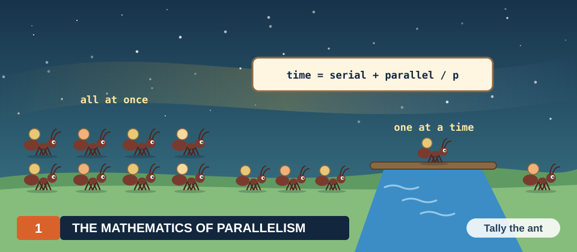

# Chapter 1: The Mathematics of Parallelism

A *parallel program* divides one computation among several processors that run at the
same time. How much sooner such a program finishes than a sequential one can be
estimated before any code is written. The estimate needs 3 things: how long each
operation takes, how much of the computation can be divided, and how many bytes each
operation reads from memory.

For several decades, programs became faster without any effort from the people who wrote
them. Each generation of microprocessors ran at a higher clock rate than the one before, and
the same sequential program finished sooner on the newer chip. That trend ended in the
mid-2000s. A higher clock rate requires more power, and the power drawn by a chip becomes heat
that must be removed from it; at clock rates of a few gigahertz, the heat reached the limit of
what a chip package and its cooling could carry away. Since then, chip designers have spent
the additional transistors of each generation on more processors per chip, and a program
becomes faster on a newer chip only if it divides its work among those processors. A GPU
contains thousands of simple arithmetic units
and depends entirely on parallel programs to keep them busy.

In this chapter we develop the quantitative tools that we use throughout the book to reason about
the performance of such programs. They do not depend on any particular machine. A
*processor* here is any unit that executes instructions: a core of a CPU, or one of the threads of a GPU, which we introduce in section 1.1.5. We begin with the time that individual
operations take and the way in which overlapping them hides that time (section 1.1). We then
ask how much faster a program can become on more processors, and find that the answer
depends on the part of it that cannot be divided (sections 1.2 to 1.5). Sections 1.6 and 1.7
classify the ways in which work divides and the machines that execute it. In section 1.8 we introduce the model that decides whether memory or arithmetic limits a computation, and we use it in later chapters to judge every kernel. Sections 1.9 and 1.10 account for
the costs that parallel execution adds: waiting at barriers, and performing more operations
than a sequential program would.

<div class="covers" markdown="1">

This chapter covers

- cycles, latency and throughput, and how they differ
- concurrency, and Little's law, which relates it to latency and throughput
- dependencies, and why independent operations can overlap
- speedup and efficiency
- Amdahl's law for a fixed computation, and Gustafson's law for a growing one
- Amdahl's law when only part of a program moves to a GPU, and the copies it needs
- strong and weak scaling
- task, data and pipeline parallelism, and Flynn's classes of machines
- arithmetic intensity and the roofline model
- the cost of a barrier
- work, steps, and why a parallel algorithm that does extra work can be slower

</div>

<figure>
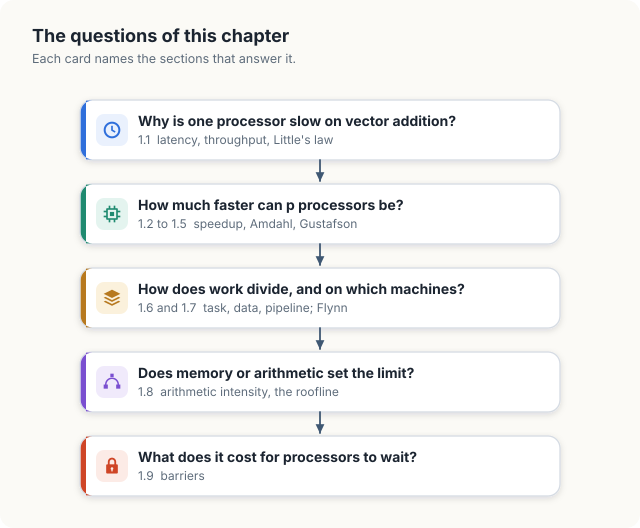
<figcaption><b>Figure 1.1</b> The questions of this chapter, and the sections that answer them.</figcaption>
</figure>

## The running example: vector addition

Most examples in this chapter use one computation, chosen because it is the simplest
computation that a parallel machine can speed up. 2 arrays of numbers, `a` and `b`, each hold
`N` entries, and a third array `c` receives their sum, entry by entry:

```text
c[i] = a[i] + b[i]      for every i from 0 to N - 1
```

For `N = 4`:

| i | a[i] | b[i] | c[i] |
|---|------|------|------|
| 0 | 0.0  | 0.0  | 0.0  |
| 1 | 1.0  | 2.0  | 3.0  |
| 2 | 2.0  | 4.0  | 6.0  |
| 3 | 3.0  | 6.0  | 9.0  |

Each entry `c[i]` is computed from `a[i]` and `b[i]` alone; no entry of `c` needs another
entry of `c`. Computations with this property are called **independent**. They give the
same result in any order, and they can therefore run at the same time on different
processors. Almost everything a GPU does well rests on this property, and much of the
difficulty of parallel programming, which later chapters address, arises in computations
that lack it.

## 1.1 Latency, throughput, and concurrency

A sequential program on a modern processor spends most of its time waiting for data, and
very little of it computing. In this section we measure that waiting and show how a machine can hide it by keeping many operations under way at once. The argument introduces 3
quantities, latency, throughput and concurrency, and one law that connects them. The same law gives the number of threads a GPU must hold, which we work out for an H100 in section 1.1.5.

### 1.1.1 Cycles

A processor performs its work in steps timed by a clock, and one tick of the clock is a
**cycle**. At a clock rate of 1 GHz there are 10<sup>9</sup> cycles per second, so a cycle
lasts 1 nanosecond; at 2 GHz it lasts half a nanosecond. We count time in cycles because
the number of cycles an operation takes changes much less from one machine to another than
its duration in nanoseconds. A processor whose clock runs twice as fast completes each
cycle in half the time, but an addition still occupies roughly the same number of cycles on
it.

### 1.1.2 Latency

The **latency** of an operation is the time from the moment it starts to the moment its
result can be used. The latencies of the 2 operations of vector addition differ by a factor of more than 100.

| Operation | Latency |
|---|---|
| add 2 numbers that are already in the processor | about 4 cycles |
| read one number from main memory | about 500 cycles |

The difference of more than 100 times comes from distance and from the kind of storage. An
addition works on values held in registers inside the processor, a short distance from the
arithmetic unit, and passes them through a few layers of logic. A read from main memory
leaves the processor, crosses the chip to a memory controller, waits in a queue behind other
requests, and travels over wires to separate memory chips. There a row of storage cells is
opened and read, and the value returns by the same route. Each of these steps is fast by
itself, but there are many of them, and the slowest, reading the storage cells, has hardly
become faster in decades.

<div class="callout note" markdown="1">

**Why is a read from main memory so slow?** Main memory is built from DRAM, dynamic
random-access memory. A DRAM chip stores each bit as a small electrical charge in a
capacitor, and connects thousands of these capacitors to each long wire, called a bit line,
that leads to a detector called a sense amplifier. To read a bit, the chip first raises a
row line that connects every cell of one row to its bit line. The small charge of the cell
then spreads over the much larger bit line and shifts its voltage by a tiny amount, and the
sense amplifier must wait until that shift is large enough to tell a 1 from a 0. Both steps
take tens of nanoseconds, which is tens to hundreds of cycles of a processor that runs at
1 to 2 GHz. The process could be made faster with larger capacitors that hold more charge.
DRAM makers have done the opposite: they have shrunk the capacitors in each generation to
fit more bits on a chip. As a result, the capacity and the bandwidth of DRAM have grown by
large factors over the decades, while its latency has changed little. In Chapter 2 we describe how DRAM delivers many bytes from each opened row, which is the property that GPUs exploit.

</div>

<div class="callout note" markdown="1">

**NOTE:** The latencies in this chapter, and the 40 TFLOP/s machine of section 1.8, are
round figures chosen to keep the arithmetic easy. They have the right order of magnitude,
and in Chapter 2 we replace them with measured values for real GPUs.

</div>

Suppose one processor computes the 4 rows of the example, one row after another, and
issues the reads of a row only after it has finished the previous row.

<div class="example" markdown="1">

Worked example: one processor, 4 rows

1. The processor requests `a[0]` and `b[0]`. The 2 reads travel together, so both values
   arrive 500 cycles later.
2. It adds them: 4 cycles.
3. It sends `c[0]` towards memory. A processor does not wait for a write to complete, so it
   moves straight on to the next row.
4. Rows 1, 2 and 3 repeat the same steps.

Each row takes 504 cycles, the 4 rows take **2,016 cycles**, and the adder is busy for
**16** of them.

</div>

<figure>
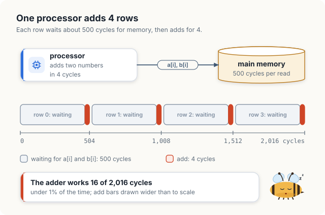
<figcaption><b>Figure 1.2</b> One processor computes 4 rows. Each row waits 500 cycles for its 2 reads, then adds for 4.</figcaption>
</figure>

It may seem that a faster adder would shorten this run. It would not: the adder accounts for
16 of the 2,016 cycles, and an infinitely fast adder could save at most those 16. The run is
long because the processor waits for each read before it asks for the next one, so the reads
take place one after another and their latencies add up. The latency of a memory read is a
property of the hardware, and the program cannot shorten it. What the program can change is
how many reads it has under way at the same time. We treat that number in sections 1.1.3 to 1.1.5.

<div class="bee bee-shocked" markdown="1">

The processor in figure 1.2 spends more than 99% of the run waiting for memory.

</div>

### 1.1.3 Throughput

The **throughput** of a system is the rate at which it completes operations: the number
of operations it completes during an interval of time, divided by the length of the
interval. Latency is a property of one operation, and throughput is a property of a
stream of operations, so the 2 answer different questions. Latency tells us how long
one result takes to arrive. Throughput tells us how many results arrive per unit of time
once a steady stream of operations is under way.

A related quantity is **bandwidth**: the maximum amount of data that a connection or an
electronic system, such as a memory system, can transfer in a given amount of time.
Bandwidth is a capacity of the hardware. Throughput is the rate that a stream of operations
actually achieves, and it can be anything up to that capacity. A memory system with a
bandwidth of 1 TB/s that receives one read at a time achieves a small fraction of it, as the
processor of figure 1.2 does. We use the bandwidth of a GPU's memory in section 1.8.

If a system worked on only one operation at a time, its throughput would follow from its
latency: with reads that take 10 cycles, it would complete one read every 10 cycles. Many
systems instead accept a new operation before the earlier ones have finished, and their
throughput can then be much higher than one operation per latency. Memory systems work
this way. A memory is divided into many independent parts, called channels and banks, and
each part can work on a different read at the same time; we describe these parts of a GPU in Chapter 2.

Consider a simplified memory system in which every read takes 10 cycles, and which
accepts a new read every 2 cycles. Figure 1.3 shows 8 reads sent to it, one every 2
cycles.

<figure>
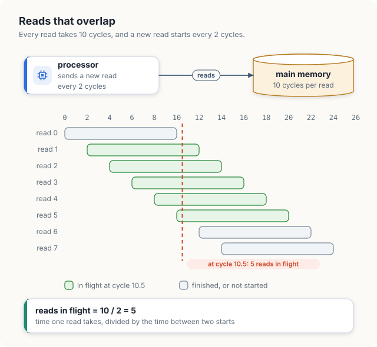
<figcaption><b>Figure 1.3</b> Reads that take 10 cycles each, started 2 cycles apart.</figcaption>
</figure>

| Read | Starts at cycle | Completes at cycle |
|---|---|---|
| 0 | 0 | 10 |
| 1 | 2 | 12 |
| 2 | 4 | 14 |
| 3 | 6 | 16 |

From cycle 10 onwards a read completes every 2 cycles, so the throughput is 0.5 reads per
cycle. Each individual read still takes 10 cycles. Starting reads in quick succession did
not make any of them faster; it made them overlap. Most optimisations in this book work the same way: they raise throughput by overlapping
operations, and leave the latency of each operation as it was.

### 1.1.4 Concurrency and Little's law

The reads that have started and not yet completed are said to be **in flight**, and their
number is the **concurrency** of the system. The dashed line in figure 1.3, at cycle
10.5, crosses reads 1 to 5, so 5 reads are in flight at that moment. A line drawn at
any later cycle, until the stream of reads ends, also crosses 5.

The count of 5 follows from the 2 rates. Each read stays in flight for 10
cycles, and while it does, a new read starts every 2 cycles, so 10 / 2 = 5 reads start
during its lifetime. When it completes, those 5 are the reads still in flight.

We write \\(L\\) for the latency (10 cycles here), \\(X\\) for the throughput (0.5 reads per
cycle) and \\(C\\) for the concurrency (5 reads). The same argument holds for any system
that runs at a steady rate:

\\[ C = X \times L \qquad\text{or equivalently}\qquad X = \frac{C}{L} \\]

This relation is **Little's law**. John Little proved it in 1961 for queues of every kind:
the average number of customers in a shop equals the rate at which they arrive multiplied by
the average time each one stays. For the reads of figure 1.3, \\(0.5 \times 10 = 5\\), the
number we counted.

The second form, \\(X = C / L\\), is the one that matters for performance. When the latency
is fixed by the hardware, the only way to raise the throughput is to raise the concurrency:
twice as many reads in flight complete twice as many reads per cycle. The law also works in
the other direction. A memory system that can deliver a certain throughput only delivers it
if the program keeps \\(X \times L\\) reads in flight; with fewer, the throughput falls in
proportion, however high the bandwidth printed on the data sheet.

<div class="bee bee-happy" markdown="1">

A latency that cannot be shortened can still be hidden, by keeping enough operations in
flight.

</div>

<details class="check">
<summary>A memory read takes 400 cycles, and the memory accepts a new read every 4 cycles. How many reads must be in flight to keep it busy?</summary>

The throughput is \\(X = 1/4\\) read per cycle and the latency \\(L = 400\\) cycles, so
\\(C = 400 / 4 = 100\\) reads.

</details>

### 1.1.5 Where the concurrency comes from

We now return to main memory, with its 500-cycle reads, and suppose that it accepts a new
read every 2 cycles. To keep it busy, Little's law asks for

\\[ C = X \times L = 0.5 \times 500 = 250 \\]

reads in flight at all times. The processor of figure 1.2 has at most 2 in flight. It
receives 2 values every 500 cycles from a memory that could have delivered 250 in the same
time (figure 1.4).

<figure>

<figcaption><b>Figure 1.4</b> The same 500-cycle read latency with 1 read in flight and with 250.</figcaption>
</figure>

The 250 reads must come from the computation, and its structure decides how many it can
offer. An operation **depends** on another when it needs that operation's result. In one
row of vector addition, the add depends on both reads and the write depends on the add. A
sequence of operations in which each depends on the one before is a **dependency
chain**, and no 2 operations of the same chain can overlap. One row is a short chain,
so it can offer at most its 2 reads at once.

The rows, however, are independent. The reads of row 7 do not need anything from row 6, so
a program can issue the reads of 125 rows before the first of them returns. A GPU does this
with threads. A **thread** is a sequence of instructions with its own **registers**, the
small storage slots inside a processor that each hold one value. A GPU runs thousands of
threads and gives each a few rows. While some threads wait for their values, others
already have theirs and keep the arithmetic units busy (animation 1).

<figure class="anim">
<video class="motion" src="../../figures/ch01-hide-latency.mp4" autoplay loop muted playsinline preload="metadata" aria-label="A chart that grows cycle by cycle from 0 to 24. Groups of threads share one arithmetic unit; each group reads for 6 cycles, then adds for 2. With 1 group the unit is busy 6 of 24 cycles. With 2 groups the unit works 4 cycles of every 8. With 4 groups, some group always has its values ready from cycle 6 on, and the unit never waits. A round takes 8 cycles and an add 2, so 8 / 2 = 4 groups keep the unit busy: Little's law." data-chapters="[[0.0, &quot;1 group&quot;], [11.64, &quot;2 groups&quot;], [26.88, &quot;4 groups&quot;], [38.52, &quot;why 4&quot;]]">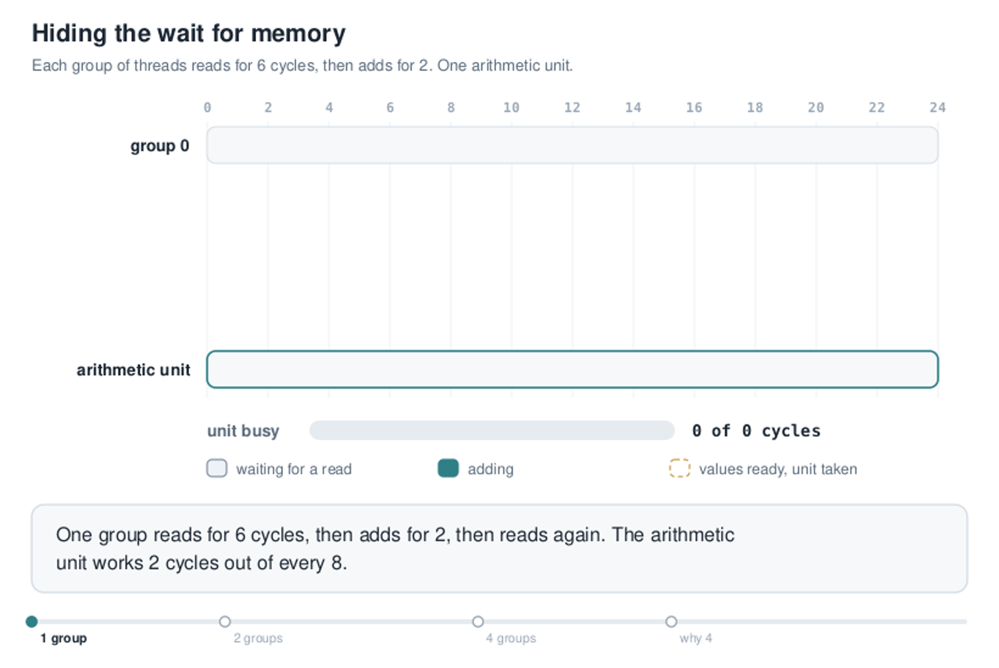</video>
<figcaption><b>Animation 1</b> Groups of threads share one arithmetic unit. Each read takes 6 cycles and each add 2. With 4 groups the unit never waits.</figcaption>
</figure>

The animation uses small numbers so that every cycle is visible. A group needs 8 cycles
for one round, a read and an add, and the unit finishes an add every 2 cycles. Little's
law gives the number of groups that keeps it busy: \\(C = 8 \times \tfrac{1}{2} = 4\\). A
GPU applies the same arithmetic with latencies of hundreds of cycles, which is why it
holds thousands of threads at once.

Applied to bytes instead of reads, the same law gives the number of threads that a real GPU needs. Little's law holds for any
unit of work, so the number of bytes that must be in flight is the bandwidth multiplied by
the latency.

<div class="example" markdown="1">

Worked example: how many threads an H100 needs for vector addition

1. The H100's memory delivers \\(X\\) = 3.35 TB/s (section 1.8).
2. A read from its memory takes about 500 cycles (section 2.6). At its clock rate of
   1.98 GHz (section 2.2), 500 cycles last 500 / (1.98 × 10<sup>9</sup>) s = 253 ns.
3. Bytes in flight: \\(C = X \times L\\) = 3.35 × 10<sup>12</sup> B/s × 253 × 10<sup>-9</sup> s
   = 848,000 bytes, about 0.85 MB.
4. One row of vector addition reads `a[i]` and `b[i]`, 8 bytes. A thread that works on one
   row at a time has 8 bytes in flight, so the memory stays busy only with
   848,000 / 8 = **106,000 threads** waiting at every moment.

</div>

An H100 can hold 132 SMs × 2,048 threads = 270,336 threads at once (section 2.9). Vector
addition needs about 40% of them in flight just to keep the memory busy. A kernel that holds
fewer threads, or gives each thread a long dependency chain, runs below the memory's
bandwidth however simple its arithmetic. A CPU core keeps only a few reads outstanding and
relies on its caches to make most reads short. The number of threads a GPU holds follows from
Little's law and the latency of DRAM.

<div class="callout note" markdown="1">

**Why not reduce the latency instead?** A CPU and a GPU read from the same kind of DRAM,
with the same latency of hundreds of cycles. They differ in what they spend chip area on. A
CPU core is designed to make one thread fast. It spends much of its area and power on large caches that
turn many slow memory reads into fast ones, and on control logic that predicts branches and
reorders instructions so that one thread rarely waits. This approach is called
**latency-oriented design**. A GPU is designed to make many threads fast in total. It spends
the same area on more arithmetic units and more memory channels, lets each operation take a
long time, and relies on other threads to fill the wait. This approach is called
**throughput-oriented design**. The choice follows from cost. Doubling the throughput of an
arithmetic unit takes a second unit, about twice the area and power. Halving its latency
requires faster circuits, which cost disproportionately more area and power. Per unit of
area and power, throughput costs less than latency, provided the program supplies the
threads. A GPU therefore performs poorly on a program with one
thread or a few, and a CPU performs poorly on a program with many; most applications that use
a GPU run their sequential parts on the CPU and their data-parallel parts on the GPU. We compare the 2 designs in hardware in section 2.1.1.

</div>

## 1.2 Speedup and efficiency

Section 1.1 made one processor faster by overlapping its reads. The other way to finish sooner is to share the work among several processors. In this section we define the 2 measures of the result. We write \\(p\\) for the number of processors,
\\(T_1\\) for the running time on one processor and \\(T_p\\) for the running time on
\\(p\\).

Consider a program with 3 phases that run in order: it reads its input for 20
microseconds (µs), computes for 100 µs and writes its result for 10 µs, so
\\(T_1 = 130\\) µs. Suppose that the compute phase can be shared evenly among any number of
processors, but that the read and the write pass through a single channel and cannot be
shared.

<div class="example" markdown="1">

Worked example: the program on 1, 2, 4 and 8 processors

| \\(p\\) | Compute (µs) | Read + write (µs) | \\(T_p\\) (µs) | Saved by the last doubling (µs) |
|---|---|---|---|---|
| 1 | 100 | 30 | 130 | |
| 2 | 50 | 30 | 80 | 50 |
| 4 | 25 | 30 | 55 | 25 |
| 8 | 12.5 | 30 | 42.5 | 12.5 |

</div>

Every doubling of the processors saves half as much time as the doubling before it,
because only the compute phase shrinks. 2 ratios describe the result. The **speedup**
compares the running times:

\\[ S(p) = \frac{T_1}{T_p} \\]

On 2 processors \\(S(2) = 130 / 80 = 1.63\\). The **efficiency** divides the speedup by
the number of processors, and so measures how much of the added capacity turned into
speed:

\\[ E(p) = \frac{S(p)}{p} \\]

| \\(p\\) | \\(T_p\\) (µs) | Speedup \\(S\\) | Efficiency \\(E\\) |
|---|---|---|---|
| 1 | 130 | 1.00 | 1.00 |
| 2 | 80 | 1.63 | 0.81 |
| 4 | 55 | 2.36 | 0.59 |
| 8 | 42.5 | 3.06 | 0.38 |

At 8 processors the efficiency has fallen to 0.38. During the 30 µs of reading and writing,
7 of the 8 processors have nothing to do, and those 30 µs are a larger share of
each shorter run. At 8 processors, 62% of the processor time paid for is idle.

The speedup is normally no greater than \\(p\\), and the efficiency no greater than 1. The
exception, **superlinear speedup**, appears when each processor's share of the data
becomes small enough to fit in its cache, a small fast memory beside the processor. Each
processor then runs faster than the single processor did, and the combined speedup can
exceed \\(p\\). The extra speed comes from the cache, so the program loses it once its data no longer
fits.

<div class="callout tip" markdown="1">

**TIP:** Report the efficiency with the speedup. A speedup of 10 sounds good until it turns
out to need 64 processors, an efficiency of 0.16.

</div>

A speedup is only as meaningful as its baseline, the run it divides by. \\(T_1\\) should be
the time of the best sequential program for the task. The parallel program run on 1
processor is a weaker baseline, because it still carries the work of dividing the data and
combining the results, so it makes \\(T_1\\) larger and the speedup look better. The same rule
applies between machines. A GPU program compared with 1 CPU core running plain loops shows a
larger speedup than the same program compared with every core of the CPU using its vector
instructions (section 1.7). Only the second comparison tells the reader whether the GPU is
worth using.

## 1.3 Amdahl's law

The table of section 1.2 showed the speedup levelling off as processors were added. In this section we explain why and give the limit a formula. In 1967 Gene Amdahl, the chief architect
of IBM's System/360, used a short argument to show that machines with many processors would
gain less than their designers hoped. Part of every program, he observed, can only be
executed by one processor at a time, and that part limits what the rest of the machine can
achieve. His argument fits in the table of section 1.2, extended to many more processors.

The **serial part** of a program is the part that only one processor can execute at a
time; the **parallel part** is the part that can be shared. In our program the read and
the write, 30 µs, are serial, and the compute phase, 100 µs, is parallel.

<div class="example" markdown="1">

Worked example: more and more processors

| \\(p\\) | Parallel part (µs) | Serial part (µs) | \\(T_p\\) (µs) | Speedup |
|---|---|---|---|---|
| 1 | 100 | 30 | 130 | 1.00 |
| 8 | 12.5 | 30 | 42.5 | 3.06 |
| 100 | 1 | 30 | 31 | 4.19 |
| 1,000 | 0.1 | 30 | 30.1 | 4.32 |
| unlimited | approaches 0 | 30 | approaches 30 | approaches 4.33 |

</div>

However many processors share the parallel part, the 30 serial microseconds remain. The
program can never run in less than 30 µs, and so never more than 130 / 30 = 4.33 times
faster than on one processor.

<figure>
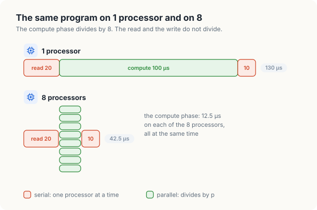
<figcaption><b>Figure 1.5</b> The program on 1 processor and on 8.</figcaption>
</figure>

To state the result for any program, let \\(f\\) be the **serial fraction**: the share of
the one-processor time that is serial. For our program \\(f = 30 / 130 = 0.23\\), and the
parallel share is \\(1 - f = 0.77\\). On \\(p\\) processors the serial part keeps its
length and the parallel part is divided by \\(p\\):

\\[ T_p = f \cdot T_1 + \frac{(1 - f) \cdot T_1}{p} \\]

For \\(p = 8\\) this is \\(30 + 100 / 8 = 42.5\\) µs, as in the table. As \\(p\\) grows,
the second term vanishes and \\(T_p\\) approaches \\(f \cdot T_1\\). The speedup therefore
approaches

\\[ S_{\max} = \frac{T_1}{f \cdot T_1} = \frac{1}{f} \\]

which is **Amdahl's law**. For our program, \\(1 / 0.23 = 4.3\\). Dividing \\(T_1\\) by
\\(T_p\\) gives the speedup on a particular number of processors:

\\[ S(p) = \frac{1}{f + \dfrac{1 - f}{p}} \\]

<div class="bee bee-shocked" markdown="1">

A program with serial fraction \\(f\\) can never run more than \\(1/f\\) times faster,
however many processors it is given.

</div>

### 1.3.1 How small the serial fraction must be

The limit rises steeply as the serial fraction falls. The table also gives the number of
processors at which a program reaches half of its limit.

| Serial fraction \\(f\\) | Limit \\(1/f\\) | Processors for half the limit |
|---|---|---|
| 0.25 | 4 | 3 |
| 0.10 | 10 | 9 |
| 0.05 | 20 | 19 |
| 0.01 | 100 | 99 |
| 0.001 | 1,000 | 999 |

The last column follows from the formula for \\(T_p\\). The speedup is half of its limit
when the shared parallel part has shrunk to the size of the serial part,
\\((1 - f)/p = f\\), that is at \\(p = 1/f - 1\\). Beyond that point each additional
processor divides an ever smaller remainder. A GPU runs thousands of threads, and a
program can only make use of them if its serial fraction is a small fraction of a percent
(figure 1.6). A program that spends 1% of its time in serial code cannot run more than 100 times faster,
on a GPU with 100 threads or with 100,000.

<figure>
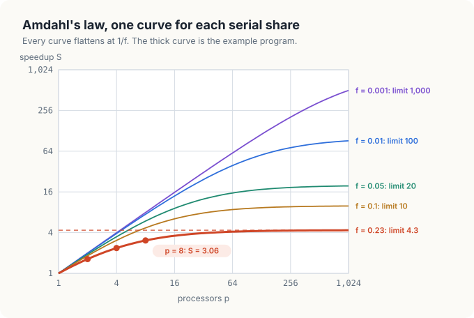
<figcaption><b>Figure 1.6</b> Amdahl's law for 5 serial fractions. Each curve flattens at its limit, 1/f.</figcaption>
</figure>

Animation 2 follows the example along its curve, then lengthens the read, which raises
\\(f\\) and lowers the limit.

<figure class="anim">
<video class="motion" src="../../figures/ch01-amdahl-multi.mp4" autoplay loop muted playsinline preload="metadata" aria-label="A log-log plot of speedup against the number of processors. 4 thin curves for serial fractions 0.001, 0.01, 0.05 and 0.10 appear in turn and flatten at their limits. A point climbs a thick f = 0.23 curve from S = 1.00 at p = 1 to S = 3.06 at p = 8, under a dashed limit of 4.3. In the last step the serial fraction rises to 0.375, the limit falls to 2.7, and the point at p = 8 falls to S = 2.2." data-chapters="[[0.0, &quot;the curves&quot;], [23.7, &quot;our run&quot;], [45.66, &quot;slow read&quot;]]">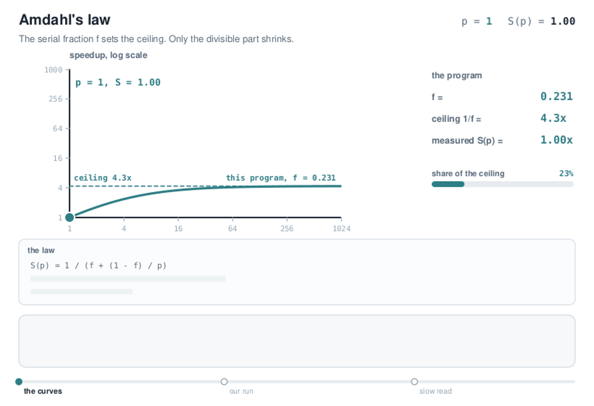</video>
<figcaption><b>Animation 2</b> The example on the f = 0.23 curve, up to 8 processors. In the last step a slower read raises f to 0.375 and lowers the limit to 2.7.</figcaption>
</figure>

<details class="check">
<summary>A program spends 5% of its one-processor time in a serial part. What is the highest speedup any number of processors can give it?</summary>

\\(f = 0.05\\), so the limit is \\(1 / 0.05 = 20\\).

</details>

### 1.3.2 Where the serial part comes from

The serial part of a real program is rarely a single phase that is easy to point to. It
includes starting the program and loading its input, combining the processors' partial
results at the end, and every step that has to wait for the one before it. It is often
larger than its author expects, and measuring it is the first step in deciding how many
processors a program can use. The serial parts of an application frequently make up most of
its source code while taking a small share of its running time. Such code usually stays on the CPU, which runs one thread quickly, and the parallel
programming effort goes into the small amount of code where the time is spent.

Amdahl's formula is also optimistic in one respect: it assumes that the parallel part
divides for free. In practice, handing out work and collecting results take time, and that
time grows with the number of processors, so measured speedup curves bend over earlier than
the formula predicts. We calculate one such cost in section 1.9.

### 1.3.3 When the parallel part has a speedup of its own

The formula for \\(T_p\\) assumes that \\(p\\) processors divide the parallel part exactly
\\(p\\) ways. A GPU program is measured differently. The serial part stays on the CPU, the
parallel part moves to the GPU, and the GPU runs that part some number of times faster. We
call that number \\(s\\). It depends on the GPU and on the part, and it is not a count of
processors. Putting \\(s\\) in place of \\(p\\) gives the speedup of the whole program:

\\[ S = \frac{1}{f + \dfrac{1 - f}{s}} \\]

<div class="example" markdown="1">

Worked example: 1 serial second and 99 parallel seconds

A program runs for 100 s on 1 CPU core: 1 s of serial work and 99 s of parallel work, so
\\(f = 0.01\\).

1. The GPU runs the parallel part 100 times faster, in 99 / 100 = 0.99 s. The program takes
   1 + 0.99 = 1.99 s, a speedup of 100 / 1.99 = **50**.
2. The parallel part is memory-bound, and the GPU runs it only 10 times faster, in 9.9 s.
   The program takes 1 + 9.9 = 10.9 s, a speedup of **9.2**.
3. The parallel part again runs 100 times faster, but its input must first be copied into
   the GPU's memory and its output copied back, which takes 2 s. The program takes
   1 + 0.99 + 2 = 3.99 s, a speedup of **25**.

</div>

<figure>
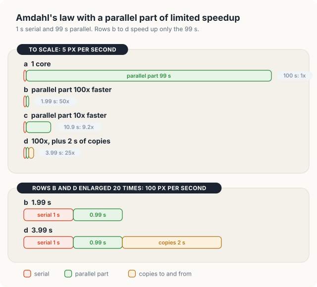
<figcaption><b>Figure 1.7</b> The 3 cases of the worked example, to scale and enlarged.</figcaption>
</figure>

In case 1 the parallel part became 100 times faster and the program only 50 times. The
serial second was 1% of the original run and is half of the new one (row b of figure 1.7).
The table of section 1.3.1 predicts this: with \\(f = 0.01\\), the speedup reaches half of its
limit of 100 when the parallel part shrinks to the size of the serial part, at \\(s = 99\\).

The factor of 10 in case 2 has a specific cause. A memory-bound part runs at the rate at which
its memory delivers bytes (section 1.8), so moving it to a GPU makes it faster by about the
ratio of the 2 memory bandwidths, whatever the GPU's arithmetic units could do. A desktop CPU
with 2 channels of DDR5-5600 memory moves 2 × 8 bytes × 5.6 × 10<sup>9</sup> per second =
89.6 GB/s. A GeForce RTX 4090 moves 1,008 GB/s, about 11 times as much. A straightforward
port of a memory-bound program to a GPU therefore often stops near a speedup of 10. Chapters 7
to 9 go beyond it by reusing each byte from on-chip memory once it has arrived, which reduces
the number of bytes the part must fetch from DRAM.

The copies of case 3 exist only because the work moved, and they behave like serial time:
the GPU's speed does not shorten them. With \\(t\\) for the copy time as a fraction of the
original run, here 2 / 100 = 0.02:

\\[ S = \frac{1}{f + \dfrac{1 - f}{s} + t} = \frac{1}{0.01 + 0.0099 + 0.02} = 25 \\]

| Symbol | Meaning | In the example |
|---|---|---|
| \\(f\\) | serial fraction of the 1-core run | 0.01 |
| \\(s\\) | speedup of the parallel part alone | 100 in cases 1 and 3, 10 in case 2 |
| \\(t\\) | copy time as a fraction of the 1-core run | 0.02 in case 3 |
| \\(S\\) | speedup of the whole program | 50, 9.2 and 25 |

In Chapter 4 we measure what copies cost and show that a GPU sharing the CPU's memory, as on a
Jetson board, can skip them. In Chapter 6 we run copies at the same time as computation, which
removes most of \\(t\\) from the formula.

<div class="bee bee-shocked" markdown="1">

A GPU speeds up only the part it runs. The serial part and the copies keep their length, and
they set the limit.

</div>

<details class="check">
<summary>The parallel part of a program is 90% of its 1-core time, and a GPU runs it 20 times faster. What is the speedup of the program, and what is its limit for a GPU of unlimited speed?</summary>

\\(S = 1 / (0.1 + 0.9 / 20) = 1 / 0.145 = 6.9\\). As \\(s\\) grows the second term vanishes,
and the limit is \\(1 / 0.1 = 10\\).

</details>

## 1.4 Gustafson's law

Amdahl's law was derived for a computation of fixed size. In this section we show that the conclusion changes when the size of the computation grows with the machine, as it usually
does in practice. For 2 decades Amdahl's law was read as a verdict against large parallel
machines. In 1988 John Gustafson and his colleagues at Sandia National Laboratories ran 3
scientific programs on a machine with 1,024 processors. They measured speedups of 1,021,
1,020 and 1,016, for programs whose serial fractions were 0.4 to 0.8 percent. By Amdahl's
formula, a serial fraction of 0.4 percent allows a speedup of about 200 on 1,024 processors.
The measured speedups were 5 times higher, and the arithmetic of both results was correct.

The 2 results answer different questions. Amdahl asked how much faster a fixed
computation runs on more processors. Gustafson's group did what users of large machines
usually do: they enlarged the problem to fill the machine, and asked how much more work
could be done in the same time. A larger machine renders a larger image, trains on a
larger batch or simulates a finer grid. In such programs the serial part, typically the
setup and the input and output, grows slowly or not at all, while the parallel part grows
with the data.

<div class="example" markdown="1">

Worked example: a computation that grows with the machine

A program runs for 10 seconds on 4 processors: 1 second in a serial part, then 9 seconds
in which all 4 processors compute.

1. On one processor, the serial second still takes 1 second.
2. The 9 parallel seconds kept 4 processors busy, which is 4 × 9 = 36 processor-seconds
   of work. One processor needs 36 seconds for it.
3. So \\(T_1 = 37\\) s and \\(T_4 = 10\\) s, a speedup of **3.7**.

On 8 processors, with twice the data, the run again takes 1 + 9 = 10 seconds, and one
processor would need 1 + 8 × 9 = 73. The speedup is **7.3**.

</div>

<figure>
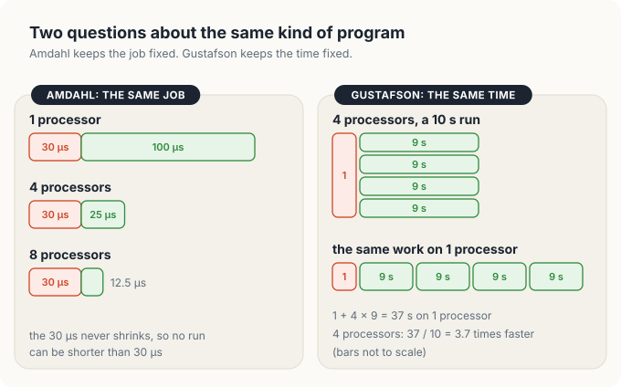
<figcaption><b>Figure 1.8</b> Left: a fixed computation on more processors. Right: a computation that grows with the number of processors.</figcaption>
</figure>

Let \\(s\\) be the serial fraction measured on the parallel run, here 1 second out of 10, so
\\(s = 0.1\\). The worked example generalises to

\\[ S(p) = s + p \cdot (1 - s) \\]

which is **Gustafson's law**. For the example, \\(0.1 + 4 \times 0.9 = 3.7\\). For the
Sandia programs, with \\(s = 0.004\\) and \\(p = 1{,}024\\), it gives 1,020, the speedup
they measured.

The 2 laws are consistent with each other. They measure the serial fraction against
different running times, and answer different questions.

| | Amdahl | Gustafson |
|---|---|---|
| Question | how much faster does the same computation run? | how much more computation fits in the same time? |
| Serial fraction measured on | the one-processor run, \\(f\\) | the parallel run, \\(s\\) |
| As processors are added | the computation stays the same | the computation grows |
| Speedup | approaches \\(1/f\\) | grows in proportion to \\(p\\) |

In the worked example the serial second is a tenth of the parallel run but only a
thirty-seventh of the one-processor run. Its share of the one-processor run keeps
falling as the problem grows. A video frame of fixed size that must be ready in 16
milliseconds is governed by Amdahl's law; a training batch that grows with the machine is
governed by Gustafson's.

## 1.5 Strong and weak scaling

The 2 laws correspond to the 2 standard ways of measuring a parallel program.
**Strong scaling** keeps the total problem fixed and adds processors; the running time
should fall, and Amdahl's law predicts where it stops falling. **Weak scaling** keeps the
problem *per processor* fixed, so the total grows with the processors; the running time
should stay the same, as Gustafson's law describes.

| Measurement | Problem size | Good result |
|---|---|---|
| strong scaling | fixed | time falls as processors are added |
| weak scaling | grows with the processors | time stays the same |

Weak scaling exposes overheads directly. Suppose that one processor handles 1,000 elements
in 1 ms, and that 16 processors are given 16,000 elements, still 1,000 each. A run of 1 ms is
perfect scaling. A run of 1.25 ms means that 0.25 ms went to distributing work, exchanging
data and waiting, costs that grow with the number of processors.

<div class="callout tip" markdown="1">

**TIP:** When you report a speedup, say whether it comes from strong or weak scaling. The
2 have different limits, so a speedup without that information cannot be checked.

</div>

## 1.6 How a computation divides

Both laws assume that the parallel part can be divided, but they say nothing about how. The
way in which a computation divides decides which machines can run it well, and 3 patterns
cover most programs.

**Task parallelism** runs different computations at the same time: one processor decodes
the next video frame while another filters the current one. Programs rarely have more than
a handful of separate tasks, so task parallelism occupies a few processors at most. In Chapter 6 we use it to overlap data transfers with computation.

**Data parallelism** runs the same computation on different parts of the data at the same
time. Vector addition is data parallel: every row runs the same instructions, and each
processor takes some of the rows. The number of parts grows with the data, which is what a
machine with thousands of processors needs. Data parallelism is also easier to reason about
than task parallelism, because every processor executes the same code, and a programmer can
understand the whole computation by understanding one part of it. GPUs are built for data
parallelism, and we use it in most of this book.

**Pipeline parallelism** splits the work on each item into stages, such as load, compute
and store, and lets different items occupy different stages at the same time, like an
assembly line. Figure 1.9 shows 4 items passing through 3 stages.

<figure>
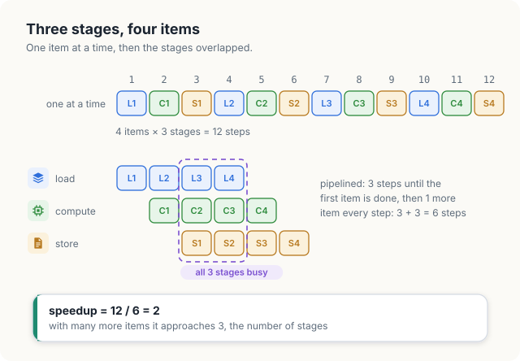
<figcaption><b>Figure 1.9</b> 4 items through 3 stages, first one item at a time, then pipelined.</figcaption>
</figure>

One item at a time, each item needs 3 steps and the 4 need 12. In the pipeline, the
first item still needs 3 steps to pass through every stage. From then on one item
leaves at every step, so the remaining 3 items need only 3 more: 6 steps in all, a speedup
of 2. In general \\(N\\) items through \\(S\\) stages take \\(S \cdot N\\) steps one at a
time and \\(S + N - 1\\) in a pipeline, a speedup of

\\[ \frac{S \cdot N}{S + N - 1} \\]

For figure 1.9, \\(3 \times 4 / 6 = 2\\). As \\(N\\) grows the speedup approaches \\(S\\),
the number of stages. A short batch spends most of its time filling and emptying the
pipeline, which is why pipelines pay off on long streams. The same arithmetic reappears in
Chapter 6, where the stages are a copy to the GPU, a kernel and a copy back.

## 1.7 Flynn's taxonomy

The patterns of section 1.6 describe programs. In this section we classify the machines that run them, by the way in which their processors receive instructions. In 1966 Michael Flynn sorted
computers by 2 counts: the number of **instruction streams** a machine follows at once, and
the number of **data streams** those instructions work on. With one or many of each there
are 4 classes. Figure 1.10 shows one computation, adding 8 pairs of numbers, on each kind of
machine.

- **SISD**, single instruction stream, single data stream: an ordinary core. Each add
  instruction adds one pair, so 8 pairs take 8 instructions in sequence.
- **SIMD**, single instruction stream, multiple data streams: a core with *vector
  registers* that hold several numbers side by side. One add instruction adds all 8 pairs.
  AVX on x86 processors and NEON on Arm processors are SIMD instruction sets.
- **MIMD**, multiple instruction streams, multiple data streams: several cores, each
  running its own program on its own data. Every multi-core CPU is a MIMD machine.
- **MISD**, multiple instruction streams, single data stream, is rare. Some fault-tolerant
  systems run the same data through different programs and compare the results.

<figure>
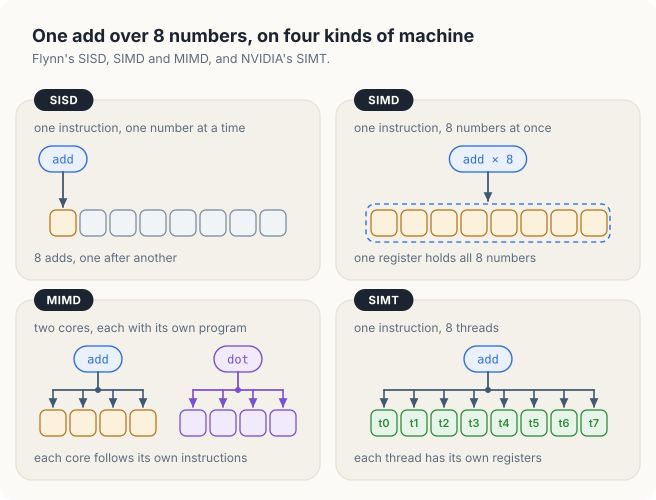
<figcaption><b>Figure 1.10</b> One add over 8 numbers on SISD, SIMD and MIMD machines, and on NVIDIA's SIMT design.</figcaption>
</figure>

A GPU fits none of the 4 exactly. NVIDIA calls its design **SIMT**, for single
instruction, multiple threads. As in SIMD, one instruction is issued to a whole group of
threads, so the cost of fetching and decoding the instruction is shared among them; this
sharing is what lets a GPU devote most of its area to arithmetic units. Unlike SIMD, every
thread has its own registers, so a programmer writes an ordinary sequential program for one thread and the hardware runs it for many. A SIMD programmer must arrange the data into
vector registers by hand; a SIMT programmer does not.

The difference becomes visible at a branch. When some threads of a group take the `if`
side and others the `else` side, the group cannot do both at once. It runs one side while
the threads of the other side wait, and then runs the other side. The program remains
correct, but the group spends time on both sides. In Chapter 2 we show how the hardware forms these groups and what such a split costs.

## 1.8 Arithmetic intensity and the roofline

The previous sections asked how many processors a program can use. In this section we ask a different question: given a machine, which of its resources limits a computation. An NVIDIA H100 can perform
67 trillion additions of 32-bit numbers per second. Given 2 long arrays to add, element by
element, it performs about 0.28 trillion, less than half of one percent of its peak. The GPU
is working correctly: its arithmetic units spend almost all of their time waiting for
numbers to arrive from memory, as the processor of section 1.1 did. Both observations follow
from one ratio, which compares the arithmetic a computation performs with the bytes it
moves.

### 1.8.1 Arithmetic intensity

A computation on arrays does 2 kinds of work: it moves bytes between main memory and the
processor, and it performs arithmetic on them. One addition or multiplication of 2
floating-point numbers is one **FLOP**, for floating-point operation. The **arithmetic
intensity** of a computation is the number of FLOPs it performs for each byte it moves:

\\[ I = \frac{\text{FLOPs performed}}{\text{bytes moved}} \\]

<div class="example" markdown="1">

Worked example: 2 intensities counted by hand

**Vector addition, one row.** The processor reads `a[i]` and `b[i]`, 4 bytes each, and
writes `c[i]`, 4 bytes: 12 bytes moved for 1 addition. \\(I = 1/12 \approx 0.08\\) FLOP
per byte.

**A 2 × 2 matrix product** \\(C = A \times B\\). Each entry of \\(C\\) is a row of \\(A\\)
multiplied by a column of \\(B\\):

```text
C[0][0] = A[0][0] × B[0][0] + A[0][1] × B[1][0]
```

Each of the 4 entries takes 2 multiplications and 2 additions, counting the addition to
the initial zero: 16 FLOPs. The 3 matrices hold 12 numbers of 4 bytes, 48 bytes.
\\(I = 16/48 = 1/3\\) FLOP per byte.

</div>

The matrix product already does 4 times as much arithmetic per byte, and the ratio
grows with the size of the matrices, because each number takes part in many products. For
2 \\(N \times N\\) matrices the same count gives \\(2N^3\\) FLOPs on \\(3N^2\\) numbers of
4 bytes:

\\[ I = \frac{2N^3}{3N^2 \times 4} = \frac{N}{6}\ \text{FLOP per byte} \\]

For \\(N = 2\\) this is the \\(1/3\\) we counted. For \\(N = 4{,}096\\) it is about 680
(figure 1.11). The number of times a byte is used after it arrives is its **reuse**.
Vector addition uses every byte once, and a large matrix product uses each one thousands
of times. The count above assumes that each number is fetched from memory only once, which a
program achieves only if it keeps the numbers close to the processor between uses; we examine whether it does in Chapter 9.

<figure>
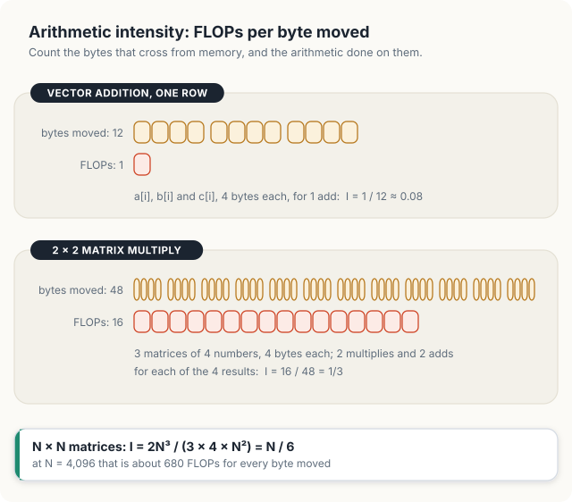
<figcaption><b>Figure 1.11</b> The bytes moved and the FLOPs performed for one row of vector addition and for a 2 × 2 matrix product.</figcaption>
</figure>

### 1.8.2 The ridge point

A machine has 2 speed limits. Its arithmetic units perform at most \\(P_{\text{peak}}\\)
FLOPs per second, and its memory delivers at most \\(B\\) bytes per second, a figure called
the **memory bandwidth**. A computation with intensity \\(I\\) performs \\(I\\) FLOPs per
byte, so memory alone lets it reach \\(I \times B\\) FLOPs per second. It runs at whichever
limit is lower:

\\[ P = \min(P_{\text{peak}},\ I \times B) \\]

<div class="example" markdown="1">

Worked example: 3 computations on a machine with 40 TFLOP/s and 1 TB/s

| Computation | \\(I\\) (FLOP/byte) | Memory allows \\(I \times B\\) | Arithmetic allows | Runs at |
|---|---|---|---|---|
| vector addition | 0.08 | 0.08 TFLOP/s | 40 TFLOP/s | **0.08 TFLOP/s** |
| matrix product, \\(N = 64\\) | 10.7 | 10.7 TFLOP/s | 40 TFLOP/s | **10.7 TFLOP/s** |
| matrix product, \\(N = 4{,}096\\) | 683 | 683 TFLOP/s | 40 TFLOP/s | **40 TFLOP/s** |

</div>

For the first 2 computations memory sets the speed. Such a computation is
**memory-bound**, and faster arithmetic units would not help it. For the third,
arithmetic sets the speed; it is **compute-bound**, and more memory bandwidth would not
help. The 2 limits are equal at the intensity

\\[ I_{\text{ridge}} = \frac{P_{\text{peak}}}{B} = \frac{40}{1} = 40\ \text{FLOP per byte} \\]

called the **ridge point** of the machine. The ridge point has a direct reading: it is the
number of FLOPs the machine can perform in the time its memory delivers 1 byte. A
computation that performs fewer FLOPs than that per byte leaves the arithmetic units idle
part of the time. Drawn on logarithmic axes, the limit \\(P\\) rises along a slope and then
runs flat, like a roof. Samuel Williams, Andrew Waterman and David Patterson introduced the
picture in 2009 and named it the **roofline** (figure 1.12).

<figure>
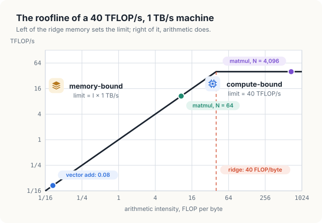
<figcaption><b>Figure 1.12</b> The roofline of a machine with 40 TFLOP/s and 1 TB/s, with the 3 computations of the worked example.</figcaption>
</figure>

The H100 delivers 3.35 TB/s from its memory, so its ridge is at 67 / 3.35 = 20 FLOP per
byte. Vector addition, at 1/12, sits far down the slope, and
\\(\tfrac{1}{12} \times 3.35 = 0.28\\) TFLOP/s is the speed quoted at the start of this
section. In section 2.1.5 we repeat the calculation for 7 current GPUs.

The roofline is an upper bound, and a program can sit well below it. The most common reason is the one of section 1.1. The memory delivers \\(B\\) bytes per second only if
enough reads are in flight to satisfy Little's law; a program that offers too few
independent reads reaches a fraction of \\(B\\), and therefore a fraction of its roof. A measured point far below the roof means that the program has too few reads in flight, or
moves
more bytes than the count of section 1.8.1 assumed.

<details class="check">
<summary>A machine performs 20 TFLOP/s and its memory delivers 0.5 TB/s. Where is its ridge point, and is a computation with an intensity of 10 FLOP per byte memory-bound on it?</summary>

The ridge is at \\(20 / 0.5 = 40\\) FLOP per byte. An intensity of 10 lies below it, so the
computation is memory-bound and runs at \\(10 \times 0.5 = 5\\) TFLOP/s.

</details>

A computation moves to the right on the roofline when each byte it loads is used more
often. In the inner loop of a straightforward matrix product, each step reads 2 numbers,
8 bytes, for 2 FLOPs, an intensity of 0.25. If a 16 × 16 block of the result is kept in
registers, every number read is used 16 times and the intensity rises to about 4. The
technique is called **tiling**, and we build it step by step in Chapter 9 (animation 3). Vector
addition offers nothing to reuse, so it can only become faster by moving its bytes more efficiently, which we treat in section 2.7 and Chapter 7.

<figure class="anim">
<video class="motion" src="../../figures/ch01-roofline.mp4" autoplay loop muted playsinline preload="metadata" aria-label="The inner loop of a matrix product on a roofline plot, one k at a time. 4 k steps move 8 values for 8 FLOPs, which sits at 0.25 FLOP per byte on the diagonal. A 16 by 16 tile in registers reuses each value 16 times and lifts the loop to about 4 FLOP per byte. The last step removes the tile and the loop falls back to the diagonal." data-chapters="[[0.0, &quot;the loop&quot;], [18.42, &quot;reuse&quot;], [37.62, &quot;no tile&quot;]]">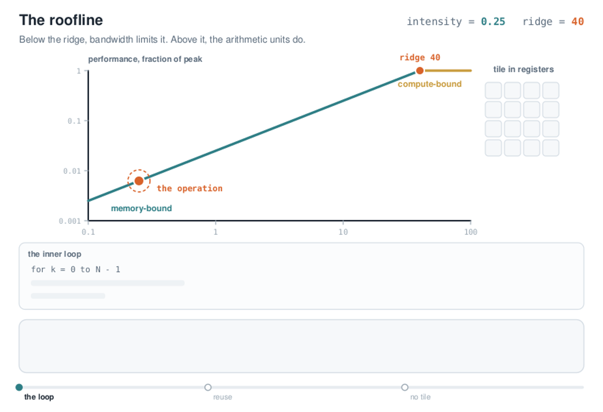</video>
<figcaption><b>Animation 3</b> The inner loop of a matrix product. Reusing a tile of values raises its intensity; removing the tile lowers it again.</figcaption>
</figure>

### 1.8.3 CPU-bound, memory-bound, and I/O-bound programs

The same words describe whole programs once a third resource is added: **input and
output** (I/O), such as a disk or a network. Whichever resource stays busy while the
others wait gives the program its name. A **CPU-bound** program, also called
compute-bound, keeps the processor busy. A **memory-bound** program keeps the memory
system busy while the processor waits for bytes. An **I/O-bound** program keeps a disk or
network link busy while the processor waits for data.

<figure>
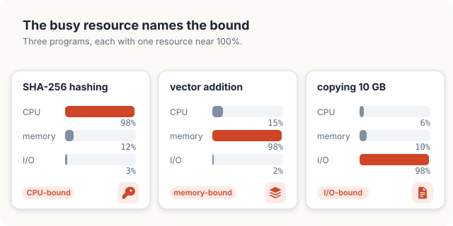
<figcaption><b>Figure 1.13</b> 3 programs, each with one resource near full use.</figcaption>
</figure>

An experiment confirms the bound: make one resource twice as fast and measure again.

| Resource made twice as fast | Running time halves? | The program is |
|---|---|---|
| processor | yes | CPU-bound |
| memory bandwidth | yes | memory-bound |
| disk or network | yes | I/O-bound |
| number of processors | no | limited by its serial part (section 1.3) |

A video encoder that spends 98% of its time computing and 2% reading frames is CPU-bound:
a faster disk changes nothing, and a processor twice as fast nearly halves its running
time. The bound of a program is the first thing to establish before optimising it, because
an optimisation aimed at a resource that is not the bound cannot help. We treat memory-bound GPU programs in Chapter 7, compute-bound ones in Chapter 9 and programs that wait for data transfers in Chapter 6. In Chapter 16 we show how a profiler measures the bound instead of guessing it.

## 1.9 The cost of synchronization

The laws of sections 1.3 and 1.4 treat the parallel part as if each processor worked alone
from start to finish. Real parallel computations must also coordinate. Many of them end by
combining the results of their processors, for example by adding partial sums, and the
results cannot be combined until every processor has finished. The usual mechanism is a
**barrier**: a point in the program at which each processor stops until all the others have
reached it. We show how barriers are built in Chapter 5; here we calculate what they cost.

If 4 processors each perform 1,000 cycles of work and then spend 100 cycles at a
barrier, each works for 1,000 of every 1,100 cycles, an efficiency of 0.91. Work is
rarely divided that evenly.

<figure>
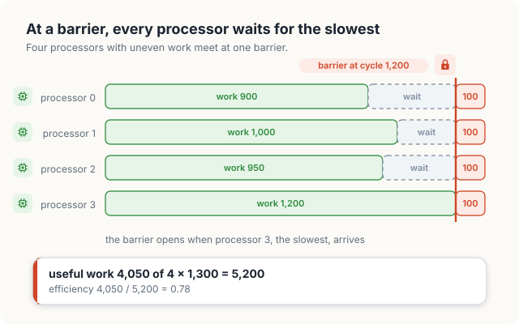
<figcaption><b>Figure 1.14</b> 4 processors with uneven work meet at a barrier.</figcaption>
</figure>

<div class="example" markdown="1">

Worked example: uneven work at a barrier

1. The processors have 900, 1,000, 950 and 1,200 cycles of work.
2. The barrier opens at cycle 1,200, when processor 3 arrives; the other 3 stand idle
   until then.
3. Useful work: 900 + 1,000 + 950 + 1,200 = 4,050 processor-cycles.
4. Time paid for: 4 processors × (1,200 + 100) cycles = 5,200 processor-cycles.
5. Efficiency: 4,050 / 5,200 = **0.78**.

</div>

A barrier makes every processor finish at the pace of the slowest. The amount of work each
processor receives often depends on the input data, for example on the number of non-zero
entries in its part of a sparse matrix, so the same program can scale well on one input and
poorly on another. A barrier also has a cost that the figure does not show. A value written
by one processor does not become visible to the others instantly. A barrier has to wait until
all such writes are visible, which is part of why it takes 100 cycles and not 1.

The idle time and the barrier itself behave like serial time, since adding processors
shortens neither. Under strong scaling each processor's share of the work shrinks while the
barrier stays the same, so the barrier takes a growing share of each run and Amdahl's
limit falls.

<div class="bee bee-cute" markdown="1">

Fast parallel programs meet as rarely as they can: each processor writes its own partial
result, and the results are combined once, at the end.

</div>

In Chapter 8 we apply this to the sum of \\(N\\) numbers and reduce the number of barriers from
about \\(\log_2 N\\) to a small constant.

## 1.10 Work, steps and work efficiency

The laws of this chapter compare a parallel program with a sequential one as if both
performed the same operations. That assumption often fails. Many parallel algorithms perform
more operations than the best sequential algorithm, and for large inputs the extra operations
can make them slower than the program they replace. In this section we measure a parallel algorithm by 2 counts that expose the problem, and derive bounds on its running time from
them.

Section 1.1.5 showed that the operations of a dependency chain cannot overlap. The 2 counts
turn that observation into numbers. The **work** \\(W\\) of an algorithm is the number of
operations it performs. Its **steps** \\(D\\), also called its depth or span, is the number of
operations in its longest dependency chain. We use the same 2 counts for sums in Chapter 8. In
this section we count time in units of 1 operation, and assume that every operation takes 1
unit.

<div class="example" markdown="1">

Worked example: 3 computations on the entries of c

The running example produced \\(c\\) = 0, 3, 6, 9.

1. Vector addition itself: 4 additions, and none needs the result of another. \\(W = 4\\),
   \\(D = 1\\).
2. The sum of \\(c\\), from left to right: 0 + 3 = 3, then 3 + 6 = 9, then 9 + 9 = 18. Each
   addition needs the one before. \\(W = 3\\), \\(D = 3\\).
3. The same sum in pairs: 0 + 3 = 3 and 6 + 9 = 15 are independent, then 3 + 15 = 18.
   \\(W = 3\\), \\(D = 2\\).

</div>

On \\(p\\) processors, at most \\(p\\) operations complete in each unit of time, so the run
takes at least \\(W / p\\) units. It also takes at least \\(D\\) units, because the operations
of the longest chain run one after another however many processors are free. Both limits
hold at once:

\\[ T_p \ge \max\left(\frac{W}{p},\ D\right) \\]

In 1974 Richard Brent showed that the operations can always be scheduled so that the run is
not much longer than this bound:

\\[ T_p \le \frac{W}{p} + D \\]

For the sum in pairs on 2 processors, the bounds give \\(\max(1.5,\ 2) = 2\\) and
\\(1.5 + 2 = 3.5\\) units. The run takes 2: both first additions in the first unit, the last
addition in the second.

The ratio \\(W / D\\) is the **parallelism** of the algorithm: the average number of
operations available per unit of time. Up to about \\(W / D\\) processors, the \\(W / p\\)
term dominates and each added processor shortens the run. Beyond it, \\(D\\) dominates and
added processors wait. Vector addition of \\(N\\) entries has parallelism \\(N / 1 = N\\). A
chain has parallelism 1, which is why exercise 8 finds no gain from more processors. A sum in
pairs of \\(2^{20}\\) = 1,048,576 values has \\(W\\) = 1,048,575 and \\(D = 20\\), a parallelism
of about 52,000.

| Symbol | Meaning | In the example |
|---|---|---|
| \\(W\\) | work: operations performed | 3 for the sum of \\(c\\) |
| \\(D\\) | steps: operations on the longest chain | 3 left to right, 2 in pairs |
| \\(p\\) | processors | 2 |
| \\(W / D\\) | parallelism | 1 left to right, 1.5 in pairs |

A parallel algorithm is **work-efficient** when its work is within a constant factor of the
work of the best sequential algorithm for the same task. Many parallel algorithms buy fewer
steps with more work, and the bounds show what that costs.

A **scan**, or running sum, replaces each entry by the sum of all entries up to it. The scan
of \\(c\\) = 0, 3, 6, 9 is 0, 3, 9, 18. A scan appears to be inherently sequential, since
each output needs the one before it, yet it can be computed in parallel by algorithms that
perform extra additions. A sequential scan of \\(N\\) values performs \\(N - 1\\) additions,
each needing the one before: \\(W = D = N - 1\\). 2 parallel scans appear in Chapter 8.

- The **shifted scan** (section 8.7.2) runs rounds at offsets 1, 2, 4, up to \\(N / 2\\). In
  the round at offset \\(d\\), every entry from position \\(d\\) on adds the entry \\(d\\)
  places to its left. On \\(c\\), offset 1 gives 0, 3, 9, 15 with 3 additions, and offset 2
  gives 0, 3, 9, 18 with 2 more: \\(W = 5\\), \\(D = 2\\). In general
  \\(W = N \log_2 N - (N - 1)\\) and \\(D = \log_2 N\\).
- The **tree scan**, due to Guy Blelloch, adds pairs up a tree and then passes the partial
  sums back down it. It has \\(W = 2(N - 1)\\) and \\(D = 2 \log_2 N\\).

<div class="example" markdown="1">

Worked example: 3 scans of 1,024 values

With \\(N = 1{,}024 = 2^{10}\\), the shifted scan performs 1,024 × 10 − 1,023 = 9,217
additions, 9 times the sequential 1,023. The table gives the lower bound \\(\max(W / p, D)\\)
in units of 1 addition.

| Scan | \\(W\\) | \\(D\\) | \\(p = 4\\) | \\(p = 32\\) | \\(p = 1{,}024\\) |
|---|---|---|---|---|---|
| sequential | 1,023 | 1,023 | 1,023 | 1,023 | 1,023 |
| tree | 2,046 | 20 | 511.5 | 63.9 | 20 |
| shifted | 9,217 | 10 | 2,304 | 288 | 10 |

</div>

On 4 processors the shifted scan needs at least 2,304 units, more than twice the sequential
scan. Its extra work needs more than 9,217 / 1,023 = 9.01 processors before it can even break
even, and the ratio grows with \\(N\\): for a scan of \\(2^{20}\\) values it is about 19. The
tree scan breaks even at 2 processors whatever the size. On 1,024 processors the order
reverses: each scan has processors to spare for its work, the steps decide, and the shifted
scan's 10 beat the tree scan's 20 (figure 1.15).

<figure>
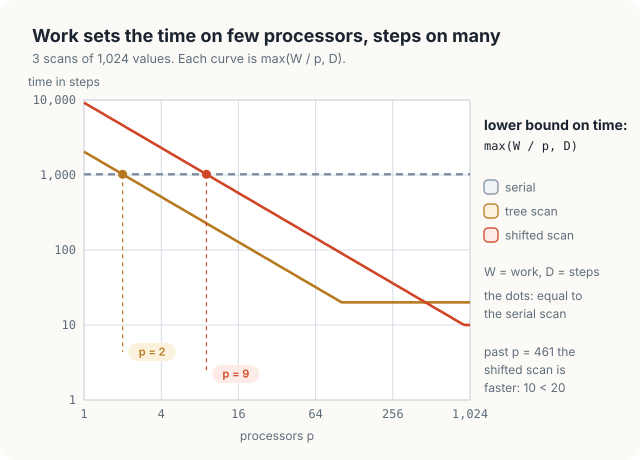
<figcaption><b>Figure 1.15</b> The lower bound \(\max(W/p, D)\) for 3 scans of 1,024 values.</figcaption>
</figure>

Neither scan is better in general; the choice depends on how many processors the scan
actually has. A warp of 32 GPU threads executes every step of the shifted scan together,
whether a thread adds or not, so its extra work costs no time there, and for that reason we use the shifted scan inside a warp in section 8.7.2. Across a whole block, each step usually ends
at a barrier. \\(D\\) then counts barriers too, and the price of each is calculated in section 1.9.

<div class="bee bee-happy" markdown="1">

Work decides the running time on few processors, and steps decide it on many. Count both
before choosing a parallel algorithm.

</div>

<details class="check">
<summary>An algorithm has \(W = 10^6\) and \(D = 10^3\). Between which times does it run on 100 processors, and on 10,000?</summary>

On 100 processors, \\(\max(10^4, 10^3) = 10{,}000\\) units at least and
\\(10^4 + 10^3 = 11{,}000\\) at most. On 10,000 processors, \\(\max(100, 1{,}000) = 1{,}000\\)
and \\(100 + 1{,}000 = 1{,}100\\). The parallelism is \\(10^6 / 10^3 = 1{,}000\\), so the
processors beyond about 1,000 wait.

</details>

<div class="summary" markdown="1">

## Summary

- **Latency** is the time one operation takes; **throughput** is the number of operations
  completed per unit of time. **Little's law**, \\(C = X \times L\\), gives the concurrency
  needed to reach a throughput when the latency is fixed.
- Operations in a **dependency chain** cannot overlap. Independent operations can, and
  they supply the concurrency that hides memory latency. A CPU is designed to shorten
  latency, a GPU to hide it.
- **Speedup** is \\(T_1 / T_p\\) and **efficiency** is \\(S / p\\). Measure every speedup
  against the best sequential program.
- **Amdahl's law**: a fixed computation with serial fraction \\(f\\) runs at most \\(1/f\\)
  times faster on any number of processors.
- A GPU runs the parallel part \\(s\\) times faster, and copies take a fraction \\(t\\) of
  the original run. The program's speedup is \\(1 / (f + (1 - f)/s + t)\\).
- **Gustafson's law**: a computation that grows with the machine has a speedup of
  \\(s + p(1 - s)\\).
- **Strong scaling** fixes the total problem; **weak scaling** fixes the problem per
  processor.
- Computations divide by task, by data, or into pipeline stages. GPUs are built for data
  parallelism.
- **Flynn's taxonomy** classifies machines as SISD, SIMD, MISD or MIMD. A GPU uses
  **SIMT**: one instruction issued to a group of threads that each have their own
  registers.
- **Arithmetic intensity**, FLOPs per byte, compared with the machine's **ridge point**,
  shows whether memory or arithmetic limits a computation. The roofline is reached only with
  enough reads in flight.
- A **barrier** costs the wait for the slowest processor plus the barrier itself.
- **Work** \\(W\\) counts operations and **steps** \\(D\\) the longest chain;
  \\(\max(W/p, D) \le T_p \le W/p + D\\). A **work-efficient** parallel algorithm does no more
  than a constant factor of the sequential work.

</div>

In Chapter 2 we describe the organisation of the GPU: how its processors are arranged, how it keeps hundreds of memory reads in flight, and where the ridge points of current GPUs lie.

## Exercises

1. A memory read has a latency of 600 cycles, and the memory accepts a new read every 3
   cycles. How many reads must be in flight to reach its highest throughput?
2. A program takes 10.0 s on one processor, 5.5 s on 2 and 4.0 s on 4. Compute the
   speedup and efficiency for each number of processors.
3. A program spends 10 µs reading its input, 100 µs computing and 10 µs writing its output,
   and only the computing can be shared. Compute the serial fraction and Amdahl's limit.
4. The same program grows its problem with the number of processors, so that the serial
   fraction of the parallel run falls to 0.001. Estimate the speedup on 1,000 processors.
5. Using Amdahl's formula, what speedup would the Sandia programs of section 1.4, with a
   serial fraction of 0.8 percent, reach on 1,024 processors? What does Gustafson's law
   give?
6. An \\(N \times N\\) matrix product has an intensity of \\(N/6\\) FLOP per byte. For which
   \\(N\\) does it reach a ridge point of 40 FLOP per byte?
7. A program downloads 10 GB over a network at 2 GB/s and compresses it on the CPU at 20
   GB/s. Estimate the fraction of the time the CPU is busy and name the bound. Which change
   shortens the run more: a CPU twice as fast, or a network twice as fast?
8. Explain why a program whose operations form one long dependency chain gains nothing
   from more processors.
9. Name the class of each machine: one ordinary core; one vector instruction that adds 8
   pairs; 4 cores, each running its own program; one instruction issued to many
   threads. Which of these is not one of Flynn's classes?
10. In figure 1.14, the work of processor 3 falls from 1,200 to 1,000 cycles. Compute the
    efficiency.
11. A program spends 5% of its 1-core time in a serial part, and a GPU runs the rest 40 times
    faster. Compute the speedup with no copies, and with copies that take 3% of the 1-core
    time.
12. Count \\(W\\) and \\(D\\) for the shifted scan and the tree scan of 8 values. On how many
    processors does each first match the sequential scan's 7 units?
13. A report compares a GPU kernel with the same parallel code run on 1 CPU thread. Explain
    why the speedup it quotes is larger than the speedup over the best sequential program.
14. A memory system has a bandwidth of 1 TB/s and a read latency of 500 ns. Each read returns
    32 bytes. How many reads must be in flight for a program to reach the bandwidth, and what
    fraction of it does a program reach with 1,000 reads in flight?

## Sources and further reading

- Gene M. Amdahl, "Validity of the Single Processor Approach to Achieving Large-Scale
  Computing Capabilities," AFIPS Conference Proceedings 30, 1967.
- John L. Gustafson, "Reevaluating Amdahl's Law," Communications of the ACM 31(5), 1988.
- John L. Gustafson, Gary R. Montry and Robert E. Benner, "Development of Parallel Methods
  for a 1024-Processor Hypercube," SIAM Journal on Scientific and Statistical Computing
  9(4), 1988.
- John D. C. Little, "A Proof for the Queuing Formula: L = λW," Operations Research 9(3),
  1961.
- Michael J. Flynn, "Very High-Speed Computing Systems," Proceedings of the IEEE 54(12),
  1966.
- Samuel Williams, Andrew Waterman and David Patterson, "Roofline: An Insightful Visual
  Performance Model for Multicore Architectures," Communications of the ACM 52(4), 2009.
- NVIDIA, *H100 Tensor Core GPU* datasheet, for the 67 TFLOP/s and 3.35 TB/s of the SXM
  part.
- NVIDIA, *GeForce RTX 4090* specifications, for the 1,008 GB/s of section 1.3.3.
- Richard P. Brent, "The Parallel Evaluation of General Arithmetic Expressions," Journal of
  the ACM 21(2), 1974.
- Guy E. Blelloch, "Programming Parallel Algorithms," Communications of the ACM 39(3), 1996,
  for work and depth as a way to compare parallel algorithms.
