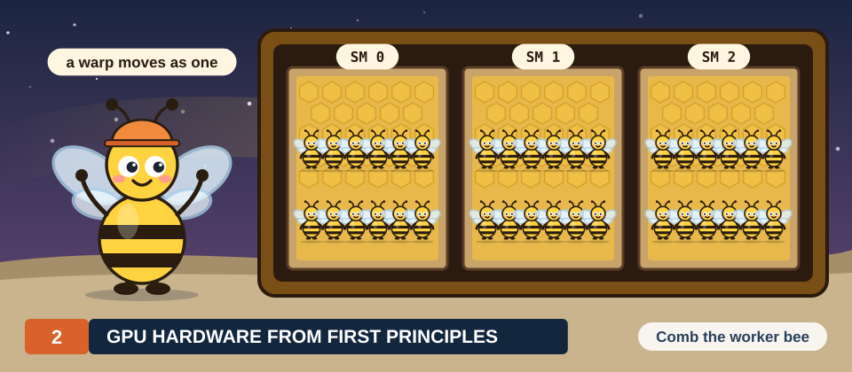

# Chapter 2: GPU Hardware from First Principles

A *graphics processing unit*, or GPU, is a processor built for data parallelism: it runs
the same instructions on a very large number of data elements at the same time. Chapter 1
showed that a processor reading from main memory waits hundreds of cycles for every value,
and that the wait can be hidden only by keeping many independent operations in flight. A
GPU is designed around that observation. Its parts, and the rules that decide how fast a
program runs on them, are the subject of this chapter.

This chapter covers

- kernels, threads, blocks and grids: how work is handed to a GPU
- the parts of a GPU, from the whole chip down to a single thread
- the streaming multiprocessor (SM) and its schedulers
- the warp, a group of 32 threads that carry out each instruction together, and what
  happens when its threads take different sides of a branch
- how a block is divided into warps
- the memory hierarchy, from registers to the CPU's memory
- coalescing: why neighbouring threads should read neighbouring addresses
- shared-memory banks and bank conflicts
- occupancy, and how switching between warps hides memory latency

## 2.1 The GPU at a glance

### 2.1.1 How a CPU and a GPU deal with memory latency

A CPU and a GPU handle the long wait for memory in opposite ways (figure 2.1).

A CPU core runs 1 sequence of instructions as fast as possible, and spends much of its chip
area on avoiding waits. Large **caches**, small fast memories near a core that keep copies
of recently used data, answer most reads without a trip to main memory. Prediction logic
starts likely next instructions early. A desktop CPU has 4 to 32 such cores.

A GPU accepts that a read from main memory takes hundreds of cycles. It spends its area on
thousands of simple arithmetic units and on room for tens of thousands of threads. A
**thread**, as in Chapter 1, is 1 sequence of instructions with its own working values.
While some threads wait for memory, others compute. In Chapter 1's terms, a CPU core is
built for low latency and a GPU for high throughput.

<figure>
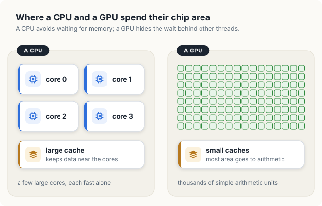
<figcaption><b>Figure 2.1</b> A CPU spends its chip on a few fast cores and large caches; a GPU on many simple arithmetic units.</figcaption>
</figure>

### 2.1.2 Kernels, threads, blocks and grids

A few terms describe how a program hands work to a GPU (figure 2.2).

- A **kernel** is a function that runs on the GPU.
- A **launch** starts a kernel from a program on the CPU. The GPU then runs many copies of
  the kernel at once.
- Each copy is 1 **thread**. A thread keeps its working values in **registers**, small
  storage slots inside a processor that each hold 1 value. Each thread also receives its own
  number, its **index**, and uses it to pick its share of the work.
- Threads are grouped into **blocks** of equal size. Threads of 1 block run on the same
  part of the GPU, so they can share fast memory and wait for each other.
- All blocks of 1 launch form the **grid**.

<figure>
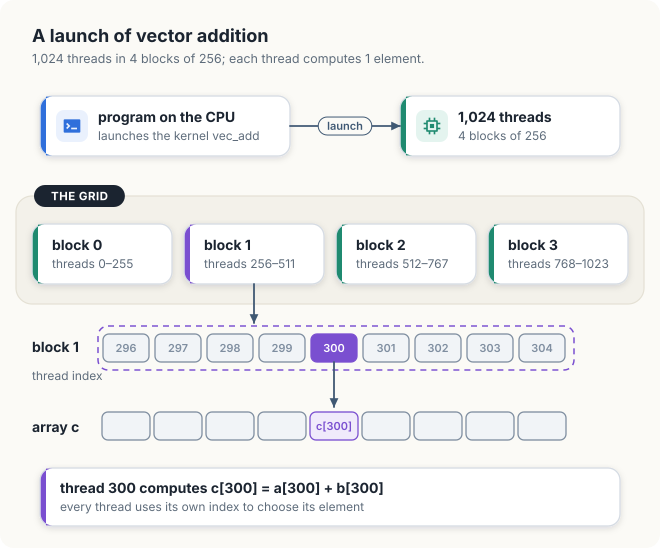
<figcaption><b>Figure 2.2</b> A launch of vector addition: 1,024 threads in 4 blocks of 256. Thread 300 lies in block 1 and computes <code>c[300]</code>.</figcaption>
</figure>

For vector addition with N = 1,024, every element needs 1 thread, so the launch needs 1,024
threads. A block holds 256 of them, so the grid needs 1,024 ÷ 256 = 4 blocks.

A thread finds its element through its index. Inside its block, each thread has a
**position**, numbered from 0. Block 0 has positions 0 to 255, and so does block 1, so a
position alone cannot tell a thread which element is its own. The blocks before a thread's
block hold 256 threads each, and its index counts them first:

\\[ \text{index} = \text{block number} \times \text{block size} + \text{position} \\]

Thread 300 is at position 44 of block 1, and 1 × 256 + 44 = 300 (figure 2.3). Going the other
way, 300 ÷ 256 = 1 with remainder 44 gives back its block and its position. Each thread
computes `c[index]`, so the 1,024 threads cover the 1,024 elements once each, and no 2
threads write the same element.

<figure>
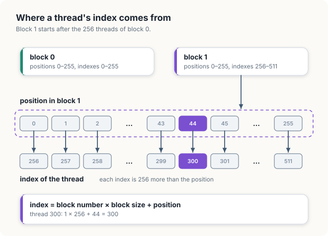
<figcaption><b>Figure 2.3</b> A thread's index is its block's starting index plus its position in the block.</figcaption>
</figure>

Chapter 3 shows how a kernel reads its block number and position in code, and how blocks and
grids can also be laid out in 2 or 3 dimensions, which suits images and volumes. The rest of
this chapter describes where blocks and threads run.

### 2.1.3 From the chip to one thread

A GPU is built in levels, each made of copies of the next (figure 2.4).

<figure>
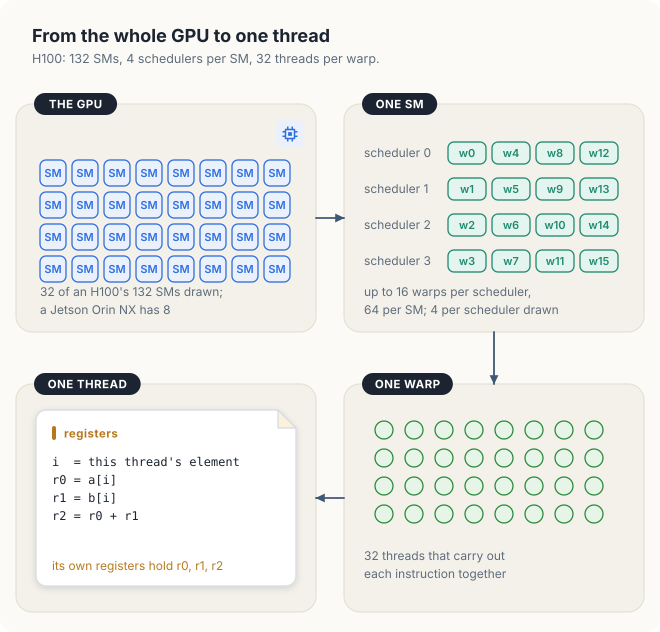
<figcaption><b>Figure 2.4</b> From the whole GPU down to 1 thread.</figcaption>
</figure>

1. Most of a GPU chip is a set of identical units called **streaming multiprocessors**, or
   **SMs**: 8 on a Jetson Orin NX, 132 on an H100 (section 2.1.4). Each block of a launch
   runs on 1 SM.
2. An SM holds threads of several blocks at once. It has 4 **schedulers**, units that choose
   in every cycle which instruction runs next (section 2.2).
3. An SM runs threads in groups of 32 called **warps**. The 32 threads of a warp carry out
   each instruction together (section 2.3).
4. Each thread has its own registers for its working values.

### 2.1.4 GPUs in numbers

GPUs are built in very different sizes, from boards for robots to cards for data centres,
and they share the design of this chapter. The table compares 7 of them. The **compute
capability**, CC in the table, is NVIDIA's version number for each generation of the
design (section 2.11).

| GPU | Kind | CC | SMs | Memory | Bandwidth | FP32 peak |
|---|---|---|---|---|---|---|
| Jetson Orin NX 16 GB | embedded | 8.7 | 8 | 16 GB, shared | 102 GB/s | 2.4 TFLOP/s |
| Jetson AGX Thor | embedded | 11.0 | 20 | 128 GB, shared | 273 GB/s | 8.1 TFLOP/s |
| DGX Spark (GB10) | desktop AI | 12.1 | 48 | 128 GB, shared | 273 GB/s | ~31 TFLOP/s |
| GeForce RTX 4090 | desktop card | 8.9 | 128 | 24 GB | 1,008 GB/s | 82.6 TFLOP/s |
| GeForce RTX 5090 | desktop card | 12.0 | 170 | 32 GB | 1,792 GB/s | 104.8 TFLOP/s |
| A100 SXM 80 GB | data centre | 8.0 | 108 | 80 GB | 2,039 GB/s | 19.5 TFLOP/s |
| H100 SXM | data centre | 9.0 | 132 | 80 GB | 3,350 GB/s | 67 TFLOP/s |

CC is the compute capability, and "shared" marks memory that the GPU shares with the CPU.
The figures are NVIDIA's published specifications, with peak arithmetic at the highest
clock rate. The SM counts of the Thor and the DGX Spark follow from their published numbers
of arithmetic units, 2,560 and 6,144, at 128 units per SM. The Orin NX figures were also
read from a board with `cudaGetDeviceProperties`, a CUDA function that Chapter 3
introduces.

The memory column shows 2 kinds of system. The Jetson modules and the DGX Spark are
**integrated**: the CPU and the GPU share one set of memory chips. The graphics cards and
data-centre GPUs are **discrete**: the GPU has memory chips of its own, beside it on the
card, and data moves to it from the CPU's memory over a link (Chapter 4).

### 2.1.5 The ridge point of each GPU

Chapter 1 defined the **ridge point** of a machine as its peak arithmetic divided by its
memory bandwidth: the arithmetic intensity at which a computation stops being limited by
memory. For the H100,

\\[ \frac{67 \times 10^{12}\ \text{FLOP/s}}{3.35 \times 10^{12}\ \text{B/s}} = 20\ \text{FLOP per byte} \\]

Dividing FLOPs per second by bytes per second leaves FLOPs per byte. The result has a
direct meaning: in the time an H100's memory delivers 1 byte, its arithmetic units can
perform 20 FLOPs. A kernel that performs fewer than 20 FLOPs on each byte it reads leaves
those units waiting for data. The same division for the other GPUs of the table gives very
different values.

| GPU | Ridge point (FLOP per byte) |
|---|---|
| A100 SXM 80 GB | 19.5 / 2.039 ≈ 10 |
| H100 SXM | 67 / 3.35 = 20 |
| Jetson Orin NX 16 GB | 2.4 / 0.102 ≈ 24 |
| Jetson AGX Thor | 8.1 / 0.273 ≈ 30 |
| GeForce RTX 5090 | 104.8 / 1.792 ≈ 58 |
| GeForce RTX 4090 | 82.6 / 1.008 ≈ 82 |
| DGX Spark (GB10) | 31 / 0.273 ≈ 114 |

The data-centre GPUs have the lowest ridge points, because their memory, stacked beside the
GPU chip, delivers several terabytes per second. The graphics cards and the DGX Spark have
far more arithmetic for each byte of bandwidth, so a kernel needs more reuse to reach their
peak. A kernel that is compute-bound on an A100 can be memory-bound on an RTX 4090.

Vector addition, at 1/12 of a FLOP per byte, is memory-bound on every GPU in the table.

## 2.2 The streaming multiprocessor

Every thread of a launch runs on an SM. Figure 2.5 shows the parts of 1 SM of an H100.

<figure>
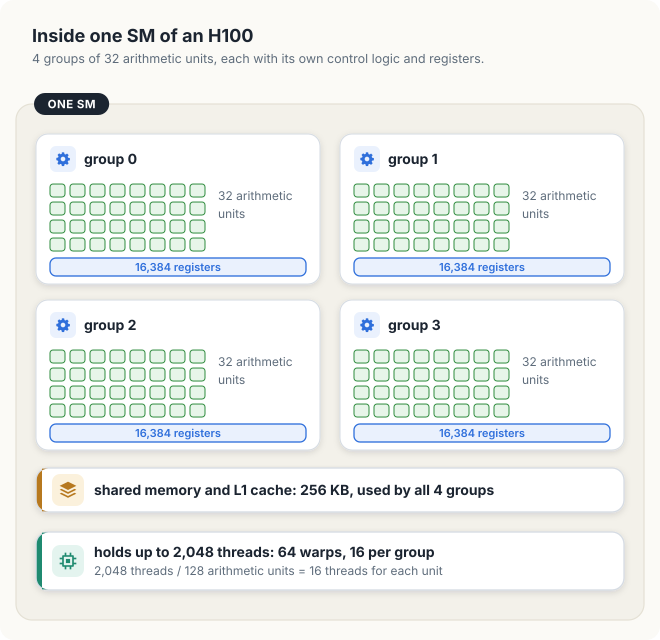
<figcaption><b>Figure 2.5</b> Inside 1 SM of an H100: 4 groups of 32 arithmetic units, each with a scheduler and 16,384 registers, above a shared pool of fast memory.</figcaption>
</figure>

- **Arithmetic units.** 4 groups of 32 units for 32-bit floating-point numbers, 128 per SM,
  often called *CUDA cores*. A group has 32 units because a warp has 32 lanes (section 2.3):
  1 instruction keeps a whole group busy. Each unit performs 1 **fused multiply-add** per cycle: it
  computes \\(a \times b + c\\) in 1 step, which counts as 2 FLOPs.
- **Schedulers.** Each group has 1 scheduler. In every cycle a scheduler picks 1 warp whose
  next instruction is ready and sends that instruction to its 32 units.
- **Registers.** 65,536 registers of 4 bytes each, 65,536 × 4 = 262,144 bytes or 256 KB,
  split into 4 parts of 65,536 ÷ 4 = 16,384, 1 per group. Each
  thread on the SM gets its own registers from this file. Section 2.9 shows how the
  registers a thread needs limit the number of threads that fit.
- **Shared memory and L1 cache.** 1 pool of 256 KB serves 2 purposes. **Shared memory** is
  memory that all threads of a block can read and write, so threads of a block exchange
  data through it. The **L1 cache** keeps copies of data the SM has read from main memory.
  On an H100, up to 228 KB of the pool can serve as shared memory.
- **Other units.** Units for integer arithmetic; **special function units**, which compute
  fast approximations of `sin`, `cos`, `exp` and square roots; and **tensor cores**, which
  multiply small matrices in 1 operation (Chapter 11).

Peak arithmetic follows from these parts. Each unit completes 1 fused multiply-add, 2 FLOPs,
per cycle, and the clock rate counts cycles per second, so peak FLOPs per second = 2 × number
of units × clock rate. For an H100, 2 × 132 SMs × 128 units × 1.98 GHz = 67 TFLOP/s. For an RTX 4090, 2 × 128 × 128 ×
2.52 GHz = 82.6 TFLOP/s.

**NOTE:** SMs of other generations differ in detail. An A100 SM has 64 units for 32-bit
floating-point numbers, not 128. The number of threads and blocks an SM can hold, and its
shared memory, depend on the compute capability; section 2.9 lists them.

## 2.3 The warp

### 2.3.1 One instruction, 32 lanes

A **warp** is a group of 32 threads that an SM schedules as 1 unit. A scheduler issues 1
instruction to a warp, and all 32 threads carry it out in the same cycle, each on values in
its own registers. The 32 positions in a warp are its **lanes**: lane 0 holds the warp's
first thread, lane 1 the next, and so on.

<figure>
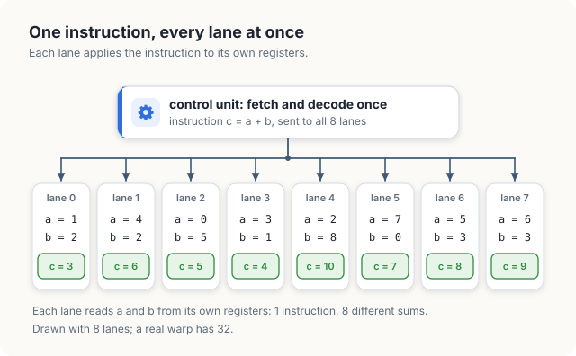
<figcaption><b>Figure 2.6</b> One instruction reaches every lane of a warp. Each lane has its own values, so one step gives one answer per lane.</figcaption>
</figure>

Figure 2.6 draws 8 lanes instead of 32, to keep the values readable. A single instruction,
`c = a + b`, gives 8 different results, because each lane holds its own `a` and `b`. Chapter
1 called this design SIMT (section 1.7).

Grouping threads saves chip area. Fetching and decoding an instruction costs the same for 1
thread as for 32, so a warp shares that cost among 32 threads and leaves more area for
arithmetic units.

### 2.3.2 Why 32

NVIDIA GPUs have used warps of 32 threads since the first CUDA GPUs. The size balances 3
effects:

- A wider warp shares each instruction's cost among more threads.
- 32 threads reading 4 bytes each read 128 bytes, the size of 1 cache line. Section 2.7
  shows why this match helps.
- A wider warp loses more when its threads need to do different things (section 2.3.3).

### 2.3.3 Divergence

All lanes of a warp carry out the same instruction. An `if` can send some threads of a warp
one way and the rest the other way, and a warp cannot run both sides at once. It runs them
in turn (figure 2.7).

<figure>
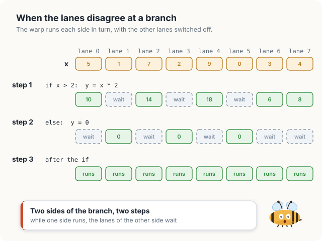 2: y = x * 2. Lanes 0, 2, 4, 6 and 7 compute 10, 14, 18, 6 and 8 while lanes 1, 3 and 5 wait. Step 2 runs else: y = 0, and lanes 1, 3 and 5 compute 0 while the others wait. Step 3, after the if, all lanes run together.">
<figcaption><b>Figure 2.7</b> A branch on which the lanes of a warp disagree.</figcaption>
</figure>

In figure 2.7 the condition `x > 2` holds in 5 lanes and fails in 3.

1. Step 1 runs the `if` side. 5 lanes compute `y = x * 2`; the other 3 are switched off.
2. Step 2 runs the `else` side. 3 lanes compute `y = 0`; the other 5 are switched off.
3. Step 3 comes after the branch, and all 8 lanes run together again.

A branch on which lanes of a warp disagree is called **divergence**. Results stay correct,
but both sides cost time: when each side is long, a diverging warp takes about twice as long.
Chapter 5 shows how to measure divergence and how to arrange data so lanes tend to agree.

## 2.4 Blocks, grids, and warps

A launch asks for a grid of blocks with an equal number of threads each, for example 256.
Hardware turns each block into warps in 2 steps.

**Step 1: each block goes to 1 SM, whole.** All threads of a block stay on 1 SM from start to
finish, so they can share that SM's shared memory and wait for each other at a barrier
(Chapter 5). An SM can hold several blocks at once when it has room; section 2.9 counts how
many.

**Step 2: each block is cut into warps of 32 consecutive threads.** Threads 0 to 31 form warp
0, threads 32 to 63 form warp 1, and so on (figure 2.8). A program never creates warps
itself; warps are how an SM runs a block.

<figure>
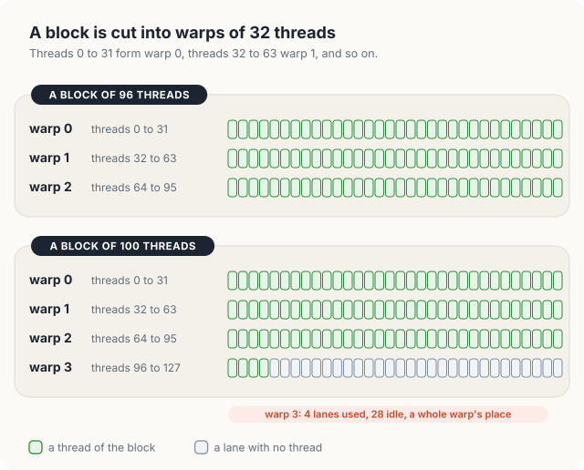
<figcaption><b>Figure 2.8</b> A block of 96 threads makes 3 full warps. A block of 100 makes 4, the last one nearly empty.</figcaption>
</figure>

A block of 100 threads needs 4 warps: 3 full warps hold 96 threads, and the 4 threads left
over need a 4th warp. In general a block needs its size ÷ 32 warps, rounded up. The 4th warp's
other 28 lanes do no work, yet the warp still takes a full warp's place on the SM. Block sizes are
therefore almost always multiples of 32, such as 128 or 256.

A block can also be 2-dimensional, for example 16 × 16 threads covering a tile of an image.
Its threads are numbered row by row before the block is cut, so its first 2 rows of 16 form
warp 0. Chapter 3 shows the numbering.

| | Block | Warp |
|---|---|---|
| chosen by | the program, at launch | the hardware |
| size | up to 1,024 threads | always 32 threads |
| its threads can | share memory and wait for each other | carry out each instruction together |

## 2.5 The memory hierarchy

A thread can keep data in several kinds of memory. Memory closer to the arithmetic units is
faster and smaller. Together, these levels form the **memory hierarchy** (figure 2.9).

<figure>
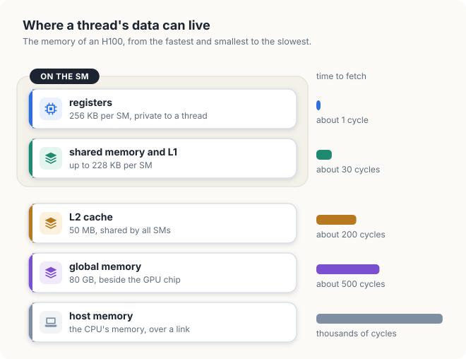
<figcaption><b>Figure 2.9</b> The memory hierarchy of an H100, from the fastest and smallest level to the slowest.</figcaption>
</figure>

**Registers** belong to 1 thread. A thread's local variables live in registers when they fit,
and an instruction reads a register at no extra cost. An SM's 65,536 registers are shared out
among all its threads, so a thread needing many registers leaves room for fewer threads
(section 2.9). When a thread needs more registers than it gets, the compiler moves some values
out to slow memory, a **spill**; Chapter 7 shows how to detect one.

**Shared memory** belongs to 1 block and sits on the SM. Any thread of a block can read what
another thread of it wrote, so threads of a block cooperate through shared memory. A read
takes 20 to 30 cycles, about 20 times less than a read from main memory. A program decides
what goes into shared memory and when; Chapters 7 to 9 rely on it.

**L1 cache** uses the same on-chip memory as shared memory, but hardware manages it: data
read from main memory stays there in case it is read again soon. Caches store data in
fixed-size pieces called **lines**, 128 bytes each on these GPUs.

**L2 cache** is 1 cache shared by all SMs, 50 MB on an H100, with reads of about 200 cycles.
Every SM goes through it, so blocks on different SMs see each other's writes there (Chapter
5).

**Global memory** is a GPU's main memory: 80 GB on an H100, in memory chips beside the GPU
chip. Every array a program allocates for the GPU lives there (Chapter 4). Its bandwidth is
very high, but a single read takes about 500 cycles, and most optimisation work aims to read
it less often.

**Host memory** is the CPU's memory; CUDA calls the CPU the **host**. A request for host
memory leaves the GPU and crosses a link to the CPU, so it is the slowest level. Chapter 4
covers moving data across that link efficiently.

2 read-only paths complete the hierarchy. **Constant memory** is fast when every thread of a
warp reads the same value, such as a kernel's parameters. **Texture memory** is designed for
reading 2-dimensional images. Chapter 7 covers both.

**NOTE:** On integrated systems, such as Jetson modules and DGX Spark, CPU and GPU share
1 set of memory chips, so global memory and host memory are the same hardware. The hierarchy
still holds: a read from those chips takes hundreds of cycles, while registers and shared
memory sit on the SM.

## 2.6 The latency table

The table gives each level's read time. Values are typical for a recent GPU and rounded;
Chapter 7 measures real ones.

| Where the data is | Time to read it | Location |
|---|---|---|
| register | about 1 cycle | inside the SM |
| shared memory | 20 to 30 cycles | inside the SM |
| L1 cache | about 30 cycles | inside the SM |
| L2 cache | about 200 cycles | elsewhere on the chip |
| global memory | 400 to 800 cycles | in separate memory chips |
| host memory | thousands of cycles, plus the transfer | across a link to the CPU |

Read time grows with distance. A signal needs time to travel, and data further from the
arithmetic units passes through more circuits on its way. Leaving the SM is the largest step:
a read from global memory costs about 20 times a read from shared memory.

Worked example: reading 1 value 20 times

A kernel needs the same value 20 times.

1. Reading it from global memory each time costs 20 × 500 = 10,000 cycles.
2. Reading it once from global memory into shared memory, then 20 times from shared memory,
   costs 500 + 20 × 25 = 1,000 cycles.

The second way is 10 times cheaper. Chapter 9 builds a matrix multiplication on this trade.

## 2.7 Coalescing: how a warp reads memory

1 instruction drives all 32 lanes of a warp (section 2.3). When that instruction reads global
memory, a warp asks for 32 values at once, 1 per lane. How fast they arrive depends on where
those 32 values lie in memory.

### 2.7.1 Sectors

Global memory does not deliver single values. It delivers 32-byte pieces called **sectors**;
4 sectors make 1 cache line of 128 bytes. A line of 128 bytes holds 128 ÷ 4 = 32 floats, 1 for
each lane of a warp. Fetching a sector costs the same however many of
its bytes a warp uses, so a warp's read costs about 1 fetch per sector it touches.

### 2.7.2 Worked by hand

Figure 2.10 shrinks everything by a factor of 4: a warp of 8 lanes, each reading 1 `float` of
4 bytes, and sectors of 8 floats.

<figure>
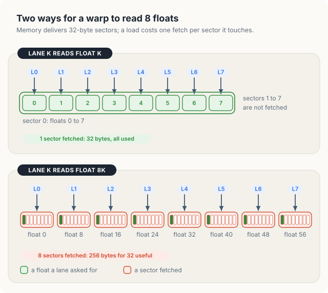
<figcaption><b>Figure 2.10</b> 2 ways for 8 lanes to read 8 floats.</figcaption>
</figure>

- **Lane k reads float k.** Floats 0 to 7 lie side by side in sector 0. Memory fetches 1
  sector, 32 bytes, and every byte is used.
- **Lane k reads float 8k.** Floats 0, 8, 16 and so on up to 56 each lie in a different
  sector. Memory fetches 8 sectors, 256 bytes, to deliver the same 32 useful bytes: 8 times
  the traffic for the same result.

A real warp behaves the same way with larger numbers. 32 lanes reading 32 consecutive floats
need 128 bytes, 4 sectors. Floats 32 apart are 32 × 4 = 128 bytes apart, a whole line, so 32 lanes reading every 32nd
float touch 32 different sectors and fetch 32 × 32 = 1,024 bytes for 32 × 4 = 128 useful
ones.

### 2.7.3 The rule

A read whose addresses fall into as few sectors as possible is **coalesced**; a read whose
addresses spread out is **uncoalesced**. Hardware does not rearrange a warp's requests: it
fetches every sector any lane needs.

Neighbouring threads should read neighbouring addresses.

Most kernels are memory-bound (Chapter 1), and for them this rule alone can change running
time several times over. Chapter 7 measures the difference.

## 2.8 Shared-memory banks

Shared memory sits on the SM and has to answer all 32 lanes of a warp at once. It is built
from 32 separate memory arrays called **banks**, and each bank delivers 1 word of 4 bytes per
cycle. Working side by side, 32 banks deliver 32 words in 1 cycle: 1 word for each lane.

Words are spread over the banks in turn, the way cards are dealt to 32 players. Word 0 goes
to bank 0, word 1 to bank 1, and so on to word 31 in bank 31; word 32 starts the next round in
bank 0. A word's bank is therefore the remainder when its number is divided by 32:

\\[ \text{bank} = \text{word number} \bmod 32 \\]

Word 70, for example, is 2 full rounds of 32 plus 6, so it lies in bank 6.

A warp's read takes 1 cycle when no bank is asked for more than 1 word. When 2 lanes ask 1
bank for different words, the bank delivers them in turn. A read that has to wait for a bank
in this way has a **bank conflict**.

Figure 2.11 uses 8 banks and 8 lanes, so a word's bank is its number modulo 8. Words are
drawn in rows of 8, so each column is 1 bank.

<figure>
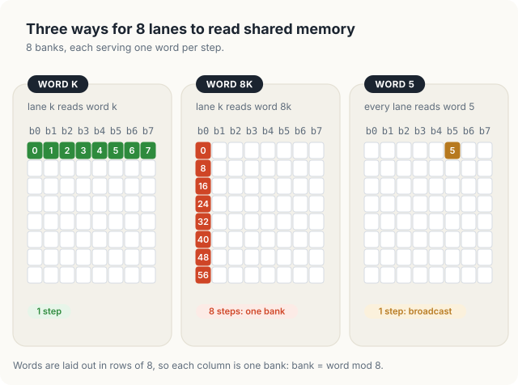
<figcaption><b>Figure 2.11</b> 3 ways for 8 lanes to read shared memory with 8 banks.</figcaption>
</figure>

- **Lane k reads word k.** Words 0 to 7 lie in banks 0 to 7, 1 each: 1 step.
- **Lane k reads word 8k.** Words 0, 8, 16 and so on all lie in bank 0, which serves them 1 at
  a time: 8 steps for 1 read.
- **Every lane reads word 5.** Many lanes ask 1 bank for the *same* word. The bank reads it
  once and hands it to every lane, a **broadcast**: 1 step.

With 32 banks, the worst case is 32 lanes asking 1 bank for 32 different words: 32 steps. In
general, a warp's read takes as many steps as its busiest bank has different words to
deliver.

The middle case appears whenever threads read down a column of a 32 × 32 table of floats in
shared memory. Element (row r, column c) is word 32r + c, and (32r + c) mod 32 = c: the row
drops out, so every element of column c lies in bank c. Chapter 7 shows the usual fix. With 1
unused word added to each row, element (r, c) becomes word 33r + c, whose bank is
(r + c) mod 32. That bank differs from row to row, so the column spreads across all 32
banks.

A warp reads a shared-memory table of floats with 32 columns, each lane reading one element of the same column. How many steps does the read take, and why?

32 steps. Rows of 32 floats are 32 words long, so every element of a column has the same
word number modulo 32 and lies in the same bank. The bank delivers the 32 different words
one at a time.

## 2.9 Occupancy

### 2.9.1 Why an SM holds many warps

Threads an SM holds at a given moment are its **resident** threads, and their warps its
resident warps. When 1 warp reads global memory and must wait about 500 cycles, the scheduler
switches, at no cost, to another resident warp that is ready. More resident warps mean better
odds that 1 of them is ready.

An SM's **occupancy** is its number of resident warps divided by the most it can hold. An
H100 SM holds up to 2,048 threads, which is 2,048 ÷ 32 = 64 warps, so 32 resident warps give
an occupancy of 32 ÷ 64 = 50%.

### 2.9.2 What limits occupancy

4 resources limit how many threads an SM holds, and whichever runs out first sets the
occupancy: registers, resident threads, resident blocks and shared memory. Every compute
capability below has 65,536 registers per SM; the other 3 limits vary.

| Compute capability | Examples | Resident threads (warps) | Resident blocks | Shared memory |
|---|---|---|---|---|
| 8.0 | A100 | 2,048 (64) | 32 | up to 164 KB |
| 8.6 | GeForce RTX 30 series | 1,536 (48) | 16 | up to 100 KB |
| 8.7 | Jetson Orin | 1,536 (48) | 16 | up to 164 KB |
| 8.9 | GeForce RTX 40 series | 1,536 (48) | 24 | up to 100 KB |
| 9.0 | H100 | 2,048 (64) | 32 | up to 228 KB |
| 10.0 | B200 | 2,048 (64) | 32 | up to 228 KB |
| 12.x | GeForce RTX 50 series, DGX Spark | 1,536 (48) | 32 | up to 100 KB |

Values come from NVIDIA's *CUDA C++ Programming Guide* and its tuning guide for each
architecture.

Worked example: the register budget, blocks of 256 threads on an H100 SM

A compiler decides how many registers each thread of a kernel needs; Chapter 9 shows how to
see that number and how to cap it.

| Registers per thread | Registers per block | Blocks that fit | Resident threads | Occupancy |
|---|---|---|---|---|
| 32 | 256 × 32 = 8,192 | 65,536 / 8,192 = 8 | 2,048 | 100% |
| 64 | 16,384 | 4 | 1,024 | 50% |
| 128 | 32,768 | 2 | 512 | 25% |

Each row divides the SM's 65,536 registers by 1 block's need: the register file has enough
for 8, 4 or 2 blocks. The thread limit allows 2,048 / 256 = 8 blocks and the block limit 32, and this kernel uses
no shared memory, so registers set the limit in every row.

<figure>
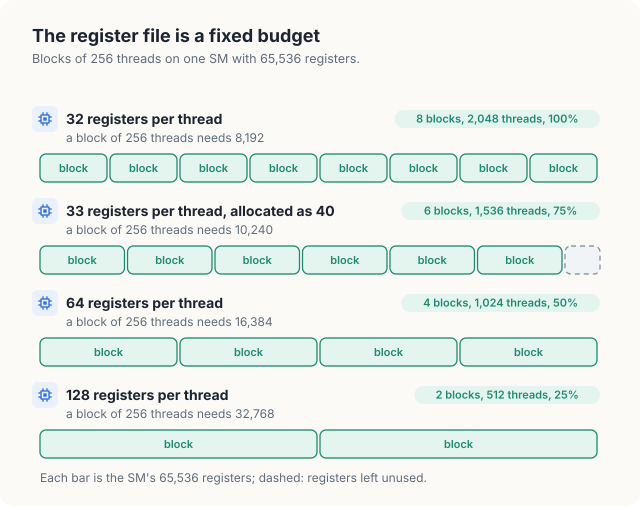
<figcaption><b>Figure 2.12</b> The register file is a fixed budget: the more registers each thread needs, the fewer blocks fit.</figcaption>
</figure>

As a formula, with \\(T_B\\) threads per block and \\(R_T\\) registers per thread, the
number of blocks that fit on an SM is the smallest of

\\[ \left\lfloor \frac{65{,}536}{T_B \cdot R_T} \right\rfloor,\quad \left\lfloor \frac{\text{thread limit}}{T_B} \right\rfloor,\quad \text{block limit},\quad \left\lfloor \frac{\text{shared memory per SM}}{\text{shared memory per block}} \right\rfloor \\]

where \\(\lfloor\ \rfloor\\) means rounding down, since part of a block cannot be
resident. Occupancy is then that number of blocks times \\(T_B\\), divided by the thread
limit. Chapter 16 shows the CUDA function that computes it.

### 2.9.3 More is not always better

High occupancy helps a kernel that often waits for memory, because more warps give the
scheduler more chances to find 1 that is ready. High occupancy is not a goal in itself.

- A kernel whose data already sits in registers rarely waits, and can run at full speed with
  few warps.
- Forcing a kernel to use fewer registers, so more warps fit, can make the compiler spill
  values to slow memory, adding the very memory traffic the extra warps were meant to hide.
- A kernel keeping a large tile of data in shared memory may run fewer blocks per SM on
  purpose, because each block then does more work per byte it reads.

The aim is enough ready warps to keep the schedulers busy, not the largest possible number.

## 2.10 The SM in action: time slicing

Figure 2.13 follows 1 scheduler with 4 warps. To keep the picture small, a read from memory
takes 8 cycles instead of about 500.

<figure>
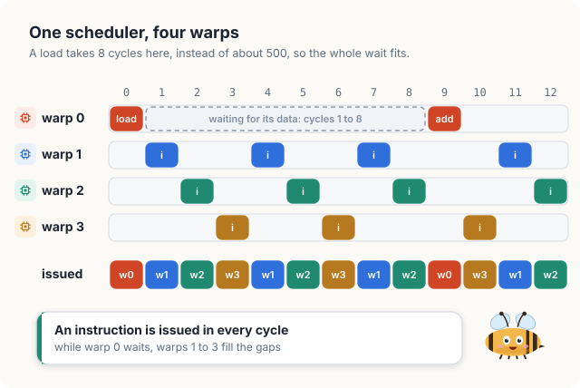
<figcaption><b>Figure 2.13</b> One scheduler and 4 warps. While warp 0 waits for its data, the other warps fill every cycle.</figcaption>
</figure>

1. In cycle 0, warp 0 issues a read. Its data arrives at the end of cycle 8.
2. In cycles 1 to 8, the scheduler issues instructions from warps 1, 2 and 3, whichever is
   ready. No cycle stays empty.
3. In cycle 9, warp 0 has its data and issues the add that needed it.

No code in a program makes this happen. A scheduler picks among its resident warps in every
cycle, and switching costs nothing, because each warp's registers stay where they are. A
program's part is to provide enough warps (occupancy) and enough independent work in each
warp.

Little's law (Chapter 1, section 1.1.4) gives the number of warps needed. A scheduler issuing
1 instruction per cycle against a latency of 500 cycles needs about 500 independent
instructions in flight to stay busy. No SM holds 500 warps per scheduler, and none needs to: a
warp usually has several independent instructions between reads, and can have several reads
in flight at once. In practice, a few dozen warps per SM cover the wait.

## 2.11 Architecture generations

The design described in this chapter has been stable across NVIDIA GPUs for more than a
decade, while the sizes have changed. Each generation is identified by a **compute
capability**, a version number of the form *major.minor*.

| Compute capability | Architecture | Examples |
|---|---|---|
| 7.x | Volta, Turing | V100, GeForce RTX 20 series |
| 8.0, 8.6, 8.7 | Ampere | A100 (8.0), GeForce RTX 30 series (8.6), Jetson Orin (8.7) |
| 8.9 | Ada Lovelace | GeForce RTX 40 series |
| 9.0 | Hopper | H100 |
| 10.0, 11.0, 12.0, 12.1 | Blackwell | B200 (10.0), Jetson AGX Thor (11.0), GeForce RTX 50 series (12.0), DGX Spark (12.1) |

Each generation changes the number of SMs, the size of shared memory, the tensor cores and
many of the limits of section 2.9. A performance figure is only meaningful together with the
compute capability on which it was measured. The `deviceQuery` sample that ships with CUDA
prints the limits of the GPU it runs on; Chapter 16 shows how to read its output.

## Common mistakes

- **Treating higher occupancy as always faster.** Spilled registers or smaller shared-memory
  tiles can make a kernel at 50% occupancy faster than one at 100%. Measure.
- **Forgetting the warp.** A kernel is written for one thread, but the hardware runs warps.
  Divergence, coalescing and bank conflicts all depend on what the 32 lanes of a warp do
  together.
- **Reading a shared-memory table by column.** A column of a 32 × 32 table of floats lies in
  one bank, so reading it takes 32 times as long as reading a row. Padding each row by one
  element fixes it (Chapter 7).
- **Quoting one GPU's numbers for another.** Check the compute capability and the limits of
  the GPU the program actually runs on.

## Summary

- A **kernel** is a function that runs on the GPU. A launch runs it as many **threads**,
  organised in **blocks**; the blocks of a launch form the **grid**.
- A GPU is a set of **SMs**. Each block runs on one SM, and the SM runs its threads in
  **warps** of 32 that carry out each instruction together.
- When the lanes of a warp disagree at a branch, the 2 sides run one after the other:
  **divergence**.
- A block is divided into warps of 32 consecutive threads, so block sizes should be
  multiples of 32.
- The memory hierarchy runs from registers (about 1 cycle) through shared memory (about 30),
  the L2 cache (about 200) and global memory (about 500) to host memory.
- Global memory delivers 32-byte sectors, so neighbouring threads should read neighbouring
  addresses: **coalescing**.
- Shared memory has 32 **banks**; lanes that ask one bank for different words must wait for
  each other.
- **Occupancy** is the share of an SM's warp places that are filled. Registers usually limit
  it. Enough warps let the scheduler hide memory latency; more than enough brings nothing.

Chapter 3 turns from the hardware to the code: how a kernel is written, how a grid of blocks
is described, and how each thread finds its own piece of work.

## Exercises

1. A kernel uses 64 registers per thread. How many threads can one SM hold before its 65,536
   registers run out?
2. The same kernel uses 128 registers per thread. What share of an H100 SM's 2,048 thread
   places can be filled?
3. On the Orin NX an SM holds at most 1,536 threads and 16 blocks. A kernel uses 32 registers
   per thread and blocks of 256 threads. How many blocks fit on one SM, and which limit sets
   the number?
4. A warp reads 32 consecutive `int`s of 4 bytes each. How many 32-byte sectors does it
   touch? How many if the lanes read every 32nd `int`, and how many bytes are fetched in
   each case?
5. Why must all the threads of a block run on the same SM? What 2 features does this make
   possible?
6. How many steps does a shared-memory read take when all 32 lanes read the same 4-byte
   word? And when they read words 128 bytes apart?
7. A warp runs `if (i % 2 == 0) { A } else { B }`, where `i` is the thread's index and A and
   B each take 10 cycles. How long does the branch take, and how long would it take if every
   lane took the same side?
8. A launch of vector addition with N = 1,000,000 uses blocks of 256 threads. How many blocks
   does the grid need, and how many threads of the last block have no element to compute?

## Sources and further reading

- NVIDIA, *CUDA C++ Programming Guide*, "Hardware Implementation" and "Compute
  Capabilities": <https://docs.nvidia.com/cuda/cuda-c-programming-guide/>
- NVIDIA, *H100 Tensor Core GPU Architecture* whitepaper, and the H100 data sheet, for the
  H100 figures in this chapter.
- NVIDIA, *Jetson Orin NX Series* and *Jetson Thor Series* module data sheets, the DGX Spark
  hardware overview (<https://docs.nvidia.com/dgx/dgx-spark/hardware.html>), and the GeForce
  RTX 4090 and 5090 specifications, for the other figures of section 2.1.4.
- NVIDIA, *Ampere*, *Ada* and *Blackwell* tuning guides, for the limits per SM in section
  2.9: <https://docs.nvidia.com/cuda/blackwell-tuning-guide/>
- David B. Kirk, Wen-mei W. Hwu and Izzat El Hajj, *Programming Massively Parallel
  Processors: A Hands-on Approach*, 4th ed., Morgan Kaufmann, 2022.
