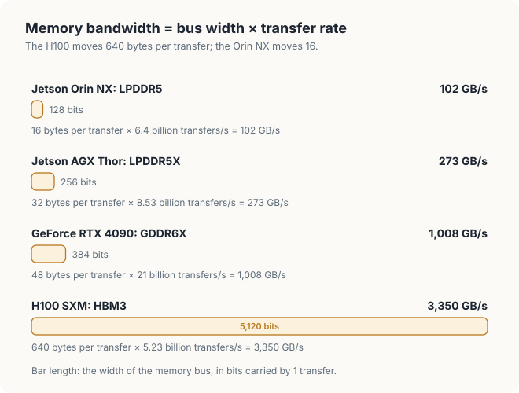
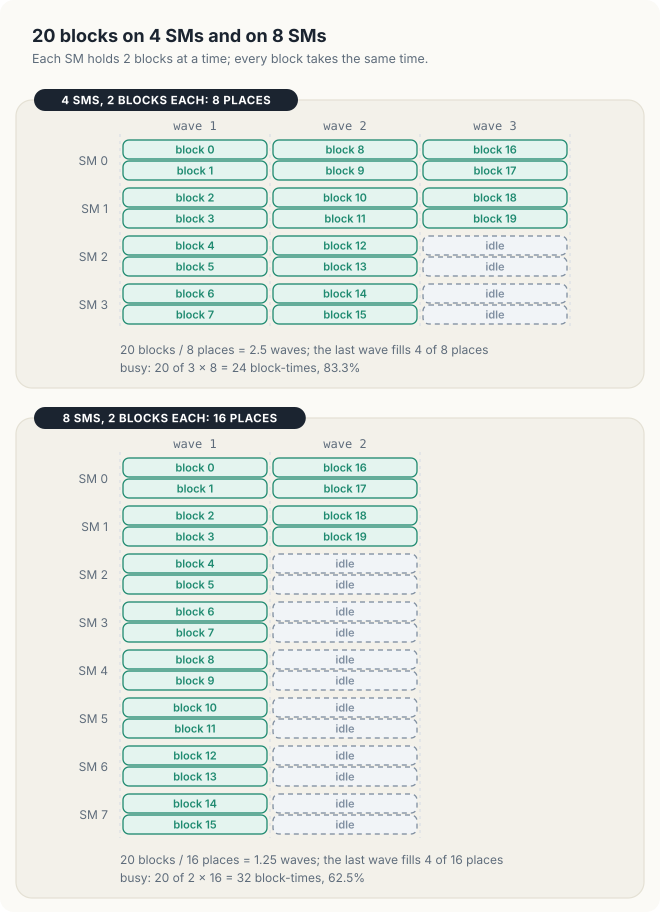
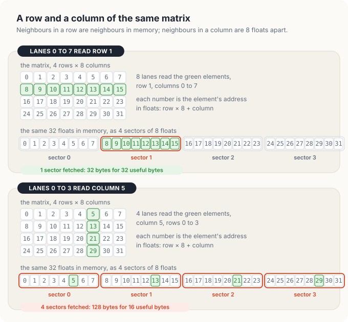

# Chapter 2: GPU Hardware from First Principles

In Chapter 1 we saw that a processor that reads its operands from DRAM waits hundreds of
cycles for each of them, and that the wait can be hidden only by keeping many independent
operations in flight. A *graphics processing unit*, or GPU, is designed around this
observation. It executes the same instructions on many data elements at once, and it holds
enough threads that its arithmetic units remain busy while many of those threads wait for
memory.

In this book we program NVIDIA GPUs with **CUDA**, the platform for general-purpose GPU
computing that NVIDIA introduced in 2007. Before CUDA, a general computation could run on a
GPU only if it was expressed through a graphics interface, for example as an operation that
colours the pixels of an image. CUDA C++ extends C++ with a small amount of syntax for
marking and launching functions that run on the GPU; its compiler, `nvcc`, generates GPU code
from those functions; and its runtime library lets code on the CPU allocate GPU memory,
transfer data and start work on the GPU. We present each program both in CUDA C++ and in Rust,
using NVIDIA's cuda-oxide compiler and libraries. In Chapter 3 we write the first of these
programs.

In this chapter we describe those parts of a GPU that determine how fast a CUDA program
runs: streaming multiprocessors and their warps, how blocks of threads are assigned to
hardware, a GPU's memory hierarchy, and access patterns and occupancy, which decide whether
memory latency is hidden. Limits differ between GPU generations, so every number is given for
a named GPU.

<div class="covers" markdown="1">

This chapter covers

- kernels, threads, blocks and grids: how work is handed to a GPU
- the parts of a GPU, from the whole chip down to a single thread
- the streaming multiprocessor (SM)
- the warp, a group of 32 threads that carry out each instruction together, and what
  happens when its threads take different sides of a branch or loop
- how blocks are assigned to SMs in waves, and how a block is divided into warps
- the memory hierarchy, from registers to the CPU's memory, and where each kind of variable
  lives
- coalescing: why neighbouring threads should read neighbouring addresses
- shared-memory banks and bank conflicts
- occupancy, the resources that limit it, and how switching between warps hides memory
  latency

</div>

## 2.1 The GPU at a glance

### 2.1.1 How a CPU and a GPU deal with memory latency

A CPU and a GPU read from the same kind of DRAM and wait the same hundreds of cycles for
each read. They differ in what they do during that wait, and the difference determines how
each divides its chip area (figure 2.1).

A CPU core runs 1 sequence of instructions as fast as possible, and spends much of its area
on avoiding waits. Large **caches**, small fast memories near a core that keep copies of
recently used data, answer most reads without a trip to main memory. Prediction logic starts
the likely next instructions early, so that a branch rarely stalls the core. A desktop CPU
has 4 to 32 such cores. This approach is called **latency-oriented design**: it shortens the
time that each thread waits.

A GPU accepts that a read from main memory takes hundreds of cycles. It spends its area on
thousands of simple arithmetic units and on room to hold tens of thousands of threads at
once. A **thread**, as in Chapter 1, is 1 sequence of instructions with its own working
values. While some threads wait for memory, others compute. This approach is called
**throughput-oriented design**: each thread may wait a long time, but the GPU as a whole
completes more operations per second (section 1.1.3).

<figure>

<figcaption><b>Figure 2.1</b> A CPU spends its chip on a few fast cores and large caches; a GPU on many simple arithmetic units.</figcaption>
</figure>

### 2.1.2 Kernels, threads, blocks and grids

A program hands work to a GPU as a kernel, launched over a grid of threads (figure 2.2).

- A **kernel** is a function that runs on the GPU.
- A **launch** starts a kernel from a program on the CPU. The GPU then runs many copies of
  the kernel at once.
- Each copy is 1 **thread**. A thread keeps its working values in **registers**, small
  storage slots inside a processor that each hold 1 value. Each thread also receives its own
  number, its **index**, and uses it to select its share of the work.
- Threads are grouped into **blocks** of equal size. The threads of 1 block run on the same
  part of the GPU, so they can share fast memory and wait for each other.
- All blocks of 1 launch form the **grid**.

<figure>

<figcaption><b>Figure 2.2</b> A launch of vector addition: 1,024 threads in 4 blocks of 256. Thread 300 lies in block 1 and computes <code>c[300]</code>.</figcaption>
</figure>

For vector addition with N = 1,024, every element needs 1 thread, so the launch needs 1,024
threads. A block holds 256 of them, so the grid needs 1,024 ÷ 256 = 4 blocks.

A thread finds its element through its index. Inside its block, each thread has a
**position**, numbered from 0. Block 0 has positions 0 to 255, and so does block 1, so a
position alone cannot tell a thread which element is its own. The blocks before a thread's
block hold 256 threads each, and its index counts them first:

\\[ \text{index} = \text{block number} \times \text{block size} + \text{position} \\]

Thread 300 is at position 44 of block 1, and 1 × 256 + 44 = 300 (figure 2.3). In the other
direction, 300 ÷ 256 = 1 with remainder 44 gives back its block and its position. Each thread
computes `c[index]`, so the 1,024 threads cover the 1,024 elements once each, and no 2
threads write the same element.

<figure>

<figcaption><b>Figure 2.3</b> A thread's index is its block's starting index plus its position in the block.</figcaption>
</figure>

In Chapter 3 we show how a kernel reads its block number and position in code, and how blocks and
grids can also be laid out in 2 or 3 dimensions, which suits images and volumes.

### 2.1.3 From the chip to one thread

A GPU chip is organised as an array of **streaming multiprocessors**, or SMs. An SM is a
processor that executes the threads of the blocks assigned to it. It contains a set of
arithmetic units, which NVIDIA calls *CUDA cores*, together with the control logic that fetches
and issues their instructions, a register file that holds the working values of its threads,
and a small on-chip memory. Each arithmetic unit performs 1 operation on 32-bit floating-point
numbers per cycle, for 1 thread. An H100 has 132 SMs of 128 arithmetic units each, 16,896 in
all; a Jetson Orin NX has 8 SMs of 128, 1,024 in all. An H100 SM has 65,536 registers of 4
bytes, divided among all its threads. Each block of a launch runs on 1 SM from start to
finish, and all SMs share the GPU's main memory.

### 2.1.4 GPUs in numbers

GPUs of one design are built in sizes from robot modules to data-centre cards. Our table
compares 7 of them. **Compute capability**, CC in the table, is NVIDIA's version number for
each generation of this design (section 2.11).

| GPU | Kind | CC | SMs | Memory | Bandwidth | FP32 peak |
|---|---|---|---|---|---|---|
| Jetson Orin NX 16 GB | embedded | 8.7 | 8 | 16 GB, shared | 102 GB/s | 2.4 TFLOP/s |
| Jetson AGX Thor | embedded | 11.0 | 20 | 128 GB, shared | 273 GB/s | 8.1 TFLOP/s |
| DGX Spark (GB10) | desktop AI | 12.1 | 48 | 128 GB, shared | 273 GB/s | ~31 TFLOP/s |
| GeForce RTX 4090 | desktop card | 8.9 | 128 | 24 GB | 1,008 GB/s | 82.6 TFLOP/s |
| GeForce RTX 5090 | desktop card | 12.0 | 170 | 32 GB | 1,792 GB/s | 104.8 TFLOP/s |
| A100 SXM 80 GB | data centre | 8.0 | 108 | 80 GB | 2,039 GB/s | 19.5 TFLOP/s |
| H100 SXM | data centre | 9.0 | 132 | 80 GB | 3,350 GB/s | 67 TFLOP/s |

All figures are NVIDIA's published specifications, with peak arithmetic at each GPU's highest
clock rate; "shared" marks memory shared with a CPU. SM counts for Thor and DGX Spark follow
from their published unit counts, 2,560 and 6,144, at 128 units per SM. We also read Orin NX
figures from a board with `cudaGetDeviceProperties`, a CUDA function described in section
2.9.4.

Its memory column shows 2 kinds of system. Jetson modules and DGX Spark are
**integrated**: CPU and GPU share one set of memory chips. Graphics cards and data-centre GPUs
are **discrete**: each GPU has memory chips of its own on its card, and data reaches them from
CPU memory over a link (Chapter 4).

Each bandwidth follows from 2 numbers: the width of a GPU's **memory bus**, meaning how many
bits move between GPU and memory chips in 1 transfer, and how many transfers occur per
second. Their product, in bytes per second, is the bandwidth (figure 2.4).

| GPU | Memory | Bus width | Transfers per second | Bandwidth |
|---|---|---|---|---|
| Jetson Orin NX | LPDDR5 | 128 bits = 16 bytes | 6.4 billion | 16 × 6.4 = 102 GB/s |
| Jetson AGX Thor | LPDDR5X | 256 bits = 32 bytes | 8.53 billion | 32 × 8.53 = 273 GB/s |
| GeForce RTX 4090 | GDDR6X | 384 bits = 48 bytes | 21 billion | 48 × 21 = 1,008 GB/s |
| H100 SXM | HBM3 | 5,120 bits = 640 bytes | 5.23 billion | 640 × 5.23 = 3,350 GB/s |

The H100's rate is the published bandwidth divided by its bus width, 3,350 GB/s ÷ 640 bytes.
Its memory transfers less often than the RTX 4090's, 5.23 billion times per second against
21 billion, yet delivers 3.3 times as much data, because its bus is 13 times as wide. A bus
of 5,120 wires cannot run across a circuit board to separate memory chips: the wires would
need too much board area and too much power to drive. **High-bandwidth memory**, HBM, stacks
DRAM chips on top of each other and places the stacks in the same package as the GPU chip,
on a silicon base that carries thousands of short connections. LPDDR5 and GDDR6X chips sit on
the circuit board, so their buses are narrower, and they make up part of the difference with
a higher rate on each wire.

<figure>

<figcaption><b>Figure 2.4</b> Bandwidth is bus width × transfer rate. The H100's HBM3 bus is 5,120 bits wide, 40 times the Orin NX's.</figcaption>
</figure>

### 2.1.5 The ridge point of each GPU

In Chapter 1 we defined the **ridge point** of a machine as its peak arithmetic divided by its
memory bandwidth: the arithmetic intensity at which a computation stops being limited by
memory. For the H100,

\\[ \frac{67 \times 10^{12}\ \text{FLOP/s}}{3.35 \times 10^{12}\ \text{B/s}} = 20\ \text{FLOP per byte} \\]

Dividing FLOPs per second by bytes per second leaves FLOPs per byte. In the time an H100's memory delivers 1 byte, its arithmetic units can perform 20
FLOPs. A kernel that performs fewer than 20 FLOPs on each byte it reads leaves those units
waiting for data. For the other GPUs of the table, the same division gives values from 10 to 114.

| GPU | Ridge point (FLOP per byte) |
|---|---|
| A100 SXM 80 GB | 19.5 / 2.039 ≈ 10 |
| H100 SXM | 67 / 3.35 = 20 |
| Jetson Orin NX 16 GB | 2.4 / 0.102 ≈ 24 |
| Jetson AGX Thor | 8.1 / 0.273 ≈ 30 |
| GeForce RTX 5090 | 104.8 / 1.792 ≈ 58 |
| GeForce RTX 4090 | 82.6 / 1.008 ≈ 82 |
| DGX Spark (GB10) | 31 / 0.273 ≈ 114 |

The data-centre GPUs have the lowest ridge points, because their memory, stacked beside the
GPU chip, delivers several terabytes per second. The graphics cards and the DGX Spark have
far more arithmetic for each byte of bandwidth, so a kernel needs more reuse to reach their
peak. A kernel that is compute-bound on an A100 can therefore be memory-bound on an RTX 4090,
with no change to its code.

<div class="bee bee-shocked" markdown="1">

Vector addition, at 1/12 of a FLOP per byte, is memory-bound on every GPU in the table.

</div>

For a memory-bound kernel, bandwidth also sets a lower bound on running time, against which a
measured time can be compared. Such a comparison is called a **speed-of-light** check: bytes
moved, divided by bandwidth, give the time a kernel would take if memory never paused.

<div class="example" markdown="1">

Worked example: the speed of light for vector addition on a Jetson Orin NX

1. The arrays hold N = 2<sup>26</sup> = 67,108,864 floats each. The kernel reads `a` and
   `b` and writes `c`: 3 × 4 bytes × 67,108,864 = 805,306,368 bytes.
2. At 102 GB/s, moving them takes at least 805,306,368 / (102 × 10<sup>9</sup>) s = 7.9 ms.
3. A run measured at 10.0 ms reaches 7.9 / 10.0 = 79% of the speed of light. No change to
   the code can make it more than 10.0 / 7.9 = 1.27 times faster.

</div>

A memory-bound kernel at 90% of its speed of light has little left to gain from tuning, and
further speed must come from moving fewer bytes. In Chapter 7 we measure about 68 GB/s for well-ordered reads on the Orin NX, 67% of its
rated bandwidth.

## 2.2 The streaming multiprocessor

Figure 2.5 shows 1 SM of an H100. Its 128 arithmetic units are divided into 4 groups of 32.
Each group has its own control logic and a quarter of the register file, and the 4 groups
share 256 KB of on-chip memory.

<figure>

<figcaption><b>Figure 2.5</b> Inside 1 SM of an H100: 4 groups of 32 arithmetic units, each with its own control logic and 16,384 registers, above a shared pool of fast memory. The SM holds up to 2,048 threads, 64 warps: 16 threads for each arithmetic unit.</figcaption>
</figure>

- **Arithmetic units.** 4 groups of 32, 128 per SM. A group has 32 units, 1 for each thread of a
  warp, the group of 32 threads that executes each instruction together (section 2.3). Each
  unit performs 1 **fused multiply-add** per cycle: it computes \\(a \times b + c\\) in 1 step, which counts as 2 FLOPs.
- **Registers.** 65,536 registers of 4 bytes each, 65,536 × 4 = 262,144 bytes or 256 KB,
  split into 4 parts of 65,536 ÷ 4 = 16,384, 1 per group. Each thread on the SM gets its own
  registers from this file, so the registers a thread needs limit the number of threads that
  fit (section 2.9).
- **Shared memory and L1 cache.** 1 pool of 256 KB serves 2 purposes. **Shared memory** is
  memory that all threads of a block can read and write, so threads of a block exchange data
  through it. The **L1 cache** keeps copies of data the SM has read from main memory. On an
  H100, up to 228 KB of the pool can serve as shared memory.
- **Other units.** Units for integer arithmetic; **special function units**, which compute
  fast approximations of `sin`, `cos`, `exp` and square roots; and **tensor cores**, which
  multiply small matrices in 1 operation (Chapter 11).

Peak arithmetic follows from these parts. Each unit completes 1 fused multiply-add, 2 FLOPs,
per cycle, and the clock rate counts cycles per second, so peak FLOPs per second = 2 × number
of units × clock rate. For an H100, 2 × 132 SMs × 128 units × 1.98 GHz = 67 TFLOP/s. For an
RTX 4090, 2 × 128 × 128 × 2.52 GHz = 82.6 TFLOP/s.

The SM holds far more threads than it has units to run them. An H100 SM can keep 2,048
threads resident, 16 for each of its 128 arithmetic units, and in any one cycle at most 128
of them execute. The other threads supply the independent work that a processor needs while
its reads are in flight (section 1.1.5).

<div class="callout note" markdown="1">

**NOTE:** SMs of other generations differ in detail. An A100 SM has 64 units for 32-bit
floating-point numbers instead of 128. The number of threads and blocks an SM can hold, and
its shared memory, depend on the compute capability; they are listed in section 2.9.

</div>

## 2.3 The warp

### 2.3.1 One instruction, 32 lanes

Each group of 32 units in figure 2.5 has a single control unit. In every cycle the
control unit fetches 1 instruction, decodes it, and sends the same control signals to all 32
units; each unit applies the instruction to operands in its own registers. For the instruction
`add r1, r2, r3`, all 32 units add, but the values in `r2` and `r3` differ from unit to unit,
so the 32 sums differ (figure 2.6). A control unit is a complex circuit: it reads instructions
from an instruction cache, decodes them and tracks which operands are ready. Sharing 1 of them
among 32 arithmetic units saves chip area and power, which the SM spends on more arithmetic
units. NVIDIA calls each such group a **processing block**; an H100 SM has 4.

<figure>

<figcaption><b>Figure 2.6</b> One instruction reaches every lane of a warp. Each lane has its own values, so one step gives one answer per lane.</figcaption>
</figure>

A **warp** is a group of 32 threads of one block whose instructions a processing block
executes together. A thread's position in its warp, 0 to 31, is its **lane**. Because 1 instruction serves all 32 lanes, a programmer writes kernel code
for 1 thread and the hardware forms the warps. In Chapter 1 we called this design SIMT (section
1.7). CPUs share instructions in the same way through vector instructions such as AVX, but
there the programmer or the compiler must place the data in vector registers explicitly.

A processing block holds the registers of many warps at once, up to 16 warps on an H100, which is
64 warps or 2,048 threads per SM, so that it has other work when a warp waits for memory. The part of its control unit that chooses, in
every cycle, which of these warps issues its next instruction is the **warp scheduler**. We
return to it in section 2.10, where it hides the latency of memory. Figure 2.7 summarises the
levels from the whole GPU down to a single thread.

<figure>

<figcaption><b>Figure 2.7</b> From the whole GPU down to 1 thread, for an H100.</figcaption>
</figure>

### 2.3.2 Why 32

NVIDIA GPUs have used warps of 32 threads since the first CUDA GPUs. A wider warp would share
each instruction among more threads, but it would lose more time whenever its threads take
different paths (section 2.3.3). 32 threads reading 4 bytes each read 32 × 4 = 128 bytes, exactly 1 cache line, and section 2.7
shows why that match matters. A program
should read the warp size from `cudaGetDeviceProperties` (section 2.9.4) instead of assuming
it.

### 2.3.3 Divergence

All lanes of a warp carry out the same instruction. An `if` can send some threads of a warp
one way and the rest the other way, and a warp cannot run both sides at once. It runs them in
turn (figure 2.8).

<figure>
 2: y = x * 2. Lanes 0, 2, 4, 6 and 7 compute 10, 14, 18, 6 and 8 while lanes 1, 3 and 5 wait. Step 2 runs else: y = 0, and lanes 1, 3 and 5 compute 0 while the others wait. Step 3, after the if, all lanes run together.">
<figcaption><b>Figure 2.8</b> A branch on which the lanes of a warp disagree: 5 lanes take the <code>if</code> side and 3 the <code>else</code> side.</figcaption>
</figure>

In figure 2.8 the condition `x > 2` holds in 5 lanes and fails in 3.

1. Step 1 runs the `if` side: 5 lanes compute `y = x * 2`, and 3 are switched off.
2. Step 2 runs the `else` side: 3 lanes compute `y = 0`, and 5 are switched off.
3. Step 3 follows the branch, and all 8 lanes run together again.

A branch on which lanes of a warp disagree is called **divergence**. The results remain
correct, because a switched-off lane does not write its registers or memory. The cost is
time: a diverging warp spends the time of both sides, so when each side is long it takes
about twice as long as a warp whose lanes agree.

Loops diverge in the same way. When each lane runs a loop a different number of times, the
warp runs it as many times as its busiest lane, and a lane that has finished waits switched
off. Suppose 8 lanes run 3, 1, 4, 1, 5, 9, 2 and 6 iterations: the warp runs 9 iterations,
which is 9 × 8 = 72 lane-iterations of time, and the lanes need 3 + 1 + 4 + 1 + 5 + 9 + 2 + 6
= 31 of them. The warp's lanes do useful work 31 / 72 = 43% of the time. Such loops are
common when each thread processes a row of irregular data, such as a sparse matrix, and
the cost depends on the data more than on the code.

Boundary checks cause divergence that costs little. Most kernels check that their index lies
inside the array, `if (i < n)`, because the grid is rounded up to whole blocks (Chapter 3).
Only warps that straddle the end of the array diverge. With n = 1,000 and blocks of 256
threads, the grid has 4 blocks and 32 warps. Warp 31 holds threads 992 to 1,023, of which
992 to 999 pass the check and 1,000 to 1,023 fail it: 1 diverging warp of 32, about 3% of
the warps. With n = 1,000,000 the grid has 31,256 warps. Since 1,000,000 = 31,250 × 32
exactly, warps 0 to 31,249 lie wholly inside the array and warps 31,250 to 31,255 wholly
outside it, and no warp diverges at all. A boundary check costs almost nothing on a large
array.

<div class="callout note" markdown="1">

**Independent thread scheduling.** Up to the Pascal generation (compute capability 6.x), a
warp executed the 2 sides of a branch one after the other and then continued with all lanes
together. From Volta (compute capability 7.0) on, each thread has its own program counter,
and the scheduler may interleave the 2 sides of a branch. The results of a correct program
are the same, but a kernel can no longer assume that the lanes of a warp are back together
at any particular point after a branch. Code that relies on lanes exchanging data must say
where they meet, with `__syncwarp()` or with the `_sync` forms of the warp functions that we use in Chapter 8.

</div>

## 2.4 Blocks, grids, and warps

When a kernel is launched, hardware assigns its blocks to SMs and divides each block into
warps. A program controls neither step, but both follow rules that affect how well a launch
uses a GPU.

### 2.4.1 Assigning blocks to SMs

**Each block goes to 1 SM, whole.** All threads of a block stay on 1 SM from start to
finish, so they can share that SM's shared memory and wait for each other at a barrier
(Chapter 5). A block starts only when the SM has room for all of its threads, registers and
shared memory at once. If part of a block could start while the rest waited for room, the
started threads could wait at a barrier for threads that would never arrive.

**Blocks are assigned in any order, as room appears.** A grid usually has many more blocks
than the GPU can hold at once. The hardware keeps a list of the blocks not yet started, and
whenever a block finishes and frees its place on an SM, it starts another one there. The
program cannot tell in what order blocks run, and blocks of 1 grid cannot wait for each
other. Because of this restriction, the same compiled kernel runs on 8 SMs or on 132: a GPU
with more SMs runs more blocks at the same time. The property is called
**transparent scalability**.

Blocks that run at the same time form a **wave**, and a grid runs as a sequence of waves.
When all blocks take about equal time, its final wave decides how well a grid uses a GPU
(figure 2.9). If a grid's block count is not a multiple of the GPU's places, its final wave is
partly empty, and a whole wave's time buys only a fraction of a wave's work. This loss is
called the **tail effect**.

<figure>

<figcaption><b>Figure 2.9</b> 20 blocks on 4 SMs and on 8 SMs. The larger GPU finishes in 2 waves instead of 3, but leaves most of its second wave idle.</figcaption>
</figure>

<div class="example" markdown="1">

Worked example: 1,100 blocks on an H100 and on a Jetson Orin NX

A kernel uses blocks of 256 threads and 32 registers per thread, and its blocks take about
equal time.

1. **H100.** An SM holds 2,048 threads, so 2,048 / 256 = 8 blocks, and 132 SMs hold
   132 × 8 = 1,056 blocks at once. 1,100 blocks are 1,100 / 1,056 = 1.04 waves. The second
   wave runs 44 blocks, 4% of the places, for as long as a full wave. The GPU spends 2 waves
   of time on 1.04 waves of work: it is busy 1,100 / 2,112 = 52% of the time.
2. **Orin NX.** An SM holds 1,536 threads, so 6 blocks, and 8 SMs hold 48. 1,100 blocks are
   22.9 waves. Only the 23rd wave is partly empty, and the GPU is busy
   1,100 / (23 × 48) = 99.6% of the time.

</div>

The same grid wastes half of the larger GPU and almost none of the smaller one. On the H100,
a grid of 1,056 blocks would finish in about the same time as one of 1,100. Real blocks
differ in duration, and a new block starts as soon as any place frees up, so measured tails
are softer than this calculation; the effect is still large when a grid has only 1 or 2
waves. A grid of many waves, or a block count that is a multiple of the GPU's places, avoids
it. We show in section 2.9.4 how a program reads the number of SMs it runs on.

### 2.4.2 Dividing a block into warps

**Each block is cut into warps of 32 consecutive threads.** Threads 0 to 31 form warp 0,
threads 32 to 63 form warp 1, and so on (figure 2.10). A program never creates warps itself;
warps are how an SM runs a block.

<figure>

<figcaption><b>Figure 2.10</b> A block of 96 threads makes 3 full warps. A block of 100 makes 4, the last one nearly empty.</figcaption>
</figure>

A block of 100 threads needs 4 warps: 3 full warps hold 96 threads, and the 4 threads left
over need a 4th warp. In general a block needs its size ÷ 32 warps, rounded up. The 4th
warp's other 28 lanes do no work, yet the warp still takes a full warp's place on the SM.
Block sizes are therefore almost always multiples of 32, such as 128 or 256.

A block can also be 2- or 3-dimensional, for example 16 × 16 threads covering a tile of an
image. Its threads are first numbered in a single sequence, x fastest, then y, then z, and
the sequence is then cut into warps as before. For a block of \\(D_x \times D_y\\) threads,
the thread at \\((x, y, z)\\) has

\\[ \text{linear number} = x + y \cdot D_x + z \cdot D_x \cdot D_y, \qquad \text{warp} = \left\lfloor \frac{\text{linear number}}{32} \right\rfloor \\]

In a 16 × 16 block, the thread at (x = 5, y = 3) has linear number 5 + 3 × 16 = 53 and lies
in warp 1. Each warp of this block covers 2 rows of 16: warp 0 holds rows 0 and 1, warp 1
rows 2 and 3. In an 8 × 8 block, the 64 threads form 2 warps, rows 0 to 3 and rows 4 to 7.
The 32 lanes of a warp read memory together, so this numbering decides which addresses a
warp reads at once (sections 2.7 and 2.8). In Chapter 3 we draw the numbering for 3-dimensional blocks.

| | Block | Warp |
|---|---|---|
| chosen by | the program, at launch | the hardware |
| size | up to 1,024 threads | always 32 threads |
| its threads can | share memory and wait for each other | carry out each instruction together |

## 2.5 The memory hierarchy

A thread can keep data in several kinds of memory. Memory closer to the arithmetic units is faster and smaller. Together, these levels form the **memory hierarchy** (figure
2.10).

<figure>

<figcaption><b>Figure 2.11</b> The memory hierarchy of an H100, from the fastest and smallest level to the slowest.</figcaption>
</figure>

**Registers** belong to 1 thread. A thread's local variables live in registers when they
fit. An arithmetic instruction names its registers directly, as in `add r1, r2, r3`, so a
value in a register reaches the arithmetic unit with no further instruction. A value in
memory needs a load first, `load r2, [address]`, which occupies an issue slot and waits for
the memory to answer. An SM's 65,536 registers are shared out among all its threads, so a
thread needing many registers leaves room for fewer threads (section 2.9).

**Local memory** is the place for a thread's private data that does not fit in registers:
values the compiler moves out of registers when it runs short, called a **spill**, and arrays
that the thread indexes with values known only at run time. Despite its name, local memory
lies in global memory, the slowest level on the GPU, and is local only in the sense that each
thread sees its own part of it. A spill therefore turns a 1-cycle register access into a
read that may take hundreds of cycles. In Chapter 7 we show how to detect one.

**Shared memory** belongs to 1 block and sits on the SM. Any thread of a block can read what
another thread of it wrote, so threads of a block cooperate through shared memory. A read
takes 20 to 30 cycles, about 20 times less than a read from main memory. A program decides
what goes into shared memory and when; we rely on it in Chapters 7 to 9.

**L1 cache** uses the same on-chip memory as shared memory, but hardware manages it: data read
from main memory stays there in case it is read again soon. Caches store data in fixed-size
pieces called **lines**, 128 bytes each on these GPUs. An SM's L1 serves its many resident
threads at once, and they compete for its lines, so a kernel cannot count on finding a value
in L1 that it read some time ago. For data a block will reuse, shared memory gives a
guarantee that the cache does not.

**L2 cache** is 1 cache shared by all SMs, 50 MB on an H100, with reads of about 200 cycles.
Every SM goes through it, so blocks on different SMs see each other's writes there (Chapter
5).

**Global memory** is a GPU's main memory, built from DRAM chips outside its processor chip.
On an H100 it is 80 GB of HBM3, stacked inside its package. On an RTX 4090 it
is 24 GB of GDDR6X chips on the card. On a Jetson Orin NX it is the 16 GB of LPDDR5 that the
CPU also uses. Every array a program allocates for the GPU lives there (Chapter 4). An H100 reads it at 3.35 TB/s, but a single read takes about 500 cycles, and much of the
optimisation in Chapters 7 to 9 reduces the number of reads from it.

**Host memory** is CPU memory; CUDA calls a CPU its **host**. A request for host memory
leaves the GPU and crosses a link, so this level is slowest of all. In Chapter 4 we move data
across that link efficiently.

2 read-only paths complete the hierarchy. **Constant memory** is fast when every thread of a
warp reads the same value, such as a kernel's parameters. **Texture memory** is designed for
reading 2-dimensional images. We cover both in Chapter 7.

How a variable is declared decides where it lives. Its declaration also fixes its **scope**,
meaning which threads can see it, and its **lifetime**, meaning how long it exists.

| Declaration in CUDA C++ | Lives in | Scope | Lifetime |
|---|---|---|---|
| scalar variable inside a kernel | register | 1 thread | 1 launch |
| array inside a kernel | registers if small and indexed with constants, else local memory | 1 thread | 1 launch |
| `__shared__` variable inside a kernel | shared memory | 1 block | 1 launch |
| `__device__` variable at file scope | global memory | all threads of all launches | the whole program |
| `__constant__` variable at file scope | constant memory | all threads of all launches | the whole program |

A scalar declared inside a kernel launched with 1 million threads exists 1 million times,
once per thread, and disappears when each thread ends. A `__shared__` variable exists once per
block and disappears with the block, so a later launch cannot read what an earlier one left
there.

<div class="callout note" markdown="1">

**NOTE:** On integrated systems, such as Jetson modules and DGX Spark, CPU and GPU share
1 set of memory chips, so global memory and host memory are the same hardware. The hierarchy
still holds: a read from those chips takes hundreds of cycles, while registers and shared
memory sit on the SM.

</div>

<div class="callout note" markdown="1">

**The energy of a read.** The levels of the hierarchy also differ in energy. Mark Horowitz's
widely used figures for a 45 nm process put a 32-bit floating-point addition at about 0.9 pJ
and a 64-bit read from DRAM at 1,300 to 2,600 pJ, between 1,400 and 2,900 times as much. A
read from a small on-chip memory of 8 KB costs about 10 pJ. The numbers are older than any GPU
in this chapter, and both have fallen since, but the ratio between arithmetic and off-chip
access has stayed large. A kernel that reads each value from DRAM once instead of many times
saves energy as well as time.

</div>

## 2.6 The latency table

The table gives each level's read time. Values are typical for a recent GPU and rounded;
we measure real ones in Chapter 7.

| Where the data is | Time to read it | Location |
|---|---|---|
| register | about 1 cycle | inside the SM |
| shared memory | 20 to 30 cycles | inside the SM |
| L1 cache | about 30 cycles | inside the SM |
| L2 cache | about 200 cycles | elsewhere on the chip |
| global memory | 400 to 800 cycles | in separate memory chips |
| host memory | thousands of cycles, plus the transfer | across a link to the CPU |

Read time grows with distance. A signal needs time to travel, and data further from the
arithmetic units passes through more circuits on its way. Leaving the SM is the largest step:
a read from global memory costs about 20 times a read from shared memory. In Chapter 1 we explained the remaining part of the cost of global memory, the time a DRAM chip needs to read its own
cells (section 1.1.2).

<div class="example" markdown="1">

Worked example: reading 1 value 20 times

A kernel needs the same value 20 times.

1. Reading it from global memory each time costs 20 × 500 = 10,000 cycles.
2. Reading it once from global memory into shared memory, then 20 times from shared memory,
   costs 500 + 20 × 25 = 1,000 cycles.

The second way is 10 times cheaper. In Chapter 9 we build a matrix multiplication on this trade.

</div>

## 2.7 Coalescing: how a warp reads memory

1 instruction drives all 32 lanes of a warp (section 2.3). When that instruction reads global
memory, a warp asks for 32 values at once, 1 per lane. How fast they arrive depends on where
those 32 values lie in memory.

### 2.7.1 Sectors

Global memory does not deliver single values. It delivers 32-byte pieces called **sectors**;
4 sectors make 1 cache line of 128 bytes. A line of 128 bytes holds 128 ÷ 4 = 32 floats, 1
for each lane of a warp. Fetching a sector costs the same however many of its bytes a warp
uses, so a warp's read costs about 1 fetch per sector it touches.

The reason lies in the DRAM chips. As we saw in section 1.1.2, the slow part of a DRAM read is
opening a row of cells and sensing their charges. Once a row is open, the chip can deliver
many consecutive bytes from it quickly, one after another, in a **burst**. The cost of
opening the row is paid once for the whole burst. A memory system therefore moves data in
pieces of consecutive bytes, and a read of 4 bytes costs nearly as much as a read of the
whole piece that contains them. The sector is the piece in which a GPU's memory system
deals.

### 2.7.2 Worked by hand

Figure 2.12 shrinks everything by a factor of 4: a warp of 8 lanes, each reading 1 `float` of
4 bytes, and sectors of 8 floats.

<figure>

<figcaption><b>Figure 2.12</b> 8 lanes reading 8 floats: from 1 sector when the floats are consecutive, from 8 sectors when they are 8 floats apart.</figcaption>
</figure>

- **Lane k reads float k.** Floats 0 to 7 lie side by side in sector 0. Memory fetches 1
  sector, 32 bytes, and every byte is used.
- **Lane k reads float 8k.** Floats 0, 8, 16 and so on up to 56 each lie in a different
  sector. Memory fetches 8 sectors, 256 bytes, to deliver the same 32 useful bytes: 8 times
  the traffic for the same result.

A real warp behaves the same way with larger numbers. 32 lanes reading 32 consecutive floats
need 128 bytes, 4 sectors. Floats 32 apart are 32 × 4 = 128 bytes apart, a whole line, so 32
lanes reading every 32nd float touch 32 different sectors and fetch 32 × 32 = 1,024 bytes
for 32 × 4 = 128 useful ones.

### 2.7.3 The rule

A read whose addresses fall into as few sectors as possible is **coalesced**; a read whose
addresses spread out is **uncoalesced**. Hardware does not rearrange a warp's requests: it
fetches every sector any lane needs.

<div class="bee bee-happy" markdown="1">

Neighbouring threads should read neighbouring addresses.

</div>

A memory-bound kernel runs at the rate its bytes arrive, so the uncoalesced read above, which
moves 8 times the bytes, runs several times slower. In Chapter 7 we measure, on the Orin NX, 68 GB/s of useful
bandwidth for reads 4 bytes apart and 21 GB/s for reads 32 bytes apart.

### 2.7.4 Rows and columns of a matrix

Whether a kernel's reads are coalesced can be read off its index expression. In vector
addition, thread i reads `a[i]` with i = block number × block size + position (section
2.1.2). The lanes of a warp have consecutive positions and the same block number, so they
read consecutive elements, and the 32 floats of a warp fill 4 sectors exactly.

A 2-dimensional array is stored row after row. In a matrix of W columns, element
(row, col) lies at address row × W + col, counted in elements. This order is called
**row-major**, and C, C++ and Rust all use it. Figure 2.13 shows a matrix of 4 rows and 8
columns, with sectors of 8 floats as in figure 2.12.

<figure>

<figcaption><b>Figure 2.13</b> A row of a row-major matrix lies in 1 sector; a column of 4 elements lies in 4.</figcaption>
</figure>

- **Lanes 0 to 7 read row 1.** Lane k reads element (1, k), at address 1 × 8 + k. The
  addresses 8 to 15 are consecutive and fill sector 1: 1 sector, 32 bytes, all used.
- **Lanes 0 to 3 read column 5.** Lane k reads element (k, 5), at address k × 8 + 5. The
  addresses 5, 13, 21 and 29 are 8 floats apart and lie in 4 different sectors: 128 bytes
  fetched for 16 useful bytes.

The rule follows from the index expression: the variable that changes from lane to lane must
be the one that is multiplied by 1, the column. In a matrix of 4,096 columns, a warp reading
down a column touches addresses 4,096 floats, 16 KB, apart: 32 sectors for 32 floats, 8 times
the bytes it uses. In Chapter 7 we show how a kernel that must read columns, such as a matrix
transpose, reads a tile by rows into shared memory and then reads the columns from there.

2 further details complete the rule. A warp's read is fully efficient only if it starts at
the start of a sector: 32 floats starting at float 4 occupy bytes 16 to 143 and touch 5
sectors instead of 4. Writes follow the same rule as reads, and an uncoalesced write can cost
more than an uncoalesced read. On GPUs whose memory uses error-correcting codes, a write that
covers only part of a sector can force the memory to read the sector before writing it.

## 2.8 Shared-memory banks

Shared memory sits on the SM and has to answer all 32 lanes of a warp at once. It is built
from SRAM, a faster kind of memory than DRAM that answers in a few cycles and needs no bursts,
so it can be organised in narrow parts that each deliver a single word. It consists of 32
separate memory arrays called **banks**, and each bank delivers 1 word of 4 bytes per
cycle. Working side by side, 32 banks deliver 32 words in 1 cycle: 1 word for each lane.

Consecutive words lie in consecutive banks. Word 0 goes
to bank 0, word 1 to bank 1, and so on to word 31 in bank 31; word 32 starts the next round in
bank 0. A word's bank is therefore the remainder when its number is divided by 32:

\\[ \text{bank} = \text{word number} \bmod 32 \\]

Word 70, for example, is 2 full rounds of 32 plus 6, so it lies in bank 6.

A warp's read takes 1 cycle when no bank is asked for more than 1 word. When 2 lanes ask 1
bank for different words, the bank delivers them in turn. A read that has to wait for a bank
in this way has a **bank conflict**.

Figure 2.14 uses 8 banks and 8 lanes, so a word's bank is its number modulo 8. Words are
drawn in rows of 8, so each column is 1 bank.

<figure>

<figcaption><b>Figure 2.14</b> 8 lanes reading shared memory with 8 banks: 1 step for a row, 8 steps for a column, 1 step when all lanes read the same word.</figcaption>
</figure>

- **Lane k reads word k.** Words 0 to 7 lie in banks 0 to 7, 1 each: 1 step.
- **Lane k reads word 8k.** Words 0, 8, 16 and so on all lie in bank 0, which serves them 1 at
  a time: 8 steps for 1 read.
- **Every lane reads word 5.** Many lanes ask 1 bank for the *same* word. The bank reads it
  once and hands it to every lane, a **broadcast**: 1 step.

With 32 banks, the worst case is 32 lanes asking 1 bank for 32 different words: 32 steps. In
general, a warp's read takes as many steps as its busiest bank has different words to
deliver.

The middle case appears whenever threads read down a column of a 32 × 32 table of floats in
shared memory. Element (row r, column c) is word 32r + c, and (32r + c) mod 32 = c: the row
drops out, so every element of column c lies in bank c. We apply the usual fix in Chapter 7. With 1
unused word added to each row, element (r, c) becomes word 33r + c, whose bank is
(r + c) mod 32. That bank differs from row to row, so the column spreads across all 32
banks.

The same conflict arises in ordinary code. A block of 32 × 32 threads that stores a tile in
transposed order,

```cpp
__shared__ float tile[32][32];
tile[threadIdx.x][threadIdx.y] = value;
```

has warps whose 32 lanes share 1 value of `threadIdx.y` and have consecutive values of
`threadIdx.x` (section 2.4.2). Lane k writes `tile[k][y]`, at word 32k + y, and every lane
writes to bank y: a 32-way conflict, 32 steps instead of 1. Declaring `tile[32][33]` moves
lane k's word to 33k + y, in bank (k + y) mod 32, and the 32 lanes write to 32 different
banks. Padding has 2 costs. The tile occupies 32 × 33 × 4 = 4,224 bytes instead of 4,096, 3%
more shared memory. And the address 33k + y cannot be computed with a shift, as 32k = k << 5
can, so each access needs 1 more addition.

<details class="check">
<summary>A warp reads a shared-memory table of floats with 32 columns, each lane reading one element of the same column. How many steps does the read take, and why?</summary>

32 steps. A row of 32 floats is 32 words long, so all elements of a column have one word
number modulo 32 and lie in one bank, which delivers its 32 different words one at a time.

</details>

## 2.9 Occupancy

### 2.9.1 Why an SM holds many warps

The threads an SM holds at a given moment are its **resident** threads, and their warps its
resident warps. When 1 warp reads global memory and must wait about 500 cycles, the scheduler
switches to another resident warp that is ready. More resident warps mean better odds that 1
of them is ready.

An SM's **occupancy** is its number of resident warps divided by the most it can hold. An
H100 SM holds up to 2,048 threads, which is 2,048 ÷ 32 = 64 warps, so 32 resident warps give
an occupancy of 32 ÷ 64 = 50%.

### 2.9.2 What limits occupancy

An SM does not give each block a fixed share of its resources. It divides its registers,
shared memory, thread places and block places among the blocks that arrive, as each needs
them. An SM can therefore hold many small blocks or a few large ones, and 4 limits apply at once:
whichever runs out first sets the occupancy. Every compute
capability below has 65,536 registers per SM; the other 3 limits vary.

| Compute capability | Examples | Resident threads (warps) | Resident blocks | Shared memory |
|---|---|---|---|---|
| 8.0 | A100 | 2,048 (64) | 32 | up to 164 KB |
| 8.6 | GeForce RTX 30 series | 1,536 (48) | 16 | up to 100 KB |
| 8.7 | Jetson Orin | 1,536 (48) | 16 | up to 164 KB |
| 8.9 | GeForce RTX 40 series | 1,536 (48) | 24 | up to 100 KB |
| 9.0 | H100 | 2,048 (64) | 32 | up to 228 KB |
| 10.0 | B200 | 2,048 (64) | 32 | up to 228 KB |
| 12.x | GeForce RTX 50 series, DGX Spark | 1,536 (48) | 32 | up to 100 KB |

Values come from NVIDIA's *CUDA C++ Programming Guide* and its tuning guide for each
architecture.

The thread and block limits depend on the block size in 2 ways.

- **Small blocks run out of block places.** With blocks of 32 threads, an H100 SM would need
  2,048 / 32 = 64 blocks to fill its thread places, but it holds at most 32 blocks:
  32 × 32 = 1,024 threads, 50% occupancy. On a Jetson Orin, with 16 block places, the same
  blocks fill 16 × 32 = 512 of 1,536 thread places, 33%. Blocks of at least 64 threads on the
  H100, and of at least 96 on the Orin, avoid this limit.
- **Block sizes that do not divide the thread limit leave places empty.** With blocks of 768
  threads, an H100 SM holds 2 blocks, 1,536 of its 2,048 places: 75%. A third block would
  need 2,304 places. On a Jetson Orin, the same 2 blocks fill all 1,536 places: 100%. The
  best block size depends on the GPU.

<div class="example" markdown="1">

Worked example: the register budget, blocks of 256 threads on an H100 SM

A compiler decides how many registers each thread of a kernel needs; in Chapter 9 we show how to see that number and how to cap it. The SM hands out registers to each warp in units of 256,
so a thread's count is rounded up to a multiple of 256 / 32 = 8.

| Registers per thread | Allocated | Registers per block | Blocks that fit | Resident threads | Occupancy |
|---|---|---|---|---|---|
| 32 | 32 | 256 × 32 = 8,192 | 65,536 / 8,192 = 8 | 2,048 | 100% |
| 33 | 40 | 256 × 40 = 10,240 | 65,536 / 10,240 = 6.4, so 6 | 1,536 | 75% |
| 64 | 64 | 16,384 | 4 | 1,024 | 50% |
| 128 | 128 | 32,768 | 2 | 512 | 25% |

Each row divides an SM's 65,536 registers by 1 block's need, which leaves room for 8, 6, 4
or 2 blocks. Thread places allow 2,048 / 256 = 8 blocks and block places 32, and this kernel
uses no shared memory, so registers set the limit in every row.

</div>

In the second row, 1 additional register per thread, perhaps from 1 more
variable in the kernel, moves the allocation from 32 to 40 and the occupancy from 100% to
75%. Occupancy changes in steps, and a small edit can move a kernel from one step to the next. Such a drop is sometimes called a **performance cliff**.

<figure>

<figcaption><b>Figure 2.15</b> A register file is a fixed budget: more registers per thread means fewer blocks. 1 register more than 32 costs 2 of 8 blocks.</figcaption>
</figure>

As a formula, with \\(T_B\\) threads per block and \\(R_T\\) registers per thread after
rounding up to a multiple of 8, the number of blocks that fit on an SM is the smallest of

\\[ \left\lfloor \frac{65{,}536}{T_B \cdot R_T} \right\rfloor,\quad \left\lfloor \frac{\text{thread limit}}{T_B} \right\rfloor,\quad \text{block limit},\quad \left\lfloor \frac{\text{shared memory per SM}}{\text{shared memory per block}} \right\rfloor \\]

where \\(\lfloor\ \rfloor\\) means rounding down, since part of a block cannot be resident.
Occupancy is then that number of blocks times \\(T_B\\), divided by the thread limit.

### 2.9.3 More is not always better

High occupancy helps a kernel that often waits for memory, because more warps give the
scheduler more chances to find 1 that is ready. High occupancy is not a goal in itself.

- A kernel whose data already sits in registers rarely waits, and can run at full speed with
  few warps.
- Forcing a kernel to use fewer registers, so that more warps fit, can make the compiler
  spill values to local memory, adding the very memory traffic the extra warps were meant to
  hide.
- A kernel keeping a large tile of data in shared memory may run fewer blocks per SM on
  purpose, because each block then does more work per byte it reads.

A kernel needs enough ready warps to keep the schedulers busy, and no more. In Chapter 9 we measure the trade
between registers and occupancy on a matrix multiplication.

### 2.9.4 Reading the limits of a GPU

The limits of this section differ between GPUs, and a program that runs on more than one
should read them at run time instead of assuming them. The CUDA runtime reports them through
`cudaGetDeviceProperties`, which fills a `cudaDeviceProp` structure for a given device.
For an H100 and a Jetson Orin NX, the fields that hold the limits of this section have the
values in the table.

| Field of `cudaDeviceProp` | Meaning | H100 | Jetson Orin NX |
|---|---|---|---|
| `multiProcessorCount` | number of SMs | 132 | 8 |
| `maxThreadsPerMultiProcessor` | resident threads per SM | 2,048 | 1,536 |
| `maxBlocksPerMultiProcessor` | resident blocks per SM | 32 | 16 |
| `regsPerMultiprocessor` | registers per SM | 65,536 | 65,536 |
| `sharedMemPerMultiprocessor` | shared memory per SM, in bytes | 233,472 | 167,936 |
| `maxThreadsPerBlock` | threads per block | 1,024 | 1,024 |
| `warpSize` | threads per warp | 32 | 32 |

The shared-memory figures are the 228 KB and 164 KB of the table in section 2.9.2, written in
bytes: 228 × 1,024 = 233,472. For a particular kernel, the function
`cudaOccupancyMaxActiveBlocksPerMultiprocessor` applies all 4 limits, with the kernel's real
register and shared-memory use, and returns the number of blocks that fit on an SM.
Multiplied by `multiProcessorCount`, it gives the number of places in a wave (section 2.4.1).
We call it in a complete program in Chapter 9 and return to both functions in Chapter 16.

## 2.10 The SM in action: time slicing

Figure 2.16 follows 1 scheduler with 4 warps. To keep the
picture small, a read from memory takes 8 cycles instead of about 500.

<figure>

<figcaption><b>Figure 2.16</b> One scheduler and 4 warps. While warp 0 waits 8 cycles for its data, warps 1 to 3 issue an instruction in every cycle.</figcaption>
</figure>

1. In cycle 0, warp 0 issues a read. Its data arrives at the end of cycle 8.
2. In cycles 1 to 8, the scheduler issues instructions from warps 1, 2 and 3, whichever is
   ready. No cycle stays empty.
3. In cycle 9, warp 0 has its data and issues the add that needed it.

No code in a program makes this happen. A scheduler picks among its resident warps in every
cycle, and the switch from 1 warp to another costs nothing. A program's part is to provide
enough warps (occupancy) and enough independent work in each warp.

<div class="callout note" markdown="1">

**Why switching warps costs nothing.** A CPU that switches from 1 thread to another, for example when an operating system shares a
core between 2 programs, must save an outgoing thread's registers to memory and load an
incoming thread's. Each switch costs hundreds of cycles or more, which is why a CPU core does
not switch threads to cover a single memory read. An SM avoids this copy: every resident
warp's registers stay in its register file for as long as that warp is resident, and a switch
only changes which warp's registers its next instruction uses. Size is the cost. An H100 SM's
register file holds 256 KB, so its 132 SMs together hold 132 × 256 KB = 33 MB of registers,
about 2/3 of its 50 MB L2 cache, because they hold the state of every resident warp.

</div>

Little's law (section 1.1.4) gives the number of warps needed. A scheduler issuing 1
instruction per cycle against a latency of 500 cycles needs about 500 independent
instructions in flight to stay busy. No SM holds 500 warps per scheduler, and none needs to:
a warp usually has several independent instructions between reads, and can have several
reads in flight at once. In practice, a few dozen warps per SM cover the wait. The worked
example of section 1.1.5 reached the same conclusion from the side of memory: an H100 needs
about 106,000 threads in flight for vector addition, 40% of the 270,336 it can hold.

## 2.11 Architecture generations

The design described in this chapter has been stable across NVIDIA GPUs for more than a
decade, while the sizes have changed. Each generation is identified by a **compute
capability**, a version number of the form *major.minor*.

| Compute capability | Architecture | Examples |
|---|---|---|
| 7.x | Volta, Turing | V100, GeForce RTX 20 series |
| 8.0, 8.6, 8.7 | Ampere | A100 (8.0), GeForce RTX 30 series (8.6), Jetson Orin (8.7) |
| 8.9 | Ada Lovelace | GeForce RTX 40 series |
| 9.0 | Hopper | H100 |
| 10.0, 11.0, 12.0, 12.1 | Blackwell | B200 (10.0), Jetson AGX Thor (11.0), GeForce RTX 50 series (12.0), DGX Spark (12.1) |

Each generation changes SM counts, shared-memory sizes, tensor cores and many limits of
section 2.9, so a performance figure means little without its compute capability. CUDA's
`deviceQuery` sample prints these limits for any GPU; in Chapter 16 we read its output.

## Common mistakes

- **Treating higher occupancy as always faster.** Spilled registers or smaller shared-memory
  tiles can make a kernel at 50% occupancy faster than one at 100%. Measure.
- **Forgetting the warp.** A kernel is written for one thread, but the hardware runs warps.
  Divergence, coalescing and bank conflicts all depend on what the 32 lanes of a warp do
  together.
- **Assuming the lanes of a warp stay together.** Since Volta, lanes may separate after a
  branch. Code that exchanges data between lanes must use `__syncwarp()` or the `_sync` warp
  functions.
- **Reading a shared-memory table by column.** A column of a 32 × 32 table of floats lies in
  one bank, so reading it takes 32 times as long as reading a row. Padding each row by one
  element fixes it (Chapter 7).
- **Launching a grid slightly larger than a whole number of waves.** On an H100 with 1,056 places, 1,100
  equal blocks take about as long as 2,112.
- **Quoting one GPU's numbers for another.** Read the limits of the GPU the program actually
  runs on with `cudaGetDeviceProperties`.

<div class="summary" markdown="1">

## Summary

- A **kernel** is a function that runs on the GPU. A launch runs it as many **threads**,
  organised in **blocks**; the blocks of a launch form the **grid**.
- A GPU is a set of **SMs**. Each block runs on one SM, whole, and blocks start in any order
  as places free up, which gives **transparent scalability**. Blocks that run at the same time
  form a **wave**; a partly empty last wave wastes the GPU.
- The SM runs threads in **warps** of 32 that carry out each instruction together. When the
  lanes of a warp disagree at a branch or run a loop different numbers of times, the warp
  pays for every path: **divergence**.
- A block is divided into warps of 32 consecutive threads, numbered x fastest, then y, then z,
  so block sizes should be multiples of 32.
- The memory hierarchy runs from registers (about 1 cycle) through shared memory (about 30),
  the L2 cache (about 200) and global memory (about 500) to host memory. **Local memory** is
  private to a thread but lies in global memory.
- Global memory delivers 32-byte sectors, because DRAM delivers bursts of consecutive bytes,
  so neighbouring threads should read neighbouring addresses: **coalescing**.
- Shared memory has 32 **banks**; lanes that ask one bank for different words must wait for
  each other.
- **Occupancy** is the share of an SM's warp places that are filled. Registers, threads,
  blocks and shared memory all limit it, and it changes in steps. Enough warps let the
  scheduler hide memory latency, and switching between them costs nothing because every
  resident warp keeps its registers on the SM.
- A memory-bound kernel can be judged against its **speed of light**: the bytes it moves
  divided by the bandwidth.

</div>

In Chapter 3 we turn from the hardware to the code: how a kernel is written, how a grid of blocks
is described, and how each thread finds its own piece of work.

## Exercises

1. A kernel uses 64 registers per thread. How many threads can one SM hold before its 65,536
   registers run out?
2. The same kernel uses 128 registers per thread. What share of an H100 SM's 2,048 thread
   places can be filled?
3. On the Orin NX an SM holds at most 1,536 threads and 16 blocks. A kernel uses 32 registers
   per thread and blocks of 256 threads. How many blocks fit on one SM, and which limit sets
   the number?
4. A warp reads 32 consecutive `int`s of 4 bytes each. How many 32-byte sectors does it
   touch? How many if the lanes read every 32nd `int`, and how many bytes are fetched in
   each case?
5. Why must all the threads of a block run on the same SM? What 2 features does this make
   possible?
6. How many steps does a shared-memory read take when all 32 lanes read the same 4-byte
   word? And when they read words 128 bytes apart?
7. A warp runs `if (i % 2 == 0) { A } else { B }`, where `i` is the thread's index and A and
   B each take 10 cycles. How long does the branch take, and how long would it take if every
   lane took the same side?
8. A launch of vector addition with N = 1,000,000 uses blocks of 256 threads. How many blocks
   does the grid need, and how many threads of the last block have no element to compute?
9. A kernel uses 41 registers per thread and blocks of 128 threads on an H100. How many
   registers are allocated per thread, how many blocks fit on an SM, and what is the
   occupancy?
10. A grid of 2,000 equal blocks runs on an RTX 4090 (128 SMs) whose SMs each hold 6 of its
    blocks. How many waves does it run, and what fraction of the last wave is busy? Suggest a
    block count close to 2,000 without a partial wave.
11. In a block of 32 × 8 threads, which warp holds the thread at (x = 7, y = 5)? Which rows
    of the block does each warp cover?
12. A memory-bound kernel reads 2 GB and writes 1 GB on an RTX 5090 in 2.0 ms. What
    percentage of the speed of light does it reach?
13. 32 lanes of a warp run a loop 1, 2, 3, ..., 32 times respectively. What fraction of the
    warp's lane-iterations does useful work?
14. A GPU's memory bus is 256 bits wide and makes 16 billion transfers per second. What is its
    bandwidth? How wide would a bus at 5.23 billion transfers per second need to be to match
    it?
15. A kernel stores into `__shared__ float t[32][32]` with `t[threadIdx.x][threadIdx.y]`, in
    blocks of 32 × 32 threads. How many steps does each warp's store take? How many with
    `t[32][33]`, and how many bytes of shared memory does the padding add?

## Sources and further reading

- NVIDIA, *CUDA C++ Programming Guide*, "Hardware Implementation", "Compute Capabilities"
  and the description of independent thread scheduling:
  <https://docs.nvidia.com/cuda/cuda-c-programming-guide/>
- NVIDIA, *H100 Tensor Core GPU Architecture* whitepaper, and the H100 data sheet, for the
  H100 figures in this chapter.
- NVIDIA, *Volta V100 Architecture* whitepaper, for independent thread scheduling.
- NVIDIA, *Jetson Orin NX Series* and *Jetson Thor Series* module data sheets, the DGX Spark
  hardware overview (<https://docs.nvidia.com/dgx/dgx-spark/hardware.html>), and the GeForce
  RTX 4090 and 5090 specifications, for the other figures of section 2.1.4.
- NVIDIA, *Ampere*, *Ada* and *Blackwell* tuning guides, for the limits per SM in section
  2.9: <https://docs.nvidia.com/cuda/blackwell-tuning-guide/>
- NVIDIA, *CUDA Occupancy Calculator* in Nsight Compute, for the register allocation unit of
  256 registers per warp.
- NVIDIA, *H100 Tensor Core GPU Architecture* whitepaper, for the 5,120-bit HBM3 interface;
  the Jetson Orin NX and AGX Thor data sheets, for their 128-bit LPDDR5 and 256-bit LPDDR5X
  interfaces; the GeForce RTX 4090 specifications, for its 384-bit GDDR6X interface at
  21 Gbps.
- Mark Horowitz, "Computing's Energy Problem (and What We Can Do About It)," IEEE
  International Solid-State Circuits Conference, 2014, for the energy of arithmetic and of
  memory accesses.
- David B. Kirk, Wen-mei W. Hwu and Izzat El Hajj, *Programming Massively Parallel
  Processors: A Hands-on Approach*, 4th ed., Morgan Kaufmann, 2022.
