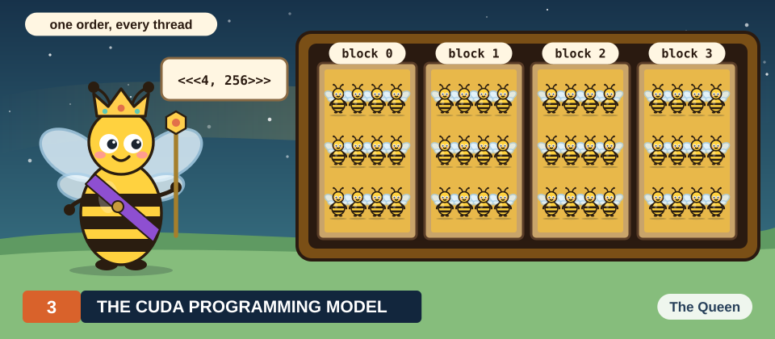
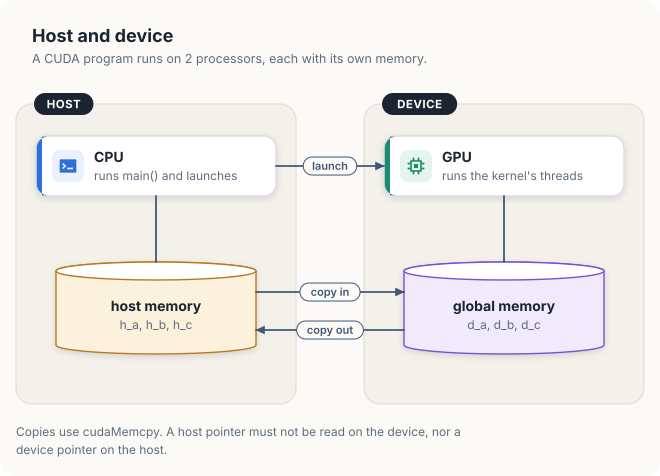
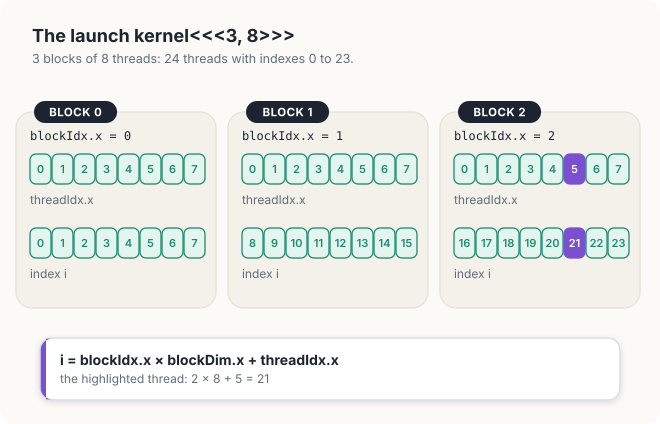
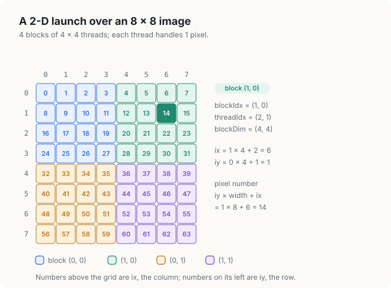
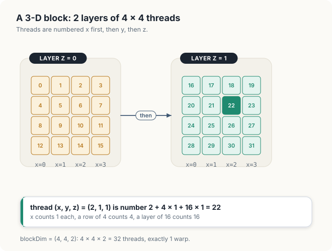
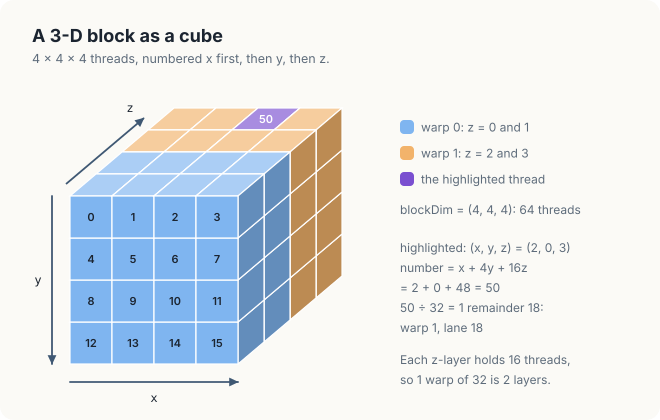
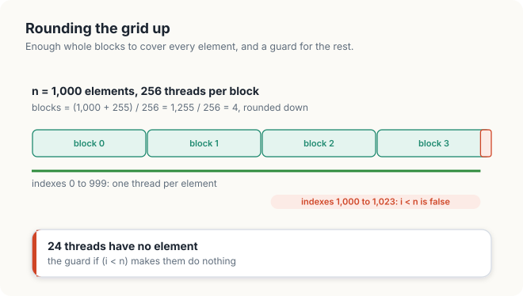
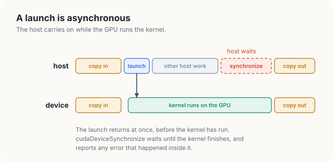
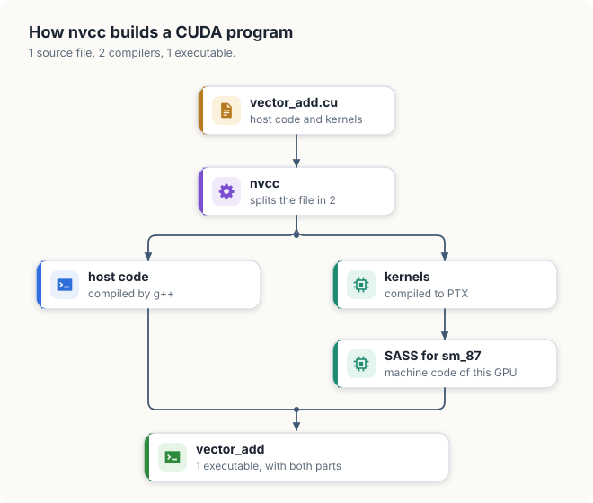

>>: a launch of 4 blocks of 256 threads. Beside her a wooden board holds 4 comb frames, labelled block 0 to block 3, and on each frame rows of worker bees wait for the order. The Queen gives one order and every bee on every frame carries it out.">

# Chapter 3: The CUDA Programming Model

*CUDA* is NVIDIA's platform for running general-purpose programs on its GPUs. Its
programming model is C++ with a small number of additions: a way to mark a function as a
kernel, a syntax to launch it as a grid of blocks, built-in variables that tell each thread
who it is, and library functions that move data between the CPU's memory and the GPU's.
Chapter 2 described the hardware that runs these programs. This chapter writes the first
complete program, vector addition, and runs it.

Every program in the chapter appears twice: in CUDA C++, and in Rust with **cuda-oxide**,
NVIDIA's compiler that turns Rust functions into GPU kernels. The 2 versions take the same
steps, so each idea is seen from both sides. Part V of the book uses cuda-oxide throughout.

<div class="covers" markdown="1">

This chapter covers

- host and device: the 2 processors and 2 memories of a CUDA program
- the function qualifiers `__global__`, `__device__` and `__host__`
- launching a kernel as a grid of blocks, in 1, 2 or 3 dimensions
- the built-in variables `threadIdx`, `blockIdx`, `blockDim` and `gridDim`
- the global index formula, and rounding a grid up with a guard
- the first complete program: vector addition, with its real output
- allocating and copying memory with `cudaMalloc` and `cudaMemcpy`
- why a launch is asynchronous, and how to check for errors
- how `nvcc` compiles a `.cu` file, and how `cargo oxide` builds the Rust version

</div>

The complete code of the chapter is in
[`code/ch03_vector_add/`](https://github.com/arpanpathak/gpu-parallel-book/tree/main/code/ch03_vector_add)
for C++ and in
[`code/oxide/ch03_basics/`](https://github.com/arpanpathak/gpu-parallel-book/tree/main/code/oxide/ch03_basics)
for Rust.

## 3.1 Host and device

A CUDA program runs on 2 processors. CUDA calls the CPU and its memory the **host**, and
the GPU and its memory the **device** (figure 3.1). The program's `main` function runs on
the host. Kernels run on the device.

<figure>

<figcaption><b>Figure 3.1</b> Host and device. The host launches kernels and copies data; the device runs the kernels.</figcaption>
</figure>

Each side has its own **address space**: the set of memory addresses its code can use. An
address on 1 side means nothing on the other. A **pointer** is a variable that holds an
address, so a pointer to device memory, a **device pointer**, must not be read on the host,
and a host pointer must not be read on the device. Data crosses between the 2 memories
only when the program copies it. This book names host arrays `h_a`, `h_b`, and device
arrays `d_a`, `d_b`, so the side each pointer belongs to is always visible.

The separation follows the hardware. On a discrete GPU, such as an RTX 4090 or an H100,
global memory is a separate set of chips on the GPU's card, and every copy crosses a link
between the card and the CPU (Chapter 2, section 2.1.4).

<div class="callout note" markdown="1">

**NOTE:** On integrated systems such as Jetson modules and DGX Spark, host and device share
1 set of memory chips. The programs in this chapter still allocate device memory and copy
data explicitly, so they run unchanged on every NVIDIA GPU. Chapter 4 shows how integrated
systems can avoid the copies.

</div>

## 3.2 Function qualifiers

A C++ compiler needs to know which functions to compile for the CPU and which for the GPU.
CUDA marks them with a **function qualifier**, a keyword written before the function's
return type.

| Qualifier | Runs on | Called from | Typical use |
|---|---|---|---|
| `__global__` | device | host | a kernel |
| `__device__` | device | device code | a helper called by a kernel |
| `__host__` | host | host code | an ordinary function; the default |

A `__global__` function is a kernel. It must return `void`, because thousands of threads
run it at once and there is no single caller to receive a return value; a kernel delivers
its results by writing to memory. The 2 qualifiers `__host__ __device__` together compile
1 function for both sides, which suits small helpers such as a function that clamps a value
to a range (Chapter 10).

```cpp
__device__ float square(float x) { return x * x; }        // helper, GPU only

__global__ void squares(float* out, const float* in, int n) // kernel, launched from the host
{
    // ... each thread computes 1 element, using square() ...
}
```

In Rust with cuda-oxide, an attribute plays the part of the qualifier. `#[kernel]` marks a
kernel and `#[device]` a helper that runs on the GPU, and both live in a module marked
`#[cuda_module]`, which cuda-oxide compiles for the GPU.

```rust
#[cuda_module]
mod kernels {
    #[device]
    fn square(x: f32) -> f32 { x * x }               // helper, GPU only

    #[kernel]
    pub fn squares(input: &[f32], mut out: DisjointSlice<f32>) {
        // ... each thread computes 1 element, using square() ...
    }
}
```

## 3.3 Launching a kernel: grids and blocks

### 3.3.1 A 1-dimensional launch

A launch names the kernel, then the shape of the work between triple angle brackets, then
the kernel's arguments:

```cpp
addVectors<<<blocks, threadsPerBlock>>>(d_a, d_b, d_c, n);
```

The part between `<<<` and `>>>` is the **execution configuration**. Its first number is
the number of blocks in the grid, and its second the number of threads in each block. The
launch `kernel<<<3, 8>>>` therefore starts 3 × 8 = 24 threads (figure 3.2).

In Rust, a launch takes 2 calls: `prepare_` checks the configuration against what the kernel
declares, and the second call runs it. `LaunchConfig1D::new(blocks, threads, 0)` holds the
same 2 numbers as `<<<blocks, threads>>>`; its last argument, 0 here, is the shared memory
each block asks for (Chapter 7).

```rust
let add = module.prepare_add_vectors(LaunchConfig1D::new(blocks, BLOCK, 0))?;
module.add_vectors(&stream, &add, &a_dev, &b_dev, &mut c_dev)?;
```

<figure>

<figcaption><b>Figure 3.2</b> The launch <code>kernel&lt;&lt;&lt;3, 8&gt;&gt;&gt;</code>: 3 blocks of 8 threads, with each thread's position in its block and its index.</figcaption>
</figure>

A launch states how much work there is and how it is grouped. It does not state an order.
The GPU decides which SM runs which block, and when, so blocks may run in any order and
must not depend on each other. Section 3.6 shows a real run in which block 1 printed before
block 0.

### 3.3.2 2 and 3 dimensions

Many kinds of data have 2 or 3 dimensions: an image has rows and columns, and a medical
scan or a simulated volume has layers as well. CUDA lets a grid and its blocks have the same
shape. Both numbers of the execution configuration can be a `dim3`, a small type with 3
fields, `x`, `y` and `z`; a field that is not given is 1.

```cpp
dim3 threadsPerBlock(4, 4);     // 4 × 4 = 16 threads per block, z = 1
dim3 blocks(2, 2);              // 2 × 2 = 4 blocks
kernel<<<blocks, threadsPerBlock>>>(...);
```

The 4 blocks of 4 × 4 threads cover an image of 8 × 8 pixels, 1 thread per pixel (figure
3.3). Each thread computes its column and row with the same formula as in 1 dimension, once
for x and once for y.

<figure>

<figcaption><b>Figure 3.3</b> A 2-dimensional launch over an 8 × 8 image. The highlighted thread computes its column, its row and the pixel's number.</figcaption>
</figure>

A block can have depth too. Figure 3.4 shows a block of `dim3(4, 4, 2)`: 2 layers of 4 × 4
threads. The hardware numbers a block's threads with x changing fastest, then y, then z, and
cuts that numbering into warps of 32 (Chapter 2, section 2.4). A row of 4 threads therefore
counts 4, and a layer of 16 counts 16, so the thread at (2, 1, 1) is number
2 + 4 × 1 + 16 × 1 = 22. This block holds 4 × 4 × 2 = 32 threads, exactly 1 warp.

<figure>

<figcaption><b>Figure 3.4</b> A 3-dimensional block of 4 × 4 × 2 threads, numbered x first, then y, then z.</figcaption>
</figure>

Stacked, the layers form a cube (figure 3.5). A block of `dim3(4, 4, 4)` holds 64 threads,
2 warps. 1 layer holds 16 threads, half a warp, so warp 0 is layers z = 0 and 1, and warp 1
is layers z = 2 and 3. The thread at (2, 0, 3), on top of the back layer, is number
2 + 4 × 0 + 16 × 3 = 50, and 50 ÷ 32 = 1 remainder 18 places it in warp 1, lane 18.

<figure>

<figcaption><b>Figure 3.5</b> A block of 4 × 4 × 4 threads as a cube. Each warp is a slab of 2 layers.</figcaption>
</figure>

### 3.3.3 Launch limits

A launch must stay within limits that NVIDIA documents for every current GPU.

| Quantity | Limit | Where the number comes from |
|---|---|---|
| threads per block | 1,024 | 32 warps; NVIDIA's limit, which keeps a whole block small enough for 1 SM (Chapter 2, section 2.4) |
| block size in x, in y | 1,024 each | no axis can exceed the block total |
| block size in z | 64 | NVIDIA's documented limit |
| blocks in a grid, in x | 2<sup>31</sup> − 1 | the largest positive 32-bit signed integer |
| blocks in a grid, in y and in z | 65,535 | the largest 16-bit unsigned integer |

A launch that breaks a limit does not run. The launch itself reports no error; the program
learns of the failure from `cudaGetLastError`, as section 3.8 explains.

## 3.4 Built-in variables

Inside a kernel, 4 variables describe the launch and the thread's place in it. Every thread
can read them, and no program declares them.

| C++ | Rust (cuda-oxide) | Meaning |
|---|---|---|
| `threadIdx.x` | `thread::threadIdx_x()` | the thread's position in its block |
| `blockIdx.x` | `thread::blockIdx_x()` | the block's position in the grid |
| `blockDim.x` | `thread::blockDim_x()` | the number of threads in a block |
| `gridDim.x` | `thread::gridDim_x()` | the number of blocks in the grid |

Each has `.y` and `.z` forms as well (`threadIdx_y()` and so on in Rust). In C++,
`threadIdx` and `blockIdx` have type `uint3` and `blockDim` and `gridDim` type `dim3`; both
hold 3 unsigned integers.

`threadIdx` is the position of Chapter 2, section 2.1.2, and `blockIdx` is the block number.

## 3.5 The global index formula

Chapter 2 found a thread's index by counting the threads of the blocks before it, then
adding its position. In CUDA's names:

```cpp
const int i = blockIdx.x * blockDim.x + threadIdx.x;
```

`blockIdx.x * blockDim.x` counts the threads of all earlier blocks: block 2 of a launch with
8 threads per block starts after 2 × 8 = 16 threads. Adding `threadIdx.x`, the position in
the block, gives the index. In figure 3.2, thread 5 of block 2 has index 2 × 8 + 5 = 21.

<div class="example" markdown="1">

Worked example: the launch `kernel<<<4, 256>>>`

| Thread | `blockIdx.x` | `threadIdx.x` | Index |
|---|---|---|---|
| first thread of block 0 | 0 | 0 | 0 × 256 + 0 = 0 |
| thread 137 of block 2 | 2 | 137 | 2 × 256 + 137 = 649 |
| last thread of block 3 | 3 | 255 | 3 × 256 + 255 = 1,023 |

Block 2 covers indexes 512 to 767. Its warp 0 holds positions 0 to 31, indexes 512 to 543:
32 consecutive indexes.

</div>

For a 2-dimensional launch the same formula is applied to each axis, and the pixel's place
in memory follows from its row and column (figure 3.3):

```cpp
const int ix = blockIdx.x * blockDim.x + threadIdx.x;   // column
const int iy = blockIdx.y * blockDim.y + threadIdx.y;   // row
const int pixel = iy * width + ix;                      // rows are stored 1 after another
```

An image stored row after row puts a row's pixels at consecutive addresses. Neighbouring
threads of a warp have consecutive `threadIdx.x`, so they read consecutive pixels of 1 row:
the coalesced pattern of Chapter 2, section 2.7.

### 3.5.1 Rounding the grid up

A grid must have a whole number of blocks, but the number of elements need not be a
multiple of the block size. For n = 1,000 elements and 256 threads per block, 3 blocks
cover only 768 elements, and 4 blocks start 1,024 threads. A program launches 4 blocks and
lets the 24 extra threads do nothing (figure 3.6).

<figure>

<figcaption><b>Figure 3.6</b> 4 blocks of 256 threads for 1,000 elements. The guard <code>if (i &lt; n)</code> stops the last 24 threads.</figcaption>
</figure>

C++ integer division rounds down: 1,000 / 256 = 3. Adding 255, 1 less than the block size,
before dividing makes any remainder reach the next multiple: (1,000 + 255) / 256 =
1,255 / 256 = 4. In general,

```cpp
const int blocks = (n + threadsPerBlock - 1) / threadsPerBlock;
```

gives the smallest number of blocks that covers n. When n is already a multiple, the
added 255 does not reach the next multiple, and no extra block is launched. Every kernel
then needs a **guard**, a test that stops threads whose index is past the end of the data:

```cpp
if (i < n) { c[i] = a[i] + b[i]; }
```

Without the guard, threads 1,000 to 1,023 would read and write outside the arrays. The guard
costs 1 comparison per thread, and only the last block contains threads that fail it.

<details class="check">
<summary>A program adds 1,000,000 elements with 256 threads per block. How many blocks does it launch, and how many threads are stopped by the guard?</summary>

(1,000,000 + 255) / 256 = 3,907 blocks, which is 3,907 × 256 = 1,000,192 threads. The guard
stops 1,000,192 − 1,000,000 = 192 of them, all in the last block.

</details>

## 3.6 The first program: vector addition

The program adds 2 arrays of 1,048,576 floats on the GPU, copies the result back, and checks
every element. Each step is shown in C++ first, then in Rust.

### 3.6.1 The kernel

<p class="listing"><b>Listing 3.1</b> The kernel, in C++. <a href="https://github.com/arpanpathak/gpu-parallel-book/blob/main/code/ch03_vector_add/vector_add.cu">code/ch03_vector_add/vector_add.cu</a></p>

```cpp
{{#include ../../../../code/ch03_vector_add/vector_add.cu:19:25}}
```

<p class="listing"><b>Listing 3.2</b> The kernel, in Rust. <a href="https://github.com/arpanpathak/gpu-parallel-book/blob/main/code/oxide/ch03_basics/src/main.rs">code/oxide/ch03_basics/src/main.rs</a></p>

```rust,ignore
mod kernels {
    // ...
{{#include ../../../../code/oxide/ch03_basics/src/main.rs:25:33}}
}
```

In C++, each thread computes its index, checks it against `n`, and adds 1 pair of elements.

The Rust kernel does the same with 2 helpers. `thread::index_1d()` computes the same index,
`blockIdx.x × blockDim.x + threadIdx.x`. `DisjointSlice` is an output array in which each
thread can reach only its own element: `c.get_mut(idx)` returns that element, or `None` when
the index is past the end. The guard is therefore part of the type, and a kernel that forgot
it would not compile. `#[launch_contract(domain = 1, block = (256, 1, 1))]` states that the
kernel expects 1-dimensional blocks of 256 threads; the host checks every launch against it.

In both versions, each thread writes a different element of `c`, so no 2 threads ever write
to the same address, and the threads need no coordination.

### 3.6.2 Memory on both sides

<p class="listing"><b>Listing 3.3</b> Host and device arrays, in C++.</p>

```cpp
int main()
{
{{#include ../../../../code/ch03_vector_add/vector_add.cu:29:44}}
    // ...
}
```

<p class="listing"><b>Listing 3.4</b> Host and device arrays, in Rust.</p>

```rust,ignore
fn main() -> Result<(), Box<dyn std::error::Error>> {
    // ...
{{#include ../../../../code/oxide/ch03_basics/src/main.rs:47:53}}
    // ...
}
```

`1 << 20` shifts 1 left by 20 bits, which is 2<sup>20</sup> = 1,048,576. Each array holds
1,048,576 floats of 4 bytes, so `bytes` is 4,194,304, 4 MiB.

In C++, `cudaMalloc` allocates that many bytes of global memory and stores the new device
pointer in its first argument, which is why it receives the pointer's address, `&d_a`.
`cudaMemcpy` then copies each input from host to device.

In Rust, `DeviceBuffer::from_host` allocates device memory and copies a host array into it
in 1 call, and `DeviceBuffer::zeroed` allocates the output, filled with zeros. A
`DeviceBuffer` frees its memory when it goes out of scope, so the Rust program has no
equivalent of `cudaFree`.

### 3.6.3 Launch and wait

<p class="listing"><b>Listing 3.5</b> Launch, in C++.</p>

```cpp
int main()
{
    // ...
{{#include ../../../../code/ch03_vector_add/vector_add.cu:46:51}}
    // ...
}
```

<p class="listing"><b>Listing 3.6</b> Launch, in Rust.</p>

```rust,ignore
fn main() -> Result<(), Box<dyn std::error::Error>> {
    // ...
{{#include ../../../../code/oxide/ch03_basics/src/main.rs:55:59}}
    // ...
}
```

The block size of 256 is 8 full warps, and small enough that several blocks fit on 1 SM
(Chapter 2, section 2.9); sizes from 128 to 512 are common. With n = 1,048,576, the grid has
1,048,576 / 256 = 4,096 blocks, and no thread fails the guard. Rust's `div_ceil` divides and
rounds up, the same as `(n + threads - 1) / threads` in C++.

C++ waits for the kernel with `cudaDeviceSynchronize`. In Rust, `to_host_vec` copies the
result back into a new `Vec`, and the copy waits for the kernel first.

### 3.6.4 Building and running

```console
$ nvcc -arch=native vector_add.cu -o vector_add
$ ./vector_add
n = 1048576, 4096 blocks of 256 threads
c[0] = 0, c[1] = 3, c[1048575] = 3145725
max error = 0
```

```console
$ cargo oxide run
...
n = 1048576, 4096 blocks of 256 threads
c[0] = 0, c[1] = 3, c[1048575] = 3145725
max error = 0
```

Both outputs come from runs on a Jetson Orin NX with CUDA 12.6; any NVIDIA GPU prints the same
numbers. The inputs were `a[i] = i` and `b[i] = 2i`, so `c[i]` should be `3i`: `c[1048575]`
is 3 × 1,048,575 = 3,145,725, and the maximum error over all 1,048,576 elements is 0.

### 3.6.5 Which thread runs first?

A second, tiny kernel makes the index formula visible. Every thread of a launch of 2 blocks
of 4 threads prints its block, its position and its index.

<p class="listing"><b>Listing 3.7</b> Every thread prints who it is, in C++. <a href="https://github.com/arpanpathak/gpu-parallel-book/blob/main/code/ch03_vector_add/whoami.cu">code/ch03_vector_add/whoami.cu</a></p>

```cpp
{{#include ../../../../code/ch03_vector_add/whoami.cu:7:18}}
```

<p class="listing"><b>Listing 3.8</b> The same kernel, in Rust.</p>

```rust,ignore
mod kernels {
    // ...
{{#include ../../../../code/oxide/ch03_basics/src/main.rs:15:23}}
    // ...
}
```

```console
$ ./whoami
block 1, position 0 -> index 4
block 1, position 1 -> index 5
block 1, position 2 -> index 6
block 1, position 3 -> index 7
block 0, position 0 -> index 0
block 0, position 1 -> index 1
block 0, position 2 -> index 2
block 0, position 3 -> index 3
```

The Rust program printed the same 8 lines in the same order. Each index is the block number ×
4 + the position, as section 3.5 says. On these runs block 1 printed before block 0. Another
GPU, or another run, may print them in a different order: the order of blocks is not
defined, and a correct kernel never depends on it.

### 3.6.6 The complete programs

<p class="listing"><b>Listing 3.9</b> The complete <code>vector_add.cu</code>.</p>

```cpp
{{#include ../../../../code/ch03_vector_add/vector_add.cu}}
```

<p class="listing"><b>Listing 3.10</b> The complete Rust program.</p>

```rust,ignore
{{#include ../../../../code/oxide/ch03_basics/src/main.rs}}
```

## 3.7 The memory functions

| Function | What it does |
|---|---|
| `cudaMalloc(&p, bytes)` | allocates `bytes` of global memory and stores the device pointer in `p` |
| `cudaFree(p)` | frees memory allocated by `cudaMalloc` |
| `cudaMemcpy(dst, src, bytes, kind)` | copies `bytes`; `kind` is `cudaMemcpyHostToDevice`, `cudaMemcpyDeviceToHost` or `cudaMemcpyDeviceToDevice`; waits for earlier device work, and in most cases returns when the copy is complete (Chapter 4 gives the exceptions) |
| `cudaDeviceSynchronize()` | waits until all work launched so far on the device has finished |
| `cudaGetLastError()` | returns, and clears, the last error recorded by the runtime |
| `cudaGetErrorString(err)` | returns a readable description of an error code |

`cudaMalloc` writes its result through a pointer to the caller's pointer, as C functions do,
and returns an error code instead of the pointer. `cudaMemcpy` needs the direction because a
host address and a device address are both plain numbers, and the same number can be valid
on both sides.

## 3.8 Errors and asynchronous launches

Every CUDA runtime function returns a value of type `cudaError_t`: `cudaSuccess`, which is
0, or a code that names what went wrong. Errors arrive in 2 ways.

1. **Immediately.** A call with a bad argument, such as a copy from a null pointer, returns
   an error code at once.
2. **Later.** A launch returns before its kernel runs. The host carries on while the GPU
   works (figure 3.7), so an error inside the kernel, such as a read outside an array,
   cannot be reported by the launch. It is reported by the next call that waits for the
   kernel, such as `cudaDeviceSynchronize`.

<figure>

<figcaption><b>Figure 3.7</b> A launch returns at once. The host waits only where it calls <code>cudaDeviceSynchronize</code>.</figcaption>
</figure>

The program in section 3.6 checks both kinds. Right after the launch, `cudaGetLastError`
reports whether the launch was accepted, for example whether a block of more than 1,024
threads was requested. `cudaDeviceSynchronize` then waits for the kernel and reports any
error that happened while it ran.

Every CUDA call in the C++ program goes through `check`, which prints the error's
description and stops the program. In Rust, every call returns a `Result`, and the `?`
operator passes an error up to `main`, which reports it. An unchecked error does not stop
anything: the program goes on with wrong data and prints wrong results.

<details class="check">
<summary>A kernel reads outside its array. Which call in listing 3.5 reports the error?</summary>

`cudaDeviceSynchronize`. The launch was valid, so `cudaGetLastError` right after it returns
`cudaSuccess`; the bad read happens while the kernel runs, and the wait reports it.

</details>

## 3.9 Compiling with nvcc

A `.cu` file holds code for 2 processors. **nvcc**, NVIDIA's compiler driver, splits it in 2
(figure 3.8).

<figure>

<figcaption><b>Figure 3.8</b> nvcc sends the host code to the host's C++ compiler and compiles the kernels for the GPU, then joins both in 1 executable.</figcaption>
</figure>

- The host code goes to the host's ordinary C++ compiler, such as `g++`. Each launch
  `<<<...>>>` becomes a call into the CUDA runtime library.
- The kernels are compiled first to **PTX**, an instruction set that NVIDIA keeps stable
  across GPU generations, then to **SASS**, the machine code of 1 particular GPU. SASS is
  specific to a compute capability; `sm_87` names compute capability 8.7.

The `-arch` option chooses the GPU to compile for:

```console
$ nvcc -arch=native vector_add.cu -o vector_add    # the GPU in this machine
$ nvcc -arch=sm_90  vector_add.cu -o vector_add    # an H100
```

An executable compiled with `-arch=sm_90` also carries PTX for compute capability 9.0, and a
newer GPU's driver can compile that PTX for itself when the program starts. This book never
shows PTX or SASS: the kernels are read in C++ and in Rust.

The Rust version is built with `cargo oxide run`. cuda-oxide compiles the `#[cuda_module]`
for the GPU, rustc compiles the host code, and both end up in 1 executable, as with `nvcc`.

## Common mistakes

- **Reading a device pointer on the host.** `d_c[0]` in `main` reads an address that means
  nothing to the CPU. Copy the data back first.
- **Forgetting the guard.** A rounded-up grid has threads past the end of the data. Without
  `if (i < n)` they read and write outside the arrays.
- **Reading results before the kernel has finished.** A launch returns at once. Synchronize,
  or copy with `cudaMemcpy`, which waits for earlier work, before reading the output.
- **Assuming an order of blocks.** Blocks run in any order (section 3.6.6), and a kernel's
  result must not depend on it.
- **Using `int` for byte counts.** Sizes in bytes can exceed 2<sup>31</sup> − 1; use
  `size_t`.

<div class="summary" markdown="1">

## Summary

- The **host** is the CPU and its memory; the **device** is the GPU and its memory. Each has
  its own address space, and data moves between them with `cudaMemcpy`.
- `__global__` marks a kernel, which runs on the device and is launched from the host.
  `__device__` marks a helper that runs on the device.
- `kernel<<<blocks, threadsPerBlock>>>` launches a grid of blocks. Grids and blocks can have
  1, 2 or 3 dimensions, and blocks run in no fixed order.
- A thread's index is `blockIdx.x * blockDim.x + threadIdx.x`.
- `(n + threadsPerBlock - 1) / threadsPerBlock` rounds the grid up, and `if (i < n)` stops
  the extra threads.
- A launch is asynchronous. Check `cudaGetLastError` after it and the result of
  `cudaDeviceSynchronize`, and check every other CUDA call.
- `nvcc` compiles host code with the host's compiler and kernels to PTX and SASS.
- In Rust with cuda-oxide, `#[kernel]` marks a kernel, `thread::index_1d()` gives the index,
  `DisjointSlice` builds the guard into the type, and `DeviceBuffer` allocates, copies and
  frees device memory.

</div>

Chapter 4 looks closely at the copies between host and device: how fast they are, and how
pinned and unified memory make them faster or remove them.

## Exercises

1. A launch `kernel<<<5, 64>>>` starts how many threads? What is the index of thread 10 of
   block 3?
2. Write the 2-dimensional index formulas for an image of `width × height` pixels, and show
   that the 32 threads of a warp in a block of 32 × 8 threads read 32 consecutive pixels.
3. For n = 1,000,000 and 512 threads per block, how many blocks are launched, and how many
   threads fail the guard?
4. A block has `blockDim = (8, 4, 2)`. How many threads does it hold, how many warps, and what
   is the number of the thread at (3, 2, 1)?
5. Why must a `__global__` function return `void`? What would a return value mean for
   1,000,000 threads?
6. Change `whoami.cu` to launch 4 blocks of 2 threads. Predict the indexes before running it,
   then run it 3 times. Does the order of the lines change?
7. Remove the guard from the kernel of listing 3.1 and run it with n = 1,000. What happens?
   Use a machine where a crash does no harm.
8. In the Rust kernel of listing 3.2, try to write `c[i] = a[i] + b[i]` directly instead of
   going through `c.get_mut(idx)`. What does the compiler say, and why?

## Sources and further reading

- NVIDIA, *CUDA C++ Programming Guide*, "Programming Model" and "Programming Interface":
  <https://docs.nvidia.com/cuda/cuda-c-programming-guide/>
- NVIDIA, *CUDA C++ Best Practices Guide*: <https://docs.nvidia.com/cuda/cuda-c-best-practices-guide/>
- NVIDIA, *NVCC* documentation, for `-arch` and the compilation flow:
  <https://docs.nvidia.com/cuda/cuda-compiler-driver-nvcc/>
- David B. Kirk, Wen-mei W. Hwu and Izzat El Hajj, *Programming Massively Parallel
  Processors*, 4th ed., chapters 2 and 3.
