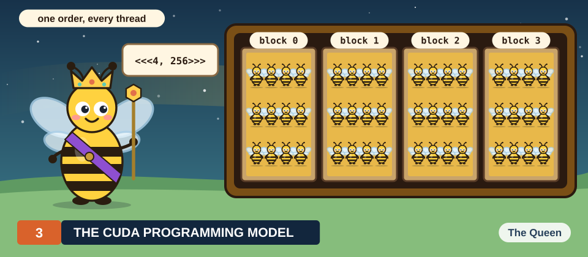
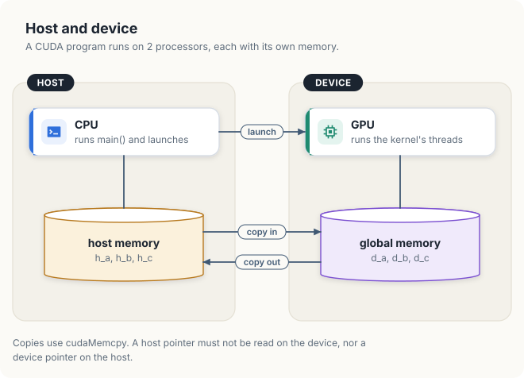
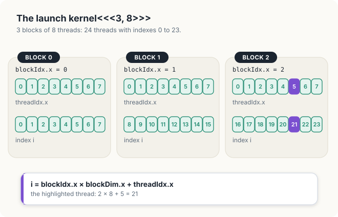
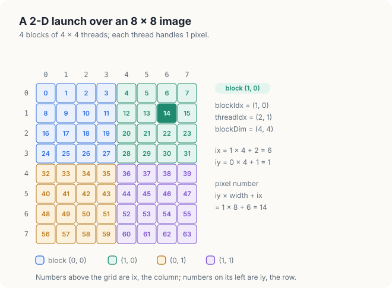
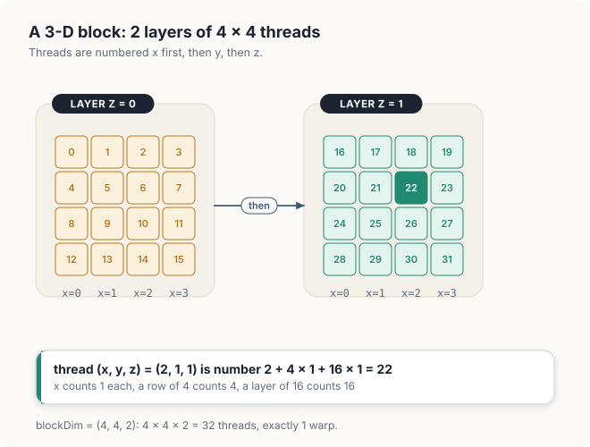
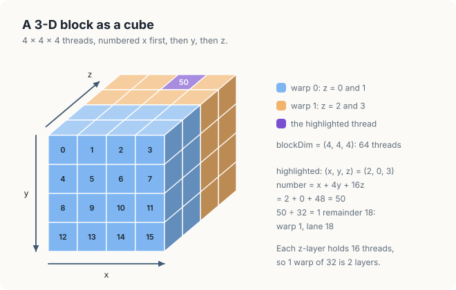
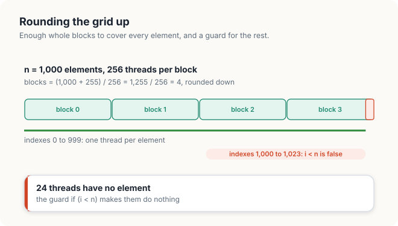
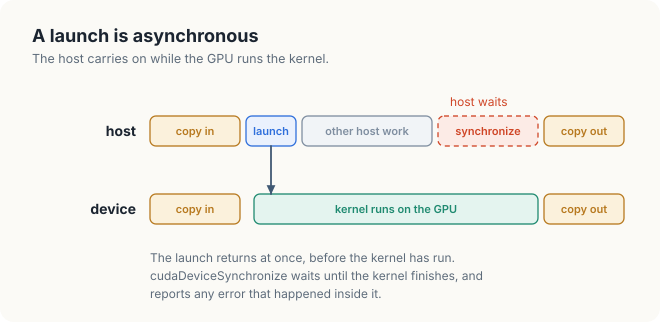
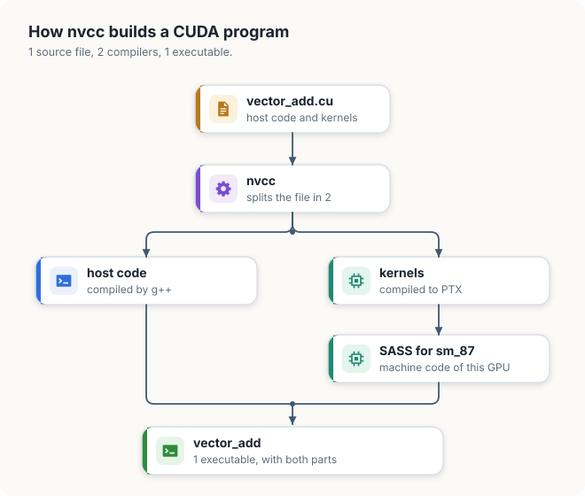

>>: a launch of 4 blocks of 256 threads. Beside her a wooden board holds 4 comb frames, labelled block 0 to block 3, and on each frame rows of worker bees wait for the order. The Queen gives one order and every bee on every frame carries it out.">

# Chapter 3: The CUDA Programming Model

*CUDA* is NVIDIA's platform for running general-purpose programs on its GPUs. A CUDA
program is written in C++ with a small number of additions: a keyword that marks a function
as a kernel, a syntax for launching that kernel as a grid of blocks, built-in variables that
give each thread its position in the grid, and library functions that move data between the
memory of the CPU and the memory of the GPU. Chapter 2 described the hardware that executes
these programs. In this chapter, we use these additions to write, compile and run a complete
program, the addition of 2 vectors.

We show every program twice: in CUDA C++, and in Rust with **cuda-oxide**, NVIDIA's compiler
that turns Rust functions into GPU kernels. The 2 versions perform the same steps in the
same order, so that each concept can be compared in both languages. Part V of the book uses
cuda-oxide throughout.

<div class="covers" markdown="1">

This chapter covers

- host and device: the 2 processors and 2 memories of a CUDA program
- the function qualifiers `__global__`, `__device__` and `__host__`
- launching a kernel as a grid of blocks, in 1, 2 or 3 dimensions
- the built-in variables `threadIdx`, `blockIdx`, `blockDim` and `gridDim`
- the global index formula, and rounding the number of blocks up with a guard
- a complete vector addition program and its output
- allocating and copying memory with `cudaMalloc` and `cudaMemcpy`
- asynchronous launches and error checking
- compiling a `.cu` file with `nvcc` and the Rust version with `cargo oxide`

</div>

The complete code of the chapter is in
[`code/ch03_vector_add/`](https://github.com/arpanpathak/gpu-parallel-book/tree/main/code/ch03_vector_add)
for C++ and in
[`code/oxide/ch03_basics/`](https://github.com/arpanpathak/gpu-parallel-book/tree/main/code/oxide/ch03_basics)
for Rust.

## 3.1 Host and device

A CUDA program runs on 2 processors. CUDA calls the CPU and its memory the **host**, and
the GPU and its memory the **device** (figure 3.1). The `main` function of the program runs
on the host, and the kernels run on the device. The host is responsible for allocating
device memory, copying the input data into it, launching the kernels and copying the
results back.

<figure>

<figcaption><b>Figure 3.1</b> Host and device. The host launches kernels and copies data; the device runs the kernels.</figcaption>
</figure>

Each side has its own **address space**, the set of memory addresses that its code can use.
An address that is valid on 1 side has no meaning on the other. A **pointer** is a variable
that holds an address, and a pointer to device memory is called a **device pointer**. A
device pointer must not be dereferenced in host code, and a host pointer must not be
dereferenced in device code. Data moves between the 2 memories only when the program copies
it. In this book, host arrays are named `h_a`, `h_b`, and device arrays `d_a`, `d_b`, so that
the side to which each pointer belongs is visible in the code.

The separation follows the hardware. On a discrete GPU, such as an RTX 4090 or an H100,
global memory is a separate set of chips on the GPU's card, and every copy crosses the link
between the card and the CPU (Chapter 2, section 2.1.4).

<div class="callout note" markdown="1">

**NOTE:** On integrated systems such as Jetson modules and DGX Spark, host and device share
1 set of memory chips. The programs in this chapter still allocate device memory and copy
data explicitly, so they run unchanged on every NVIDIA GPU. Chapter 4 shows how integrated
systems can avoid the copies.

</div>

## 3.2 Function qualifiers

The compiler must know which functions to compile for the CPU and which for the GPU. CUDA
marks this with a **function qualifier**, a keyword written before the return type of a
function.

| Qualifier | Runs on | Called from | Typical use |
|---|---|---|---|
| `__global__` | device | host | a kernel |
| `__device__` | device | device code | a helper called by a kernel |
| `__host__` | host | host code | an ordinary function; the default |

A `__global__` function is a kernel. It must return `void`. Thousands of threads execute a
kernel at the same time, and there is no single caller that could receive a return value;
a kernel therefore delivers its results by writing them to memory. A function declared with
both `__host__` and `__device__` is compiled twice, once for each side. This is useful for
small helpers, such as a function that clamps a value to a range (Chapter 10).

```cpp
__device__ float square(float x) { return x * x; }        // helper, GPU only

__global__ void squares(float* out, const float* in, int n) // kernel, launched from the host
{
    // ... each thread computes 1 element, using square() ...
}
```

In Rust with cuda-oxide, an attribute takes the place of the qualifier. `#[kernel]` marks a
kernel and `#[device]` marks a helper that runs on the GPU. Both are placed in a module
marked `#[cuda_module]`, which cuda-oxide compiles for the GPU.

```rust
#[cuda_module]
mod kernels {
    #[device]
    fn square(x: f32) -> f32 { x * x }               // helper, GPU only

    #[kernel]
    pub fn squares(input: &[f32], mut out: DisjointSlice<f32>) {
        // ... each thread computes 1 element, using square() ...
    }
}
```

## 3.3 Kernel launch: grids and blocks

### 3.3.1 One-dimensional launches

A kernel launch names the kernel, then the shape of the work between triple angle brackets,
then the arguments of the kernel:

```cpp
addVectors<<<blocks, threadsPerBlock>>>(d_a, d_b, d_c, n);
```

The part between `<<<` and `>>>` is called the **execution configuration**. Its first value
is the number of blocks in the grid, and its second value is the number of threads in each
block. For example, the launch `kernel<<<3, 8>>>` starts 3 × 8 = 24 threads, as shown in
figure 3.2.

In Rust, a launch takes 2 calls. The `prepare_` call checks the configuration against the
one that the kernel declares, and the second call runs the kernel. `LaunchConfig1D::new(blocks,
threads, 0)` holds the same 2 values as `<<<blocks, threads>>>`; its last argument, 0 here, is
the amount of shared memory that each block requests (Chapter 7).

```rust
let add = module.prepare_add_vectors(LaunchConfig1D::new(blocks, BLOCK, 0))?;
module.add_vectors(&stream, &add, &a_dev, &b_dev, &mut c_dev)?;
```

<figure>

<figcaption><b>Figure 3.2</b> The launch <code>kernel&lt;&lt;&lt;3, 8&gt;&gt;&gt;</code>: 3 blocks of 8 threads, with the position of each thread in its block and its index.</figcaption>
</figure>

The execution configuration specifies how much work there is and how it is grouped into
blocks. It does not specify an order of execution. The hardware decides which SM executes
which block, and when. Blocks may therefore execute in any order, and a correct kernel must
not depend on the order. Section 3.6.5 shows a run in which block 1 printed its output before
block 0.

### 3.3.2 Multidimensional grids and blocks

Many kinds of data have 2 or 3 dimensions. An image has rows and columns, and a medical scan
or a simulated volume has layers as well. CUDA allows a grid and its blocks to have the same
shape as the data. Both values of the execution configuration can be of type `dim3`, a small
type with 3 fields, `x`, `y` and `z`; a field that is not given defaults to 1.

```cpp
dim3 threadsPerBlock(4, 4);     // 4 × 4 = 16 threads per block, z = 1
dim3 blocks(2, 2);              // 2 × 2 = 4 blocks
kernel<<<blocks, threadsPerBlock>>>(...);
```

The 4 blocks of 4 × 4 threads cover an image of 8 × 8 pixels with 1 thread per pixel, as shown
in figure 3.3. Each thread computes its column and its row with the same formula as in the
1-dimensional case, once along x and once along y.

<figure>

<figcaption><b>Figure 3.3</b> A 2-dimensional launch over an 8 × 8 image. The highlighted thread computes its column, its row and the number of its pixel.</figcaption>
</figure>

A block can also have a depth. Figure 3.4 shows a block of `dim3(4, 4, 2)`, which consists of 2
layers of 4 × 4 threads. The hardware numbers the threads of a block with x changing fastest,
then y, then z, and divides that numbering into warps of 32 threads (Chapter 2, section 2.4).
A step of 1 in y therefore advances the number by 4, the length of a row, and a step of 1 in z
advances it by 16, the size of a layer. The thread at (2, 1, 1) is number 2 + 4 × 1 + 16 × 1 =
22. This block holds 4 × 4 × 2 = 32 threads, which is exactly 1 warp.

<figure>

<figcaption><b>Figure 3.4</b> A 3-dimensional block of 4 × 4 × 2 threads, numbered x first, then y, then z.</figcaption>
</figure>

When the layers are stacked, they form a cube, as in figure 3.5. A block of `dim3(4, 4, 4)`
holds 64 threads, which is 2 warps. Each layer holds 16 threads, half a warp, so warp 0
consists of layers z = 0 and 1, and warp 1 consists of layers z = 2 and 3. The thread at
(2, 0, 3), on the top of the back layer, is number 2 + 4 × 0 + 16 × 3 = 50. Since 50 ÷ 32 = 1
with a remainder of 18, this thread is lane 18 of warp 1.

<figure>

<figcaption><b>Figure 3.5</b> A block of 4 × 4 × 4 threads as a cube. Each warp occupies 2 layers.</figcaption>
</figure>

### 3.3.3 Launch limits

The execution configuration must stay within limits that NVIDIA documents for every current
GPU.

| Quantity | Limit | Where the number comes from |
|---|---|---|
| threads per block | 1,024 | 32 warps; NVIDIA's limit, which keeps a whole block small enough for 1 SM (Chapter 2, section 2.4) |
| block size in x, in y | 1,024 each | no axis can exceed the block total |
| block size in z | 64 | NVIDIA's documented limit |
| blocks in a grid, in x | 2<sup>31</sup> − 1 | the largest positive 32-bit signed integer |
| blocks in a grid, in y and in z | 65,535 | the largest 16-bit unsigned integer |

A launch that exceeds a limit does not run. The launch statement itself does not return an
error; the program detects the failure by calling `cudaGetLastError`, as explained in section
3.8.

## 3.4 Built-in variables

Inside a kernel, 4 built-in variables describe the launch and the position of the thread in
it. Every thread can read them, and the program does not declare them. The table below lists them
together with their cuda-oxide equivalents.

| C++ | Rust (cuda-oxide) | Meaning |
|---|---|---|
| `threadIdx.x` | `thread::threadIdx_x()` | the thread's position in its block |
| `blockIdx.x` | `thread::blockIdx_x()` | the block's position in the grid |
| `blockDim.x` | `thread::blockDim_x()` | the number of threads in a block |
| `gridDim.x` | `thread::gridDim_x()` | the number of blocks in the grid |

Each variable also has `.y` and `.z` fields (`threadIdx_y()` and so on in Rust). In C++,
`threadIdx` and `blockIdx` are of type `uint3`, and `blockDim` and `gridDim` are of type
`dim3`; both types hold 3 unsigned integers.

`threadIdx` is the position within the block that Chapter 2, section 2.1.2, introduced, and
`blockIdx` is the block number.

## 3.5 The global index formula

Recall from Chapter 2 that the index of a thread is found by counting the threads of all
blocks before its own and adding its position within its block. With CUDA's built-in
variables, the formula is written as follows:

```cpp
const int i = blockIdx.x * blockDim.x + threadIdx.x;
```

The product `blockIdx.x * blockDim.x` is the number of threads in all earlier blocks. For
example, in a launch with 8 threads per block, block 2 starts after 2 × 8 = 16 threads.
Adding `threadIdx.x`, the position within the block, gives the index. In figure 3.2, thread 5
of block 2 therefore has the index 2 × 8 + 5 = 21.

For the launch `kernel<<<4, 256>>>`, the formula gives the following indices:

| Thread | `blockIdx.x` | `threadIdx.x` | Index |
|---|---|---|---|
| first thread of block 0 | 0 | 0 | 0 × 256 + 0 = 0 |
| thread 137 of block 2 | 2 | 137 | 2 × 256 + 137 = 649 |
| last thread of block 3 | 3 | 255 | 3 × 256 + 255 = 1,023 |

Block 2 covers the indices 512 to 767. Its warp 0 holds the positions 0 to 31, which are the
indices 512 to 543, so the 32 threads of a warp have 32 consecutive indices.

For a 2-dimensional launch, the same formula is applied along each axis, and the location of
the pixel in memory follows from its row and its column (figure 3.3):

```cpp
const int ix = blockIdx.x * blockDim.x + threadIdx.x;   // column
const int iy = blockIdx.y * blockDim.y + threadIdx.y;   // row
const int pixel = iy * width + ix;                      // rows are stored 1 after another
```

An image stored row after row places the pixels of a row at consecutive addresses. Adjacent
threads of a warp have consecutive values of `threadIdx.x`, so they read consecutive pixels
of 1 row. This is the coalesced access pattern of Chapter 2, section 2.7.

### 3.5.1 Covering an arbitrary number of elements

A grid must consist of a whole number of blocks, but the number of elements is not always a
multiple of the block size. For n = 1,000 elements and 256 threads per block, 3 blocks cover
only 768 elements, while 4 blocks start 1,024 threads. The program therefore launches 4
blocks, and the 24 extra threads do no work, as figure 3.6 shows.

<figure>

<figcaption><b>Figure 3.6</b> 4 blocks of 256 threads for 1,000 elements. The guard <code>if (i &lt; n)</code> stops the last 24 threads.</figcaption>
</figure>

Integer division in C++ rounds down, so 1,000 / 256 = 3. Adding 255, which is 1 less than the
block size, before the division raises any remainder to the next multiple: (1,000 + 255) / 256
= 1,255 / 256 = 4. In general, the expression

```cpp
const int blocks = (n + threadsPerBlock - 1) / threadsPerBlock;
```

gives the smallest number of blocks that covers n elements. When n is already a multiple of
the block size, the added 255 does not reach the next multiple, and no extra block is
launched. Every kernel then needs a **guard**, a test that prevents threads whose index lies
past the end of the data from accessing memory:

```cpp
if (i < n) { c[i] = a[i] + b[i]; }
```

Without the guard, threads 1,000 to 1,023 would read and write outside the arrays. The guard
costs 1 comparison per thread, and only threads of the last block fail it.

<details class="check">
<summary>A program adds 1,000,000 elements with 256 threads per block. How many blocks does it launch, and how many threads are stopped by the guard?</summary>

(1,000,000 + 255) / 256 = 3,907 blocks, which is 3,907 × 256 = 1,000,192 threads. The guard
stops 1,000,192 − 1,000,000 = 192 of them, all in the last block.

</details>

## 3.6 A vector addition program

We are now ready to write a complete program. It adds 2 arrays of 1,048,576 floats on the GPU,
copies the result back to the host, and checks every element. We present each step first in
C++ and then in Rust.

### 3.6.1 The kernel

<p class="listing"><b>Listing 3.1</b> The kernel, in C++. <a href="https://github.com/arpanpathak/gpu-parallel-book/blob/main/code/ch03_vector_add/vector_add.cu">code/ch03_vector_add/vector_add.cu</a></p>

```cpp
{{#include ../../../../code/ch03_vector_add/vector_add.cu:19:25}}
```

<p class="listing"><b>Listing 3.2</b> The kernel, in Rust. <a href="https://github.com/arpanpathak/gpu-parallel-book/blob/main/code/oxide/ch03_basics/src/main.rs">code/oxide/ch03_basics/src/main.rs</a></p>

```rust,ignore
mod kernels {
    // ...
{{#include ../../../../code/oxide/ch03_basics/src/main.rs:25:33}}
}
```

Every thread of the grid executes the kernel in listing 3.1. Each thread first computes its
global index `i` with the formula of section 3.5. The `if` statement is the guard of section
3.5.1: only threads whose index is less than `n` continue. Each of these threads reads 1
element of `a` and 1 element of `b`, adds them, and writes the sum to the element of `c` with
the same index.

The Rust kernel in listing 3.2 performs the same steps with 2 helpers. `thread::index_1d()`
computes the same index, `blockIdx.x × blockDim.x + threadIdx.x`. `DisjointSlice` is an output
array in which each thread can reach only its own element: `c.get_mut(idx)` returns that
element, or `None` when the index lies past the end of the array. The guard is therefore part
of the type, and a kernel that omitted it would not compile. The attribute
`#[launch_contract(domain = 1, block = (256, 1, 1))]` states that the kernel expects
1-dimensional blocks of 256 threads, and the host checks every launch against it.

In both versions, each thread writes a different element of `c`. No 2 threads write to the
same address, so the threads need no coordination.

### 3.6.2 Allocating and copying device memory

<p class="listing"><b>Listing 3.3</b> Host and device arrays, in C++.</p>

```cpp
int main()
{
{{#include ../../../../code/ch03_vector_add/vector_add.cu:29:44}}
    // ...
}
```

<p class="listing"><b>Listing 3.4</b> Host and device arrays, in Rust.</p>

```rust,ignore
fn main() -> Result<(), Box<dyn std::error::Error>> {
    // ...
{{#include ../../../../code/oxide/ch03_basics/src/main.rs:47:53}}
    // ...
}
```

The expression `1 << 20` shifts the value 1 left by 20 bits, which gives 2<sup>20</sup> =
1,048,576. Each array holds 1,048,576 floats of 4 bytes, so `bytes` is 4,194,304, or 4 MiB.
The host arrays are filled with `a[i] = i` and `b[i] = 2i`, so every element of the result
should equal `3i`.

In C++, `cudaMalloc` allocates the given number of bytes of global memory and stores the new
device pointer in its first argument. For this reason it receives the address of the pointer,
`&d_a`, rather than the pointer itself. The 2 calls to `cudaMemcpy` then copy the inputs from
the host to the device.

In Rust, `DeviceBuffer::from_host` allocates device memory and copies a host array into it in
1 call, and `DeviceBuffer::zeroed` allocates the output array filled with zeros. A
`DeviceBuffer` frees its memory when it goes out of scope, so the Rust program has no
equivalent of `cudaFree`.

### 3.6.3 Launching the kernel and waiting for it

<p class="listing"><b>Listing 3.5</b> Launch, in C++.</p>

```cpp
int main()
{
    // ...
{{#include ../../../../code/ch03_vector_add/vector_add.cu:46:51}}
    // ...
}
```

<p class="listing"><b>Listing 3.6</b> Launch, in Rust.</p>

```rust,ignore
fn main() -> Result<(), Box<dyn std::error::Error>> {
    // ...
{{#include ../../../../code/oxide/ch03_basics/src/main.rs:55:59}}
    // ...
}
```

A block size of 256 threads is 8 full warps, and it is small enough that several blocks fit on
1 SM (Chapter 2, section 2.9); block sizes from 128 to 512 threads are common. With n =
1,048,576, the grid has 1,048,576 / 256 = 4,096 blocks, and no thread fails the guard. Rust's
`div_ceil` divides and rounds up, which is the same computation as `(n + threads - 1) /
threads` in C++.

The C++ program waits for the kernel to finish by calling `cudaDeviceSynchronize`. In Rust,
`to_host_vec` copies the result into a new `Vec`, and the copy first waits for the kernel to
finish.

### 3.6.4 Building and running

```console
$ nvcc -arch=native vector_add.cu -o vector_add
$ ./vector_add
n = 1048576, 4096 blocks of 256 threads
c[0] = 0, c[1] = 3, c[1048575] = 3145725
max error = 0
```

```console
$ cargo oxide run
...
n = 1048576, 4096 blocks of 256 threads
c[0] = 0, c[1] = 3, c[1048575] = 3145725
max error = 0
```

Both outputs were produced on a Jetson Orin NX with CUDA 12.6; any NVIDIA GPU prints the same
numbers. Since `c[i]` should equal `3i`, the last element `c[1048575]` should be 3 × 1,048,575
= 3,145,725, which is what both programs print. The maximum error over all 1,048,576 elements
is 0.

### 3.6.5 The order of block execution

A second, small kernel shows the index formula at work. Every thread of a launch of 2 blocks
of 4 threads prints its block number, its position and its index.

<p class="listing"><b>Listing 3.7</b> Every thread prints its block, position and index, in C++. <a href="https://github.com/arpanpathak/gpu-parallel-book/blob/main/code/ch03_vector_add/whoami.cu">code/ch03_vector_add/whoami.cu</a></p>

```cpp
{{#include ../../../../code/ch03_vector_add/whoami.cu:7:18}}
```

<p class="listing"><b>Listing 3.8</b> The same kernel, in Rust.</p>

```rust,ignore
mod kernels {
    // ...
{{#include ../../../../code/oxide/ch03_basics/src/main.rs:15:23}}
    // ...
}
```

```console
$ ./whoami
block 1, position 0 -> index 4
block 1, position 1 -> index 5
block 1, position 2 -> index 6
block 1, position 3 -> index 7
block 0, position 0 -> index 0
block 0, position 1 -> index 1
block 0, position 2 -> index 2
block 0, position 3 -> index 3
```

The Rust program printed the same 8 lines in the same order. Each index equals the block
number × 4 + the position, as the formula of section 3.5 states. Note that block 1 printed
before block 0 in this run. Another GPU, or another run on the same GPU, may print the blocks
in a different order, because the order in which blocks execute is not defined. A correct
kernel never depends on it.

### 3.6.6 The complete programs

<p class="listing"><b>Listing 3.9</b> The complete <code>vector_add.cu</code>.</p>

```cpp
{{#include ../../../../code/ch03_vector_add/vector_add.cu}}
```

<p class="listing"><b>Listing 3.10</b> The complete Rust program.</p>

```rust,ignore
{{#include ../../../../code/oxide/ch03_basics/src/main.rs}}
```

## 3.7 The memory functions

The table below summarises the runtime functions that the program of section 3.6 uses to manage
memory and to wait for the device.

| Function | What it does |
|---|---|
| `cudaMalloc(&p, bytes)` | allocates `bytes` of global memory and stores the device pointer in `p` |
| `cudaFree(p)` | frees memory allocated by `cudaMalloc` |
| `cudaMemcpy(dst, src, bytes, kind)` | copies `bytes`; `kind` is `cudaMemcpyHostToDevice`, `cudaMemcpyDeviceToHost` or `cudaMemcpyDeviceToDevice`; waits for earlier device work, and in most cases returns when the copy is complete (Chapter 4 gives the exceptions) |
| `cudaDeviceSynchronize()` | waits until all work launched so far on the device has finished |
| `cudaGetLastError()` | returns, and clears, the last error recorded by the runtime |
| `cudaGetErrorString(err)` | returns a readable description of an error code |

`cudaMalloc` writes its result through a pointer to the caller's pointer, as C functions do,
and uses its return value for an error code. `cudaMemcpy` needs the direction of the copy as
an argument because a host address and a device address are both plain numbers, and the same
number can be a valid address on both sides.

## 3.8 Errors and asynchronous launches

Every function of the CUDA runtime returns a value of type `cudaError_t`. The value is either
`cudaSuccess`, which is 0, or a code that identifies the error. Errors are reported in 2 ways.

1. **Immediately.** A call with an invalid argument, such as a copy from a null pointer,
   returns an error code at once.
2. **Later.** A kernel launch returns before the kernel runs, and the host continues while the
   GPU works (figure 3.7). An error inside the kernel, such as a read outside an array,
   therefore cannot be reported by the launch. It is reported by the next call that waits for
   the kernel, such as `cudaDeviceSynchronize`.

<figure>

<figcaption><b>Figure 3.7</b> A launch returns at once. The host waits only where it calls <code>cudaDeviceSynchronize</code>.</figcaption>
</figure>

The program of section 3.6 checks for both kinds of error. The call to `cudaGetLastError`
right after the launch reports whether the launch was accepted, for example whether it
requested a block of more than 1,024 threads. The call to `cudaDeviceSynchronize` then waits
for the kernel and reports any error that occurred while it ran.

Every CUDA call in the C++ program is passed to the function `check`, which prints the
description of an error and stops the program. In Rust, every call returns a `Result`, and the
`?` operator passes an error up to `main`, which reports it. An error that is not checked does
not stop the program: it continues with wrong data and prints wrong results.

<details class="check">
<summary>A kernel reads outside its array. Which call in listing 3.5 reports the error?</summary>

`cudaDeviceSynchronize`. The launch was valid, so `cudaGetLastError` right after it returns
`cudaSuccess`; the bad read happens while the kernel runs, and the wait reports it.

</details>

## 3.9 Compiling with nvcc

A `.cu` file contains code for 2 processors. **nvcc**, NVIDIA's compiler driver, separates the
2 kinds of code and compiles each with a different compiler (figure 3.8).

<figure>

<figcaption><b>Figure 3.8</b> nvcc sends the host code to the host's C++ compiler and compiles the kernels for the GPU, then joins both in 1 executable.</figcaption>
</figure>

- The host code is passed to the ordinary C++ compiler of the host, such as `g++`. Each launch
  `<<<...>>>` is replaced by a call into the CUDA runtime library.
- The kernels are compiled first to **PTX**, an instruction set that NVIDIA keeps stable
  across GPU generations, and then to **SASS**, the machine code of a particular GPU. SASS is
  specific to a compute capability; `sm_87` denotes compute capability 8.7.

The `-arch` option selects the GPU to compile for:

```console
$ nvcc -arch=native vector_add.cu -o vector_add    # the GPU in this machine
$ nvcc -arch=sm_90  vector_add.cu -o vector_add    # an H100
```

An executable compiled with `-arch=sm_90` also contains PTX for compute capability 9.0, and
the driver of a newer GPU can compile that PTX for its own architecture when the program
starts. This book does not show PTX or SASS; all kernels are read in C++ and in Rust.

The Rust version is built with `cargo oxide run`. cuda-oxide compiles the `#[cuda_module]`
for the GPU, rustc compiles the host code, and both are combined in 1 executable, as with
`nvcc`.

## Common mistakes

- **Dereferencing a device pointer on the host.** `d_c[0]` in `main` reads an address that has
  no meaning on the CPU. Copy the data back first.
- **Omitting the guard.** A rounded-up grid has threads past the end of the data. Without
  `if (i < n)` they read and write outside the arrays.
- **Reading results before the kernel has finished.** A launch returns at once. Synchronize,
  or copy with `cudaMemcpy`, which waits for earlier work, before reading the output.
- **Assuming an order of blocks.** Blocks execute in any order (section 3.6.5), and the result
  of a kernel must not depend on it.
- **Using `int` for byte counts.** Sizes in bytes can exceed 2<sup>31</sup> − 1; use
  `size_t`.

<div class="summary" markdown="1">

## Summary

- The **host** is the CPU and its memory; the **device** is the GPU and its memory. Each has
  its own address space, and data moves between them with `cudaMemcpy`.
- `__global__` marks a kernel, which runs on the device and is launched from the host.
  `__device__` marks a helper that runs on the device.
- `kernel<<<blocks, threadsPerBlock>>>` launches a grid of blocks. Grids and blocks can have
  1, 2 or 3 dimensions, and blocks execute in no fixed order.
- The index of a thread is `blockIdx.x * blockDim.x + threadIdx.x`.
- `(n + threadsPerBlock - 1) / threadsPerBlock` rounds the number of blocks up, and
  `if (i < n)` stops the extra threads.
- A launch is asynchronous. Check `cudaGetLastError` after it and the result of
  `cudaDeviceSynchronize`, and check every other CUDA call.
- `nvcc` compiles the host code with the host's compiler and the kernels to PTX and SASS.
- In Rust with cuda-oxide, `#[kernel]` marks a kernel, `thread::index_1d()` gives the index,
  `DisjointSlice` builds the guard into the type, and `DeviceBuffer` allocates, copies and
  frees device memory.

</div>

In Chapter 4, we study the copies between host and device in detail: how fast they are, and
how pinned memory and unified memory make them faster or remove them.

## Exercises

1. A launch `kernel<<<5, 64>>>` starts how many threads? What is the index of thread 10 of
   block 3?
2. Write the 2-dimensional index formulas for an image of `width × height` pixels, and show
   that the 32 threads of a warp in a block of 32 × 8 threads read 32 consecutive pixels.
3. For n = 1,000,000 and 512 threads per block, how many blocks are launched, and how many
   threads fail the guard?
4. A block has `blockDim = (8, 4, 2)`. How many threads does it hold, how many warps, and what
   is the number of the thread at (3, 2, 1)?
5. Why must a `__global__` function return `void`? What would a return value mean for
   1,000,000 threads?
6. Change `whoami.cu` to launch 4 blocks of 2 threads. Predict the indices before running it,
   then run it 3 times. Does the order of the lines change?
7. Remove the guard from the kernel of listing 3.1 and run it with n = 1,000. What happens?
   Use a machine where a crash does no harm.
8. In the Rust kernel of listing 3.2, try to write `c[i] = a[i] + b[i]` directly instead of
   going through `c.get_mut(idx)`. What does the compiler report, and why?

## Sources and further reading

- NVIDIA, *CUDA C++ Programming Guide*, "Programming Model" and "Programming Interface":
  <https://docs.nvidia.com/cuda/cuda-c-programming-guide/>
- NVIDIA, *CUDA C++ Best Practices Guide*: <https://docs.nvidia.com/cuda/cuda-c-best-practices-guide/>
- NVIDIA, *NVCC* documentation, for `-arch` and the compilation flow:
  <https://docs.nvidia.com/cuda/cuda-compiler-driver-nvcc/>
- David B. Kirk, Wen-mei W. Hwu and Izzat El Hajj, *Programming Massively Parallel
  Processors*, 4th ed., chapters 2 and 3.
