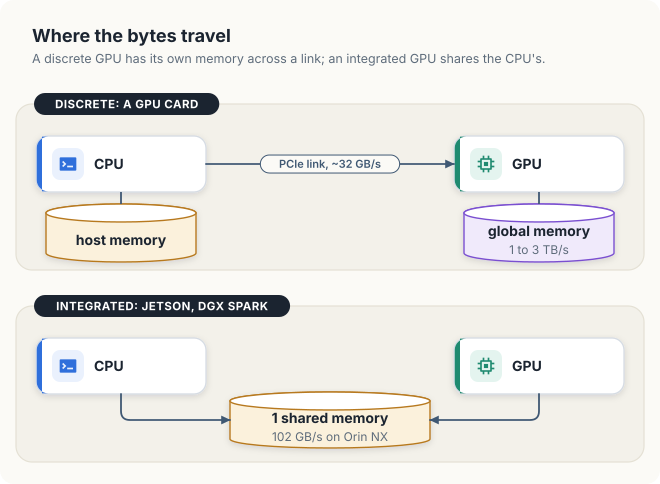
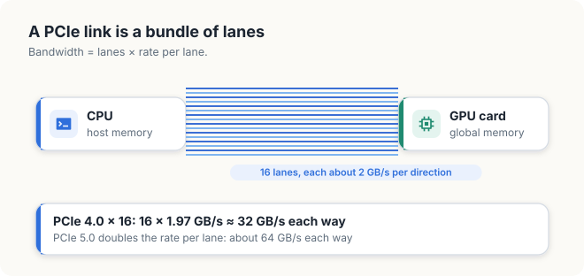
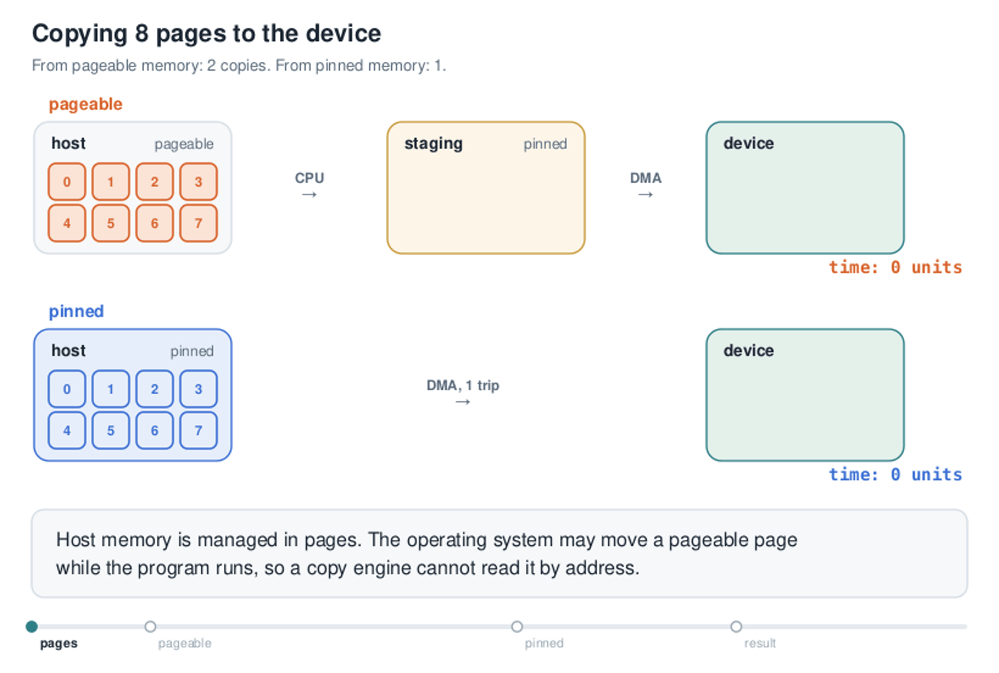
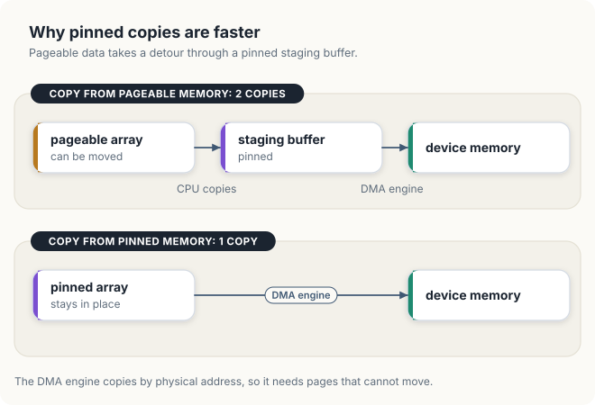
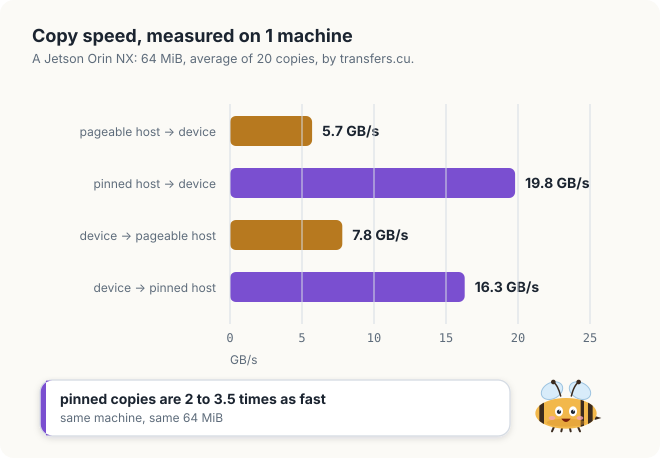
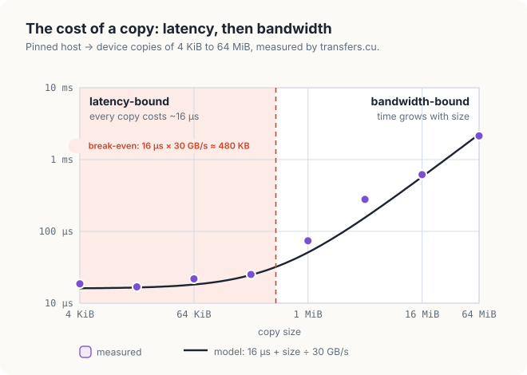
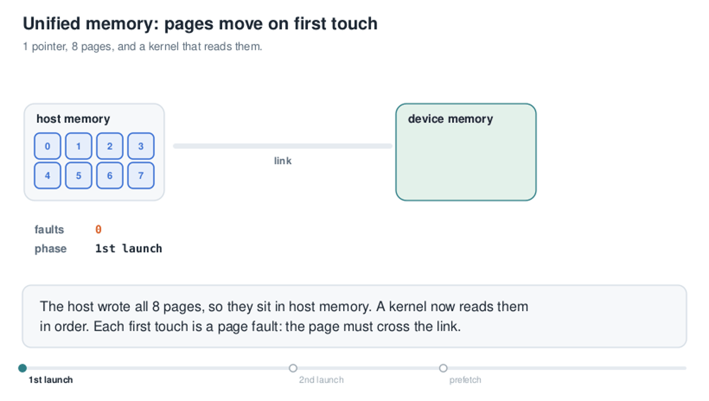
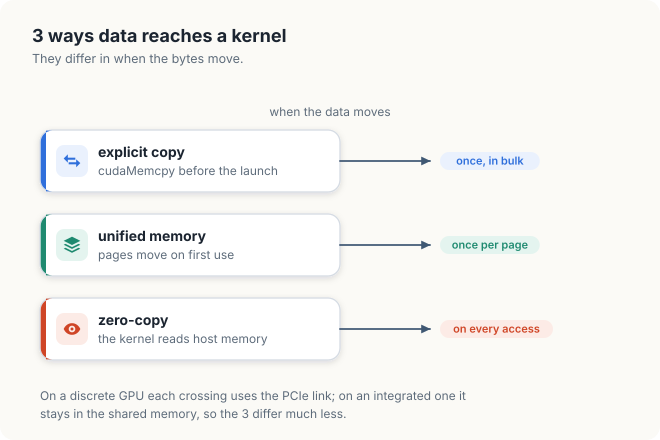
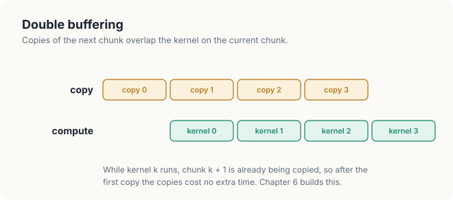

# Chapter 4: Memory Management & Data Movement

Chapter 3 copied data between host and device with `cudaMemcpy` without asking how the
copy happens or what it costs. On many systems a copy takes longer than the kernel that uses
the data, so copies often decide how fast a whole program runs. A kernel that takes 0.3 ms
gains little from tuning if it waits 20 ms for its data. This chapter follows the
bytes from host memory to device memory, works out what a copy costs on different kinds of
GPU, and compares the kinds of memory a CUDA program can allocate. The measurements are
taken by 2 small programs, in C++ and in Rust, that run on any NVIDIA GPU.

<div class="covers" markdown="1">

This chapter covers

- discrete and integrated systems, and the path a copy takes in each
- PCIe lanes and NVLink-C2C, and what a copy costs on 7 systems
- virtual memory, pages, and why a copy engine needs pinned memory
- the cost of a copy: a fixed latency, then bandwidth
- measuring copies, and why small copies are slow
- unified memory, in which pages move on first use
- zero-copy memory, which a kernel reads in place
- how to choose a kind of memory, and a preview of overlapping copies with kernels

</div>

The code of the chapter is in
[`code/ch04_memory/`](https://github.com/arpanpathak/gpu-parallel-book/tree/main/code/ch04_memory)
for C++ and in
[`code/oxide/ch04_transfers/`](https://github.com/arpanpathak/gpu-parallel-book/tree/main/code/oxide/ch04_transfers)
for Rust.

## 4.1 The transfer path

### 4.1.1 Discrete and integrated systems

A copy's path depends on how the GPU is attached to the CPU (figure 4.1).

<figure>

<figcaption><b>Figure 4.1</b> A discrete GPU has its own memory across a link; an integrated GPU shares the CPU's memory.</figcaption>
</figure>

A **discrete** GPU sits on its own card or module, such as an RTX 4090, an A100 or an H100,
with memory chips of its own. Data travels between the CPU's memory and the GPU's memory
over a **link**, a connection between the 2 chips. An **integrated** GPU, as on Jetson
boards and DGX Spark, has no memory of its own: it shares the CPU's memory chips.

The 2 designs make different trades. A discrete GPU's memory serves the GPU alone, and an
H100 reads its own at 3.35 TB/s, but the link that fills it is far narrower: data is fast to
use once it arrives and slow to arrive. An integrated GPU has no link to cross, but its memory
is slower and shared with the CPU.

### 4.1.2 Links: PCIe lanes and NVLink-C2C

Most discrete GPUs connect to the CPU through **PCIe**, the standard expansion connection of
a computer. A pair of wires can only switch so fast before its signal blurs, so PCIe gains bandwidth by
running connections side by side. Each is a **lane**: 2 wire pairs, 1 for each direction, so a
lane sends and receives at once (figure 4.2). "PCIe 4.0 × 16" means 16 lanes of generation
4.0, and the link's bandwidth is the number of lanes times the rate of 1 lane.

<figure>

<figcaption><b>Figure 4.2</b> A PCIe link of 16 lanes.</figcaption>
</figure>

A lane of PCIe 4.0 carries 1.97 GB/s each way, so 16 lanes carry 16 × 1.97 ≈ 32 GB/s. PCIe
5.0 doubles the rate of each lane to about 64 GB/s for 16 lanes. Programs reach about 80% of
these figures in practice, because the link carries data in packets, and each packet's
header of address and error checks uses the link without being the program's data.

NVIDIA's Grace Hopper (GH200) joins its CPU and GPU with **NVLink-C2C**, a chip-to-chip link
of 900 GB/s in total, 450 GB/s each way: 14 times as fast as PCIe 5.0.

### 4.1.3 What a copy costs on 7 systems

The time to copy \\(N\\) bytes over a path of bandwidth \\(B\\) is \\(N / B\\): bandwidth is
bytes per second, and dividing the bytes by it leaves seconds.

| System | Path from host memory to device memory | Bandwidth each way | Time to copy 1 GB |
|---|---|---|---|
| GeForce RTX 4090 | PCIe 4.0 × 16 | 32 GB/s | 31 ms |
| A100 SXM | PCIe 4.0 × 16 | 32 GB/s | 31 ms |
| GeForce RTX 5090 | PCIe 5.0 × 16 | 64 GB/s | 16 ms |
| H100 SXM | PCIe 5.0 × 16 | 64 GB/s | 16 ms |
| GH200 Grace Hopper | NVLink-C2C | 450 GB/s | 2.2 ms |
| Jetson AGX Thor, DGX Spark | shared memory, 273 GB/s | at most 137 GB/s | at least 7.3 ms |
| Jetson Orin NX 16 GB | shared memory, 102 GB/s | at most 51 GB/s | at least 20 ms |

A program need not copy at all on an integrated system, as sections 4.5 and 4.6 show. When it
does, the copy reads each byte from the shared memory and writes it back to
another place in the same memory, so every byte copied costs 2 bytes of memory traffic. A
copy can therefore use at most half of the memory's bandwidth: 273 / 2 ≈ 137 GB/s on a Thor or
a DGX Spark, and 102 / 2 = 51 GB/s on an Orin NX.

<div class="example" markdown="1">

Worked example: copy time against kernel time on an H100

1. Copying 1 GB over PCIe 5.0 at about 50 GB/s, 80% of 64 GB/s, takes 1 / 50 = 0.02 s,
   20 ms.
2. A kernel that reads that 1 GB once from the H100's memory at 3.35 TB/s takes
   1 / 3,350 = 0.0003 s, 0.3 ms.
3. The copy takes 20 / 0.3 ≈ 67 times as long as the kernel.

</div>

The factor is not peculiar to the H100. Each discrete GPU in the table reads its own memory 28
to 64 times as fast as PCIe feeds it: 1,008 / 32 ≈ 32 for the RTX 4090, 2,039 / 32 ≈ 64 for
the A100, 1,792 / 64 = 28 for the RTX 5090. A program that copies its data in, runs 1 short kernel and copies the result out spends
almost all its time on the link. It becomes faster by copying less, by keeping data on the
GPU between kernels, and by overlapping copies with computation (section 4.8).

## 4.2 Pageable and pinned host memory

### 4.2.1 Virtual memory and pages

A program does not use physical memory addresses. The operating system gives it **virtual
addresses**, and translates each one to a physical address through a table it keeps for
the program. The translation works in fixed-size pieces called **pages**, usually 4 KiB on
Linux. Because the program only ever sees virtual addresses, the operating system is free
to move a page to a different physical place, for example to gather free memory into larger
pieces, or write it to disk when memory runs short,
and update the table. The program notices nothing.

Memory allocated with `malloc`, `new`, `std::vector` or a Rust `Vec` is **pageable**: the
operating system may move its pages at any time.

### 4.2.2 Why a copy engine needs pinned memory

A GPU has **copy engines**, units that move data between host memory and device memory by
themselves while the CPU and the SMs do other work. This kind of copy is called **DMA**, for
direct memory access; without it, a CPU core would load and store every byte itself. The driver
hands a copy engine the physical addresses of the pages to read, and the engine works through
them alone, without consulting the operating system's tables. If a pageable page moved during a copy, the copy
engine would read whatever now sits at the old physical address, and the device would
receive the wrong bytes without any error.

CUDA therefore copies pageable memory in 2 steps. The CPU first copies the data into a
**staging buffer** whose pages cannot move, then a copy engine moves the staging buffer to
the device. The driver works in chunks, so the 2 steps partly overlap, but every byte still
passes through the CPU once. Memory whose pages the operating system has promised not to move is called
**pinned**, or page-locked. A copy from pinned memory needs only the second step.
Animation 1 shows both.

<figure class="anim">
<video class="motion" src="../../figures/ch04-copy-paths.mp4" autoplay loop muted playsinline preload="metadata" aria-label="Two rows of 8 pages. First the operating system moves a pageable page, showing why a copy engine cannot read it by address. Pageable row: the CPU copies each page into a pinned staging buffer at 2 time units per page, then the copy engine moves them to the device at 1 unit per page, 24 units in all. Pinned row: the copy engine moves the pages straight to the device, 8 units. Pinned is 3 times as fast." data-chapters="[[0.0, &quot;pages&quot;], [5.46, &quot;pageable&quot;], [22.32, &quot;pinned&quot;], [32.4, &quot;result&quot;]]"></video>
<figcaption><b>Animation 1</b> 8 pages copied to the device: from pageable memory through a staging buffer, and from pinned memory directly.</figcaption>
</figure>

Figure 4.3 shows the same 2 paths as a still picture.

<figure>

<figcaption><b>Figure 4.3</b> A copy from pageable memory goes through a staging buffer; a copy from pinned memory goes straight to the device.</figcaption>
</figure>

Some newer systems do without the staging buffer. On Jetson AGX Thor and Grace Hopper, the GPU
translates addresses through the CPU's own page tables, so it finds a pageable page wherever
the operating system has put it. CUDA reports this as the device attribute
`pageableMemoryAccessUsesHostPageTables`: 1 on a Thor, 0 on an Orin NX. On a Thor, a copy from
pageable memory runs as fast as one from pinned memory (section 4.4).

### 4.2.3 Allocating pinned memory

| | Allocate | Free |
|---|---|---|
| C++, pinned | `cudaMallocHost(&p, bytes)` | `cudaFreeHost(p)` |
| C++, pageable | `std::malloc`, `new`, `std::vector` | `std::free`, `delete`, automatic |
| Rust, pinned | `PinnedHostBuffer::<f32>::zeroed(&ctx, n)?` | automatic, when the buffer goes out of scope |
| Rust, pageable | `vec![0.0f32; n]` | automatic |

Memory from `cudaMallocHost` must be freed with `cudaFreeHost`: `free` or `delete` would
corrupt CUDA's records of the allocation. A Rust `PinnedHostBuffer` frees itself correctly
when it goes out of scope. Pinned memory also has a cost. Every pinned page is
a page the operating system can no longer move or write to disk, which leaves it less room to
manage memory for every other program. Pinning is also slow to set up, since every page must
be found and locked, so programs allocate pinned buffers once and reuse them. Programs therefore pin the buffers they copy often,
and leave the rest pageable. Pinned memory is also required for asynchronous copies, which
Chapter 6 uses to overlap copies with kernels.

## 4.3 The cost of a copy

Section 4.1 treated a copy's time as \\(N / B\\). At 30 GB/s, a copy of 4 KiB would then take
about 0.14 µs, yet section 4.4 measures 18.6 µs. The formula leaves out a cost that every copy pays
however small it is: the CPU's call into the CUDA driver, the setup of the copy engine, and
the signal back when the copy is done. Call this fixed cost the copy's **latency**, \\(t_0\\).
The time of a copy is then

\\[ T = t_0 + \frac{N}{B} \\]

which has 2 regimes. For small copies, \\(N / B\\) is tiny and \\(T \approx t_0\\): the copy
is **latency-bound**, and copying 4 times as many bytes takes about the same time. For large
copies, \\(t_0\\) is negligible and \\(T \approx N / B\\): the copy is **bandwidth-bound**.
The 2 terms are equal at the **break-even size**

\\[ N^* = t_0 \times B \\]

From the model, a copy of \\(N\\) bytes achieves the fraction \\(N / (N + N^{\ast})\\) of the
bandwidth: half at \\(N^{\ast}\\), 10 / 11 ≈ 91% at 10 \\(N^{\ast}\\), and 1 / 11 ≈ 9% at a tenth of
\\(N^{\ast}\\).

<div class="example" markdown="1">

Worked example: break-even sizes

| System | \\(t_0\\) | \\(B\\) | Break-even size \\(N^*\\) |
|---|---|---|---|
| a discrete GPU on PCIe 4.0 | 10 µs | 25 GB/s | 10 × 10<sup>−6</sup> × 25 × 10<sup>9</sup> = 250 KB |
| the Orin NX of section 4.4 | 16 µs | 30 GB/s | 16 × 10<sup>−6</sup> × 30 × 10<sup>9</sup> = 480 KB |

The 10 µs is an order of magnitude only; section 4.4 measures \\(t_0\\) on 1 machine, and
the programs measure it on yours.

</div>

Below the break-even size, more than half of a copy's time is fixed cost. 1,000 copies of
4 KB each take about 1,000 × \\(t_0\\), while 1 copy of the same 4 MB takes about
\\(t_0 + 4\ \text{MB} / B\\). A program that has many small pieces of data to copy should
gather them into 1 buffer and copy it once. This is Chapter 1's latency and throughput again:
a fixed latency per operation caps the throughput of operations that are issued one at a
time.

## 4.4 Measuring copies

The C++ program `transfers.cu` measures 4 things on whatever GPU it runs on, and its Rust
counterpart the first 2.

### 4.4.1 Timing a copy

<p class="listing"><b>Listing 4.1</b> Timing a copy, in C++. <a href="https://github.com/arpanpathak/gpu-parallel-book/blob/main/code/ch04_memory/transfers.cu">code/ch04_memory/transfers.cu</a></p>

```cpp
{{#include ../../../../code/ch04_memory/transfers.cu:24:35}}
```

<p class="listing"><b>Listing 4.2</b> Timing a copy, in Rust. <a href="https://github.com/arpanpathak/gpu-parallel-book/blob/main/code/oxide/ch04_transfers/src/main.rs">code/oxide/ch04_transfers/src/main.rs</a></p>

```rust,ignore
{{#include ../../../../code/oxide/ch04_transfers/src/main.rs:12:25}}
```

The first copy is a warm-up and is not timed, because it includes 1-time work such as setting
up the staging buffer. `steady_clock` and `Instant` are clocks that never jump when the system sets its time of day, which suits
measuring intervals. Chapter 6 replaces them with CUDA events, which time work on the GPU
itself.

The Rust version takes the copy as a closure that returns a `Result`. Every copy can fail,
for example when the GPU is lost, and the `?` operator passes any failure up to `main`
instead of ignoring it.

### 4.4.2 Pageable against pinned

<p class="listing"><b>Listing 4.3</b> 4 copies of 64 MiB, in C++.</p>

```cpp
{{#include ../../../../code/ch04_memory/transfers.cu:58:74}}
```

<p class="listing"><b>Listing 4.4</b> The same copies, in Rust.</p>

```rust,ignore
fn main() -> Result<(), Box<dyn std::error::Error>> {
{{#include ../../../../code/oxide/ch04_transfers/src/main.rs:32:52}}
    // ...
}
```

64 MiB is about 140 times the break-even size of 480 KB, so \\(t_0\\) is under 1% of each
copy's time and the results measure bandwidth alone.

The C++ version lists the 4 cases in a table and runs 1 loop over it. In Rust,
`copy_from_host` copies a host slice to the device and waits for the copy; passing
`pinned.as_slice()` hands it pinned memory, and CUDA then skips the staging buffer.
`copy_to_pinned_host` copies back into a `PinnedHostBuffer`.

### 4.4.3 Copy time against size

<p class="listing"><b>Listing 4.5</b> Copies from 4 KiB to 64 MiB, in C++.</p>

```cpp
{{#include ../../../../code/ch04_memory/transfers.cu:76:86}}
```

<p class="listing"><b>Listing 4.6</b> The same sweep, in Rust.</p>

```rust,ignore
fn main() -> Result<(), Box<dyn std::error::Error>> {
    // ...
{{#include ../../../../code/oxide/ch04_transfers/src/main.rs:54:67}}
    // ...
}
```

Each size is 4 times the last, from 4 KiB to 64 MiB, and each is copied 200 times so that the
small copies, which take microseconds, can be timed reliably: 200 copies of 4 KiB take about
3.6 ms in all.

### 4.4.4 Results on 2 boards

The first 2 runs are on a Jetson Orin NX, the third on a Jetson AGX Thor. Run the programs on your own GPU and compare: on a
discrete GPU the pinned figures approach the PCIe rates of section 4.1.

```console
$ ./transfers
GPU: Orin, integrated, 2 copy engine(s)
copies of 64 MiB
  pageable host -> device   11.81 ms    5.7 GB/s
  pinned   host -> device    3.40 ms   19.8 GB/s
  device -> pageable host    8.63 ms    7.8 GB/s
  device -> pinned   host    4.12 ms   16.3 GB/s
pinned host -> device, by size
         4 KiB      18.6 us    0.2 GB/s
        16 KiB      16.9 us    1.0 GB/s
        64 KiB      21.8 us    3.0 GB/s
       256 KiB      25.1 us   10.4 GB/s
      1024 KiB      74.0 us   14.2 GB/s
      4096 KiB     278.9 us   15.0 GB/s
     16384 KiB     616.5 us   27.2 GB/s
     65536 KiB    2139.7 us   31.4 GB/s
```

```console
$ cargo oxide run
copies of 64 MiB
  pageable host -> device   11.19 ms    6.0 GB/s
  pinned   host -> device    4.26 ms   15.7 GB/s
  device -> pageable host    9.16 ms    7.3 GB/s
  device -> pinned   host    3.60 ms   18.7 GB/s
pinned host -> device, by size
         4 KiB      17.7 us    0.2 GB/s
        16 KiB      16.8 us    1.0 GB/s
        64 KiB      16.0 us    4.1 GB/s
       256 KiB      22.1 us   11.9 GB/s
      1024 KiB     104.1 us   10.1 GB/s
      4096 KiB     331.5 us   12.7 GB/s
     16384 KiB     642.3 us   26.1 GB/s
     65536 KiB    2215.4 us   30.3 GB/s
```

```console
$ ./transfers                     # on a Jetson AGX Thor
GPU: NVIDIA Thor, integrated, 2 copy engine(s)
copies of 64 MiB
  pageable host -> device    0.57 ms  118.4 GB/s
  pinned   host -> device    0.57 ms  118.4 GB/s
  device -> pageable host    0.68 ms   99.4 GB/s
  device -> pinned   host    0.62 ms  108.9 GB/s
pinned host -> device, by size
         4 KiB      23.2 us    0.2 GB/s
        16 KiB      23.2 us    0.7 GB/s
        64 KiB      23.9 us    2.7 GB/s
       256 KiB      28.0 us    9.4 GB/s
      1024 KiB      32.1 us   32.7 GB/s
      4096 KiB      55.6 us   75.5 GB/s
     16384 KiB     167.0 us  100.5 GB/s
     65536 KiB     573.8 us  117.0 GB/s
```

**Pinned against pageable.** Pinned copies ran 2.1 to 3.5 times as fast as pageable ones
(19.8 / 5.7 = 3.5 and 16.3 / 7.8 = 2.1 in the C++ run), because they skip the CPU's copy into
the staging buffer (figure 4.4). On the Thor both kinds ran at the same speed, because its GPU
reads pageable memory through the CPU's page tables (section 4.2.2). Its largest copies reached
117 GB/s, close to the 137 GB/s limit for a copy within its 273 GB/s memory, with \\(t_0\\) about
23 µs.

<figure>

<figcaption><b>Figure 4.4</b> Copy speeds of the C++ run above.</figcaption>
</figure>

**Latency and bandwidth.** Every copy up to 64 KiB took about 16 to 22 µs, whatever its size:
that is \\(t_0\\). From 1 MiB up the time grows with the size, and the largest copies reached
about 30 GB/s. Figure 4.5 puts the measured points on the model of section 4.3 with
\\(t_0\\) = 16 µs and \\(B\\) = 30 GB/s.

<figure>

<figcaption><b>Figure 4.5</b> Measured copy times and the model \(T = t_0 + N/B\), with the break-even size between the 2 regimes.</figcaption>
</figure>

The model's 2 numbers follow 8 measurements over a 16,384-fold range of sizes. Between 1 and 4 MiB the
points sit above the line, within the board's run-to-run variation.

The 30 GB/s is below the 51 GB/s that a copy within 102 GB/s of shared memory could reach
(section 4.1.3); the copy engine, not the memory, sets this board's limit. Timings move by up
to about 30% from run to run, because the board changes its clock rates with load and
temperature; the shape of the results stays the same.

<details class="check">
<summary>A program copies 1,000 buffers of 4 KB each to the device, 1 copy per buffer, with t<sub>0</sub> = 16 µs and B = 30 GB/s. How long does it take, and how long would 1 copy of all 4 MB take?</summary>

1,000 copies take about 1,000 × (16 µs + 4 KB / 30 GB/s) = 1,000 × (16 + 0.13) µs ≈ 16 ms.
1 copy of 4 MB takes 16 µs + 4 MB / 30 GB/s ≈ 16 + 133 = 149 µs, about 100 times less.

</details>

## 4.5 Unified memory

Explicit copies suit arrays, but not data built of pointers. A tree copied node by node to the
device still holds host addresses in every pointer, and the program would have to rewrite
each one.

**Unified memory** is memory that host and device reach through the same pointer. CUDA
allocates it with `cudaMallocManaged`, and the program reads and writes it on either side
without calling `cudaMemcpy`. The pages still have to reach the GPU before a kernel can use
them. On a discrete GPU, the CUDA driver moves a page the first time a kernel touches it:
the touch raises a **page fault**: the warp that asked stops, the driver moves the page across
the link and records its new place, and the warp resumes (animation 2). Later accesses to the
page run at full speed.

<figure class="anim">
<video class="motion" src="../../figures/ch04-unified.mp4" autoplay loop muted playsinline preload="metadata" aria-label="Host memory holds 8 pages. A kernel reads them in order; each first touch is a page fault and the page crosses the link to device memory, 8 faults in all. A second launch finds every page on the device and has no faults. Then, with cudaMemPrefetchAsync, all 8 pages move in 1 bulk transfer before the kernel starts, and the kernel runs with no faults." data-chapters="[[0.0, &quot;1st launch&quot;], [13.62, &quot;2nd launch&quot;], [21.18, &quot;prefetch&quot;]]"></video>
<figcaption><b>Animation 2</b> Unified memory: pages move on first touch, then stay; with a prefetch they move in bulk before the kernel.</figcaption>
</figure>

<p class="listing"><b>Listing 4.7</b> Unified memory, in C++.</p>

```cpp
{{#include ../../../../code/ch04_memory/transfers.cu:88:106}}
```

The host writes every element, a kernel that doubles every element runs 11 times, and the
host reads the first element again: 1 doubled 11 times is 2<sup>11</sup> = 2,048, so the printed value confirms that host and device
worked on the same memory.

```console
unified memory, kernel over 64 MiB
  1st launch, after the host wrote it    3.51 ms
  next 10 launches, average              2.26 ms
  host reads managed[0] = 2048
```

On the Orin NX the first launch took about 1.5 times as long as later ones, because the
driver prepares the pages for the GPU on first use. Nothing crosses a link there, since host
and device share the memory. On a discrete GPU the first launch also pays for moving every
page across PCIe: 64 MiB at about 25 GB/s adds about 2.7 ms, and page faults move the data in
many small pieces, each paying a latency, so the real cost is higher still.

A program can move the pages ahead of time, in 1 bulk transfer, before the kernel needs them:

```cpp
cudaMemPrefetchAsync(managed, bytes, 0);    // move the pages to device 0 now
```

Unified memory suits data structures full of pointers, such as trees and graphs, which are
hard to copy by hand. For large arrays, explicit copies or prefetching keep control over when
the bytes move.

<div class="callout note" markdown="1">

**NOTE:** The version of cuda-oxide used in this book has no wrapper for unified memory or
zero-copy memory, so sections 4.5 and 4.6 use C++ only.

</div>

## 4.6 Zero-copy memory

**Zero-copy** memory is pinned host memory that a kernel reads and writes in place, with no
copy at all. CUDA allocates it with `cudaHostAlloc` and the flag `cudaHostAllocMapped`, and
`cudaHostGetDevicePointer` returns the address a kernel uses for it. The memory is pinned for
the reason of section 4.2: the GPU reaches it by physical address. On a discrete GPU, every load
or store a kernel makes to it crosses the link.

<p class="listing"><b>Listing 4.8</b> Zero-copy memory, in C++.</p>

```cpp
{{#include ../../../../code/ch04_memory/transfers.cu:108:124}}
```

<div class="example" markdown="1">

Worked example: the same kernel on a discrete GPU

The kernel reads 64 MiB and writes 64 MiB, 0.134 GB of traffic in all.

1. In device memory on an RTX 4090, at about 1 TB/s: 0.134 / 1,000 = 0.13 ms.
2. In zero-copy memory, across PCIe 4.0 at about 25 GB/s: 0.134 / 25 = 5.4 ms.

Zero-copy is about 40 times slower here, and every further launch pays the same again,
because nothing stays on the device.

</div>

On an integrated GPU the picture changes, because zero-copy memory and device memory are the
same chips. On the Orin NX the kernel took about the same time in both:

```console
kernel over 64 MiB, average of 10 launches
  in device memory        1.70 ms
  in zero-copy memory     1.72 ms
```

Zero-copy therefore suits small data and data that a kernel reads only once on a discrete GPU,
such as a few parameters or a result the host needs as soon as it is written. On an
integrated GPU it can replace copies altogether. Figure 4.6 compares the 3 ways data reaches a
kernel by when the bytes move.

<figure>

<figcaption><b>Figure 4.6</b> Explicit copies, unified memory and zero-copy differ in when the bytes move.</figcaption>
</figure>

## 4.7 Choosing a memory kind

| Situation | Choice | Reason |
|---|---|---|
| data copied once, at start-up | pageable memory and `cudaMemcpy` | simplest; the slower copy happens once |
| data copied again and again | pinned memory (`cudaMallocHost`, `PinnedHostBuffer`) | 1 copy instead of 2, 2 to 3.5 times as fast unless the GPU uses the CPU's page tables |
| many small pieces of data | 1 pinned buffer, copied once | pays the copy latency \\(t_0\\) once instead of many times |
| pointer-heavy data structures | unified memory and `cudaMemPrefetchAsync` | 1 pointer on both sides; no copying by hand |
| small data, or data read once | zero-copy memory (`cudaHostAllocMapped`) | no copy at all |
| data on an integrated GPU | zero-copy or unified memory | host and device share the chips, so copies only duplicate data |
| data used by kernel after kernel | device memory (`cudaMalloc`, `DeviceBuffer`) | the full speed of the GPU's memory |

A common mistake is to allocate everything with `cudaMallocManaged` because it is convenient,
then find on a discrete GPU that a large array crosses the link page by page. The kind of
memory is part of a program's design.

## 4.8 Overlapping copies with kernels: a preview

A copy engine and the SMs are separate units, so a copy and a kernel that work on different
data can run at the same time. **Double buffering** splits the data into chunks: while a kernel
works on 1 chunk, a copy engine moves the next (figure 4.7).

<figure>

<figcaption><b>Figure 4.7</b> With 2 buffers, the copy of the next chunk overlaps the kernel on the current one.</figcaption>
</figure>

With 4 chunks whose copy and kernel take 1 time unit each, the work takes 4 × 2 = 8 units in
sequence and 1 + 3 + 1 = 5 units overlapped. After the first copy, copies cost no extra time as long as each copy is no longer than each
kernel. A GPU with 2 copy engines, as `transfers` reported for the Orin NX, can also copy
results back to the host while it copies the next inputs in. Double buffering needs pinned
memory and asynchronous copies; Chapter 6 builds it.

## 4.9 The complete programs

<p class="listing"><b>Listing 4.9</b> The complete <code>transfers.cu</code>. <a href="https://github.com/arpanpathak/gpu-parallel-book/blob/main/code/ch04_memory/transfers.cu">code/ch04_memory/transfers.cu</a></p>

```cpp
{{#include ../../../../code/ch04_memory/transfers.cu}}
```

<p class="listing"><b>Listing 4.10</b> The complete Rust program. <a href="https://github.com/arpanpathak/gpu-parallel-book/blob/main/code/oxide/ch04_transfers/src/main.rs">code/oxide/ch04_transfers/src/main.rs</a></p>

```rust,ignore
{{#include ../../../../code/oxide/ch04_transfers/src/main.rs}}
```

## Common mistakes

- **Copying often from pageable memory.** Pin the buffers that are copied repeatedly.
- **Many small copies.** Each pays the fixed latency \\(t_0\\). Gather small pieces into 1
  buffer and copy it once.
- **Freeing pinned memory with `free` or `delete`.** Pair `cudaMallocHost` and `cudaHostAlloc`
  with `cudaFreeHost`, and `cudaMalloc` with `cudaFree`.
- **Pinning everything.** Pinned pages cannot move, which leaves the operating system less
  memory to manage for other programs.
- **Using unified memory for every array on a discrete GPU.** Large arrays then move page by
  page, on first touch. Prefetch them, or copy them explicitly.
- **Using zero-copy for large data that kernels read repeatedly on a discrete GPU.** Every
  access crosses the link.
- **Timing the first copy.** It includes 1-time work; warm up first and average several copies.

<div class="summary" markdown="1">

## Summary

- A discrete GPU has its own memory across a link: PCIe 4.0 at about 32 GB/s each way, PCIe
  5.0 at about 64 GB/s, NVLink-C2C at 450 GB/s. An integrated GPU shares the CPU's memory, and
  a copy within it can use at most half of that memory's bandwidth.
- The operating system may move pageable pages, so CUDA copies them through a pinned staging
  buffer. Pinned memory goes straight to a copy engine, 2 to 3.5 times as fast on the Orin
  NX. A GPU that uses the CPU's page tables, as on Thor, copies pageable memory as fast.
- A copy costs \\(T = t_0 + N/B\\). Below the break-even size \\(t_0 B\\), a copy is
  latency-bound, so many small copies should become 1 large one.
- Unified memory gives host and device 1 pointer; its pages move on first use, or ahead of
  time with `cudaMemPrefetchAsync`.
- Zero-copy memory is read in place: slow for large data on a discrete GPU, and as fast as
  device memory on an integrated one.
- In Rust with cuda-oxide, `PinnedHostBuffer` holds pinned memory, `DeviceBuffer` copies to
  and from it, and every copy returns a `Result`.

</div>

Chapter 5 turns to threads that need each other's results: barriers, atomic operations and
race conditions.

## Exercises

1. A 4 GB dataset is copied to an H100 over PCIe 5.0 at 50 GB/s from pinned memory, and at
   15 GB/s from pageable memory. How many milliseconds does pinning save?
2. Run `transfers` on your own GPU. Fit \\(t_0\\) and \\(B\\) to your sweep, and work out your
   break-even size.
3. Why can a copy engine not copy directly from pageable memory? Describe what could go wrong.
4. A kernel reads each element of a 1 GB unified-memory array once on a discrete GPU. Where
   would you call `cudaMemPrefetchAsync`, and why?
5. A kernel re-reads the same 1 MB of zero-copy memory 1,000 times on a discrete GPU at
   25 GB/s. How long do the reads take, and how long would they take from device memory at
   1 TB/s?
6. A GH200 copies 1 GB from host to device over NVLink-C2C at 450 GB/s. How long does the
   copy take, and how does that compare with the H100 on PCIe 5.0?
7. In the Rust program, pass `&pageable` instead of `pinned.as_slice()` in the second copy.
   What happens to the measured speed, and why?

## Sources and further reading

- NVIDIA, *CUDA C++ Programming Guide*, "Page-Locked Host Memory", "Mapped Memory" and
  "Unified Memory Programming": <https://docs.nvidia.com/cuda/cuda-c-programming-guide/>
- NVIDIA, *CUDA C++ Best Practices Guide*, "Data Transfer Between Host and Device":
  <https://docs.nvidia.com/cuda/cuda-c-best-practices-guide/>
- NVIDIA, *CUDA for Tegra*, on memory in integrated systems:
  <https://docs.nvidia.com/cuda/cuda-for-tegra-appnote/>
- NVIDIA, *NVIDIA Grace Hopper Superchip Architecture* whitepaper, for NVLink-C2C.
- PCI-SIG, PCI Express Base Specifications 4.0 and 5.0, for lane rates.
