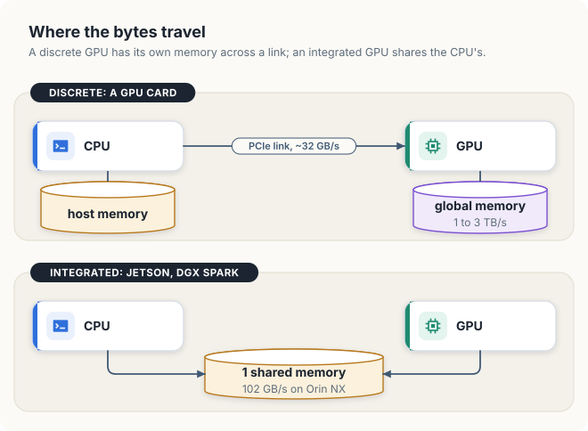
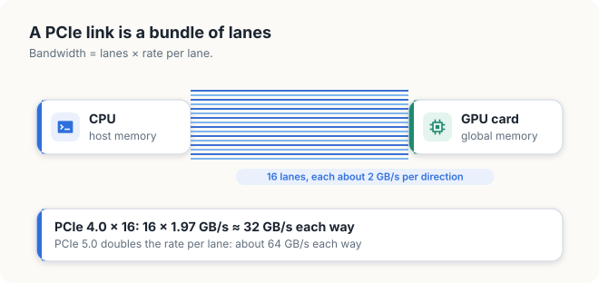
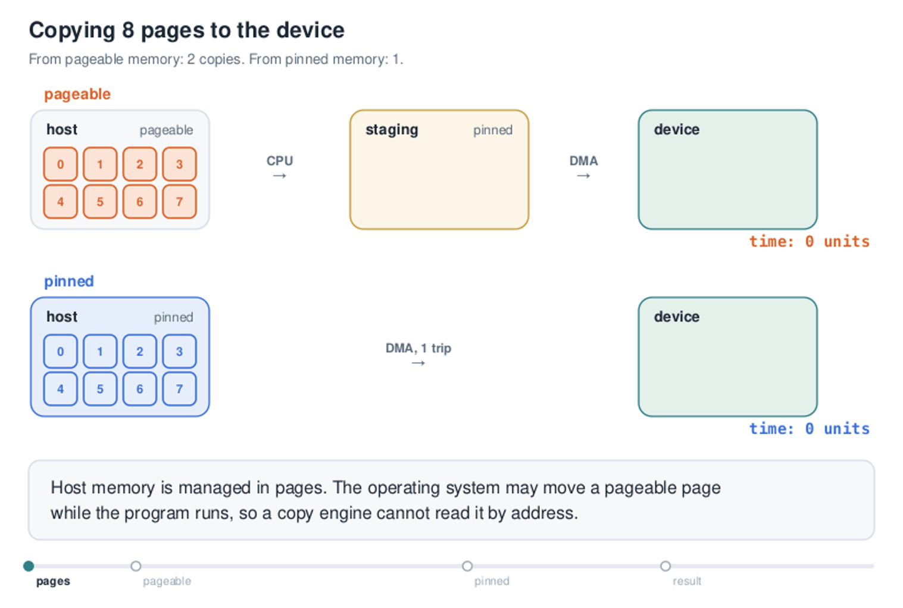
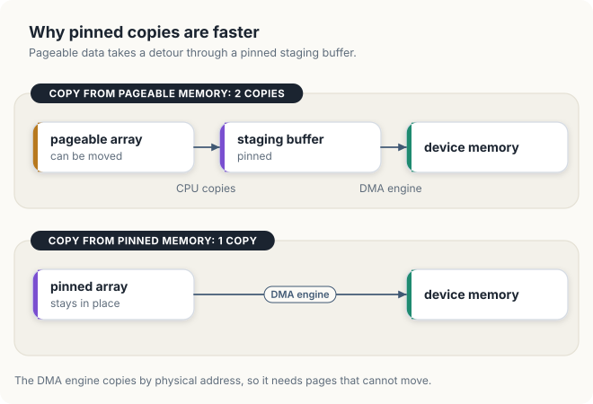
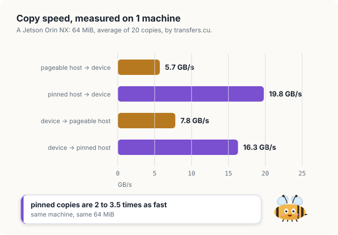
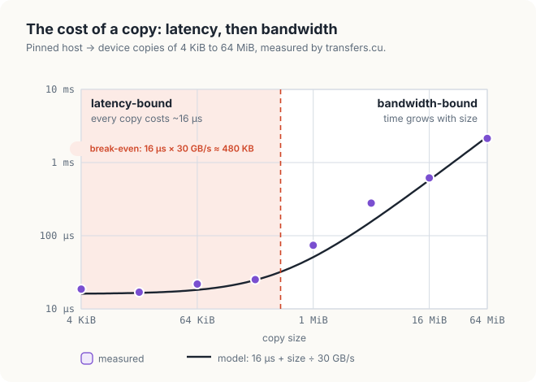
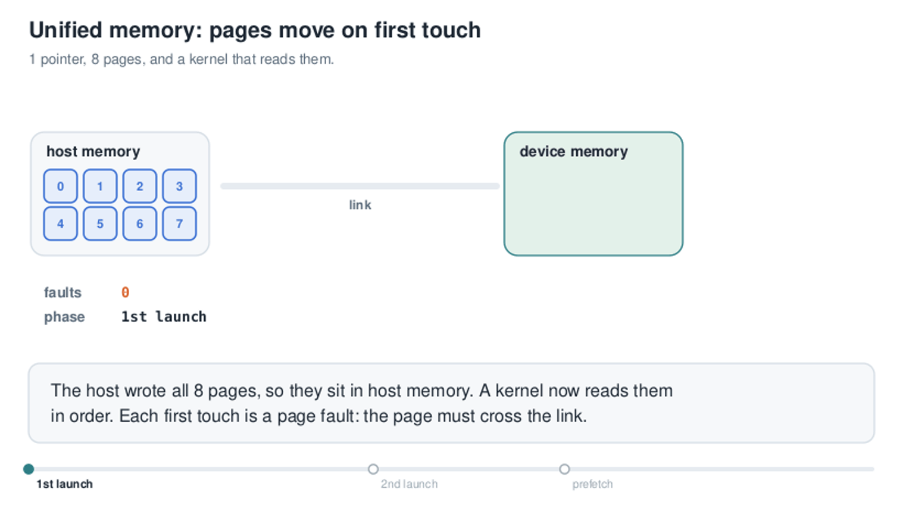
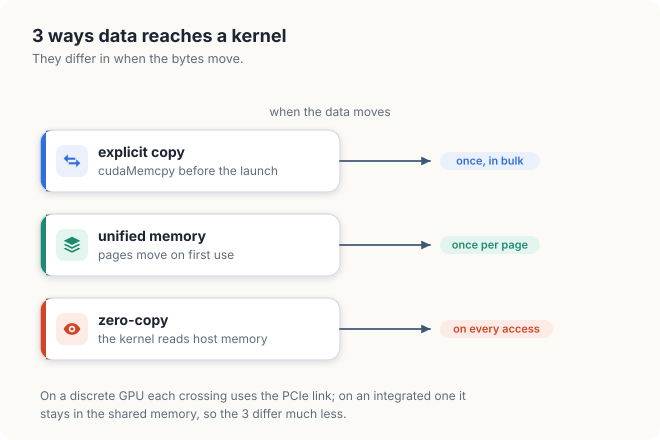
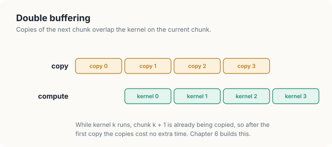

# Chapter 4: Memory Management & Data Movement

In Chapter 3, we used `cudaMemcpy` to transfer data between host memory and device memory,
and we treated each transfer as a single function call. In this chapter, we look at how a
transfer is carried out and how long it takes. The time matters because on many systems a
transfer takes longer than the kernel that uses the data. For example, a kernel that reads
1 GB from the memory of an H100 at 3.35 TB/s finishes in about 0.3 ms, whereas copying the same
1 GB to the H100 over PCIe 5.0 takes about 20 ms. Making such a kernel faster has little effect
on the running time of the whole program unless the transfers are also made faster or avoided.

We first describe the path that data takes between the CPU and the GPU, which differs between
discrete and integrated GPUs. We then explain why CUDA distinguishes pageable from pinned host
memory, build a simple model of the cost of a transfer, and compare the model with
measurements. The chapter ends with 2 kinds of memory that reduce or remove explicit
transfers: unified memory and zero-copy memory. The measurements are made by 2 small programs,
1 in C++ and 1 in Rust, which run on any NVIDIA GPU.

<div class="covers" markdown="1">

This chapter covers

- discrete and integrated systems, and the path of a transfer in each
- PCIe lanes, NVLink-C2C, and transfer times on 7 systems
- virtual memory, pages, and the reason copy engines require pinned memory
- the cost of a transfer: a fixed latency plus the size divided by the bandwidth
- measuring transfers, and the cost of small transfers
- unified memory, whose pages move on first use
- zero-copy memory, which a kernel accesses in place
- choosing a kind of memory, and overlapping transfers with kernels

</div>

The code of the chapter is in
[`code/ch04_memory/`](https://github.com/arpanpathak/gpu-parallel-book/tree/main/code/ch04_memory)
for C++ and in
[`code/oxide/ch04_transfers/`](https://github.com/arpanpathak/gpu-parallel-book/tree/main/code/oxide/ch04_transfers)
for Rust.

## 4.1 The transfer path

### 4.1.1 Discrete and integrated systems

The path of a transfer depends on how the GPU is attached to the CPU. Figure 4.1 shows the 2
arrangements in use today.

<figure>

<figcaption><b>Figure 4.1</b> A discrete GPU has its own memory across a link; an integrated GPU shares the CPU's memory.</figcaption>
</figure>

A GPU is said to be **discrete** if it sits on its own card or module with its own memory
chips, as an RTX 4090, an A100 or an H100 does. Data moves between the CPU's memory and the
GPU's memory over a **link**, which is a connection between the 2 chips. A GPU is said to be
**integrated** if it has no memory of its own and uses the CPU's memory chips, as the GPUs of
the Jetson boards and of the DGX Spark do.

The 2 designs make different trade-offs. The memory of a discrete GPU serves the GPU alone and
is very fast; an H100 reads its own memory at 3.35 TB/s. However, the link that fills this
memory is much slower, so data is fast to use once it has arrived and slow to arrive. An
integrated GPU has no link to cross, but its memory is slower and is shared with the CPU.

### 4.1.2 PCIe lanes and NVLink-C2C

Most discrete GPUs are connected to the CPU through **PCIe**, the standard expansion bus of a
computer. A pair of wires can switch only so fast before its signal becomes unreliable, so PCIe
increases bandwidth by running several connections side by side. Each connection is called a
**lane** and consists of 2 wire pairs, 1 for each direction, so that a lane sends and receives
at the same time (figure 4.2). The notation "PCIe 4.0 × 16" means 16 lanes of generation 4.0,
and the bandwidth of the link is the number of lanes multiplied by the rate of 1 lane.

<figure>

<figcaption><b>Figure 4.2</b> A PCIe link of 16 lanes.</figcaption>
</figure>

A lane of PCIe 4.0 carries 1.97 GB/s in each direction, so 16 lanes carry
16 × 1.97 ≈ 32 GB/s. PCIe 5.0 doubles the rate of each lane, to about 64 GB/s for 16 lanes.
Programs reach about 80% of these figures in practice. The link carries data in packets, and
the header of each packet, which holds an address and error checks, occupies the link without
being part of the program's data.

NVIDIA's Grace Hopper (GH200) connects its CPU and GPU with **NVLink-C2C**, a chip-to-chip link
of 900 GB/s in total, or 450 GB/s in each direction. This is 14 times the bandwidth of
PCIe 5.0.

### 4.1.3 Transfer times on 7 systems

The time to transfer \\(N\\) bytes over a path of bandwidth \\(B\\) is \\(N / B\\), since
bandwidth is measured in bytes per second. The table applies this formula to 1 GB on 7 systems.

| System | Path from host memory to device memory | Bandwidth each way | Time to copy 1 GB |
|---|---|---|---|
| GeForce RTX 4090 | PCIe 4.0 × 16 | 32 GB/s | 31 ms |
| A100 SXM | PCIe 4.0 × 16 | 32 GB/s | 31 ms |
| GeForce RTX 5090 | PCIe 5.0 × 16 | 64 GB/s | 16 ms |
| H100 SXM | PCIe 5.0 × 16 | 64 GB/s | 16 ms |
| GH200 Grace Hopper | NVLink-C2C | 450 GB/s | 2.2 ms |
| Jetson AGX Thor, DGX Spark | shared memory, 273 GB/s | at most 137 GB/s | at least 7.3 ms |
| Jetson Orin NX 16 GB | shared memory, 102 GB/s | at most 51 GB/s | at least 20 ms |

On an integrated system a program does not need to copy at all, as sections 4.5 and 4.6 show.
When it does copy, each byte is read from the shared memory and written back to another place
in the same memory, so every byte copied causes 2 bytes of memory traffic. A copy can therefore
use at most half of the memory bandwidth: 273 / 2 ≈ 137 GB/s on a Thor or a DGX Spark, and
102 / 2 = 51 GB/s on an Orin NX.

We can now return to the example of the introduction. Over PCIe 5.0 at about 50 GB/s, which is
80% of 64 GB/s, copying 1 GB to an H100 takes 1 / 50 = 0.02 s, or 20 ms. A kernel that reads
the same 1 GB once from the H100's memory at 3.35 TB/s takes 1 / 3,350 = 0.0003 s, or 0.3 ms.
The copy therefore takes about 20 / 0.3 ≈ 67 times as long as the kernel.

This ratio is not specific to the H100. Each discrete GPU in the table reads its own memory 28
to 64 times as fast as PCIe can fill it: 1,008 / 32 ≈ 32 for the RTX 4090, 2,039 / 32 ≈ 64 for
the A100, and 1,792 / 64 = 28 for the RTX 5090. A program that copies its data in, runs 1 short
kernel and copies the result out therefore spends almost all of its time on the link. Such a
program becomes faster by copying less, by keeping data on the GPU between kernels, and by
overlapping copies with computation (section 4.8).

## 4.2 Pageable and pinned host memory

### 4.2.1 Virtual memory and pages

A program does not use physical memory addresses directly. The operating system gives it
**virtual addresses** and translates each of them to a physical address through a table that
it keeps for the program. The translation works in fixed-size units called **pages**, usually
4 KiB on Linux. Because the program sees only virtual addresses, the operating system is free
to move a page to a different physical location and update the table. It does so, for example,
to gather free memory into larger contiguous regions, or to write a page to disk when memory
runs short. The program is not affected by such a move.

Memory allocated with `malloc`, `new`, `std::vector` or a Rust `Vec` is called **pageable**,
because the operating system may move its pages at any time.

### 4.2.2 Copy engines and pinned memory

A GPU has **copy engines**, which are units that move data between host memory and device
memory by themselves while the CPU and the SMs do other work. A transfer performed this way is
called **DMA**, for direct memory access; without it, a CPU core would have to load and store
every byte. The driver gives a copy engine the physical addresses of the pages to read, and the
engine then works through them without consulting the operating system's tables. If a
pageable page were moved during the transfer, the copy engine would read whatever now occupies
the old physical address, and the device would receive the wrong bytes without any error being
reported.

For this reason, CUDA copies pageable memory in 2 steps. The CPU first copies the data into a
**staging buffer** whose pages cannot move, and a copy engine then transfers the staging buffer
to the device. The driver processes the data in chunks, so the 2 steps partly overlap, but
every byte still passes through the CPU once. Memory whose pages the operating system has
agreed not to move is called **pinned**, or page-locked, memory. A transfer from pinned memory
needs only the second step. Animation 1 shows both cases.

<figure class="anim">
<video class="motion" src="../../figures/ch04-copy-paths.mp4" autoplay loop muted playsinline preload="metadata" aria-label="Two rows of 8 pages. First the operating system moves a pageable page, showing why a copy engine cannot read it by address. Pageable row: the CPU copies each page into a pinned staging buffer at 2 time units per page, then the copy engine moves them to the device at 1 unit per page, 24 units in all. Pinned row: the copy engine moves the pages straight to the device, 8 units. Pinned is 3 times as fast." data-chapters="[[0.0, &quot;pages&quot;], [5.46, &quot;pageable&quot;], [22.32, &quot;pinned&quot;], [32.4, &quot;result&quot;]]"></video>
<figcaption><b>Animation 1</b> 8 pages copied to the device: from pageable memory through a staging buffer, and from pinned memory directly.</figcaption>
</figure>

Figure 4.3 shows the same 2 paths as a still picture.

<figure>

<figcaption><b>Figure 4.3</b> A copy from pageable memory goes through a staging buffer; a copy from pinned memory goes straight to the device.</figcaption>
</figure>

Some newer systems do not need the staging buffer. On the Jetson AGX Thor and on Grace Hopper,
the GPU translates addresses through the CPU's own page tables, so it finds a pageable page
wherever the operating system has placed it. CUDA reports this capability as the device
attribute `pageableMemoryAccessUsesHostPageTables`, which is 1 on a Thor and 0 on an Orin NX.
On such a system, a copy from pageable memory runs as fast as a copy from pinned memory, as the
measurements of section 4.4 confirm.

### 4.2.3 Allocating pinned memory

The table lists the calls that allocate and free pinned and pageable host memory in C++ and in
Rust.

| | Allocate | Free |
|---|---|---|
| C++, pinned | `cudaMallocHost(&p, bytes)` | `cudaFreeHost(p)` |
| C++, pageable | `std::malloc`, `new`, `std::vector` | `std::free`, `delete`, automatic |
| Rust, pinned | `PinnedHostBuffer::<f32>::zeroed(&ctx, n)?` | automatic, when the buffer goes out of scope |
| Rust, pageable | `vec![0.0f32; n]` | automatic |

Memory obtained from `cudaMallocHost` must be released with `cudaFreeHost`; calling `free` or
`delete` on it would corrupt CUDA's records of the allocation. A Rust `PinnedHostBuffer` is
released correctly when it goes out of scope.

Pinned memory has a cost. Every pinned page is a page that the operating system can no longer
move or write to disk, which leaves it less room to manage memory for other programs. Pinning
is also slow to set up, because every page must be located and locked. Programs therefore
allocate pinned buffers once and reuse them, pin only the buffers that they copy often, and
leave the rest pageable. Pinned memory is also required for asynchronous copies, which
Chapter 6 uses to overlap copies with kernels.

## 4.3 The cost of a copy

Section 4.1 treated the time of a copy as \\(N / B\\). With this formula, a copy of 4 KiB at
30 GB/s would take about 0.14 µs, yet section 4.4 measures 18.6 µs for such a copy. The formula
leaves out a cost that every copy pays regardless of its size: the CPU's call into the CUDA
driver, the setup of the copy engine, and the notification that the copy is complete. We call
this fixed cost the **latency** of the copy and denote it \\(t_0\\). The time of a copy is then

\\[ T = t_0 + \frac{N}{B} \\]

The formula has 2 regimes. For small copies, \\(N / B\\) is tiny and \\(T \approx t_0\\); such a
copy is said to be **latency-bound**, and copying 4 times as many bytes takes about the same
time. For large copies, \\(t_0\\) is negligible and \\(T \approx N / B\\); such a copy is said to
be **bandwidth-bound**. The 2 terms are equal at the **break-even size**

\\[ N^* = t_0 \times B \\]

It follows from the model that a copy of \\(N\\) bytes achieves the fraction
\\(N / (N + N^{\ast})\\) of the bandwidth: one half at \\(N^{\ast}\\), 10 / 11 ≈ 91% at
10 \\(N^{\ast}\\), and 1 / 11 ≈ 9% at a tenth of \\(N^{\ast}\\). The table gives the break-even
size for 2 systems.

| System | \\(t_0\\) | \\(B\\) | Break-even size \\(N^*\\) |
|---|---|---|---|
| a discrete GPU on PCIe 4.0 | 10 µs | 25 GB/s | 10 × 10<sup>−6</sup> × 25 × 10<sup>9</sup> = 250 KB |
| the Orin NX of section 4.4 | 16 µs | 30 GB/s | 16 × 10<sup>−6</sup> × 30 × 10<sup>9</sup> = 480 KB |

The 10 µs of the first row indicates only the order of magnitude; section 4.4 measures
\\(t_0\\) on 1 machine, and the programs of this chapter measure it on any other.

Below the break-even size, more than half of the time of a copy is fixed cost. For example,
1,000 copies of 4 KB each take about 1,000 × \\(t_0\\), whereas 1 copy of the same 4 MB takes
about \\(t_0 + 4\ \text{MB} / B\\). A program that has many small pieces of data to transfer
should therefore gather them into 1 buffer and copy that buffer once. This is the relation
between latency and throughput from Chapter 1: a fixed latency per operation limits the
throughput of operations that are issued 1 at a time.

## 4.4 Measuring copies

We now test the model with measurements. The C++ program `transfers.cu` measures 4 quantities
on whatever GPU it runs on, and its Rust counterpart measures the first 2.

### 4.4.1 Timing a copy

<p class="listing"><b>Listing 4.1</b> Timing a copy, in C++. <a href="https://github.com/arpanpathak/gpu-parallel-book/blob/main/code/ch04_memory/transfers.cu">code/ch04_memory/transfers.cu</a></p>

```cpp
{{#include ../../../../code/ch04_memory/transfers.cu:24:35}}
```

<p class="listing"><b>Listing 4.2</b> Timing a copy, in Rust. <a href="https://github.com/arpanpathak/gpu-parallel-book/blob/main/code/oxide/ch04_transfers/src/main.rs">code/oxide/ch04_transfers/src/main.rs</a></p>

```rust,ignore
{{#include ../../../../code/oxide/ch04_transfers/src/main.rs:12:25}}
```

The function `timeCopy` first performs 1 copy that is not timed. This warm-up copy includes
work that happens only once, such as setting up the staging buffer, and would distort the
average. The function then reads the clock, performs `reps` copies, reads the clock again, and
returns the average time per copy in milliseconds. The clocks used, `steady_clock` in C++ and
`Instant` in Rust, never jump when the system adjusts its time of day, which makes them suitable
for measuring intervals. Chapter 6 replaces them with CUDA events, which measure time on the GPU
itself.

The Rust function `time_copy` has the same structure, but it receives the copy as a closure
that returns a `Result`. Every copy can fail, for example when the GPU is lost, and the `?`
operator passes any failure up to `main` instead of ignoring it.

### 4.4.2 Pageable and pinned copies

<p class="listing"><b>Listing 4.3</b> 4 copies of 64 MiB, in C++.</p>

```cpp
{{#include ../../../../code/ch04_memory/transfers.cu:58:74}}
```

<p class="listing"><b>Listing 4.4</b> The same copies, in Rust.</p>

```rust,ignore
fn main() -> Result<(), Box<dyn std::error::Error>> {
{{#include ../../../../code/oxide/ch04_transfers/src/main.rs:32:52}}
    // ...
}
```

The function `copySpeeds` measures 4 copies of 64 MiB: from pageable and from pinned host
memory to the device, and from the device back to each. The C++ version lists the 4 cases in
an array of `Case` structures and runs 1 loop over it, printing the time and the bandwidth of
each. The size of 64 MiB is about 140 times the break-even size of 480 KB, so \\(t_0\\) is less
than 1% of the time of each copy, and the results measure the bandwidth alone.

In the Rust version, `copy_from_host` copies a host slice to the device and waits for the copy
to finish. When it is given `pinned.as_slice()`, the source is pinned memory, and CUDA skips
the staging buffer. `copy_to_pinned_host` copies from the device into a `PinnedHostBuffer`.

### 4.4.3 Copy time as a function of size

<p class="listing"><b>Listing 4.5</b> Copies from 4 KiB to 64 MiB, in C++.</p>

```cpp
{{#include ../../../../code/ch04_memory/transfers.cu:76:86}}
```

<p class="listing"><b>Listing 4.6</b> The same sweep, in Rust.</p>

```rust,ignore
fn main() -> Result<(), Box<dyn std::error::Error>> {
    // ...
{{#include ../../../../code/oxide/ch04_transfers/src/main.rs:54:67}}
    // ...
}
```

The function `sizeSweep` copies pinned memory to the device at sizes from 4 KiB to 64 MiB, each
size 4 times the previous one. Each size is copied 200 times. The small copies take only
microseconds each, and 200 of them take long enough to be timed reliably: 200 copies of 4 KiB
take about 3.6 ms in total.

### 4.4.4 Results

The first 2 runs below were made on a Jetson Orin NX and the third on a Jetson AGX Thor. On a
discrete GPU, the pinned figures approach the PCIe rates of section 4.1.

```console
$ ./transfers
GPU: Orin, integrated, 2 copy engine(s)
copies of 64 MiB
  pageable host -> device   11.81 ms    5.7 GB/s
  pinned   host -> device    3.40 ms   19.8 GB/s
  device -> pageable host    8.63 ms    7.8 GB/s
  device -> pinned   host    4.12 ms   16.3 GB/s
pinned host -> device, by size
         4 KiB      18.6 us    0.2 GB/s
        16 KiB      16.9 us    1.0 GB/s
        64 KiB      21.8 us    3.0 GB/s
       256 KiB      25.1 us   10.4 GB/s
      1024 KiB      74.0 us   14.2 GB/s
      4096 KiB     278.9 us   15.0 GB/s
     16384 KiB     616.5 us   27.2 GB/s
     65536 KiB    2139.7 us   31.4 GB/s
```

```console
$ cargo oxide run
copies of 64 MiB
  pageable host -> device   11.19 ms    6.0 GB/s
  pinned   host -> device    4.26 ms   15.7 GB/s
  device -> pageable host    9.16 ms    7.3 GB/s
  device -> pinned   host    3.60 ms   18.7 GB/s
pinned host -> device, by size
         4 KiB      17.7 us    0.2 GB/s
        16 KiB      16.8 us    1.0 GB/s
        64 KiB      16.0 us    4.1 GB/s
       256 KiB      22.1 us   11.9 GB/s
      1024 KiB     104.1 us   10.1 GB/s
      4096 KiB     331.5 us   12.7 GB/s
     16384 KiB     642.3 us   26.1 GB/s
     65536 KiB    2215.4 us   30.3 GB/s
```

```console
$ ./transfers                     # on a Jetson AGX Thor
GPU: NVIDIA Thor, integrated, 2 copy engine(s)
copies of 64 MiB
  pageable host -> device    0.57 ms  118.4 GB/s
  pinned   host -> device    0.57 ms  118.4 GB/s
  device -> pageable host    0.68 ms   99.4 GB/s
  device -> pinned   host    0.62 ms  108.9 GB/s
pinned host -> device, by size
         4 KiB      23.2 us    0.2 GB/s
        16 KiB      23.2 us    0.7 GB/s
        64 KiB      23.9 us    2.7 GB/s
       256 KiB      28.0 us    9.4 GB/s
      1024 KiB      32.1 us   32.7 GB/s
      4096 KiB      55.6 us   75.5 GB/s
     16384 KiB     167.0 us  100.5 GB/s
     65536 KiB     573.8 us  117.0 GB/s
```

**Pinned and pageable memory.** On the Orin NX, pinned copies ran 2.1 to 3.5 times as fast as
pageable ones: 19.8 / 5.7 = 3.5 and 16.3 / 7.8 = 2.1 in the C++ run (figure 4.4). The
difference is the CPU's copy into the staging buffer, which pinned copies do not need. On the
Thor, both kinds of copy ran at the same speed, because its GPU reads pageable memory through
the CPU's page tables (section 4.2.2). Its largest copies reached 117 GB/s, close to the
137 GB/s limit for a copy within its 273 GB/s memory, with \\(t_0\\) of about 23 µs.

<figure>

<figcaption><b>Figure 4.4</b> Copy speeds of the C++ run above.</figcaption>
</figure>

**Latency and bandwidth.** On the Orin NX, every copy up to 64 KiB took about 16 to 22 µs
regardless of its size; this is \\(t_0\\). From 1 MiB upward the time grows with the size, and
the largest copies reached about 30 GB/s. Figure 4.5 plots the measured points together with
the model of section 4.3, using \\(t_0\\) = 16 µs and \\(B\\) = 30 GB/s.

<figure>

<figcaption><b>Figure 4.5</b> Measured copy times and the model \(T = t_0 + N/B\), with the break-even size between the 2 regimes.</figcaption>
</figure>

The model's 2 parameters describe 8 measurements over a 16,384-fold range of sizes. Between
1 MiB and 4 MiB the points lie above the line, within the variation between runs.

The bandwidth of 30 GB/s is below the 51 GB/s that a copy within 102 GB/s of shared memory
could reach (section 4.1.3), so on this GPU the copy engine, not the memory, sets the limit.
Timings vary by up to about 30% from run to run, because the GPU changes its clock rates with
load and temperature; the shape of the results does not change.

<details class="check">
<summary>A program copies 1,000 buffers of 4 KB each to the device, 1 copy per buffer, with t<sub>0</sub> = 16 µs and B = 30 GB/s. How long does it take, and how long would 1 copy of all 4 MB take?</summary>

1,000 copies take about 1,000 × (16 µs + 4 KB / 30 GB/s) = 1,000 × (16 + 0.13) µs ≈ 16 ms.
1 copy of 4 MB takes 16 µs + 4 MB / 30 GB/s ≈ 16 + 133 = 149 µs, about 100 times less.

</details>

## 4.5 Unified memory

Explicit copies work well for arrays, but not for data structures built from pointers. A tree
copied node by node to the device still holds host addresses in every pointer, and the program
would have to rewrite each of them.

**Unified memory** is memory that the host and the device access through the same pointer.
CUDA allocates it with `cudaMallocManaged`, and the program reads and writes it on either side
without calling `cudaMemcpy`. The pages must still reach the GPU before a kernel can use them.
On a discrete GPU, the CUDA driver moves a page the first time a kernel accesses it. The access
causes a **page fault**: the warp that made the access stops, the driver moves the page across
the link and records its new location, and the warp resumes (animation 2). Later accesses to
the page run at full speed.

<figure class="anim">
<video class="motion" src="../../figures/ch04-unified.mp4" autoplay loop muted playsinline preload="metadata" aria-label="Host memory holds 8 pages. A kernel reads them in order; each first touch is a page fault and the page crosses the link to device memory, 8 faults in all. A second launch finds every page on the device and has no faults. Then, with cudaMemPrefetchAsync, all 8 pages move in 1 bulk transfer before the kernel starts, and the kernel runs with no faults." data-chapters="[[0.0, &quot;1st launch&quot;], [13.62, &quot;2nd launch&quot;], [21.18, &quot;prefetch&quot;]]"></video>
<figcaption><b>Animation 2</b> Unified memory: pages move on first touch, then stay; with a prefetch they move in bulk before the kernel.</figcaption>
</figure>

<p class="listing"><b>Listing 4.7</b> Unified memory, in C++.</p>

```cpp
{{#include ../../../../code/ch04_memory/transfers.cu:88:106}}
```

The function `unifiedMemory` allocates 64 MiB with `cudaMallocManaged` and sets every element
to 1.0 on the host. It then launches a kernel that doubles every element, first once and then
10 more times, and times both. Finally the host reads the first element. The kernel has
doubled 1.0 11 times, so the expected value is 2<sup>11</sup> = 2,048; the printed value
confirms that the host and the device worked on the same memory.

```console
unified memory, kernel over 64 MiB
  1st launch, after the host wrote it    3.51 ms
  next 10 launches, average              2.26 ms
  host reads managed[0] = 2048
```

On the Orin NX, the first launch took about 1.5 times as long as the later ones, because the
driver prepares the pages for the GPU on first use. No data crosses a link, since the host and
the device share the memory. On a discrete GPU, the first launch also pays for moving every
page across PCIe. At about 25 GB/s, 64 MiB adds about 2.7 ms, and because page faults move the
data in many small pieces, each paying a latency, the real cost is higher still.

A program can avoid the page faults by moving the pages to the device in 1 bulk transfer before
the kernel needs them:

```cpp
cudaMemPrefetchAsync(managed, bytes, 0);    // move the pages to device 0 now
```

Unified memory is best suited to data structures that contain many pointers, such as trees and
graphs, which are difficult to copy by hand. For large arrays, explicit copies or prefetching
give the program control over when the bytes move.

<div class="callout note" markdown="1">

**NOTE:** The version of cuda-oxide used in this book has no wrapper for unified memory or
zero-copy memory, so sections 4.5 and 4.6 use C++ only.

</div>

## 4.6 Zero-copy memory

**Zero-copy memory** is pinned host memory that a kernel reads and writes in place, without any
copy. CUDA allocates it with `cudaHostAlloc` and the flag `cudaHostAllocMapped`, and
`cudaHostGetDevicePointer` returns the address through which a kernel accesses it. The memory
must be pinned for the reason given in section 4.2: the GPU accesses it by physical address. On
a discrete GPU, every load or store that a kernel makes to zero-copy memory crosses the link.

<p class="listing"><b>Listing 4.8</b> Zero-copy memory, in C++.</p>

```cpp
{{#include ../../../../code/ch04_memory/transfers.cu:108:124}}
```

The function `zeroCopy` allocates mapped host memory, obtains the device address of that memory,
and runs the same doubling kernel 10 times on device memory and 10 times on the mapped memory.
The kernel reads 64 MiB and writes 64 MiB, which is 0.134 GB of traffic in total. On a discrete
GPU such as an RTX 4090, this traffic takes 0.134 / 1,000 = 0.13 ms in device memory at about
1 TB/s, but 0.134 / 25 = 5.4 ms in zero-copy memory across PCIe 4.0 at about 25 GB/s. Zero-copy
is therefore about 40 times slower on such a GPU, and every further launch pays the same cost
again, because no data stays on the device.

On an integrated GPU the result is different, because zero-copy memory and device memory are
the same memory chips. On the Orin NX the kernel took about the same time in both:

```console
kernel over 64 MiB, average of 10 launches
  in device memory        1.70 ms
  in zero-copy memory     1.72 ms
```

On a discrete GPU, zero-copy memory is therefore suited to small data and to data that a
kernel reads only once, such as a few parameters, or a result that the host needs as soon as it
is written. On an integrated GPU it can replace copies altogether. Figure 4.6 compares the 3
ways in which data reaches a kernel, according to when the bytes move.

<figure>

<figcaption><b>Figure 4.6</b> Explicit copies, unified memory and zero-copy differ in when the bytes move.</figcaption>
</figure>

## 4.7 Choosing a kind of memory

The table summarises the choice of memory for common situations.

| Situation | Choice | Reason |
|---|---|---|
| data copied once, at start-up | pageable memory and `cudaMemcpy` | simplest; the slower copy happens once |
| data copied again and again | pinned memory (`cudaMallocHost`, `PinnedHostBuffer`) | 1 copy instead of 2, 2 to 3.5 times as fast unless the GPU uses the CPU's page tables |
| many small pieces of data | 1 pinned buffer, copied once | pays the copy latency \\(t_0\\) once instead of many times |
| pointer-heavy data structures | unified memory and `cudaMemPrefetchAsync` | 1 pointer on both sides; no copying by hand |
| small data, or data read once | zero-copy memory (`cudaHostAllocMapped`) | no copy at all |
| data on an integrated GPU | zero-copy or unified memory | host and device share the chips, so copies only duplicate data |
| data used by kernel after kernel | device memory (`cudaMalloc`, `DeviceBuffer`) | the full speed of the GPU's memory |

A common mistake is to allocate everything with `cudaMallocManaged` because it is convenient,
and then to find on a discrete GPU that a large array crosses the link page by page. The kind
of memory should be chosen as part of the design of a program.

## 4.8 Overlapping copies with kernels

A copy engine and the SMs are separate units, so a copy and a kernel that work on different
data can run at the same time. **Double buffering** divides the data into chunks, and while a
kernel processes 1 chunk, a copy engine transfers the next (figure 4.7).

<figure>

<figcaption><b>Figure 4.7</b> With 2 buffers, the copy of the next chunk overlaps the kernel on the current one.</figcaption>
</figure>

Consider 4 chunks whose copy and kernel take 1 time unit each. Performed in sequence, the work
takes 4 × 2 = 8 units; overlapped, it takes 1 + 3 + 1 = 5 units. After the first copy, the
copies add no time as long as each copy takes no longer than each kernel. A GPU with 2 copy
engines, as `transfers` reported for the Orin NX, can also copy results back to the host while
it copies the next inputs in. Double buffering requires pinned memory and asynchronous copies,
which Chapter 6 introduces.

## 4.9 The complete programs

<p class="listing"><b>Listing 4.9</b> The complete <code>transfers.cu</code>. <a href="https://github.com/arpanpathak/gpu-parallel-book/blob/main/code/ch04_memory/transfers.cu">code/ch04_memory/transfers.cu</a></p>

```cpp
{{#include ../../../../code/ch04_memory/transfers.cu}}
```

<p class="listing"><b>Listing 4.10</b> The complete Rust program. <a href="https://github.com/arpanpathak/gpu-parallel-book/blob/main/code/oxide/ch04_transfers/src/main.rs">code/oxide/ch04_transfers/src/main.rs</a></p>

```rust,ignore
{{#include ../../../../code/oxide/ch04_transfers/src/main.rs}}
```

## Common mistakes

- **Copying repeatedly from pageable memory.** Pin the buffers that are copied often.
- **Many small copies.** Each pays the fixed latency \\(t_0\\). Gather small pieces into 1
  buffer and copy it once.
- **Freeing pinned memory with `free` or `delete`.** Pair `cudaMallocHost` and `cudaHostAlloc`
  with `cudaFreeHost`, and `cudaMalloc` with `cudaFree`.
- **Pinning everything.** Pinned pages cannot move, which leaves the operating system less
  memory to manage for other programs.
- **Using unified memory for every array on a discrete GPU.** Large arrays then move page by
  page, on first access. Prefetch them, or copy them explicitly.
- **Using zero-copy memory on a discrete GPU for large data that kernels read repeatedly.**
  Every access crosses the link.
- **Timing the first copy.** It includes work that happens only once; perform a warm-up copy
  first and average several copies.

<div class="summary" markdown="1">

## Summary

- A discrete GPU has its own memory across a link: PCIe 4.0 at about 32 GB/s in each direction,
  PCIe 5.0 at about 64 GB/s, and NVLink-C2C at 450 GB/s. An integrated GPU shares the CPU's
  memory, and a copy within that memory can use at most half of its bandwidth.
- The operating system may move pageable pages, so CUDA copies them through a pinned staging
  buffer. Pinned memory is transferred directly by a copy engine, 2 to 3.5 times as fast on the
  Orin NX. A GPU that uses the CPU's page tables, such as the Thor's, copies pageable memory as
  fast as pinned memory.
- The time of a copy is \\(T = t_0 + N/B\\). Below the break-even size \\(t_0 B\\), a copy is
  latency-bound, so many small copies should be combined into 1 large copy.
- Unified memory gives the host and the device 1 pointer. Its pages move on first use, or in
  advance with `cudaMemPrefetchAsync`.
- Zero-copy memory is accessed in place. It is slow for large data on a discrete GPU and as
  fast as device memory on an integrated GPU.
- In Rust with cuda-oxide, `PinnedHostBuffer` holds pinned memory, `DeviceBuffer` copies to and
  from it, and every copy returns a `Result`.

</div>

Chapter 5 turns to threads that depend on each other's results: barriers, atomic operations and
race conditions.

## Exercises

1. A 4 GB dataset is copied to an H100 over PCIe 5.0 at 50 GB/s from pinned memory, and at
   15 GB/s from pageable memory. How many milliseconds does pinning save?
2. Run `transfers` on your own GPU. Fit \\(t_0\\) and \\(B\\) to your sweep, and calculate
   your break-even size.
3. Why can a copy engine not copy directly from pageable memory? Describe what could go wrong.
4. A kernel reads each element of a 1 GB unified-memory array once on a discrete GPU. Where
   would you call `cudaMemPrefetchAsync`, and why?
5. A kernel reads the same 1 MB of zero-copy memory 1,000 times on a discrete GPU at 25 GB/s.
   How long do the reads take, and how long would they take from device memory at 1 TB/s?
6. A GH200 copies 1 GB from host to device over NVLink-C2C at 450 GB/s. How long does the copy
   take, and how does that compare with the H100 on PCIe 5.0?
7. In the Rust program, pass `&pageable` instead of `pinned.as_slice()` in the second copy.
   What happens to the measured speed, and why?

## Sources and further reading

- NVIDIA, *CUDA C++ Programming Guide*, "Page-Locked Host Memory", "Mapped Memory" and
  "Unified Memory Programming": <https://docs.nvidia.com/cuda/cuda-c-programming-guide/>
- NVIDIA, *CUDA C++ Best Practices Guide*, "Data Transfer Between Host and Device":
  <https://docs.nvidia.com/cuda/cuda-c-best-practices-guide/>
- NVIDIA, *CUDA for Tegra*, on memory in integrated systems:
  <https://docs.nvidia.com/cuda/cuda-for-tegra-appnote/>
- NVIDIA, *NVIDIA Grace Hopper Superchip Architecture* whitepaper, for NVLink-C2C.
- PCI-SIG, PCI Express Base Specifications 4.0 and 5.0, for lane rates.
