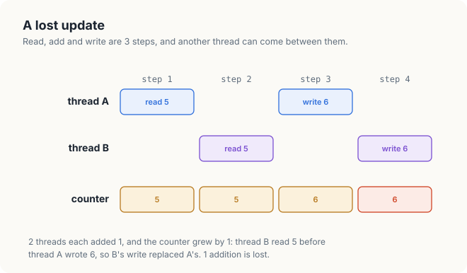
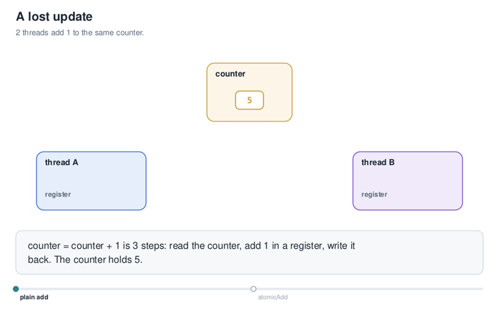
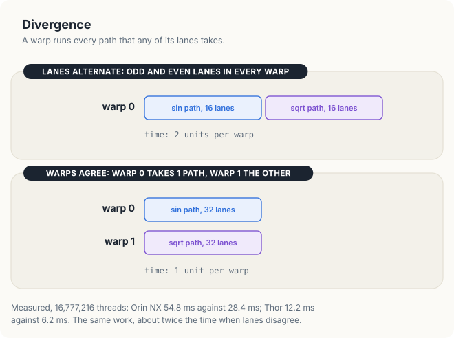
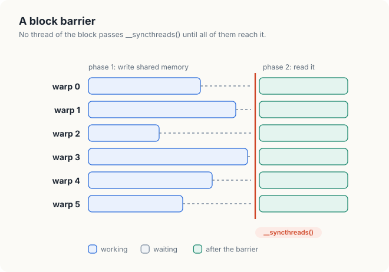
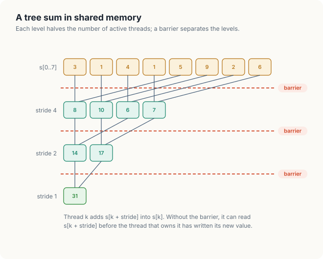
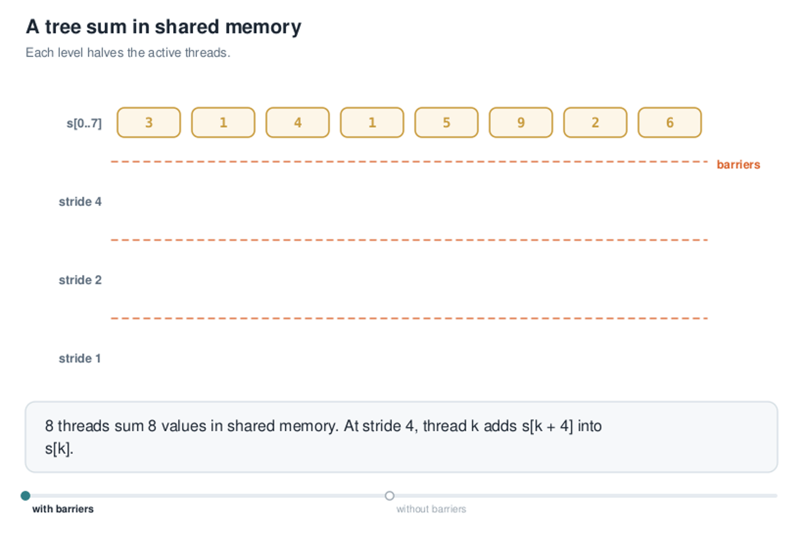
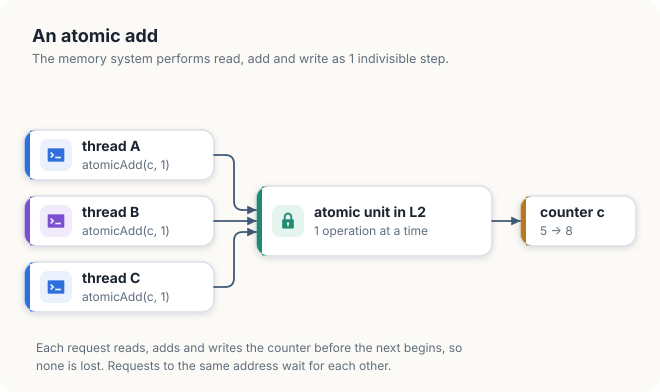
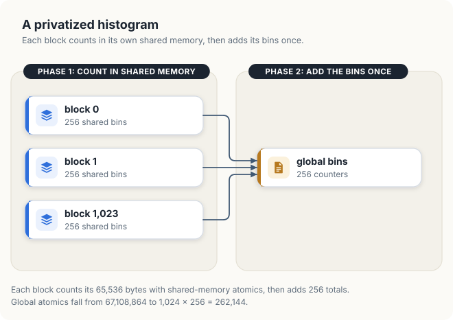
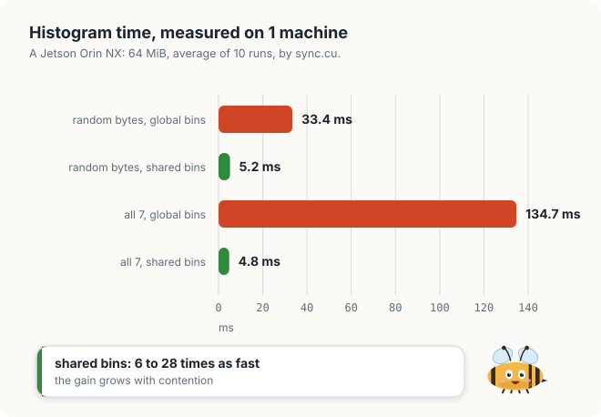

# Chapter 5: Synchronization, Atomics & Race Conditions

In every kernel so far, we used one thread to write one element of the result array. In the
vector addition kernel, for example, thread \\(i\\) wrote `c[i]` and nothing else, so the threads
never needed to know about each other. Many useful computations lack this property. To build a
histogram of bytes, we let millions of threads add counts to only 256 bins. To compute a sum, we
let every thread contribute a part of a single result. Whenever 2 threads access one memory
location, and at least one of them writes to it, the result can depend on the order of those
accesses. The hardware does not choose that order in any predictable way, so we must impose an
order wherever our program needs one.

In this chapter, we'll examine the two mechanisms that CUDA provides for this purpose. With a
barrier, we make the threads of a block wait for each other at a chosen point in the program. With
an atomic operation, we perform a read-modify-write on a memory location as one indivisible step.
We'll also examine control divergence, the slowdown that occurs when threads of one warp take
different paths through a branch. We measure each effect with a C++ program and a Rust program.

<div class="covers" markdown="1">

This chapter covers

- race conditions, and why a kernel can complete without error and still produce a wrong result
- control divergence within a warp
- `__syncthreads()`, the barrier for the threads of a block, and the errors caused by a missing barrier
- the visibility of writes across blocks: caches, memory fences and memory orderings
- atomic operations, and the atomic types that safe Rust requires for a shared counter
- privatization of a histogram in shared memory, 6 to 28 times as fast as the direct version
- why a floating-point sum computed with atomic operations varies from run to run

</div>

The code of the chapter is in
[`code/ch05_sync/`](https://github.com/arpanpathak/gpu-parallel-book/tree/main/code/ch05_sync)
for C++ and in
[`code/oxide/ch05_sync/`](https://github.com/arpanpathak/gpu-parallel-book/tree/main/code/oxide/ch05_sync)
for Rust.

## 5.1 Race conditions

### 5.1.1 Lost updates

The statement `counter = counter + 1` appears to be a single step, but a processor executes it as
3. It **reads** the value of `counter` from memory into a register, **adds** 1 to the register,
and **writes** the register back to memory. Since these are separate operations, another thread
can access `counter` between them. Figure 5.1 shows 2 threads that do so.

<figure>

<figcaption><b>Figure 5.1</b> 2 additions with 1 result: thread B reads the counter before thread A has written it.</figcaption>
</figure>

The counter initially holds 5. Thread A reads 5 in step 1, and thread B reads 5 in step 2, before
A has written its result. Both threads compute 6, and both write 6. Two additions were performed,
but the counter increased by only 1. The addition performed by thread A has been overwritten; we
call this a **lost update**. The situation that makes it possible is called a race condition. A
**race condition**, or data race, occurs when 2 or more threads access the same memory location,
at least one of the accesses is a write, and nothing in the program orders the accesses. The result
then depends on the relative timing of the threads.

### 5.1.2 Measuring a race on the GPU

Listing 5.1 produces the same race with 1,048,576 threads. The kernel is launched with 4,096
blocks of 256 threads, and every thread executes `*counter = *counter + 1` on the same location.
The second kernel, `countAtomic`, performs the same increment with `atomicAdd`, which we discuss
in section 5.5.

In Rust, the plain statement `counter[0] = counter[0] + 1` on a slice that all threads share
does not compile: the kernel receives the slice as a shared reference, and the compiler rejects
the write with error E0594. The Rust kernel `count_racy` therefore writes the same race
explicitly. It reads the counter with an atomic load and writes the incremented value back with a
separate atomic store, so another thread can store between the 2 operations, exactly as in the
plain C++ addition.

<p class="listing"><b>Listing 5.1</b> 2 ways to count. <a href="https://github.com/arpanpathak/gpu-parallel-book/blob/main/code/oxide/ch05_sync/src/main.rs">code/oxide/ch05_sync/src/main.rs</a> <a href="https://github.com/arpanpathak/gpu-parallel-book/blob/main/code/ch05_sync/sync.cu">code/ch05_sync/sync.cu</a></p>

<div class="code-tabs">
<div class="code-tab" data-lang="Rust">

```rust,ignore
mod kernels {
    // ...
{{#include ../../../../code/oxide/ch05_sync/src/main.rs:18:32}}
    // ...
}
```

</div>
<div class="code-tab" data-lang="C++">

```cpp
{{#include ../../../../code/ch05_sync/sync.cu:24:33}}
```

</div>
</div>

The measurements in this chapter come from 2 integrated GPUs, a Jetson Orin NX and a Jetson AGX
Thor. The output below is from the first.

```console
$ ./sync
1,048,576 threads each add 1 to 1 counter
  plain add    counter = 505
  atomicAdd    counter = 1048576
```

The plain version counted 505 of the 1,048,576 additions, and the same program counted 192 on the
second GPU. Nearly every update was lost, because thousands of threads read the counter at almost
the same time and wrote back almost the same value. The count also changes from one run to the
next. Note that the kernel completed without any error. The hardware does not detect races, so a
racy kernel stores a wrong result in exactly the same way as a correct kernel stores a right one.
The atomic version counted all 1,048,576 additions. The Rust program behaves in the same way: its load-and-store kernel counted
94 of the 1,048,576 additions, and its `fetch_add` kernel counted all of them.

Animation 1 shows the race with 2 threads, followed by the same 2 additions performed with
`atomicAdd`.

<figure class="anim">
<video class="motion" src="../../figures/ch05-lost-update.mp4" autoplay loop muted playsinline preload="metadata" aria-label="A counter holding 5 and 2 threads. Plain add: thread A reads 5, thread B reads 5, A writes 6, B writes 6; 1 addition is lost. atomicAdd: both threads send a +1 request; A's is applied first, B's waits beside the counter and is applied next; the counter reaches 7." data-chapters="[[0.0, &quot;plain add&quot;], [23.4, &quot;atomicAdd&quot;]]"></video>
<figcaption><b>Animation 1</b> A lost update, then the same 2 additions with <code>atomicAdd</code>.</figcaption>
</figure>

### 5.1.3 Shared counters in safe Rust

The racy kernel cannot be written in safe Rust. Recall from Chapter 3 that a cuda-oxide kernel
receives its inputs as `&[T]`, which it can only read, and its outputs as a `DisjointSlice`, which
gives each thread access to its own element only. Neither type allows every thread to write
`counter[0]`. Memory that many threads update must instead have an atomic type, such as
`DeviceAtomicU32`, whose operations are all indivisible. Listing 5.2 shows the counting kernel
written this way.

<p class="listing"><b>Listing 5.2</b> The counter. <a href="https://github.com/arpanpathak/gpu-parallel-book/blob/main/code/oxide/ch05_sync/src/main.rs">code/oxide/ch05_sync/src/main.rs</a> <a href="https://github.com/arpanpathak/gpu-parallel-book/blob/main/code/ch05_sync/sync.cu">code/ch05_sync/sync.cu</a></p>

<div class="code-tabs">
<div class="code-tab" data-lang="Rust">

```rust,ignore
mod kernels {
    // ...
{{#include ../../../../code/oxide/ch05_sync/src/main.rs:28:32}}
    // ...
}
```

</div>
<div class="code-tab" data-lang="C++">

```cpp
{{#include ../../../../code/ch05_sync/sync.cu:30:33}}
```

</div>
</div>

The host allocates the counter as ordinary zeroed `u32` memory, as listing 5.3 shows. The
function `atomic_u32` then calls `cast_elem` to change the element type that the kernel sees to
`DeviceAtomicU32`. The bytes in device memory are not moved or changed.

<p class="listing"><b>Listing 5.3</b> Allocating atomic counters and launching the count.</p>

<div class="code-tabs">
<div class="code-tab" data-lang="Rust">

```rust,ignore
{{#include ../../../../code/oxide/ch05_sync/src/main.rs:168:174}}

fn main() -> Result<(), Box<dyn std::error::Error>> {
    // ...
{{#include ../../../../code/oxide/ch05_sync/src/main.rs:182:197}}
    // ...
}
```

</div>
<div class="code-tab" data-lang="C++">

```cpp
{{#include ../../../../code/ch05_sync/sync.cu:105:127}}
```

</div>
</div>

```console
$ cargo oxide run
1,048,576 threads each add 1 to 1 counter
  fetch_add    counter = 1048576
```

The call to `fetch_add` takes a memory ordering, here `Relaxed`, which we explain in section 5.4.
The guarantee that Rust provides is a narrow one: a data race on ordinary device memory cannot be
written without `unsafe`. As we will see in section 5.3, accesses to shared memory still require
`unsafe` blocks, and in those blocks the programmer is again responsible for correctness.

## 5.2 Control divergence

Recall from Chapter 2 that a warp issues 1 instruction at a time for all 32 of its threads. A
branch therefore needs special handling when some threads of a warp take the `if` path and the
others take the `else` path. In this case, the warp executes both paths. It first executes the
`if` path, with the threads that took it active and the other threads idle. It then executes the
`else` path with the roles reversed. After the branch, the threads continue together. Executing
more than one path within a warp is called **control divergence**. Its cost is proportional to the
number of paths the warp executes, not to the number of threads that take each path, as figure 5.2
illustrates.

<figure>

<figcaption><b>Figure 5.2</b> When adjacent lanes take different paths, every warp executes both paths; when adjacent warps take different paths, each warp executes 1.</figcaption>
</figure>

Listing 5.4 measures this cost. Every thread executes 1 of 2 loops of 64 iterations, and half the
threads take each loop. The 2 runs of the kernel differ only in which threads take which loop.

<p class="listing"><b>Listing 5.4</b> A branch on alternate lanes or alternate warps.</p>

<div class="code-tabs">
<div class="code-tab" data-lang="Rust">

```rust,ignore
mod kernels {
    // ...
{{#include ../../../../code/oxide/ch05_sync/src/main.rs:107:143}}
    // ...
}
```

</div>
<div class="code-tab" data-lang="C++">

```cpp
{{#include ../../../../code/ch05_sync/sync.cu:78:94}}
```

</div>
</div>

The variable `odd` decides the path. When `byWarp` is true, `odd` is computed from
`threadIdx.x / 32`, the number of the warp within the block. All 32 threads of a warp then compute
the same value, and each warp executes only 1 loop. When `byWarp` is false, `odd` is computed from
`threadIdx.x % 2`, which alternates from 1 thread to the next. Every warp then contains threads of
both kinds and must execute both loops.

```console
branch on every other thread, 16777216 threads, average of 10 runs
  whole warps agree       28.37 ms
  lanes alternate         54.78 ms
```

The same work took 54.78 / 28.37 = 1.93 times as long when lanes alternated. On the second GPU the
ratio was 12.24 / 6.22 = 1.97. Both are close to 2, the ratio we expect from counting the paths
each warp executes.

Divergence is therefore a property of warps, not of individual threads. A branch on `blockIdx.x`
or on `threadIdx.x / 32` adds no cost, because all threads of each warp agree. The guard
`if (i < n)` of Chapter 3 diverges only in the warp that contains element \\(n\\), which is at most
1 warp in the entire grid, so its cost is negligible. Branches that depend on the data are more
likely to diverge. When the data can be arranged so that neighboring threads tend to take the same
path, the warps diverge less.

<div class="bee bee-happy" markdown="1">

A warp executes every path that any of its threads takes, so branch on whole warps where you can.

</div>

## 5.3 `__syncthreads()`: the block barrier

### 5.3.1 Phases within a block

We often organize the work of a block in phases. In the first phase, we let each thread write a
value to shared memory. In the second phase, we let the threads read values that other threads
wrote. The second phase is correct only if every write of the first phase has completed. A **barrier** is a point in a
program that every thread of a group must reach before any thread of the group continues past it.
`__syncthreads()` is the barrier for the threads of 1 block. A thread that calls it waits until all
threads of its block have called it. In addition, the writes that each thread made to shared and
global memory before the barrier are visible to all threads of the block after it (figure 5.3). In
Rust, the same barrier is `thread::sync_threads()`.

<figure>

<figcaption><b>Figure 5.3</b> Warps that reach the barrier early wait; the block continues when the last warp arrives.</figcaption>
</figure>

### 5.3.2 A block sum with and without barriers

Listing 5.5 sums the 256 values of each block in shared memory. Each thread first copies 1 value
from global memory into the shared array `s`. In the loop that follows, the variable `stride`
starts at 128. At stride 128, the first 128 threads each add `s[k + 128]` into `s[k]`. At stride
64, the first 64 threads add `s[k + 64]` into `s[k]`, and so on, with the stride halved in each
iteration, until `s[0]` holds the sum of the block. 256 values require log<sub>2</sub> 256 = 8
levels. Figure 5.4 shows the same tree for 8 values.

<figure>

<figcaption><b>Figure 5.4</b> A tree sum of 8 values, with a barrier between levels.</figcaption>
</figure>

<p class="listing"><b>Listing 5.5</b> A block sum with or without barriers.</p>

<div class="code-tabs">
<div class="code-tab" data-lang="Rust">

```rust,ignore
mod kernels {
    // ...
{{#include ../../../../code/oxide/ch05_sync/src/main.rs:75:105}}
    // ...
}
```

</div>
<div class="code-tab" data-lang="C++">

```cpp
{{#include ../../../../code/ch05_sync/sync.cu:59:76}}
```

</div>
</div>

Each level reads values that the previous level wrote, and these values were often written by
threads in other warps. A barrier must therefore separate each level from the next. The parameter
`barrier` allows the program to leave the barriers out, so that we can observe the effect. Every
block sums 256 ones, so the correct result for every block is 256.

```console
4,096 blocks each sum 256 ones; the right answer is 256
  with barriers      wrong sums:    0 of 4096   (block 0: 256)
  without barriers   wrong sums: 2450 of 4096   (block 0: 96)
```

Without barriers, 2,450 of the 4,096 block sums were wrong on the first GPU, and 3,057 on the
second. A thread that reached the next level early read a value that its neighbor had not yet
written. Some blocks still produced the correct sum, because whether a warp runs ahead of the
others depends on the scheduling of the warps. Errors of this kind are difficult to find, because
a test can pass on some runs and fail on others. Animation 2 shows the 8-value tree with and
without barriers.

<figure class="anim">
<video class="motion" src="../../figures/ch05-tree-sum.mp4" autoplay loop muted playsinline preload="metadata" aria-label="Eight values in shared memory are summed in a tree. With barriers: stride 4 gives 8, 10, 6, 7, stride 2 gives 14, 17, stride 1 gives 31, with a barrier between levels. Without barriers: threads 0 and 1 run ahead to stride 2 and read s[2] = 4 and s[3] = 1 before they are updated, giving 12 and 11, and the final sum is 23 instead of 31." data-chapters="[[0.0, &quot;with barriers&quot;], [20.28, &quot;without barriers&quot;]]"></video>
<figcaption><b>Animation 2</b> The tree sum with barriers, then without: a thread reads a value before it is written.</figcaption>
</figure>

### 5.3.3 Rules for barriers

A barrier is correct only if every thread of the block reaches it, and reaches it the same number
of times. If `__syncthreads()` is placed inside a branch that some threads skip, the threads that
reach it wait for threads that never arrive, and the block hangs. In listing 5.5,
`if (barrier) __syncthreads();` is allowed only because `barrier` has the same value in every
thread. The following code is incorrect:

<div class="code-tabs">
<div class="code-tab" data-lang="Rust">

```rust,ignore
if thread::threadIdx_x() % 2 == 0 {
    thread::sync_threads(); // odd threads never arrive: the block hangs
}
```

</div>
<div class="code-tab" data-lang="C++">

```cpp
if (threadIdx.x % 2 == 0) {
    __syncthreads();     // odd threads never arrive: the block hangs
}
```

</div>
</div>

Note also that a barrier applies to exactly 1 block. The blocks of a grid run on different SMs,
and a GPU does not guarantee that all the blocks of a launch are running at the same time.
There is therefore no ordinary barrier across a grid. Work that needs every block to complete a
phase before any block starts the next is split into 2 kernel launches, which execute in order,
or it uses atomic operations (section 5.5).

## 5.4 Visibility across blocks: caches, fences and orderings

A barrier orders memory accesses within a block. Between blocks, 2 further effects determine
which writes of 1 thread another thread can see. First, each SM has its own L1 cache, and the L1
caches of different SMs are not kept consistent with each other. A thread on SM 0 can read a stale
copy of a location that a thread on SM 1 has already changed in L2. Second, the compiler may keep a
value in a register and never read it from memory again.

A **memory fence** orders the memory operations of 1 thread as other threads observe them.
`__threadfence()` guarantees that every write the thread made before the fence becomes visible to
the whole device before any write it makes after the fence. `__threadfence_block()` gives the
same guarantee for the threads of the block, and `__threadfence_system()` extends it to the host.
A fence does not make any thread wait. Its typical use is to publish data: a thread writes the
data, executes a fence, and then sets a flag, so that any thread that sees the flag also sees the
data.

cuda-oxide expresses the same ideas in its types. An atomic type names its **scope**, the set of
threads that must observe its operations: `BlockAtomicU32` for 1 block, `DeviceAtomicU32` for the
device, and `SystemAtomicU32` for the device and the host. Each operation names a **memory
ordering**, which states what other memory accesses the operation orders:

| Ordering | Guarantee | Typical use |
|---|---|---|
| `Relaxed` | the operation itself is atomic; nothing else is ordered | counters, histograms |
| `Release` | writes before it are visible to a thread that acquires the value | setting a "data ready" flag |
| `Acquire` | reads after it see what the releasing thread wrote | reading that flag |
| `AcqRel` | both, for a read-modify-write | locks, queues |
| `SeqCst` | 1 order of all such operations that every thread agrees on | rarely needed |

A counter needs only `Relaxed`, because no other memory access depends on its value. A flag that
announces that data is ready needs `Release` on the write and `Acquire` on the read.

## 5.5 Atomic operations

### 5.5.1 Atomic read-modify-write

An **atomic operation** is a read-modify-write that the hardware performs indivisibly. No other
thread can read or write the location between the read and the write of the operation. When 2
threads call `atomicAdd` on the same location, the 2 operations are performed one after the other,
in an order chosen by the hardware, and both take effect. Atomic operations do not
impose a particular order between the threads; they only guarantee that the operations do not
overlap. Atomic operations on global memory are performed in the L2 cache, which all SMs share
(figure 5.5).

<figure>

<figcaption><b>Figure 5.5</b> Atomic requests to 1 address are performed one at a time.</figcaption>
</figure>

CUDA provides the following atomic functions for `int`, `unsigned int` and `unsigned long long`,
and `atomicAdd` also for `float` and `double`. Each function returns the value that the location
held before the operation.

| Function | Operation | Returns |
|---|---|---|
| `atomicAdd(addr, v)` | `*addr += v` | the old value |
| `atomicSub(addr, v)` | `*addr -= v` | the old value |
| `atomicExch(addr, v)` | `*addr = v` | the old value |
| `atomicCAS(addr, cmp, v)` | if `*addr == cmp` then `*addr = v` | the old value |
| `atomicMin(addr, v)` | `*addr = min(*addr, v)` | the old value |
| `atomicMax(addr, v)` | `*addr = max(*addr, v)` | the old value |
| `atomicAnd(addr, v)` | `*addr &= v` | the old value |
| `atomicOr(addr, v)` | `*addr \|= v` | the old value |
| `atomicXor(addr, v)` | `*addr ^= v` | the old value |

The Rust atomic types provide the same operations as methods: `fetch_add`, `fetch_sub`, `swap`,
`compare_exchange`, `fetch_min`, `fetch_max`, `fetch_and`, `fetch_or` and `fetch_xor`.

Atomic operations are correct, but they have a cost. Since operations on the same address are
performed one at a time, many threads that update 1 location must wait for each other, and the
waiting time grows with the number of threads. The next section measures this cost.

### 5.5.2 A histogram

A **histogram** counts how many times each value occurs in a data set. A byte has 256 possible
values, so a histogram of bytes has 256 counters, called **bins**. In the direct kernel, shown in
listing 5.6, we give each thread a set of bytes, and we let the thread add 1 to the bin of each
byte with `atomicAdd`.

<p class="listing"><b>Listing 5.6</b> A histogram with global bins.</p>

<div class="code-tabs">
<div class="code-tab" data-lang="Rust">

```rust,ignore
mod kernels {
    // ...
{{#include ../../../../code/oxide/ch05_sync/src/main.rs:34:44}}
    // ...
}
```

</div>
<div class="code-tab" data-lang="C++">

```cpp
{{#include ../../../../code/ch05_sync/sync.cu:35:42}}
```

</div>
</div>

The launch uses 1,024 blocks of 256 threads, 262,144 threads in total, for 67,108,864 bytes, so
each thread processes 256 bytes. The loop advances by `stride`, the total number of threads in the
grid. This pattern is called a **grid-stride loop**. In every iteration, neighboring threads read
neighboring bytes.

Every one of the 67,108,864 additions targets 1 of only 256 addresses in global memory. We can
reduce this contention with **privatization**. We give each block its own 256 bins in shared
memory, where atomic operations are fast and only the threads of that block compete for each bin.
At the end, we add each block's totals to the global bins once (figure 5.6).

<figure>

<figcaption><b>Figure 5.6</b> A privatized histogram: count in shared memory, then add each bin to global memory once.</figcaption>
</figure>

<p class="listing"><b>Listing 5.7</b> A histogram with shared bins.</p>

<div class="code-tabs">
<div class="code-tab" data-lang="Rust">

```rust,ignore
mod kernels {
    // ...
{{#include ../../../../code/oxide/ch05_sync/src/main.rs:46:73}}
    // ...
}
```

</div>
<div class="code-tab" data-lang="C++">

```cpp
{{#include ../../../../code/ch05_sync/sync.cu:44:57}}
```

</div>
</div>

We split the kernel into 3 phases, separated by 2 barriers. In the first phase, we let each thread
set one bin of `local` to 0. The first barrier ensures that every bin is 0 before any thread counts into it. In
the second phase, we let the threads count their bytes into `local`. The second barrier ensures that all
counting has finished before the third phase, in which thread \\(k\\) adds bin \\(k\\) to the
global bins. Since the block has 256 threads and there are 256 bins, each thread handles exactly
1 bin in the first and third phases.

The Rust versions have the same structure. In the shared version, the bins are held in a
`SharedArray`, and every access to it is `unsafe`. The compiler cannot see the barriers that make
these accesses correct, so each `unsafe` block carries a `SAFETY` comment that states the reason.

`BlockAtomicU32::from_ptr` treats 1 shared bin as an atomic with block scope, which is sufficient
for a counter in shared memory. We ran each kernel on 2 inputs: random bytes, which are spread
over all 256 bins, and bytes that all have the value 7, so that every addition targets the same
bin.

```console
histogram of 64 MiB, average of 10 runs
  random bytes global bins     33.40 ms  total 67108864
  random bytes shared bins      5.19 ms  total 67108864
  all 7        global bins    134.65 ms  total 67108864
  all 7        shared bins      4.84 ms  total 67108864
```

```console
$ cargo oxide run
histogram of 64 MiB, average of 10 runs
  random bytes global bins     35.54 ms  total 67108864
  random bytes shared bins      4.05 ms  total 67108864
  all 7        global bins    133.65 ms  total 67108864
  all 7        shared bins      4.04 ms  total 67108864
```

Every total is 67,108,864, 1 count per byte, so no update was lost. The versions differ in time
(figure 5.7). With global bins, the bytes that are all 7 took 134.65 / 33.40 = 4 times as long as
the random bytes, because all requests waited for the same address. The shared bins were 6 times
as fast as the global bins on random bytes, and 28 times as fast on the bytes that are all 7. On
the second GPU, the global version took 21 ms and 51 ms and the shared version 0.5 ms to 1.3 ms,
16 to 109 times less.

<figure>

<figcaption><b>Figure 5.7</b> Histogram times of the C++ run above.</figcaption>
</figure>

<details class="check">
<summary>How many atomic operations on global memory does each histogram make for 64 MiB, with 1,024 blocks?</summary>

The global version makes 1 per byte: 67,108,864. The shared version makes 1 per bin per block:
1,024 × 256 = 262,144, which is 256 times fewer. Its other 67,108,864 atomic operations are on
shared memory, inside each block.

</details>

### 5.5.3 Compare-and-swap

`atomicCAS(addr, cmp, v)` writes `v` only if the location still holds `cmp`, and it returns the
value it found. With this operation, we can make any update atomic. We read the old value, compute the new
value, and attempt to swap it in. If another thread changed the location
in the meantime, the swap fails, and we try again with the value that `atomicCAS` returned. The same operation can be used to build a lock. However, a lock makes threads wait for
each other on a machine designed to keep all of them busy, and a warp whose threads spin on 1 lock
can stop making progress. Privatization, partitioning the data, and plain atomic operations are
almost always faster.

## 5.6 Floating-point non-determinism

Floating-point addition rounds every result to the nearest representable number, so the result of
a sum depends on the order of the additions. A `float` has 24 bits of precision, and near
10<sup>8</sup> the representable numbers are 8 apart. Adding 1 to 10<sup>8</sup> therefore gives
10<sup>8</sup>, so (10<sup>8</sup> + 1) − 10<sup>8</sup> = 0, while
(10<sup>8</sup> − 10<sup>8</sup>) + 1 = 1.

An `atomicAdd` on a `float` performs the additions in the order in which the threads arrive, and
that order changes from run to run. Listing 5.8 sums 1,048,576 values with 1 atomic operation per
value.

<p class="listing"><b>Listing 5.8</b> A float sum by atomics.</p>

<div class="code-tabs">
<div class="code-tab" data-lang="Rust">

```rust,ignore
mod kernels {
    // ...
{{#include ../../../../code/oxide/ch05_sync/src/main.rs:145:153}}
}
```

</div>
<div class="code-tab" data-lang="C++">

```cpp
{{#include ../../../../code/ch05_sync/sync.cu:96:103}}
```

</div>
</div>

```console
sum of 1,048,576 floats by atomicAdd (exact: 7851.7077)
  run 1   7849.5161
  run 2   7849.4971
  run 3   7849.4990
  run 4   7849.5288
```

The 4 runs give 4 different results, and all of them are about 2.2 below the exact sum. Both
effects are caused by rounding. Near 7,850, representable `float` values are
2<sup>−11</sup> ≈ 0.00049 apart, so each of the 1,048,576 additions rounds the running total, and
the small rounding errors accumulate. The runs differ from each other because the threads added
their values in a different order each time, and the rounding errors therefore differ.

For most programs this variation is acceptable. Programs that need the same bits on every run, for
example to compare results across software versions or to reproduce a training run, must add in a
fixed order. The tree sum of section 5.3 always adds the same pairs, so it gives the same result on
every run. In Chapter 8, we develop fast sums of this kind.

## 5.7 Choosing a synchronization method

When the threads of a kernel share memory, the answers to 4 questions determine what the kernel
needs:

| Question | If yes |
|---|---|
| Do 2 threads write the same location? | use an atomic, or give each thread its own location |
| Does a thread read what another thread of its block wrote? | put a `__syncthreads()` between the write and the read, reached by every thread |
| Does a thread read what another block wrote? | split the work into 2 launches, or use atomics with release and acquire |
| Must the result be the same bits on every run? | add in a fixed order, not with floating-point atomics |

Each method in the table imposes an order on 2 accesses that had none. The same reasoning can be
used to find a race. We identify the shared location, list the threads that write it and the
threads that read it, and determine what orders their accesses. If nothing does, the program
contains a race, even if every test so far has passed. The `racecheck` tool of Compute Sanitizer
(Chapter 25) detects unordered accesses to shared memory automatically.

## 5.8 The complete programs

<p class="listing"><b>Listing 5.9</b> The complete programs. <a href="https://github.com/arpanpathak/gpu-parallel-book/blob/main/code/oxide/ch05_sync/src/main.rs">code/oxide/ch05_sync/src/main.rs</a> <a href="https://github.com/arpanpathak/gpu-parallel-book/blob/main/code/ch05_sync/sync.cu">code/ch05_sync/sync.cu</a></p>

<div class="code-tabs">
<div class="code-tab" data-lang="Rust">

```rust,ignore
{{#include ../../../../code/oxide/ch05_sync/src/main.rs}}
```

</div>
<div class="code-tab" data-lang="C++">

```cpp
{{#include ../../../../code/ch05_sync/sync.cu}}
```

</div>
</div>

## Common mistakes

- **Updating a shared counter with `+=`.** Use `atomicAdd`, or in Rust an atomic type.
- **A `__syncthreads()` that some threads skip.** Every thread of the block must reach every
  barrier, the same number of times, or the block hangs.
- **Reading another thread's shared-memory value without a barrier.** The value may not have been
  written yet, and the result is correct on some runs and wrong on others.
- **Expecting `__syncthreads()` to synchronize blocks.** It applies to 1 block. Use 2 launches.
- **Many threads updating 1 global location.** The atomic operations are serialized. Privatize
  the counts in shared memory and add the totals once.
- **Expecting a floating-point atomic sum to repeat exactly.** The order of the additions changes,
  so the last digits change.
- **Branching on alternate threads.** Branch on whole warps where the data allows it.

<div class="summary" markdown="1">

## Summary

- A race condition consists of 2 accesses to 1 location, at least one of them a write, with nothing
  ordering them. 1,048,576 plain additions to 1 counter kept 505 and 192 of the additions on the
  2 GPUs, and no error was reported.
- Safe Rust cannot express that race, because memory that many threads update must have an atomic
  type.
- A warp executes every path that its threads take. Branching on alternate lanes doubled the time
  of the same work.
- `__syncthreads()` makes every thread of a block wait for the others and makes their writes
  visible to the block. Without it, 2,450 of 4,096 block sums were wrong.
- Atomic operations make a read-modify-write indivisible, at the cost of serializing the
  operations on a busy address. A privatized histogram was 6 to 28 times as fast as one with
  global atomic operations.
- Floating-point atomic operations add in a different order on each run, so their sums differ in
  the last digits.

</div>

Chapter 6 moves from the threads of a kernel to streams of work on the GPU, and overlaps copies
with kernels through asynchronous execution.

## Exercises

1. Explain why the guard `if (i < n)` diverges in at most 1 warp of a grid.
2. Rewrite the branch `if (threadIdx.x % 2 == 0) {...} else {...}` so that whole warps take each
   path while each path still covers half the threads.
3. The barrier in the hanging example of section 5.3.3 is inside an `if`. Rewrite it so that every
   thread reaches the barrier exactly once.
4. A histogram has 1,024 bins instead of 256, with blocks of 256 threads. How must listing 5.7
   change for the zeroing and the final addition?
5. Use `atomicMax` to find the largest of 1,048,576 `int` values. Why does this result, unlike the
   float sum, not change from run to run?
6. On the bytes that are all 7, why did shared bins become no slower than on random bytes, while
   global bins became 4 times slower?
7. In Rust, try to write the racy counter with a `DisjointSlice<u32>`. What prevents it?

## Sources and further reading

- NVIDIA, *CUDA C++ Programming Guide*, "Synchronization Functions", "Memory Fence Functions",
  "Atomic Functions" and "SIMT Architecture": <https://docs.nvidia.com/cuda/cuda-c-programming-guide/>
- NVIDIA, *CUDA C++ Best Practices Guide*, "Branching and Divergence":
  <https://docs.nvidia.com/cuda/cuda-c-best-practices-guide/>
- NVIDIA, *Compute Sanitizer*, the `racecheck` tool: <https://docs.nvidia.com/compute-sanitizer/>
- NVlabs, *cuda-oxide*, the `cuda_device::atomic` module, for scopes and orderings:
  <https://github.com/NVlabs/cuda-oxide>
- D. Goldberg, "What Every Computer Scientist Should Know About Floating-Point Arithmetic",
  *ACM Computing Surveys* 23(1), 1991.
