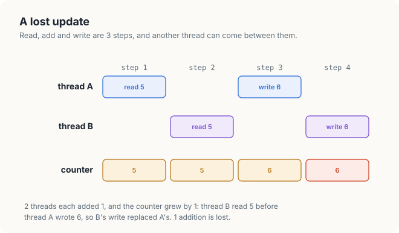
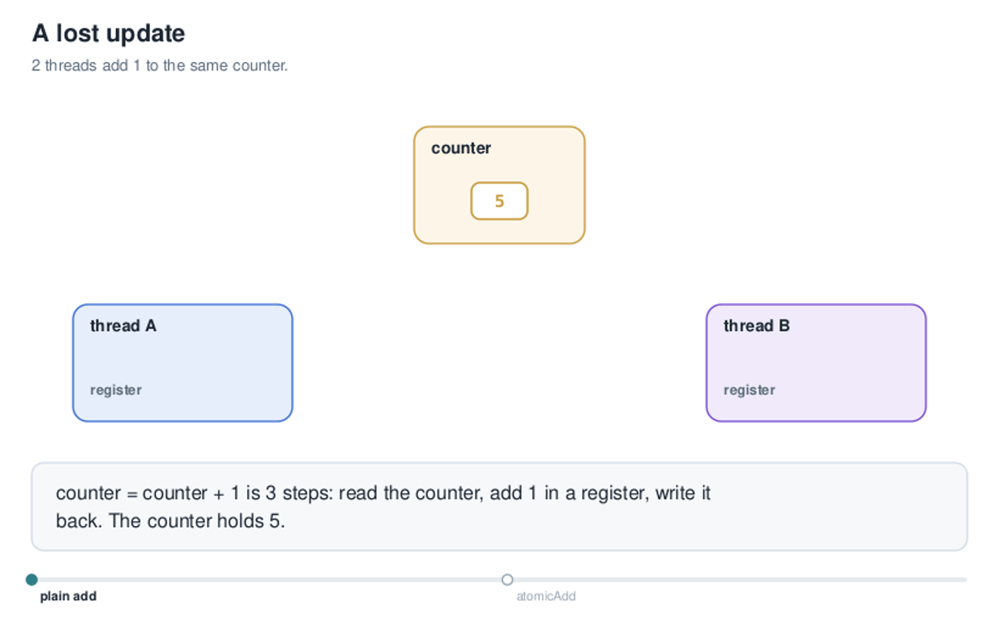
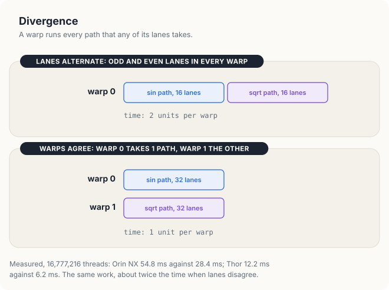
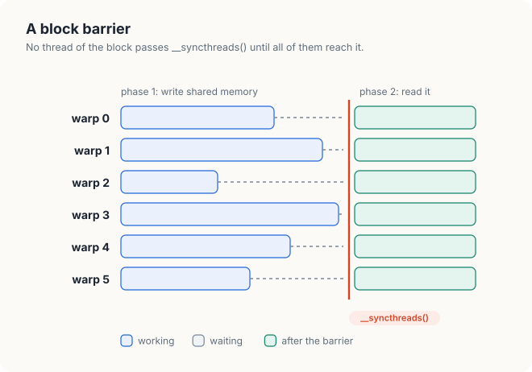
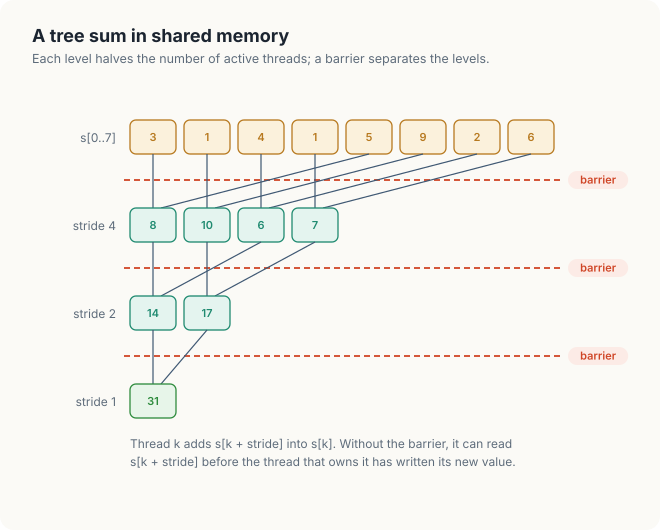
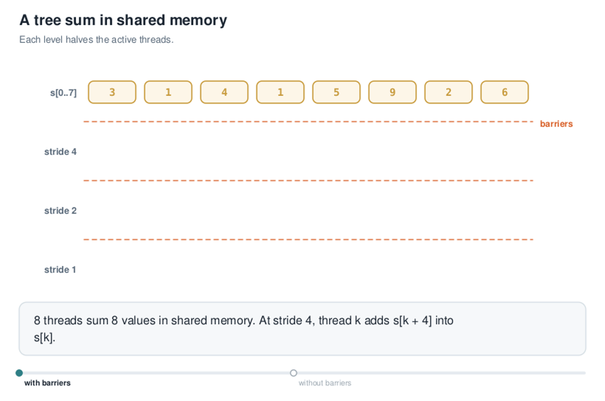
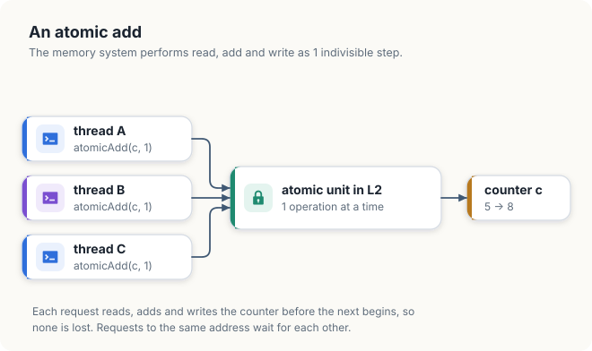
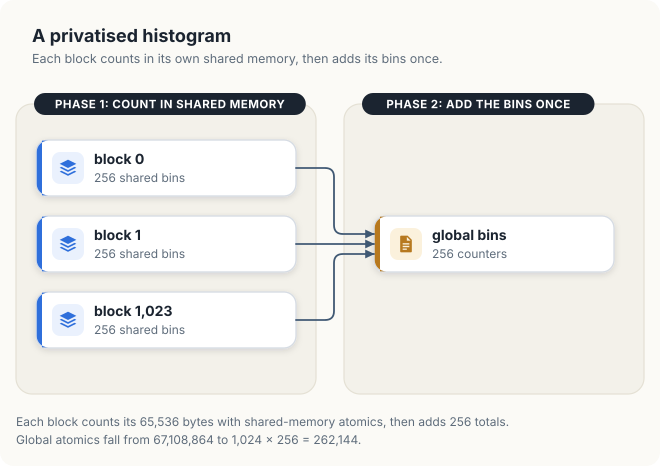
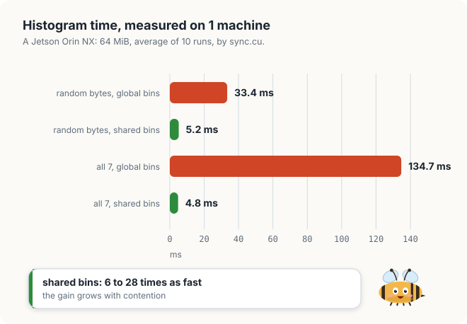

# Chapter 5: Synchronisation, Atomics & Race Conditions

Every kernel so far gave each thread its own output element: thread \\(i\\) wrote `c[i]` and
nothing else, so no thread could disturb another. Many useful kernels cannot work that way. A
histogram has 256 bins and millions of threads that want to add to them; a sum has 1 result and
every thread holds a piece of it. As soon as 2 threads touch the same memory, the order in which
they touch it decides the result, and nothing in the hardware fixes that order unless the program asks.

This chapter is about the tools a program uses to ask: barriers, which make the threads of a block
wait for each other, and atomic operations, which make a read-modify-write indivisible. It also
covers divergence, the cost a warp pays when its threads take different branches. Every effect is
measured by 2 programs, in C++ and in Rust, on 2 boards.

<div class="covers" markdown="1">

This chapter covers

- race conditions, and why a GPU reports success while computing a wrong answer
- divergence: what a warp does when its threads disagree on a branch
- `__syncthreads()`, the block barrier, and the bug a missing barrier causes
- visibility across blocks: caches, fences and memory orderings
- atomic operations, and how safe Rust forces a shared counter to be atomic
- a privatised histogram, 6 to 28 times as fast as a naive one
- why a sum computed with atomics changes from run to run

</div>

The code of the chapter is in
[`code/ch05_sync/`](https://github.com/arpanpathak/gpu-parallel-book/tree/main/code/ch05_sync)
for C++ and in
[`code/oxide/ch05_sync/`](https://github.com/arpanpathak/gpu-parallel-book/tree/main/code/oxide/ch05_sync)
for Rust.

## 5.1 The race condition

### 5.1.1 A lost update

The statement `counter = counter + 1` looks like 1 step, but a processor carries it out in 3: it
**reads** the counter into a register, **adds** 1 to the register, and **writes** the register
back. Another thread can come between those steps. Figure 5.1 shows 2 threads doing so.

<figure>

<figcaption><b>Figure 5.1</b> 2 additions, 1 result: thread B reads the counter before thread A has written it.</figcaption>
</figure>

Both threads read 5, both compute 6, and both write 6. 2 additions happened and the counter grew by
1. This is a **lost update**, and the situation that allows it has a name. A **race condition**,
or data race, occurs when 2 or more threads access the same memory location, at least 1 of the
accesses is a write, and nothing in the program orders the accesses. The result then depends on
the order the hardware happens to choose.

### 5.1.2 A race on 1,048,576 threads

Listing 5.1 runs the race at the scale of a GPU: 4,096 blocks of 256 threads, 1,048,576 threads
in all, each adding 1 to the same counter. `countAtomic` does the same with `atomicAdd`, which
section 5.5 explains.

<p class="listing"><b>Listing 5.1</b> 2 ways to count, in C++. <a href="https://github.com/arpanpathak/gpu-parallel-book/blob/main/code/ch05_sync/sync.cu">code/ch05_sync/sync.cu</a></p>

```cpp
{{#include ../../../../code/ch05_sync/sync.cu:24:33}}
```

```console
$ ./sync                                   # on a Jetson Orin NX
1,048,576 threads each add 1 to 1 counter
  plain add    counter = 505
  atomicAdd    counter = 1048576
```

The plain version counted 505 of 1,048,576 additions; on a Jetson AGX Thor it counted 192. Almost
every addition was lost, because thousands of threads read the counter at nearly the same moment
and wrote back nearly the same value. The number changes from run to run. The kernel reported
no error: a race is not something the hardware detects, so a GPU stores the wrong answer as
calmly as the right one.

Animation 1 slows the race down to 2 threads and then repeats it with an atomic add.

<figure class="anim">
<video class="motion" src="../../figures/ch05-lost-update.mp4" autoplay loop muted playsinline preload="metadata" aria-label="A counter holding 5 and 2 threads. Plain add: thread A reads 5, thread B reads 5, A writes 6, B writes 6; 1 addition is lost. atomicAdd: both threads send a +1 request; A's is applied first, B's waits beside the counter and is applied next; the counter reaches 7." data-chapters="[[0.0, &quot;plain add&quot;], [23.4, &quot;atomicAdd&quot;]]"></video>
<figcaption><b>Animation 1</b> A lost update, then the same 2 additions with <code>atomicAdd</code>.</figcaption>
</figure>

### 5.1.3 Why safe Rust cannot express the race

In Rust the racy kernel does not compile. A kernel receives its inputs as `&[T]`, which it may
only read, and its outputs as a `DisjointSlice`, which hands each thread only its own element
(Chapter 3). Neither lets every thread write `counter[0]`. Memory that many threads update must
have an atomic type, such as `DeviceAtomicU32`, whose only operations are indivisible:

<p class="listing"><b>Listing 5.2</b> The counter in Rust. <a href="https://github.com/arpanpathak/gpu-parallel-book/blob/main/code/oxide/ch05_sync/src/main.rs">code/oxide/ch05_sync/src/main.rs</a></p>

```rust,ignore
mod kernels {
    // ...
{{#include ../../../../code/oxide/ch05_sync/src/main.rs:16:20}}
    // ...
}
```

The host allocates the counter as ordinary zeroed `u32` memory and changes only the element type
the kernel sees, with `cast_elem`; the bytes stay where they are.

<p class="listing"><b>Listing 5.3</b> Allocating atomic counters and launching the count, in Rust.</p>

```rust,ignore
{{#include ../../../../code/oxide/ch05_sync/src/main.rs:86:92}}

fn main() -> Result<(), Box<dyn std::error::Error>> {
    // ...
{{#include ../../../../code/oxide/ch05_sync/src/main.rs:100:107}}
    // ...
}
```

```console
$ cargo oxide run
1,048,576 threads each add 1 to 1 counter
  fetch_add    counter = 1048576
```

`fetch_add` takes a memory ordering, here `Relaxed`, which section 5.4 explains. The guarantee
Rust gives is narrow but valuable: a data race on ordinary memory cannot be written without
`unsafe`. Shared memory, as section 5.3 shows, still needs `unsafe`, and there the programmer
carries the responsibility again.

## 5.2 Divergence: control flow in a warp

Chapter 2 showed that a warp issues 1 instruction at a time for all 32 of its threads. A branch
raises a question: what happens when some threads of a warp take the `if` path and the others
take the `else` path? The warp runs both. It first runs the `if` path with the threads that took
it active and the others idle, then the `else` path with the roles swapped, and then the threads
continue together. Running more than 1 path in a warp is called **divergence**, and it costs time
in proportion to the paths taken, not the threads that take them (figure 5.2).

<figure>

<figcaption><b>Figure 5.2</b> Alternate lanes force every warp through both paths; alternate warps send each warp down 1.</figcaption>
</figure>

Listing 5.4 measures the cost. Every thread runs 1 of 2 loops of 64 steps, and half the threads
take each loop. The only difference between the 2 runs is which threads take which loop.

<p class="listing"><b>Listing 5.4</b> A branch on alternate lanes or alternate warps, in C++.</p>

```cpp
{{#include ../../../../code/ch05_sync/sync.cu:78:94}}
```

```console
branch on every other thread, 16777216 threads, average of 10 runs
  whole warps agree       28.37 ms
  lanes alternate         54.78 ms
```

With `byWarp`, `threadIdx.x / 32` is the warp's number within the block, so all 32 threads of a
warp agree and each warp runs 1 loop. Without it, `threadIdx.x % 2` alternates from 1 thread to
the next, so every warp holds both kinds and runs both loops. The same work took 54.78 / 28.37 =
1.93 times as long on the Orin NX, and 12.24 / 6.22 = 1.97 times as long on the Thor: close to the
2 that counting paths predicts.

Divergence is a property of warps, not of threads. A branch on `blockIdx.x` or on
`threadIdx.x / 32` costs nothing extra, because whole warps agree. The guard `if (i < n)` from
Chapter 3 diverges only in the warp that contains element \\(n\\), at most 1 warp in the whole
grid, so its cost is negligible. Data-dependent branches are where divergence hides: arranging
data so that neighbouring threads tend to take the same path keeps warps together.

<div class="bee bee-happy" markdown="1">

A warp pays for every path any of its threads takes, so branch on whole warps where you can.

</div>

## 5.3 `__syncthreads()`: the block barrier

### 5.3.1 Phases within a block

Threads of a block often work in phases: each thread writes a value to shared memory, and then
threads read values that other threads wrote. The second phase is correct only if every write of
the first has finished. A **barrier** is a point in a program that every thread of a group must
reach before any thread of the group continues. `__syncthreads()` is the barrier for 1 block: a
thread that calls it waits until all threads of its block have called it, and the writes each
thread made to shared and global memory before the barrier are visible to the whole block after
it (figure 5.3). In Rust the same barrier is `thread::sync_threads()`.

<figure>

<figcaption><b>Figure 5.3</b> Early warps wait at the barrier; the block continues when the last one arrives.</figcaption>
</figure>

### 5.3.2 A tree sum, and a missing barrier

Listing 5.5 sums the 256 values of each block in shared memory. Each thread first copies 1 value
into the array `s`. Then, at stride 128, the first 128 threads each add `s[k + 128]` into `s[k]`;
at stride 64 the first 64 threads add `s[k + 64]`; and so on, halving each time, until `s[0]`
holds the sum. 256 values need log<sub>2</sub> 256 = 8 levels, and figure 5.4 draws the same tree
for 8 values.

<figure>

<figcaption><b>Figure 5.4</b> A tree sum of 8 values, with a barrier between levels.</figcaption>
</figure>

<p class="listing"><b>Listing 5.5</b> A block sum with or without barriers, in C++.</p>

```cpp
{{#include ../../../../code/ch05_sync/sync.cu:59:76}}
```

Each level reads values the previous level wrote, often written by threads in other warps, so a
barrier separates the levels. The parameter `barrier` lets the program leave them out. Every block
sums 256 ones, so every right answer is 256:

```console
4,096 blocks each sum 256 ones; the right answer is 256
  with barriers      wrong sums:    0 of 4096   (block 0: 256)
  without barriers   wrong sums: 2450 of 4096   (block 0: 96)
```

Without barriers, 2,450 of 4,096 blocks were wrong on the Orin NX and 3,057 on the Thor. A thread
that reached the next level early read a value its neighbour had not yet written. Some blocks were
still right, because whether a warp runs ahead depends on the scheduler; a bug that sometimes
gives the right answer is the hardest kind to find. Animation 2 shows the 8-value tree both ways.

<figure class="anim">
<video class="motion" src="../../figures/ch05-tree-sum.mp4" autoplay loop muted playsinline preload="metadata" aria-label="Eight values in shared memory are summed in a tree. With barriers: stride 4 gives 8, 10, 6, 7, stride 2 gives 14, 17, stride 1 gives 31, with a barrier between levels. Without barriers: threads 0 and 1 run ahead to stride 2 and read s[2] = 4 and s[3] = 1 before they are updated, giving 12 and 11, and the final sum is 23 instead of 31." data-chapters="[[0.0, &quot;with barriers&quot;], [20.28, &quot;without barriers&quot;]]"></video>
<figcaption><b>Animation 2</b> The tree sum with barriers, then without: a thread reads a value before it is written.</figcaption>
</figure>

### 5.3.3 Rules for barriers

A barrier is safe only if every thread of the block reaches it, the same number of times. A
`__syncthreads()` inside a branch that some threads skip waits for threads that will never come,
and the block hangs. `if (barrier) __syncthreads();` in listing 5.5 is allowed only because
`barrier` has the same value in every thread.

```cpp
if (threadIdx.x % 2 == 0) {
    __syncthreads();     // odd threads never arrive: the block hangs
}
```

A barrier also has a reach of exactly 1 block. Blocks run on different SMs, and a GPU does not
promise that all the blocks of a launch are running at the same moment, so there is no ordinary
barrier across a grid. Work that needs every block to finish a phase is split into 2 kernel
launches, which run in order, or uses atomics (section 5.5).

## 5.4 Visibility across blocks: caches, fences and orderings

A barrier orders memory within a block. Between blocks, 2 further effects decide what 1 thread
sees of another's writes. Each SM has its own L1 cache, and L1 caches are not kept in agreement
with each other: a thread on SM 0 can read a stale copy of a location that a thread on SM 1 has
already changed in L2. The compiler, for its part, may keep a value in a register and never read
memory again.

A **memory fence** orders 1 thread's own memory operations as other threads see them.
`__threadfence()` makes every write the thread made before it visible to the whole device before
any write it makes after it; `__threadfence_block()` does the same for the block, and
`__threadfence_system()` for the host as well. A fence makes no thread wait. Its typical use is
"publish": write the data, fence, then set a flag, so that a thread that sees the flag also sees
the data.

cuda-oxide states the same ideas in its types. An atomic type names its **scope**, the set of
threads that must see its operations: `BlockAtomicU32` for 1 block, `DeviceAtomicU32` for the
device, `SystemAtomicU32` for device and host. Each operation names a **memory ordering**:

| Ordering | Guarantee | Typical use |
|---|---|---|
| `Relaxed` | the operation itself is atomic; nothing else is ordered | counters, histograms |
| `Release` | writes before it are visible to a thread that acquires the value | setting a "data ready" flag |
| `Acquire` | reads after it see what the releasing thread wrote | reading that flag |
| `AcqRel` | both, for a read-modify-write | locks, queues |
| `SeqCst` | 1 order of all such operations that every thread agrees on | rarely needed |

A counter needs only `Relaxed`, because no other memory depends on its value. A flag that
announces data needs `Release` on the write and `Acquire` on the read.

## 5.5 Atomic operations

### 5.5.1 Read, modify and write as 1 step

An **atomic operation** is a read-modify-write that the hardware performs indivisibly: no other
thread can read or write the location between its read and its write. 2 `atomicAdd` calls on the
same location happen 1 after the other, in an order the hardware chooses, and both take effect.
Global-memory atomics are carried out in the L2 cache, which every SM shares (figure 5.5).

<figure>

<figcaption><b>Figure 5.5</b> Atomic requests to 1 address are applied 1 at a time.</figcaption>
</figure>

CUDA provides these atomic functions for `int`, `unsigned int` and `unsigned long long`, and
`atomicAdd` also for `float` and `double`. Each returns the value the location held before the
operation.

| Function | Operation | Returns |
|---|---|---|
| `atomicAdd(addr, v)` | `*addr += v` | the old value |
| `atomicSub(addr, v)` | `*addr -= v` | the old value |
| `atomicExch(addr, v)` | `*addr = v` | the old value |
| `atomicCAS(addr, cmp, v)` | if `*addr == cmp` then `*addr = v` | the old value |
| `atomicMin(addr, v)` | `*addr = min(*addr, v)` | the old value |
| `atomicMax(addr, v)` | `*addr = max(*addr, v)` | the old value |
| `atomicAnd(addr, v)` | `*addr &= v` | the old value |
| `atomicOr(addr, v)` | `*addr \|= v` | the old value |
| `atomicXor(addr, v)` | `*addr ^= v` | the old value |

The Rust atomic types offer the same operations as methods: `fetch_add`, `fetch_sub`, `swap`,
`compare_exchange`, `fetch_min`, `fetch_max`, `fetch_and`, `fetch_or` and `fetch_xor`.

Atomics are correct but not free. Requests to the same address are applied 1 at a time, so when
many threads target 1 location they queue, and the queue is the cost. Section 5.5.2 measures it.

### 5.5.2 Worked example: a histogram

A **histogram** counts how many times each value occurs. For bytes there are 256 possible values,
so 256 counters, called bins. The direct kernel gives each thread some bytes and lets it add 1 to
the bin of each byte with an atomic.

<p class="listing"><b>Listing 5.6</b> A histogram with global bins, in C++.</p>

```cpp
{{#include ../../../../code/ch05_sync/sync.cu:35:42}}
```

The launch uses 1,024 blocks of 256 threads, 262,144 threads for 67,108,864 bytes, so each thread
loops over 256 bytes. The loop advances by `stride`, the number of threads in the grid, a pattern
called a **grid-stride loop**: neighbouring threads read neighbouring bytes on every pass.

Every one of the 67,108,864 additions goes to 1 of only 256 addresses in global memory. The fix
is **privatisation**: each block counts into its own 256 bins in shared memory, where atomics are
fast and only the block's own threads compete, and adds its totals to the global bins once at the
end (figure 5.6).

<figure>

<figcaption><b>Figure 5.6</b> A privatised histogram: count in shared memory, then add each bin to global memory once.</figcaption>
</figure>

<p class="listing"><b>Listing 5.7</b> A histogram with shared bins, in C++.</p>

```cpp
{{#include ../../../../code/ch05_sync/sync.cu:44:57}}
```

The 2 barriers mark the 3 phases. The first makes sure every bin is zero before any thread counts
into it; the second makes sure every count is finished before thread \\(k\\) adds bin \\(k\\) to
the global bins. The block has 256 threads and there are 256 bins, so each thread owns exactly 1
bin in the first and last phases.

The Rust versions follow the same shape. In the shared version, the array lives in a
`SharedArray`, and every access to it is `unsafe`: the compiler cannot see the barriers that make
the accesses safe, so each `unsafe` block carries a `SAFETY` comment that states the argument.

<p class="listing"><b>Listing 5.8</b> Both histograms in Rust.</p>

```rust,ignore
mod kernels {
    // ...
{{#include ../../../../code/oxide/ch05_sync/src/main.rs:22:61}}
    // ...
}
```

`BlockAtomicU32::from_ptr` views 1 shared bin as an atomic with block scope, which is all a
shared-memory counter needs. Each kernel was run on random bytes, which spread over all 256 bins,
and on bytes that are all 7, where every addition targets the same bin:

```console
histogram of 64 MiB, average of 10 runs
  random bytes global bins     33.40 ms  total 67108864
  random bytes shared bins      5.19 ms  total 67108864
  all 7        global bins    134.65 ms  total 67108864
  all 7        shared bins      4.84 ms  total 67108864
```

```console
$ cargo oxide run
histogram of 64 MiB, average of 10 runs
  random bytes global bins     35.54 ms  total 67108864
  random bytes shared bins      4.05 ms  total 67108864
  all 7        global bins    133.65 ms  total 67108864
  all 7        shared bins      4.04 ms  total 67108864
```

Every total is 67,108,864, 1 count per byte: atomics lost nothing. The difference is time
(figure 5.7). With global bins, bytes that are all 7 took 134.65 / 33.40 = 4 times as long as
random bytes, because every request queued for the same address. Shared bins were 6 times as fast
on random bytes and 28 times as fast on the bytes that are all 7. On the Thor the global kernel
took 21 and 51 ms and the shared one 0.5 to 1.3 ms, 16 to 109 times less.

<figure>

<figcaption><b>Figure 5.7</b> Histogram times of the C++ run above.</figcaption>
</figure>

<details class="check">
<summary>How many atomic operations on global memory does each histogram make for 64 MiB, with 1,024 blocks?</summary>

The global version makes 1 per byte: 67,108,864. The shared version makes 1 per bin per block:
1,024 × 256 = 262,144, which is 256 times fewer. Its other 67,108,864 atomics are on shared
memory, inside each block.

</details>

### 5.5.3 Compare-and-swap

`atomicCAS(addr, cmp, v)` writes `v` only if the location still holds `cmp`, and returns what it
found. A thread can use it to make any update atomic: read the old value, compute the new one,
and try to swap it in; if another thread changed the location meanwhile, the swap fails and the
thread tries again with the value it found. The same operation can build a lock, but a lock makes
threads wait for each other on a machine built to keep them all busy, and a warp whose threads
spin on 1 lock can stop making progress. Privatisation, partitioning the data, and plain atomics
are almost always faster.

## 5.6 Floating-point non-determinism

Floating-point addition rounds every result to the nearest representable number, so the order of
additions changes the answer. A `float` has 24 bits of precision; near 10<sup>8</sup>,
representable numbers are 8 apart. Adding 1 to 10<sup>8</sup> therefore leaves 10<sup>8</sup>, so
(10<sup>8</sup> + 1) − 10<sup>8</sup> = 0, while (10<sup>8</sup> − 10<sup>8</sup>) + 1 = 1.

An `atomicAdd` on a `float` adds in whatever order the threads arrive, and the order changes from
run to run. Listing 5.9 sums 1,048,576 values with 1 atomic per value.

<p class="listing"><b>Listing 5.9</b> A float sum by atomics, in C++ and in Rust.</p>

```cpp
{{#include ../../../../code/ch05_sync/sync.cu:96:103}}
```

```rust,ignore
mod kernels {
    // ...
{{#include ../../../../code/oxide/ch05_sync/src/main.rs:63:71}}
}
```

```console
sum of 1,048,576 floats by atomicAdd (exact: 7851.7077)
  run 1   7849.5161
  run 2   7849.4971
  run 3   7849.4990
  run 4   7849.5288
```

The 4 runs give 4 different answers, and all are about 2.2 below the exact sum. Both effects come
from rounding. Near 7,850, representable `float` values are 2<sup>−11</sup> ≈ 0.00049 apart, so
each of the 1,048,576 additions rounds the running total, and the small rounding errors add up.
The runs differ from each other because the threads added in a different order each time, so the
roundings differ.

For most programs the variation is harmless. Programs that need the same bits on every run, for
example to compare results across versions or to reproduce a training run, sum in a fixed order:
the tree of section 5.3 always adds the same pairs, so it gives the same answer every time.
Chapter 8 builds fast sums of that kind.

## 5.7 A decision procedure

When a kernel shares memory between threads, 4 questions settle what it needs:

| Question | If yes |
|---|---|
| Do 2 threads write the same location? | use an atomic, or give each thread its own location |
| Does a thread read what another thread of its block wrote? | put a `__syncthreads()` between the write and the read, reached by every thread |
| Does a thread read what another block wrote? | split the work into 2 launches, or use atomics with release and acquire |
| Must the result be the same bits on every run? | add in a fixed order, not with floating-point atomics |

Every fix in the table works the same way: it puts an order on 2 accesses that had none. A race
can be found by the same reasoning. Name the shared location, name its writers and readers, and
ask what orders them. If nothing does, the program has a race, even if every test so far has
passed. Compute Sanitizer's `racecheck` tool (Chapter 16) finds unordered accesses to shared
memory automatically.

## Common mistakes

- **Updating a shared counter with `+=`.** Use `atomicAdd`, or in Rust an atomic type.
- **A `__syncthreads()` that some threads skip.** Every thread of the block must reach every
  barrier, the same number of times, or the block hangs.
- **Reading another thread's shared-memory value without a barrier.** The value may not be
  written yet; the result is right on some runs and wrong on others.
- **Expecting `__syncthreads()` to synchronise blocks.** It covers 1 block. Use 2 launches.
- **Many threads updating 1 global location.** The atomics queue. Privatise in shared memory and
  add the totals once.
- **Expecting a floating-point atomic sum to repeat exactly.** The order changes, so the last
  digits change.
- **Branching on alternate threads.** Branch on whole warps where the data allows.

<div class="summary" markdown="1">

## Summary

- A race condition is 2 accesses to 1 location, at least 1 a write, with nothing ordering them.
  1,048,576 plain additions to 1 counter kept 505 and 192 of them on the 2 boards, and the GPU
  reported no error.
- Safe Rust cannot express that race: shared mutable memory must have an atomic type.
- A warp runs every path its threads take. Alternating branches doubled the time of the same work.
- `__syncthreads()` makes every thread of a block wait for the others and makes their writes
  visible. Without it, 2,450 of 4,096 block sums were wrong.
- Atomic operations make read, modify and write indivisible, at the cost of queuing on a busy
  address. A privatised histogram was 6 to 28 times as fast as one with global atomics.
- Floating-point atomics add in a different order on each run, so their sums differ in the last
  digits.

</div>

Chapter 6 turns from threads to whole streams of work: overlapping copies and kernels with
asynchronous execution.

## Exercises

1. Explain why the guard `if (i < n)` diverges in at most 1 warp of a grid.
2. Rewrite the branch `if (threadIdx.x % 2 == 0) {...} else {...}` so that whole warps take each
   path while each path still covers half the threads.
3. The barrier in the hanging example of section 5.3.3 sits inside an `if`. Rewrite it so every
   thread reaches the barrier exactly once.
4. A histogram has 1,024 bins instead of 256, with blocks of 256 threads. How must listing 5.7
   change for the zeroing and the final addition?
5. Use `atomicMax` to find the largest of 1,048,576 `int` values. Why does this result, unlike the
   float sum, not change from run to run?
6. On the bytes that are all 7, why did shared bins get no slower than on random bytes, while
   global bins got 4 times slower?
7. In Rust, try to write the racy counter with a `DisjointSlice<u32>`. What stops you?

## Sources and further reading

- NVIDIA, *CUDA C++ Programming Guide*, "Synchronization Functions", "Memory Fence Functions",
  "Atomic Functions" and "SIMT Architecture": <https://docs.nvidia.com/cuda/cuda-c-programming-guide/>
- NVIDIA, *CUDA C++ Best Practices Guide*, "Branching and Divergence":
  <https://docs.nvidia.com/cuda/cuda-c-best-practices-guide/>
- NVIDIA, *Compute Sanitizer*, the `racecheck` tool: <https://docs.nvidia.com/compute-sanitizer/>
- NVlabs, *cuda-oxide*, the `cuda_device::atomic` module, for scopes and orderings:
  <https://github.com/NVlabs/cuda-oxide>
- D. Goldberg, "What Every Computer Scientist Should Know About Floating-Point Arithmetic",
  *ACM Computing Surveys* 23(1), 1991.
