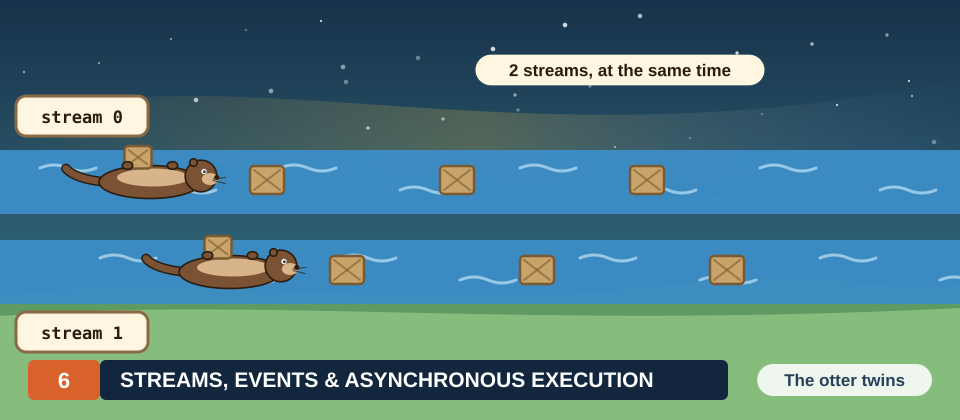
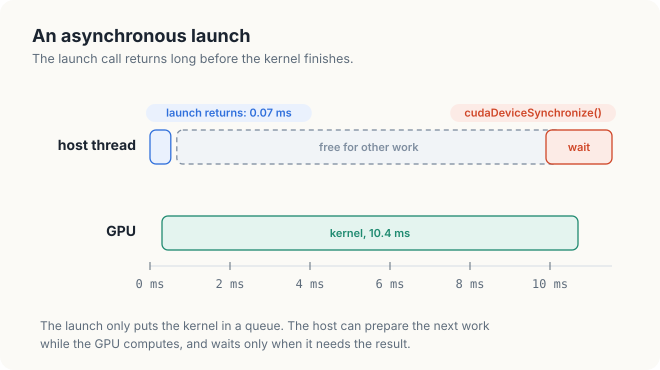
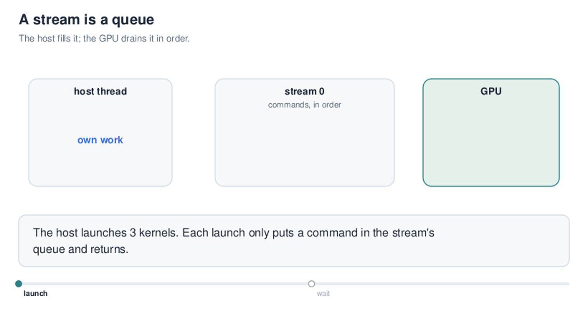
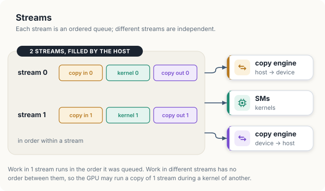
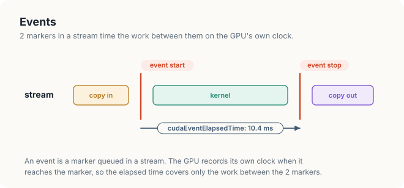
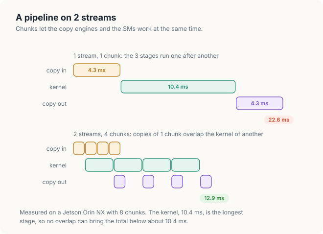
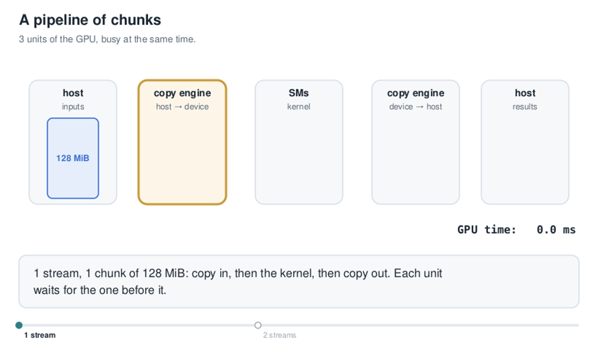
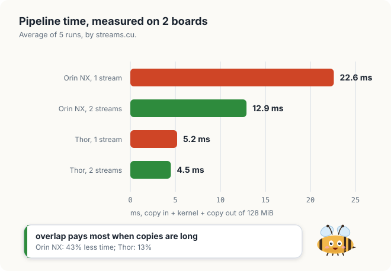
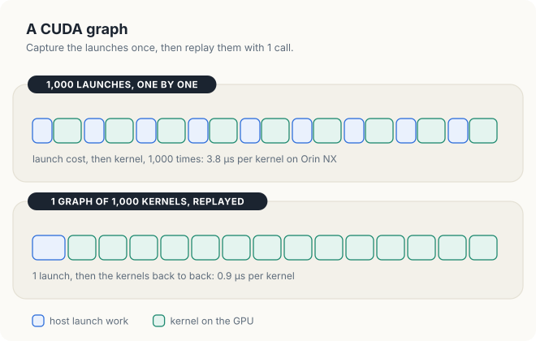

# Chapter 6: Streams, Events & Asynchronous Execution

A GPU has more than 1 kind of worker. Chapter 4 met the copy engines, which move data between host
and device memory, and Chapter 2 the SMs, which run kernels. In the programs so far these units
took turns: a copy, then a kernel, then a copy back, each waiting for the one before. At every
moment 2 of the 3 stood idle.

This chapter lets them work at the same time. A launch or a copy can be **asynchronous**: the call
puts the work in a queue and returns, and the GPU carries it out later. Queues of this kind are
called streams. With 2 streams and data cut into chunks, a copy engine can bring in 1 chunk while
the SMs compute on another and the second copy engine sends back a third. The chapter measures how
much time that saves on 2 boards, times work with events on the GPU's own clock, and replays
1,000 launches as a single CUDA graph.

<div class="covers" markdown="1">

This chapter covers

- asynchronous launches and copies, and what the host can do while the GPU works
- streams: ordered queues of GPU work, and how work in different streams overlaps
- the default stream, which can silently serialise a program
- events: timing work on the GPU's own clock
- a pipeline of chunks on 2 streams, 43% faster on a Jetson Orin NX
- why overlap helps less when the kernel dominates or the memory is shared
- CUDA graphs: 1,000 launches for the price of 1

</div>

The code of the chapter is in
[`code/ch06_streams/`](https://github.com/arpanpathak/gpu-parallel-book/tree/main/code/ch06_streams)
for C++ and in
[`code/oxide/ch06_streams/`](https://github.com/arpanpathak/gpu-parallel-book/tree/main/code/oxide/ch06_streams)
for Rust.

## 6.1 The problem: serial execution

The programs of this chapter process 128 MiB of floats in 3 stages: copy the data to the device,
run a kernel that does some arithmetic on every element, and copy the result back. Listing 6.1 is
the kernel. Its loop of 256 steps is there only to make the kernel take about as long as its
copies, so that overlapping them can make a visible difference.

<p class="listing"><b>Listing 6.1</b> The kernel of the chapter, in C++. <a href="https://github.com/arpanpathak/gpu-parallel-book/blob/main/code/ch06_streams/streams.cu">code/ch06_streams/streams.cu</a></p>

```cpp
{{#include ../../../../code/ch06_streams/streams.cu:23:34}}
```

<p class="listing"><b>Listing 6.2</b> The same kernel in Rust. <a href="https://github.com/arpanpathak/gpu-parallel-book/blob/main/code/oxide/ch06_streams/src/main.rs">code/oxide/ch06_streams/src/main.rs</a></p>

```rust,ignore
mod kernels {
    // ...
{{#include ../../../../code/oxide/ch06_streams/src/main.rs:21:32}}
}
```

Timed 1 stage at a time on a Jetson Orin NX, the 3 stages take:

```console
copy in, kernel, copy out over 128 MiB
  copy in      4.29 ms
  kernel      10.39 ms
  copy out     4.30 ms
```

Run 1 after another, they take about 4.3 + 10.4 + 4.3 = 19 ms, and each unit of the GPU works for
only part of that time: a copy engine for 4.3 ms of the 19, the SMs for 10.4. If the stages could
run at the same time on different parts of the data, the total would approach the longest stage,
10.4 ms. The rest of the chapter builds that.

## 6.2 Asynchronous launches and streams

### 6.2.1 A launch returns at once

A call is **synchronous** when it returns only after its work is done, and **asynchronous** when
it returns as soon as the work has been queued. Kernel launches have been asynchronous since
Chapter 3, and section 6.4 shows how to measure it:

```console
a launch of a kernel over 128 MiB
  launch call returned after      0.075 ms
  kernel finished after          12.451 ms
```

The launch call returned after 0.075 ms, and the kernel finished 12 ms later. In between, the host
thread was free (figure 6.1). It can prepare the next input, launch more work, or do anything else,
and it waits only when it needs a result.

<figure>

<figcaption><b>Figure 6.1</b> The launch call returns in 0.07 ms; the kernel runs for 10.4 ms.</figcaption>
</figure>

### 6.2.2 Streams

The queued work has to go somewhere. A **stream** is a queue of GPU work, such as kernel launches
and copies, that the GPU carries out in the order it was queued. Work in 1 stream never overlaps:
a copy queued after a kernel in the same stream starts only when the kernel has finished. Work in
different streams has no order between them, and the GPU may run it at the same time (figure 6.2).
Animation 1 shows a host filling a stream and a GPU draining it.

<figure class="anim">
<video class="motion" src="../../figures/ch06-queue.mp4" autoplay loop muted playsinline preload="metadata" aria-label="A host thread, a stream and a GPU. The host launches 3 kernels; each launch drops a command card into the stream and the host returns to its own work. The GPU takes the commands in order, running kernel 0, then 1, then 2. The host calls cudaStreamSynchronize and waits until the queue is empty, then continues." data-chapters="[[0.0, &quot;launch&quot;], [13.5, &quot;wait&quot;]]"></video>
<figcaption><b>Animation 1</b> The host fills a stream and carries on; the GPU drains it in order.</figcaption>
</figure>

<figure>

<figcaption><b>Figure 6.2</b> 2 streams feed the 3 units of the GPU.</figcaption>
</figure>

In C++, `cudaStreamCreate(&s)` creates a stream, the 4th value between the angle brackets of a
launch names it, `kernel<<<grid, block, 0, s>>>(...)`, and `cudaMemcpyAsync(dst, src, bytes, kind,
s)` queues a copy in it. In Rust, `ctx.new_stream()?` creates a stream, and every launch and copy
takes the stream as its first argument. An asynchronous copy needs pinned host memory (Chapter 4):
a copy engine reads the host memory long after the call has returned, so its pages must not move.

## 6.3 The default stream and implicit synchronisation

A launch or copy without a stream goes to the **default stream**. In its original form, still the
default in C++, the default stream synchronises with every other stream: work queued in it waits
for all earlier work in all streams, and later work in other streams waits for it. A single launch
or `cudaMemcpy` without a stream can therefore serialise a program that was meant to overlap.

There are 2 ways to avoid this:

- **Name a stream in every launch and copy.** Dependencies are then visible where the work is
  queued.
- **Compile with `--default-stream per-thread`.** Each host thread then gets its own default
  stream that does not synchronise with the others.

Streams created with `cudaStreamCreateWithFlags(&s, cudaStreamNonBlocking)` never synchronise with
the default stream at all.

## 6.4 Events: markers and stopwatches

An **event** is a marker queued in a stream. When the GPU reaches it, the GPU records the time on
its own clock. 2 events around a kernel therefore time the kernel on the GPU, without the time
the host takes to launch it or to notice that it has finished (figure 6.3).

<figure>

<figcaption><b>Figure 6.3</b> 2 events around a kernel time it on the GPU's clock.</figcaption>
</figure>

<p class="listing"><b>Listing 6.3</b> An asynchronous launch, timed with events, in C++.</p>

```cpp
{{#include ../../../../code/ch06_streams/streams.cu:38:67}}
```

`cudaEventRecord(e)` queues the marker, `cudaEventSynchronize(e)` makes the host wait until the GPU
has passed it, and `cudaEventElapsedTime(&ms, start, stop)` returns the time between 2 markers in
milliseconds. In Rust, `stream.record_event(Some(TIMING))?` creates and queues an event that can
time, `stop.synchronize()?` waits for it, and `start.elapsed_ms(&stop)?` gives the time between
them.

<p class="listing"><b>Listing 6.4</b> The same measurement in Rust.</p>

```rust,ignore
fn main() -> Result<(), Box<dyn std::error::Error>> {
    // ...
{{#include ../../../../code/oxide/ch06_streams/src/main.rs:99:116}}
    // ...
}
```

```console
a launch of a kernel over 128 MiB
  launch call returned after      0.075 ms
  kernel finished after          12.451 ms
  kernel time by events          11.151 ms
```

The host saw the kernel finish after 12.45 ms; the events measured 11.15 ms. The difference, about
1.3 ms, is time the GPU spent outside the kernel, starting it and signalling that it was done,
plus the time the host thread took to notice. For timing work on the GPU, events are the right
clock.

## 6.5 The double-buffered pipeline

### 6.5.1 Chunks on 2 streams

To let the units overlap, the data is cut into chunks, and each chunk gets its own 3 stages. Chunk
\\(c\\) goes to stream \\(c \bmod 2\\), so consecutive chunks alternate between 2 streams. Within
a stream the stages of a chunk stay in order; between the streams, the copy of 1 chunk can run
while the kernel of the previous chunk runs (figure 6.4). Keeping 2 chunks in flight this way is
often called **double buffering**.

<figure>

<figcaption><b>Figure 6.4</b> In chunks on 2 streams, the copies overlap the kernels.</figcaption>
</figure>

<p class="listing"><b>Listing 6.5</b> The pipeline, in C++.</p>

```cpp
{{#include ../../../../code/ch06_streams/streams.cu:69:98}}
```

`enqueue` only queues work: the 3 calls in its loop all return at once, so the host queues every
chunk of every stream before the first copy has finished. `pipeline` runs the whole pipeline 5
times and divides by 5. Animation 2 follows the chunks through the 3 units of the GPU.

<figure class="anim">
<video class="motion" src="../../figures/ch06-pipeline-anim.mp4" autoplay loop muted playsinline preload="metadata" aria-label="Five stations from left to right: host inputs, the host-to-device copy engine, the SMs, the device-to-host copy engine, and host results. 1 stream: a single 128 MiB card passes through the copy engine, the SMs and the second copy engine one after another, and at each moment 2 stations are idle; the clock reaches 19 ms. 2 streams: 4 chunk cards move through the stations in a staircase, and the copy engines and SMs are busy at the same time; the clock reaches 12.6 ms." data-chapters="[[0.0, &quot;1 stream&quot;], [13.98, &quot;2 streams&quot;]]"></video>
<figcaption><b>Animation 2</b> 1 chunk on 1 stream, then 4 chunks on 2 streams.</figcaption>
</figure>

### 6.5.2 The pipeline in Rust

In Rust each chunk owns its pinned host buffer and its device buffer, which keeps the borrow checker
able to see which data each stream uses.

<p class="listing"><b>Listing 6.6</b> The pipeline, in Rust.</p>

```rust,ignore
{{#include ../../../../code/oxide/ch06_streams/src/main.rs:35:39}}

{{#include ../../../../code/oxide/ch06_streams/src/main.rs:58:87}}
```

The asynchronous copies are `unsafe`, and for a reason the borrow checker cannot see. A copy
continues after `copy_from_pinned_host_async` has returned, so the host buffer must stay alive and
unchanged until the GPU has finished with it. The borrow of `part.host` ends when the call returns;
the GPU's use of the buffer ends only at `stream.synchronize()`. The `SAFETY` comment states why
the program keeps that promise: nothing touches the host buffers until every stream has been
synchronized.

### 6.5.3 Results on 2 boards

```console
$ ./streams                                # on a Jetson Orin NX
copy in, kernel, copy out over 128 MiB
  1 stream, 1 chunk          22.60 ms
  2 streams, 8 chunks        12.93 ms
  2 streams, 32 chunks       13.27 ms
```

```console
$ ./streams                                # on a Jetson AGX Thor
copy in, kernel, copy out over 128 MiB
  copy in      1.12 ms
  kernel       3.05 ms
  copy out     1.08 ms
  1 stream, 1 chunk           5.21 ms
  2 streams, 8 chunks         4.88 ms
  2 streams, 32 chunks        4.51 ms
```

```console
$ cargo oxide run                          # on a Jetson Orin NX
copy in, kernel, copy out over 128 MiB
  1 stream, 1 chunk          20.07 ms
  2 streams, 8 chunks        12.55 ms
```

On the Orin NX, 2 streams cut the time from 22.6 ms to 12.9 ms, 43% less (figure 6.5). A simple
bound tells how close that is to the best possible. With \\(k\\) chunks, the longest stage runs
from start to finish, and the other stages add only their first and last chunk:

\\[ T_{\text{pipeline}} \approx T_{\text{longest}} + \frac{T_{\text{others}}}{k} \\]

For 8 chunks that is 10.4 + (4.3 + 4.3) / 8 ≈ 11.5 ms, close to the 12.9 ms measured. 32 chunks
did no better than 8, because the bound has already come within 1 ms of the kernel's time and each
extra chunk adds 3 more calls to queue.

<figure>

<figcaption><b>Figure 6.5</b> Pipeline times of the C++ runs above.</figcaption>
</figure>

On the Thor the gain was 13%, for 2 reasons. Its kernel dominates: 3.05 ms against 1.1 ms for each
copy, so even perfect overlap could save only the copies, about 2.2 of the 5.2 ms. And on an
integrated board, copies and kernels draw on the same memory, so a copy running during a kernel
slows the kernel down. Chapter 4 showed the larger saving available on such a board: skip the copies
altogether with zero-copy or unified memory.

<div class="bee bee-happy" markdown="1">

Overlap hides the shorter stages behind the longest one; it cannot make the longest one shorter.

</div>

<details class="check">
<summary>A pipeline has copy in 6 ms, kernel 4 ms and copy out 6 ms, on a GPU with 2 copy engines. What is the best time with 8 chunks?</summary>

The longest stage is a copy, 6 ms. The bound gives 6 + (4 + 6) / 8 ≈ 7.3 ms, against 16 ms in 1
stream. When copies dominate, the copies set the time, and the kernel hides behind them instead.

</details>

## 6.6 Stream priorities and concurrency limits

Not every pair of operations can overlap. A GPU has a fixed number of copy engines, reported as
`asyncEngineCount`: with 2, as on both boards here, 1 copy to the device and 1 copy to the host can
run at once, but 2 copies in the same direction take turns. Kernels in different streams can run
at the same time only if the first leaves SMs free; a kernel that fills the GPU, like the one in
this chapter, runs alone until its last blocks finish.

When work competes for the SMs, **priorities** tell the scheduler which stream to serve first:

```cpp
int least, greatest;
cudaStream_t urgent, bulk;
cudaDeviceGetStreamPriorityRange(&least, &greatest);
cudaStreamCreateWithPriority(&urgent, cudaStreamNonBlocking, greatest);
cudaStreamCreateWithPriority(&bulk, cudaStreamNonBlocking, least);
```

Blocks from a high-priority stream are scheduled before waiting blocks from a low-priority one.
Latency-critical work, such as a small kernel whose result the host is waiting for, goes in the
high-priority stream, and bulk work in the low one. In Rust, `ctx.new_stream_with_priority(p)?`
creates such a stream, and `ctx.stream_priority_range()?` returns the range.

## 6.7 CUDA graphs: pipelines without per-launch cost

Every launch costs the host a few microseconds: the driver checks the arguments, writes a command,
and hands it to the GPU. For a kernel of 10 ms that cost is invisible. For a program that launches
thousands of short kernels, it can exceed the kernels' own time.

A **CUDA graph** is a recorded set of GPU operations, kernels and copies, together with the order
between them. The program records the graph once and then launches the whole graph with a single
call, so the per-launch work is paid once for all of its operations. The simplest way to record a
graph is **stream capture**: between `cudaStreamBeginCapture` and `cudaStreamEndCapture`, work
queued in the stream is recorded instead of run.

<p class="listing"><b>Listing 6.7</b> 1,000 launches, one by one and as a graph, in C++.</p>

```cpp
{{#include ../../../../code/ch06_streams/streams.cu:126:163}}
```

```console
1,000 launches of an empty kernel, time per kernel
  launched one by one     3.77 us
  replayed from a graph   0.93 us
```

An empty kernel measures nothing but overhead. Launched 1 at a time, each cost 3.77 µs on the Orin
NX and 2.65 µs on the Thor; replayed from a graph, 0.93 µs and 0.85 µs (figure 6.6). Graphs pay off
for programs that run the same short sequence many times, such as each step of an inference loop
or each frame of a video pipeline.

<figure>

<figcaption><b>Figure 6.6</b> A graph pays the launch cost once for all of its kernels.</figcaption>
</figure>

<div class="callout note" markdown="1">

**NOTE:** The version of cuda-oxide used in this book has no API for CUDA graphs, so section 6.7
uses C++ only.

</div>

## 6.8 Synchronisation reference

| C++ | Rust (cuda-oxide) | The host waits for |
|---|---|---|
| `cudaDeviceSynchronize()` | `ctx.synchronize()?` | all work on the device |
| `cudaStreamSynchronize(s)` | `stream.synchronize()?` | all work queued in stream `s` |
| `cudaEventSynchronize(e)` | `event.synchronize()?` | the GPU to pass event `e` |
| `cudaStreamWaitEvent(s, e)` | `stream.wait(&event)?` | nothing: stream `s` waits on the GPU for event `e` |
| `cudaMemcpy(...)` | `buffer.copy_from_host(&stream, ...)?` | the copy itself |
| `cudaMemcpyAsync(..., s)` | `unsafe { buffer.copy_from_pinned_host_async(&stream, ...)? }` | nothing: the copy is queued |

`cudaStreamWaitEvent` deserves a note: it makes 1 stream wait for work in another without stopping
the host. A stream that must not start a kernel until another stream's copy has landed records an
event after the copy in the first stream and waits for that event in the second.

## 6.9 The complete programs

<p class="listing"><b>Listing 6.8</b> The complete <code>streams.cu</code>. <a href="https://github.com/arpanpathak/gpu-parallel-book/blob/main/code/ch06_streams/streams.cu">code/ch06_streams/streams.cu</a></p>

```cpp
{{#include ../../../../code/ch06_streams/streams.cu}}
```

<p class="listing"><b>Listing 6.9</b> The complete Rust program. <a href="https://github.com/arpanpathak/gpu-parallel-book/blob/main/code/oxide/ch06_streams/src/main.rs">code/oxide/ch06_streams/src/main.rs</a></p>

```rust,ignore
{{#include ../../../../code/oxide/ch06_streams/src/main.rs}}
```

## Common mistakes

- **Queuing a copy with `cudaMemcpyAsync` from pageable memory.** The copy runs synchronously, and
  the overlap is lost. Use pinned memory (Chapter 4).
- **A launch or copy without a stream in an overlapping program.** The default stream waits for
  every other stream. Name a stream every time.
- **Timing GPU work with the host clock alone.** It adds launch and wake-up time. Use events.
- **Touching a host buffer while an asynchronous copy still uses it.** Synchronize the stream, or
  wait for an event, first.
- **Splitting the data into more and more chunks.** Beyond the point where the longest stage
  dominates, extra chunks only add launch work.
- **Expecting overlap to shorten the longest stage.** It hides the others behind it.

<div class="summary" markdown="1">

## Summary

- A launch or an asynchronous copy only queues work and returns: 0.075 ms for a kernel that ran for
  12 ms.
- A stream is an ordered queue. Work in 1 stream runs in order; work in different streams may run
  at the same time, on the copy engines and the SMs together.
- The default stream synchronises with every other stream; name streams explicitly.
- Events time work on the GPU's own clock.
- A pipeline of chunks on 2 streams cut 22.6 ms to 12.9 ms on an Orin NX, close to the bound
  \\(T_{\text{longest}} + T_{\text{others}} / k\\). On a Thor, where the kernel dominates and the
  memory is shared, it saved 13%.
- In Rust, asynchronous copies are `unsafe`: the GPU uses the buffer after the borrow has ended.
- A CUDA graph launches many operations with 1 call: 0.93 µs per empty kernel instead of 3.77 µs.

</div>

Chapter 7 returns to a single kernel and its memory: coalescing, shared-memory tiling and bank
conflicts, measured.

## Exercises

1. A program queues copy in, kernel and copy out for 4 chunks, all in stream 0. Why does it gain
   nothing over 1 chunk?
2. Copy in takes 8 ms, the kernel 3 ms and copy out 2 ms. What is the bound for 4 chunks on 2
   streams, and which stage sets it?
3. Change `streams.cu` to use 1 stream with 8 chunks. Predict the time, then measure it.
4. Why does the gain from overlap fall on an integrated GPU such as the Thor? Name 2 reasons.
5. Record an event after the copy in stream 0 and make stream 1 wait for it with
   `cudaStreamWaitEvent`. What does stream 1 now wait for, and what does the host wait for?
6. A loop launches 5 kernels of 20 µs each, 10,000 times. Estimate the launch overhead at 4 µs per
   launch, and the time saved by a graph at 1 µs per kernel.
7. In the Rust pipeline, move `stream.synchronize()` out of `pipeline` and read `parts[0].host`
   right after the loop. Which promise in the `SAFETY` comment does that break?

## Sources and further reading

- NVIDIA, *CUDA C++ Programming Guide*, "Asynchronous Concurrent Execution", "Streams", "Events"
  and "CUDA Graphs": <https://docs.nvidia.com/cuda/cuda-c-programming-guide/>
- NVIDIA, *CUDA C++ Best Practices Guide*, "Asynchronous and Overlapping Transfers with
  Computation": <https://docs.nvidia.com/cuda/cuda-c-best-practices-guide/>
- M. Harris, "How to Overlap Data Transfers in CUDA C/C++", NVIDIA Technical Blog, 2012.
- NVlabs, *cuda-oxide*, `cuda_core::CudaStream` and `cuda_core::CudaEvent`:
  <https://github.com/NVlabs/cuda-oxide>
