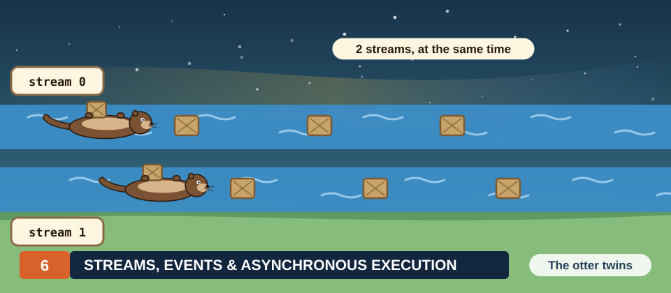
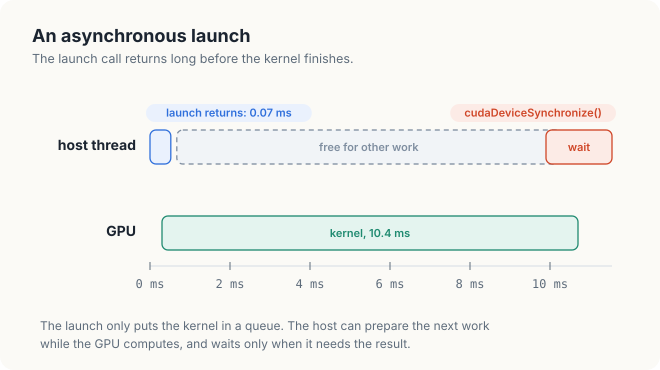
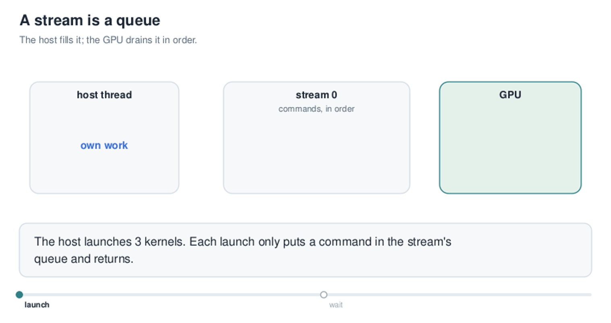
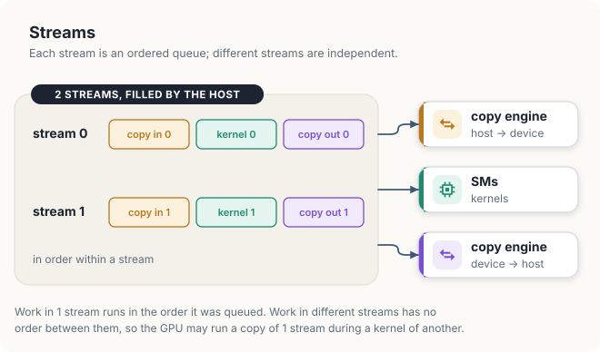
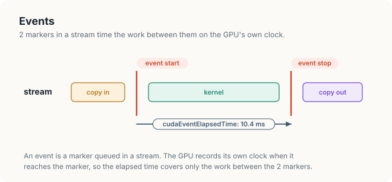
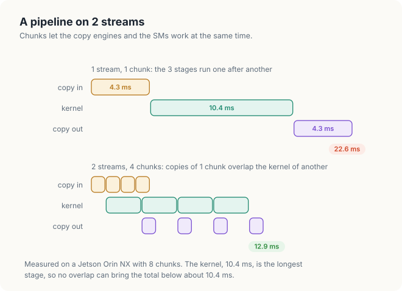
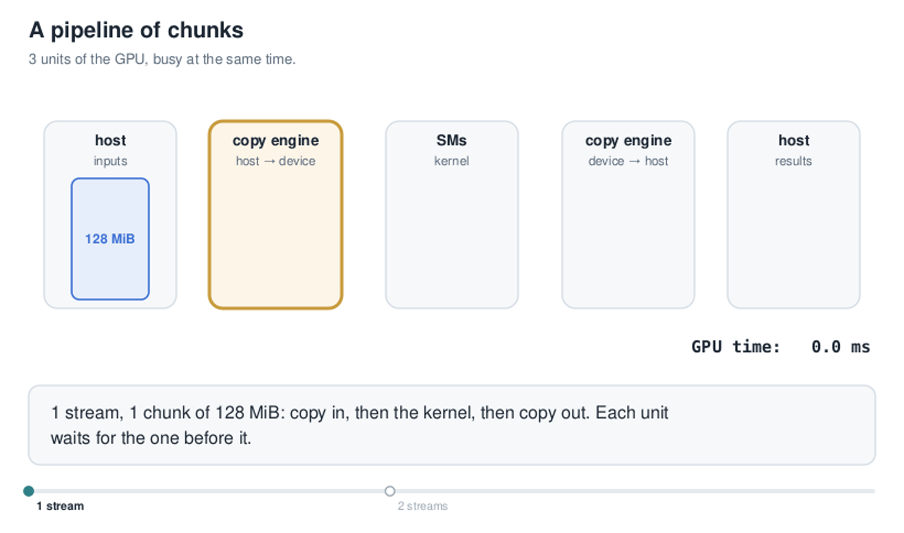
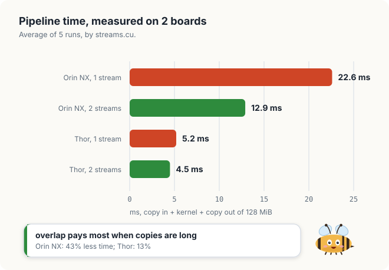
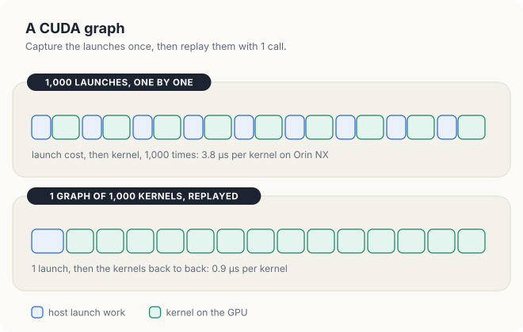

# Chapter 6: Streams, Events & Asynchronous Execution

A GPU contains more than one kind of execution unit. The streaming multiprocessors (SMs), described
in Chapter 2, execute kernels. The copy engines, described in Chapter 4, transfer data between
host memory and device memory without using the SMs. In the programs of the previous chapters,
these units were used one at a time. The program copied its input to the device, launched a kernel,
and copied the result back, and each operation started only after the previous one had finished.
While a copy was in progress the SMs were idle, and while the kernel was running the copy engines
were idle.

In this chapter, we study how a program can keep these units busy at the same time. The mechanism
is **asynchronous** execution: a kernel launch or a copy is placed in a queue, called a stream,
and the call returns before the work is done. When the data is divided into chunks and the chunks
are distributed over 2 streams, a copy engine can transfer 1 chunk while the SMs process another
and the second copy engine returns a third. We also use events to time work on the GPU's own
clock, and CUDA graphs to reduce the cost of launching many short kernels.

<div class="covers" markdown="1">

This chapter covers

- asynchronous launches and copies, and the work the host can do while the GPU runs
- streams: ordered queues of GPU work, and the overlap of work in different streams
- the default stream and the synchronisation it adds between streams
- events, which time work on the GPU's own clock
- a pipeline of chunks on 2 streams, 43% faster on a Jetson Orin NX
- why overlap gains less when the kernel dominates or the memory is shared
- CUDA graphs, which submit 1,000 launches with 1 call

</div>

The code of the chapter is in
[`code/ch06_streams/`](https://github.com/arpanpathak/gpu-parallel-book/tree/main/code/ch06_streams)
for C++ and in
[`code/oxide/ch06_streams/`](https://github.com/arpanpathak/gpu-parallel-book/tree/main/code/oxide/ch06_streams)
for Rust.

## 6.1 Serial execution of copies and kernels

The programs of this chapter process 128 MiB of floats in 3 stages. The first stage copies the
input to the device, the second runs a kernel that performs some arithmetic on every element, and
the third copies the result back to the host. Listing 6.1 shows the kernel. Its loop of 256
iterations has no purpose other than to make the kernel take about as long as its copies; with a
much shorter kernel, overlapping the stages would make little difference.

<p class="listing"><b>Listing 6.1</b> The kernel of the chapter. <a href="https://github.com/arpanpathak/gpu-parallel-book/blob/main/code/oxide/ch06_streams/src/main.rs">code/oxide/ch06_streams/src/main.rs</a> <a href="https://github.com/arpanpathak/gpu-parallel-book/blob/main/code/ch06_streams/streams.cu">code/ch06_streams/streams.cu</a></p>

<div class="code-tabs">
<div class="code-tab" data-lang="Rust">

```rust,ignore
mod kernels {
    // ...
{{#include ../../../../code/oxide/ch06_streams/src/main.rs:24:35}}
    // ...
}
```

</div>
<div class="code-tab" data-lang="C++">

```cpp
{{#include ../../../../code/ch06_streams/streams.cu:23:34}}
```

</div>
</div>

When the 3 stages are timed separately on a Jetson Orin NX, they take the following times:

```console
copy in, kernel, copy out over 128 MiB
  copy in      4.29 ms
  kernel      10.39 ms
  copy out     4.30 ms
```

If the stages run one after another, the computation takes about 4.3 + 10.4 + 4.3 = 19 ms. Each
unit of the GPU is busy for only part of that time: the copy engine that moves data to the device
works for 4.3 ms of the 19 ms, and the SMs work for 10.4 ms. If the 3 stages could operate at the
same time on different parts of the data, the total time would approach the time of the longest
stage, 10.4 ms. For that, the program must be able to give the GPU new work without waiting for
earlier work to finish. Asynchronous launches and streams, the subject of section 6.2, provide
this ability.

## 6.2 Asynchronous launches and streams

### 6.2.1 Asynchronous kernel launches

A call is said to be **synchronous** if it returns only after its work is done, and
**asynchronous** if it returns as soon as the work has been queued. Kernel launches have been
asynchronous in every program since Chapter 3. The program of this chapter measures the effect
directly, with a method that section 6.4 explains:

```console
a launch of a kernel over 128 MiB
  launch call returned after      0.075 ms
  kernel finished after          12.451 ms
```

The launch call returned after 0.075 ms, whereas the kernel finished 12 ms later. Between these 2
moments the host thread was free, as figure 6.1 shows. It could prepare the next input or launch
more work, and it needs to wait only when it requires a result from the GPU.

<figure>

<figcaption><b>Figure 6.1</b> The launch call returns in 0.07 ms; the kernel runs for 10.4 ms.</figcaption>
</figure>

### 6.2.2 Streams

Work that has been queued must be held somewhere until the GPU executes it. A **stream** is an
ordered queue of GPU operations, such as kernel launches and memory copies. The GPU executes the
operations of a stream in the order in which they were queued, so operations in the same stream
never overlap: a copy queued after a kernel starts only when the kernel has finished. Operations in
different streams, on the other hand, have no ordering constraint between them, and the GPU may
execute them at the same time (figure 6.2). Animation 1 shows a host thread placing work in a
stream and the GPU executing it in order.

<figure class="anim">
<video class="motion" src="../../figures/ch06-queue.mp4" autoplay loop muted playsinline preload="metadata" aria-label="A host thread, a stream and a GPU. The host launches 3 kernels; each launch drops a command card into the stream and the host returns to its own work. The GPU takes the commands in order, running kernel 0, then 1, then 2. The host calls cudaStreamSynchronize and waits until the queue is empty, then continues." data-chapters="[[0.0, &quot;launch&quot;], [13.5, &quot;wait&quot;]]"></video>
<figcaption><b>Animation 1</b> The host places work in a stream and continues; the GPU executes the stream in order.</figcaption>
</figure>

<figure>

<figcaption><b>Figure 6.2</b> 2 streams supply work to the 3 units of the GPU.</figcaption>
</figure>

In C++, `cudaStreamCreate(&s)` creates a stream. A kernel is launched into a stream by passing
the stream as the 4th launch parameter between the angle brackets,
`kernel<<<grid, block, 0, s>>>(...)`, and `cudaMemcpyAsync(dst, src, bytes, kind, s)` places a
copy in it. In Rust, `ctx.new_stream()?` creates a stream, and every launch and copy takes the
stream as its first argument. Note that an asynchronous copy requires pinned host memory, which
Chapter 4 introduced. The copy engine reads the host memory after the call has returned, so the
operating system must not move the pages of that memory while the copy is in progress.

## 6.3 The default stream and implicit synchronisation

A launch or a copy that does not name a stream is placed in the **default stream**. In its
original form, which is still the default behaviour in C++, the default stream synchronises with
every other stream of the device. An operation in the default stream waits for all earlier work in
all streams, and work queued later in other streams waits for it. Therefore, a single launch or
`cudaMemcpy` without a stream can serialise a program that was designed to overlap its operations.

There are 2 ways to avoid this behaviour:

- **Name a stream in every launch and copy.** The dependencies between operations are then
  visible in the code, at the place where the work is queued.
- **Compile with `--default-stream per-thread`.** Each host thread then has its own default
  stream, which does not synchronise with the streams of other threads.

Streams created with `cudaStreamCreateWithFlags(&s, cudaStreamNonBlocking)` do not synchronise
with the default stream at all.

## 6.4 CUDA events

An **event** is a marker placed in a stream. When the GPU reaches the marker, it records the time
on its own clock. By recording 1 event before a kernel and another after it, we can measure the
execution time of the kernel on the GPU. The measurement excludes the time the host takes to launch
the kernel and the time it takes to notice that the kernel has finished (figure 6.3).

<figure>

<figcaption><b>Figure 6.3</b> 2 events around a kernel measure its time on the GPU's clock.</figcaption>
</figure>

<p class="listing"><b>Listing 6.2</b> An asynchronous launch, timed with events.</p>

<div class="code-tabs">
<div class="code-tab" data-lang="Rust">

```rust,ignore
fn main() -> Result<(), Box<dyn std::error::Error>> {
    // ...
{{#include ../../../../code/oxide/ch06_streams/src/main.rs:173:190}}
    // ...
}
```

</div>
<div class="code-tab" data-lang="C++">

```cpp
{{#include ../../../../code/ch06_streams/streams.cu:38:67}}
```

</div>
</div>

The call `cudaEventRecord(e)` places the marker in the stream, `cudaEventSynchronize(e)` makes
the host wait until the GPU has passed it, and `cudaEventElapsedTime(&ms, start, stop)` returns
the time between 2 markers in milliseconds. The Rust version follows the same steps.
`stream.record_event(Some(TIMING))?` creates an event that can record time and places it in the
stream, `stop.synchronize()?` waits for it, and `start.elapsed_ms(&stop)?` returns the time
between the 2 events.

```console
a launch of a kernel over 128 MiB
  launch call returned after      0.075 ms
  kernel finished after          12.451 ms
  kernel time by events          11.151 ms
```

The host observed the kernel finish after 12.45 ms, whereas the events measured 11.15 ms. The
difference of about 1.3 ms is time spent outside the kernel: the GPU starting the kernel and
signalling its completion, and the host thread noticing that signal. For timing work on the GPU,
events therefore give the more accurate measurement.

## 6.5 A double-buffered pipeline

### 6.5.1 Dividing the data into chunks

To allow the units of the GPU to overlap, we divide the data into chunks and give each chunk its
own 3 stages. Chunk \\(c\\) is placed in stream \\(c \bmod 2\\), so consecutive chunks alternate
between 2 streams. Within a stream, the stages of a chunk remain in order. Between the streams,
however, the copy of 1 chunk can proceed while the kernel of the previous chunk runs (figure 6.4).
Keeping 2 chunks in flight in this way is commonly called **double buffering**.

<figure>

<figcaption><b>Figure 6.4</b> With chunks on 2 streams, the copies overlap the kernels.</figcaption>
</figure>

<p class="listing"><b>Listing 6.3</b> The pipeline.</p>

<div class="code-tabs">
<div class="code-tab" data-lang="Rust">

```rust,ignore
{{#include ../../../../code/oxide/ch06_streams/src/main.rs:43:47}}

{{#include ../../../../code/oxide/ch06_streams/src/main.rs:66:95}}
```

</div>
<div class="code-tab" data-lang="C++">

```cpp
{{#include ../../../../code/ch06_streams/streams.cu:69:98}}
```

</div>
</div>

The function `enqueue` only queues work. Each of the 3 calls in its loop returns immediately, so
the host queues every chunk of every stream before the first copy has finished. The function
`pipeline` runs the complete pipeline 5 times and divides the total time by 5. Animation 2 shows
the chunks passing through the 3 units of the GPU.

<figure class="anim">
<video class="motion" src="../../figures/ch06-pipeline-anim.mp4" autoplay loop muted playsinline preload="metadata" aria-label="Five stations from left to right: host inputs, the host-to-device copy engine, the SMs, the device-to-host copy engine, and host results. 1 stream: a single 128 MiB card passes through the copy engine, the SMs and the second copy engine one after another, and at each moment 2 stations are idle; the clock reaches 19 ms. 2 streams: 4 chunk cards move through the stations in a staircase, and the copy engines and SMs are busy at the same time; the clock reaches 12.6 ms." data-chapters="[[0.0, &quot;1 stream&quot;], [13.98, &quot;2 streams&quot;]]"></video>
<figcaption><b>Animation 2</b> 1 chunk on 1 stream, then 4 chunks on 2 streams.</figcaption>
</figure>

### 6.5.2 The pipeline in Rust

In the Rust version of Listing 6.3, each chunk owns its pinned host buffer and its device buffer.
With this arrangement, the borrow checker can see which data each stream uses.

The asynchronous copies are `unsafe` for a reason that the borrow checker cannot see. A copy
continues after `copy_from_pinned_host_async` has returned, so the host buffer must remain alive
and unchanged until the GPU has finished with it. The borrow of `part.host` ends when the call
returns, but the GPU's use of the buffer ends only at `stream.synchronize()`. The `SAFETY` comment
states why the program meets this requirement: no code touches the host buffers until every
stream has been synchronized.

### 6.5.3 Measured pipeline times

```console
$ ./streams                                # on a Jetson Orin NX
copy in, kernel, copy out over 128 MiB
  1 stream, 1 chunk          22.60 ms
  2 streams, 8 chunks        12.93 ms
  2 streams, 32 chunks       13.27 ms
```

```console
$ ./streams                                # on a Jetson AGX Thor
copy in, kernel, copy out over 128 MiB
  copy in      1.12 ms
  kernel       3.05 ms
  copy out     1.08 ms
  1 stream, 1 chunk           5.21 ms
  2 streams, 8 chunks         4.88 ms
  2 streams, 32 chunks        4.51 ms
```

```console
$ cargo oxide run                          # on a Jetson Orin NX
copy in, kernel, copy out over 128 MiB
  1 stream, 1 chunk          20.07 ms
  2 streams, 8 chunks        12.55 ms
```

On the Orin NX, 2 streams reduced the time from 22.6 ms to 12.9 ms, a reduction of 43% (figure
6.5). To judge how close this result is to the best possible, we can derive a simple bound. With
\\(k\\) chunks, the longest stage runs from the start of the pipeline to its end. Each of the other
stages contributes only the time it spends on 1 chunk: the copy of the first chunk before the first
kernel can start, and the copy of the last chunk after the last kernel has finished. The total time
is therefore approximately

\\[ T_{\text{pipeline}} \approx T_{\text{longest}} + \frac{T_{\text{others}}}{k} \\]

For 8 chunks, the bound is 10.4 + (4.3 + 4.3) / 8 ≈ 11.5 ms, which is close to the measured
12.9 ms. 32 chunks performed no better than 8. The bound for 8 chunks is already within 1 ms of the
kernel's time, and each additional chunk adds 3 more calls that the host must queue.

<figure>

<figcaption><b>Figure 6.5</b> Pipeline times of the C++ runs above.</figcaption>
</figure>

On the Thor, the gain was 13%, for 2 reasons. First, its kernel dominates: the kernel takes
3.05 ms, against 1.1 ms for each copy, so even perfect overlap could hide only the copies, about
2.2 ms of the 5.2 ms. Second, on an integrated GPU the copies and the kernel use the same memory,
so a copy that runs during a kernel slows the kernel down. Chapter 4 showed a larger saving that
is available on such a GPU: avoiding the copies altogether with zero-copy or unified memory.

<div class="bee bee-happy" markdown="1">

Overlap hides the shorter stages behind the longest one; it cannot make the longest one shorter.

</div>

<details class="check">
<summary>A pipeline has copy in 6 ms, kernel 4 ms and copy out 6 ms, on a GPU with 2 copy engines. What is the best time with 8 chunks?</summary>

The longest stage is a copy, which takes 6 ms. The bound gives 6 + (4 + 6) / 8 ≈ 7.3 ms, against
16 ms in 1 stream. When the copies dominate, they set the time, and the kernel is hidden behind
them.

</details>

## 6.6 Stream priorities and concurrency limits

Not every pair of operations can overlap. A GPU has a fixed number of copy engines, which the
device property `asyncEngineCount` reports. With 2 copy engines, as on both boards used here, 1
copy to the device and 1 copy to the host can run at the same time, but 2 copies in the same
direction must take turns. Kernels in different streams can run at the same time only if the
first kernel leaves some SMs free. A kernel that fills the GPU, like the one in this chapter, runs
alone until its last blocks finish.

When operations compete for the SMs, stream **priorities** tell the scheduler which stream to
serve first:

<div class="code-tabs">
<div class="code-tab" data-lang="Rust">

```rust,ignore
{{#include ../../../../code/oxide/ch06_streams/src/main.rs:97:105}}
```

</div>
<div class="code-tab" data-lang="C++">

```cpp
int least, greatest;
cudaStream_t urgent, bulk;
cudaDeviceGetStreamPriorityRange(&least, &greatest);
cudaStreamCreateWithPriority(&urgent, cudaStreamNonBlocking, greatest);
cudaStreamCreateWithPriority(&bulk, cudaStreamNonBlocking, least);
```

</div>
</div>

The scheduler starts blocks from a high-priority stream before waiting blocks from a low-priority
stream. Latency-critical work, such as a small kernel whose result the host is waiting for, belongs
in the high-priority stream, and bulk work in the low-priority one. In Rust,
`ctx.new_stream_with_priority(p)?` creates such a stream, and `ctx.stream_priority_range()?`
returns the range of priorities.

## 6.7 CUDA graphs

Every kernel launch costs the host a few microseconds: the driver checks the arguments, writes a
command, and submits it to the GPU. For a kernel that runs for 10 ms, this cost is negligible. For
a program that launches thousands of short kernels, however, the launch cost can exceed the
execution time of the kernels themselves.

A **CUDA graph** is a recorded set of GPU operations, such as kernels and copies, together with the
ordering between them. The program records the graph once and then launches the whole graph with a
single call, so the launch work is performed once for all of its operations. The simplest way to
record a graph is **stream capture**: between the calls `cudaStreamBeginCapture` and
`cudaStreamEndCapture`, operations queued in the stream are recorded instead of executed.

<p class="listing"><b>Listing 6.4</b> 1,000 launches, one by one and as a graph.</p>

<div class="code-tabs">
<div class="code-tab" data-lang="Rust">

```rust,ignore
{{#include ../../../../code/oxide/ch06_streams/src/main.rs:107:161}}
```

</div>
<div class="code-tab" data-lang="C++">

```cpp
{{#include ../../../../code/ch06_streams/streams.cu:126:163}}
```

</div>
</div>

```console
1,000 launches of an empty kernel, time per kernel
  launched one by one     3.77 us
  replayed from a graph   0.93 us
```

An empty kernel does no work, so its time consists entirely of launch overhead. Launched 1 at a
time, each empty kernel cost 3.77 µs on the Orin NX and 2.65 µs on the Thor. Replayed from a
graph, it cost 0.93 µs and 0.85 µs, respectively (figure 6.6). Graphs are therefore useful in
programs that run the same short sequence of operations many times, such as each step of an
inference loop or each frame of a video pipeline.

<figure>

<figcaption><b>Figure 6.6</b> A graph performs the launch work once for all of its kernels.</figcaption>
</figure>

<div class="callout note" markdown="1">

**NOTE:** The version of cuda-oxide used in this book has no safe API for CUDA graphs. The Rust
version therefore calls the driver functions `cuStreamBeginCapture_v2`, `cuStreamEndCapture`,
`cuGraphInstantiateWithFlags` and `cuGraphLaunch` through `cuda_core::sys`, in `unsafe` blocks.

</div>

## 6.8 Synchronisation calls

| C++ | Rust (cuda-oxide) | The host waits for |
|---|---|---|
| `cudaDeviceSynchronize()` | `ctx.synchronize()?` | all work on the device |
| `cudaStreamSynchronize(s)` | `stream.synchronize()?` | all work queued in stream `s` |
| `cudaEventSynchronize(e)` | `event.synchronize()?` | the GPU to pass event `e` |
| `cudaStreamWaitEvent(s, e)` | `stream.wait(&event)?` | nothing: stream `s` waits on the GPU for event `e` |
| `cudaMemcpy(...)` | `buffer.copy_from_host(&stream, ...)?` | the copy itself |
| `cudaMemcpyAsync(..., s)` | `unsafe { buffer.copy_from_pinned_host_async(&stream, ...)? }` | nothing: the copy is queued |

The call `cudaStreamWaitEvent` needs a further explanation. It makes 1 stream wait for work in
another stream without stopping the host. For example, if a kernel in 1 stream must not start
until a copy in another stream has completed, the program records an event after the copy in the
first stream and makes the second stream wait for that event.

## 6.9 The complete programs

<p class="listing"><b>Listing 6.5</b> The complete programs. <a href="https://github.com/arpanpathak/gpu-parallel-book/blob/main/code/oxide/ch06_streams/src/main.rs">code/oxide/ch06_streams/src/main.rs</a> <a href="https://github.com/arpanpathak/gpu-parallel-book/blob/main/code/ch06_streams/streams.cu">code/ch06_streams/streams.cu</a></p>

<div class="code-tabs">
<div class="code-tab" data-lang="Rust">

```rust,ignore
{{#include ../../../../code/oxide/ch06_streams/src/main.rs}}
```

</div>
<div class="code-tab" data-lang="C++">

```cpp
{{#include ../../../../code/ch06_streams/streams.cu}}
```

</div>
</div>

## Common mistakes

- **Queuing a copy with `cudaMemcpyAsync` from pageable memory.** The copy runs synchronously, and
  the overlap is lost. Use pinned memory (Chapter 4).
- **Launching or copying without a stream in a program that overlaps work.** The default stream
  waits for every other stream. Name a stream in every call.
- **Timing GPU work with the host clock alone.** The measurement includes launch time and the time
  the host takes to notice completion. Use events.
- **Modifying a host buffer while an asynchronous copy still reads it.** Synchronise the stream, or
  wait for an event, first.
- **Dividing the data into more and more chunks.** Once the longest stage dominates, additional
  chunks only add launch work.
- **Expecting overlap to shorten the longest stage.** Overlap hides the other stages behind it.

<div class="summary" markdown="1">

## Summary

- A launch or an asynchronous copy only queues work and returns: 0.075 ms for a kernel that ran for
  12 ms.
- A stream is an ordered queue. Work in 1 stream runs in order; work in different streams may run
  at the same time, on the copy engines and the SMs together.
- The default stream synchronises with every other stream, so programs that overlap work name
  their streams explicitly.
- Events time work on the GPU's own clock.
- A pipeline of chunks on 2 streams reduced 22.6 ms to 12.9 ms on an Orin NX, close to the bound
  \\(T_{\text{longest}} + T_{\text{others}} / k\\). On a Thor, where the kernel dominates and the
  memory is shared, it saved 13%.
- In Rust, asynchronous copies are `unsafe`, because the GPU uses the buffer after the borrow has
  ended.
- A CUDA graph launches many operations with 1 call: 0.93 µs per empty kernel instead of 3.77 µs.

</div>

In Chapter 7, we return to a single kernel and study its memory accesses: coalescing,
shared-memory tiling and bank conflicts, each measured.

## Exercises

1. A program queues copy in, kernel and copy out for 4 chunks, all in stream 0. Why does it gain
   nothing over 1 chunk?
2. Copy in takes 8 ms, the kernel 3 ms and copy out 2 ms. What is the bound for 4 chunks on 2
   streams, and which stage sets it?
3. Change `streams.cu` to use 1 stream with 8 chunks. Predict the time, then measure it.
4. Why does the gain from overlap fall on an integrated GPU such as the Thor? Name 2 reasons.
5. Record an event after the copy in stream 0 and make stream 1 wait for it with
   `cudaStreamWaitEvent`. What does stream 1 now wait for, and what does the host wait for?
6. A loop launches 5 kernels of 20 µs each, 10,000 times. Estimate the launch overhead at 4 µs per
   launch, and the time saved by a graph at 1 µs per kernel.
7. In the Rust pipeline, move `stream.synchronize()` out of `pipeline` and read `parts[0].host`
   right after the loop. Which promise in the `SAFETY` comment does that break?

## Sources and further reading

- NVIDIA, *CUDA C++ Programming Guide*, "Asynchronous Concurrent Execution", "Streams", "Events"
  and "CUDA Graphs": <https://docs.nvidia.com/cuda/cuda-c-programming-guide/>
- NVIDIA, *CUDA C++ Best Practices Guide*, "Asynchronous and Overlapping Transfers with
  Computation": <https://docs.nvidia.com/cuda/cuda-c-best-practices-guide/>
- M. Harris, "How to Overlap Data Transfers in CUDA C/C++", NVIDIA Technical Blog, 2012.
- NVlabs, *cuda-oxide*, `cuda_core::CudaStream` and `cuda_core::CudaEvent`:
  <https://github.com/NVlabs/cuda-oxide>
