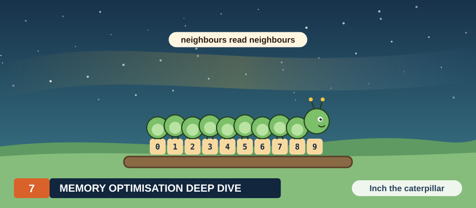
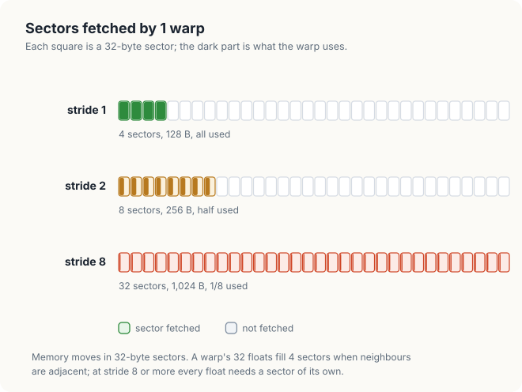
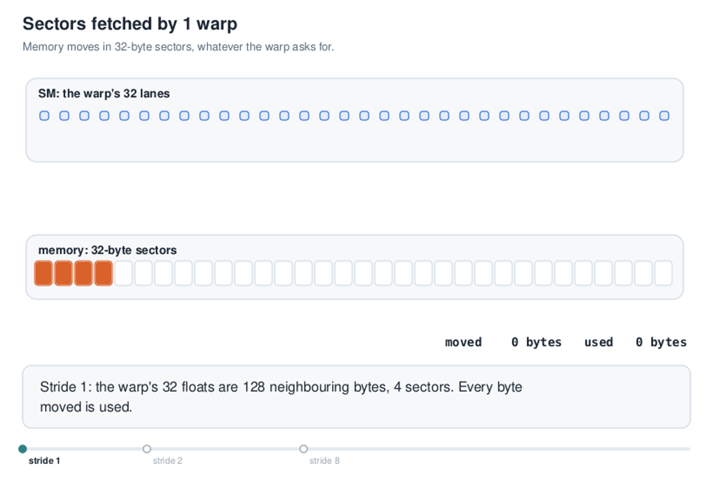
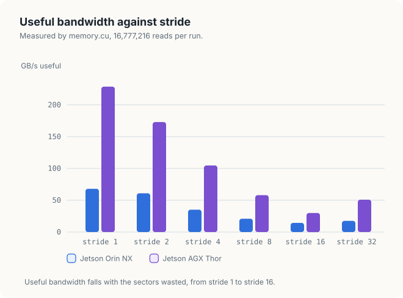
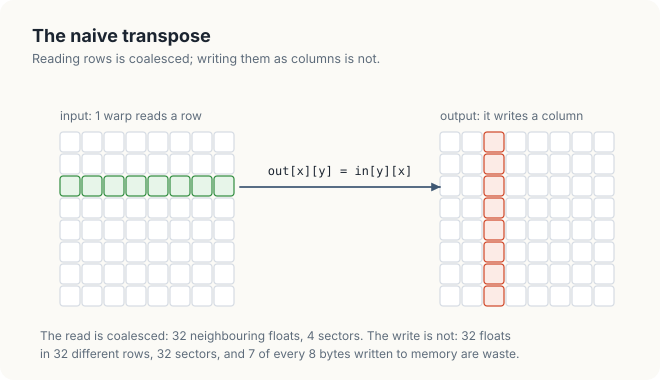
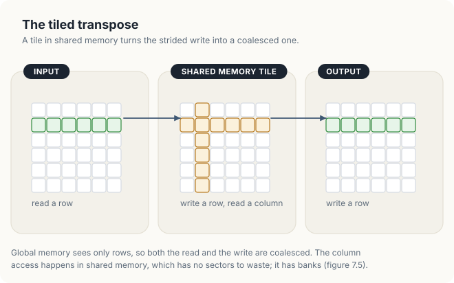
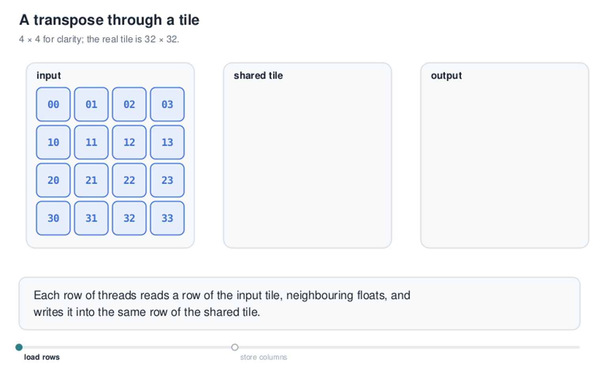
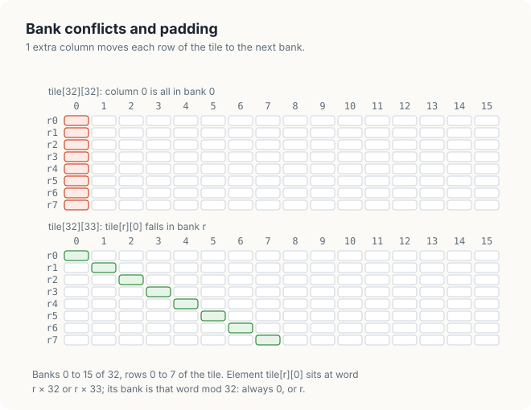
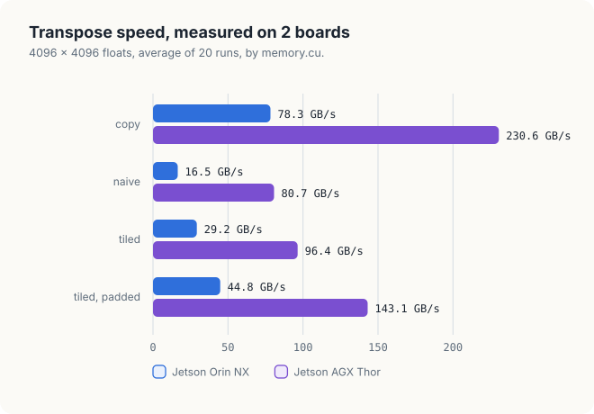

# Chapter 7: Memory Optimisation Deep Dive

Most kernels do little arithmetic for each byte they read, so the memory, not the SMs, sets their
speed (Chapter 1). For such a kernel the useful question is not how many operations it performs
but how many bytes it moves, and how many of those bytes it actually uses. Two kernels that compute
the same result can differ 5 times in speed because 1 of them moves 5 times as many bytes.

This chapter measures the rules that decide those bytes. Memory moves in fixed pieces, so the
pattern in which a warp's threads read counts as much as the amount they read. Shared memory lets a
block rearrange data on the chip before it touches global memory, and it has a layout rule of its
own. Wider loads move more bytes per instruction. Each rule is measured on 2 boards, and the
chapter ends with a checklist that later chapters use.

<div class="covers" markdown="1">

This chapter covers

- effective bandwidth: the yardstick for a memory-bound kernel
- 32-byte sectors, and why the stride between neighbouring threads decides the bytes moved
- the grid-stride loop
- shared memory as a cache the program controls, through a matrix transpose
- bank conflicts, and the 1 extra column that removes them
- vector loads with `float4`
- constant and texture memory
- a checklist for memory-bound kernels

</div>

The code of the chapter is in
[`code/ch07_memory/`](https://github.com/arpanpathak/gpu-parallel-book/tree/main/code/ch07_memory)
for C++ and in
[`code/oxide/ch07_memory/`](https://github.com/arpanpathak/gpu-parallel-book/tree/main/code/oxide/ch07_memory)
for Rust.

## 7.1 Where memory time goes

The **effective bandwidth** of a kernel is the number of bytes it must read and write to do its
job, divided by its running time. A kernel that copies 64 MiB reads 64 MiB and writes 64 MiB, so
its effective bandwidth is 128 MiB divided by its time. The figure counts only the bytes the job
needs, not the bytes the hardware happens to move, which makes it an honest yardstick: a kernel
that wastes traffic shows a low effective bandwidth.

A plain copy is the natural ceiling. On a Jetson Orin NX, whose memory can deliver 102 GB/s, a copy
kernel reached about 74 GB/s; on a Jetson AGX Thor, with 273 GB/s, about 225 GB/s. No real kernel
moves its bytes faster than a copy, so a memory-bound kernel near copy speed has little left to
gain, and 1 far below it is moving bytes it does not use or moving them in an awkward pattern.

There are 2 ways to improve a memory-bound kernel:

1. **Waste fewer bytes**: arrange accesses so that every byte the memory delivers is used.
2. **Fetch fewer bytes**: when the same data is needed more than once, keep it on the chip, in
   shared memory or in registers, instead of reading it from global memory again.

Every technique in the chapter is 1 of these 2.

## 7.2 Coalescing, quantified

### 7.2.1 Sectors

Global memory does not deliver single bytes. The memory system moves data in **sectors** of 32
bytes, aligned to multiples of 32, and the L2 cache groups 4 sectors into a 128-byte line. When a
warp loads, the hardware collects the 32 addresses of its threads and fetches every sector that
contains at least 1 of them. A warp's access is **coalesced** when its addresses fall in as few
sectors as possible.

32 neighbouring `float`s are 32 × 4 = 128 bytes, exactly 4 sectors, so a warp that reads them
moves 128 bytes and uses all 128. If the threads read every other float, the 32 floats spread over
256 bytes, 8 sectors, and half of each sector is wasted. At a distance of 8 floats, 32 bytes, each
float sits in a sector of its own: the warp moves 32 sectors, 1,024 bytes, to use 128 (figure 7.1).

<figure>

<figcaption><b>Figure 7.1</b> The same 32 floats, read at strides 1, 2 and 8: 4, 8 and 32 sectors.</figcaption>
</figure>

Animation 1 moves the sectors for each stride and counts the bytes moved against the bytes used.

<figure class="anim">
<video class="motion" src="../../figures/ch07-sectors-anim.mp4" autoplay loop muted playsinline preload="metadata" aria-label="A warp of 32 lanes above a strip of 32 memory sectors. Stride 1: 4 sectors travel up to the warp, 128 bytes moved, 128 used. Stride 2: 8 half-used sectors travel, 256 bytes moved, 128 used. Stride 8: all 32 sectors travel, each carrying 4 useful bytes, 1,024 bytes moved for 128 used." data-chapters="[[0.0, &quot;stride 1&quot;], [6.42, &quot;stride 2&quot;], [14.52, &quot;stride 8&quot;]]"></video>
<figcaption><b>Animation 1</b> Sectors moved for 1 warp at strides 1, 2 and 8.</figcaption>
</figure>

### 7.2.2 Measuring the stride

Listing 7.1 makes the stride a parameter. Thread \\(i\\) reads element \\(i \times\\) `stride` and
writes element \\(i\\), so the writes stay coalesced and only the reads change.

<p class="listing"><b>Listing 7.1</b> A strided read, in C++. <a href="https://github.com/arpanpathak/gpu-parallel-book/blob/main/code/ch07_memory/memory.cu">code/ch07_memory/memory.cu</a></p>

```cpp
{{#include ../../../../code/ch07_memory/memory.cu:26:33}}
```

<p class="listing"><b>Listing 7.2</b> The same kernel in Rust. <a href="https://github.com/arpanpathak/gpu-parallel-book/blob/main/code/oxide/ch07_memory/src/main.rs">code/oxide/ch07_memory/src/main.rs</a></p>

```rust,ignore
mod kernels {
    // ...
{{#include ../../../../code/oxide/ch07_memory/src/main.rs:21:31}}
    // ...
}
```

The program launches 16,777,216 threads, so every run reads 64 MiB that the job needs. The array it
reads from is 32 times as large, 2 GiB, so that stride 32 stays inside it and no stride can be
served from the L2 cache, which is 2 MiB on the Orin NX and 32 MiB on the Thor.

```console
$ ./memory                                 # on a Jetson Orin NX
GPU: Orin, 8 SMs, L2 cache 2 MiB
each thread reads 1 float, neighbours `stride` floats apart
  stride  1     1.973 ms     68.0 GB/s useful
  stride  2     2.199 ms     61.0 GB/s useful
  stride  4     3.824 ms     35.1 GB/s useful
  stride  8     6.432 ms     20.9 GB/s useful
  stride 16     9.333 ms     14.4 GB/s useful
  stride 32     7.616 ms     17.6 GB/s useful
```

```console
$ ./memory                                 # on a Jetson AGX Thor
GPU: NVIDIA Thor, 20 SMs, L2 cache 32 MiB
each thread reads 1 float, neighbours `stride` floats apart
  stride  1     0.587 ms    228.6 GB/s useful
  stride  2     0.776 ms    172.9 GB/s useful
  stride  4     1.283 ms    104.6 GB/s useful
  stride  8     2.315 ms     58.0 GB/s useful
  stride 16     4.468 ms     30.0 GB/s useful
  stride 32     2.636 ms     50.9 GB/s useful
```

The sector model predicts the size of the fall. Per thread, stride 1 moves 4 bytes of read and 4
bytes of write, 8 in all. From stride 8 on, each read costs a whole sector, so a thread moves 32 + 4
= 36 bytes for the same 8 useful ones: 36 / 8 = 4.5 times the traffic, and about 1/4.5 of the
useful bandwidth. 68 / 4.5 ≈ 15 GB/s on the Orin NX and 229 / 4.5 ≈ 51 GB/s on the Thor, close to
what strides 8 and 16 measured (figure 7.2).

<figure>

<figcaption><b>Figure 7.2</b> Useful bandwidth falls as the stride wastes more of each sector.</figcaption>
</figure>

Stride 32 came out faster than stride 16 on both boards. The memory chips themselves are organised
in rows and banks, and some address patterns spread over them better than others; that level is
below the sector model and below what this book measures. Stride 1 also varied between about 68
and 78 GB/s from run to run on the Orin NX, as its clocks changed. Neither effect changes the rule:

<div class="bee bee-happy" markdown="1">

Neighbouring threads should read neighbouring addresses.

</div>

The global index of Chapter 3, `blockIdx.x * blockDim.x + threadIdx.x`, follows the rule by
construction. Row-major 2-D data follows it when `threadIdx.x` moves along a row: thread \\(x\\)
reads `in[y * width + x]`. The same data read down a column, `in[x * width + y]`, puts neighbouring
threads `width` floats apart, the worst case above.

## 7.3 The grid-stride loop

A kernel with 1 thread per element ties its launch to the size of the data. A **grid-stride loop**,
used for the histogram of Chapter 5, decouples them: a fixed grid is launched, and each thread
handles element \\(i\\), then \\(i + s\\), then \\(i + 2s\\), and so on, where \\(s\\) =
`gridDim.x * blockDim.x` is the number of threads in the grid.

```cpp
int stride = gridDim.x * blockDim.x;
for (int i = blockIdx.x * blockDim.x + threadIdx.x; i < n; i += stride) {
    out[i] = in[i];
}
```

On every pass, neighbouring threads still read neighbouring elements, so the loop keeps the
coalescing of the 1-thread-per-element kernel. It lets a kernel work on data of any size with a
grid sized to the GPU, typically a few blocks per SM, and it lets each thread accumulate a private
result across many elements before touching shared state, as the histogram did.

## 7.4 Shared memory: the explicit cache

### 7.4.1 The transpose problem

A **transpose** turns rows into columns: `out[x][y] = in[y][x]`. For a matrix stored row by row,
1 of the 2 accesses must then cross rows. If each warp reads a row of the input, the read is
coalesced and the write goes down a column of the output, 1 float in each of 32 rows (figure 7.3).

<figure>

<figcaption><b>Figure 7.3</b> The naive transpose: a coalesced read and a strided write.</figcaption>
</figure>

<p class="listing"><b>Listing 7.3</b> The naive transpose, in C++.</p>

```cpp
{{#include ../../../../code/ch07_memory/memory.cu:60:66}}
```

Swapping the 2 accesses does not help: then the read goes down a column instead. The way out is to
let the column access happen somewhere that has no sectors to waste.

### 7.4.2 A tile in shared memory

Shared memory (Chapter 2) is on the chip, belongs to 1 block, and has no sectors: each thread can
read or write any word of it at the same cost. A block can use it as a cache whose contents the
program chooses. For the transpose, each block of 32 × 32 threads:

1. reads a 32 × 32 tile of the input, row by row, coalesced, and stores it in shared memory in the
   same layout;
2. waits at a barrier, so the whole tile is in place;
3. reads the tile column by column and writes each column as a row of the output tile, which sits
   at the mirrored position of the output matrix, coalesced again.

Global memory sees only rows; the column access happens in shared memory (figure 7.4).

<figure>

<figcaption><b>Figure 7.4</b> The tiled transpose: rows in, columns out of the tile, rows out to memory.</figcaption>
</figure>

<p class="listing"><b>Listing 7.4</b> The tiled transpose, in C++.</p>

```cpp
{{#include ../../../../code/ch07_memory/memory.cu:68:81}}
```

After the barrier, `x` and `y` are recomputed for the output: the block's x and y block numbers
swap, because tile (bx, by) of the input becomes tile (by, bx) of the output. `PAD` is a template
parameter, 0 or 1; section 7.5 explains what the 1 extra column does. Animation 2 follows a 4 × 4
tile through shared memory.

<figure class="anim">
<video class="motion" src="../../figures/ch07-tile-anim.mp4" autoplay loop muted playsinline preload="metadata" aria-label="Three 4 by 4 grids: input, shared tile and output, with cells labelled by row and column. Row by row, the input cells fly into the same rows of the shared tile. A barrier lights up. Then column by column, the tile's cells fly to the output, each column becoming a row, so cell r c lands at row c, column r." data-chapters="[[0.0, &quot;load rows&quot;], [11.22, &quot;store columns&quot;]]"></video>
<figcaption><b>Animation 2</b> A transpose through a tile: rows in, a barrier, columns out.</figcaption>
</figure>

### 7.4.3 The transpose in Rust

In Rust, both transposes need `unsafe`, for a reason the compiler cannot check. A `DisjointSlice` lets a
thread write only the element its own index names, which proves that no 2 threads write the same
element. A transpose writes element `x * WIDTH + y`, someone else's index. The writes are still
disjoint, because the mapping from \\((x, y)\\) to `x * WIDTH + y` is a permutation, but the
compiler cannot see that, so the kernel states it in a `SAFETY` comment and writes through
`get_unchecked_mut`.

<p class="listing"><b>Listing 7.5</b> Both transposes in Rust.</p>

```rust,ignore
mod kernels {
    // ...
{{#include ../../../../code/oxide/ch07_memory/src/main.rs:33:61}}
}
```

`Index2D<WIDTH>` declares the output a 2-D grid of width `WIDTH`, which a launch with a 2-D
contract requires. The tile is `SharedArray<f32, { 32 * 33 }>`, indexed as `row * 33 + column`:
the padded layout of section 7.5.

## 7.5 Bank conflicts and column padding

Shared memory is divided into 32 **banks**, each of which can serve 1 32-bit word per cycle.
Consecutive words go to consecutive banks: word \\(w\\) lives in bank \\(w \bmod 32\\) (Chapter 2).
A warp's 32 accesses complete in 1 cycle when they fall in 32 different banks. When several fall in
the same bank at different addresses, a **bank conflict**, that bank serves them 1 after another.

In a tile declared `float tile[32][32]`, element `tile[r][c]` is word \\(32r + c\\), in bank
\\((32r + c) \bmod 32 = c\\). Reading column 0 means reading `tile[0][0]` to `tile[31][0]`, which
are all in bank 0: a 32-way conflict, 32 cycles for 1 warp's access. Declaring the tile with 1 extra
column, `float tile[32][33]`, puts `tile[r][c]` at word \\(33r + c\\), in bank
\\((33r + c) \bmod 32 = (r + c) \bmod 32\\). Column 0 now falls in banks 0, 1, 2, … 31, all
different, and the access takes 1 cycle (figure 7.5). The extra column is never used; it only
shifts each row 1 bank to the right.

<figure>

<figcaption><b>Figure 7.5</b> With 32 columns a tile column sits in 1 bank; with 33 it spreads over all 32.</figcaption>
</figure>

```console
transpose of a 4096 x 4096 matrix          # on a Jetson Orin NX
  copy, for reference     1.71 ms     78.3 GB/s
  naive                   8.13 ms     16.5 GB/s
  tiled                   4.60 ms     29.2 GB/s
  tiled and padded        3.00 ms     44.8 GB/s
tiled transpose correct: yes
```

```console
transpose of a 4096 x 4096 matrix          # on a Jetson AGX Thor
  copy, for reference     0.58 ms    230.6 GB/s
  naive                   1.66 ms     80.7 GB/s
  tiled                   1.39 ms     96.4 GB/s
  tiled and padded        0.94 ms    143.1 GB/s
tiled transpose correct: yes
```

```console
$ cargo oxide run                          # on a Jetson Orin NX
transpose of a 4096 x 4096 matrix
  naive                   7.98 ms     16.8 GB/s
  tiled and padded        3.26 ms     41.1 GB/s
tiled transpose correct: yes
```

On the Orin NX the tile alone took the transpose from 16.5 to 29.2 GB/s, and the padding to 44.8
GB/s, 2.7 times the naive kernel; on the Thor, from 80.7 to 143.1 GB/s, 1.8 times (figure 7.6).
Both are still below the copy. A transpose block must wait at its barrier between reading and
writing, so it overlaps memory traffic less than a copy does; Chapter 9 returns to keeping more
work in flight per thread.

<figure>

<figcaption><b>Figure 7.6</b> Transpose speeds of the C++ runs above.</figcaption>
</figure>

<details class="check">
<summary>A tile is declared float tile[32][16]. Which banks does a column of it fall in, and how many cycles does reading a column take?</summary>

`tile[r][c]` is word \\(16r + c\\), in bank \\((16r + c) \bmod 32\\). For column 0, rows 0, 2, 4, …
fall in bank 0 and rows 1, 3, 5, … in bank 16. With 32 rows, each of the 2 banks serves 16 words: a
16-way conflict, 16 cycles. Padding to 17 columns spreads the column over all 32 banks.

</details>

## 7.6 Vectorised loads: `float4` and alignment

A load instruction can move 4, 8 or 16 bytes per thread. With `float4`, a built-in type of 4
floats, 1 instruction moves 16 bytes per thread and 512 bytes per warp, 4 times as much as a
`float` load. The kernel issues a quarter as many load and store instructions for the same bytes.

<p class="listing"><b>Listing 7.6</b> A copy with 1 and with 4 floats per thread, in C++.</p>

```cpp
{{#include ../../../../code/ch07_memory/memory.cu:43:58}}
```

```console
copy of 64 MiB                             # Orin NX, then Thor
  1 float per thread      1.83 ms     73.5 GB/s
  4 floats per thread     1.53 ms     87.7 GB/s
  1 float per thread      0.60 ms    225.2 GB/s
  4 floats per thread     0.53 ms    251.5 GB/s
```

The wider loads made the copy 19% faster on the Orin NX and 12% faster on the Thor, bringing the
Thor to 92% of its 273 GB/s. A `float4` access must be aligned to 16 bytes. Memory from `cudaMalloc`
is aligned far more than that, so casting the start of an allocation to `float4*` is safe; a pointer
offset by 1, 2 or 3 floats is not, and the last \\(n \bmod 4\\) elements of an array need a plain
`float` loop. The version of cuda-oxide used here offers `Float4` for device code, but this chapter
keeps its Rust listings to the access patterns above.

## 7.7 Constant memory

**Constant memory** is a read-only space of 64 KB with its own small cache on each SM. Its cache
serves all 32 threads of a warp in 1 access when they read the same address, a **broadcast**; when
they read different addresses, the accesses are served 1 after another. That is the opposite of
global and shared memory, which prefer different addresses.

```cpp
__constant__ float coeffs[16];                                // device side, at file scope

cudaMemcpyToSymbol(coeffs, host, 16 * sizeof(float));         // host side: fill it by name

out[i] = in[i] * coeffs[k];                                   // in a kernel: every thread reads coeffs[k]
```

Constant memory suits parameters, coefficients and small tables that every thread of a warp reads at
the same index. When each thread needs a different entry, ordinary global memory, served through
the caches, is faster.

## 7.8 Texture and surface memory

**Texture memory** is a read-only path to global memory with 2 extra abilities: a cache arranged for
2-D neighbourhoods, which suits images read in small squares, and hardware interpolation, which
returns a blend of neighbouring pixels in 1 load. On current GPUs the ordinary L1 and L2 caches serve
most access patterns as well as the texture cache does, so the main reason to use textures today is
the interpolation hardware. Surfaces are the writable counterpart. For data read in rows, as in every
kernel of this chapter, plain coalesced global memory is as fast and simpler.

## 7.9 Optimisation checklist

For a memory-bound kernel, check in this order, and measure after each change:

1. **Effective bandwidth.** Compute it and compare it with a copy on the same GPU. Close to the copy
   means little is left to gain.
2. **Coalescing.** Do neighbouring threads touch neighbouring addresses, for every load and every
   store (section 7.2)?
3. **Launch shape.** Does a grid-stride loop let each thread do enough work (section 7.3)?
4. **Reuse.** Is data read more than once, or read in a pattern that cannot be coalesced? Stage it
   in shared memory (section 7.4).
5. **Bank conflicts.** Do the shared-memory accesses of a warp fall in different banks? Pad a tile's
   rows if not (section 7.5).
6. **Vector loads.** Can the kernel load `float4` with correct alignment (section 7.6)?
7. **Uniform values.** Do all threads of a warp read the same small values? Use constant memory
   (section 7.7).
8. **Transfers.** Is the kernel fed by copies that take longer than it does? Pinned memory and
   streams come first (Chapters 4 and 6).

## Common mistakes

- **Indexing 2-D data with `threadIdx.x` down a column.** Neighbouring threads then sit `width`
  floats apart. Let `threadIdx.x` move along rows.
- **Measuring a small array.** When the data fits in L2, the measurement shows the cache, not the
  memory: the Thor reported 432 GB/s, above its memory's 273 GB/s, for a 16 MiB test.
- **Timing before the clocks have risen.** Run the kernel for a fraction of a second first.
- **A shared tile of 32 × 32 read by columns.** Pad it to 32 × 33.
- **A missing barrier between filling a tile and reading it.** Chapter 5 measured what follows.
- **Casting an unaligned pointer to `float4*`.** Only offsets that are multiples of 4 floats are
  safe.
- **Constant memory indexed differently by each thread.** The accesses serialise.

<div class="summary" markdown="1">

## Summary

- Effective bandwidth, the bytes a job needs divided by its time, measured against a plain copy,
  shows how much a memory-bound kernel has left to gain.
- Global memory moves 32-byte sectors. Neighbouring threads at neighbouring addresses use every
  byte; at a stride of 8 floats or more, a warp moves 8 times the bytes it needs, and the measured
  useful bandwidth fell 3 to 5 times.
- A tile in shared memory lets a transpose read and write only rows of global memory; a barrier
  separates filling the tile from reading it.
- Shared memory has 32 banks; 1 extra column in a 32 × 32 tile removes the 32-way conflict of a
  column read. Tiling and padding made the transpose 2.7 times as fast on the Orin NX.
- `float4` loads moved the same bytes with a quarter of the instructions, 12 to 19% faster.
- In Rust, a write to another thread's index needs `unsafe` and a stated permutation argument.

</div>

Chapter 8 combines these tools into reductions, scans and histograms that run near copy speed.

## Exercises

1. A warp reads `float`s at stride 3. How many 32-byte sectors does it fetch, and what fraction of
   the bytes is used?
2. A kernel reads 1 GB and writes 1 GB in 25 ms on a GPU whose copy reaches 90 GB/s. What is its
   effective bandwidth, and how far is it from the copy?
3. Run `memory` on your GPU. Use the sector model to predict the useful bandwidth at stride 8 from
   your stride-1 result, and compare.
4. Rewrite `transposeNaive` so that it reads down columns and writes rows. Is it faster or slower
   than the original, and why?
5. A tile is `double tile[32][32]`. A `double` takes 2 banks. Which padding removes the conflict
   of a column read?
6. Change `copy4` to handle any `n`, including the last \\(n \bmod 4\\) elements.
7. In the Rust `transpose_tiled`, which `SAFETY` claim would break if the tile were filled after
   the barrier instead of before?

## Sources and further reading

- NVIDIA, *CUDA C++ Best Practices Guide*, "Coalesced Access to Global Memory", "Shared Memory" and
  "Effective Bandwidth Calculation": <https://docs.nvidia.com/cuda/cuda-c-best-practices-guide/>
- NVIDIA, *CUDA C++ Programming Guide*, "Device Memory Accesses":
  <https://docs.nvidia.com/cuda/cuda-c-programming-guide/>
- M. Harris, "An Efficient Matrix Transpose in CUDA C/C++", NVIDIA Technical Blog, 2013.
- D. Kirk and W. Hwu, *Programming Massively Parallel Processors*, 4th ed., Morgan Kaufmann, 2022,
  chapters on memory and tiling.
