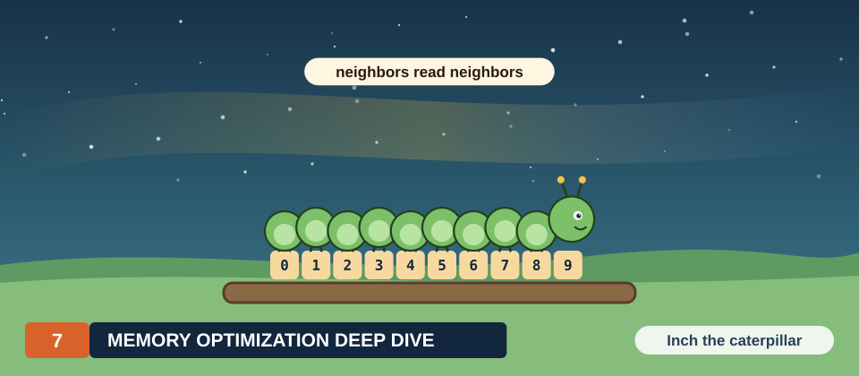
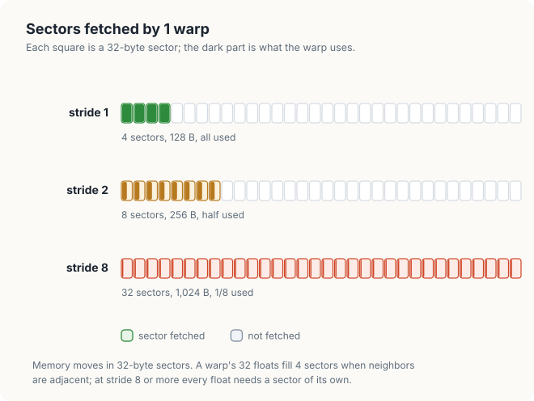
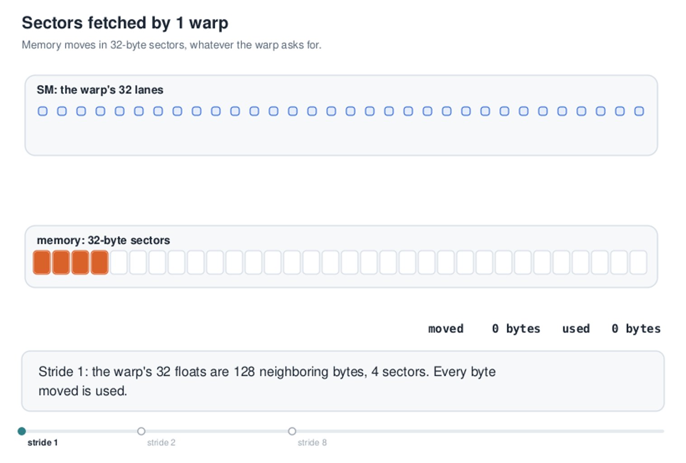
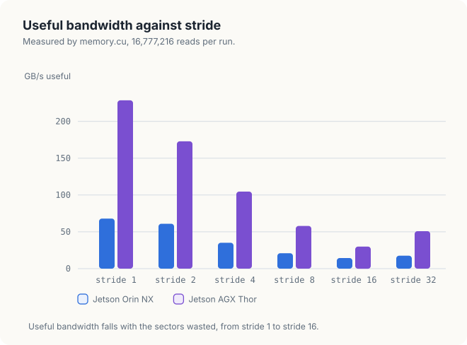
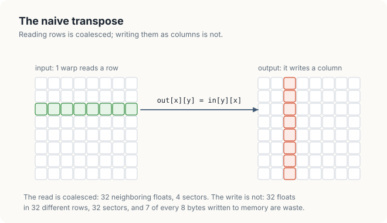
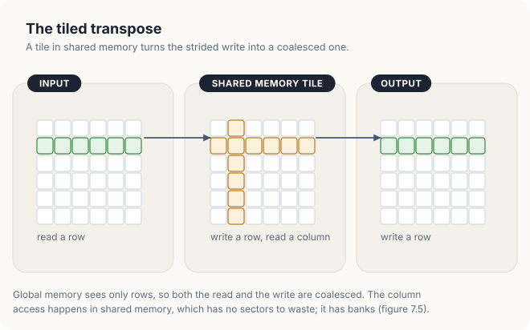
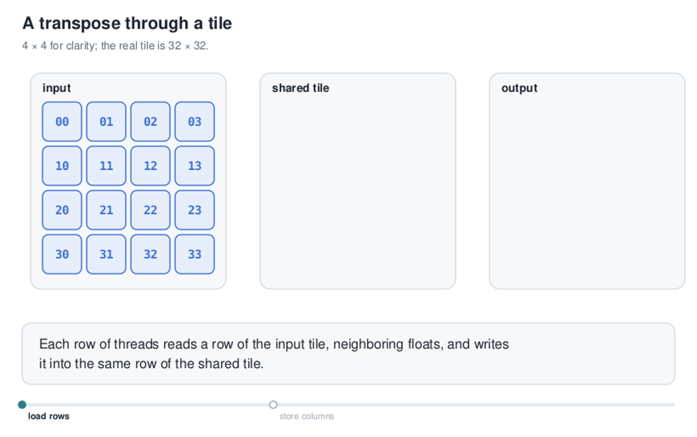
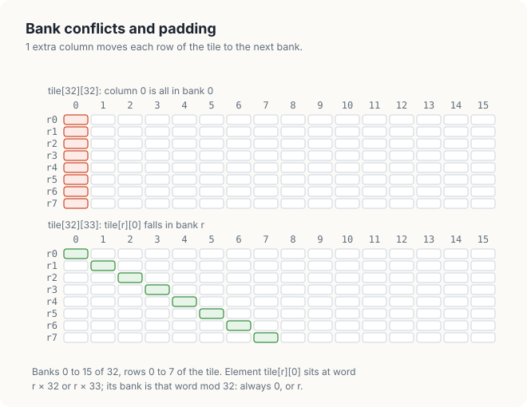
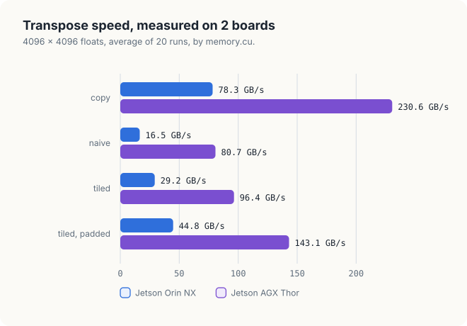

# Chapter 7: Memory Optimisation Deep Dive

Most kernels perform only a few arithmetic operations for each byte they read from global memory.
As we saw in Chapter 1, the speed of such a kernel is limited by the memory bandwidth of the GPU,
not by its arithmetic units. For a memory-bound kernel, the number of operations it performs
matters less than the number of bytes it moves and the fraction of those bytes it uses. 2 kernels
that compute the same result can differ 5 times in speed because one of them moves 5 times as many
bytes.

In this chapter, we study the rules that determine how many bytes a kernel moves. Global memory
transfers data in fixed-size pieces, so the pattern in which the threads of a warp access memory
matters as much as the amount of data they access. Shared memory allows a block to rearrange data
on the chip before writing it to global memory, and it has a layout rule of its own. Wider load
instructions move more bytes per instruction. We measure the effect of each rule and conclude with
a checklist for memory-bound kernels that later chapters use.

<div class="covers" markdown="1">

This chapter covers

- effective bandwidth as the measure of a memory-bound kernel
- 32-byte sectors, and the effect of the stride between neighbouring threads on the bytes moved
- the grid-stride loop
- shared memory as a program-managed cache, applied to a matrix transpose
- bank conflicts, and the padding column that removes them
- vector loads with `float4`
- constant and texture memory
- a checklist for memory-bound kernels

</div>

The code of the chapter is in
[`code/ch07_memory/`](https://github.com/arpanpathak/gpu-parallel-book/tree/main/code/ch07_memory)
for C++ and in
[`code/oxide/ch07_memory/`](https://github.com/arpanpathak/gpu-parallel-book/tree/main/code/oxide/ch07_memory)
for Rust.

## 7.1 Effective bandwidth

The **effective bandwidth** of a kernel is the number of bytes it must read and write to perform
its task, divided by its running time. For example, a kernel that copies 64 MiB reads 64 MiB and
writes 64 MiB, so its effective bandwidth is 128 MiB divided by its running time. Effective
bandwidth counts only the bytes that the task requires, not the bytes that the hardware actually
transfers. Therefore, a kernel that causes unnecessary memory traffic has a low effective
bandwidth, and the measure exposes the waste.

A plain copy kernel provides the reference point. On a Jetson Orin NX, whose memory has a peak
bandwidth of 102 GB/s, a copy kernel reached about 74 GB/s; on a Jetson AGX Thor, with a peak of
273 GB/s, it reached about 225 GB/s. No kernel moves its bytes faster than a copy. A memory-bound
kernel whose effective bandwidth is close to that of a copy has little left to gain, whereas a
kernel far below it either transfers bytes that it does not use or accesses memory in an
unfavourable pattern.

There are 2 ways to improve a memory-bound kernel:

1. **Waste fewer bytes.** Arrange the accesses so that every byte delivered by the memory is used.
2. **Fetch fewer bytes.** When the same data is needed more than once, keep it on the chip, in
   shared memory or in registers, instead of reading it from global memory again.

Each technique in the rest of this chapter belongs to one of these 2 categories.

## 7.2 Memory coalescing

### 7.2.1 Sectors

Global memory does not deliver individual bytes. The memory system transfers data in **sectors**
of 32 bytes, aligned to multiples of 32, and the L2 cache groups 4 sectors into a 128-byte line.
When a warp executes a load instruction, the hardware collects the 32 addresses of its threads and
fetches every sector that contains at least one of them. A warp's access is said to be **coalesced**
when its addresses fall into as few sectors as possible.

Consider a warp whose 32 threads read 32 neighbouring `float`s. These occupy 32 × 4 = 128 bytes,
exactly 4 sectors, so the warp moves 128 bytes and uses all 128 of them. If the threads instead read
every other float, the 32 floats are spread over 256 bytes, or 8 sectors, and half of each sector is
wasted. At a distance of 8 floats, which is 32 bytes, each float lies in a sector of its own. The
warp then moves 32 sectors, 1,024 bytes, to use 128 bytes (figure 7.1).

<figure>

<figcaption><b>Figure 7.1</b> The same 32 floats, read at strides 1, 2 and 8: 4, 8 and 32 sectors.</figcaption>
</figure>

Animation 1 shows the sectors moved for each stride, with the bytes moved and the bytes used.

<figure class="anim">
<video class="motion" src="../../figures/ch07-sectors-anim.mp4" autoplay loop muted playsinline preload="metadata" aria-label="A warp of 32 lanes above a strip of 32 memory sectors. Stride 1: 4 sectors travel up to the warp, 128 bytes moved, 128 used. Stride 2: 8 half-used sectors travel, 256 bytes moved, 128 used. Stride 8: all 32 sectors travel, each carrying 4 useful bytes, 1,024 bytes moved for 128 used." data-chapters="[[0.0, &quot;stride 1&quot;], [6.42, &quot;stride 2&quot;], [14.52, &quot;stride 8&quot;]]"></video>
<figcaption><b>Animation 1</b> Sectors moved for 1 warp at strides 1, 2 and 8.</figcaption>
</figure>

### 7.2.2 Measuring the effect of stride

The kernel in Listing 7.1 takes the stride as a parameter. Thread \\(i\\) reads element \\(i
\times\\) `stride` of the input and writes element \\(i\\) of the output. The writes therefore
remain coalesced for every stride, and only the reads change from one run to the next.

<p class="listing"><b>Listing 7.1</b> A strided read, in C++. <a href="https://github.com/arpanpathak/gpu-parallel-book/blob/main/code/ch07_memory/memory.cu">code/ch07_memory/memory.cu</a></p>

```cpp
{{#include ../../../../code/ch07_memory/memory.cu:26:33}}
```

<p class="listing"><b>Listing 7.2</b> The same kernel in Rust. <a href="https://github.com/arpanpathak/gpu-parallel-book/blob/main/code/oxide/ch07_memory/src/main.rs">code/oxide/ch07_memory/src/main.rs</a></p>

```rust,ignore
mod kernels {
    // ...
{{#include ../../../../code/oxide/ch07_memory/src/main.rs:21:31}}
    // ...
}
```

The program launches 16,777,216 threads, so every run reads the 64 MiB that the task requires. The
input array is 32 times as large, 2 GiB, so that stride 32 stays within it. The array is also far
larger than the L2 cache, which is 2 MiB on the Orin NX and 32 MiB on the Thor, so no stride can be
served from the cache.

```console
$ ./memory                                 # on a Jetson Orin NX
GPU: Orin, 8 SMs, L2 cache 2 MiB
each thread reads 1 float, neighbours `stride` floats apart
  stride  1     1.973 ms     68.0 GB/s useful
  stride  2     2.199 ms     61.0 GB/s useful
  stride  4     3.824 ms     35.1 GB/s useful
  stride  8     6.432 ms     20.9 GB/s useful
  stride 16     9.333 ms     14.4 GB/s useful
  stride 32     7.616 ms     17.6 GB/s useful
```

```console
$ ./memory                                 # on a Jetson AGX Thor
GPU: NVIDIA Thor, 20 SMs, L2 cache 32 MiB
each thread reads 1 float, neighbours `stride` floats apart
  stride  1     0.587 ms    228.6 GB/s useful
  stride  2     0.776 ms    172.9 GB/s useful
  stride  4     1.283 ms    104.6 GB/s useful
  stride  8     2.315 ms     58.0 GB/s useful
  stride 16     4.468 ms     30.0 GB/s useful
  stride 32     2.636 ms     50.9 GB/s useful
```

The sector model of section 7.2.1 predicts how far the useful bandwidth falls. At stride 1, each
thread moves 4 bytes of read and 4 bytes of write, 8 bytes in all. From stride 8 onwards, each read
costs a whole sector, so a thread moves 32 + 4 = 36 bytes for the same 8 useful bytes. That is 36 /
8 = 4.5 times the traffic, and the useful bandwidth should therefore fall to about 1/4.5 of its
stride-1 value: 68 / 4.5 ≈ 15 GB/s on the Orin NX and 229 / 4.5 ≈ 51 GB/s on the Thor. These
predictions are close to the measured values at strides 8 and 16 (figure 7.2).

<figure>

<figcaption><b>Figure 7.2</b> Useful bandwidth falls as the stride wastes more of each sector.</figcaption>
</figure>

Note that stride 32 ran faster than stride 16 on both GPUs. The DRAM chips are organised in rows and
banks, and some address patterns are distributed over them better than others. This effect lies
below the level of the sector model, and we do not analyse it here. The stride-1 bandwidth on the
Orin NX also varied between about 68 and 78 GB/s from run to run, as the GPU's clocks changed.
Neither effect changes the conclusion:

<div class="bee bee-happy" markdown="1">

Neighbouring threads should read neighbouring addresses.

</div>

The global index of Chapter 3, `blockIdx.x * blockDim.x + threadIdx.x`, satisfies this rule by
construction, since consecutive threads receive consecutive indices. Row-major 2-D data satisfies
it when `threadIdx.x` moves along a row: thread \\(x\\) reads `in[y * width + x]`. If the same data
is read down a column, as in `in[x * width + y]`, neighbouring threads are `width` floats apart,
which is the worst case in the measurements above.

## 7.3 The grid-stride loop

A kernel that assigns 1 thread to each element ties the size of its launch to the size of the
data. A **grid-stride loop**, which we used for the histogram in Chapter 5, removes that
dependence. The program launches a grid of fixed size, and each thread processes element \\(i\\),
then element \\(i + s\\), then \\(i + 2s\\), and so on, where \\(s\\) = `gridDim.x * blockDim.x` is
the number of threads in the grid.

```cpp
int stride = gridDim.x * blockDim.x;
for (int i = blockIdx.x * blockDim.x + threadIdx.x; i < n; i += stride) {
    out[i] = in[i];
}
```

In every iteration of the loop, neighbouring threads access neighbouring elements, so the loop
keeps the coalescing of the kernel with 1 thread per element. It allows a kernel to process data of
any size with a grid sized to the GPU, typically a few blocks per SM. It also allows each thread to
accumulate a private result over many elements before it updates shared state, as the histogram
kernel of Chapter 5 did.

## 7.4 Shared memory tiling

### 7.4.1 Matrix transpose

A **transpose** exchanges the rows and columns of a matrix: `out[x][y] = in[y][x]`. When the
matrix is stored in row-major order, 1 of the 2 accesses must cross rows. If each warp reads a row
of the input, the read is coalesced, but the write goes down a column of the output, 1 float in each
of 32 rows (figure 7.3).

<figure>

<figcaption><b>Figure 7.3</b> The naive transpose: a coalesced read and a strided write.</figcaption>
</figure>

<p class="listing"><b>Listing 7.3</b> The naive transpose, in C++.</p>

```cpp
{{#include ../../../../code/ch07_memory/memory.cu:60:66}}
```

Exchanging the 2 accesses does not help, because the read then goes down a column instead. The
solution is to perform the column access in a memory that does not transfer data in sectors, and to
access global memory only along rows.

### 7.4.2 A tiled transpose

Recall from Chapter 2 that shared memory is located on the chip and belongs to 1 block. It does not
transfer data in sectors: a thread can read or write any word of it at the same cost. A block can
therefore use shared memory as a cache whose contents the program chooses explicitly. For the
transpose, each block of 32 × 32 threads performs 3 steps:

1. It reads a 32 × 32 tile of the input row by row, with coalesced accesses, and stores the tile in
   shared memory in the same layout.
2. It waits at a barrier, so that the whole tile is in shared memory before any thread reads it.
3. It reads the tile column by column and writes each column as a row of the output tile, which is
   located at the mirrored position of the output matrix. These writes are also coalesced.

Global memory is accessed only along rows; the column access takes place in shared memory
(figure 7.4).

<figure>

<figcaption><b>Figure 7.4</b> The tiled transpose: rows in, columns out of the tile, rows out to memory.</figcaption>
</figure>

<p class="listing"><b>Listing 7.4</b> The tiled transpose, in C++.</p>

```cpp
{{#include ../../../../code/ch07_memory/memory.cu:68:81}}
```

After the barrier, the kernel recomputes `x` and `y` for the output. The block's x and y block
numbers are exchanged, because tile (bx, by) of the input becomes tile (by, bx) of the output.
`PAD` is a template parameter whose value is 0 or 1; section 7.5 explains the purpose of the
additional column. Animation 2 follows a 4 × 4 tile through shared memory.

<figure class="anim">
<video class="motion" src="../../figures/ch07-tile-anim.mp4" autoplay loop muted playsinline preload="metadata" aria-label="Three 4 by 4 grids: input, shared tile and output, with cells labelled by row and column. Row by row, the input cells fly into the same rows of the shared tile. A barrier lights up. Then column by column, the tile's cells fly to the output, each column becoming a row, so cell r c lands at row c, column r." data-chapters="[[0.0, &quot;load rows&quot;], [11.22, &quot;store columns&quot;]]"></video>
<figcaption><b>Animation 2</b> A transpose through a tile: rows in, a barrier, columns out.</figcaption>
</figure>

### 7.4.3 The transposes in Rust

In Rust, both transpose kernels require `unsafe`, for a reason that the compiler cannot check. A
`DisjointSlice` allows a thread to write only the element named by its own index, which guarantees
that no 2 threads write the same element. A transpose, however, writes element `x * WIDTH + y`,
which is the index of a different thread. The writes are still disjoint, because the mapping from
\\((x, y)\\) to `x * WIDTH + y` is a permutation, but the compiler cannot prove this. The kernel
therefore states the argument in a `SAFETY` comment and writes through `get_unchecked_mut`.

<p class="listing"><b>Listing 7.5</b> Both transposes in Rust.</p>

```rust,ignore
mod kernels {
    // ...
{{#include ../../../../code/oxide/ch07_memory/src/main.rs:33:61}}
}
```

`Index2D<WIDTH>` declares the output to be a 2-D grid of width `WIDTH`, which a launch with a 2-D
contract requires. The tile is a `SharedArray<f32, { 32 * 33 }>`, indexed as `row * 33 + column`.
This is the padded layout described in section 7.5.

## 7.5 Bank conflicts and column padding

Shared memory is divided into 32 **banks**, each of which can serve 1 32-bit word per cycle.
Consecutive words are assigned to consecutive banks, so word \\(w\\) is located in bank \\(w \bmod
32\\) (Chapter 2). A warp's 32 accesses complete in 1 cycle when they fall into 32 different banks.
When several accesses fall into the same bank at different addresses, the result is a **bank
conflict**, and that bank serves the accesses 1 after another.

In a tile declared as `float tile[32][32]`, element `tile[r][c]` is word \\(32r + c\\), which is in
bank \\((32r + c) \bmod 32 = c\\). Reading column 0 means reading `tile[0][0]` to `tile[31][0]`,
all of which are in bank 0. This is a 32-way conflict, and 1 warp's access takes 32 cycles. If the
tile is declared with 1 additional column, as `float tile[32][33]`, then `tile[r][c]` is word
\\(33r + c\\), in bank \\((33r + c) \bmod 32 = (r + c) \bmod 32\\). Column 0 now falls into banks
0, 1, 2, … 31, which are all different, and the access takes 1 cycle (figure 7.5). The additional
column is never used; its only effect is to shift each row by 1 bank.

<figure>

<figcaption><b>Figure 7.5</b> With 32 columns a tile column sits in 1 bank; with 33 it spreads over all 32.</figcaption>
</figure>

```console
transpose of a 4096 x 4096 matrix          # on a Jetson Orin NX
  copy, for reference     1.71 ms     78.3 GB/s
  naive                   8.13 ms     16.5 GB/s
  tiled                   4.60 ms     29.2 GB/s
  tiled and padded        3.00 ms     44.8 GB/s
tiled transpose correct: yes
```

```console
transpose of a 4096 x 4096 matrix          # on a Jetson AGX Thor
  copy, for reference     0.58 ms    230.6 GB/s
  naive                   1.66 ms     80.7 GB/s
  tiled                   1.39 ms     96.4 GB/s
  tiled and padded        0.94 ms    143.1 GB/s
tiled transpose correct: yes
```

```console
$ cargo oxide run                          # on a Jetson Orin NX
transpose of a 4096 x 4096 matrix
  naive                   7.98 ms     16.8 GB/s
  tiled and padded        3.26 ms     41.1 GB/s
tiled transpose correct: yes
```

On the Orin NX, tiling alone raised the transpose from 16.5 to 29.2 GB/s, and padding raised it to
44.8 GB/s, 2.7 times the bandwidth of the naive kernel. On the Thor, the transpose rose from 80.7 to
143.1 GB/s, 1.8 times (figure 7.6). Both results are still below the copy. A block of the tiled
transpose must wait at its barrier between reading and writing, so it overlaps memory traffic less
than a copy does. Chapter 9 returns to the problem of keeping more work in flight per thread.

<figure>

<figcaption><b>Figure 7.6</b> Transpose speeds of the C++ runs above.</figcaption>
</figure>

<details class="check">
<summary>A tile is declared float tile[32][16]. Which banks does a column of it fall in, and how many cycles does reading a column take?</summary>

`tile[r][c]` is word \\(16r + c\\), in bank \\((16r + c) \bmod 32\\). For column 0, rows 0, 2, 4, …
fall in bank 0 and rows 1, 3, 5, … in bank 16. With 32 rows, each of the 2 banks serves 16 words: a
16-way conflict, 16 cycles. Padding to 17 columns spreads the column over all 32 banks.

</details>

## 7.6 Vectorised loads: `float4` and alignment

A load instruction can move 4, 8 or 16 bytes per thread. `float4` is a built-in type that holds 4
floats. With a `float4` load, 1 instruction moves 16 bytes per thread and 512 bytes per warp, 4
times as much as a `float` load. The kernel therefore issues a quarter as many load and store
instructions for the same number of bytes.

<p class="listing"><b>Listing 7.6</b> A copy with 1 and with 4 floats per thread, in C++.</p>

```cpp
{{#include ../../../../code/ch07_memory/memory.cu:43:58}}
```

```console
copy of 64 MiB                             # Orin NX, then Thor
  1 float per thread      1.83 ms     73.5 GB/s
  4 floats per thread     1.53 ms     87.7 GB/s
  1 float per thread      0.60 ms    225.2 GB/s
  4 floats per thread     0.53 ms    251.5 GB/s
```

The wider loads made the copy 19% faster on the Orin NX and 12% faster on the Thor, where the copy
reached 92% of the peak of 273 GB/s. A `float4` access must be aligned to 16 bytes. Memory returned
by `cudaMalloc` is aligned to a much larger boundary, so it is safe to cast the start of an
allocation to `float4*`. A pointer offset by 1, 2 or 3 floats, however, is not aligned, and the last
\\(n \bmod 4\\) elements of an array must be handled with a plain `float` loop. The version of
cuda-oxide used here provides `Float4` for device code, but the Rust listings of this chapter are
limited to the access patterns above.

## 7.7 Constant memory

**Constant memory** is a read-only space of 64 KB with a small cache of its own on each SM. The
constant cache serves all 32 threads of a warp in 1 access when they read the same address; this is
called a **broadcast**. When the threads read different addresses, the accesses are served 1 after
another. This behaviour is the opposite of global and shared memory, which perform best when the
threads access different addresses.

```cpp
__constant__ float coeffs[16];                                // device side, at file scope

cudaMemcpyToSymbol(coeffs, host, 16 * sizeof(float));         // host side: fill it by name

out[i] = in[i] * coeffs[k];                                   // in a kernel: every thread reads coeffs[k]
```

Constant memory is therefore suited to parameters, coefficients and small tables that every thread
of a warp reads at the same index. When each thread needs a different entry, ordinary global
memory, served through the caches, is faster.

## 7.8 Texture and surface memory

**Texture memory** is a read-only path to global memory with 2 additional capabilities. Its cache
is organised for 2-D neighbourhoods, which suits images read in small squares, and its hardware can
interpolate, returning a weighted average of neighbouring pixels in 1 load. On current GPUs, the
ordinary L1 and L2 caches serve most access patterns as well as the texture cache does, so the main
reason to use textures today is the interpolation hardware. Surfaces are the writable counterpart
of textures. For data read in rows, as in every kernel of this chapter, coalesced accesses to
global memory are as fast and simpler to program.

## 7.9 Optimisation checklist

For a memory-bound kernel, check the following items in order, and measure after each change:

1. **Effective bandwidth.** Compute it and compare it with a copy on the same GPU. A kernel close
   to the copy has little left to gain.
2. **Coalescing.** Do neighbouring threads access neighbouring addresses in every load and every
   store (section 7.2)?
3. **Launch shape.** Does a grid-stride loop give each thread enough work (section 7.3)?
4. **Reuse.** Is data read more than once, or read in a pattern that cannot be coalesced? Stage it
   in shared memory (section 7.4).
5. **Bank conflicts.** Do the shared-memory accesses of a warp fall into different banks? If not,
   pad the rows of the tile (section 7.5).
6. **Vector loads.** Can the kernel use `float4` loads with correct alignment (section 7.6)?
7. **Uniform values.** Do all threads of a warp read the same small values? Use constant memory
   (section 7.7).
8. **Transfers.** Do the copies that feed the kernel take longer than the kernel itself? Use pinned
   memory and streams first (Chapters 4 and 6).

## 7.10 The complete programs

<p class="listing"><b>Listing 7.7</b> The complete <code>memory.cu</code>. <a href="https://github.com/arpanpathak/gpu-parallel-book/blob/main/code/ch07_memory/memory.cu">code/ch07_memory/memory.cu</a></p>

```cpp
{{#include ../../../../code/ch07_memory/memory.cu}}
```

<p class="listing"><b>Listing 7.8</b> The complete Rust program. <a href="https://github.com/arpanpathak/gpu-parallel-book/blob/main/code/oxide/ch07_memory/src/main.rs">code/oxide/ch07_memory/src/main.rs</a></p>

```rust,ignore
{{#include ../../../../code/oxide/ch07_memory/src/main.rs}}
```

## Common mistakes

- **Indexing 2-D data with `threadIdx.x` down a column.** Neighbouring threads are then `width`
  floats apart. Let `threadIdx.x` move along rows.
- **Measuring a small array.** When the data fits in the L2 cache, the measurement reflects the
  cache, not the memory: the Thor reported 432 GB/s, above the 273 GB/s peak of its memory, for a
  16 MiB test.
- **Timing before the clocks have risen.** Run the kernel for a fraction of a second before timing
  it.
- **A 32 × 32 shared tile read by columns.** Pad it to 32 × 33.
- **A missing barrier between filling a tile and reading it.** Chapter 5 measured the consequences.
- **Casting an unaligned pointer to `float4*`.** Only offsets that are multiples of 4 floats are
  safe.
- **Constant memory indexed differently by each thread.** The accesses are serialised.

<div class="summary" markdown="1">

## Summary

- Effective bandwidth, the bytes a task requires divided by its running time, compared with a plain
  copy, shows how much a memory-bound kernel has left to gain.
- Global memory transfers 32-byte sectors. When neighbouring threads access neighbouring
  addresses, every byte is used; at a stride of 8 floats or more, a warp moves 8 times the bytes it
  needs, and the measured useful bandwidth fell 3 to 5 times.
- A tile in shared memory allows a transpose to read and write global memory only along rows; a
  barrier separates filling the tile from reading it.
- Shared memory has 32 banks. 1 additional column in a 32 × 32 tile removes the 32-way conflict of a
  column read. Tiling and padding made the transpose 2.7 times as fast on the Orin NX.
- `float4` loads moved the same bytes with a quarter of the instructions and were 12 to 19% faster.
- In Rust, a write to another thread's index requires `unsafe` and a stated permutation argument.

</div>

Chapter 8 combines these techniques in reductions, scans and histograms that run close to the speed
of a copy.

## Exercises

1. A warp reads `float`s at stride 3. How many 32-byte sectors does it fetch, and what fraction of
   the bytes is used?
2. A kernel reads 1 GB and writes 1 GB in 25 ms on a GPU whose copy reaches 90 GB/s. What is its
   effective bandwidth, and how far is it from the copy?
3. Run `memory` on your GPU. Use the sector model to predict the useful bandwidth at stride 8 from
   your stride-1 result, and compare.
4. Rewrite `transposeNaive` so that it reads down columns and writes rows. Is it faster or slower
   than the original, and why?
5. A tile is `double tile[32][32]`. A `double` takes 2 banks. Which padding removes the conflict
   of a column read?
6. Change `copy4` to handle any `n`, including the last \\(n \bmod 4\\) elements.
7. In the Rust `transpose_tiled`, which `SAFETY` claim would break if the tile were filled after
   the barrier instead of before?

## Sources and further reading

- NVIDIA, *CUDA C++ Best Practices Guide*, "Coalesced Access to Global Memory", "Shared Memory" and
  "Effective Bandwidth Calculation": <https://docs.nvidia.com/cuda/cuda-c-best-practices-guide/>
- NVIDIA, *CUDA C++ Programming Guide*, "Device Memory Accesses":
  <https://docs.nvidia.com/cuda/cuda-c-programming-guide/>
- M. Harris, "An Efficient Matrix Transpose in CUDA C/C++", NVIDIA Technical Blog, 2013.
- D. Kirk and W. Hwu, *Programming Massively Parallel Processors*, 4th ed., Morgan Kaufmann, 2022,
  chapters on memory and tiling.
