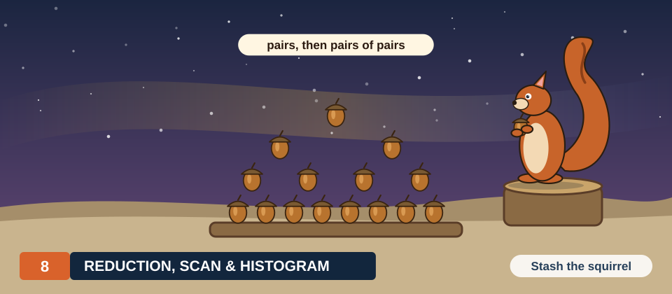

# Chapter 8: Reduction, Scan & Histogram

Many computations end by combining a large number of values into a small result: the total of
an array, its largest element, the running total at every position, or the number of elements
that fall into each of several bins. These are the reduction, scan and histogram patterns. In
Chapter 5 we wrote a tree sum in shared memory and a histogram with atomic counters, and we used
them to study barriers and atomic operations. Both kernels produced correct results, but both ran
far below the bandwidth of the memory that supplied their data.

In this chapter, we develop a sum, a scan and a histogram that run close to the memory bandwidth
of the GPU. We use the tools of Chapter 7: effective bandwidth as the measure of a kernel, the
grid-stride loop, and wide loads. The sum is developed in 4 stages, and each stage removes one
source of overhead. The scan reuses the same building blocks in a different arrangement. The
histogram returns to the kernel of Chapter 5, and its measurements show that its speed was limited
by its loads rather than by contention between atomic operations. Every kernel is given in CUDA
C++ and in Rust.

<div class="covers" markdown="1">

This chapter covers

- reductions, and the difference between the work of a computation and its number of steps
- the accuracy of a float sum computed sequentially and computed as a tree
- a tree sum in shared memory, thread coarsening, and warp shuffles, each measured
- inclusive and exclusive scans within a warp, within a block, and across many blocks
- a histogram that reads 16 bytes per load
- results that are identical from run to run

</div>

The code of the chapter is in
[`code/ch08_reduction/`](https://github.com/arpanpathak/gpu-parallel-book/tree/main/code/ch08_reduction)
for C++ and in
[`code/oxide/ch08_reduce/`](https://github.com/arpanpathak/gpu-parallel-book/tree/main/code/oxide/ch08_reduce)
for Rust. The measurements in this chapter come from 2 integrated GPUs: a Jetson Orin NX (8 SMs,
102 GB/s) and a Jetson AGX Thor (20 SMs, 273 GB/s).

## 8.1 Background

### 8.1.1 Reduction operators

A **reduction** derives a single value from \\(n\\) values by repeatedly applying a binary
operator. A sum uses \\(+\\), a maximum uses \\(\max\\), and a count of the elements that satisfy
a condition uses \\(+\\) over values of 0 and 1. A sequential program computes a reduction by
walking the array from one end to the other and combining each element with the result so far.

A parallel program must combine the values in a different order: it adds them in pairs, then adds
the pairs, and so on. The result is unchanged only if the operator is **associative**, that is,
if \\((a + b) + c = a + (b + c)\\) for any 3 values. Integer addition, maximum and minimum are
associative. Floating-point addition is associative only approximately, because every addition
rounds its result and a different grouping rounds at different places (Chapter 5, section 5.6).
A float sum computed in pairs is therefore a slightly different sum from the sequential one. As
we will see in section 8.2, it is usually the more accurate of the 2.

### 8.1.2 Work and steps

2 quantities describe the cost of a parallel computation. The **work** of a computation is the
number of operations it performs. Its **steps**, also called its depth, is the length of the
longest chain of operations in which each operation needs the result of the one before. Given
enough threads, the work determines the energy that the computation consumes, and the number of
steps determines its time.

Consider the 8 values 3, 1, 4, 1, 5, 9, 2, 6. Added sequentially, they produce the running sums
3, 4, 8, 9, 14, 23, 25, 31. Each addition needs the previous running sum, so the computation
performs 7 additions in 7 steps. Added in pairs, the values become 4, 5, 14, 8; these become 9 and
22; and these become 31. The 4 additions of the first level are independent of each other, and so
are the 2 additions of the second level. The tree therefore performs the same 7 additions in 3
steps (figure 8.1).

<figure>
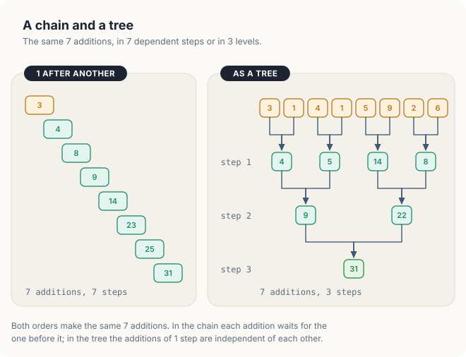
<figcaption><b>Figure 8.1</b> The same 7 additions as a chain of 7 steps or as a tree of 3 steps.</figcaption>
</figure>

In general, both orders perform \\(n - 1\\) additions. Each level of the tree halves the number of
values, so a tree over \\(n\\) values has \\(\log_2 n\\) levels, while the sequential chain has
\\(n - 1\\) steps. For the \\(n\\) = 67,108,864 values summed in this chapter, the chain is
67,108,863 steps long and the tree 26 steps, because \\(2^{26}\\) = 67,108,864.

### 8.1.3 The bandwidth limit of a sum

A sum performs 1 addition for every 4-byte float that it reads, so its arithmetic intensity is
0.25 FLOP per byte. The ridge points of Chapter 2 lie between 10 and 114 FLOP per byte. A sum is
therefore memory-bound on every GPU of that table, by a factor of 40 or more, and the shortest time
in which it can run is the time the memory needs to deliver the array once: the size of the array
divided by the memory bandwidth.

| GPU | Bandwidth | 256 MiB read once |
|---|---|---|
| Jetson Orin NX 16 GB | 102 GB/s | 2.63 ms |
| Jetson AGX Thor | 273 GB/s | 0.98 ms |
| DGX Spark (GB10) | 273 GB/s | 0.98 ms |
| GeForce RTX 4090 | 1,008 GB/s | 0.27 ms |
| GeForce RTX 5090 | 1,792 GB/s | 0.15 ms |
| A100 SXM 80 GB | 2,039 GB/s | 0.13 ms |
| H100 SXM | 3,350 GB/s | 0.08 ms |

For example, 256 MiB is 268,435,456 bytes, and at 102 GB/s the array takes
268,435,456 / (102 × 10<sup>9</sup>) s = 2.63 ms to read. As in Chapter 7, we judge each kernel
of this chapter by the bytes it must read and write, divided by its time, and compare the result
with the bandwidth in the table.

## 8.2 Accuracy of a sequential float sum

The test data of the chapter is 67,108,864 floats spread evenly between 0 and 1, generated on the
host. Their exact sum, computed in double precision, is 33,557,630.3. When the same values are
added sequentially into a `float` on the CPU, the result is 16,777,216.0, half of the correct
answer.

The reason lies in the precision of a float, which holds 24 significant bits. Below
2<sup>24</sup> = 16,777,216, consecutive floats are at most 1 apart. Between 2<sup>24</sup> and
2<sup>25</sup>, they are 2 apart, so a float in that range can hold only even numbers. When a
value below 1 is added to 16,777,216, the exact result is closer to 16,777,216 than to 16,777,218,
and rounding returns 16,777,216. Once the running sum reaches 2<sup>24</sup>, which happens about
halfway through the array, no further addition changes it (figure 8.2).

<figure>
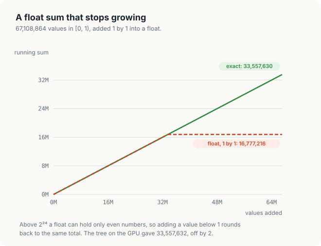
<figcaption><b>Figure 8.2</b> A sequential float sum of values below 1 stops growing at 2<sup>24</sup>.</figcaption>
</figure>

A reduction tree does not have this problem. In the GPU sums of this chapter, each thread first
adds 256 values into a register, which produces a total near 128. From then on, totals of similar
size are added to each other, so no addition combines a very large number with a very small one.
The GPU sums of section 8.6 produced 33,557,632.0. Near 33.5 million, consecutive floats are 4
apart, and 33,557,632 is the float nearest to the exact 33,557,630.3. It is the most accurate
result that a float can hold.

<div class="bee bee-shocked" markdown="1">

A long float sum computed sequentially loses the small values. A tree adds values of similar size
and keeps them.

</div>

## 8.3 A tree in shared memory

The first GPU sum is the tree of Chapter 5, section 5.3. Each block of 256 threads loads 256
values into shared memory. At strides 128, 64, …, 1, the lower half of the active threads adds the
values of the upper half into its own slots. The halving requires a block size that is a power of
2, so that every level splits evenly; 128, 256 and 512 are the usual choices. A barrier separates
the levels, because each level reads values that other threads wrote in the level before.

<p class="listing"><b>Listing 8.1</b> A tree sum per block, 1 element per thread. <a href="https://github.com/arpanpathak/gpu-parallel-book/blob/main/code/oxide/ch08_reduce/src/main.rs">code/oxide/ch08_reduce/src/main.rs</a> <a href="https://github.com/arpanpathak/gpu-parallel-book/blob/main/code/ch08_reduction/reduce.cu">code/ch08_reduction/reduce.cu</a></p>

<div class="code-tabs">
<div class="code-tab" data-lang="Rust">

```rust,ignore
mod kernels {
    // ...
{{#include ../../../../code/oxide/ch08_reduce/src/main.rs:25:51}}
    // ...
}
```

</div>
<div class="code-tab" data-lang="C++">

```cpp
{{#include ../../../../code/ch08_reduction/reduce.cu:43:59}}
```

</div>
</div>

Each block writes 1 **partial sum**, the total of its own values, to `partial[blockIdx.x]`.
Because blocks cannot wait for each other inside a kernel (Chapter 5, section 5.4), the partial
sums are added by a second launch of 1 block of 256 threads. For 67,108,864 values, the first
launch writes 262,144 partial sums.

```console
sum of 67108864 floats (256 MiB), average of 20 runs   # on a Jetson Orin NX
  tree, 1 per thread      10.36 ms    25.9 GB/s  sum 33557628.0
```

The kernel reached 25.9 GB/s, a quarter of the first GPU's 102 GB/s; on the second GPU it reached
88.3 GB/s, a third of 273 GB/s. The cause is the ratio of loads to barriers. Each thread loads 1
float and then takes part in 8 levels separated by 8 barriers. In the last levels, almost all of
the threads of a block wait for a few others: at stride 1, 1 thread adds and 255 threads wait.
While its threads are busy with the tree, a block issues no loads, so the memory is idle for much
of the time.

## 8.4 Thread coarsening

**Thread coarsening** assigns many elements to each thread instead of 1. Each thread first sums
its elements in a register, and the block's tree then combines the 256 register sums once, at the
end. The elements are assigned by the grid-stride loop of Chapter 7, section 7.3: thread \\(i\\)
of a grid of \\(s\\) threads reads elements \\(i\\), \\(i + s\\), \\(i + 2s\\), and so on.

The program launches 1,024 blocks of 256 threads, so \\(s\\) = 262,144 threads, and each thread
adds 67,108,864 / 262,144 = 256 elements (figure 8.3). 1,024 blocks are several times as many as
either GPU can hold at once, so no SM runs out of work. They are also few enough that the second
launch adds only 1,024 partial sums.

<figure>
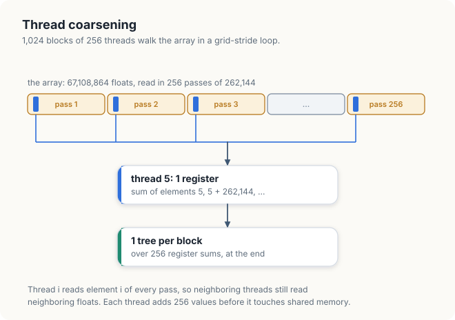
<figcaption><b>Figure 8.3</b> A grid-stride loop: 256 elements per thread, then 1 tree per block.</figcaption>
</figure>

<p class="listing"><b>Listing 8.2</b> The coarsened sum.</p>

<div class="code-tabs">
<div class="code-tab" data-lang="Rust">

```rust,ignore
mod kernels {
    // ...
{{#include ../../../../code/oxide/ch08_reduce/src/main.rs:53:86}}
    // ...
}
```

</div>
<div class="code-tab" data-lang="C++">

```cpp
{{#include ../../../../code/ch08_reduction/reduce.cu:61:80}}
```

</div>
</div>

In every pass of the loop, neighbouring threads read neighbouring floats, so the loads of each
warp are coalesced. The loads of different passes do not depend on each other, so a thread can
have several of them in flight while the memory serves them.

```console
  coarsened                4.19 ms    64.1 GB/s  sum 33557632.0      # Orin NX
  coarsened                1.32 ms   203.0 GB/s  sum 33557632.0      # Thor
```

With 256 loads per tree instead of 1, the same kernel structure ran 2.5 times as fast on the first
GPU and 2.3 times as fast on the second. The tree still costs 8 barriers per block, but a block
now pays that cost once for 65,536 values instead of once for 256 values.

## 8.5 Warp shuffles

### 8.5.1 Shuffle instructions

A **lane** is the position of a thread within its warp, from 0 to 31; for a 1-D block it is
`threadIdx.x % 32`. A **warp shuffle** is an instruction with which the lanes of a warp read each
other's registers, without shared memory and without a barrier. In
`__shfl_down_sync(mask, v, d)`, every lane supplies its value `v`, and lane \\(k\\) receives the
value of lane \\(k + d\\). A lane for which \\(k + d\\) is above 31 receives its own value. The
`mask` names the lanes that take part, `0xffffffff` for all 32, and each of these lanes must
execute the call. In Rust the same instruction is `warp::shuffle_down_f32(v, d)`.

A warp is reduced with 5 shuffles. At offset 16, lanes 0 to 15 add the values of lanes 16 to 31.
At offset 8, lanes 0 to 7 add the values of lanes 8 to 15, and so on down to offset 1, after which
lane 0 holds the sum of all 32 values (figure 8.4). The other lanes hold partial sums that the
program does not use. The number 5 is \\(\log_2 32\\), the depth of a tree over 32 values.

<figure>
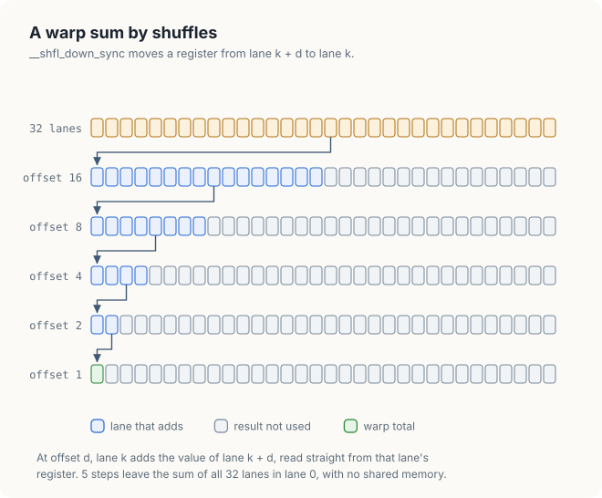
<figcaption><b>Figure 8.4</b> A warp sum in 5 shuffles; lane 0 ends with the total.</figcaption>
</figure>

### 8.5.2 A block reduction with warp shuffles

A block of 256 threads consists of 8 warps. Each warp reduces its 32 values by shuffles, and lane
0 of each warp writes the warp's total into 1 of 8 slots in shared memory. A single barrier makes
the 8 totals visible to all threads, and warp 0 then reduces them by shuffles (figure 8.5). The
tree of section 8.3 needed 8 barriers for the same 256 values; this version needs 1.

<figure>
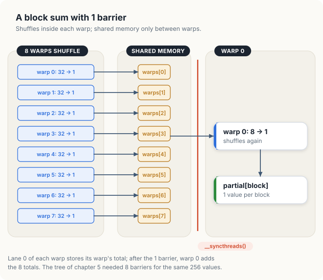
<figcaption><b>Figure 8.5</b> Shuffles within each warp, 1 barrier, then shuffles within warp 0.</figcaption>
</figure>

<p class="listing"><b>Listing 8.3</b> Warp sum, block sum, and the shuffle kernel.</p>

<div class="code-tabs">
<div class="code-tab" data-lang="Rust">

```rust,ignore
mod kernels {
    // ...
{{#include ../../../../code/oxide/ch08_reduce/src/main.rs:88:94}}

    // ...
{{#include ../../../../code/oxide/ch08_reduce/src/main.rs:108:139}}
    // ...
}
```

</div>
<div class="code-tab" data-lang="C++">

```cpp
{{#include ../../../../code/ch08_reduction/reduce.cu:82:120}}
```

</div>
</div>

In `blockSum`, lanes 8 to 31 of warp 0 contribute 0, the identity value of addition, so the second
call of `warpSum` adds exactly the 8 warp totals. Only warp 0 makes this second call, and all 32 of
its lanes make it, as the mask requires.

The Rust kernel has the same structure. The attribute `#[device]` marks `warp_sum` as a function
that runs on the GPU and is called from kernels. Thread 0 of each block writes the block's partial
sum at an index that is not the thread's own. The write therefore uses `get_unchecked_mut`, with a
`SAFETY` comment, as the transpose of Chapter 7 did.

```console
  shuffles                 4.17 ms    64.4 GB/s  sum 33557632.0      # Orin NX
  shuffles                 1.31 ms   203.6 GB/s  sum 33557632.0      # Thor
```

The shuffles made almost no difference: 64.4 GB/s against 64.1 GB/s on the first GPU, and
203.6 GB/s against 203.0 GB/s on the second. After coarsening, a block runs its tree once per
65,536 values, so the 8 barriers had become a small part of its time, and removing 7 of them saved
little. Shuffles are worthwhile where the combining step is frequent: in many short reductions,
such as 1 per row of a matrix, and in the scans of section 8.7, which perform a shuffle-based scan
in every block.

## 8.6 Vector loads and reproducible results

### 8.6.1 Vector loads with float4

The last stage replaces each `float` load with a `float4` load, the 16-byte load of Chapter 7,
section 7.6. Each thread now adds 4 floats per load instruction, and the loop runs a quarter as
many iterations.

<p class="listing"><b>Listing 8.4</b> The shuffle sum with 16-byte loads.</p>

<div class="code-tabs">
<div class="code-tab" data-lang="Rust">

```rust,ignore
mod kernels {
    // ...
{{#include ../../../../code/oxide/ch08_reduce/src/main.rs:141:158}}

    // ...
{{#include ../../../../code/oxide/ch08_reduce/src/main.rs:160:180}}
    // ...
}
```

</div>
<div class="code-tab" data-lang="C++">

```cpp
{{#include ../../../../code/ch08_reduction/reduce.cu:122:135}}
```

</div>
</div>

Listing 8.5 times the 4 stages. Each run consists of 2 launches: the stage itself, and 1 block of
`sumShuffle` over its partial sums.

<p class="listing"><b>Listing 8.5</b> Timing the 4 stages.</p>

<div class="code-tabs">
<div class="code-tab" data-lang="Rust">

```rust,ignore
{{#include ../../../../code/oxide/ch08_reduce/src/main.rs:348:360}}

{{#include ../../../../code/oxide/ch08_reduce/src/main.rs:362:403}}
```

</div>
<div class="code-tab" data-lang="C++">

```cpp
{{#include ../../../../code/ch08_reduction/reduce.cu:271:300}}
```

</div>
</div>

```console
$ ./reduce                                       # on a Jetson Orin NX
GPU: Orin, 8 SMs, L2 cache 2 MiB
sum of 67108864 floats (256 MiB), average of 20 runs
  tree, 1 per thread      10.36 ms    25.9 GB/s  sum 33557628.0
  coarsened                4.19 ms    64.1 GB/s  sum 33557632.0
  shuffles                 4.17 ms    64.4 GB/s  sum 33557632.0
  shuffles, float4         2.99 ms    89.7 GB/s  sum 33557628.0
exact sum (double)         33557630.3
CPU, float, 1 by 1         16777216.0
GPU, shuffles, 5 runs      33557632.0 33557632.0 33557632.0 33557632.0 33557632.0
```

```console
$ ./reduce                                       # on a Jetson AGX Thor
GPU: NVIDIA Thor, 20 SMs, L2 cache 32 MiB
sum of 67108864 floats (256 MiB), average of 20 runs
  tree, 1 per thread       3.04 ms    88.3 GB/s  sum 33557628.0
  coarsened                1.32 ms   203.0 GB/s  sum 33557632.0
  shuffles                 1.32 ms   203.6 GB/s  sum 33557632.0
  shuffles, float4         1.02 ms   264.2 GB/s  sum 33557628.0
```

```console
$ cargo oxide run                                # on a Jetson Orin NX, then a Thor
sum of 67108864 floats, average of 20 runs
  shuffles        4.13 ms    65.0 GB/s  sum 33557632.0
  shuffles        1.33 ms   201.2 GB/s  sum 33557632.0
```

With `float4` loads, the sum read its 256 MiB at 89.7 GB/s on the first GPU, 88% of its rated
102 GB/s, and at 264.2 GB/s on the second, 97% of its rated 273 GB/s (figure 8.6). Together, the 4
stages made the sum 3.5 times as fast on the first GPU and 3.0 times as fast on the second.
Section 8.1.3 predicted 2.63 ms and 0.98 ms at the full rated bandwidth, and the measured 2.99 ms
and 1.02 ms are close to both predictions. The Rust shuffle kernel matched the C++ shuffle
stage.

<figure>
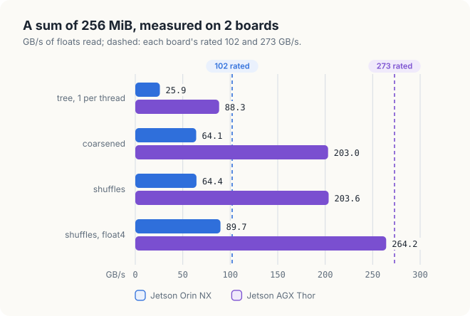
<figcaption><b>Figure 8.6</b> The 4 stages of the sum on 2 GPUs, against each GPU's rated bandwidth.</figcaption>
</figure>

### 8.6.2 Reproducibility of the sum

The 5 runs of the shuffle sum printed the same value, 33,557,632.0, and the Rust kernel printed it
as well. The float sum by `atomicAdd` in Chapter 5 gave a different answer on each run, because
the threads added their values in whatever order they arrived. In a tree, the code determines the
order. Thread \\(i\\) always adds the same elements in the same order, each warp always shuffles
the same pairs, and the second launch always adds the 1,024 partial sums in the same way. The same
order of additions produces the same roundings and therefore the same bits.

Note, however, that the order depends on the shape of the launch. The tree with 1 element per
thread and the `float4` version group the values differently from the coarsened versions, and
both printed 33,557,628.0, 1 float step lower. A program that must reproduce its results across
machines must therefore fix its block size and grid size, not only its algorithm.

<details class="check">
<summary>A sum runs with 512 blocks instead of 1,024. Will its answer match the 1,024-block answer bit for bit?</summary>

Not necessarily. With 512 blocks, thread \\(i\\) reads elements \\(i\\), \\(i + 131{,}072\\), …,
a different set from the 1,024-block grid, so the partial sums round differently. The answer is
still the same on every run with 512 blocks.

</details>

## 8.7 Scan

### 8.7.1 Inclusive and exclusive scan

An **inclusive scan** of an array \\(a\\) computes, at every position \\(i\\), the sum of elements
0 to \\(i\\): \\(y_i = a_0 + a_1 + \cdots + a_i\\). An **exclusive scan** leaves out element
\\(i\\) itself: \\(y_i = a_0 + \cdots + a_{i-1}\\), with \\(y_0 = 0\\). Scans are also called
prefix sums, because \\(y_i\\) is the sum of the prefix of the array that ends at \\(i\\).

| \\(i\\) | 0 | 1 | 2 | 3 | 4 | 5 | 6 | 7 |
|---|---|---|---|---|---|---|---|---|
| \\(a_i\\) | 3 | 1 | 4 | 1 | 5 | 9 | 2 | 6 |
| inclusive | 3 | 4 | 8 | 9 | 14 | 23 | 25 | 31 |
| exclusive | 0 | 3 | 4 | 8 | 9 | 14 | 23 | 25 |

A scan gives each element the position at which it is stored when selected elements are packed
together. For this reason it is the core of **stream compaction**, which keeps the elements that
pass a test and stores them contiguously in a shorter array. For example, to keep the values above
3 from 3, 1, 4, 1, 5, 9, 2, 6, we first set a flag of 1 for each value above 3, which gives
0, 0, 1, 0, 1, 1, 0, 1. The exclusive scan of the flags is 0, 0, 0, 1, 1, 2, 3, 3. Each kept value
is then written to the position given by its scan value: 4 to position 0, 5 to position 1, 9 to
position 2 and 6 to position 3. The output is 4, 5, 9, 6, and its length, 4, is the last scan
value plus the last flag.

Because every thread computes its output position independently, all threads can write at the
same time. Radix sort, the allocation of outputs of varying size, and sparse matrix formats use
scans in the same way.

### 8.7.2 Warp-level scan

A scan within a warp uses the opposite shuffle, `__shfl_up_sync`, in which lane \\(k\\) receives
the value of lane \\(k - d\\). At offset 1, every lane from lane 1 upwards adds the value of the
lane to its left. Each lane then holds the sum of 2 values, and at offset 2 it adds the sum of the
2 values before those; at offset 4, it adds the sum of the 4 values before those. After offsets
1, 2 and 4, each of 8 lanes holds the sum of all lanes up to and including its own (figure 8.7).
A warp of 32 lanes needs 5 offsets, 1 to 16.

<figure>
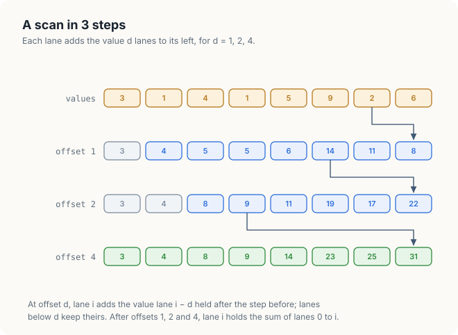
<figcaption><b>Figure 8.7</b> A scan of 8 lanes in 3 steps of shifted additions.</figcaption>
</figure>

Animation 1 shows the values moving at each of the 3 offsets.

<figure class="anim">
<video class="motion" src="../../figures/ch08-warp-scan.mp4" autoplay loop muted playsinline preload="metadata" aria-label="Eight lanes hold 3, 1, 4, 1, 5, 9, 2, 6. At offset 1, a copy of each lane's value slides 1 lane to the right and is added, giving 3, 4, 5, 5, 6, 14, 11, 8. At offset 2 the copies slide 2 lanes, giving 3, 4, 8, 9, 11, 19, 17, 22. At offset 4 they slide 4 lanes, giving the running sums 3, 4, 8, 9, 14, 23, 25, 31." data-chapters="[[0.0, &quot;offset 1&quot;], [14.22, &quot;offset 2&quot;], [22.5, &quot;offset 4&quot;]]">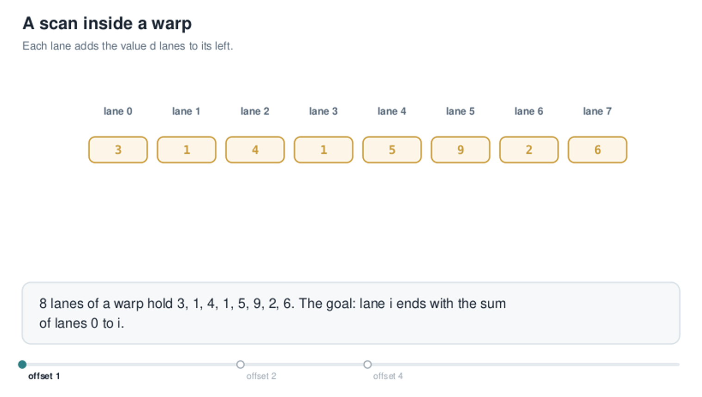</video>
<figcaption><b>Animation 1</b> A warp scan: each lane adds the value 1, 2, then 4 lanes to its left.</figcaption>
</figure>

<p class="listing"><b>Listing 8.6</b> A warp scan.</p>

<div class="code-tabs">
<div class="code-tab" data-lang="Rust">

```rust,ignore
mod kernels {
    // ...
{{#include ../../../../code/oxide/ch08_reduce/src/main.rs:96:106}}
    // ...
}
```

</div>
<div class="code-tab" data-lang="C++">

```cpp
{{#include ../../../../code/ch08_reduction/reduce.cu:137:148}}
```

</div>
</div>

This form of scan performs more work than a sequential scan. At offset \\(d\\), \\(32 - d\\) lanes
perform an addition, so a warp performs 31 + 30 + 28 + 24 + 16 = 129 additions where a sequential
chain needs 31. Within a warp, the extra additions add no time: the 32 lanes execute every step
together whether or not a lane adds, and 5 steps take less time than 31. For large scans in shared
memory, the work-efficient algorithm due to Blelloch performs \\(2(n - 1)\\) additions in
\\(2 \log_2 n\\) steps instead; Exercise 6 traces it.

### 8.7.3 Block-level scan

The kernel `scanBlocks` scans 1,024 values per block of 256 threads, 4 values per thread, in 4
phases:

1. Each thread loads its 4 consecutive values with a single 16-byte `uint4` load and scans them in
   its registers.
2. The threads scan their 4-value totals with `warpScan`. Lane 31 of each warp then holds the
   total of its warp and writes it to shared memory.
3. After a barrier, warp 0 scans the 8 warp totals.
4. After a second barrier, each thread adds 2 offsets to its 4 values: the total of the warps
   before its own, and the total of the lanes before it in its own warp.

<p class="listing"><b>Listing 8.7</b> A scan of 1,024 values per block.</p>

<div class="code-tabs">
<div class="code-tab" data-lang="Rust">

```rust,ignore
mod kernels {
    // ...
{{#include ../../../../code/oxide/ch08_reduce/src/main.rs:182:233}}
    // ...
}
```

</div>
<div class="code-tab" data-lang="C++">

```cpp
{{#include ../../../../code/ch08_reduction/reduce.cu:150:184}}
```

</div>
</div>

The expression `v - a.w` computes the second offset. The variable `v` holds the inclusive warp
scan at this lane, and subtracting the lane's own total `a.w` leaves the sum of the lanes before
it. The last thread of the block writes the block's total to `sums`.

### 8.7.4 Hierarchical scan across blocks

Blocks cannot read each other's results while a kernel runs, so an array larger than 1 block is
scanned in 3 steps (figure 8.8):

1. every block scans its 1,024 values and writes its total;
2. the block totals are scanned, by the same function;
3. every value of block \\(b\\) has the scanned total of blocks 0 to \\(b - 1\\) added to it.

<figure>
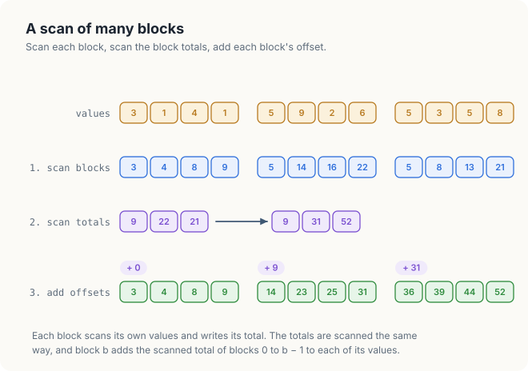
<figcaption><b>Figure 8.8</b> Scan the blocks, scan the block totals, then add each block's offset.</figcaption>
</figure>

For 67,108,864 values, step 1 runs 65,536 blocks and writes 65,536 totals. Scanning these totals is
the same problem, 1,024 times smaller: 64 blocks, whose 64 totals fit in 1 block. The C++ function
`scan` therefore calls itself for step 2 until a single block remains. Animation 2 shows the 3
steps on the 12 values of the figure.

<figure class="anim">
<video class="motion" src="../../figures/ch08-scan-levels-anim.mp4" autoplay loop muted playsinline preload="metadata" aria-label="Three blocks of 4 values. Each block scans its values at the same time, giving 3, 4, 8, 9; 5, 14, 16, 22; 5, 8, 13, 21. The 3 block totals 9, 22, 21 fly down to a row of totals, which is scanned to 9, 31, 52. Then copies of +9 fly into the 4 values of block 1 and copies of +31 into block 2, giving the running sums 3 to 52." data-chapters="[[0.0, &quot;scan blocks&quot;], [10.86, &quot;scan totals&quot;], [15.84, &quot;add offsets&quot;]]">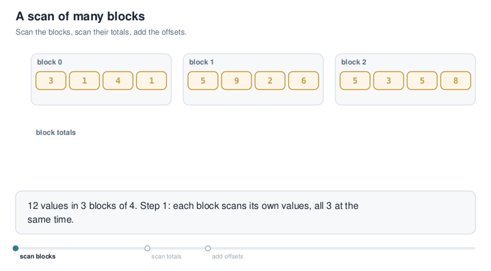</video>
<figcaption><b>Animation 2</b> A scan of 3 blocks: block totals are scanned, and the offsets are added back.</figcaption>
</figure>

<p class="listing"><b>Listing 8.8</b> Adding the offsets, and the whole scan.</p>

<div class="code-tabs">
<div class="code-tab" data-lang="Rust">

```rust,ignore
mod kernels {
    // ...
{{#include ../../../../code/oxide/ch08_reduce/src/main.rs:235:250}}
    // ...
}

{{#include ../../../../code/oxide/ch08_reduce/src/main.rs:417:447}}
```

</div>
<div class="code-tab" data-lang="C++">

```cpp
{{#include ../../../../code/ch08_reduction/reduce.cu:186:209}}
```

</div>
</div>

The totals of each level are scanned in place, in `scratch`, which holds all levels one after
another. The number of totals is rounded up to a multiple of 4, so that the next level can load
them as `uint4`. The rounding adds unused values after the last real total. Because an inclusive
scan never carries a value backwards, these values change none of the sums that are used.

The Rust version loads its 4 values with 4 ordinary loads and writes them through
`get_unchecked_mut`, because thread \\(t\\) writes elements \\(4t\\) to \\(4t + 3\\) rather than
element \\(t\\). A Rust function cannot borrow 1 buffer as both input and output, so each level
has its own pair of buffers, `totals` and `scanned`, which are allocated before the timing starts.

### 8.7.5 Performance of the scan

The test scans 67,108,864 random values from 0 to 3 and checks every result against a scan
computed on the CPU. The reported bandwidth counts the bytes that the job requires: the input read
once and the output written once, 2 × 256 MiB.

```console
inclusive scan of 67108864 values                # Orin NX
   13.19 ms    40.7 GB/s  last 100652862  correct: yes
inclusive scan of 67108864 values                # Thor
    5.88 ms    91.4 GB/s  last 100652862  correct: yes
```

```console
$ cargo oxide run                                # Orin NX, then Thor
inclusive scan of 67108864 values
   19.38 ms    27.7 GB/s  last 100652862  correct: yes
inclusive scan of 67108864 values
    5.48 ms    98.0 GB/s  last 100652862  correct: yes
```

Every value matched the CPU scan. The 3 steps, however, move more bytes than the job requires.
Step 1 reads the input and writes the output, and step 3 reads the output and writes it again, so
4 × 256 MiB cross the memory in all. The memory therefore moved about 2 × 40.7 = 81 GB/s on the
first GPU and 2 × 91.4 = 183 GB/s on the second, 80% and 67% of their rated bandwidth. A
**single-pass scan** passes each block's total directly to the next block while the kernel runs,
so that each value is read once and written once. The CUB library of Chapter 11 provides one. The
Rust scan, which uses 4 ordinary loads per thread, ran slower than the C++ scan on the first GPU
and faster on the second in this run; over several runs, its bandwidth on the second GPU varied
between 96 and 128 GB/s.

## 8.8 Histogram with wide loads

In Chapter 5, section 5.5.2, we privatised a histogram of bytes: each block counts into 256 bins
in shared memory and adds them to the global bins once. This made the kernel 6 to 28 times as fast
as the version with global atomics. Measured as a bandwidth, however, its speed was still low.
Listing 5.7, run here as `histBytes`, read 64 MiB at 13.7 GB/s on the first GPU, 13% of the
memory's rated bandwidth.

An input in which every byte is 7 shows where the time goes. In that case every atomic operation
of a warp targets the same bin, which is the worst possible contention. Yet these bytes were
counted no more slowly than random bytes: 16.8 GB/s against 13.7 GB/s. Contention was therefore
not the limit. Each byte cost 1 load instruction, and the 1-byte loads of a warp fetch only 32
bytes, 1 sector, per instruction. The kernel was limited by its loads.

The kernel `histWords` reads 16 bytes per thread with a single `uint4` load, 512 bytes per warp.
It extracts the 4 bytes of each 32-bit word by shifting and masking: `(w >> 8 * k) & 255` is byte
\\(k\\) of the word `w`.

<p class="listing"><b>Listing 8.9</b> A histogram reading 16 bytes per load.</p>

<div class="code-tabs">
<div class="code-tab" data-lang="Rust">

```rust,ignore
mod kernels {
    // ...
{{#include ../../../../code/oxide/ch08_reduce/src/main.rs:284:297}}

    // ...
{{#include ../../../../code/oxide/ch08_reduce/src/main.rs:299:328}}
}
```

</div>
<div class="code-tab" data-lang="C++">

```cpp
{{#include ../../../../code/ch08_reduction/reduce.cu:226:249}}
```

</div>
</div>

```console
histogram of 64 MiB, average of 20 runs          # Orin NX
  random bytes  1 byte per load     4.92 ms    13.7 GB/s
  random bytes  16 bytes per load   0.81 ms    82.9 GB/s  total 67108864
  all 7         1 byte per load     3.99 ms    16.8 GB/s
  all 7         16 bytes per load   0.72 ms    93.4 GB/s  total 67108864
```

```console
histogram of 64 MiB, average of 20 runs          # Thor
  random bytes  1 byte per load     1.35 ms    49.7 GB/s
  random bytes  16 bytes per load   0.35 ms   190.9 GB/s  total 67108864
  all 7         1 byte per load     1.24 ms    54.1 GB/s
  all 7         16 bytes per load   0.32 ms   210.6 GB/s  total 67108864
```

With 16-byte loads, the same atomic operations ran 6.1 times as fast for random bytes on the first
GPU and 3.8 times as fast on the second, which is 81% and 70% of rated bandwidth (figure 8.9).
Every total is 67,108,864, 1 count per byte. A version with 1 set of 256 bins per warp, intended to
reduce contention further, was also measured. It ran no faster on either GPU, so the listing leaves
it out.

<figure>
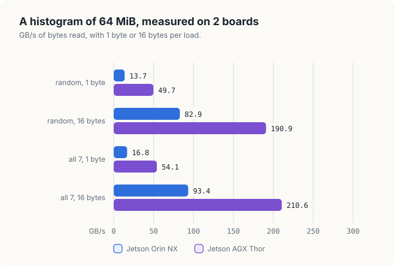
<figcaption><b>Figure 8.9</b> The histogram with 1 and 16 bytes per load, on 2 GPUs.</figcaption>
</figure>

Listing 8.10 reads 4-byte words, 4 bytes per load:

<p class="listing"><b>Listing 8.10</b> A histogram reading 4 bytes per load.</p>

<div class="code-tabs">
<div class="code-tab" data-lang="Rust">

```rust,ignore
mod kernels {
    // ...
{{#include ../../../../code/oxide/ch08_reduce/src/main.rs:252:282}}
    // ...
}
```

</div>
<div class="code-tab" data-lang="C++">

```cpp
{{#include ../../../../code/ch08_reduction/reduce.cu:251:263}}
```

</div>
</div>

```console
$ cargo oxide run                                # Orin NX, then Thor
histogram of 64 MiB, 4 bytes per load
    1.27 ms    52.8 GB/s  total 67108864
histogram of 64 MiB, 4 bytes per load
    0.38 ms   176.4 GB/s  total 67108864
```

Loads of 4 bytes already gave 3.9 and 3.5 times the speed of 1-byte loads, and 16-byte loads
provided the rest of the gain.

<div class="bee bee-angry" markdown="1">

Measure before optimising. The histogram was limited by its loads, not by the contention that
privatisation was designed to avoid.

</div>

## 8.9 Comparison of the 3 patterns

| Pattern | Computes | Combining step | Shared state | Measured, best stage |
|---|---|---|---|---|
| Reduction | 1 value from \\(n\\) | tree: registers, shuffles, 1 barrier per block, 2 launches | none | 88% and 97% of rated |
| Scan | \\(n\\) running sums | warp scan by shuffles, block scan, 3 steps across blocks | none | 80% and 67% of rated, counting the bytes moved |
| Histogram | counts per bin | atomics on private bins in shared memory, 1 fold per block | 256 bins | 81% and 70% of rated |

The 3 kernels follow the same method. Each does as much of the work as possible in registers,
combines values within a warp by shuffles, and then combines the warps of a block through shared
memory. It combines results across blocks only once, through global memory or a second launch.
Each optimisation was kept only when a measurement showed that it removed a cost.

## 8.10 The complete programs

<p class="listing"><b>Listing 8.11</b> The complete programs. <a href="https://github.com/arpanpathak/gpu-parallel-book/blob/main/code/oxide/ch08_reduce/src/main.rs">code/oxide/ch08_reduce/src/main.rs</a> <a href="https://github.com/arpanpathak/gpu-parallel-book/blob/main/code/ch08_reduction/reduce.cu">code/ch08_reduction/reduce.cu</a></p>

<div class="code-tabs">
<div class="code-tab" data-lang="Rust">

```rust,ignore
{{#include ../../../../code/oxide/ch08_reduce/src/main.rs}}
```

</div>
<div class="code-tab" data-lang="C++">

```cpp
{{#include ../../../../code/ch08_reduction/reduce.cu}}
```

</div>
</div>

## Common mistakes

- **A block size that is not a power of 2 in a halving tree.** The levels no longer split evenly,
  and some values are skipped.
- **A shuffle that only some lanes execute.** Every lane named in the mask must call
  `__shfl_down_sync`; calling it inside `if (lane < 8)` is undefined.
- **Reading the partial result of a lane other than lane 0** after a shuffle sum. Only lane 0
  holds the total.
- **A missing barrier between writing the warp totals and reading them.** Chapter 5 measured the
  effect.
- **Summing many floats sequentially into a float.** Above 2<sup>24</sup>, small values are lost.
- **Comparing results bit for bit across launch shapes.** A different grid groups the additions
  differently.
- **Timing a scan with allocations inside the timed loop.** Allocate the buffers of every level
  first.

<div class="summary" markdown="1">

## Summary

- A reduction combines \\(n\\) values with an associative operator. A tree performs the same
  \\(n - 1\\) operations as a sequential chain, in \\(\log_2 n\\) steps.
- A float sum of values below 1, computed sequentially, stopped at 2<sup>24</sup> = 16,777,216.
  The tree on the GPU produced the float nearest to the exact sum.
- A tree with 1 element per thread reached a quarter to a third of rated bandwidth. Coarsening to
  256 elements per thread made it 2.3 to 2.5 times as fast.
- Warp shuffles combine the registers of a warp without shared memory or barriers. After
  coarsening they changed little, because the tree had become a small cost.
- With `float4` loads, the sum reached 88% and 97% of rated bandwidth on the 2 GPUs, with the same
  bits on every run.
- A scan within a warp takes 5 shuffle steps. A scan of many blocks scans the blocks, scans their
  totals, and adds the offsets, and it moves the output twice.
- The privatised histogram of Chapter 5 was limited by its 1-byte loads; 16-byte loads made it
  3.8 to 6.1 times as fast.

</div>

Chapter 9 applies the same approach to matrix multiplication, a computation that reuses every value
it loads many times and can therefore run faster than the memory bandwidth alone would allow.

## Exercises

1. A tree sums 512 values per block, 1 per thread. How many levels and how many barriers does it
   need? How many does the shuffle version of section 8.5 need?
2. In `blockSum`, why does lane 0 of each warp write `warps[warp]`, and not every lane? What
   would go wrong if every lane wrote its own `v`?
3. Compute the largest number of floats with values in [0, 1) that can be summed sequentially into
   a float before the sum stops growing, and check it with a small CPU program.
4. Change `GRID` to 256 and to 4,096 and run `reduce`. Explain the change in speed, and check
   whether the bits of the sum change.
5. Write `warpMax` with `__shfl_down_sync` and use it to find the largest value of the array.
   Does the result depend on the launch shape, as the float sum does?
6. Trace the Blelloch scan on 3, 1, 4, 1: an up-sweep that stores the partial sums of a tree,
   then a down-sweep that gives each left child its parent's prefix and each right child the
   parent's prefix plus the left child's sum. Check that it yields the exclusive scan 0, 3, 4, 8.
7. Use `scan` to write stream compaction: keep the values above 1 from 67,108,864 values from 0
   to 3, and verify the output length against a count on the CPU.
8. Rewrite the Rust `hist_words` to read 16 bytes per thread, as 4 consecutive `u32` words, and
   compare its speed with listing 8.13 on your GPU.

## Sources and further reading

- M. Harris, "Optimizing Parallel Reduction in CUDA", NVIDIA, 2007.
- J. Luitjens, "Faster Parallel Reductions on Kepler", NVIDIA Technical Blog, 2014.
- G. Blelloch, "Prefix Sums and Their Applications", Carnegie Mellon University, 1990.
- D. Merrill and M. Garland, "Single-pass Parallel Prefix Scan with Decoupled Look-back",
  NVIDIA, 2016.
- N. Higham, "The Accuracy of Floating Point Summation", *SIAM Journal on Scientific Computing*,
  1993.
- NVIDIA, *CUDA C++ Programming Guide*, "Warp Shuffle Functions":
  <https://docs.nvidia.com/cuda/cuda-c-programming-guide/>
- D. Kirk and W. Hwu, *Programming Massively Parallel Processors*, 4th ed., Morgan Kaufmann, 2022,
  chapters on reduction, prefix sum and histogram.
