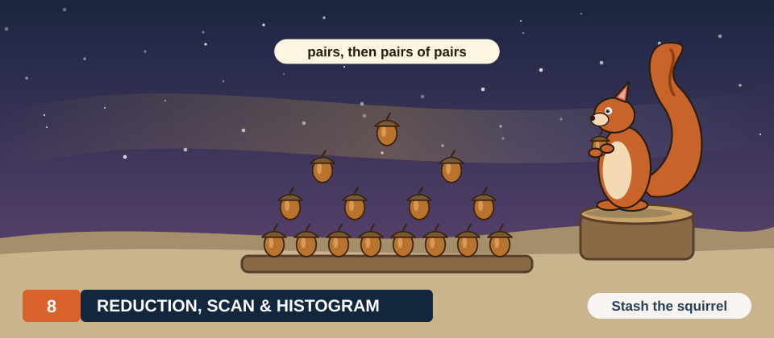

# Chapter 8: Reduction, Scan & Histogram

Many programs end by combining many values: a total, a maximum, a count of each kind, a running
sum. Chapter 5 built 2 such kernels for correctness, a tree sum in shared memory and a histogram
with atomic counters. Neither ran anywhere near the speed of the memory that fed it. Chapter 7
supplied the tools to change that: effective bandwidth as the yardstick, the grid-stride loop, and
wide loads.

This chapter builds 3 kernels that run close to memory speed: a sum, a scan, and a histogram. The
sum is built in 4 measured stages, and each stage removes 1 named cost. The scan, a running sum
over an array, uses the same building blocks in a different arrangement. The histogram returns
to the kernel of Chapter 5 and finds that its limit was never contention. Every kernel is shown in
CUDA C++ and in Rust and measured on 2 boards.

<div class="covers" markdown="1">

This chapter covers

- reductions, and the difference between the work of a computation and its number of steps
- why a float sum added 1 by 1 gives a wrong answer, and why a tree gives a better one
- a tree sum in shared memory, thread coarsening, and warp shuffles, each measured
- scans: inclusive and exclusive, inside a warp, inside a block, and across many blocks
- a histogram that reads 16 bytes per load
- results that repeat bit for bit from run to run

</div>

The code of the chapter is in
[`code/ch08_reduction/`](https://github.com/arpanpathak/gpu-parallel-book/tree/main/code/ch08_reduction)
for C++ and in
[`code/oxide/ch08_reduce/`](https://github.com/arpanpathak/gpu-parallel-book/tree/main/code/oxide/ch08_reduce)
for Rust.

## 8.1 Combining many values into 1

### 8.1.1 Reductions

A **reduction** combines \\(n\\) values into 1 with a binary operator: a sum with \\(+\\), a
maximum with \\(\max\\), a count of matching elements with \\(+\\) over 0s and 1s. A reduction can
regroup its operations when the operator is **associative**, that is, when
\\((a + b) + c = a + (b + c)\\) for any 3 values. Associativity lets a program add the values
in pairs, then add the pairs, instead of walking the array from 1 end to the other.

Integer addition, maximum and minimum are associative. Floating-point addition is associative only
approximately: every addition rounds its result, and a different grouping rounds at different
places (Chapter 5, section 5.6). A float sum regrouped into pairs is a slightly different sum, and
section 8.2 shows it is usually a better one.

### 8.1.2 Work and steps

2 numbers describe the cost of a parallel computation. Its **work** is the number of operations
it performs. Its **steps**, also called its depth, is the length of the longest chain of
operations in which each needs the result of the one before. With enough threads, the work sets
the energy and the steps set the time.

<div class="example" markdown="1">

Worked example: 8 values, 2 orders

1. Added 1 after another, 3 + 1 + 4 + 1 + 5 + 9 + 2 + 6 is a chain of running sums 3, 4, 8, 9,
   14, 23, 25, 31. Each addition needs the previous running sum: 7 additions, 7 steps.
2. Added in pairs, the values become 4, 5, 14, 8; those become 9 and 22; those become 31. The 4
   additions of the first level are independent of each other, and so are the 2 of the second:
   still 7 additions, now in 3 steps.

</div>

Each level of the tree halves the number of values, so \\(n\\) values need
\\(\log_2 n\\) levels (figure 8.1). For the \\(n\\) = 67,108,864 values summed in this chapter,
the chain is 67,108,863 steps long and the tree 26, because \\(2^{26}\\) = 67,108,864. Both make
67,108,863 additions.

<figure>
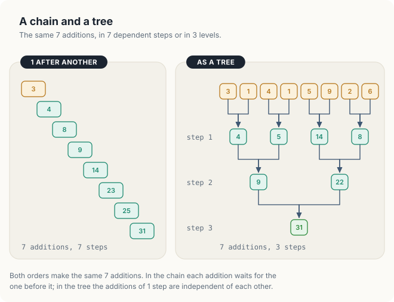
<figcaption><b>Figure 8.1</b> The same 7 additions as a chain of 7 steps or a tree of 3.</figcaption>
</figure>

| Symbol | Meaning | In the example |
|---|---|---|
| \\(n\\) | number of values | 8 |
| work | additions performed: \\(n - 1\\) in both orders | 7 |
| steps, chain | \\(n - 1\\) | 7 |
| steps, tree | \\(\log_2 n\\) | 3 |

<div class="bee bee-happy" markdown="1">

A tree performs the same work as a chain in \\(\log_2 n\\) steps instead of \\(n - 1\\).

</div>

### 8.1.3 The speed limit

A sum performs 1 addition for every 4-byte float it reads, an arithmetic intensity of
0.25 FLOP per byte. The ridge points of Chapter 2 lie between 10 and 114 FLOP per byte, so a sum
is memory-bound on every GPU of that table by a factor of 40 or more. Its speed limit is the time
the memory needs to deliver the array once: the size of the array divided by the memory bandwidth.

| GPU | Bandwidth | 256 MiB read once |
|---|---|---|
| Jetson Orin NX 16 GB | 102 GB/s | 2.63 ms |
| Jetson AGX Thor | 273 GB/s | 0.98 ms |
| DGX Spark (GB10) | 273 GB/s | 0.98 ms |
| GeForce RTX 4090 | 1,008 GB/s | 0.27 ms |
| GeForce RTX 5090 | 1,792 GB/s | 0.15 ms |
| A100 SXM 80 GB | 2,039 GB/s | 0.13 ms |
| H100 SXM | 3,350 GB/s | 0.08 ms |

256 MiB is 268,435,456 bytes; on the Orin NX, 268,435,456 / (102 × 10<sup>9</sup>) s = 2.63 ms.
Each kernel of the chapter is judged as in Chapter 7: the bytes it must read and write, divided by
its time, against the bandwidth in the table.

## 8.2 The serial sum, and why its answer is wrong

The test data of the chapter is 67,108,864 floats spread evenly between 0 and 1, generated on the
host. Their exact sum, computed in double precision, is 33,557,630.3. The same values added 1 by
1 into a `float` on the CPU give 16,777,216.0, half the right answer.

A float holds 24 significant bits. Below 2<sup>24</sup> = 16,777,216, consecutive floats are at
most 1 apart; from 2<sup>24</sup> to 2<sup>25</sup>, they are 2 apart, so a float there can hold
only even numbers. Adding a value below 1 to 16,777,216 produces a result closer to 16,777,216 than to
16,777,218, and rounding returns 16,777,216. From the moment the running sum reaches
2<sup>24</sup>, about halfway through the array, no addition changes it (figure 8.2).

<figure>
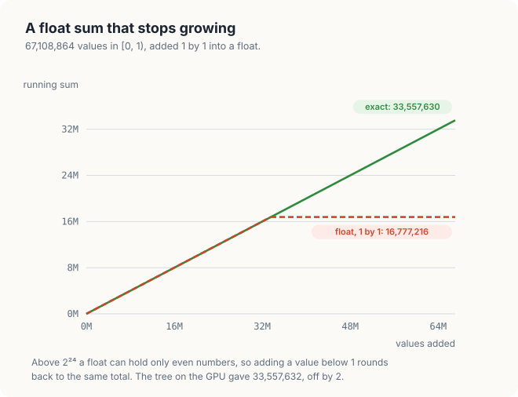
<figcaption><b>Figure 8.2</b> Added 1 by 1, a float sum of values below 1 stops at 2<sup>24</sup>.</figcaption>
</figure>

A tree avoids the failure. In the GPU sums, each thread adds 256 values into a register total
near 128. From then on, the larger totals meet only each other, so no addition joins a huge
number to a tiny one. The GPU sums of section 8.6 gave 33,557,632.0. Near 33.5 million, consecutive floats
are 4 apart, and 33,557,632 is the float nearest to the exact 33,557,630.3: the best answer a
float can hold.

<div class="bee bee-shocked" markdown="1">

A long float sum added 1 by 1 loses the small values. A tree adds values of similar size and
keeps them.

</div>

## 8.3 A tree in shared memory

The first GPU sum is the tree of Chapter 5, section 5.3. Each block of 256 threads loads 256
values into shared memory. At strides 128, 64, … 1, the lower half of the active threads adds the
upper half into its own slots. The halving needs a block size that is a power of 2, so that
every level splits evenly; 128, 256 and 512 are the usual choices. A barrier separates the levels,
because each level reads values that other threads wrote in the level before.

<p class="listing"><b>Listing 8.1</b> A tree sum per block, 1 element per thread, in C++. <a href="https://github.com/arpanpathak/gpu-parallel-book/blob/main/code/ch08_reduction/reduce.cu">code/ch08_reduction/reduce.cu</a></p>

```cpp
{{#include ../../../../code/ch08_reduction/reduce.cu:43:59}}
```

Each block writes 1 **partial sum**, the total of its own values, to `partial[blockIdx.x]`. Blocks
cannot wait for each other inside a kernel (Chapter 5, section 5.4). The partial sums are therefore
added by a second launch: 1 block of 256 threads that adds all of them. For 67,108,864 values the first
launch writes 262,144 partial sums.

```console
sum of 67108864 floats (256 MiB), average of 20 runs   # on a Jetson Orin NX
  tree, 1 per thread      10.36 ms    25.9 GB/s  sum 33557628.0
```

25.9 GB/s is a quarter of the Orin NX's 102 GB/s; the Thor reached 88.3 GB/s, a third of its 273.
The cost lies in the ratio of loads to barriers. Each thread loads 1 float and then takes part in 8
levels separated by 8 barriers. In the last levels almost all of its block waits for a few
threads: at stride 1, 1 thread works and 255 wait. Blocks that are busy with their trees issue no
loads, so the memory is idle for much of the time.

## 8.4 Thread coarsening

**Thread coarsening** gives each thread many elements instead of 1. Each thread first sums its
elements in a register, and the block's tree then combines 256 register sums once, at the end. The
elements are assigned by the grid-stride loop of Chapter 7, section 7.3. Thread \\(i\\) of a grid
of \\(s\\) threads reads elements \\(i\\), \\(i + s\\), \\(i + 2s\\), and so on.

The program launches 1,024 blocks of 256 threads, \\(s\\) = 262,144 threads. Each thread
therefore adds 67,108,864 / 262,144 = 256 elements (figure 8.3). 1,024 blocks are several times
as many as either board holds at once, so no SM runs out of work. They are also few enough that
the second launch adds only 1,024 partial sums.

<figure>
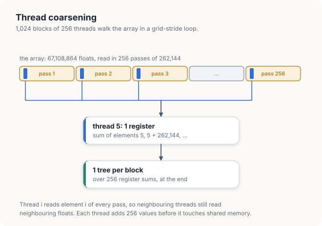
<figcaption><b>Figure 8.3</b> A grid-stride loop: 256 elements per thread, then 1 tree per block.</figcaption>
</figure>

<p class="listing"><b>Listing 8.2</b> The coarsened sum, in C++.</p>

```cpp
{{#include ../../../../code/ch08_reduction/reduce.cu:61:80}}
```

On every pass, neighbouring threads read neighbouring floats, so each warp's loads stay coalesced.
The loads of different passes do not depend on each other, so a thread can have several of them in
flight at once while the memory works.

```console
  coarsened                4.19 ms    64.1 GB/s  sum 33557632.0      # Orin NX
  coarsened                1.32 ms   203.0 GB/s  sum 33557632.0      # Thor
```

The same kernel shape, with 256 loads per tree instead of 1, ran 2.5 times as fast on the Orin NX
and 2.3 times as fast on the Thor. The tree still costs 8 barriers per block, but a block now pays
them once for 65,536 values instead of once for 256.

<div class="bee bee-happy" markdown="1">

Coarsening spreads the fixed cost of combining over many elements per thread.

</div>

## 8.5 Warp shuffles

### 8.5.1 Moving a register between lanes

A **lane** is 1 thread's position inside its warp, 0 to 31: `threadIdx.x % 32` for a 1-D block. A
**warp shuffle** lets the lanes of a warp read each other's registers in 1 instruction, without
shared memory and without a barrier. In `__shfl_down_sync(mask, v, d)`, every lane hands over its
value `v`, and lane \\(k\\) receives the value of lane \\(k + d\\). A lane with \\(k + d\\) above 31
receives its own value. The `mask` names the lanes that take part, `0xffffffff` for all 32, and
each of them must execute the call. In Rust the same instruction is
`warp::shuffle_down_f32(v, d)`.

5 shuffles reduce a warp. At offset 16, lanes 0 to 15 add the values of lanes 16 to 31. At
offset 8, lanes 0 to 7 add those of lanes 8 to 15, and so on to offset 1, after which lane 0
holds the sum of all 32 (figure 8.4). The other lanes hold partial sums that the program ignores. 5 is
\\(\log_2 32\\), the depth of a tree over 32 values.

<figure>
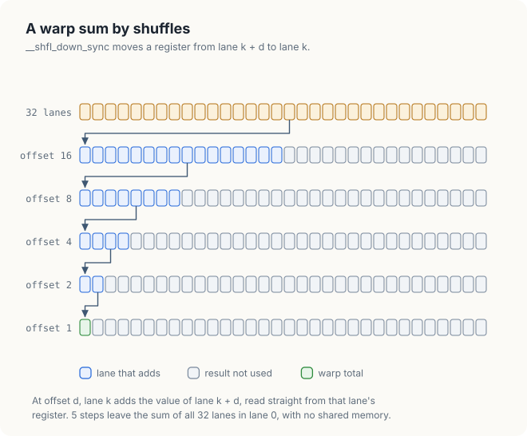
<figcaption><b>Figure 8.4</b> A warp sum in 5 shuffles: lane 0 ends with the total.</figcaption>
</figure>

### 8.5.2 A block sum with 1 barrier

A block of 256 threads is 8 warps. Each warp reduces its 32 values by shuffles. Lane 0 of each
warp then writes the warp's total to 1 of 8 slots in shared memory. 1 barrier makes the 8 totals visible,
and warp 0 reduces them by shuffles once more (figure 8.5). The tree of section 8.3 needed 8
barriers for the same 256 values; the shuffle version needs 1.

<figure>
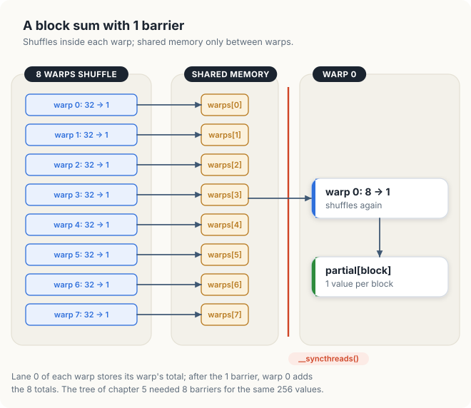
<figcaption><b>Figure 8.5</b> Shuffles inside the warps, 1 barrier, shuffles inside warp 0.</figcaption>
</figure>

<p class="listing"><b>Listing 8.3</b> Warp sum, block sum, and the shuffle kernel, in C++.</p>

```cpp
{{#include ../../../../code/ch08_reduction/reduce.cu:82:120}}
```

In `blockSum`, lanes 8 to 31 of warp 0 contribute 0, the identity of addition, so the second
`warpSum` adds exactly the 8 totals. Only warp 0 calls it the second time, and all 32 of its lanes
do, as the mask requires.

The Rust kernel has the same shape. `#[device]` marks `warp_sum` as a function that runs on the
GPU and is called from kernels. Thread 0 of each block writes its block's partial sum, at an index
that is not the thread's own. The write therefore goes through `get_unchecked_mut` with a `SAFETY`
comment, as for the transpose of Chapter 7.

<p class="listing"><b>Listing 8.4</b> The shuffle sum in Rust. <a href="https://github.com/arpanpathak/gpu-parallel-book/blob/main/code/oxide/ch08_reduce/src/main.rs">code/oxide/ch08_reduce/src/main.rs</a></p>

```rust,ignore
mod kernels {
    // ...
{{#include ../../../../code/oxide/ch08_reduce/src/main.rs:23:29}}

    // ...
{{#include ../../../../code/oxide/ch08_reduce/src/main.rs:43:74}}
}
```

```console
  shuffles                 4.17 ms    64.4 GB/s  sum 33557632.0      # Orin NX
  shuffles                 1.31 ms   203.6 GB/s  sum 33557632.0      # Thor
```

The shuffles changed almost nothing: 64.4 against 64.1 GB/s on the Orin NX, 203.6 against 203.0 on
the Thor. After coarsening, a block runs its tree once per 65,536 values, so the 8 barriers had
become a small part of its time, and removing 7 of them removed little. Shuffles pay where a
combining step is frequent: many short reductions, such as 1 per row of a matrix, or the scans of
section 8.7, which shuffle at every block.

## 8.6 Wider loads, and a result that repeats

### 8.6.1 4 floats per load

The last stage replaces each `float` load by a `float4` load, the 16-byte load of Chapter 7,
section 7.6. Each thread now adds 4 floats per instruction, and the loop runs a quarter as many
times.

<p class="listing"><b>Listing 8.5</b> The shuffle sum with <code>float4</code> loads, in C++.</p>

```cpp
{{#include ../../../../code/ch08_reduction/reduce.cu:122:135}}
```

Listing 8.6 times the 4 stages. Each run is 2 launches: the stage itself, and 1 block of
`sumShuffle` over its partial sums.

<p class="listing"><b>Listing 8.6</b> Timing the 4 stages, in C++.</p>

```cpp
{{#include ../../../../code/ch08_reduction/reduce.cu:257:286}}
```

```console
$ ./reduce                                       # on a Jetson Orin NX
GPU: Orin, 8 SMs, L2 cache 2 MiB
sum of 67108864 floats (256 MiB), average of 20 runs
  tree, 1 per thread      10.36 ms    25.9 GB/s  sum 33557628.0
  coarsened                4.19 ms    64.1 GB/s  sum 33557632.0
  shuffles                 4.17 ms    64.4 GB/s  sum 33557632.0
  shuffles, float4         2.99 ms    89.7 GB/s  sum 33557628.0
exact sum (double)         33557630.3
CPU, float, 1 by 1         16777216.0
GPU, shuffles, 5 runs      33557632.0 33557632.0 33557632.0 33557632.0 33557632.0
```

```console
$ ./reduce                                       # on a Jetson AGX Thor
GPU: NVIDIA Thor, 20 SMs, L2 cache 32 MiB
sum of 67108864 floats (256 MiB), average of 20 runs
  tree, 1 per thread       3.04 ms    88.3 GB/s  sum 33557628.0
  coarsened                1.32 ms   203.0 GB/s  sum 33557632.0
  shuffles                 1.32 ms   203.6 GB/s  sum 33557632.0
  shuffles, float4         1.02 ms   264.2 GB/s  sum 33557628.0
```

```console
$ cargo oxide run                                # on a Jetson Orin NX, then a Thor
sum of 67108864 floats, average of 20 runs
  shuffles        4.13 ms    65.0 GB/s  sum 33557632.0
  shuffles        1.33 ms   201.2 GB/s  sum 33557632.0
```

With `float4` loads, the sum read its 256 MiB at 89.7 GB/s on the Orin NX, 88% of the 102 GB/s in
the table. The Thor reached 264.2 GB/s, 97% of 273 (figure 8.6). The 4 stages together made the
sum 3.5 times as fast on the Orin NX and 3.0 times on the Thor. Section 8.1.3 predicted 2.63 ms and
0.98 ms at the full rated bandwidth; the measured 2.99 ms and 1.02 ms are close to both. The
Rust kernel, without `float4`, matched the C++ shuffle stage. While another program used the
Thor's GPU, its timings came out up to 2 times longer; the runs quoted were taken with the GPU
otherwise idle.

<figure>
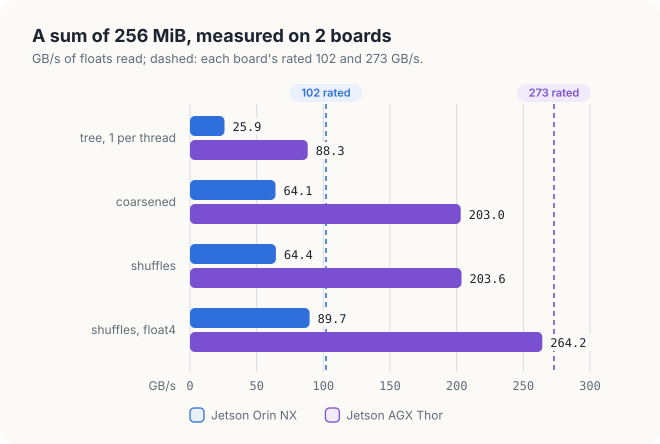
<figcaption><b>Figure 8.6</b> The 4 stages of the sum on 2 boards, against each board's rated bandwidth.</figcaption>
</figure>

### 8.6.2 The same answer every time

The 5 runs of the shuffle sum printed the same 33,557,632.0, and the Rust kernel printed it as
well. The float sum by `atomicAdd` of Chapter 5 gave a different answer on each run, because the
threads added in whatever order they arrived. In a tree, the code fixes the order. Thread \\(i\\)
always adds the same elements in the same order, and each warp always shuffles the same pairs. The
second launch always adds the 1,024 partial sums the same way. Same order, same roundings, same
bits.

The order depends on the shape of the launch, though. The tree with 1 element per thread and the
`float4` version group the values differently from the coarsened ones, and both printed
33,557,628.0, 1 float step below. A program that must reproduce its results across machines
fixes its block size and grid size, not only its algorithm.

<details class="check">
<summary>A sum runs with 512 blocks instead of 1,024. Will its answer match the 1,024-block answer bit for bit?</summary>

Not necessarily. With 512 blocks, thread \\(i\\) reads elements \\(i\\), \\(i + 131{,}072\\), …,
a different set from the 1,024-block grid, so the partial sums round differently. The answer is
still the same on every run with 512 blocks.

</details>

## 8.7 Scan

### 8.7.1 Running sums

An **inclusive scan** of an array \\(a\\) computes, at every position \\(i\\), the sum of
elements 0 to \\(i\\): \\(y_i = a_0 + a_1 + \cdots + a_i\\). An **exclusive scan** leaves out
element \\(i\\) itself: \\(y_i = a_0 + \cdots + a_{i-1}\\), with \\(y_0 = 0\\). Scans are also
called prefix sums, because \\(y_i\\) is the sum of the prefix of the array that ends at \\(i\\).

| \\(i\\) | 0 | 1 | 2 | 3 | 4 | 5 | 6 | 7 |
|---|---|---|---|---|---|---|---|---|
| \\(a_i\\) | 3 | 1 | 4 | 1 | 5 | 9 | 2 | 6 |
| inclusive | 3 | 4 | 8 | 9 | 14 | 23 | 25 | 31 |
| exclusive | 0 | 3 | 4 | 8 | 9 | 14 | 23 | 25 |

A scan tells each element where it lands when elements are packed together. That makes it the core
of **stream compaction**, which keeps the elements that pass a test and packs them into a shorter
array.

<div class="example" markdown="1">

Worked example: keep the values above 3

1. Values 3, 1, 4, 1, 5, 9, 2, 6. Flags, 1 where a value is above 3: 0, 0, 1, 0, 1, 1, 0, 1.
2. The exclusive scan of the flags is 0, 0, 0, 1, 1, 2, 3, 3.
3. Each kept value goes to the position its scan names: 4 to 0, 5 to 1, 9 to 2, 6 to 3. The
   output is 4, 5, 9, 6, and its length, 4, is the last scan value plus the last flag.

</div>

Every thread computes its own position independently, so all of them can write at once. Radix
sort, the allocation of variable-sized outputs, and sparse matrix formats use scans in the same way.

### 8.7.2 A scan inside a warp

A scan inside a warp uses the opposite shuffle, `__shfl_up_sync`, in which lane \\(k\\) receives
the value of lane \\(k - d\\). At offset 1, every lane from 1 up adds the value of the lane to its
left. Each lane then holds the sum of 2 values, and at offset 2 it adds the sum of the 2 values
before those; at offset 4, the 4 before those. After offsets 1, 2 and 4, each of 8 lanes holds
the sum of all lanes up to its own (figure 8.7). A warp of 32 needs 5 offsets, 1 to 16.

<figure>
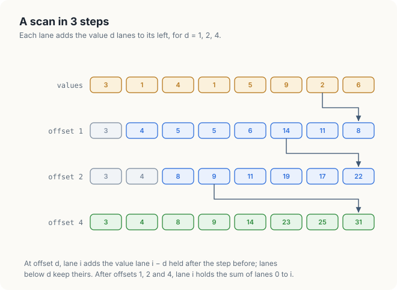
<figcaption><b>Figure 8.7</b> A scan of 8 lanes in 3 steps of shifted additions.</figcaption>
</figure>

Animation 1 moves the values for the 3 offsets.

<figure class="anim">
<video class="motion" src="../../figures/ch08-warp-scan.mp4" autoplay loop muted playsinline preload="metadata" aria-label="Eight lanes hold 3, 1, 4, 1, 5, 9, 2, 6. At offset 1, a copy of each lane's value slides 1 lane to the right and is added, giving 3, 4, 5, 5, 6, 14, 11, 8. At offset 2 the copies slide 2 lanes, giving 3, 4, 8, 9, 11, 19, 17, 22. At offset 4 they slide 4 lanes, giving the running sums 3, 4, 8, 9, 14, 23, 25, 31." data-chapters="[[0.0, &quot;offset 1&quot;], [14.22, &quot;offset 2&quot;], [22.5, &quot;offset 4&quot;]]">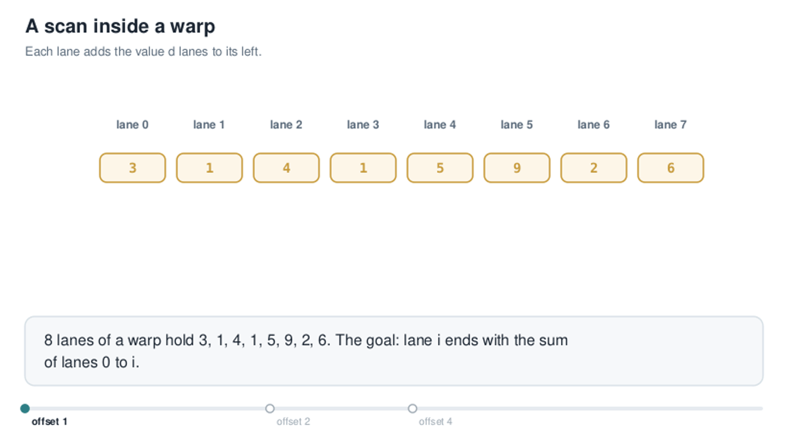</video>
<figcaption><b>Animation 1</b> A warp scan: each lane adds the value 1, 2, then 4 lanes to its left.</figcaption>
</figure>

<p class="listing"><b>Listing 8.7</b> A warp scan, in C++.</p>

```cpp
{{#include ../../../../code/ch08_reduction/reduce.cu:137:148}}
```

The shifted form does more work than a serial scan. At offset \\(d\\), \\(32 - d\\) lanes add, so a
warp performs 31 + 30 + 28 + 24 + 16 = 129 additions where a chain needs 31. Inside a warp the
extra additions cost nothing: the 32 lanes execute every step together whether a lane adds or not,
and 5 steps beat 31. For large scans in shared memory, a work-efficient tree due to Blelloch does
\\(2(n - 1)\\) additions in \\(2 \log_2 n\\) steps instead; Exercise 6 traces it.

### 8.7.3 A scan of a block

`scanBlocks` scans 1,024 values per block of 256 threads, 4 per thread, in 4 phases.

1. Each thread loads its 4 consecutive values with 1 16-byte `uint4` load and scans them in its
   registers.
2. The threads scan their 4-value totals with `warpScan`. Lane 31 of each warp then holds its
   warp's total and writes it to shared memory.
3. After a barrier, warp 0 scans the 8 warp totals.
4. After a second barrier, each thread adds 2 offsets to its 4 values: the totals of the warps
   before its own, and the totals of the lanes before it in its own warp.

<p class="listing"><b>Listing 8.8</b> A scan of 1,024 values per block, in C++.</p>

```cpp
{{#include ../../../../code/ch08_reduction/reduce.cu:150:184}}
```

`v - a.w` is the second offset: `v` is the inclusive warp scan at this lane, and subtracting the
lane's own total `a.w` leaves the sum of the lanes before it. The last thread of the block writes
the block's total to `sums`.

### 8.7.4 A scan of many blocks

Blocks cannot read each other's results during a kernel, so an array larger than 1 block is
scanned in 3 steps (figure 8.8):

1. every block scans its 1,024 values and writes its total;
2. the block totals are scanned, by the same function;
3. every value of block \\(b\\) gets the scanned total of blocks 0 to \\(b - 1\\) added to it.

<figure>
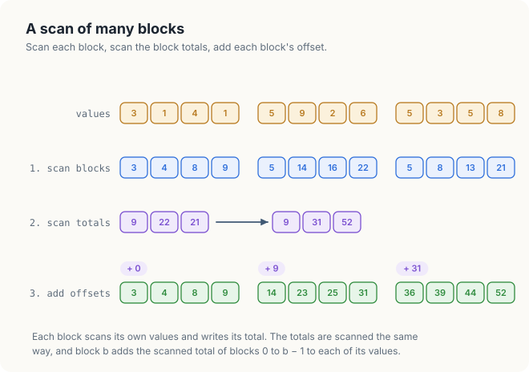
<figcaption><b>Figure 8.8</b> Scan the blocks, scan the block totals, add each block's offset.</figcaption>
</figure>

For 67,108,864 values, step 1 runs 65,536 blocks and writes 65,536 totals. Scanning those totals is
the same problem, 1,024 times smaller: 64 blocks, whose 64 totals fit in 1 block. The C++ `scan`
function calls itself for step 2 until a single block remains. Animation 2 runs the 3 steps on the
12 values of the figure.

<figure class="anim">
<video class="motion" src="../../figures/ch08-scan-levels-anim.mp4" autoplay loop muted playsinline preload="metadata" aria-label="Three blocks of 4 values. Each block scans its values at the same time, giving 3, 4, 8, 9; 5, 14, 16, 22; 5, 8, 13, 21. The 3 block totals 9, 22, 21 fly down to a row of totals, which is scanned to 9, 31, 52. Then copies of +9 fly into the 4 values of block 1 and copies of +31 into block 2, giving the running sums 3 to 52." data-chapters="[[0.0, &quot;scan blocks&quot;], [10.86, &quot;scan totals&quot;], [15.84, &quot;add offsets&quot;]]">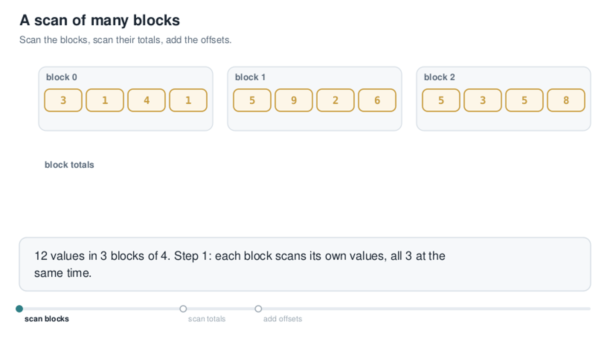</video>
<figcaption><b>Animation 2</b> A scan of 3 blocks: totals up, offsets back down.</figcaption>
</figure>

<p class="listing"><b>Listing 8.9</b> Adding the offsets, and the whole scan, in C++.</p>

```cpp
{{#include ../../../../code/ch08_reduction/reduce.cu:186:209}}
```

The totals of a level are scanned in place, in `scratch`, which holds every level one after
another. Their count is rounded up to a multiple of 4, so that the next level can load them as
`uint4`. The rounding adds unused values after the last real total, and an inclusive scan never
carries a value backwards, so they change none of the sums that are used.

The Rust version loads its 4 values with 4 ordinary loads and writes them through
`get_unchecked_mut`, since thread \\(t\\) writes elements \\(4t\\) to \\(4t + 3\\), not element
\\(t\\). A Rust function cannot borrow 1 buffer as both input and output, so each level has its own
pair of buffers, `totals` and `scanned`, allocated before the timing starts.

<p class="listing"><b>Listing 8.10</b> The scan kernels in Rust.</p>

```rust,ignore
mod kernels {
    // ...
{{#include ../../../../code/oxide/ch08_reduce/src/main.rs:31:41}}

    // ...
{{#include ../../../../code/oxide/ch08_reduce/src/main.rs:76:144}}
    // ...
}
```

<p class="listing"><b>Listing 8.11</b> The scan of many blocks, on the host in Rust.</p>

```rust,ignore
{{#include ../../../../code/oxide/ch08_reduce/src/main.rs:208:238}}
```

### 8.7.5 The scan, measured

The test scans 67,108,864 random values from 0 to 3 and checks every result against a scan on
the CPU. The bandwidth counts the bytes the job needs: the input read once and the output written
once, 2 × 256 MiB.

```console
inclusive scan of 67108864 values                # Orin NX
   13.19 ms    40.7 GB/s  last 100652862  correct: yes
inclusive scan of 67108864 values                # Thor
    5.88 ms    91.4 GB/s  last 100652862  correct: yes
```

```console
$ cargo oxide run                                # Orin NX, then Thor
inclusive scan of 67108864 values
   19.38 ms    27.7 GB/s  last 100652862  correct: yes
inclusive scan of 67108864 values
    5.48 ms    98.0 GB/s  last 100652862  correct: yes
```

Every value matched. The 3 steps move more bytes than the job needs. Step 1 reads the input and
writes the output; step 3 reads the output and writes it again: 4 × 256 MiB in all. The
memory therefore moved about 2 × 40.7 = 81 GB/s on the Orin NX and 2 × 91.4 = 183 GB/s on the
Thor, 80% and 67% of their rated bandwidth. A **single-pass scan** passes each block's total
directly to the next block while the kernel runs, so each value is read once and written once. The
CUB library of Chapter 11 provides one. The Rust scan, with 4 plain loads per thread, ran slower
than the C++ one on the Orin NX and faster on the Thor in this run. Over several runs, the Thor's
Rust scan varied between 96 and 128 GB/s.

<div class="bee bee-cute" markdown="1">

A scan of many blocks is 3 steps: scan the blocks, scan their totals, add the offsets.

</div>

## 8.8 Histogram: the limit was the loads

Chapter 5, section 5.5.2, privatised a histogram of bytes: each block counts into 256 bins in
shared memory and adds them to the global bins once. That made it 6 to 28 times as fast as global
atomics. In this chapter's terms, its speed was still low. Listing 5.7, run here as
`histBytes`, read 64 MiB at 13.7 GB/s on the Orin NX, 13% of the memory's rated speed.

The bytes that are all 7 give the clue. Every atomic of a warp then targets the same bin, the
worst contention possible, yet they were counted no slower than random bytes: 16.8 GB/s against
13.7. Contention was not the limit. Each byte cost 1 load instruction, and a warp's 1-byte loads
fetch only 32 bytes, 1 sector, per instruction. The loads were the limit.

`histWords` reads 16 bytes per thread with 1 `uint4` load, 512 bytes per warp. It takes the 4
bytes out of each 32-bit word by shifting and masking: `(w >> 8 * k) & 255` is byte \\(k\\) of
word `w`.

<p class="listing"><b>Listing 8.12</b> A histogram reading 16 bytes per load, in C++.</p>

```cpp
{{#include ../../../../code/ch08_reduction/reduce.cu:226:249}}
```

```console
histogram of 64 MiB, average of 20 runs          # Orin NX
  random bytes  1 byte per load     4.92 ms    13.7 GB/s
  random bytes  16 bytes per load   0.81 ms    82.9 GB/s  total 67108864
  all 7         1 byte per load     3.99 ms    16.8 GB/s
  all 7         16 bytes per load   0.72 ms    93.4 GB/s  total 67108864
```

```console
histogram of 64 MiB, average of 20 runs          # Thor
  random bytes  1 byte per load     1.35 ms    49.7 GB/s
  random bytes  16 bytes per load   0.35 ms   190.9 GB/s  total 67108864
  all 7         1 byte per load     1.24 ms    54.1 GB/s
  all 7         16 bytes per load   0.32 ms   210.6 GB/s  total 67108864
```

Fed by 16-byte loads, the same atomics ran 6.1 times as fast on the Orin NX for random bytes and
3.8 times on the Thor. That is 81% and 70% of rated bandwidth (figure 8.9). Every total is 67,108,864,
1 count per byte. A version with 1 set of 256 bins per warp, meant to reduce contention further,
was also measured; it ran no faster on either board, so the listing leaves it out.

<figure>
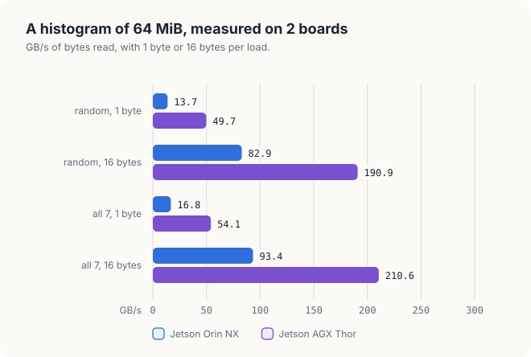
<figcaption><b>Figure 8.9</b> The histogram with 1 and 16 bytes per load, on 2 boards.</figcaption>
</figure>

The Rust version reads 4-byte `u32` words, 4 bytes per load:

<p class="listing"><b>Listing 8.13</b> A histogram reading 4 bytes per load, in Rust.</p>

```rust,ignore
mod kernels {
    // ...
{{#include ../../../../code/oxide/ch08_reduce/src/main.rs:146:176}}
}
```

```console
$ cargo oxide run                                # Orin NX, then Thor
histogram of 64 MiB, 4 bytes per load
    1.27 ms    52.8 GB/s  total 67108864
histogram of 64 MiB, 4 bytes per load
    0.38 ms   176.4 GB/s  total 67108864
```

4 bytes per load already gave 3.9 and 3.5 times the speed of 1 byte per load; 16 bytes added the
rest.

<div class="bee bee-angry" markdown="1">

Measure before fixing. The histogram's limit was its loads, not the contention it was built to
avoid.

</div>

## 8.9 Choosing a pattern

| Pattern | Computes | Combining step | Shared state | Measured, best stage |
|---|---|---|---|---|
| Reduction | 1 value from \\(n\\) | tree: registers, shuffles, 1 barrier per block, 2 launches | none | 88% and 97% of rated |
| Scan | \\(n\\) running sums | warp scan by shuffles, block scan, 3 steps across blocks | none | 80% and 67% of rated, counting the bytes moved |
| Histogram | counts per bin | atomics on private bins in shared memory, 1 fold per block | 256 bins | 81% and 70% of rated |

The 3 share 1 method. Each does as much as possible in registers and combines inside a warp by
shuffles, then inside a block through shared memory. It crosses blocks only once, through global
memory or a second launch. Each stage was kept only when the measurement showed it removed a cost.

## 8.10 The complete programs

<p class="listing"><b>Listing 8.14</b> The complete <code>reduce.cu</code>. <a href="https://github.com/arpanpathak/gpu-parallel-book/blob/main/code/ch08_reduction/reduce.cu">code/ch08_reduction/reduce.cu</a></p>

```cpp
{{#include ../../../../code/ch08_reduction/reduce.cu}}
```

<p class="listing"><b>Listing 8.15</b> The complete Rust program. <a href="https://github.com/arpanpathak/gpu-parallel-book/blob/main/code/oxide/ch08_reduce/src/main.rs">code/oxide/ch08_reduce/src/main.rs</a></p>

```rust,ignore
{{#include ../../../../code/oxide/ch08_reduce/src/main.rs}}
```

## Common mistakes

- **A block size that is not a power of 2 in a halving tree.** The levels stop splitting evenly
  and values are skipped.
- **A shuffle that only some lanes execute.** Every lane named in the mask must call
  `__shfl_down_sync`; calling it inside `if (lane < 8)` is undefined.
- **Reading a lane's partial result other than lane 0's** after a shuffle sum. Only lane 0 holds
  the total.
- **A missing barrier between writing warp totals and reading them.** Chapter 5 measured the
  result.
- **Summing many floats 1 by 1 into a float.** Above 2<sup>24</sup> small values vanish.
- **Comparing results across launch shapes bit for bit.** A different grid groups the additions
  differently.
- **Timing a scan with allocations inside the timed loop.** Allocate every level first.

<div class="summary" markdown="1">

## Summary

- A reduction combines \\(n\\) values with an associative operator. A tree does the same
  \\(n - 1\\) operations as a chain in \\(\log_2 n\\) steps.
- A float sum added 1 by 1 stopped at 2<sup>24</sup> = 16,777,216 for values below 1. The tree on
  the GPU gave the nearest float to the exact sum.
- A tree with 1 element per thread reached a quarter to a third of rated bandwidth. Coarsening,
  256 elements per thread, made it 2.3 to 2.5 times as fast.
- Warp shuffles combine a warp's registers without shared memory or barriers; after coarsening
  they changed little, because the tree had become a small cost.
- With `float4` loads the sum reached 88% of rated bandwidth on the Orin NX and 97% on the Thor,
  with the same bits on every run.
- A scan inside a warp takes 5 shuffle steps; a scan of many blocks scans the blocks, their
  totals, and adds offsets, and moves the output twice.
- The privatised histogram of Chapter 5 was limited by 1-byte loads; 16-byte loads made it 3.8 to
  6.1 times as fast.

</div>

Chapter 9 applies the same discipline to matrix multiplication, a kernel that reuses every value it
loads many times and can therefore escape the memory limit.

## Exercises

1. A tree sums 512 values per block, 1 per thread. How many levels and how many barriers does it
   need? How many does the shuffle version of section 8.5 need?
2. In `blockSum`, why does lane 0 of each warp write `warps[warp]`, and not every lane? What
   would go wrong if every lane wrote its own `v`?
3. Compute the largest count of floats with values in [0, 1) that can be summed 1 by 1 into a
   float before the sum stops growing, and check it with a small CPU program.
4. Change `GRID` to 256 and to 4,096 and run `reduce`. Explain the change in speed, and check
   whether the sum's bits change.
5. Write `warpMax` with `__shfl_down_sync` and use it to find the largest value of the array.
   Does the result depend on the launch shape, as the float sum does?
6. Trace the Blelloch scan on 3, 1, 4, 1: an up-sweep that stores the partial sums of a tree,
   then a down-sweep that hands each left child its parent's prefix and each right child the
   parent's prefix plus the left child's sum. Check that it yields the exclusive scan 0, 3, 4, 8.
7. Use `scan` to write stream compaction: keep the values above 1 from 67,108,864 values from 0
   to 3, and verify the output length against a count on the CPU.
8. Rewrite the Rust `hist_words` to read 16 bytes per thread, as 4 consecutive `u32` words, and
   compare its speed with listing 8.13 on your GPU.

## Sources and further reading

- M. Harris, "Optimizing Parallel Reduction in CUDA", NVIDIA, 2007.
- J. Luitjens, "Faster Parallel Reductions on Kepler", NVIDIA Technical Blog, 2014.
- G. Blelloch, "Prefix Sums and Their Applications", Carnegie Mellon University, 1990.
- D. Merrill and M. Garland, "Single-pass Parallel Prefix Scan with Decoupled Look-back",
  NVIDIA, 2016.
- N. Higham, "The Accuracy of Floating Point Summation", *SIAM Journal on Scientific Computing*,
  1993.
- NVIDIA, *CUDA C++ Programming Guide*, "Warp Shuffle Functions":
  <https://docs.nvidia.com/cuda/cuda-c-programming-guide/>
- D. Kirk and W. Hwu, *Programming Massively Parallel Processors*, 4th ed., Morgan Kaufmann, 2022,
  chapters on reduction, prefix sum and histogram.
