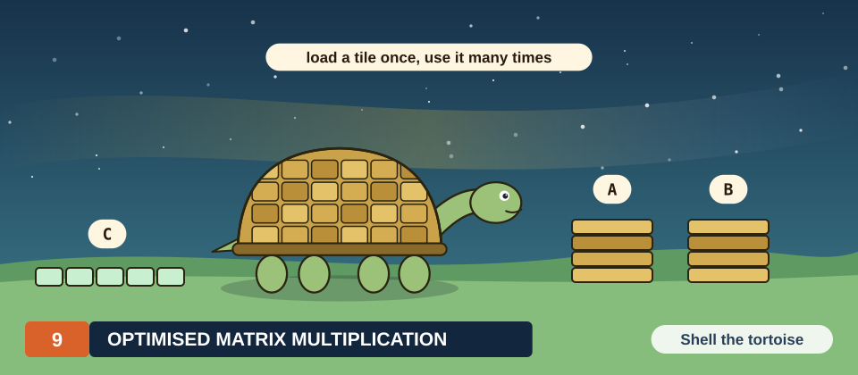
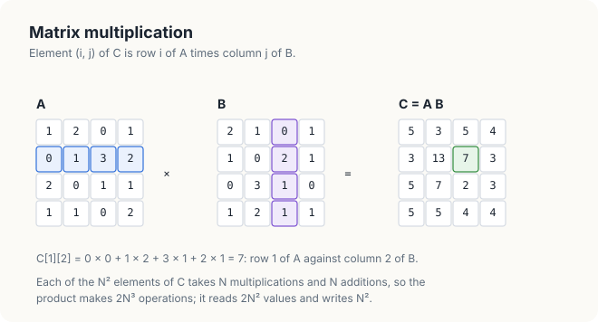
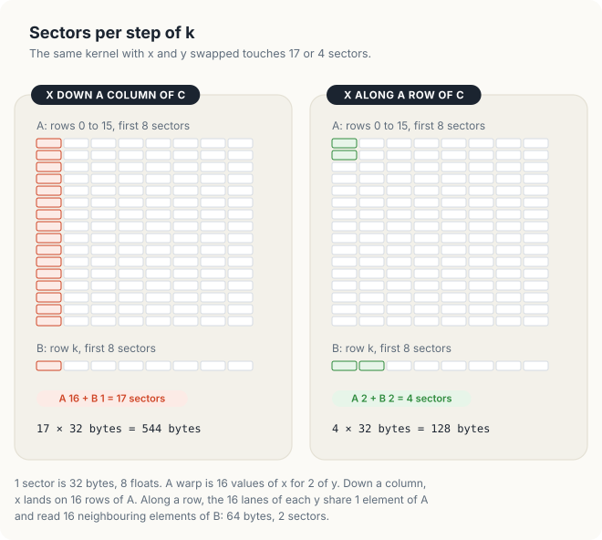
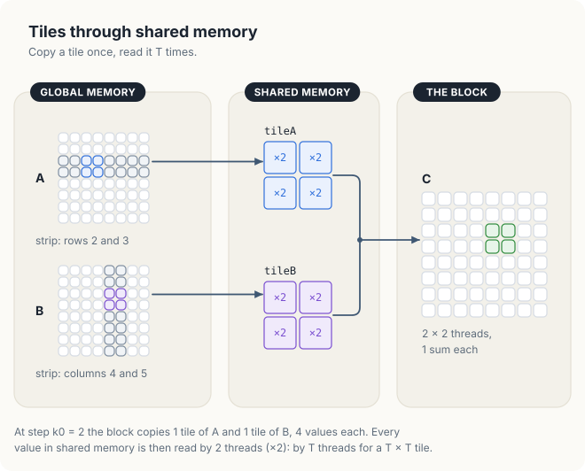
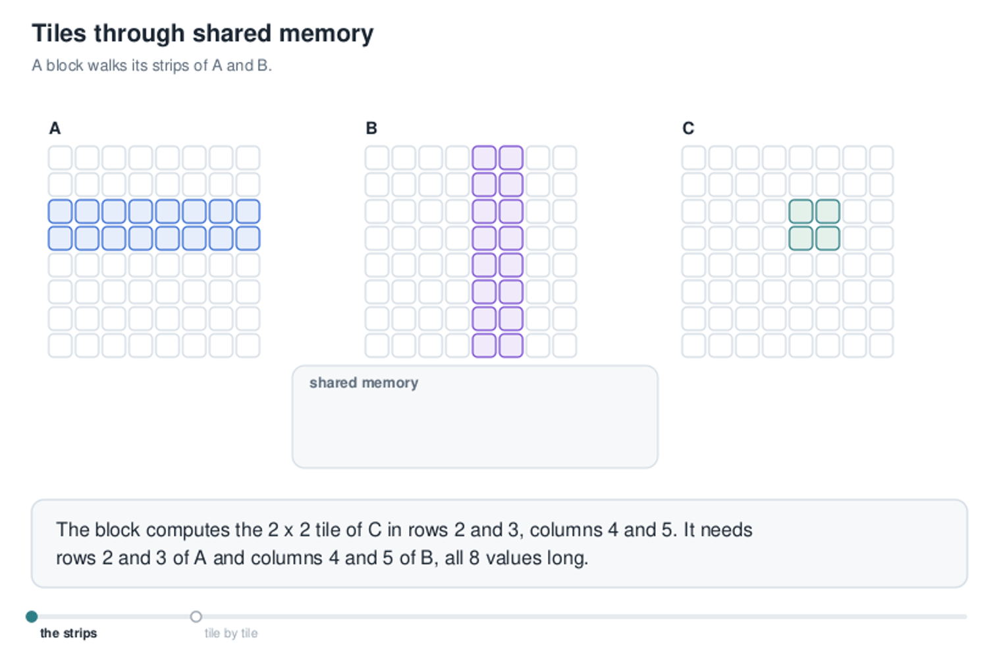
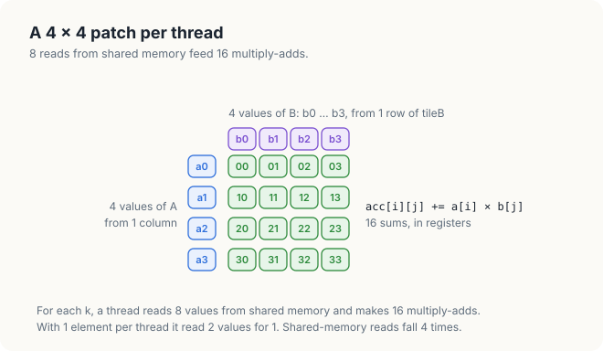
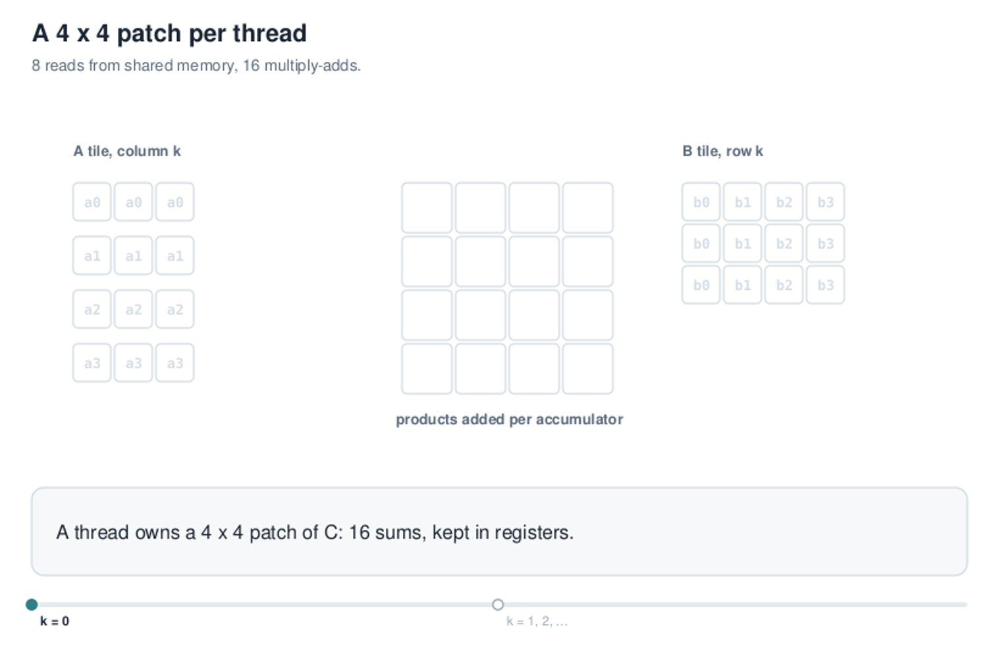
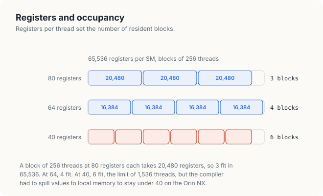
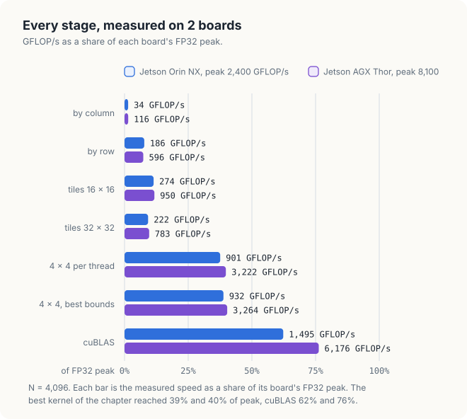

# Chapter 9: Optimised Matrix Multiplication

The kernels of Chapters 7 and 8 read each value once and did 1 or 2 operations with it, so the
memory set their speed. Matrix multiplication is different. Each value of its input is needed
thousands of times, so in principle it can keep the arithmetic units busy and run at the GPU's
peak rate. Whether it does depends on where those thousands of uses read the value from: global
memory, shared memory, or registers.

This chapter builds a matrix multiplication in 4 measured stages, each moving the reuse one level
closer to the arithmetic units. The fastest stage reaches 40% of the FP32 peak on both boards, and
the chapter ends by measuring the distance to cuBLAS, NVIDIA's library implementation. Every
kernel is shown in CUDA C++ and in Rust.

<div class="covers" markdown="1">

This chapter covers

- the work and the memory traffic of a matrix product, and why it can be compute-bound
- 1 thread per element, and why the choice of row or column changes the speed 5 times
- tiles in shared memory, and the arithmetic intensity they buy
- register tiles: 4 × 4 elements per thread
- registers, occupancy and `__launch_bounds__`, measured
- the same kernels in Rust, and why loop unrolling decides their speed
- the distance to cuBLAS

</div>

The code of the chapter is in
[`code/ch09_sgemm/`](https://github.com/arpanpathak/gpu-parallel-book/tree/main/code/ch09_sgemm)
for C++ and in
[`code/oxide/ch09_sgemm/`](https://github.com/arpanpathak/gpu-parallel-book/tree/main/code/oxide/ch09_sgemm)
for Rust.

## 9.1 Matrix multiplication is compute-bound

### 9.1.1 The product

For 2 matrices \\(A\\) and \\(B\\) of \\(N \times N\\) elements, the product \\(C = AB\\) has
elements

\\[ C_{ij} = \sum_{k=0}^{N-1} A_{ik} B_{kj} \\]

Element \\((i, j)\\) of \\(C\\) is the dot product of row \\(i\\) of \\(A\\) with column \\(j\\)
of \\(B\\) (figure 9.1). In single precision the operation is called **SGEMM**, single-precision
general matrix multiply, after the routine of the BLAS library that computes it. All matrices in
this chapter are stored row by row: element \\((i, j)\\) of an \\(N \times N\\) matrix is at index
\\(iN + j\\).

<figure>

<figcaption><b>Figure 9.1</b> C[1][2] is row 1 of A times column 2 of B.</figcaption>
</figure>

### 9.1.2 Work and traffic

<div class="example" markdown="1">

Worked example: \\(N\\) = 4,096

1. Each of the \\(N^2\\) elements of \\(C\\) takes \\(N\\) multiplications and \\(N\\) additions:
   \\(2N^3\\) = 2 × 4,096<sup>3</sup> = 137.4 × 10<sup>9</sup> floating-point operations, 137.4
   GFLOP.
2. The product must read \\(A\\) and \\(B\\) and write \\(C\\) at least once: \\(3N^2\\) floats of
   4 bytes, \\(12N^2\\) = 201 MB.
3. The arithmetic intensity is therefore at most
   \\(2N^3 / 12N^2 = N/6\\) = 683 FLOP per byte.

</div>

683 FLOP per byte is far above every ridge point of Chapter 2, which lie between 10 and 114. If
each value were read from memory once, the memory would deliver the 201 MB in 2 ms on a Jetson
Orin NX, while the arithmetic would take 57 ms. The product is **compute-bound**: its limit is the
arithmetic rate.

| Symbol | Meaning | For \\(N\\) = 4,096 |
|---|---|---|
| \\(2N^3\\) | operations | 137.4 GFLOP |
| \\(12N^2\\) | least possible traffic, bytes | 201 MB |
| \\(N/6\\) | highest possible intensity | 683 FLOP per byte |

The words "at least once" carry the whole problem. Each element of \\(A\\) is used by \\(N\\) = 4,096 elements of \\(C\\).
A kernel that reads it from memory once per use moves \\(2N^3\\) floats instead of \\(2N^2\\), and
its intensity falls to 2 FLOP per 8 bytes, 0.25 FLOP per byte. The whole chapter is about closing
the distance between those 2 intensities.

### 9.1.3 The speed limit

| GPU | FP32 peak | 137.4 GFLOP at peak |
|---|---|---|
| Jetson Orin NX 16 GB | 2.4 TFLOP/s | 57 ms |
| Jetson AGX Thor | 8.1 TFLOP/s | 17 ms |
| DGX Spark (GB10) | ~31 TFLOP/s | 4.4 ms |
| GeForce RTX 4090 | 82.6 TFLOP/s | 1.7 ms |
| GeForce RTX 5090 | 104.8 TFLOP/s | 1.3 ms |
| A100 SXM 80 GB | 19.5 TFLOP/s | 7.0 ms |
| H100 SXM | 67 TFLOP/s | 2.1 ms |

The peaks are NVIDIA's figures from Chapter 2, for the ordinary FP32 units. Each kernel of the
chapter is judged by its rate in GFLOP/s, \\(2N^3\\) divided by its time, against that peak.

## 9.2 1 thread per element

The direct kernel gives each element of \\(C\\) its own thread, which loops over \\(k\\). Blocks of
16 × 16 threads cover 16 × 16 elements. Listing 9.1 makes `threadIdx.x` select the row of \\(C\\),
the order in which a mathematician writes the indices.

<p class="listing"><b>Listing 9.1</b> 1 thread per element, <code>threadIdx.x</code> along a column of C, in C++. <a href="https://github.com/arpanpathak/gpu-parallel-book/blob/main/code/ch09_sgemm/sgemm.cu">code/ch09_sgemm/sgemm.cu</a></p>

```cpp
{{#include ../../../../code/ch09_sgemm/sgemm.cu:44:55}}
```

```console
C = A B, 4096 x 4096 floats                       # on a Jetson Orin NX
  1 per thread, by column     4093.30 ms     33.6 GFLOP/s  max error 3.4e-05
```

33.6 GFLOP/s is 1.4% of the Orin NX's peak; the Thor reached 117.7 GFLOP/s, also 1.5% of its
peak. Each thread reads \\(2N\\) floats, so the kernel requests \\(2N^3\\) floats, 550 GB, in all.
Fetched from memory at 102 GB/s they would take 5.4 s; the kernel took 4.1 s, so the caches caught
only a little of the reuse. The `max error` column compares 64 elements of \\(C\\) with a product
computed on the CPU in double precision. 3.4 × 10<sup>−5</sup> is the rounding of 4,096 float
additions, and every kernel of the chapter shows it.

## 9.3 Make the block shape match memory

A warp is 32 threads with consecutive `threadIdx.x`; with blocks of 16 × 16, it is 16 values of
`threadIdx.x` for 2 values of `threadIdx.y`. In listing 9.1, `threadIdx.x` picks the row, so a
warp's 16 lanes read `A[row * n + k]` in 16 different rows of \\(A\\): 16 sectors for 16 floats
(Chapter 7). Swapping the roles of x and y puts the 16 lanes on 1 row of \\(C\\). They then read
the same element of \\(A\\), which the hardware delivers once to all of them, a **broadcast**, and
16 neighbouring elements of \\(B\\), coalesced (figure 9.2).

<figure>

<figcaption><b>Figure 9.2</b> The elements of A that 1 warp reads, for each choice of x.</figcaption>
</figure>

<p class="listing"><b>Listing 9.2</b> 1 thread per element, <code>threadIdx.x</code> along a row of C, in C++.</p>

```cpp
{{#include ../../../../code/ch09_sgemm/sgemm.cu:57:68}}
```

```console
  1 per thread, by row         765.28 ms    179.6 GFLOP/s  max error 3.4e-05     # Orin NX
  1 per thread, by row         231.37 ms    594.0 GFLOP/s  max error 3.4e-05     # Thor
```

The same arithmetic ran 5.3 times as fast on the Orin NX and 5.0 times on the Thor. The kernel
still requests 550 GB, but now in a pattern the caches serve well. 550 GB in 0.77 s is 719 GB/s,
7 times the Orin NX's memory bandwidth, so most requests never reached memory. The reuse is
happening, but in hardware caches whose contents the program does not control.

<div class="bee bee-happy" markdown="1">

In a 2-D kernel, `threadIdx.x` belongs on the index that moves along a row in memory.

</div>

## 9.4 Shared-memory tiling

### 9.4.1 Tiles

A block of \\(T \times T\\) threads computes a \\(T \times T\\) **tile** of \\(C\\). The tile needs a
strip of \\(T\\) full rows of \\(A\\) and a strip of \\(T\\) full columns of \\(B\\). The block
walks the 2 strips in steps of \\(T\\). At step \\(k_0\\), it copies 1 \\(T \times T\\) tile of
each into shared memory and waits at a barrier. Every thread then adds the \\(T\\) products of its
row of the A tile and its column of the B tile (figure 9.3).

<figure>

<figcaption><b>Figure 9.3</b> A block copies its strips of A and B into shared memory 1 tile at a time.</figcaption>
</figure>

Each value copied into shared memory is then read by \\(T\\) threads. An element of the A tile is
read by the \\(T\\) threads of its row, an element of the B tile by the \\(T\\) threads of its
column. Global
reads fall \\(T\\) times. Animation 1 walks a 2 × 2 tile through its strips.

<figure class="anim">
<video class="motion" src="../../figures/ch09-tiles-anim.mp4" autoplay loop muted playsinline preload="metadata" aria-label="Matrices A, B and C as 8 by 8 grids. A block's 2 by 2 tile of C needs rows 2 and 3 of A and columns 4 and 5 of B. In 4 steps, a 2 by 2 tile of each strip flies into a box labelled shared memory, and the counters in the C tile rise from 1 to 4." data-chapters="[[0.0, &quot;the strips&quot;], [9.3, &quot;tile by tile&quot;]]"></video>
<figcaption><b>Animation 1</b> A block walks its strips of A and B, 1 pair of tiles per step.</figcaption>
</figure>

<p class="listing"><b>Listing 9.3</b> The tiled kernel, in C++.</p>

```cpp
{{#include ../../../../code/ch09_sgemm/sgemm.cu:70:91}}
```

The first barrier keeps any thread from reading a tile before all of it is written; the second
keeps any thread from overwriting a tile, at the next step, while another still reads it. Both
loads are coalesced: neighbouring `threadIdx.x` read neighbouring elements of a row of \\(A\\) and
of a row of \\(B\\). In the inner loop, the 16 lanes of a warp row read the same `tileA` element,
a broadcast, and 16 consecutive `tileB` elements, in 16 different banks, so there are no bank
conflicts.

### 9.4.2 The intensity of a tile

<div class="example" markdown="1">

Worked example: 1 step of a 16 × 16 tile

1. The block reads 2 tiles of 16 × 16 floats from global memory: 512 floats, 2,048 bytes.
2. Its 256 threads each make 16 multiply-adds: 256 × 16 × 2 = 8,192 FLOP.
3. Intensity: 8,192 / 2,048 = 4 FLOP per byte, \\(T/4\\) in general.

</div>

At 4 FLOP per byte, the Orin NX's 102 GB/s can feed at most 4 × 102 = 408 GFLOP/s, and the
Thor's 273 GB/s 1,092 GFLOP/s. The tiled kernel is still memory-bound.

```console
  tiles of 16 x 16             495.00 ms    277.7 GFLOP/s  max error 3.4e-05     # Orin NX
  tiles of 16 x 16             145.39 ms    945.3 GFLOP/s  max error 3.4e-05     # Thor
```

The tiles brought the Orin NX to 68% of that memory limit and the Thor to 87%. Larger tiles raise
the intensity, \\(T/4\\), but section 9.6 measures why 32 × 32 tiles were slower, not faster.

## 9.5 Register tiling

### 9.5.1 More elements per thread

In the tiled kernel each multiply-add reads 2 floats from shared memory, 1 from each tile.
Shared memory is fast but not free. An SM's shared memory delivers 128 bytes per cycle, 32 banks
of 4 bytes, while its 128 FP32 units can perform 256 FLOP per cycle. A kernel that reads 8 bytes
for every 2 FLOPs would need 1,024 bytes per cycle to keep the units busy, 8 times what shared
memory delivers.

**Register tiling** gives each thread a small patch of \\(C\\) instead of 1 element. A thread that
owns a 4 × 4 patch keeps its 16 sums in registers. For each \\(k\\), it reads 4 values of \\(A\\),
from its 4 rows, and 4 values of \\(B\\), from its 4 columns, and multiplies every pair: 16
multiply-adds from 8 reads (figure 9.4). The 8 values form what linear algebra calls an outer
product.

<figure>

<figcaption><b>Figure 9.4</b> 4 values of A and 4 of B give 16 products, in registers.</figcaption>
</figure>

Animation 2 runs 3 values of \\(k\\).

<figure class="anim">
<video class="motion" src="../../figures/ch09-outer-anim.mp4" autoplay loop muted playsinline preload="metadata" aria-label="A thread's 4 by 4 grid of accumulators between a column of the A tile, a0 to a3, and a row of the B tile, b0 to b3. For k = 0, 1 and 2, the 4 a values and 4 b values fly into place beside the grid, and every accumulator's count of added products rises by 1." data-chapters="[[0.0, &quot;k = 0&quot;], [18.66, &quot;k = 1, 2, …&quot;]]"></video>
<figcaption><b>Animation 2</b> A 4 × 4 patch: 8 reads and 16 multiply-adds for each k.</figcaption>
</figure>

### 9.5.2 The kernel

A block of 256 threads, 16 × 16, now computes a 64 × 64 tile of \\(C\\). At each step it copies
a 64 × 16 tile of \\(A\\) and a 16 × 64 tile of \\(B\\), 1,024 floats each, so each thread copies
4 of each. Thread \\((t_x, t_y)\\) owns rows \\(4t_y\\) to \\(4t_y + 3\\) and columns \\(4t_x\\) to
\\(4t_x + 3\\) of the block's tile.

<p class="listing"><b>Listing 9.4</b> The register-tiled kernel, in C++.</p>

```cpp
{{#include ../../../../code/ch09_sgemm/sgemm.cu:93:133}}
```

The A tile has 1 column of padding. A warp's lanes with the same `ty` read the same `tileA`
element, a broadcast. The 2 values of `ty` in a warp read rows 4 apart, which without padding are
4 × 16 = 64 words apart, in the same bank. With 17 columns they are 68 words apart, 4 banks apart
(Chapter 7, section 7.5). `MIN_BLOCKS` is the subject of section 9.6; set to 1, it changes
nothing.

<div class="example" markdown="1">

Worked example: 1 step of the 64 × 64 tile

1. Global reads: 64 × 16 + 16 × 64 = 2,048 floats, 8,192 bytes.
2. Arithmetic: 64 × 64 elements × 16 values of \\(k\\) × 2 = 131,072 FLOP.
3. Intensity from global memory: 131,072 / 8,192 = 16 FLOP per byte, 4 times the 16 × 16 tile.
4. Shared-memory reads per multiply-add: 8 / 16 = 0.5, against 2 in the tiled kernel.

</div>

```console
  4 x 4 per thread             147.19 ms    933.8 GFLOP/s  max error 3.4e-05     # Orin NX
  4 x 4 per thread              42.19 ms   3257.7 GFLOP/s  max error 3.4e-05     # Thor
```

Register tiling made the product 3.4 times as fast on both boards: 933.8 GFLOP/s on the Orin NX,
39% of its peak, and 3,257.7 on the Thor, 40%. At 16 FLOP per byte, memory could now feed 1,632
and 4,368 GFLOP/s, so memory is no longer the first limit.

<div class="bee bee-happy" markdown="1">

Each level of reuse moves a value closer to the arithmetic: global memory to shared memory to
registers. A 4 × 4 patch reads shared memory 4 times less than 1 element per thread.

</div>

## 9.6 Occupancy and launch bounds

### 9.6.1 Registers decide how many blocks fit

The 16 sums, 8 operands and indices of the register-tiled kernel live in registers. **Occupancy**,
from Chapter 2, is the number of warps resident on an SM compared with the most it can hold. Each
SM of both boards has 65,536 registers and holds at most 1,536 threads. The program asks the
CUDA runtime how many registers the compiler gave each kernel, with `cudaFuncGetAttributes`, and
how many blocks fit on an SM, with `cudaOccupancyMaxActiveBlocksPerMultiprocessor`.

<p class="listing"><b>Listing 9.5</b> Asking for registers and occupancy, in C++.</p>

```cpp
{{#include ../../../../code/ch09_sgemm/sgemm.cu:135:145}}
```

```console
resources                                         # Orin NX
  tiles of 16 x 16            40 registers   6 blocks per SM   0 bytes spilled
  tiles of 32 x 32            36 registers   1 blocks per SM   0 bytes spilled
  4 x 4 per thread            80 registers   3 blocks per SM   0 bytes spilled
  4 x 4, at least 4 blocks    64 registers   4 blocks per SM   0 bytes spilled
  4 x 4, at least 6 blocks    40 registers   6 blocks per SM  24 bytes spilled
```

At 80 registers per thread, a block of 256 threads needs 80 × 256 = 20,480 registers, and 65,536
/ 20,480 = 3.2, so 3 blocks fit, 24 warps (figure 9.5). The tiled kernel at 40 registers fits 6
blocks, 1,536 threads, the thread limit. The 32 × 32 tile is a block of 1,024 threads, so only 1
fits: at each of its barriers, every thread on the SM waits, and nothing else is ready to run.
The 32 × 32 tile therefore ran at 219.0 GFLOP/s against 277.7 for the 16 × 16 tile, despite twice the
intensity.

<figure>

<figcaption><b>Figure 9.5</b> Registers per thread set how many blocks of 256 threads fit on an SM.</figcaption>
</figure>

### 9.6.2 `__launch_bounds__`

`__launch_bounds__(maxThreads, minBlocks)` tells the compiler that the kernel runs with at most
`maxThreads` threads per block and should fit at least `minBlocks` blocks per SM. The compiler
then limits the registers per thread to make that possible. When the kernel needs more, the
compiler **spills**: it keeps some values in local memory, a per-thread area of global memory
served through the caches, and loads them back when needed.

```console
  4 x 4 per thread             147.19 ms    933.8 GFLOP/s                       # Orin NX
  4 x 4, at least 4 blocks     144.04 ms    954.2 GFLOP/s
  4 x 4, at least 6 blocks     150.51 ms    913.1 GFLOP/s
  4 x 4 per thread              42.19 ms   3257.7 GFLOP/s                       # Thor
  4 x 4, at least 4 blocks      42.00 ms   3272.5 GFLOP/s
  4 x 4, at least 6 blocks      43.50 ms   3159.3 GFLOP/s
```

On the Orin NX, asking for 4 blocks cut the registers to 64 and gained 2%. Asking for 6 cut them
to 40, spilled 24 bytes per thread, and lost 2%. On the Thor the compiler used 48 registers from
the start, 5 blocks per SM; 6 blocks fitted without a spill and still ran 3% slower. More resident
warps help only while the kernel is waiting for something they can hide. A register-tiled kernel
has 16 independent multiply-adds in each thread, enough work to keep the units busy from fewer
warps.

<div class="bee bee-shocked" markdown="1">

Occupancy is a means, not a goal. Forcing it with `__launch_bounds__` can cost more in spills
than it gains; measure each setting.

</div>

## 9.7 The kernels in Rust

The Rust kernels follow the C++ ones. A 2-D launch contract with blocks of 16 × 16 and an output
`DisjointSlice<f32, Index2D<N>>` lets the first 2 kernels write their element of \\(C\\) through
`thread::index_2d`, with no `unsafe`. The register-tiled kernel writes 16 elements per thread, so
it writes through `get_unchecked_mut`, with the argument that the patches cover \\(C\\) once.

<p class="listing"><b>Listing 9.6</b> The 3 kernels in Rust. <a href="https://github.com/arpanpathak/gpu-parallel-book/blob/main/code/oxide/ch09_sgemm/src/main.rs">code/oxide/ch09_sgemm/src/main.rs</a></p>

```rust,ignore
mod kernels {
    // ...
{{#include ../../../../code/oxide/ch09_sgemm/src/main.rs:20:142}}
}
```

The loops are `while` loops marked `#[unroll]`, a cuda-oxide attribute that asks the compiler to
copy the loop body once per trip. The first version of the crate used `for` loops over ranges and
ran far slower. Unrolled, a loop over `i` from 0 to 4 becomes 4 copies of its body with `i` a
constant in each. `av[i]` and `acc[i][j]` then become fixed registers, and the bounds check of
every index into a constant-sized array disappears. A loop that is not unrolled must keep `acc`
in memory, because a register cannot be chosen by a run-time index.

| Rust kernel on the Orin NX, GFLOP/s | `for` loops | `for` loops, `#[kernel(unchecked_indexing)]` | `while` loops, `#[unroll]` |
|---|---|---|---|
| 1 per thread | 62.4 | 71.3 | 192.7 |
| tiles of 16 × 16 | 201.8 | 275.1 | 274.7 |
| 4 × 4 per thread | 575.6 | 595.4 | 845.7 |

`#[kernel(unchecked_indexing)]` removes every bounds check of a kernel and makes an index out of
range undefined behaviour, the same as C++. It helped the tiled kernel, whose cost was the checks,
but not the register tile, whose cost was its arrays. The listing keeps the checks and unrolls.

```console
$ cargo oxide run                                 # on a Jetson Orin NX
C = A B, 4096 x 4096 floats
  1 per thread           713.22 ms    192.7 GFLOP/s  max error 3.4e-5
  tiles of 16 x 16       500.29 ms    274.7 GFLOP/s  max error 3.4e-5
  4 x 4 per thread       162.51 ms    845.7 GFLOP/s  max error 3.4e-5
```

```console
$ cargo oxide run                                 # on a Jetson AGX Thor
C = A B, 4096 x 4096 floats
  1 per thread           213.02 ms    645.2 GFLOP/s  max error 3.4e-5
  tiles of 16 x 16       147.85 ms    929.6 GFLOP/s  max error 3.4e-5
  4 x 4 per thread        47.35 ms   2902.6 GFLOP/s  max error 3.4e-5
```

The Rust kernels matched the C++ ones for 1 element per thread and for tiles, and reached 91% and
89% of the C++ register tile on the 2 boards.

<details class="check">
<summary>Why can an unrolled loop keep acc[i][j] in registers, and a loop that is not unrolled cannot?</summary>

Registers have fixed names chosen when the program is compiled; there is no instruction that
selects a register by a value computed at run time. Unrolled, every `acc[i][j]` has constant
`i` and `j`, so each names 1 register. In a loop, `i` changes at run time, so `acc` must live in
memory that can be indexed: local memory.

</details>

## 9.8 What the optimised kernel achieves

The program also times cuBLAS's `cublasSgemm` on the same matrices. cuBLAS stores matrices column
by column, so the call asks it for \\(B^T A^T\\), which in row-major storage is \\(AB\\).

```console
$ ./sgemm                                         # on a Jetson Orin NX
GPU: Orin, 8 SMs
C = A B, 4096 x 4096 floats
  1 per thread, by column     4093.30 ms     33.6 GFLOP/s  max error 3.4e-05
  1 per thread, by row         765.28 ms    179.6 GFLOP/s  max error 3.4e-05
  tiles of 16 x 16             495.00 ms    277.7 GFLOP/s  max error 3.4e-05
  tiles of 32 x 32             627.46 ms    219.0 GFLOP/s  max error 3.4e-05
  4 x 4 per thread             147.19 ms    933.8 GFLOP/s  max error 3.4e-05
  4 x 4, at least 4 blocks     144.04 ms    954.2 GFLOP/s  max error 3.4e-05
  4 x 4, at least 6 blocks     150.51 ms    913.1 GFLOP/s  max error 3.4e-05
  cuBLAS                        90.55 ms   1517.9 GFLOP/s  max error 1.9e-05
```

```console
$ ./sgemm                                         # on a Jetson AGX Thor
GPU: NVIDIA Thor, 20 SMs
C = A B, 4096 x 4096 floats
  1 per thread, by column     1167.45 ms    117.7 GFLOP/s  max error 3.4e-05
  1 per thread, by row         231.37 ms    594.0 GFLOP/s  max error 3.4e-05
  tiles of 16 x 16             145.39 ms    945.3 GFLOP/s  max error 3.4e-05
  tiles of 32 x 32             177.63 ms    773.8 GFLOP/s  max error 3.4e-05
  4 x 4 per thread              42.19 ms   3257.7 GFLOP/s  max error 3.4e-05
  4 x 4, at least 4 blocks      42.00 ms   3272.5 GFLOP/s  max error 3.4e-05
  4 x 4, at least 6 blocks      43.50 ms   3159.3 GFLOP/s  max error 3.4e-05
  cuBLAS                        22.27 ms   6172.6 GFLOP/s  max error 3.4e-05
```

From the first kernel to the best, the product became 28 times as fast on both boards. The best
kernel reached 40% of the FP32 peak on both. cuBLAS reached 63% on the Orin NX and 76% on the
Thor, so the chapter's kernel runs at 63% and 53% of cuBLAS's speed (figure 9.6). The 3 runs on
each board agreed within 2%.

<figure>

<figcaption><b>Figure 9.6</b> Every stage on 2 boards, against each board's FP32 peak.</figcaption>
</figure>

The rest of the gap comes from techniques beyond this chapter, which cuBLAS combines and tunes for
each GPU:

- **Larger patches.** 8 × 8 elements per thread read shared memory 8 times less than 1 element
  per thread, against 4 times for 4 × 4, at the cost of more registers.
- **Wide shared-memory loads.** Reading 4 operands with 1 `float4` load, as in Chapter 7.
- **Double buffering.** Copying the next pair of tiles while computing on the current one, so the
  barrier never waits for memory.
- **Warp tiling.** Arranging each warp's patches so that its shared-memory reads fall in as few
  banks and instructions as possible.

**Tensor cores**, units that multiply small matrices in 1 instruction, are faster still. In their
TF32 mode they keep 10 bits of the float's mantissa instead of 23, so cuBLAS uses them for SGEMM
only when the program allows it. Chapter 11 returns to cuBLAS.

## 9.9 The complete programs

<p class="listing"><b>Listing 9.7</b> The complete <code>sgemm.cu</code>. <a href="https://github.com/arpanpathak/gpu-parallel-book/blob/main/code/ch09_sgemm/sgemm.cu">code/ch09_sgemm/sgemm.cu</a></p>

```cpp
{{#include ../../../../code/ch09_sgemm/sgemm.cu}}
```

<p class="listing"><b>Listing 9.8</b> The complete Rust program. <a href="https://github.com/arpanpathak/gpu-parallel-book/blob/main/code/oxide/ch09_sgemm/src/main.rs">code/oxide/ch09_sgemm/src/main.rs</a></p>

```rust,ignore
{{#include ../../../../code/oxide/ch09_sgemm/src/main.rs}}
```

## Common mistakes

- **`threadIdx.x` on the row index of a row-major output.** Neighbouring lanes then read and
  write \\(N\\) floats apart; the kernel ran 5 times slower.
- **A missing second barrier in a tiled loop.** The next step overwrites a tile while other
  threads still read it.
- **Tiles that fill an SM with 1 block.** At every barrier the whole SM waits.
- **Forcing occupancy.** `__launch_bounds__` with a high `minBlocks` can spill registers and slow
  the kernel.
- **Small fixed-size arrays in a loop that is not unrolled.** In C++ the compiler unrolls loops
  with constant bounds by itself; in cuda-oxide, write the loop as `while` with `#[unroll]`.
- **Comparing against peak only.** A library such as cuBLAS shows what the hardware can reach on
  the same problem.

<div class="summary" markdown="1">

## Summary

- A product of \\(N \times N\\) matrices makes \\(2N^3\\) operations on \\(3N^2\\) values, an
  intensity up to \\(N/6\\): compute-bound if each value is read from memory about once.
- 1 thread per element ran at 1.5% of peak. Putting `threadIdx.x` along a row made it 5 times as
  fast, with the caches catching most of the reuse.
- Tiles of \\(T \times T\\) in shared memory divide global reads by \\(T\\): an intensity of
  \\(T/4\\), 4 FLOP per byte for 16 × 16.
- A 4 × 4 patch per thread, in registers, reads shared memory 4 times less and reached 40% of peak
  on both boards, 3.4 times the tiled kernel.
- Registers per thread decide occupancy; `__launch_bounds__` trades registers for blocks and can
  spill. The best setting gained 2%.
- In cuda-oxide, `#[unroll]` on `while` loops kept the patch in registers and the bounds checks
  away; the Rust kernels reached 89% to 107% of the C++ ones.
- cuBLAS reached 63% and 76% of peak; the chapter's kernel ran at 63% and 53% of cuBLAS.

</div>

Part IV turns to the C++ that wraps such kernels: Chapter 10 builds resource-safe buffers and
error handling, and Chapter 11 the libraries, cuBLAS among them.

## Exercises

1. Compute the time a product of 2 matrices of 8,192 × 8,192 floats needs at the FP32 peak of
   your GPU, and the least memory traffic it needs. Is it compute-bound?
2. In listing 9.1, how many distinct sectors of \\(B\\) does 1 warp read at each \\(k\\)? And in
   listing 9.2?
3. Derive the intensity \\(T/4\\) of a \\(T \times T\\) tile, and compute it for 8, 16 and 32.
4. The register kernel reads `tileB[k][tx * 4 + i]`. Which banks do the 16 lanes with the same
   `ty` touch for `i = 0`? Is there a conflict?
5. Change the patch to 8 × 4 per thread, so a block computes a 128 × 64 tile. Count its
   intensity, registers and blocks per SM, and measure it.
6. Remove `#[unroll]` from the inner loops of the Rust register kernel, run it, and explain the
   result.
7. Run `sgemm` with \\(N\\) = 1,024 and 8,192. How does the gap to cuBLAS change, and why?

## Sources and further reading

- NVIDIA, *CUDA C++ Programming Guide*, "Shared Memory" and "Launch Bounds":
  <https://docs.nvidia.com/cuda/cuda-c-programming-guide/>
- NVIDIA, *CUDA C++ Best Practices Guide*, "Occupancy" and "Register Pressure":
  <https://docs.nvidia.com/cuda/cuda-c-best-practices-guide/>
- NVIDIA, *cuBLAS Library*, `cublasSgemm` and math modes: <https://docs.nvidia.com/cuda/cublas/>
- V. Volkov and J. Demmel, "Benchmarking GPUs to Tune Dense Linear Algebra", SC08, 2008.
- S. Boehm, "How to Optimize a CUDA Matmul Kernel for cuBLAS-like Performance", 2022.
- D. Kirk and W. Hwu, *Programming Massively Parallel Processors*, 4th ed., Morgan Kaufmann, 2022,
  chapters on matrix multiplication and tiling.
