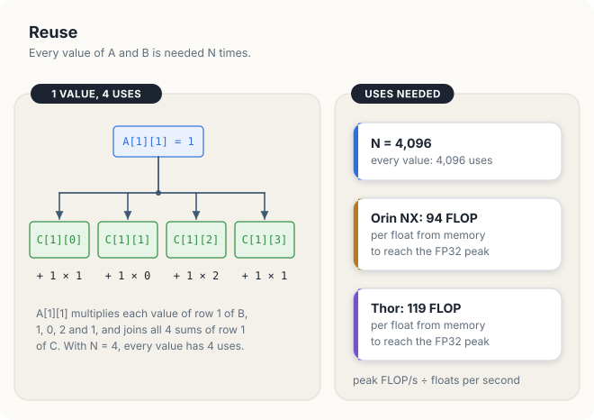
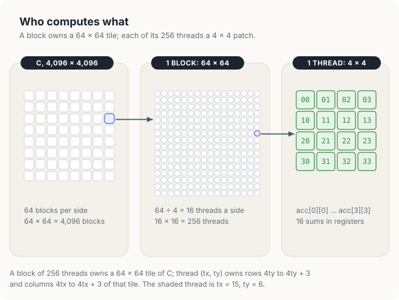
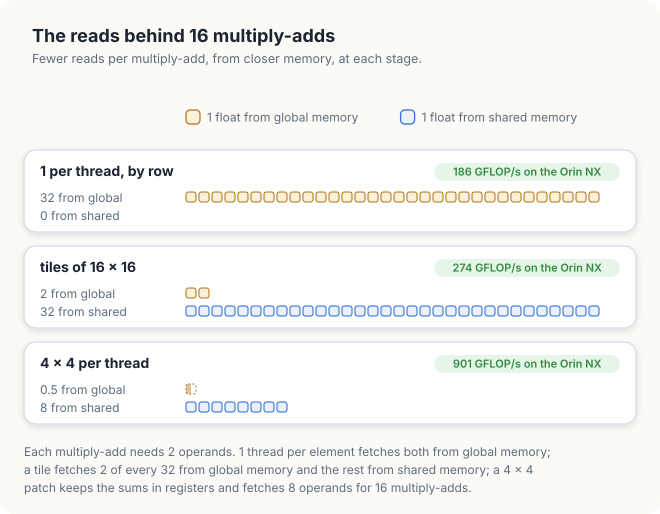

# Chapter 9: Optimised Matrix Multiplication

The kernels of Chapters 7 and 8 read each value once and did 1 or 2 operations with it, so the
memory set their speed. Matrix multiplication is different. Each value of its input takes part in
thousands of operations. A kernel that fetches the value from memory once and keeps it close to
the arithmetic units for all of those operations can run at the GPU's arithmetic peak.

This chapter builds a matrix multiplication in 4 measured stages. Each stage keeps the values
closer to the arithmetic units than the stage before: in the caches, then in shared memory, then
in registers. The last stage runs 27 to 28 times as fast as the first on the 2 test boards, at
about 40% of the FP32 peak. The chapter ends by measuring the distance to cuBLAS, NVIDIA's library. Every
kernel is shown in CUDA C++ and in Rust.

<div class="covers" markdown="1">

This chapter covers

- the work and the memory traffic of a matrix product, and the reuse that makes it fast
- 1 thread per element, and why swapping x and y changes the speed 5 times
- tiles in shared memory: copy a value once, read it many times
- a 4 × 4 patch of results per thread, kept in registers
- registers, occupancy and `__launch_bounds__`, measured
- the same kernels in Rust, and why cuda-oxide loops need `#[unroll]`
- the distance to cuBLAS

</div>

The code of the chapter is in
[`code/ch09_sgemm/`](https://github.com/arpanpathak/gpu-parallel-book/tree/main/code/ch09_sgemm)
for C++ and in
[`code/oxide/ch09_sgemm/`](https://github.com/arpanpathak/gpu-parallel-book/tree/main/code/oxide/ch09_sgemm)
for Rust.

## 9.1 Matrix multiplication is compute-bound

### 9.1.1 The product

For 2 matrices \\(A\\) and \\(B\\) of \\(N \times N\\) elements, the product \\(C = AB\\) has
elements

\\[ C_{ij} = \sum_{k=0}^{N-1} A_{ik} B_{kj} \\]

Element \\((i, j)\\) of \\(C\\) is the **dot product** of row \\(i\\) of \\(A\\) with column
\\(j\\) of \\(B\\): the 2 are walked side by side, each pair is multiplied, and the products are
added. Figure 9.1 works 1 element by hand. Row 1 of \\(A\\) is 0, 1, 3, 2 and column 2 of \\(B\\)
is 0, 2, 1, 1, so \\(C_{12}\\) = 0 × 0 + 1 × 2 + 3 × 1 + 2 × 1 = 7.

<figure>

<figcaption><b>Figure 9.1</b> 1 element of C: 4 products of row 1 of A and column 2 of B, added.</figcaption>
</figure>

On a CPU the product is 3 nested loops. The 2 outer loops pick an element of \\(C\\); the inner
loop walks \\(k\\) along the row and down the column.

```text
for i ← 0 to N − 1:                 # row of C
    for j ← 0 to N − 1:             # column of C
        sum ← 0
        for k ← 0 to N − 1:
            sum ← sum + A[i][k] × B[k][j]
        C[i][j] ← sum
```

In single precision the operation is called **SGEMM**, single-precision general matrix multiply,
after the routine of the BLAS library that computes it. All matrices in this chapter are stored
row by row: element \\((i, j)\\) of an \\(N \times N\\) matrix is at index \\(iN + j\\).

### 9.1.2 Work and traffic

<div class="example" markdown="1">

Worked example: \\(N\\) = 4,096

1. Each of the \\(N^2\\) elements of \\(C\\) takes \\(N\\) multiplications and \\(N\\) additions:
   \\(2N^3\\) = 2 × 4,096<sup>3</sup> = 137.4 × 10<sup>9</sup> floating-point operations, 137.4
   GFLOP.
2. The product must read \\(A\\) and \\(B\\) and write \\(C\\) at least once: \\(3N^2\\) floats of
   4 bytes, \\(12N^2\\) = 201 MB.
3. The arithmetic intensity, operations per byte moved, is therefore at most
   \\(2N^3 / 12N^2 = N/6\\) = 683 FLOP per byte.

</div>

| Symbol | Meaning | For \\(N\\) = 4,096 |
|---|---|---|
| \\(2N^3\\) | operations | 137.4 GFLOP |
| \\(12N^2\\) | least possible traffic | 201 MB |
| \\(N/6\\) | highest possible intensity | 683 FLOP per byte |

A Jetson Orin NX moves 201 MB from memory in 2.0 ms, at 102 GB/s, and does 137.4 GFLOP in 57 ms,
at 2.4 TFLOP/s. The arithmetic takes 28 times as long as the traffic, so the product is
**compute-bound**: its speed limit is the arithmetic rate, as long as each value crosses from
memory about once.

### 9.1.3 Reuse

The words "about once" hide the whole problem. Each value of \\(A\\) takes part in \\(N\\)
products. \\(A_{11}\\) in figure 9.2 multiplies each of the 4 values of row 1 of \\(B\\) and joins
all 4 sums of row 1 of \\(C\\). For \\(N\\) = 4,096, each value has 4,096 uses. Using a value
again without fetching it again is called **reuse**.

<figure>

<figcaption><b>Figure 9.2</b> Each value is used N times. A GPU needs about 100 uses per fetch.</figcaption>
</figure>

How much reuse a GPU needs follows from 2 of its numbers. The memory delivers a number of floats
per second; the arithmetic units perform a number of operations per second. Their ratio is the
number of operations each fetched float must feed for the units never to wait. This chapter
counts reuse in that unit, **FLOP per float**: 4 times the FLOP per byte of Chapter 2, because a
float is 4 bytes.

<div class="example" markdown="1">

Worked example: the reuse an Orin NX needs

1. Its memory delivers 102 GB/s, and 102 × 10<sup>9</sup> / 4 = 25.5 × 10<sup>9</sup> floats per
   second.
2. Its FP32 units perform 2,400 × 10<sup>9</sup> FLOP per second.
3. 2,400 / 25.5 = 94 FLOP per float. Each float fetched from memory must feed 94 operations.

</div>

| GPU | FP32 peak | Memory | FLOP per float needed | 137.4 GFLOP at peak |
|---|---|---|---|---|
| Jetson Orin NX 16 GB | 2.4 TFLOP/s | 102 GB/s | 94 | 57 ms |
| Jetson AGX Thor | 8.1 TFLOP/s | 273 GB/s | 119 | 17 ms |
| DGX Spark (GB10) | ~31 TFLOP/s | 273 GB/s | 454 | 4.4 ms |
| GeForce RTX 4090 | 82.6 TFLOP/s | 1,008 GB/s | 328 | 1.7 ms |
| GeForce RTX 5090 | 104.8 TFLOP/s | 1,792 GB/s | 234 | 1.3 ms |
| A100 SXM 80 GB | 19.5 TFLOP/s | 2,039 GB/s | 38 | 7.0 ms |
| H100 SXM | 67 TFLOP/s | 3,350 GB/s | 80 | 2.1 ms |

The peaks and bandwidths are NVIDIA's figures from Chapter 2, for the ordinary FP32 units. A
product with \\(N\\) = 4,096 offers 4,096 uses per value, far more than any GPU in the table
needs. The 4 stages of the chapter differ only in how many of those uses each fetch delivers.
Each kernel is judged by its rate, \\(2N^3\\) divided by its time, in GFLOP/s.

<div class="bee bee-happy" markdown="1">

A fast matrix product fetches each value from memory once and uses it many times from storage
closer to the arithmetic units.

</div>

## 9.2 1 thread per element

The direct kernel gives each element of \\(C\\) its own thread, and the thread runs the inner loop
of the CPU version. Blocks of 16 × 16 threads cover 16 × 16 elements of \\(C\\), so a grid of
4,096 / 16 = 256 × 256 blocks covers all of \\(C\\). The first version makes `threadIdx.x` select
the row, in the order a mathematician writes the indices.

```text
KERNEL byColumn, blocks of 16 × 16 threads:
    row ← blockIdx.x × 16 + threadIdx.x
    col ← blockIdx.y × 16 + threadIdx.y
    sum ← 0
    for k ← 0 to N − 1:
        sum ← sum + A[row][k] × B[k][col]
    C[row][col] ← sum
```

<p class="listing"><b>Listing 9.1</b> 1 thread per element, <code>threadIdx.x</code> along a column of C, in C++. <a href="https://github.com/arpanpathak/gpu-parallel-book/blob/main/code/ch09_sgemm/sgemm.cu">code/ch09_sgemm/sgemm.cu</a></p>

```cpp
{{#include ../../../../code/ch09_sgemm/sgemm.cu:47:59}}
```

```console
C = A B, 4096 x 4096 floats                       # on a Jetson Orin NX
  1 per thread, by column     4017.81 ms     34.2 GFLOP/s  max error 3.4e-05
```

34.2 GFLOP/s is 1.4% of the Orin NX's peak; the Thor reached 116.2 GFLOP/s, also 1.4% of its
peak. Each multiply-add, 2 FLOP, reads 2 floats from global memory: 1 FLOP per float, against the
94 the Orin NX needs. In all, the kernel requests \\(2N^3\\) floats, 550 GB. Fetched from memory
at 102 GB/s they would take 5.4 s; the kernel took 4.0 s, so the caches caught only a little of
the reuse.

The `max error` column compares 64 elements of \\(C\\) with a product computed on the CPU in
double precision. 3.4 × 10<sup>−5</sup> is the rounding of 4,096 float additions, and every
kernel of the chapter shows it.

## 9.3 Make the block shape match memory

A **warp** is 32 threads with consecutive `threadIdx.x` that execute each instruction together.
With blocks of 16 × 16, a warp is 16 values of `threadIdx.x` for 2 values of `threadIdx.y`. Memory
serves a warp in **sectors**, aligned pieces of 32 bytes, 8 floats (Chapter 7, section 7.2). The
fewer sectors a warp touches per load, the less memory traffic it causes.

In listing 9.1, `threadIdx.x` picks the row. At 1 step \\(k\\), the 16 lanes with the same y read
`A[row * N + k]` in 16 different rows of \\(A\\), 16 sectors, for 16 useful floats. Swapping the
roles of x and y puts the 16 lanes on 1 row of \\(C\\). They then all read the same element of
\\(A\\), which the hardware delivers once to all of them, a **broadcast**, and 16 neighbouring
elements of \\(B\\), 64 bytes in 2 sectors. Figure 9.3 counts both cases for a whole warp: 17
sectors against 4.

<figure>

<figcaption><b>Figure 9.3</b> The sectors 1 warp touches at 1 step of k: 544 bytes or 128 bytes.</figcaption>
</figure>

<p class="listing"><b>Listing 9.2</b> 1 thread per element, <code>threadIdx.x</code> along a row of C, in C++.</p>

```cpp
{{#include ../../../../code/ch09_sgemm/sgemm.cu:61:73}}
```

The Rust kernel uses the 2-D launch contract of Chapter 7, section 7.4.3: `thread::index_2d_row()` and
`index_2d_col()` give the row and column with x along the row, and the output
`DisjointSlice<f32, Index2D<N>>` lets each thread write its own element of \\(C\\) with no
`unsafe`. Section 9.7 explains the `while` loop and `#[unroll(4)]`.

<p class="listing"><b>Listing 9.3</b> 1 thread per element, x along a row of C, in Rust. <a href="https://github.com/arpanpathak/gpu-parallel-book/blob/main/code/oxide/ch09_sgemm/src/main.rs">code/oxide/ch09_sgemm/src/main.rs</a></p>

```rust,ignore
mod kernels {
    // ...
{{#include ../../../../code/oxide/ch09_sgemm/src/main.rs:19:39}}
    // ...
}
```

```console
  1 per thread, by row         739.14 ms    185.9 GFLOP/s  max error 3.4e-05     # Orin NX
  1 per thread, by row         230.54 ms    596.2 GFLOP/s  max error 3.4e-05     # Thor
```

The same arithmetic ran 5.4 times as fast on the Orin NX and 5.1 times on the Thor, while the
bytes per step fell 544 / 128 = 4.25 times. The kernel still requests 550 GB, now in 0.74 s: 744 GB/s, 7.3 times
the Orin NX's memory bandwidth. Most requests never reached memory. The reuse happens, but in
hardware caches that the program does not control.

<div class="bee bee-happy" markdown="1">

In a 2-D kernel, `threadIdx.x` belongs on the index that moves along a row in memory.

</div>

## 9.4 Shared-memory tiling

### 9.4.1 Tiles

**Shared memory** is a small memory inside each SM, shared by the threads of 1 block and filled by
the program (Chapter 7, section 7.4). Tiling moves the reuse from the caches into shared memory,
where the program decides what stays.

A block of \\(T \times T\\) threads computes a \\(T \times T\\) **tile** of \\(C\\), 1 element per
thread. The tile needs a strip of \\(T\\) full rows of \\(A\\) and a strip of \\(T\\) full columns
of \\(B\\), \\(N\\) values long. The block walks the 2 strips in steps of \\(T\\) values. At each
step it copies 1 \\(T \times T\\) tile of each strip into shared memory, 1 value per thread, and
then every thread adds the \\(T\\) products of its row of the A tile and its column of the B tile.

```text
KERNEL tiled, blocks of T × T threads; thread (x, y) owns C[row][col]:
    sum ← 0
    for k0 ← 0, T, 2T, …, N − T:
        tileA[y][x] ← A[row][k0 + x]          # each thread copies 1 value of A
        tileB[y][x] ← B[k0 + y][col]          # and 1 value of B
        wait until the whole block has copied
        for k ← 0 to T − 1:
            sum ← sum + tileA[y][k] × tileB[k][x]
        wait until the whole block has read
    C[row][col] ← sum
```

Figure 9.4 shows 1 step with \\(N\\) = 8 and \\(T\\) = 2. The block owns the tile of \\(C\\) in
rows 2 and 3, columns 4 and 5. Each value in shared memory is read by 2 threads: an element of the
A tile by the 2 threads of its row, an element of the B tile by the 2 threads of its column. With
tiles of 16 × 16 each value copied is read 16 times, so the global reads fall 16 times.

<figure>

<figcaption><b>Figure 9.4</b> 1 step: a tile of A and a tile of B into shared memory, each value read T times.</figcaption>
</figure>

Animation 1 walks the same block through all 4 steps.

<figure class="anim">
<video class="motion" src="../../figures/ch09-tiles-anim.mp4" autoplay loop muted playsinline preload="metadata" aria-label="Matrices A, B and C as 8 by 8 grids. A block's 2 by 2 tile of C needs rows 2 and 3 of A and columns 4 and 5 of B. In 4 steps, a 2 by 2 tile of each strip flies into a box labelled shared memory, the used tiles turn grey, and the 4 sums of the C tile fill up from 0 to 8 products." data-chapters="[[0.0, &quot;the strips&quot;], [6.3, &quot;step 1&quot;], [22.98, &quot;steps 2 to 4&quot;]]"></video>
<figcaption><b>Animation 1</b> 4 steps of 2 × 2 tiles: each sum gains 2 products per step.</figcaption>
</figure>

<p class="listing"><b>Listing 9.4</b> The tiled kernel, in C++.</p>

```cpp
{{#include ../../../../code/ch09_sgemm/sgemm.cu:75:99}}
```

The first barrier, `__syncthreads()`, keeps any thread from reading a tile before all of it is
written. The second keeps any thread from overwriting a tile, at the next step, while another
thread still reads it. Both copies are coalesced: neighbouring `x` read neighbouring elements of a
row of \\(A\\) and of a row of \\(B\\).

In Rust, the tiles are `SharedArray`s declared `static mut`, as in Chapter 8, and the barrier is
`thread::sync_threads()`. A write to shared memory is `unsafe`, because the compiler cannot prove
that 2 threads never write the same slot; the `SAFETY` comment gives the reason they do not.

<p class="listing"><b>Listing 9.5</b> The tiled kernel, in Rust.</p>

```rust,ignore
mod kernels {
    // ...
{{#include ../../../../code/oxide/ch09_sgemm/src/main.rs:41:79}}
    // ...
}
```

### 9.4.2 Counting the reads

<div class="example" markdown="1">

Worked example: 1 step of a 16 × 16 tile

1. The block copies 2 tiles of 16 × 16 floats from global memory: 512 floats.
2. Its 256 threads each make 16 multiply-adds: 256 × 16 × 2 = 8,192 FLOP.
3. Reuse from global memory: 8,192 / 512 = 16 FLOP per float, \\(T\\) in general.
4. Reads from shared memory: 2 per multiply-add, 1 from each tile.

</div>

At 16 FLOP per float, the Orin NX's 25.5 × 10<sup>9</sup> floats per second can feed at most
16 × 25.5 = 408 GFLOP/s, and the Thor's 68.25 × 10<sup>9</sup> floats per second 1,092 GFLOP/s.

```console
  tiles of 16 x 16             501.76 ms    273.9 GFLOP/s  max error 3.4e-05     # Orin NX
  tiles of 16 x 16             144.69 ms    949.9 GFLOP/s  max error 3.4e-05     # Thor
```

The tiles reached 67% of that limit on the Orin NX and 87% on the Thor. A second limit sits close
behind the first, in shared memory itself. Each SM's shared memory delivers 128 bytes per cycle,
32 banks of 4 bytes: 32 floats. Its 128 FP32 units perform 128 multiply-adds per cycle. At 2
shared-memory reads per multiply-add, the units would ask for 256 floats per cycle, 8 times what
shared memory delivers. Broadcasts make some of those reads cheaper, but no tile size changes the
2 reads per multiply-add. Only fewer reads per multiply-add can.

## 9.5 A 4 × 4 patch per thread

### 9.5.1 More sums per thread

In the tiled kernel each thread owns 1 sum, so each multiply-add needs 2 fresh operands. A thread
that owns a 4 × 4 **patch** of \\(C\\) keeps 16 sums in registers. For each \\(k\\), it reads 4
values of \\(A\\), 1 from each of its 4 rows, and 4 values of \\(B\\), 1 from each of its 4
columns, and multiplies every pair. Figure 9.5 works 1 value of \\(k\\) with small numbers: the
values 1, 2, 0, 3 of \\(A\\) and 2, 1, 0, 1 of \\(B\\) give 16 products from 8 reads. The 16
products form what linear algebra calls an **outer product**. Keeping results in registers in
this way is called **register tiling**.

<figure>

<figcaption><b>Figure 9.5</b> 4 values of A and 4 of B give 16 products: 8 reads, 16 multiply-adds.</figcaption>
</figure>

Animation 2 runs 3 values of \\(k\\) and adds each outer product into the 16 sums.

<figure class="anim">
<video class="motion" src="../../figures/ch09-outer-anim.mp4" autoplay loop muted playsinline preload="metadata" aria-label="A thread's 4 by 4 grid of sums between 3 columns of the A tile and 3 rows of the B tile. For k = 0, 1 and 2, 4 values of A and 4 values of B fly into place beside the grid, and every sum adds its product: after k = 0 row 3 holds 6, 3, 0, 3, and after k = 2 it holds 8, 9, 4, 3." data-chapters="[[0.0, &quot;k = 0&quot;], [19.62, &quot;k = 1, 2&quot;]]"></video>
<figcaption><b>Animation 2</b> 3 values of k: each brings 8 values and adds 16 products.</figcaption>
</figure>

### 9.5.2 Who computes what

A block of 256 threads, 16 × 16, now computes a 64 × 64 tile of \\(C\\): 4,096 elements, 16 per
thread. Thread \\((t_x, t_y)\\) owns rows \\(4t_y\\) to \\(4t_y + 3\\) and columns \\(4t_x\\) to
\\(4t_x + 3\\) of the block's tile (figure 9.6). The grid has 4,096 / 64 = 64 blocks along each
side, 4,096 blocks in all.

<figure>

<figcaption><b>Figure 9.6</b> C in blocks of 64 × 64, each block in 256 patches of 4 × 4.</figcaption>
</figure>

At each step the block copies a 64 × 16 tile of \\(A\\) and a 16 × 64 tile of \\(B\\), 1,024
floats each, so each of the 256 threads copies 4 values of each.

```text
KERNEL patches, blocks of 256 threads; thread (tx, ty) owns a 4 × 4 patch:
    acc[4][4] ← 0                                    # 16 sums, in registers
    for k0 ← 0, 16, 32, …, N − 16:
        copy a 64 × 16 tile of A and a 16 × 64 tile of B, 4 values of each per thread
        wait until the whole block has copied
        for k ← 0 to 15:
            a[0..3] ← tileA[4ty .. 4ty + 3][k]       # 4 reads
            b[0..3] ← tileB[k][4tx .. 4tx + 3]       # 4 reads
            for i, j ← 0 to 3:
                acc[i][j] ← acc[i][j] + a[i] × b[j]  # 16 multiply-adds
        wait until the whole block has read
    write the 16 sums to C
```

### 9.5.3 The kernel

<p class="listing"><b>Listing 9.6</b> The 4 × 4 patch kernel, in C++.</p>

```cpp
{{#include ../../../../code/ch09_sgemm/sgemm.cu:101:142}}
```

The A tile has 1 column of padding. A warp's lanes with the same `ty` read the same `tileA`
element, a broadcast. The 2 values of `ty` in a warp read rows 4 apart, which without padding are
4 × 16 = 64 words apart, in the same bank. With 17 columns they are 68 words apart, 4 banks apart
(Chapter 7, section 7.5). `MIN_BLOCKS` and `__launch_bounds__` are the subject of section 9.6;
with `MIN_BLOCKS` = 1 they change nothing.

The Rust kernel writes 16 elements per thread, which `thread::index_2d` cannot express, so it
writes through `get_unchecked_mut`, with the argument that the patches cover \\(C\\) once.

<p class="listing"><b>Listing 9.7</b> The 4 × 4 patch kernel, in Rust.</p>

```rust,ignore
mod kernels {
    // ...
{{#include ../../../../code/oxide/ch09_sgemm/src/main.rs:81:143}}
}
```

<div class="example" markdown="1">

Worked example: 1 step of the 64 × 64 tile

1. Global reads: 64 × 16 + 16 × 64 = 2,048 floats.
2. Arithmetic: 64 × 64 elements × 16 values of \\(k\\) × 2 = 131,072 FLOP.
3. Reuse from global memory: 131,072 / 2,048 = 64 FLOP per float, 4 times the 16 × 16 tile.
4. Shared-memory reads per multiply-add: 8 / 16 = 0.5, against 2 in the tiled kernel.

</div>

```console
  4 x 4 per thread             152.47 ms    901.4 GFLOP/s  max error 3.4e-05     # Orin NX
  4 x 4 per thread              42.66 ms   3222.0 GFLOP/s  max error 3.4e-05     # Thor
```

The patches made the product 3.3 times as fast on the Orin NX and 3.4 times on the Thor: 901.4
GFLOP/s, 38% of the Orin NX's peak, and 3,222.0 GFLOP/s, 40% of the Thor's. At 64 FLOP per
float, memory could now feed 1,632 GFLOP/s on the Orin NX and 4,368 GFLOP/s on the Thor, so memory
is no longer the first limit. Figure 9.7 puts the 3 kernels side by side: the floats 1 thread
reads, and from where, for 16 multiply-adds.

<figure>

<figcaption><b>Figure 9.7</b> The floats behind 16 multiply-adds: 32 from memory, then 2, then half of 1.</figcaption>
</figure>

<div class="bee bee-happy" markdown="1">

Each stage moves the operands closer to the arithmetic: global memory, then shared memory, then
registers. A 4 × 4 patch reads shared memory 4 times less than 1 element per thread.

</div>

## 9.6 Occupancy and launch bounds

### 9.6.1 Registers decide how many blocks fit

The 16 sums, 8 operands and indices of the patch kernel live in registers. **Occupancy**, from
Chapter 2, is the number of warps resident on an SM compared with the most it can hold. Each SM of
both boards has 65,536 registers and holds at most 1,536 threads. The program asks the CUDA runtime
how many registers the compiler gave each kernel, with `cudaFuncGetAttributes`, and how many blocks
fit on an SM, with `cudaOccupancyMaxActiveBlocksPerMultiprocessor`.

<p class="listing"><b>Listing 9.8</b> Asking for registers and occupancy, in C++.</p>

```cpp
{{#include ../../../../code/ch09_sgemm/sgemm.cu:144:157}}
```

```console
resources                                         # Orin NX
  tiles of 16 x 16            38 registers  6 blocks per SM   0 bytes spilled
  tiles of 32 x 32            37 registers  1 blocks per SM   0 bytes spilled
  4 x 4 per thread            80 registers  3 blocks per SM   0 bytes spilled
  4 x 4, at least 4 blocks    64 registers  4 blocks per SM   0 bytes spilled
  4 x 4, at least 6 blocks    40 registers  6 blocks per SM  16 bytes spilled
```

At 80 registers per thread, a block of 256 threads needs 80 × 256 = 20,480 registers, and
65,536 / 20,480 = 3.2, so 3 blocks fit: 768 threads, half of the 1,536 an SM can hold (figure
9.8). The tiled kernel at 38 registers fits 6 blocks, 1,536 threads, the thread limit.

<figure>

<figcaption><b>Figure 9.8</b> Registers per thread set how many blocks of 256 threads fit on 1 SM.</figcaption>
</figure>

The 32 × 32 tile is a block of 1,024 threads, so only 1 fits on an SM. At each of its barriers
every thread on the SM waits, and no other block is ready to run in the meantime. It ran at 222.1
GFLOP/s against 273.9 GFLOP/s for the 16 × 16 tile on the Orin NX, and at 783.4 against 949.9
GFLOP/s on the Thor, despite twice the reuse.

### 9.6.2 `__launch_bounds__`

`__launch_bounds__(maxThreads, minBlocks)` tells the compiler that the kernel runs with at most
`maxThreads` threads per block and should fit at least `minBlocks` blocks per SM. The compiler
then limits the registers per thread to make that possible. When the kernel needs more, the
compiler **spills**: it keeps some values in local memory, a per-thread area of global memory
served through the caches, and loads them back when needed.

```console
  4 x 4 per thread             152.47 ms    901.4 GFLOP/s                       # Orin NX
  4 x 4, at least 4 blocks     147.48 ms    931.9 GFLOP/s
  4 x 4, at least 6 blocks     147.91 ms    929.2 GFLOP/s
  4 x 4 per thread              42.66 ms   3222.0 GFLOP/s                       # Thor
  4 x 4, at least 4 blocks      42.30 ms   3249.4 GFLOP/s
  4 x 4, at least 6 blocks      42.10 ms   3264.2 GFLOP/s
```

On the Orin NX, asking for 4 blocks cut the registers to 64 and gained 3%. Asking for 6 cut them
to 40, spilled 16 bytes per thread, and gained the same 3%. On the Thor the compiler chose 48
registers from the start, 5 blocks per SM, and 6 blocks gained 1%. Twice the resident warps bought
at most 3%. More warps help only while the kernel waits for something they can hide, and each
thread of the patch kernel already has 16 independent multiply-adds to issue.

<div class="bee bee-shocked" markdown="1">

Occupancy is a means, not a goal. `__launch_bounds__` trades registers for blocks, and the trade
can spill; measure each setting.

</div>

## 9.7 Loops in cuda-oxide

The Rust kernels of listings 9.3, 9.5 and 9.7 write their loops as `while` loops marked
`#[unroll]`, a cuda-oxide attribute that asks the compiler to copy the loop body once per trip.
Unrolled, a loop over `i` from 0 to 3 becomes 4 copies of its body with `i` a constant in each.
`av[i]` and `acc[i][j]` then name fixed registers, and the bounds check of every index into a
constant-sized array disappears. A loop that is not unrolled must keep `acc` in memory, because a
register cannot be chosen by an index computed at run time. The CUDA C++ compiler unrolls short
loops with constant bounds by itself; cuda-oxide at the revision used here unrolls only loops
marked `#[unroll]`, and does not unroll `for` loops over ranges.

The first version of the crate used `for` loops. The table compares it with the same kernels with
every bounds check removed, by `#[kernel(unchecked_indexing)]`, and with the `while` loops of the
listings.

| Rust kernel on the Orin NX | `for` loops | `for` loops, `unchecked_indexing` | `while` loops, `#[unroll]` |
|---|---|---|---|
| 1 per thread | 62.4 GFLOP/s | 71.3 GFLOP/s | 193.2 GFLOP/s |
| tiles of 16 × 16 | 201.8 GFLOP/s | 275.1 GFLOP/s | 274.7 GFLOP/s |
| 4 × 4 per thread | 575.6 GFLOP/s | 595.4 GFLOP/s | 844.9 GFLOP/s |

`#[kernel(unchecked_indexing)]` makes an index out of range undefined behaviour, the same as in
C++. It helped the tiled kernel, whose cost was the checks, but not the patch kernel, whose cost
was its arrays in memory. The listings keep the checks and unroll.

```console
$ cargo oxide run                                 # on a Jetson Orin NX
C = A B, 4096 x 4096 floats
  1 per thread           711.52 ms    193.2 GFLOP/s  max error 3.4e-5
  tiles of 16 x 16       500.39 ms    274.7 GFLOP/s  max error 3.4e-5
  4 x 4 per thread       162.67 ms    844.9 GFLOP/s  max error 3.4e-5
```

```console
$ cargo oxide run                                 # on a Jetson AGX Thor
C = A B, 4096 x 4096 floats
  1 per thread           209.81 ms    655.1 GFLOP/s  max error 3.4e-5
  tiles of 16 x 16       146.99 ms    935.0 GFLOP/s  max error 3.4e-5
  4 x 4 per thread        47.69 ms   2881.8 GFLOP/s  max error 3.4e-5
```

The Rust kernels matched the C++ ones for 1 element per thread and for tiles, within 10%, and
reached 94% and 89% of the C++ patch kernel on the 2 boards.

<details class="check">
<summary>Why can an unrolled loop keep acc[i][j] in registers, and a loop that is not unrolled cannot?</summary>

Registers have fixed names chosen when the program is compiled; no instruction selects a register
by a value computed at run time. Unrolled, every `acc[i][j]` has constant `i` and `j`, so each
names 1 register. In a loop, `i` changes at run time, so `acc` must live in memory that can be
indexed: local memory.

</details>

## 9.8 What the optimised kernel achieves

The program also times cuBLAS's `cublasSgemm` on the same matrices. cuBLAS stores matrices column
by column, so the call asks it for \\(B^T A^T\\), which in row-major storage is \\(AB\\).

```console
$ ./sgemm                                         # on a Jetson Orin NX
GPU: Orin, 8 SMs
C = A B, 4096 x 4096 floats
  1 per thread, by column     4017.81 ms     34.2 GFLOP/s  max error 3.4e-05
  1 per thread, by row         739.14 ms    185.9 GFLOP/s  max error 3.4e-05
  tiles of 16 x 16             501.76 ms    273.9 GFLOP/s  max error 3.4e-05
  tiles of 32 x 32             618.78 ms    222.1 GFLOP/s  max error 3.4e-05
  4 x 4 per thread             152.47 ms    901.4 GFLOP/s  max error 3.4e-05
  4 x 4, at least 4 blocks     147.48 ms    931.9 GFLOP/s  max error 3.4e-05
  4 x 4, at least 6 blocks     147.91 ms    929.2 GFLOP/s  max error 3.4e-05
  cuBLAS                        91.92 ms   1495.3 GFLOP/s  max error 1.9e-05
```

```console
$ ./sgemm                                         # on a Jetson AGX Thor
GPU: NVIDIA Thor, 20 SMs
C = A B, 4096 x 4096 floats
  1 per thread, by column     1183.23 ms    116.2 GFLOP/s  max error 3.4e-05
  1 per thread, by row         230.54 ms    596.2 GFLOP/s  max error 3.4e-05
  tiles of 16 x 16             144.69 ms    949.9 GFLOP/s  max error 3.4e-05
  tiles of 32 x 32             175.43 ms    783.4 GFLOP/s  max error 3.4e-05
  4 x 4 per thread              42.66 ms   3222.0 GFLOP/s  max error 3.4e-05
  4 x 4, at least 4 blocks      42.30 ms   3249.4 GFLOP/s  max error 3.4e-05
  4 x 4, at least 6 blocks      42.10 ms   3264.2 GFLOP/s  max error 3.4e-05
  cuBLAS                        22.25 ms   6176.5 GFLOP/s  max error 3.4e-05
```

From the first kernel to the best, the product became 27 times as fast on the Orin NX, 34.2 to
931.9 GFLOP/s, and 28 times on the Thor, 116.2 to 3,264.2 GFLOP/s. The best kernel reached 39% of
the FP32 peak on the Orin NX and 40% on the Thor. cuBLAS reached 62% and 76%, so the chapter's
kernel runs at 62% and 53% of cuBLAS's speed (figure 9.9). The quiet runs on each board agreed
within 2%.

<figure>

<figcaption><b>Figure 9.9</b> Every stage on 2 boards, in GFLOP/s, as a share of each board's FP32 peak.</figcaption>
</figure>

The rest of the gap comes from techniques beyond this chapter, which cuBLAS combines and tunes for
each GPU:

- **Larger patches.** 8 × 8 elements per thread read shared memory 8 times less than 1 element
  per thread, against 4 times for 4 × 4, at the cost of more registers.
- **Wide shared-memory loads.** Reading 4 operands with 1 `float4` load, as in Chapter 7.
- **Double buffering.** Copying the next pair of tiles while computing on the current one, so the
  barrier never waits for memory.
- **Warp tiling.** Arranging each warp's patches so that its shared-memory reads fall in as few
  banks and instructions as possible.

**Tensor cores**, units that multiply small matrices in 1 instruction, are faster still. In their
TF32 mode they keep 10 bits of the float's mantissa instead of 23, so cuBLAS uses them for SGEMM
only when the program allows it. Chapter 11 returns to cuBLAS.

## 9.9 The complete programs

<p class="listing"><b>Listing 9.9</b> The complete <code>sgemm.cu</code>. <a href="https://github.com/arpanpathak/gpu-parallel-book/blob/main/code/ch09_sgemm/sgemm.cu">code/ch09_sgemm/sgemm.cu</a></p>

```cpp
{{#include ../../../../code/ch09_sgemm/sgemm.cu}}
```

<p class="listing"><b>Listing 9.10</b> The complete Rust program. <a href="https://github.com/arpanpathak/gpu-parallel-book/blob/main/code/oxide/ch09_sgemm/src/main.rs">code/oxide/ch09_sgemm/src/main.rs</a></p>

```rust,ignore
{{#include ../../../../code/oxide/ch09_sgemm/src/main.rs}}
```

## Common mistakes

- **`threadIdx.x` on the row index of a row-major output.** Neighbouring lanes then read and
  write \\(N\\) floats apart; the kernel ran 5 times slower.
- **A missing second barrier in a tiled loop.** The next step overwrites a tile while other
  threads still read it.
- **Tiles that fill an SM with 1 block.** At every barrier the whole SM waits.
- **Forcing occupancy.** `__launch_bounds__` with a high `minBlocks` can spill registers; measure
  each setting.
- **Small fixed-size arrays in a loop that is not unrolled.** In C++ the compiler unrolls loops
  with constant bounds by itself; in cuda-oxide, write the loop as `while` with `#[unroll]`.
- **Comparing against peak only.** A library such as cuBLAS shows what the hardware can reach on
  the same problem.

<div class="summary" markdown="1">

## Summary

- A product of \\(N \times N\\) matrices makes \\(2N^3\\) operations on \\(3N^2\\) values. Each
  value has \\(N\\) uses, and a GPU needs about 100 uses per fetch from memory, 94 FLOP per float
  on the Orin NX and 119 on the Thor.
- 1 thread per element ran at 1.4% of peak. Putting `threadIdx.x` along a row cut the sectors per
  warp from 17 to 4 and made it 5 times as fast, with the caches catching most of the reuse.
- Tiles of \\(T \times T\\) in shared memory give \\(T\\) FLOP per float from memory, but still 2
  shared-memory reads per multiply-add.
- A 4 × 4 patch per thread keeps 16 sums in registers and reads 8 values for 16 multiply-adds. It
  ran 3.3 to 3.4 times as fast as the tiles, at 38% to 40% of peak.
- Registers per thread decide occupancy; `__launch_bounds__` trades registers for blocks and can
  spill. The best setting gained 3%.
- In cuda-oxide, `#[unroll]` on `while` loops kept the patch in registers with the bounds checks
  on; the Rust kernels reached 89% to 110% of the C++ ones.
- cuBLAS reached 62% and 76% of peak; the chapter's best kernel ran at 62% and 53% of cuBLAS.

</div>

Part IV turns to the C++ that wraps such kernels: Chapter 10 builds resource-safe buffers and
error handling, and Chapter 11 the libraries, cuBLAS among them.

## Exercises

1. Compute the time a product of 2 matrices of 8,192 × 8,192 floats needs at the FP32 peak of
   your GPU, and the least memory traffic it needs. Is it compute-bound?
2. Compute the FLOP per float your GPU needs from its peak and its memory bandwidth. Which stage
   of the chapter first gives that much reuse?
3. In listing 9.1, how many distinct sectors of \\(B\\) does 1 warp read at each \\(k\\)? And in
   listing 9.2?
4. Derive the reuse \\(T\\) FLOP per float of a \\(T \times T\\) tile, and compute it for 8, 16
   and 32.
5. The patch kernel reads `tileB[k][tx * 4 + i]`. Which banks do the 16 lanes with the same
   `ty` touch for `i = 0`? Is there a conflict?
6. Change the patch to 8 × 4 per thread, so a block computes a 128 × 64 tile. Count its reuse,
   registers and blocks per SM, and measure it.
7. Remove `#[unroll]` from the inner loops of the Rust patch kernel, run it, and explain the
   result.
8. Run `sgemm` with \\(N\\) = 1,024 and 8,192. How does the gap to cuBLAS change, and why?

## Sources and further reading

- NVIDIA, *CUDA C++ Programming Guide*, "Shared Memory" and "Launch Bounds":
  <https://docs.nvidia.com/cuda/cuda-c-programming-guide/>
- NVIDIA, *CUDA C++ Best Practices Guide*, "Occupancy" and "Register Pressure":
  <https://docs.nvidia.com/cuda/cuda-c-best-practices-guide/>
- NVIDIA, *cuBLAS Library*, `cublasSgemm` and math modes: <https://docs.nvidia.com/cuda/cublas/>
- V. Volkov and J. Demmel, "Benchmarking GPUs to Tune Dense Linear Algebra", SC08, 2008.
- S. Boehm, "How to Optimize a CUDA Matmul Kernel for cuBLAS-like Performance", 2022.
- D. Kirk and W. Hwu, *Programming Massively Parallel Processors*, 4th ed., Morgan Kaufmann, 2022,
  chapters on matrix multiplication and tiling.
