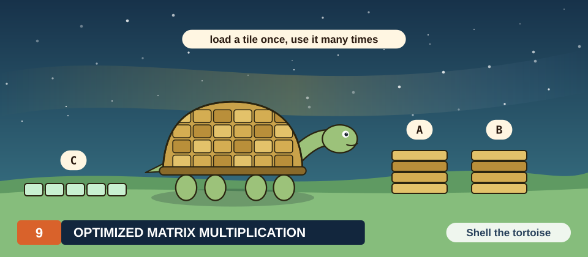

# Chapter 9: Optimized Matrix Multiplication

Matrix multiplication is one of the most important computations in science, engineering and
machine learning. The kernels of Chapters 7 and 8 read each input value once and performed 1 or
2 operations with it, so their speed was limited by memory bandwidth. Matrix multiplication
behaves differently. Each input value takes part in thousands of operations, and a kernel that
loads the value from memory once and keeps it close to the arithmetic units for all of those
operations can approach the arithmetic peak of the GPU.

In this chapter, we develop a matrix multiplication kernel in 4 stages and measure each one. Each
stage holds the reused values in a faster kind of storage than the stage before: first the
hardware caches, then shared memory, then registers. We then examine how register usage limits
occupancy, how loops must be written for the cuda-oxide compiler to keep arrays in registers,
and how far the best kernel remains from cuBLAS, NVIDIA's matrix library. Every kernel is shown
in CUDA C++ and in Rust.

<div class="covers" markdown="1">

This chapter covers

- the operations, memory traffic and data reuse of a matrix product
- a kernel with one thread per output element, and the effect of the thread-to-element mapping
- shared-memory tiling
- register tiling with a 4 × 4 output patch per thread
- register usage, occupancy and `__launch_bounds__`
- loop unrolling in cuda-oxide with `#[unroll]`
- a comparison with cuBLAS

</div>

The code of the chapter is in
[`code/ch09_sgemm/`](https://github.com/arpanpathak/gpu-parallel-book/tree/main/code/ch09_sgemm)
for C++ and in
[`code/oxide/ch09_sgemm/`](https://github.com/arpanpathak/gpu-parallel-book/tree/main/code/oxide/ch09_sgemm)
for Rust.

## 9.1 The arithmetic intensity of matrix multiplication

### 9.1.1 The matrix product

For 2 matrices \\(A\\) and \\(B\\) of \\(N \times N\\) elements, the product \\(C = AB\\) has
elements

\\[ C_{ij} = \sum_{k=0}^{N-1} A_{ik} B_{kj} \\]

That is, element \\((i, j)\\) of \\(C\\) is the **dot product** of row \\(i\\) of \\(A\\) and
column \\(j\\) of \\(B\\). The row and the column are traversed together, each pair of elements is
multiplied, and the products are added. Figure 9.1 computes 1 element of a 4 × 4 product. Row 1 of
\\(A\\) is 0, 1, 3, 2 and column 2 of \\(B\\) is 0, 2, 1, 1, so \\(C_{12}\\) = 0 × 0 + 1 × 2 +
3 × 1 + 2 × 1 = 7.

<figure>
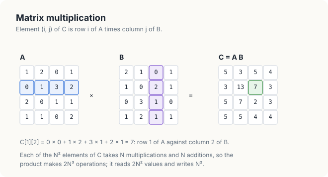
<figcaption><b>Figure 9.1</b> Element C[1][2] is the sum of the 4 products of row 1 of A and column 2 of B.</figcaption>
</figure>

A sequential implementation on a CPU uses 3 nested loops. The 2 outer loops select an element of
\\(C\\), and the inner loop runs over \\(k\\) along row \\(i\\) of \\(A\\) and down column \\(j\\)
of \\(B\\):

```text
for i ← 0 to N − 1:                 # row of C
    for j ← 0 to N − 1:             # column of C
        sum ← 0
        for k ← 0 to N − 1:
            sum ← sum + A[i][k] × B[k][j]
        C[i][j] ← sum
```

The single-precision form of this operation is called **SGEMM**, for single-precision general
matrix multiply, after the routine of the BLAS library that computes it. All matrices in this
chapter are stored in row-major order: element \\((i, j)\\) of an \\(N \times N\\) matrix is at
index \\(iN + j\\).

### 9.1.2 Operations and memory traffic

Each of the \\(N^2\\) elements of \\(C\\) requires \\(N\\) multiplications and \\(N\\) additions,
so the product performs \\(2N^3\\) floating-point operations. For \\(N\\) = 4,096, this is
2 × 4,096<sup>3</sup> = 137.4 × 10<sup>9</sup> operations, or 137.4 GFLOP. At the same time, the
product must read \\(A\\) and \\(B\\) and write \\(C\\) at least once. These are \\(3N^2\\)
floats of 4 bytes each, \\(12N^2\\) bytes, which is 201 MB for \\(N\\) = 4,096. The ratio of the
2 numbers is the highest arithmetic intensity that the computation can reach:
\\(2N^3 / 12N^2 = N/6\\), or 683 FLOP per byte for \\(N\\) = 4,096.

| Symbol | Meaning | For \\(N\\) = 4,096 |
|---|---|---|
| \\(2N^3\\) | operations | 137.4 GFLOP |
| \\(12N^2\\) | least possible traffic | 201 MB |
| \\(N/6\\) | highest possible intensity | 683 FLOP per byte |

We measure the kernels of this chapter on 2 GPUs: a Jetson Orin NX, with an FP32 peak of
2.4 TFLOP/s and 102 GB/s of memory bandwidth, and a Jetson AGX Thor, with 8.1 TFLOP/s and
273 GB/s. In the text we call them the smaller and the larger GPU. The smaller GPU moves 201 MB in
2.0 ms at 102 GB/s and performs 137.4 GFLOP in 57 ms at 2.4 TFLOP/s. The arithmetic takes 28 times
as long as the minimum traffic. A kernel whose speed is limited by the arithmetic rate of the
hardware is said to be **compute-bound**, and matrix multiplication can be compute-bound provided
that each value crosses from memory to the chip approximately once.

### 9.1.3 Data reuse

The condition "approximately once" is the central difficulty of this chapter. Each value of
\\(A\\) takes part in \\(N\\) products. In figure 9.2, \\(A_{11}\\) is multiplied by each of the 4
values of row 1 of \\(B\\) and contributes to all 4 elements of row 1 of \\(C\\). For \\(N\\) =
4,096, each value is used 4,096 times. Using a value again without loading it from memory again
is called **reuse**.

<figure>
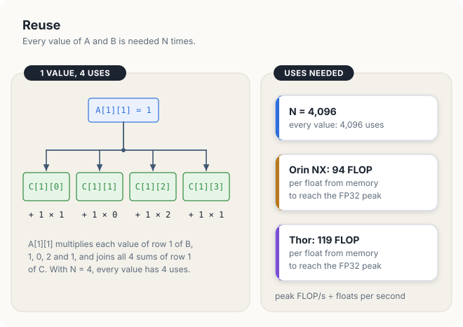
<figcaption><b>Figure 9.2</b> Each value is used N times. A GPU needs about 100 uses per load from memory.</figcaption>
</figure>

The amount of reuse that a GPU needs follows from 2 of its specifications. The memory delivers a
certain number of floats per second, and the arithmetic units perform a certain number of
operations per second. The ratio of the 2 is the number of operations that each float loaded from
memory must supply if the arithmetic units are never to wait. We count reuse in this unit,
**FLOP per float**, which is 4 times the FLOP per byte of Chapter 2 because a float occupies 4
bytes. For the smaller GPU, 102 GB/s is 102 × 10<sup>9</sup> / 4 = 25.5 × 10<sup>9</sup> floats
per second, and the FP32 units perform 2,400 × 10<sup>9</sup> FLOP per second. Therefore, each
float loaded from memory must supply 2,400 / 25.5 = 94 operations. The table gives the same ratio
for other GPUs.

| GPU | FP32 peak | Memory | FLOP per float needed | 137.4 GFLOP at peak |
|---|---|---|---|---|
| Jetson Orin NX 16 GB | 2.4 TFLOP/s | 102 GB/s | 94 | 57 ms |
| Jetson AGX Thor | 8.1 TFLOP/s | 273 GB/s | 119 | 17 ms |
| DGX Spark (GB10) | ~31 TFLOP/s | 273 GB/s | 454 | 4.4 ms |
| GeForce RTX 4090 | 82.6 TFLOP/s | 1,008 GB/s | 328 | 1.7 ms |
| GeForce RTX 5090 | 104.8 TFLOP/s | 1,792 GB/s | 234 | 1.3 ms |
| A100 SXM 80 GB | 19.5 TFLOP/s | 2,039 GB/s | 38 | 7.0 ms |
| H100 SXM | 67 TFLOP/s | 3,350 GB/s | 80 | 2.1 ms |

The peaks and bandwidths are NVIDIA's figures from Chapter 2, for the ordinary FP32 units. A
product with \\(N\\) = 4,096 offers 4,096 uses of each value, far more than any GPU in the table
requires. The 4 kernels of this chapter differ only in how many of those uses each load from
memory delivers. We judge each kernel by its rate, \\(2N^3\\) divided by its execution time, in
GFLOP/s.

<div class="bee bee-happy" markdown="1">

A fast matrix product loads each value from memory once and uses it many times from storage
closer to the arithmetic units.

</div>

## 9.2 A simple matrix multiplication kernel

The most direct kernel assigns each element of \\(C\\) to its own thread, and each thread
executes the inner loop of the CPU version. Blocks of 16 × 16 threads cover 16 × 16 elements of
\\(C\\), so a grid of 4,096 / 16 = 256 × 256 blocks covers the whole matrix. In this first
version, `threadIdx.x` selects the row of the output element, which follows the order in which
the indices are usually written.

```text
KERNEL byColumn, blocks of 16 × 16 threads:
    row ← blockIdx.x × 16 + threadIdx.x
    col ← blockIdx.y × 16 + threadIdx.y
    sum ← 0
    for k ← 0 to N − 1:
        sum ← sum + A[row][k] × B[k][col]
    C[row][col] ← sum
```

<p class="listing"><b>Listing 9.1</b> 1 thread per element, <code>threadIdx.x</code> along a column of C. <a href="https://github.com/arpanpathak/gpu-parallel-book/blob/main/code/oxide/ch09_sgemm/src/main.rs">code/oxide/ch09_sgemm/src/main.rs</a> <a href="https://github.com/arpanpathak/gpu-parallel-book/blob/main/code/ch09_sgemm/sgemm.cu">code/ch09_sgemm/sgemm.cu</a></p>

<div class="code-tabs">
<div class="code-tab" data-lang="Rust">

```rust,ignore
mod kernels {
    // ...
{{#include ../../../../code/oxide/ch09_sgemm/src/main.rs:19:36}}
    // ...
}
```

</div>
<div class="code-tab" data-lang="C++">

```cpp
{{#include ../../../../code/ch09_sgemm/sgemm.cu:47:59}}
```

</div>
</div>

Each thread first computes the row and column of its output element from its block and thread
indices. The loop over `k` then reads 1 element of row `row` of \\(A\\) and 1 element of column
`col` of \\(B\\) in each iteration and accumulates their product in the register `sum`. After the
loop, the thread writes `sum` to its element of \\(C\\). The Rust kernel writes through
`get_unchecked_mut`, because the 2-D launch contract of section 7.4.3 places x along a row.

```console
C = A B, 4096 x 4096 floats                       # on a Jetson Orin NX
  1 per thread, by column     4017.81 ms     34.2 GFLOP/s  max error 3.4e-05
```

The kernel reaches 34.2 GFLOP/s, 1.4% of the smaller GPU's peak; on the larger GPU it reaches
116.2 GFLOP/s, also 1.4% of peak. The reason is visible in the loop body. Each multiply-add, 2
FLOP, reads 2 floats from global memory, which is 1 FLOP per float, against the 94 FLOP per float
that the smaller GPU needs. In total the kernel requests \\(2N^3\\) floats, 550 GB. Loaded from
memory at 102 GB/s, they would take 5.4 s. The kernel took 4.0 s, so the hardware caches served
only a small part of the reuse.

The `max error` column compares 64 elements of \\(C\\) with a product computed on the CPU in
double precision. The value 3.4 × 10<sup>−5</sup> is the rounding error of 4,096 float additions,
and every kernel of the chapter shows it.

## 9.3 Mapping threads to rows for coalesced access

Recall from Chapter 7 that a **warp** is a group of 32 threads with consecutive `threadIdx.x`
values that execute each instruction together, and that memory serves a warp in **sectors**,
aligned pieces of 32 bytes that hold 8 floats (section 7.2). The fewer sectors a warp touches in
one load instruction, the less memory traffic the instruction causes. With blocks of 16 × 16, a
warp consists of 16 values of `threadIdx.x` for each of 2 values of `threadIdx.y`.

In listing 9.1, `threadIdx.x` selects the row. At a given step \\(k\\), the 16 threads with the
same `threadIdx.y` read `A[row * N + k]` from 16 different rows of \\(A\\). These are 16 sectors
for 16 useful floats. If we exchange the roles of x and y, the 16 threads lie along 1 row of
\\(C\\). They then all read the same element of \\(A\\), which the hardware delivers once to all
of them in a **broadcast**, and 16 adjacent elements of \\(B\\), 64 bytes in 2 sectors. Figure 9.3
counts the sectors for a whole warp: 17 in the first case and 4 in the second.

<figure>
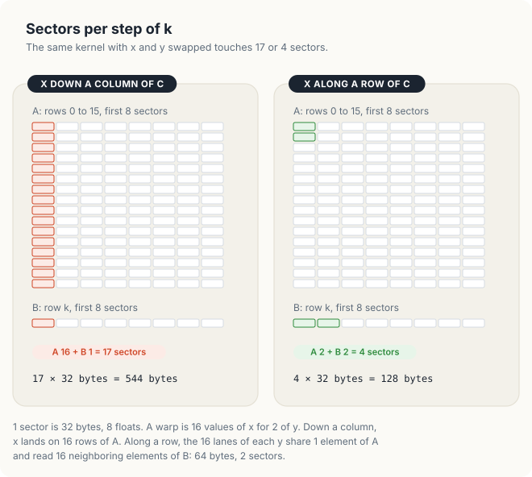
<figcaption><b>Figure 9.3</b> The sectors that 1 warp touches at 1 step of k: 544 bytes or 128 bytes.</figcaption>
</figure>

<p class="listing"><b>Listing 9.2</b> 1 thread per element, <code>threadIdx.x</code> along a row of C.</p>

<div class="code-tabs">
<div class="code-tab" data-lang="Rust">

```rust,ignore
mod kernels {
    // ...
{{#include ../../../../code/oxide/ch09_sgemm/src/main.rs:38:58}}
    // ...
}
```

</div>
<div class="code-tab" data-lang="C++">

```cpp
{{#include ../../../../code/ch09_sgemm/sgemm.cu:61:73}}
```

</div>
</div>

The only change from listing 9.1 is in the first 2 lines of the kernel: the row now comes from
`blockIdx.y` and `threadIdx.y`, and the column from `blockIdx.x` and `threadIdx.x`.

The Rust kernel uses the 2-D launch contract of section 7.4.3. The functions
`thread::index_2d_row()` and `index_2d_col()` return the row and the column with x along the row,
and the output type `DisjointSlice<f32, Index2D<N>>` lets each thread write its own element of
\\(C\\) without `unsafe`. In Section 9.7, we explain the `while` loop and the `#[unroll(4)]` attribute.

```console
  1 per thread, by row         739.14 ms    185.9 GFLOP/s  max error 3.4e-05     # Orin NX
  1 per thread, by row         230.54 ms    596.2 GFLOP/s  max error 3.4e-05     # Thor
```

The same arithmetic now runs 5.4 times as fast on the smaller GPU and 5.1 times as fast on the
larger one, while the bytes per step fell by 544 / 128 = 4.25 times. The kernel still requests
550 GB, now in 0.74 s, which is 744 GB/s, 7.3 times the memory bandwidth of the smaller GPU.
Therefore most requests never reached memory. The reuse does take place, but in hardware caches
whose contents the program does not control. In general, `threadIdx.x` should index the
dimension that moves along a row in memory.

## 9.4 Shared-memory tiling

### 9.4.1 The tiled algorithm

Recall from section 7.4 that **shared memory** is a small memory inside each SM that is shared by
the threads of 1 block and filled explicitly by the program. Tiling moves the reuse from the
caches into shared memory, where the program decides which values stay.

A block of \\(T \times T\\) threads computes a \\(T \times T\\) **tile** of \\(C\\), 1 element per
thread. To do so, it needs a strip of \\(T\\) complete rows of \\(A\\) and a strip of \\(T\\)
complete columns of \\(B\\), each \\(N\\) values long. The block traverses the 2 strips in steps
of \\(T\\) values. At each step, it copies a \\(T \times T\\) tile of each strip into shared
memory, 1 value per thread. Every thread then adds the \\(T\\) products of its row of the A tile
and its column of the B tile.

```text
KERNEL tiled, blocks of T × T threads; thread (x, y) owns C[row][col]:
    sum ← 0
    for k0 ← 0, T, 2T, …, N − T:
        tileA[y][x] ← A[row][k0 + x]          # each thread copies 1 value of A
        tileB[y][x] ← B[k0 + y][col]          # and 1 value of B
        wait until the whole block has copied
        for k ← 0 to T − 1:
            sum ← sum + tileA[y][k] × tileB[k][x]
        wait until the whole block has read
    C[row][col] ← sum
```

Figure 9.4 shows 1 step with \\(N\\) = 8 and \\(T\\) = 2. The block owns the tile of \\(C\\) in
rows 2 and 3 and columns 4 and 5. Each value in shared memory is read by 2 threads: an element of
the A tile by the 2 threads of its row, and an element of the B tile by the 2 threads of its
column. With tiles of 16 × 16, each value copied is read 16 times, so the number of global memory
reads falls by a factor of 16.

<figure>
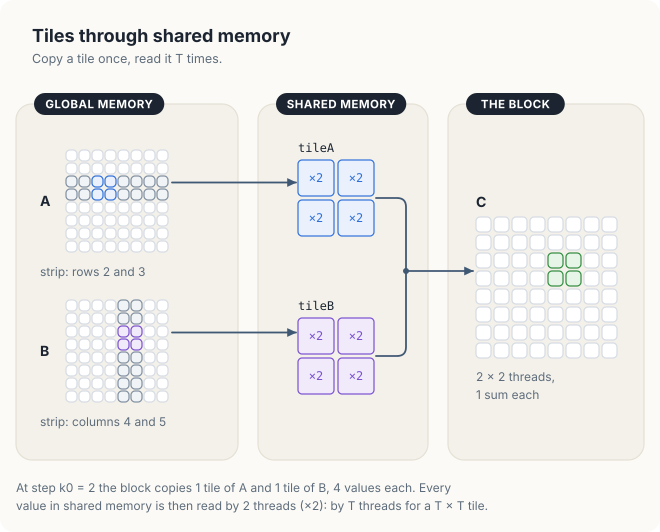
<figcaption><b>Figure 9.4</b> 1 step: a tile of A and a tile of B are copied into shared memory, and each value is read T times.</figcaption>
</figure>

Animation 1 shows the same block through all 4 steps.

<figure class="anim">
<video class="motion" src="../../figures/ch09-tiles-anim.mp4" autoplay loop muted playsinline preload="metadata" aria-label="Matrices A, B and C as 8 by 8 grids. A block's 2 by 2 tile of C needs rows 2 and 3 of A and columns 4 and 5 of B. In 4 steps, a 2 by 2 tile of each strip flies into a box labeled shared memory, the used tiles turn gray, and the 4 sums of the C tile fill up from 0 to 8 products." data-chapters="[[0.0, &quot;the strips&quot;], [6.3, &quot;step 1&quot;], [22.98, &quot;steps 2 to 4&quot;]]">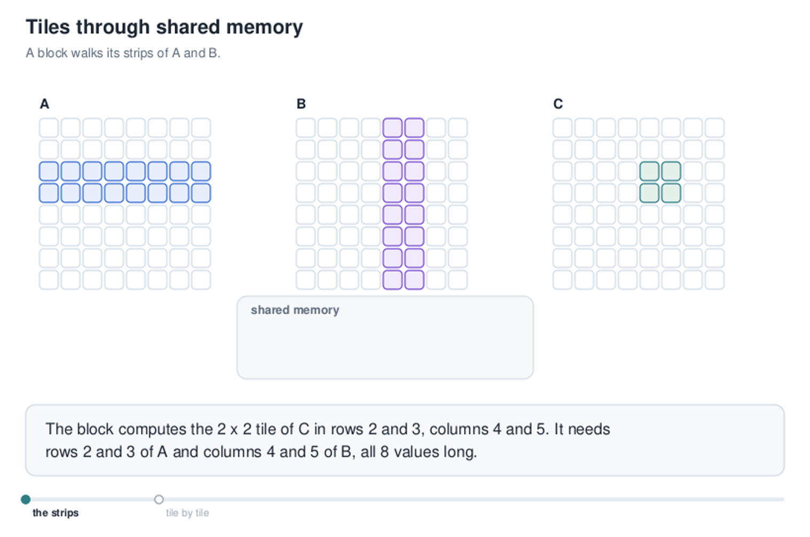</video>
<figcaption><b>Animation 1</b> 4 steps of 2 × 2 tiles: each sum gains 2 products per step.</figcaption>
</figure>

<p class="listing"><b>Listing 9.3</b> The tiled kernel.</p>

<div class="code-tabs">
<div class="code-tab" data-lang="Rust">

```rust,ignore
mod kernels {
    // ...
{{#include ../../../../code/oxide/ch09_sgemm/src/main.rs:60:98}}
    // ...
}
```

</div>
<div class="code-tab" data-lang="C++">

```cpp
{{#include ../../../../code/ch09_sgemm/sgemm.cu:75:99}}
```

</div>
</div>

The kernel declares the 2 tiles as `__shared__` arrays of \\(T \times T\\) floats. In each
iteration of the outer loop over `k0`, every thread copies 1 element of \\(A\\) into `tileA` and
1 element of \\(B\\) into `tileB`. Both copies are coalesced, because threads with adjacent `x`
read adjacent elements of a row of \\(A\\) and of a row of \\(B\\). The first `__syncthreads()`
ensures that no thread reads a tile before all of it has been written. The inner loop then
computes \\(T\\) products from shared memory. The second `__syncthreads()` ensures that no thread
overwrites a tile in the next iteration while another thread is still reading it.

In Rust, the tiles are `SharedArray`s declared `static mut`, as in Chapter 8, and the barrier is
`thread::sync_threads()`. A write to shared memory is `unsafe`, because the compiler cannot prove
that 2 threads never write the same element. The `SAFETY` comment states why they do not.

### 9.4.2 Global and shared memory reads of the tiled kernel

Let us count the reads of 1 step with tiles of 16 × 16. The block copies 2 tiles of 16 × 16
floats from global memory, 512 floats. Its 256 threads each perform 16 multiply-adds, which is
256 × 16 × 2 = 8,192 FLOP. The reuse from global memory is therefore 8,192 / 512 = 16 FLOP per
float, and \\(T\\) FLOP per float in general. Each multiply-add still reads 2 values from shared
memory, 1 from each tile.

At 16 FLOP per float, the 25.5 × 10<sup>9</sup> floats per second of the smaller GPU can supply
at most 16 × 25.5 = 408 GFLOP/s, and the 68.25 × 10<sup>9</sup> floats per second of the larger
GPU at most 1,092 GFLOP/s.

```console
  tiles of 16 x 16             501.76 ms    273.9 GFLOP/s  max error 3.4e-05     # Orin NX
  tiles of 16 x 16             144.69 ms    949.9 GFLOP/s  max error 3.4e-05     # Thor
```

The tiled kernel reaches 67% of this limit on the smaller GPU and 87% on the larger one. However,
a second limit lies close behind the first, in shared memory itself. The shared memory of each SM
delivers 128 bytes per cycle from 32 banks of 4 bytes, which is 32 floats. The 128 FP32 units of
the SM perform 128 multiply-adds per cycle. At 2 shared-memory reads per multiply-add, the units
would request 256 floats per cycle, 8 times what shared memory delivers. Broadcasts make some of
those reads cheaper, but no choice of tile size changes the 2 reads per multiply-add. Only a
kernel that performs fewer shared-memory reads per multiply-add can remove this limit.

## 9.5 Register tiling with 4 × 4 output patches

### 9.5.1 Computing several outputs per thread

In the tiled kernel, each thread computes 1 sum, so each multiply-add needs 2 new operands. A
thread that computes a 4 × 4 **patch** of \\(C\\) keeps 16 sums in registers. For each \\(k\\), it
reads 4 values of \\(A\\), 1 from each of its 4 rows, and 4 values of \\(B\\), 1 from each of its 4
columns, and multiplies every pair. Figure 9.5 shows 1 value of \\(k\\): the values 1, 2, 0, 3 of
\\(A\\) and 2, 1, 0, 1 of \\(B\\) give 16 products from 8 reads. In linear algebra, the 16
products form an **outer product**. Keeping several results of each thread in registers in this
way is called **register tiling**.

<figure>
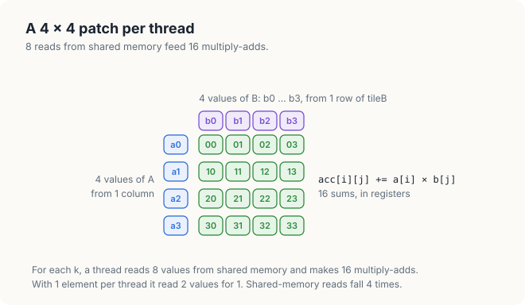
<figcaption><b>Figure 9.5</b> 4 values of A and 4 of B give 16 products: 8 reads for 16 multiply-adds.</figcaption>
</figure>

Animation 2 shows 3 values of \\(k\\), with each outer product added into the 16 sums.

<figure class="anim">
<video class="motion" src="../../figures/ch09-outer-anim.mp4" autoplay loop muted playsinline preload="metadata" aria-label="A thread's 4 by 4 grid of sums between 3 columns of the A tile and 3 rows of the B tile. For k = 0, 1 and 2, 4 values of A and 4 values of B fly into place beside the grid, and every sum adds its product: after k = 0 row 3 holds 6, 3, 0, 3, and after k = 2 it holds 8, 9, 4, 3." data-chapters="[[0.0, &quot;k = 0&quot;], [19.62, &quot;k = 1, 2&quot;]]">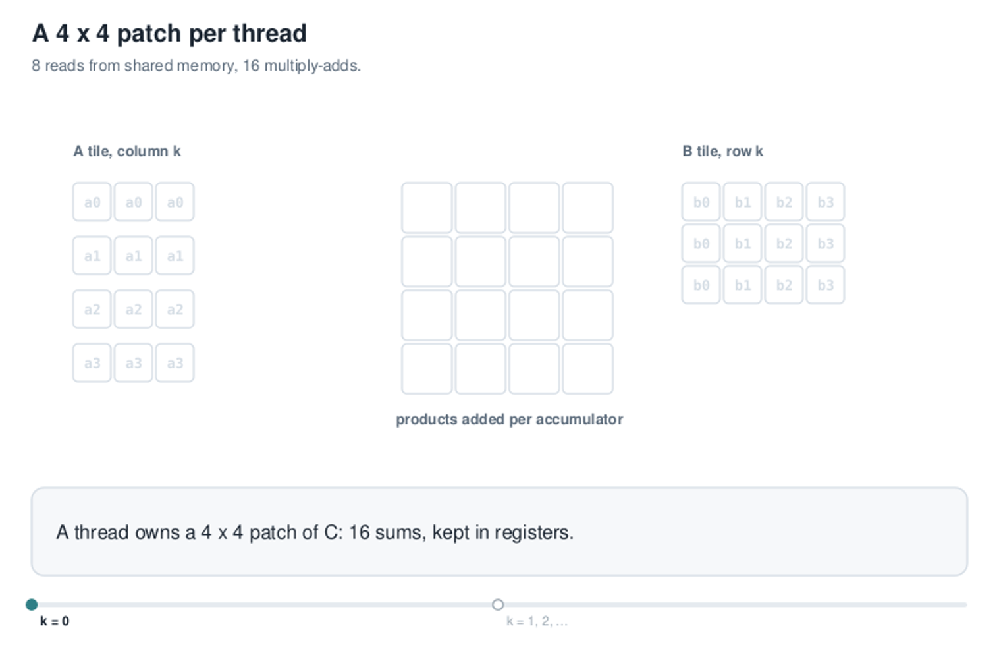</video>
<figcaption><b>Animation 2</b> 3 values of k: each brings 8 values and adds 16 products.</figcaption>
</figure>

### 9.5.2 Assigning output elements to threads

A block of 256 threads, arranged as 16 × 16, now computes a 64 × 64 tile of \\(C\\): 4,096
elements, 16 per thread. Thread \\((t_x, t_y)\\) computes rows \\(4t_y\\) to \\(4t_y + 3\\) and
columns \\(4t_x\\) to \\(4t_x + 3\\) of the block's tile, as figure 9.6 shows. The grid has
4,096 / 64 = 64 blocks along each side, 4,096 blocks in all.

<figure>
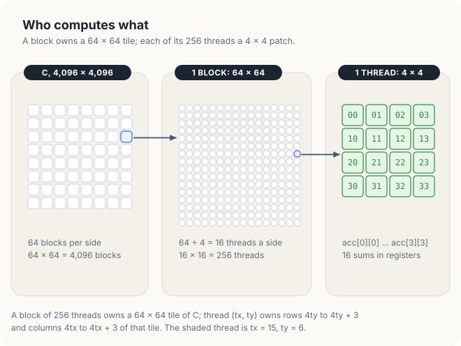
<figcaption><b>Figure 9.6</b> C divided into tiles of 64 × 64, 1 per block, and each tile into 256 patches of 4 × 4, 1 per thread.</figcaption>
</figure>

At each step the block copies a 64 × 16 tile of \\(A\\) and a 16 × 64 tile of \\(B\\), 1,024
floats each, so each of the 256 threads copies 4 values of each.

```text
KERNEL patches, blocks of 256 threads; thread (tx, ty) owns a 4 × 4 patch:
    acc[4][4] ← 0                                    # 16 sums, in registers
    for k0 ← 0, 16, 32, …, N − 16:
        copy a 64 × 16 tile of A and a 16 × 64 tile of B, 4 values of each per thread
        wait until the whole block has copied
        for k ← 0 to 15:
            a[0..3] ← tileA[4ty .. 4ty + 3][k]       # 4 reads
            b[0..3] ← tileB[k][4tx .. 4tx + 3]       # 4 reads
            for i, j ← 0 to 3:
                acc[i][j] ← acc[i][j] + a[i] × b[j]  # 16 multiply-adds
        wait until the whole block has read
    write the 16 sums to C
```

### 9.5.3 The register-tiled kernel

<p class="listing"><b>Listing 9.4</b> The 4 × 4 patch kernel.</p>

<div class="code-tabs">
<div class="code-tab" data-lang="Rust">

```rust,ignore
mod kernels {
    // ...
{{#include ../../../../code/oxide/ch09_sgemm/src/main.rs:100:162}}
}
```

</div>
<div class="code-tab" data-lang="C++">

```cpp
{{#include ../../../../code/ch09_sgemm/sgemm.cu:101:142}}
```

</div>
</div>

The kernel begins by computing the thread's position `(tx, ty)` in the 16 × 16 arrangement and
the first row and column, `row0` and `col0`, of the block's tile. The array `acc` holds the 16
sums. In each iteration over `k0`, the loop over `e` copies the 2 tiles, 4 elements of each per
thread, and the barrier waits for the copy to finish. For each of the 16 values of `k`, the thread
then loads its 4 values of `tileA` into `a` and its 4 values of `tileB` into `b`, and the 2 nested
loops over `i` and `j` add the 16 products into `acc`. After the last step, the thread writes its
16 sums to \\(C\\).

The A tile has 1 column of padding. The threads of a warp with the same `ty` read the same
`tileA` element, which is a broadcast. The 2 values of `ty` within a warp read rows that are 4
apart. Without padding, these are 4 × 16 = 64 words apart and fall in the same bank; with 17
columns they are 68 words apart, which places them 4 banks apart (section 7.5). The template
parameter `MIN_BLOCKS` and `__launch_bounds__` are discussed in section 9.6; with `MIN_BLOCKS`
= 1 they have no effect.

The Rust kernel writes 16 elements per thread, which `thread::index_2d` cannot express. It
therefore writes through `get_unchecked_mut`, with the argument that the patches of all threads
cover \\(C\\) exactly once.

We can now count the reads of 1 step of the 64 × 64 tile. The block reads 64 × 16 + 16 × 64 =
2,048 floats from global memory and performs 64 × 64 elements × 16 values of \\(k\\) × 2 =
131,072 FLOP. The reuse from global memory is therefore 131,072 / 2,048 = 64 FLOP per float, 4
times that of the 16 × 16 tile. Each thread makes 8 shared-memory reads for 16 multiply-adds, so
the kernel performs 0.5 shared-memory reads per multiply-add, against 2 in the tiled kernel.

```console
  4 x 4 per thread             152.47 ms    901.4 GFLOP/s  max error 3.4e-05     # Orin NX
  4 x 4 per thread              42.66 ms   3222.0 GFLOP/s  max error 3.4e-05     # Thor
```

Register tiling makes the product 3.3 times as fast on the smaller GPU and 3.4 times as fast on
the larger one: 901.4 GFLOP/s, 38% of the smaller GPU's peak, and 3,222.0 GFLOP/s, 40% of the
larger GPU's peak. At 64 FLOP per float, memory could now supply 1,632 GFLOP/s on the smaller GPU
and 4,368 GFLOP/s on the larger one, so memory bandwidth is no longer the first limit. Figure 9.7
compares the three kernels by the number of floats that 1 thread reads for 16 multiply-adds, and where
it reads them from.

<figure>
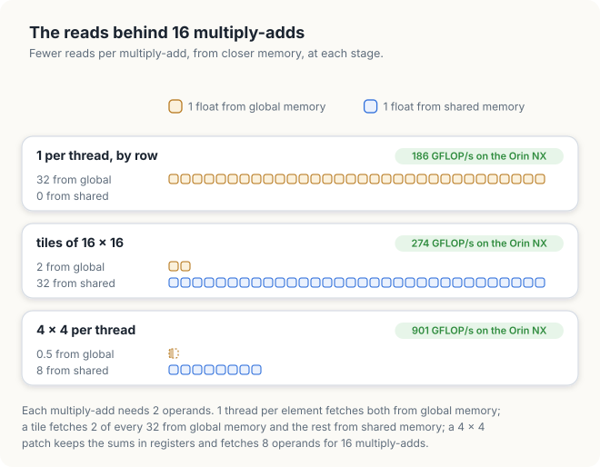
<figcaption><b>Figure 9.7</b> The floats read for 16 multiply-adds: 32 from global memory, then 2, then 0.5.</figcaption>
</figure>

## 9.6 Occupancy and launch bounds

### 9.6.1 Register usage and occupancy

The 16 sums, the 8 operands and the indices of the patch kernel are held in registers. Recall from
Chapter 2 that **occupancy** is the number of warps resident on an SM relative to the maximum
number the SM can hold. Each SM of both GPUs has 65,536 registers and can hold at most 1,536
threads. The program asks the CUDA runtime how many registers the compiler assigned to each
kernel, with `cudaFuncGetAttributes`, and how many blocks of a kernel fit on an SM, with
`cudaOccupancyMaxActiveBlocksPerMultiprocessor`.

<p class="listing"><b>Listing 9.5</b> Querying registers and occupancy.</p>

<div class="code-tabs">
<div class="code-tab" data-lang="Rust">

```rust,ignore
{{#include ../../../../code/oxide/ch09_sgemm/src/main.rs:182:197}}
```

</div>
<div class="code-tab" data-lang="C++">

```cpp
{{#include ../../../../code/ch09_sgemm/sgemm.cu:144:157}}
```

</div>
</div>

In Rust, `num_registers`, `local_size_bytes` and `max_active_blocks_per_multiprocessor` are
methods of the `CudaFunction` that the loaded module returns for a kernel name.

```console
resources                                         # Orin NX
  tiles of 16 x 16            38 registers  6 blocks per SM   0 bytes spilled
  tiles of 32 x 32            37 registers  1 blocks per SM   0 bytes spilled
  4 x 4 per thread            80 registers  3 blocks per SM   0 bytes spilled
  4 x 4, at least 4 blocks    64 registers  4 blocks per SM   0 bytes spilled
  4 x 4, at least 6 blocks    40 registers  6 blocks per SM  16 bytes spilled
```

At 80 registers per thread, a block of 256 threads needs 80 × 256 = 20,480 registers. Since
65,536 / 20,480 = 3.2, 3 blocks fit on an SM: 768 threads, half of the 1,536 that the SM can hold
(figure 9.8). The tiled kernel uses 38 registers per thread, so 6 blocks fit, 1,536 threads, which
reaches the thread limit.

<figure>
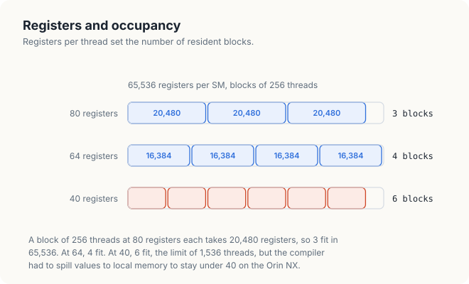
<figcaption><b>Figure 9.8</b> The registers per thread determine how many blocks of 256 threads fit on 1 SM.</figcaption>
</figure>

A tile of 32 × 32 requires a block of 1,024 threads, so only 1 block fits on an SM. At each of
its barriers, every thread on the SM waits, and no other block is available to run in the
meantime. As a result, the 32 × 32 tile ran at 222.1 GFLOP/s against 273.9 GFLOP/s for the 16 × 16
tile on the smaller GPU, and at 783.4 against 949.9 GFLOP/s on the larger one, even though it
offers twice the reuse.

### 9.6.2 `__launch_bounds__`

The qualifier `__launch_bounds__(maxThreads, minBlocks)` tells the compiler that the kernel is
launched with at most `maxThreads` threads per block and that at least `minBlocks` blocks should
fit on an SM. The compiler then limits the number of registers per thread to make this possible.
When the kernel needs more registers than the limit allows, the compiler **spills**: it keeps some
values in local memory, a per-thread area of global memory accessed through the caches, and loads
them back when they are needed.

```console
  4 x 4 per thread             152.47 ms    901.4 GFLOP/s                       # Orin NX
  4 x 4, at least 4 blocks     147.48 ms    931.9 GFLOP/s
  4 x 4, at least 6 blocks     147.91 ms    929.2 GFLOP/s
  4 x 4 per thread              42.66 ms   3222.0 GFLOP/s                       # Thor
  4 x 4, at least 4 blocks      42.30 ms   3249.4 GFLOP/s
  4 x 4, at least 6 blocks      42.10 ms   3264.2 GFLOP/s
```

On the smaller GPU, requesting 4 blocks reduced the registers to 64 and gained 3%. Requesting 6
blocks reduced them to 40, spilled 16 bytes per thread, and gained the same 3%. On the larger GPU,
the compiler chose 48 registers without any bound, which allows 5 blocks per SM, and requesting 6
blocks gained 1%. Doubling the number of resident warps therefore gained at most 3%. Additional
warps help only while the kernel waits for something that they can hide, and each thread of the
patch kernel already has 16 independent multiply-adds to issue.

<div class="bee bee-shocked" markdown="1">

Occupancy is a means, not a goal. `__launch_bounds__` trades registers for blocks, and the trade
can cause spills; measure each setting.

</div>

## 9.7 Loop unrolling in cuda-oxide

The Rust kernels of listings 9.1 to 9.4 write their loops as `while` loops marked with
`#[unroll]`, a cuda-oxide attribute that asks the compiler to replicate the loop body once per
iteration. After unrolling, a loop over `i` from 0 to 3 becomes 4 copies of its body, with `i` a
constant in each copy. The expressions `av[i]` and `acc[i][j]` then refer to fixed registers, and
the bounds check of every index into a fixed-size array is removed. A loop that is not unrolled
must keep `acc` in memory, because an instruction cannot select a register by an index computed
at run time. The CUDA C++ compiler unrolls short loops with constant bounds automatically.
cuda-oxide, at the revision used in this book, unrolls only loops marked `#[unroll]`, and it does
not unroll `for` loops over ranges.

The first version of the crate used `for` loops. The table compares that version with the same
kernels compiled with `#[kernel(unchecked_indexing)]`, which removes every bounds check, and with
the `while` loops of the listings.

| Rust kernel on the Orin NX | `for` loops | `for` loops, `unchecked_indexing` | `while` loops, `#[unroll]` |
|---|---|---|---|
| 1 per thread | 62.4 GFLOP/s | 71.3 GFLOP/s | 193.2 GFLOP/s |
| tiles of 16 × 16 | 201.8 GFLOP/s | 275.1 GFLOP/s | 274.7 GFLOP/s |
| 4 × 4 per thread | 575.6 GFLOP/s | 595.4 GFLOP/s | 844.9 GFLOP/s |

With `#[kernel(unchecked_indexing)]`, an index out of range is undefined behavior, as in C++.
Removing the checks helped the tiled kernel, whose cost was the checks, but not the patch kernel,
whose cost was keeping its arrays in memory. The listings therefore keep the bounds checks and
unroll the loops.

```console
$ cargo oxide run                                 # on a Jetson Orin NX
C = A B, 4096 x 4096 floats
  1 per thread           711.52 ms    193.2 GFLOP/s  max error 3.4e-5
  tiles of 16 x 16       500.39 ms    274.7 GFLOP/s  max error 3.4e-5
  4 x 4 per thread       162.67 ms    844.9 GFLOP/s  max error 3.4e-5
```

```console
$ cargo oxide run                                 # on a Jetson AGX Thor
C = A B, 4096 x 4096 floats
  1 per thread           209.81 ms    655.1 GFLOP/s  max error 3.4e-5
  tiles of 16 x 16       146.99 ms    935.0 GFLOP/s  max error 3.4e-5
  4 x 4 per thread        47.69 ms   2881.8 GFLOP/s  max error 3.4e-5
```

The Rust kernels match the C++ kernels within 10% for one element per thread and for tiles, and
reach 94% and 89% of the C++ patch kernel on the 2 GPUs.

<details class="check">
<summary>Why can an unrolled loop keep acc[i][j] in registers, and a loop that is not unrolled cannot?</summary>

Registers have fixed names that are chosen when the program is compiled; no instruction selects a
register by a value computed at run time. After unrolling, every `acc[i][j]` has constant `i` and
`j`, so each one names 1 register. In a loop, `i` changes at run time, so `acc` must be placed in
memory that can be indexed: local memory.

</details>

## 9.8 Comparison with cuBLAS

The program also times cuBLAS's `cublasSgemm` on the same matrices. cuBLAS stores matrices in
column-major order, so the call asks it for \\(B^T A^T\\), which in row-major storage is
\\(AB\\).

```console
$ ./sgemm                                         # on a Jetson Orin NX
GPU: Orin, 8 SMs
C = A B, 4096 x 4096 floats
  1 per thread, by column     4017.81 ms     34.2 GFLOP/s  max error 3.4e-05
  1 per thread, by row         739.14 ms    185.9 GFLOP/s  max error 3.4e-05
  tiles of 16 x 16             501.76 ms    273.9 GFLOP/s  max error 3.4e-05
  tiles of 32 x 32             618.78 ms    222.1 GFLOP/s  max error 3.4e-05
  4 x 4 per thread             152.47 ms    901.4 GFLOP/s  max error 3.4e-05
  4 x 4, at least 4 blocks     147.48 ms    931.9 GFLOP/s  max error 3.4e-05
  4 x 4, at least 6 blocks     147.91 ms    929.2 GFLOP/s  max error 3.4e-05
  cuBLAS                        91.92 ms   1495.3 GFLOP/s  max error 1.9e-05
```

```console
$ ./sgemm                                         # on a Jetson AGX Thor
GPU: NVIDIA Thor, 20 SMs
C = A B, 4096 x 4096 floats
  1 per thread, by column     1183.23 ms    116.2 GFLOP/s  max error 3.4e-05
  1 per thread, by row         230.54 ms    596.2 GFLOP/s  max error 3.4e-05
  tiles of 16 x 16             144.69 ms    949.9 GFLOP/s  max error 3.4e-05
  tiles of 32 x 32             175.43 ms    783.4 GFLOP/s  max error 3.4e-05
  4 x 4 per thread              42.66 ms   3222.0 GFLOP/s  max error 3.4e-05
  4 x 4, at least 4 blocks      42.30 ms   3249.4 GFLOP/s  max error 3.4e-05
  4 x 4, at least 6 blocks      42.10 ms   3264.2 GFLOP/s  max error 3.4e-05
  cuBLAS                        22.25 ms   6176.5 GFLOP/s  max error 3.4e-05
```

From the first kernel to the best, the product became 27 times as fast on the smaller GPU, from
34.2 to 931.9 GFLOP/s, and 28 times as fast on the larger one, from 116.2 to 3,264.2 GFLOP/s.
The best kernel reaches 39% and 40% of the FP32 peak. cuBLAS reaches 62% and 76%, so the best
kernel of this chapter runs at 62% and 53% of the speed of cuBLAS (figure 9.9). Repeated runs on
each GPU agreed within 2%.

<figure>
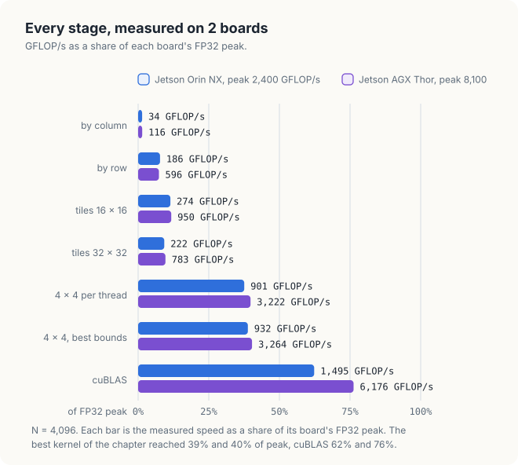
<figcaption><b>Figure 9.9</b> Every kernel on both GPUs, in GFLOP/s and as a share of each GPU's FP32 peak.</figcaption>
</figure>

The remaining gap comes from techniques beyond the scope of this chapter, which cuBLAS combines
and tunes for each GPU:

- **Larger patches.** With 8 × 8 elements per thread, a kernel reads shared memory 8 times less
  than with one element per thread, against 4 times less for 4 × 4, at the cost of more registers.
- **Wide shared-memory loads.** 4 operands can be read with 1 `float4` load, as in Chapter 7.
- **Double buffering.** The next pair of tiles is copied while the current pair is used, so that
  the barrier never waits for memory.
- **Warp tiling.** The patches of each warp are arranged so that its shared-memory reads fall in
  as few banks and instructions as possible.

**Tensor cores**, units that multiply small matrices in 1 instruction, are faster still. In their
TF32 mode they keep 10 bits of the float's mantissa instead of 23, so cuBLAS uses them for SGEMM
only when the program allows it. Chapter 11 returns to cuBLAS.

## 9.9 The complete programs

<p class="listing"><b>Listing 9.6</b> The complete programs. <a href="https://github.com/arpanpathak/gpu-parallel-book/blob/main/code/oxide/ch09_sgemm/src/main.rs">code/oxide/ch09_sgemm/src/main.rs</a> <a href="https://github.com/arpanpathak/gpu-parallel-book/blob/main/code/ch09_sgemm/sgemm.cu">code/ch09_sgemm/sgemm.cu</a></p>

<div class="code-tabs">
<div class="code-tab" data-lang="Rust">

```rust,ignore
{{#include ../../../../code/oxide/ch09_sgemm/src/main.rs}}
```

</div>
<div class="code-tab" data-lang="C++">

```cpp
{{#include ../../../../code/ch09_sgemm/sgemm.cu}}
```

</div>
</div>

## Common mistakes

- **`threadIdx.x` on the row index of a row-major output.** Adjacent threads then read and write
  elements \\(N\\) floats apart; the kernel ran 5 times slower.
- **A missing second barrier in a tiled loop.** The next iteration overwrites a tile while other
  threads are still reading it.
- **Tiles so large that 1 block fills an SM.** At every barrier the whole SM waits.
- **Forcing occupancy.** `__launch_bounds__` with a high `minBlocks` can cause register spills;
  measure each setting.
- **Small fixed-size arrays in a loop that is not unrolled.** The C++ compiler unrolls loops with
  constant bounds automatically; in cuda-oxide, write the loop as `while` with `#[unroll]`.
- **Comparing only against the peak.** A library such as cuBLAS shows what the hardware can reach
  on the same problem.

<div class="summary" markdown="1">

## Summary

- A product of \\(N \times N\\) matrices performs \\(2N^3\\) operations on \\(3N^2\\) values. Each
  value has \\(N\\) uses, and a GPU needs about 100 uses per load from memory: 94 FLOP per float
  on the Orin NX and 119 on the Thor.
- The kernel with one thread per element ran at 1.4% of peak. Mapping `threadIdx.x` along a row
  reduced the sectors per warp from 17 to 4 and made the kernel 5 times as fast, with the caches
  serving most of the reuse.
- Tiles of \\(T \times T\\) in shared memory give \\(T\\) FLOP per float from global memory, but
  still 2 shared-memory reads per multiply-add.
- A 4 × 4 patch per thread keeps 16 sums in registers and reads 8 values for 16 multiply-adds.
  It ran 3.3 to 3.4 times as fast as the tiled kernel, at 38% to 40% of peak.
- The registers per thread determine occupancy. `__launch_bounds__` trades registers for blocks
  and can cause spills; the best setting gained 3%.
- In cuda-oxide, `while` loops with `#[unroll]` kept the patch in registers with the bounds
  checks in place; the Rust kernels reached 89% to 110% of the C++ kernels.
- cuBLAS reached 62% and 76% of peak; the best kernel of the chapter ran at 62% and 53% of the
  speed of cuBLAS.

</div>

In Part IV, we turn to the C++ code around such kernels. In Chapter 10, we develop resource-safe buffers and
error handling, and Chapter 11 the CUDA libraries, including cuBLAS.

## Exercises

1. Compute the time that a product of 2 matrices of 8,192 × 8,192 floats needs at the FP32 peak
   of your GPU, and the least memory traffic it needs. Is it compute-bound?
2. Compute the FLOP per float that your GPU needs from its peak and its memory bandwidth. Which
   kernel of the chapter first provides that much reuse?
3. In listing 9.1, how many distinct sectors of \\(B\\) does 1 warp read at each \\(k\\)? How many
   in listing 9.2?
4. Derive the reuse of \\(T\\) FLOP per float for a \\(T \times T\\) tile, and compute it for
   \\(T\\) = 8, 16 and 32.
5. The patch kernel reads `tileB[k][tx * 4 + i]`. Which banks do the 16 threads with the same
   `ty` access for `i = 0`? Is there a bank conflict?
6. Change the patch to 8 × 4 elements per thread, so that a block computes a 128 × 64 tile. Count
   its reuse, registers and blocks per SM, and measure it.
7. Remove `#[unroll]` from the inner loops of the Rust patch kernel, run it, and explain the
   result.
8. Run `sgemm` with \\(N\\) = 1,024 and 8,192. How does the gap to cuBLAS change, and why?

## Sources and further reading

- NVIDIA, *CUDA C++ Programming Guide*, "Shared Memory" and "Launch Bounds":
  <https://docs.nvidia.com/cuda/cuda-c-programming-guide/>
- NVIDIA, *CUDA C++ Best Practices Guide*, "Occupancy" and "Register Pressure":
  <https://docs.nvidia.com/cuda/cuda-c-best-practices-guide/>
- NVIDIA, *cuBLAS Library*, `cublasSgemm` and math modes: <https://docs.nvidia.com/cuda/cublas/>
- V. Volkov and J. Demmel, "Benchmarking GPUs to Tune Dense Linear Algebra", SC08, 2008.
- S. Boehm, "How to Optimize a CUDA Matmul Kernel for cuBLAS-like Performance", 2022.
- D. Kirk and W. Hwu, *Programming Massively Parallel Processors*, 4th ed., Morgan Kaufmann, 2022,
  chapters on matrix multiplication and tiling.
