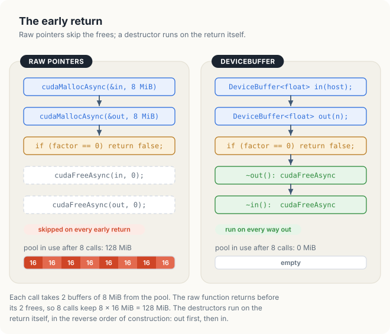
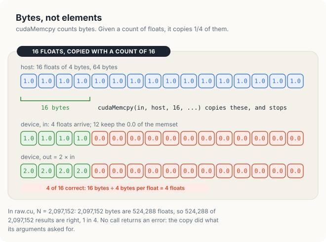
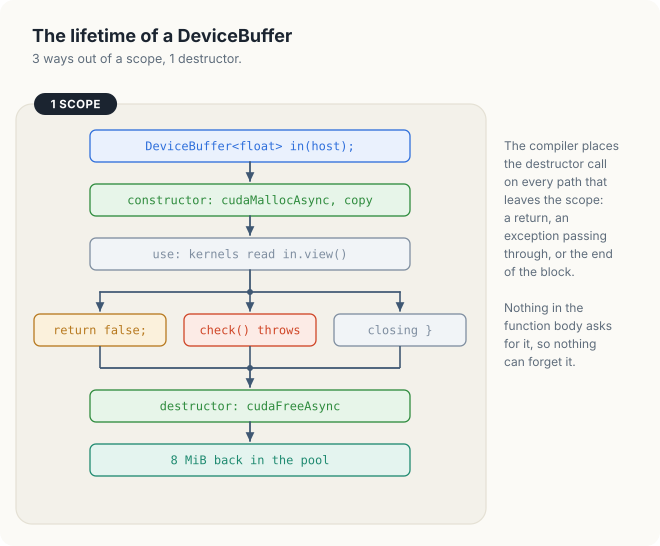
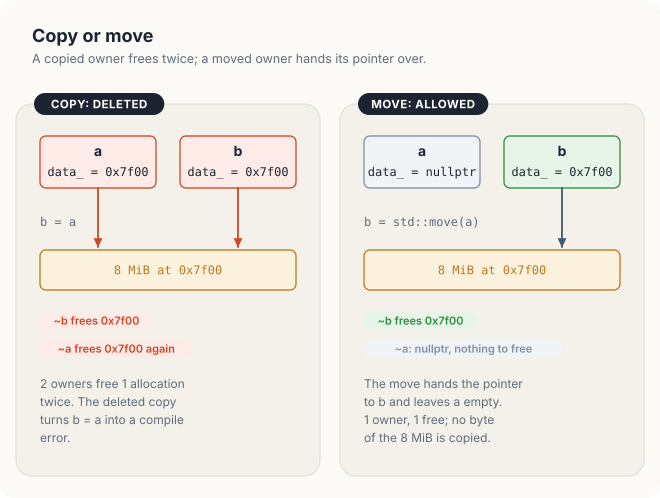
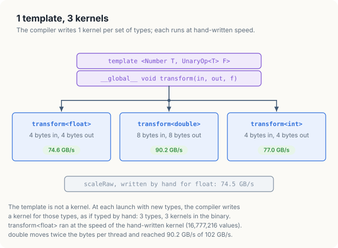
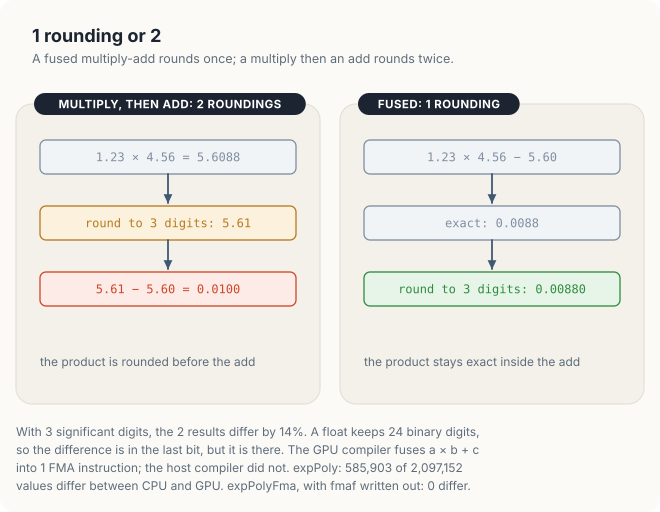

# Chapter 10: Modern C++ for CUDA

The host code of Chapters 3 to 9 was written in the style of the CUDA C API. Device memory is
allocated with `cudaMalloc` and released with `cudaFree`, every API call returns an error code
of type `cudaError_t`, and every size passed to a copy is a number of bytes. This style keeps
each step of a program visible, which is why we used it for the first programs. It also leaves
3 responsibilities to the programmer at every call site. Every allocation must be freed on
every path out of a function, every error code must be examined, and every size must be given
in the unit that the called function expects. The compiler checks none of them.

In this chapter, we use the features of modern C++, the language as standardized in 2011 and
later, to make the compiler enforce these rules. We first run 3 short programs in which each
rule is broken, and measure the consequences. We then rewrite them with a class that frees its
memory in its destructor, an error-checking function, template kernels, functions compiled for
both host and device, compile-time checks, the `cuda::` library and C++20 concepts. We measure
each technique to confirm that it adds no run-time cost. Each one also has a Rust counterpart,
which we show alongside, since Rust makes most of these rules part of the language.

<div class="covers" markdown="1">

This chapter covers

- Three errors that the CUDA C API does not detect, run and measured
- RAII: allocation in a constructor and release in a destructor
- ownership: why copying is forbidden and moving is allowed
- error reporting with exceptions and `std::source_location`, without a macro
- template kernels and their instantiations
- `__host__ __device__` functions, and rounding differences between host and device
- `constexpr` and `static_assert`
- `cuda::std::span`, `cuda::atomic_ref` and thread scopes
- C++20 concepts
- the corresponding features of Rust: `Drop`, moves, `?`, generic kernels and trait bounds

</div>

The code of the chapter is in
[`code/ch10_modern/`](https://github.com/arpanpathak/gpu-parallel-book/tree/main/code/ch10_modern)
for C++ and in
[`code/oxide/ch10_modern/`](https://github.com/arpanpathak/gpu-parallel-book/tree/main/code/oxide/ch10_modern)
for Rust. The outputs in this chapter come from 2 integrated GPUs: a Jetson Orin NX (8 SMs,
102 GB/s, CUDA 12.6), whose runs the listings show, and a Jetson AGX Thor (20 SMs, 273 GB/s,
CUDA 13.2), which gives the same counts.

## 10.1 Problems with raw CUDA C

A **resource** is anything a program acquires from the system and must later return, such as
device memory, a stream, an event or an open file. The CUDA C API manages resources with pairs
of calls, such as `cudaMalloc` and `cudaFree`, and it reports failures through return values of
type `cudaError_t`. Both conventions work correctly as long as the caller remembers to make the
second call and to examine the return value. In this section, we look at what happens when the
caller does not. The program `raw.cu` contains 3 such errors, each in a few lines of code that
look reasonable.

### 10.1.1 Measuring the device memory in use

To detect a leak, we need an exact count of the device memory that a program holds. The programs
of this chapter allocate with `cudaMallocAsync(&pointer, bytes, stream)`, the **stream-ordered
allocator** introduced in CUDA 11.2. It behaves like `cudaMalloc`, with two differences. First,
the allocation and the matching `cudaFreeAsync` are ordered in a stream, the queue of GPU work
introduced in Chapter 6, in the same way as kernel launches. Second, the memory comes from a
**pool**, a reserve of device memory that the driver keeps for each GPU and reuses between
allocations. The pool records the number of bytes that have been allocated and not yet freed in
the attribute `cudaMemPoolAttrUsedMemCurrent`, which Listing 10.1 reads and converts to MiB.

<p class="listing"><b>Listing 10.1</b> The bytes in use from the pool, in MiB. <a href="https://github.com/arpanpathak/gpu-parallel-book/blob/main/code/ch10_modern/raw.cu">code/ch10_modern/raw.cu</a></p>

<div class="code-tabs">
<div class="code-tab" data-lang="Rust">

```rust,ignore
{{#include ../../../../code/oxide/ch10_modern/src/main.rs:115:129}}
```

</div>
<div class="code-tab" data-lang="C++">

```cpp
{{#include ../../../../code/ch10_modern/raw.cu:19:28}}
```

</div>
</div>

The older function `cudaMemGetInfo` is not suitable for this purpose. It reports the free memory
of the whole device, which other programs also change. On an integrated GPU, which shares its
memory with the operating system, an allocation of 128 MiB changed the free memory reported by
`cudaMemGetInfo` by only 0.5 MiB on the first GPU and by 129 MiB on the second. The pool's
count, in contrast, depends only on the allocations of our own program.

### 10.1.2 Memory leaks on early returns

A **memory leak** occurs when a program has allocated memory and no longer holds its address, so
that the memory can no longer be freed. Listing 10.2 shows a function that scales a vector on
the GPU and contains such a leak.

<p class="listing"><b>Listing 10.2</b> An early return before the frees.</p>

<div class="code-tabs">
<div class="code-tab" data-lang="Rust">

```rust,ignore
{{#include ../../../../code/oxide/ch10_modern/src/main.rs:131:157}}
```

</div>
<div class="code-tab" data-lang="C++">

```cpp
{{#include ../../../../code/ch10_modern/raw.cu:30:52}}
```

</div>
</div>

The function allocates 2 device buffers, `in` and `out`, with the 2 calls to `cudaMallocAsync`.
It then copies the input to the device, launches the kernel `scale`, copies the result back, and
frees both buffers at the end. However, when the factor is 0, there is nothing to compute, and
the function returns `false` before it reaches the 2 calls to `cudaFreeAsync`. The early return
is correct by itself. The error is that it skips the frees. The pointers `in` and `out` are
local variables, so the return destroys them, and with them the only record of where the 2
buffers are. The memory remains allocated until the program exits.

Each buffer holds N = 2,097,152 floats of 4 bytes, which is 8 MiB, so each early return leaks
16 MiB. The test program calls the function 8 times with a factor of 0, which should leave
8 × 16 MiB = 128 MiB allocated, and then reads the pool's count:

<figure>

<figcaption><b>Figure 10.1</b> An early return skips the 2 frees. With a destructor (section 10.2), the buffers are freed on the return itself.</figcaption>
</figure>

```console
$ nvcc -arch=native raw.cu -o raw && ./raw
1. 8 calls that return early: 128.0 MiB lost
```

The measured 128.0 MiB agrees with the calculation. No error was reported, and none will be,
because as far as CUDA is concerned the program still owns the memory. A long-running program,
such as a server or a training job that calls this function millions of times, will eventually
run out of device memory, long after the leak occurred and in code that has nothing to do with
it.

In Rust, frees are written by hand only after `ManuallyDrop` has turned the automatic ones off,
and the Rust function of Listing 10.2 then loses the same 128.0 MiB.

### 10.1.3 Unchecked launch errors

Recall from Chapter 3 that a GPU contains several **streaming multiprocessors** (SMs), the
processors that execute the threads of a kernel; the Jetson Orin NX has 8 of them. A **block**
is a group of threads that are launched together, run on the same SM, and can share memory and
synchronize with each other. The **compute capability** is a version number, such as 8.7 for
the Orin NX, that NVIDIA assigns to each GPU generation and that determines which features the
generation has. Since compute capability 2.0, every CUDA GPU limits a block to at most 1,024
threads. The second error in `raw.cu` launches blocks of 2,048 threads, twice the limit.

<p class="listing"><b>Listing 10.3</b> A launch that exceeds the block size limit.</p>

<div class="code-tabs">
<div class="code-tab" data-lang="Rust">

```rust,ignore
{{#include ../../../../code/oxide/ch10_modern/src/main.rs:291:304}}

fn main() -> Result<(), Error> {
    // ...
{{#include ../../../../code/oxide/ch10_modern/src/main.rs:378:382}}
    // ...
}
```

</div>
<div class="code-tab" data-lang="C++">

```cpp
int main()
{
    // ...
{{#include ../../../../code/ch10_modern/raw.cu:74:80}}
    // ...
}
```

</div>
</div>

```console
2. 2048 threads per block: out[0] = 0.0, expected 2.0
   the error, found only by asking: invalid configuration argument
```

The launch syntax `<<<...>>>` has no return value, so a launch that fails cannot return an error
code to its caller. Instead, CUDA records the error, and the next call to `cudaGetLastError`
returns it. In the meantime, the program continues. Let us follow the first element of `out`
through the program. Before the launch, `cudaMemset`, which fills device memory with a given
byte, writes 0 into every byte of `out`, so `out[0]` is 0.0. The launch is rejected, and no
thread runs. The copy that follows the launch succeeds, but it copies an array that no kernel
has written, so `out[0]` still holds the 0.0 written by `cudaMemset`, where the kernel would
have written 1.0 × 2 = 2.0. A program that does not call `cudaGetLastError` continues with wrong
data and reports nothing. On the second GPU, CUDA 13.2 describes the same failure as `invalid
argument`. The wording of the message differs between CUDA versions, but in both cases the error
is visible only to a program that asks for it.

The Rust launch of Listing 10.3 never reaches the driver: `prepare_scale` returns an `Err`, and
the `?` passes it to the caller (section 10.2.6).

### 10.1.4 Size errors in copies

The function `cudaMemcpy(dst, src, count, kind)` copies `count` **bytes**. Its pointer
parameters have type `void*`, a pointer to memory of no particular type, so the function cannot
know that they point to floats and cannot check a count of floats against them. The third error
in `raw.cu` passes `N`, the number of floats, where the number of bytes, `N * sizeof(float)`,
was intended.

<p class="listing"><b>Listing 10.4</b> A count of floats passed as a count of bytes.</p>

<div class="code-tabs">
<div class="code-tab" data-lang="Rust">

```rust,ignore
{{#include ../../../../code/oxide/ch10_modern/src/main.rs:159:178}}
```

</div>
<div class="code-tab" data-lang="C++">

```cpp
int main()
{
    // ...
{{#include ../../../../code/ch10_modern/raw.cu:82:92}}
    // ...
}
```

</div>
</div>

Consider a small example with N = 16. The host array holds 16 floats of 4 bytes, or 64 bytes.
The call `cudaMemcpy(in, host, 16, ...)` copies 16 bytes, which are the first 16 ÷ 4 = 4 floats.
The other 12 floats of `in` keep the value 0.0 written by `cudaMemset`. The kernel doubles every
element, so 4 results are 2.0 and 12 are 0.0: only 1 result in 4 is correct, as Figure 10.2
shows.

<figure>

<figcaption><b>Figure 10.2</b> A count of 16 copies 16 bytes, which are 4 floats.</figcaption>
</figure>

```console
3. a copy of N bytes, not N floats: 524288 of 2097152 correct
```

With N = 2,097,152, the copy moved 2,097,152 bytes, which are 524,288 floats, so again exactly 1
result in 4 is correct. Every call returned `cudaSuccess`, because the API did exactly what its
arguments asked for.

The Rust function calls the driver's copy inside `unsafe` and also finds 524,288 of 2,097,152
correct: `unsafe` states that the copy stays inside both arrays, which it does, not that the count
is the one intended.

<div class="bee bee-shocked" markdown="1">

In 3 short programs, the CUDA C API lost 128 MiB of memory, skipped a kernel and copied 1/4 of
an array, and none of these errors produced a message.

</div>

## 10.2 RAII: The Device Buffer

The three errors of section 10.1 have a common cause. Each rule, such as "every allocation is
freed", must be applied by hand at every place in the program where it is relevant, and a single
omission is enough to break it. C++ allows us to state such a rule once, inside a type, and have
the compiler apply it wherever the type is used. We begin with the rule that every allocation is
freed.

### 10.2.1 Constructors, destructors and scope

A **scope** is a region of a program, delimited by braces `{ }`, in which a name is visible. The
body of a function is a scope, and so is the body of a loop. An object of a class type is
created by a **constructor**, a member function of the class that runs when the object is
defined. The object is destroyed by its **destructor**, `~ClassName()`, a member function that
the compiler calls when the object's lifetime ends. The **lifetime** of an object is the period
during which the object exists, from its construction to its destruction. For a local variable,
the lifetime ends when control leaves its scope, whichever way it leaves: through the closing
brace, a `return`, a `break`, or an exception that passes through the scope.

Before we name the technique, let us follow 1 call of the function of Listing 10.2 with a factor
of 0, first as written and then with the 2 pointers replaced by objects whose destructor frees
the memory. As written, the function performs 4 steps. It allocates `in`, and the pool holds
8 MiB; it allocates `out`, and the pool holds 16 MiB; it tests the factor; and it returns. The
return removes the local variables `in` and `out`, which are plain addresses, and 16 MiB remain
allocated with no variable that records where they are. With objects, the first 3 steps are the
same. At the return, however, the compiler destroys the 2 local objects, in the reverse order of
their construction. The destructor of `out` frees 8 MiB, the destructor of `in` frees the other
8 MiB, and the pool holds 0 MiB. Neither version contains a call to `cudaFreeAsync` on the path
of the early return. The second version obtains its 2 frees from the type of its variables.

<div class="key-observation">

<span class="box-label">Key observation</span> A release written in a destructor runs on every
path out of the scope, because the compiler, not the programmer, writes the call at each exit.

</div>

<div class="definition">

<span class="box-label">Definition 10.1</span> **RAII.** *Resource acquisition is
initialization* (RAII) is the practice of acquiring a resource in the constructor of an object
and releasing it in the destructor of the same object. The resource then lives exactly as long
as the object.

*Example.* An object of the class `DeviceBuffer<float>` of section 10.2.2, created with a count
of 2,097,152, allocates 8 MiB in its constructor and frees the 8 MiB in its destructor when its
scope ends, whether by the closing brace, by a `return` or by an exception.

</div>

Because the compiler, and not the programmer, inserts the call to the destructor, the release
happens on every path out of the scope. The pseudocode below marks where the compiler inserts
these calls.

```text
{                                   # a scope opens
    buffer ← DeviceBuffer(n)        # constructor: allocate n elements
    ...                             # use buffer
    if done early: return           # compiler inserts: destroy buffer, then return
    ...
}                                   # compiler inserts: destroy buffer
                                    # destroy = destructor: free the allocation
```

<figure>
 in(host) calls the constructor, which allocates with cudaMallocAsync and copies; kernels then read in.view(). 3 ways out branch from there: return false, check() throws, and the closing brace. All 3 join into 1 box, the destructor, which calls cudaFreeAsync and gives the 8 MiB back to the pool.">
<figcaption><b>Figure 10.3</b> All 3 ways out of a scope lead to the destructor.</figcaption>
</figure>

The C++ standard library already uses RAII. A `std::vector` frees its array in its destructor,
and a `std::unique_ptr` deletes the object it points to. Device memory needs a class of its own
only because `new` and `delete` manage host memory, while device memory is allocated and freed
through CUDA calls.

### 10.2.2 The class

`DeviceBuffer<T>` holds `count` values of type `T` in device memory. Listing 10.5 shows its
constructors and destructor.

<p class="listing"><b>Listing 10.5</b> <code>DeviceBuffer</code> and <code>PoolBuffer</code>: construction and destruction. <a href="https://github.com/arpanpathak/gpu-parallel-book/blob/main/code/ch10_modern/device_buffer.hpp">code/ch10_modern/device_buffer.hpp</a></p>

<div class="code-tabs">
<div class="code-tab" data-lang="Rust">

```rust,ignore
{{#include ../../../../code/oxide/ch10_modern/src/main.rs:190:218}}

{{#include ../../../../code/oxide/ch10_modern/src/main.rs:237:243}}
```

</div>
<div class="code-tab" data-lang="C++">

```cpp
{{#include ../../../../code/ch10_modern/device_buffer.hpp:38:57}}
    // ...
};
```

</div>
</div>

The Rust type `PoolBuffer<T>` frees its memory in the method `drop` of the trait `Drop`, which
section 10.2.6 describes.

The first constructor allocates `count` elements. The second constructor allocates enough
elements for a host vector and copies the vector into them. The destructor frees the
allocation. We explain three details of this code.

First, the size in bytes is always computed from the type: `bytes()` returns
`count_ * sizeof(T)`. Since no caller ever writes a byte count, the error of section 10.1.4
cannot occur.

Second, the second constructor delegates the allocation to the first, with
`: DeviceBuffer(host.size())`, before its body copies the data. A constructor that begins by
calling another constructor of the same class in this way is called a **delegating
constructor**. If the copy throws an exception
(section 10.2.4), the object has already been constructed, so its destructor runs and the
allocation is freed.

Third, the `static_assert` rejects types that cannot be stored in device memory. A type is
**trivially copyable** when copying its bytes produces a valid copy of the object. `float`,
`int` and a struct of floats are trivially copyable. A `std::string` is not, because it holds a
pointer to host memory, and a copy of its bytes on the device would contain an address that the
GPU cannot use. `DeviceBuffer<std::string>` is therefore a compile error. We describe
`static_assert` in more detail in Section 10.5.

Note also that the first constructor is declared `explicit`. Without this keyword, the compiler
would convert a number into a buffer implicitly, and a function that takes a
`DeviceBuffer<float>` would accept the argument `5` and allocate 5 floats.

### 10.2.3 Ownership and move semantics

A class that frees memory in its destructor must define what it means to copy one of its
objects. C++ performs a copy with 2 member functions. The **copy constructor** creates a new
object from an existing one, as in `DeviceBuffer<float> b = a;`. The **copy assignment
operator** overwrites an existing object with the contents of another, as in `b = a;` when `b`
already exists. If a class does not define them, the compiler generates both, and the generated
versions copy every member, field by field.

Let us follow 1 allocation through such a field-by-field copy. Suppose that `a` holds
`data_` = 0x7f00 and `count_` = 2,097,152, the 8 MiB of a buffer of floats. The statement
`b = a` copies both fields, so `b` also holds 0x7f00 and 2,097,152. At the end of the scope,
the destructor of `b` frees 0x7f00, and then the destructor of `a` frees 0x7f00 a second time.
Freeing the same allocation twice is called a **double free**. It corrupts the records of the
allocator, which may later hand out memory that another buffer is still using.

The same allocation can instead pass from `a` to `b` in 2 steps: copy the 2 fields to `b`, then
write `nullptr` and 0 into the fields of `a`. Afterwards `b` holds 0x7f00 and `a` holds
`nullptr`. At the end of the scope, the destructor of `b` frees 0x7f00, and the destructor of
`a` finds `nullptr` and frees nothing. The allocation is freed exactly once. In both cases, only
the 16 bytes of the 2 fields are copied, never the 8 MiB of data they describe.

<div class="key-observation">

<span class="box-label">Key observation</span> 2 objects that hold the same address free it
twice. If the object that gives up the address is left holding `nullptr`, exactly 1 object frees
it.

</div>

<div class="definition">

<span class="box-label">Definition 10.2</span> **Owner and move.** The **owner** of an
allocation is the object whose destructor frees it. A **move** transfers an allocation from 1
owner to another: the new object takes the address, and the old object is left empty, so that
its destructor frees nothing.

*Example.* After `b = std::move(a)`, `b` owns the 8 MiB at 0x7f00 and `a` holds `nullptr`.

</div>

For this reason, each allocation has exactly 1 owner. Copying is forbidden: the 2 declarations
marked `= delete` in Listing 10.6 remove the copy constructor and the copy assignment operator,
so `b = a` does not compile. Moving, however, is allowed. The function `std::move(a)` moves
nothing by itself. It marks `a` as an object whose contents may be taken, and the compiler then
calls the **move constructor** or the **move assignment operator**, the 2 member functions that
perform the transfer, instead of the copy operations. Figure 10.4 shows both cases.

<figure>

<figcaption><b>Figure 10.4</b> A copy gives 2 owners that free the same memory twice; a move leaves 1 owner.</figcaption>
</figure>

<p class="listing"><b>Listing 10.6</b> Copies deleted, moves allowed.</p>

<div class="code-tabs">
<div class="code-tab" data-lang="Rust">

```rust,ignore
{{#include ../../../../code/oxide/ch10_modern/src/main.rs:220:225}}
```

</div>
<div class="code-tab" data-lang="C++">

```cpp
// `count` values of T in device memory, owned by exactly 1 object.
template <typename T>
class DeviceBuffer {
    // ...
{{#include ../../../../code/ch10_modern/device_buffer.hpp:59:75}}
    // ...
};
```

</div>
</div>

The move constructor uses `std::exchange(other.data_, nullptr)`, which returns the old value of
`other.data_` and stores `nullptr` in its place in a single step. The move assignment operator
first frees the memory that `*this` held, then takes the pointer of `other`. The test `this !=
&other` prevents a self-assignment such as `a = std::move(a)` from freeing the buffer that it is
about to keep. Both move operations are declared `noexcept`, a promise that they never throw.
The promise is easy to keep, because they only exchange 2 values.

C++ programmers refer to this set of member functions as the **rule of 5**. A class that defines
any of the destructor, copy constructor, copy assignment, move constructor and move assignment
usually needs to define or delete all 5. The table lists the choices that `DeviceBuffer` makes.

| Member | `DeviceBuffer` | Reason |
|---|---|---|
| destructor | frees `data_` | the object owns the allocation |
| copy constructor | deleted | 2 owners would free twice |
| copy assignment | deleted | same |
| move constructor | takes the pointer, leaves `nullptr` | 1 owner after the move |
| move assignment | frees its own, then takes the pointer | same, without leaking the old buffer |

With the copy operations deleted, an accidental copy becomes a compile error. We added the line
`DeviceBuffer<float> copy = in;` to the program and compiled it:

```console
copy.cu(113): error: function "DeviceBuffer<T>::DeviceBuffer(const DeviceBuffer<T> &) [with T=float]" (declared at line 59 of device_buffer.hpp) cannot be referenced -- it is a deleted function
      DeviceBuffer<float> copy = in;
                                 ^
```

In Rust, `let b = a;` moves the buffer, as `move_once` in Listing 10.6 does, and a later use of
`a` is the compile error:

```console
error[E0382]: borrow of moved value: `a`
   --> src/main.rs:224:17
    |
222 |     let a = PoolBuffer::from_host(stream, host)?;
    |         - move occurs because `a` has type `PoolBuffer<f32>`, which does not implement the `Copy` trait
223 |     let b = a;
    |             - value moved here
224 |     let first = a.len();
    |                 ^ value borrowed here after move
```

Listing 10.7 shows the rest of the class: the functions that give access to the memory, and the
single function that frees it.

<p class="listing"><b>Listing 10.7</b> Access, and the 1 place that frees.</p>

<div class="code-tabs">
<div class="code-tab" data-lang="Rust">

```rust,ignore
{{#include ../../../../code/oxide/ch10_modern/src/main.rs:227:243}}
```

</div>
<div class="code-tab" data-lang="C++">

```cpp
// `count` values of T in device memory, owned by exactly 1 object.
template <typename T>
class DeviceBuffer {
    // ...
{{#include ../../../../code/ch10_modern/device_buffer.hpp:77:100}}
};
```

</div>
</div>

`view()` returns a read-only view of the buffer and `span()` a writable one; we introduce
the type of these views in section 10.6.1. `release()` tests for `nullptr` because a buffer that has
been moved from no longer owns any memory. A Rust value that has been moved from is never
dropped, so `drop` needs no such test.

### 10.2.4 Error reporting without a macro

In Chapters 3 to 9, we checked each CUDA call with a small function that printed the error and
ended the program. Many CUDA programs use a macro instead, `CHECK(call)`. A **macro** is a name that
the **preprocessor**, a text-substitution step that runs before the compiler proper, replaces
with other text wherever the name appears. Programs use a macro here for one reason: the
preprocessor replaces `__FILE__` and `__LINE__` with the file name and line number of the place
where the macro is written, so the message names the call that failed. For example, `CHECK`
written on line 40 of `app.cu` produces a message that contains `app.cu` and 40. Before C++20, a
function had no way to find out where it was called from. C++20 added `std::source_location` for
this purpose.

A **default argument** is a value that a function parameter takes when the caller omits it. When
`std::source_location::current()` is used as a default argument, it is evaluated at the call
site, so it records the file and line of the caller rather than a line inside `check`. Listing
10.8 shows the function.

<p class="listing"><b>Listing 10.8</b> <code>check</code>, with the caller's file and line.</p>

<div class="code-tabs">
<div class="code-tab" data-lang="Rust">

```rust,ignore
{{#include ../../../../code/oxide/ch10_modern/src/main.rs:180:188}}
```

</div>
<div class="code-tab" data-lang="C++">

```cpp
{{#include ../../../../code/ch10_modern/device_buffer.hpp:14:25}}
```

</div>
</div>

In Rust, the attribute `#[track_caller]` makes `Location::caller()` return the file and line of
the call, so the Rust `check` needs no macro either.

`check` reports a failure by throwing an **exception**, an object that travels up the chain of
function calls until a `catch` clause handles it. On its way, the exception leaves every scope
it passes through, and every local object in those scopes is destroyed. The destruction of local
objects while an exception travels up the chain of calls is called **stack unwinding**. It is
the path labelled "check() throws" in Figure 10.3. For example, if `main` calls a function `f`
that holds 2 buffers, and `check` throws inside `f`, the 2 destructors of `f` run first, and
only then does the exception reach the `catch` in `main`. As a result, the buffers of a function
that fails are freed before the error reaches the code that handles it.

Note that the destructor itself does not call `check`. A destructor may run while an exception
is already travelling, and if a second exception is thrown at that moment, the program ends with
`std::terminate`, a standard function that stops the program immediately. The destructor
therefore frees the memory and ignores the result. A program that needs to know whether a free
succeeded can call `cudaDeviceSynchronize` through `check` before the buffer goes out of scope.

### 10.2.5 The errors of section 10.1, revisited

We can now rewrite the functions of section 10.1 with `DeviceBuffer` and `check`. Listing 10.9
shows the function with the early return and the launch with 2,048 threads per block.

<p class="listing"><b>Listing 10.9</b> The early return and the launch over the limit, with <code>DeviceBuffer</code> and <code>check</code>. <a href="https://github.com/arpanpathak/gpu-parallel-book/blob/main/code/ch10_modern/modern.cu">code/ch10_modern/modern.cu</a></p>

<div class="code-tabs">
<div class="code-tab" data-lang="Rust">

```rust,ignore
{{#include ../../../../code/oxide/ch10_modern/src/main.rs:271:304}}
```

</div>
<div class="code-tab" data-lang="C++">

```cpp
{{#include ../../../../code/ch10_modern/modern.cu:112:135}}
```

</div>
</div>

The function `main` in Listing 10.10 makes the same 8 calls as `raw.cu`, launches the 2,048
threads inside a `try` block, and copies 2,097,152 floats through the constructor that takes a
host vector.

<p class="listing"><b>Listing 10.10</b> The measurements of section 10.1, repeated.</p>

<div class="code-tabs">
<div class="code-tab" data-lang="Rust">

```rust,ignore
fn main() -> Result<(), Error> {
    // ...
{{#include ../../../../code/oxide/ch10_modern/src/main.rs:369:387}}
    // ...
}
```

</div>
<div class="code-tab" data-lang="C++">

```cpp
int main()
{
    // ...
{{#include ../../../../code/ch10_modern/modern.cu:182:206}}
    // ...
}
```

</div>
</div>

```console
$ nvcc -std=c++20 --extended-lambda -arch=native modern.cu -o modern && ./modern
GPU: Orin, 8 SMs
ownership
  8 calls that return early: 0.0 MiB lost
  2048 threads per block threw: modern.cu:134: invalid configuration argument
  after the exception: 0.0 MiB in use
  copies sized by the type: 2097152 of 2097152 correct
```

All three errors are gone. The early returns leaked 0.0 MiB. The launch error became an exception
that names line 134, the `check(cudaGetLastError())` after the launch, and the 2 buffers of
`launchTooWide`, 16 MiB in total, were freed while the exception travelled to `main`. Every
element was copied correctly, because no caller states a byte count.

### 10.2.6 RAII in Rust

Rust builds RAII into the language. A **trait** in Rust is a named set of methods that a type
can implement; a function can then require that its argument type implements the trait. The
destructor of a type is the method `drop` of the trait `Drop`, and the compiler calls it when
the owner of a value goes out of scope. cuda-core, the host-side **crate** (Rust package) of
cuda-oxide, provides a `DeviceBuffer<T>` that implements `Drop` by freeing its allocation, so a
Rust program has no free to forget. Ownership is also the default. The statement `let b = a;`
**moves** the buffer, and any later use of `a` is a compile error. A copy must be requested
explicitly, and `DeviceBuffer` does not provide one.

Rust reports errors as values of type `Result<T, E>`, which is either `Ok(value)` or
`Err(error)`. The `?` operator after a call returns the `Err` from the enclosing function
immediately. Like any other return, this return drops every local buffer.

Listing 10.11 shows the Rust version of the function with the early return. The helper
`pool_copy` allocates from the same pool as the C++ program, so that the 2 counts can be
compared. The safe cuda-core functions, such as `DeviceBuffer::from_host`, allocate with the
synchronous `cuMemAlloc`, a function of the CUDA driver API (Chapter 12) that the pool does not
count. `uninitialized_async` takes the memory from the pool. A Rust function marked **`unsafe`**
performs operations whose correctness the compiler cannot check, and a caller must write the
call inside an `unsafe` block, which states that the programmer has checked it.
`uninitialized_async` is `unsafe` only because the contents of the buffer are undefined until
they are written, and the copy on the next line writes every element.

<p class="listing"><b>Listing 10.11</b> The early return, with buffers that free themselves. <a href="https://github.com/arpanpathak/gpu-parallel-book/blob/main/code/oxide/ch10_modern/src/main.rs">code/oxide/ch10_modern/src/main.rs</a></p>

<div class="code-tabs">
<div class="code-tab" data-lang="Rust">

```rust,ignore
{{#include ../../../../code/oxide/ch10_modern/src/main.rs:260:289}}
```

</div>
<div class="code-tab" data-lang="C++">

```cpp
// `count` values of T in device memory, owned by exactly 1 object.
template <typename T>
class DeviceBuffer {
    // ...
{{#include ../../../../code/ch10_modern/device_buffer.hpp:44:52}}
    // ...
};

{{#include ../../../../code/ch10_modern/modern.cu:112:126}}
```

</div>
</div>

The Rust launch in Listing 10.12 carries a **launch contract** (Chapter 13): the kernel declares
that it runs in blocks of 256 threads, and `prepare_scale` checks the requested configuration
against this declaration on the host, before any call to the driver. The listing also shows the
only way to leak a buffer in safe Rust. `std::mem::forget` takes ownership of a value and never
drops it. It is part of safe Rust, because a leak cannot cause a program to read or write the
wrong memory, but it must be written explicitly.

<p class="listing"><b>Listing 10.12</b> The launch over the limit, and the only way to leak.</p>

<div class="code-tabs">
<div class="code-tab" data-lang="Rust">

```rust,ignore
{{#include ../../../../code/oxide/ch10_modern/src/main.rs:291:311}}
```

</div>
<div class="code-tab" data-lang="C++">

```cpp
{{#include ../../../../code/ch10_modern/modern.cu:128:141}}
```

</div>
</div>

```console
$ cargo oxide run
ownership
  8 calls that return early: 0.0 MiB lost
  2048 threads per block returned: scale: block (2048, 1, 1) does not match required block (256, 1, 1)
  after the error: 0.0 MiB in use
  copies sized by the type: 2097152 of 2097152 correct
  8 calls with mem::forget: 64.0 MiB lost
```

Each of the 8 calls of `forget_on_gpu` forgot 1 buffer of 8 MiB, for the 64.0 MiB shown. The
other results match those of the C++ program, with 1 difference: the wrong block size was
rejected before it reached the driver. In C++, the counterpart of `forget` is a buffer created
with `new` and never deleted, and 8 calls of `leakOnGpu` lost the same 64.0 MiB.

<details class="check">
<summary>A function creates a DeviceBuffer, then calls a function that throws. Who frees the buffer, and when?</summary>

The destructor of the buffer frees it, while the exception passes through the function's scope
on its way to a `catch`. The code of the function after the throwing call never runs, but the
compiler destroys every local object in every scope that the exception leaves.

</details>

## 10.3 Templates: One Kernel, Many Types

### 10.3.1 Templates and instantiation

The kernel `scale` of `raw.cu` multiplies floats. A program that also needs to multiply doubles
and ints would need 3 copies of this kernel. Let us compare the float copy with the double copy
line by line. The parameter `in` changes from `const float*` to `const double*`, the parameter
`out` from `float*` to `double*`, and the factor from `float` to `double`. The index
computation, the bounds test and the multiplication are the same text in both. The 3 copies
therefore differ in 1 word, the element type, written in 3 places. C++ templates remove this
duplication by turning that word into a parameter.

<div class="definition">

<span class="box-label">Definition 10.3</span> **Template and instantiation.** A **template** is
a function or class written in terms of a **template parameter**, a placeholder for a type, such
as `T`. When the program uses the template with a particular type, the compiler substitutes the
type for the parameter and compiles the result, which is called an **instantiation** of the
template.

*Example.* From 1 template `transform<T, F>`, the uses `transform<float, Scale<float>>` and
`transform<double, Scale<double>>` produce 2 instantiations, 2 different kernels in the binary.

</div>

A template is not yet code. Only its instantiations are compiled into machine code, each exactly
as if it had been written by hand, so a program contains 1 kernel for each type with which it
uses the template.

Our kernel is generic in two ways: in the element type `T`, and in the operation `F` applied to
each element. Its pseudocode is that of `scale`, with the multiplication replaced by a call to
`f`.

```text
KERNEL transform<T, F>(in, out, f):         # T: element type, F: operation from T to T
    i ← blockIdx.x × blockDim.x + threadIdx.x  # this thread's index (Chapter 3)
    if i < length of in:
        out[i] ← f(in[i])
```

<p class="listing"><b>Listing 10.13</b> A template kernel and an operation to pass to it.</p>

<div class="code-tabs">
<div class="code-tab" data-lang="Rust">

```rust,ignore
mod kernels {
    // ...
{{#include ../../../../code/oxide/ch10_modern/src/main.rs:66:80}}
    // ...
}
```

</div>
<div class="code-tab" data-lang="C++">

```cpp
{{#include ../../../../code/ch10_modern/modern.cu:34:49}}
```

</div>
</div>

The line `template <Number T, UnaryOp<T> F>` states that `T` must be a numeric type and `F` an
operation that maps a `T` to a `T`; we define both conditions in section 10.7. The arguments `in`
and `out` are spans, which carry their length together with the pointer, so the bounds check
compares `i` with `in.size()` rather than with a separate `n` that might belong to another array
(section 10.6.1). The index `i` is a `std::size_t` of 64 bits, so the kernel also works on
arrays of more than 2<sup>31</sup> elements.

`Scale<T>` is a **function object**, a struct with an `operator()`. The member function
`operator()` is the function that C++ runs when an object is followed by parentheses, so an
object `triple` of type `Scale<float>` with `factor` = 3 can be called as `triple(x)`, and
`triple(2.0f)` returns 6.0. It stores its state, the factor, as a member, and it is passed to
the GPU as a kernel argument of `sizeof(T)` bytes. Its `operator()` is marked `__host__
__device__` so that the kernel can call it; we explain these qualifiers in section 10.4. The Rust kernel `transform` takes a closure, the
Rust form of a lambda, as its operation `f`.

Let us run `transform<float, Scale<float>>` by hand on 4 values, `in` = 1, 2, 3, 4, with `f` =
`triple`. With blocks of 256 threads, 1 block is launched, and threads 0 to 3 pass the test `i <
in.size()`, since the span `in` has size 4. Thread 2 reads `in[2]` = 3, calls `f(3)`, and writes
9 into `out[2]`. The 4 threads write 3, 6, 9, 12. Threads 4 to 255 fail the test and write
nothing.

<figure>
, 4 bytes in and 4 out, 74.6 GB/s; transform<double>, 8 bytes in and 8 out, 90.2 GB/s; transform<int>, 4 bytes in and 4 out, 77.0 GB/s. Below, the hand-written float kernel scaleRaw ran at 74.5 GB/s.">
<figcaption><b>Figure 10.5</b> 3 instantiations of the template, each running at the speed of a hand-written kernel.</figcaption>
</figure>

The timing function in Listing 10.14 is itself a template. The single call `timeType<double>`
creates a `Scale<double>` and launches `transform<double, Scale<double>>`, so the compiler
instantiates the whole chain from that 1 line.

<p class="listing"><b>Listing 10.14</b> 1 timing function, instantiated for 3 types.</p>

<div class="code-tabs">
<div class="code-tab" data-lang="Rust">

```rust,ignore
{{#include ../../../../code/oxide/ch10_modern/src/main.rs:334:358}}
```

</div>
<div class="code-tab" data-lang="C++">

```cpp
{{#include ../../../../code/ch10_modern/modern.cu:143:170}}
```

</div>
</div>

### 10.3.2 Lambdas as operations

A **lambda** is a function object written in place. The expression
`[](float v) { return 2.0f * v; }` defines an unnamed struct with that `operator()` and creates
an object of it. The unnamed struct is called the **closure type** of the lambda. The square
brackets at the start of the lambda are its **capture list**, which names the variables of the
surrounding code that the lambda may use; here the list is empty. Passing such a lambda to a
kernel looks natural, but it does not compile:

```console
hostlambda.cu(227): error: The closure type for a lambda ("lambda [](float)->float", defined at hostlambda.cu:224) cannot be used in the template argument type of a __global__ function template instantiation, unless the lambda is defined within a __device__ or __global__ function, or the flag '-extended-lambda' is specified and the lambda is an extended lambda (a __device__ or __host__ __device__ lambda defined within a __host__ or __host__ __device__ function)
```

A lambda written in host code is a host function, and the GPU cannot execute host code. The
error message names the solution. An **extended lambda** carries `__device__` or `__host__
__device__` after its capture list, and the compiler then generates a device version of it. The
program must be compiled with `--extended-lambda`. We use 2 extended lambdas in Section 10.4.2.

A lambda can also **capture** variables, which copies them into the lambda object, as in
`[factor](float v) {...}`. For example, if the host variable `factor` holds 3.0 when the lambda
is created, the lambda object contains its own float with the value 3.0, and the lambda
multiplies by 3.0 even if `factor` changes later. The copies are passed to the GPU with the
kernel's arguments, so they must be trivially copyable. A capture by reference, `[&factor]`,
would pass the address of a host variable, which the GPU cannot use, and nvcc rejects it with
the error `An extended __device__ lambda cannot capture variables by reference`.

### 10.3.3 The run-time cost of templates

A template, a function object and a span are abstractions. They give names to things that the
hand-written kernel did directly. To measure their cost, we compare `transform<float>` with
`scaleRaw`, the C-style kernel of `raw.cu`, on the same 16,777,216 floats, and run the other 2
instantiations alongside. Each measurement follows 500 ms of warm-up, because a GPU raises the
clock rates of its cores and of its memory only under sustained load.

```console
1 template, 3 types, 16777216 values
  raw pointers, float       1.80 ms    74.5 GB/s
  transform<float>          1.80 ms    74.6 GB/s
  transform<double>         2.98 ms    90.2 GB/s
  transform<int>            1.74 ms    77.0 GB/s
```

The rate counts each element read once and written once. For float, that is
2 × 16,777,216 × 4 bytes = 134.2 MB, divided by the time. `transform<float>` and `scaleRaw` both
took 1.80 ms, so the abstractions have no measurable cost. Repeated runs vary by 10 to 20% in
both directions, and the 2 kernels varied together. `transform<double>` moved twice as many
bytes, 268.4 MB, in 1.66 times the time. With 8 bytes per element, each load and store of a
thread carries twice as much data, and the kernel came closer to the GPU's memory bandwidth of
102 GB/s: 90.2 GB/s is 88% of it.

A kernel is said to be **memory-bound** if its time is set by the number of bytes it moves
rather than by its arithmetic. Each thread of `transform<float>` performs 1 multiplication for
every 8 bytes it reads and writes, so each of these kernels is memory-bound. The shortest
possible time on any GPU then follows from the number of bytes moved and the **memory
bandwidth**, the maximum number of bytes that the memory can transfer per second. For example,
134.2 MB at 102 GB/s take 134.2 / 102 = 1.32 ms.

| GPU | Memory bandwidth | Least time for `transform<float>`, 134.2 MB |
|---|---|---|
| Jetson Orin NX 16 GB | 102 GB/s | 1.32 ms |
| Jetson AGX Thor | 273 GB/s | 0.49 ms |
| DGX Spark (GB10) | 273 GB/s | 0.49 ms |
| GeForce RTX 4090 | 1,008 GB/s | 0.133 ms |
| GeForce RTX 5090 | 1,792 GB/s | 0.075 ms |
| A100 SXM 80 GB | 2,039 GB/s | 0.066 ms |
| H100 SXM | 3,350 GB/s | 0.040 ms |

The measured 1.80 ms corresponds to 74.6 GB/s, 73% of the GPU's 102 GB/s. A template does not
change this limit; only moving fewer bytes would.

### 10.3.4 Generic kernels in Rust

Rust's equivalent of templates is **generics**: a function with a type parameter `T` and a list
of conditions on that type. The compiler instantiates a generic function for each type it is
used with, a process that Rust calls **monomorphization**. cuda-oxide applies it to kernels, so
`scale::<f32>` and `scale::<f64>` become 2 separate kernels.

<p class="listing"><b>Listing 10.15</b> A generic kernel.</p>

<div class="code-tabs">
<div class="code-tab" data-lang="Rust">

```rust,ignore
mod kernels {
    // ...
{{#include ../../../../code/oxide/ch10_modern/src/main.rs:51:64}}
    // ...
}
```

</div>
<div class="code-tab" data-lang="C++">

```cpp
{{#include ../../../../code/ch10_modern/modern.cu:34:49}}
```

</div>
</div>

A **trait bound** is a condition, written after a type parameter, that the type must implement
the named traits. The bound `T: Copy + Mul<Output = T>` lists the operations that the body
needs: values of `T` can be copied (the trait `Copy`), and 2 of them can be multiplied to give a
`T` (the trait `Mul` with result type `T`). `f32`, `f64` and `i32` satisfy both; a `String`
satisfies neither. The host side names the type when it prepares the launch,
`prepare_scale::<T>`, and a generic host function, such as the timing function in Listing 10.16,
can do so for its own `T`.

<p class="listing"><b>Listing 10.16</b> 1 generic timing function for 3 types.</p>

<div class="code-tabs">
<div class="code-tab" data-lang="Rust">

```rust,ignore
{{#include ../../../../code/oxide/ch10_modern/src/main.rs:334:358}}
```

</div>
<div class="code-tab" data-lang="C++">

```cpp
{{#include ../../../../code/ch10_modern/modern.cu:143:170}}
```

</div>
</div>

```console
1 generic kernel, 3 types, 16777216 values
  scale::<f32>      1.92 ms    69.9 GB/s
  scale::<f64>      2.88 ms    93.3 GB/s
  scale::<i32>      1.77 ms    75.7 GB/s
```

The Rust instantiations ran within 7% of the C++ ones, which is inside the variation between
runs, and in the same order: double reaches the highest rate in bytes per second.

## 10.4 `__host__ __device__` Functions

### 10.4.1 Compiling a function for both processors

CUDA marks every function with the processor it is compiled for. A `__global__` function is a
kernel. It is launched from the host and runs on the device. A `__device__` function runs on the
device and is called from device code. A function with no qualifier, or with `__host__`, runs on
the host. A function marked `__host__ __device__` is compiled twice from 1 definition, once for
each processor, and can be called from either side.

This makes a simple test possible: run the function on the CPU, run it in a kernel, and check
that the 2 results agree. Testing a GPU result against a CPU result computed by the same source
code is called **differential testing**.

```text
for each x in the test values:
    cpu[x] ← f(x)                    # host compilation
gpu ← run f on every x in a kernel   # device compilation
count the x where the bits of cpu[x] and gpu[x] differ
```

A function compiled for both processors may use only what exists on both: arithmetic, the CUDA
math functions such as `fmaf`, `sqrtf` and `expf`, and plain C++. A part that must differ
between the 2 compilations is guarded by the macro `__CUDA_ARCH__`, which the compiler defines
only while it compiles device code:

```cpp
__host__ __device__ float logOf(float x)
{
#ifdef __CUDA_ARCH__
    return __logf(x);           // device: the fast hardware approximation
#else
    return std::log(x);         // host: the standard library
#endif
}
```

The Rust programs of this book have no counterpart of this guard: a Rust function called from a
kernel is compiled for both processors from the same text (section 10.4.3).

### 10.4.2 Floating-point differences between host and device

As an example, we use the polynomial 1 + x + x²/2 + x³/6, the first 4 terms of the series of
e<sup>x</sup>. **Horner's rule** evaluates a polynomial from its highest coefficient down by
nesting the multiplications. It writes the polynomial as 1 + x(1 + x(1/2 + x/6)), which takes 3
multiplications, each followed by an addition. At x = 1, for example, the 3 steps give 1/2 + 1/6
= 0.6667, then 1 + 0.6667 = 1.6667, then 1 + 1.6667 = 2.6667. Listing 10.17 writes it in two ways.

<p class="listing"><b>Listing 10.17</b> 1 polynomial, written 2 ways, for both processors.</p>

<div class="code-tabs">
<div class="code-tab" data-lang="Rust">

```rust,ignore
{{#include ../../../../code/oxide/ch10_modern/src/main.rs:35:45}}
```

</div>
<div class="code-tab" data-lang="C++">

```cpp
{{#include ../../../../code/ch10_modern/modern.cu:60:72}}
```

</div>
</div>

The test in Listing 10.18 wraps each function in an extended `__host__ __device__` lambda, runs
it in `transform` on 2,097,152 values from −1 to 1, calls the same lambda on the CPU, and
compares the bits of the results with `memcmp`.

<p class="listing"><b>Listing 10.18</b> The differential test.</p>

<div class="code-tabs">
<div class="code-tab" data-lang="Rust">

```rust,ignore
fn main() -> Result<(), Error> {
    // ...
{{#include ../../../../code/oxide/ch10_modern/src/main.rs:409:420}}
    // ...
}
```

</div>
<div class="code-tab" data-lang="C++">

```cpp
int main()
{
    // ...
{{#include ../../../../code/ch10_modern/modern.cu:238:259}}
    // ...
}
```

</div>
</div>

```console
1 function on both sides, 2097152 values in [-1, 1)
  x * y + z: 585903 of 2097152 differ from the CPU
  fmaf:      0 of 2097152 differ from the CPU
```

The version written as `x * y + z` differs in 585,903 values, 28% of them, although both
processors executed the same source code. To see how 1 expression can produce 2 results, let us
compute a × b + c by hand with a = 1.23, b = 4.56 and c = −5.60. A float keeps a fixed number of
binary digits, and we imitate it with decimal arithmetic that keeps 3 significant digits.

Suppose first that the multiplication and the addition are 2 separate operations, each rounded
to 3 digits. The exact product 1.23 × 4.56 = 5.6088 is rounded to 5.61, and 5.61 − 5.60 gives
0.0100. Suppose instead that the 2 operations are performed as 1, and only the final result is
rounded. The exact value 1.23 × 4.56 − 5.60 = 0.0088 is rounded to 0.00880. The 2 results differ
by 14%, because the first rounding discarded 0.0012 of the product, and the subtraction of a
nearly equal number then made that small part the largest part of the result. Figure 10.6 shows
both computations.

<div class="key-observation">

<span class="box-label">Key observation</span> a × b + c computed as 2 operations is rounded
twice, and computed as 1 operation it is rounded once. The 2 results can differ in their last
digits, and neither of them is wrong.

</div>

<div class="definition">

<span class="box-label">Definition 10.4</span> **Fused multiply-add.** A **fused multiply-add**
(FMA) computes a × b + c as a single operation with a single rounding at the end, so the product
is kept exact inside the addition.

*Example.* With 3 significant digits, the FMA of 1.23, 4.56 and −5.60 gives 0.00880, while a
multiplication followed by an addition gives 0.0100.

</div>

The GPU has an FMA instruction, and by default the device compiler fuses each `x * (...) + ...`
in `expPoly` into it. The host compiler used here does not fuse, so the CPU rounds twice at each
of the 3 steps where the GPU rounds once.

<figure>

<figcaption><b>Figure 10.6</b> A fused multiply-add rounds once; a multiplication followed by an addition rounds twice.</figcaption>
</figure>

A float keeps 24 binary digits, so in `expPoly` the 2 results differ only in their last binary
digits, by about 1 part in 10<sup>7</sup>. Neither result is wrong. Each follows the rounding
rules for its own sequence of operations, and the fused version rounds fewer times. However, a
differential test that expects identical bits fails on 28% of its inputs. `expPolyFma` writes
each step as `fmaf(a, b, c)`, which rounds once on both processors, because the host's `fmaf`
follows the same rule of **IEEE 754**, the standard that defines the floating-point formats and
how each operation rounds. Its 0 differences confirm that the device compilation is correct.

The compiler option `nvcc --fmad=false` would disable fusion for the whole file, but it would
also make every kernel in the file slower, because each fused operation becomes 2 instructions.
Writing `fmaf` where the bits must agree states the intent in the code, at the place where it
applies.

<div class="bee bee-shocked" markdown="1">

The same source code can produce different bits on the CPU and the GPU, because the GPU fuses a
multiplication and an addition into an operation with 1 rounding. Use `fmaf` (or `mul_add` in
Rust) where the two sides must agree bit for bit.

</div>

### 10.4.3 Host and device functions in Rust

In cuda-oxide, an ordinary Rust function that is called from a kernel is compiled for the device
as well as for the host, so it needs no qualifier.

<p class="listing"><b>Listing 10.19</b> The polynomial, called by a kernel and by the CPU.</p>

<div class="code-tabs">
<div class="code-tab" data-lang="Rust">

```rust,ignore
{{#include ../../../../code/oxide/ch10_modern/src/main.rs:35:45}}
```

</div>
<div class="code-tab" data-lang="C++">

```cpp
{{#include ../../../../code/ch10_modern/modern.cu:60:72}}
```

</div>
</div>

`x.mul_add(a, b)` is Rust's FMA. The kernels `poly` and `poly_fma` call the 2 functions, and
`main` compares their results with those of the same functions run on the CPU.

```console
1 function on both sides, 2097152 values in [-1, 1)
  x * y + z: 585903 of 2097152 differ from the CPU
  mul_add:   0 of 2097152 differ from the CPU
```

The counts are identical to those of the C++ program. The device compiler fuses, the host
compiler does not (Rust never fuses on its own), and `mul_add` rounds once on both processors.

## 10.5 `constexpr` and `static_assert`

A **constant expression** is an expression whose value the compiler can compute while it
compiles the program. A variable declared `constexpr` must be initialized with a constant
expression, and a function declared `constexpr` can be evaluated by the compiler when its
arguments are constant expressions. A `static_assert(condition, message)` evaluates its
condition during compilation and stops the compilation with the message when the condition is
false. Together, these features move checks from run time to compile time.

A useful application is checking the block size. A **warp** is a group of 32 threads of a block
that the hardware executes together, 1 instruction for all 32. A block size that is not a
multiple of 32 leaves the last warp of every block partly idle, and a size above 1,024 threads
cannot be launched at all (section 10.1.3). Listing 10.20 checks both conditions while
compiling.

<p class="listing"><b>Listing 10.20</b> The block size, checked while compiling.</p>

<div class="code-tabs">
<div class="code-tab" data-lang="Rust">

```rust,ignore
{{#include ../../../../code/oxide/ch10_modern/src/main.rs:20:28}}
```

</div>
<div class="code-tab" data-lang="C++">

```cpp
{{#include ../../../../code/ch10_modern/modern.cu:14:23}}
```

</div>
</div>

The function `blocksFor` computes the number of blocks needed for a given number of elements,
rounding up. For 1,000 elements and blocks of 256 threads, it computes
(1,000 + 256 − 1) / 256 = 1,255 / 256 = 4 in integer division. Four blocks hold 1,024 threads,
enough for 1,000 elements, whereas 3 blocks, with 768 threads, would not be. Because `blocksFor`
is `constexpr`, the compiler performs this division itself, and the assertion
`static_assert(blocksFor(1000) == 4)` holds.

If we change the first line to `constexpr int BLOCK = 100;`, the file no longer compiles:

```console
block100.cu(15): error: static assertion failed with "a block is a whole number of warps"
  static_assert(BLOCK % 32 == 0, "a block is a whole number of warps");
  ^

block100.cu(23): error: static assertion failed
  static_assert(blocksFor(1000) == 4);
  ^
```

With blocks of 100 threads, 1,000 elements need 10 blocks, so the second assertion fails as
well. A `constexpr` constant is preferable to `#define BLOCK 256` because it has a type and a
scope and can be used in a `static_assert`, whereas a macro is text that the preprocessor pastes
wherever its name appears.

Rust writes the same checks as constant assertions. An `assert!` inside a `const` item is
evaluated by the compiler, and a false condition is a compile error.

<p class="listing"><b>Listing 10.21</b> The checks of Listing 10.20.</p>

<div class="code-tabs">
<div class="code-tab" data-lang="Rust">

```rust,ignore
{{#include ../../../../code/oxide/ch10_modern/src/main.rs:20:28}}
```

</div>
<div class="code-tab" data-lang="C++">

```cpp
{{#include ../../../../code/ch10_modern/modern.cu:14:23}}
```

</div>
</div>

With `const BLOCK: u32 = 100;`, both Rust assertions fail while compiling:

```console
error[E0080]: evaluation panicked: a block is a whole number of warps
  --> src/main.rs:21:15
   |
21 | const _: () = assert!(BLOCK % 32 == 0, "a block is a whole number of warps");
   |               ^^^^^^^^^^^^^^^^^^^^^^^^^^^^^^^^^^^^^^^^^^^^^^^^^^^^^^^^^^^^^^ evaluation of `_` failed here

error[E0080]: evaluation panicked: assertion failed: blocks_for(1000) == 4
  --> src/main.rs:28:15
   |
28 | const _: () = assert!(blocks_for(1000) == 4);
   |               ^^^^^^^^^^^^^^^^^^^^^^^^^^^^^^ evaluation of `_` failed here
```

## 10.6 CUDA 12 and the `cuda::` Namespace

CUDA includes a C++ library for device code called **libcu++**. A **namespace** is a named group
of declarations, which keeps names of different libraries apart; the full name `std::vector`
means the name `vector` in the namespace `std` of the standard library. The names of libcu++ are
in 2 namespaces: `cuda::std::` holds versions of standard library types that work in device
code, and `cuda::` holds extensions specific to the GPU. Both headers used in this section,
`<cuda/std/span>` and `<cuda/atomic>`, are available in CUDA 12.6 and in CUDA 13.2.

### 10.6.1 `cuda::std::span`

The C-style kernel `scale` received a pointer and a separate count `n`. Consider a program with
2 device arrays: `a`, at address 0x7f00, with 1,000 floats, and `b`, with 2,000 floats. A call
`scale<<<8, 256>>>(a, out, 2000, 2.0f)` passes the count of `b` together with the pointer of
`a`. The kernel cannot tell, because it receives 2 unrelated numbers, 0x7f00 and 2,000. Threads
0 to 999 read `a` correctly. Threads 1,000 to 1,999 pass the test `i < n` and read the 1,000
floats that follow `a` in memory, which belong to another allocation or to none. No error is
reported. The mistake becomes impossible if the length travels together with the pointer from
the place where both are known, the buffer.

<div class="definition">

<span class="box-label">Definition 10.5</span> **Span.** A **span** is a pointer and a length
kept together: a view of a contiguous array that the span does not own. Destroying a span frees
nothing.

*Example.* A span of the array `a` above holds the 2 values 0x7f00 and 1,000. A kernel that
receives it tests `i < in.size()`, that is `i < 1000`.

</div>

`cuda::std::span<const T>` allows reading, and `cuda::std::span<T>` allows writing as well.
`DeviceBuffer::view()` and `span()` return one of each, and `transform` receives them:

<div class="code-tabs">
<div class="code-tab" data-lang="Rust">

```rust,ignore
fn scale_on_gpu(
    module: &kernels::LoadedModule,
    stream: &Arc<CudaStream>,
    host: &[f32],
    factor: f32,
) -> Result<Option<Vec<f32>>, Error> {
    // ...
{{#include ../../../../code/oxide/ch10_modern/src/main.rs:287:287}}
    // ...
}
```

</div>
<div class="code-tab" data-lang="C++">

```cpp
transform<<<blocksFor(in.size()), BLOCK>>>(in.view(), out.span(), Scale{factor});
```

</div>
</div>

The length of a span comes from the buffer it views, so the bounds check `i < in.size()` always
uses the correct length. A span occupies 16 bytes, a pointer
and a length, and it is passed to the kernel by value like any other argument. A Rust slice,
`&[T]`, has always consisted of a pointer and a length, which is why the Rust kernels of this
book never take a separate count.

### 10.6.2 `cuda::atomic_ref` and thread scopes

Recall from Chapter 5 why a shared counter needs special care. An ordinary increment `count +=
1` is 3 steps: read the value, add 1, write the result. Suppose the counter holds 5 and 2
threads increment it at the same time. Both read 5, both compute 6, and both write 6. 2
increments were made, but the counter rose by 1, and 1 count is lost. An **atomic** operation on
a memory location completes as a single indivisible step, so that no other thread can observe or
modify the location partway through it. With an atomic increment, the second thread reads 6, not
5, and the counter ends at 7. `cuda::atomic_ref<int, scope>` applies atomic operations to an
ordinary `int` that already exists, in this example a counter in a `DeviceBuffer<int>`. The
`int` itself remains a plain `int`.

The **memory order** of an atomic operation specifies what other memory accesses it orders, that
is, whether writes made before the operation become visible to a thread that observes its
result. `cuda::memory_order_relaxed` orders nothing except the counter itself. This is
sufficient for a count, and it is the least expensive order.

The **thread scope** specifies the set of threads that must agree on the value. For example, a
counter in **shared memory**, the on-chip memory that only the threads of 1 block can access, is
never seen by the threads of other blocks, so only the threads of its block need to agree on it.
A counter in **global memory**, the main memory of the GPU, can be reached by every thread of
the kernel. The narrower the set, the less work the hardware must do to keep those threads in
agreement. The table lists the 3 scopes.

| Scope | The threads that must agree | Example |
|---|---|---|
| `cuda::thread_scope_block` | the threads of 1 block | a counter in shared memory (Chapter 5) |
| `cuda::thread_scope_device` | every thread of 1 GPU | a counter in global memory |
| `cuda::thread_scope_system` | the CPU and every GPU | a flag in memory both processors write |

<figure>

<figcaption><b>Figure 10.7</b> The 3 thread scopes, each the set of threads that must agree on a value.</figcaption>
</figure>

<p class="listing"><b>Listing 10.22</b> A count with <code>cuda::atomic_ref</code>.</p>

<div class="code-tabs">
<div class="code-tab" data-lang="Rust">

```rust,ignore
mod kernels {
    // ...
{{#include ../../../../code/oxide/ch10_modern/src/main.rs:104:112}}
}
```

</div>
<div class="code-tab" data-lang="C++">

```cpp
{{#include ../../../../code/ch10_modern/modern.cu:74:83}}
```

</div>
</div>

The kernel in Listing 10.22 counts the results of `expPolyFma` that are greater than 1.5. Its
2,097,152 threads, in 8,192 blocks of 256, all add to a single `int` in global memory, so the
scope must be the whole device.

```console
span and atomic_ref: 622552 values above 1.5, CPU 622552
PASSED
```

We can verify this count by hand. The polynomial reaches 1.5 at x = 0.40629, slightly to the
right of ln 1.5 = 0.40547, because the polynomial is smaller than e<sup>x</sup> for x > 0. The
inputs are evenly spaced from −1 to 1, so the fraction above 0.40629 is (1 − 0.40629) ÷ 2 =
0.29686, and 0.29686 × 2,097,152 = 622,552 values, the number that both processors counted.

The Rust programs of Chapter 5 use `DeviceAtomicU32` from cuda-device, which serves the same
purpose. The Rust kernel `count_above` of Listing 10.22 uses it and counted the same 622,552
values.

## 10.7 C++20 Concepts

A template accepts any type for which its body compiles. The body of `transform` contains only
`out[i] = f(in[i])`, and C++ converts between number types implicitly. An operation `f` that
takes a float and returns a `bool` therefore passes: the `bool` is converted to a float and
stored. The template compiles, and every result is 0.0 or 1.0. The mistake is in the call, but
the body of the template has no way to see it, because the body never states what type `f` must
return. A condition written next to the template parameters can state it.

<div class="definition">

<span class="box-label">Definition 10.6</span> **Concept.** A **concept** is a named condition
on template parameters that the compiler checks when the template is used. A use whose types do
not satisfy the condition is a compile error at the call.

*Example.* The concept `Number<T>` of Listing 10.23 holds for `float` and `int` and fails for
`std::string`, so `transform<std::string, ...>` is rejected at the call.

</div>

Listing 10.23 defines the 2 concepts that `transform` requires.

<p class="listing"><b>Listing 10.23</b> 2 concepts.</p>

<div class="code-tabs">
<div class="code-tab" data-lang="Rust">

```rust,ignore
mod kernels {
    // ...
{{#include ../../../../code/oxide/ch10_modern/src/main.rs:66:72}}
    // ...
}
```

</div>
<div class="code-tab" data-lang="C++">

```cpp
{{#include ../../../../code/ch10_modern/modern.cu:28:32}}
```

</div>
</div>

`Number<T>` holds when `T` is an integer or floating-point type. `UnaryOp<F, T>` holds when an
`F` can be called with a `T` and returns exactly a `T`. Writing `UnaryOp<T> F` in the template's
parameter list applies the concept to `F`, with `T` as its second argument. We can evaluate both
conditions by hand for 2 calls. For `transform` with `T` = `float` and `F` = `Scale<float>`,
`Number<float>` holds, and `Scale<float>` called with a float returns a float, so
`UnaryOp<Scale<float>, float>` holds as well. For `F` = a lambda of type `(float)->bool`, the
lambda can be called with a float, but it returns a `bool`, which is not exactly a `float`, so
`UnaryOp` fails.

To see what these conditions prevent, we replaced `Scale{factor}` in `scaleOnGpu` with an
operation that returns a `bool`, `[] __device__ (float v) { return v > 0.0f; }`, and compiled it
first against a version of `transform` without the concepts. It compiled without a warning,
because C++ converts a `bool` to a `float` implicitly, and it ran:

```console
  copies sized by the type: 0 of 2097152 correct
```

Every result was 1.0, the float value of `true`, and none was the expected 2.0. With the
concepts, the same call does not compile:

```console
concept.cu(118): error: no instance of function template "transform" matches the argument list
            argument types are: (cuda::std::__4::span<const float, 18446744073709551615UL>, cuda::std::__4::span<float, 18446744073709551615UL>, lambda [](float)->bool)
concept.cu(36): note #3327-D: candidate function template "transform" failed deduction
```

The message points to the call and shows the type of the lambda, `(float)->bool`, which is the
error. **Template argument deduction** is the step in which the compiler works out the template
parameters, here `T` and `F`, from the types of the arguments of a call. When a deduced type
fails a concept, the compiler discards the template, and the message reports that deduction
failed. A Rust generic states its conditions in the same way, as **trait bounds**. Rust checks
them when the function is used, and also when it is defined: the body of `scale<T>` may perform
only the operations that `Copy + Mul<Output = T>` allows. The closure `|v: f32| v > 0.0`, passed
to the Rust kernel `transform`, fails its bound `F: Fn(T) -> T` at the call:

```console
error[E0271]: expected `{closure@main.rs:455:20}` to return `f32`, but it returns `bool`
   --> src/main.rs:455:29
    |
455 |     let positive = |v: f32| v > 0.0;
    |                    -------- ^^^^^^^ expected `f32`, found `bool`
    |                    |
    |                    this closure
456 |     let prepared = module.prepare_transform_for(&0.0f32, &positive, config)?;
    |                           ---------------------          --------- closure used here
```

## 10.8 Style Summary

Figure 10.8 collects the errors examined in this chapter and shows where each is detected in the
C API, in modern C++ and in Rust.

<figure>

<figcaption><b>Figure 10.8</b> 6 errors, written 3 ways, and where each is detected.</figcaption>
</figure>

The common principle is to turn a rule that the programmer must remember into a rule that the
program cannot break. Some rules can no longer be broken because no call site performs the step
any more: a destructor frees the memory, and a type computes the byte count. Some violations
become compile errors: deleted copies, `static_assert` and concepts. The remaining ones become
run-time errors that cannot be ignored, such as an exception or an `Err` passed up by `?`. What
C++ cannot check, such as index arithmetic, Rust kernels confine to `DisjointSlice`, the
cuda-oxide output type through which each thread can write only the element at its own index,
and to `unsafe` blocks with a written justification (Chapter 13). The table summarizes the
replacements.

| C-style habit | Modern replacement | What the compiler now does |
|---|---|---|
| `cudaMalloc` and `cudaFree` by hand | `DeviceBuffer<T>` | frees on every path, forbids 2 owners |
| byte counts at each call | sizes from `sizeof(T)` inside the class | no call site writes a byte count |
| `CHECK` macro | `check()` with `std::source_location`, exceptions | names the failed line; frees while unwinding |
| 1 kernel per type | template kernels and function objects | writes 1 kernel per type |
| `#define TILE 16` | `constexpr int TILE = 16` and `static_assert` | checks configuration while compiling |
| pointer and separate `n` | `cuda::std::span` | keeps the length with the pointer |
| `atomicAdd` on a raw pointer | `cuda::atomic_ref` with a scope | states which threads must agree |
| unconstrained templates | concepts | rejects a wrong operation at the call |

None of these techniques has a run-time cost: `transform<float>` ran at 74.6 GB/s, and the
hand-written kernel at 74.5 GB/s.

## 10.9 The complete programs

<p class="listing"><b>Listing 10.24</b> The complete programs. <a href="https://github.com/arpanpathak/gpu-parallel-book/blob/main/code/oxide/ch10_modern/src/main.rs">code/oxide/ch10_modern/src/main.rs</a>, <a href="https://github.com/arpanpathak/gpu-parallel-book/blob/main/code/ch10_modern/device_buffer.hpp">code/ch10_modern/device_buffer.hpp</a>, <a href="https://github.com/arpanpathak/gpu-parallel-book/blob/main/code/ch10_modern/raw.cu">code/ch10_modern/raw.cu</a>, <a href="https://github.com/arpanpathak/gpu-parallel-book/blob/main/code/ch10_modern/modern.cu">code/ch10_modern/modern.cu</a></p>

<div class="code-tabs">
<div class="code-tab" data-lang="Rust">

```rust,ignore
{{#include ../../../../code/oxide/ch10_modern/src/main.rs}}
```

</div>
<div class="code-tab" data-lang="C++">

<p><code>device_buffer.hpp</code></p>

```cpp
{{#include ../../../../code/ch10_modern/device_buffer.hpp}}
```

<p><code>raw.cu</code></p>

```cpp
{{#include ../../../../code/ch10_modern/raw.cu}}
```

<p><code>modern.cu</code></p>

```cpp
{{#include ../../../../code/ch10_modern/modern.cu}}
```

</div>
</div>

## Common mistakes

- **Copying an owner.** A struct that holds a raw device pointer and is copied leads to 2 frees
  of the same memory. Delete the copy operations and move with `std::move`.
- **Throwing from a destructor.** A destructor can run while an exception is travelling, and a
  second exception ends the program. Free the memory and ignore the result there.
- **Passing a host lambda to a kernel.** Mark the lambda `__device__` or `__host__ __device__` and
  compile with `--extended-lambda`.
- **Capturing by reference in a device lambda.** The capture passes a host address to the GPU.
  Capture by value, and only trivially copyable values.
- **Comparing CPU and GPU results bit for bit with plain `a * b + c`.** The GPU fuses the
  expression into an FMA. Write `fmaf` where the bits must agree, or compare with a tolerance.
- **Using a wider thread scope than necessary.** `thread_scope_system` costs more than
  `thread_scope_device`. Use the narrowest scope that contains every thread that accesses the
  value.
- **Measuring without a warm-up.** With 0.3 s of warm-up, the kernels of this chapter ran at 33
to 48 GB/s; with 500 ms before each measurement, at 70 to 90 GB/s. The clock rates of a GPU and
of its memory rise only under sustained load.

<div class="summary" markdown="1">

## Summary

- The CUDA C API leaves 3 responsibilities at every call site. When they were neglected, 8 early
  returns leaked 128 MiB, a kernel was skipped without a message, and only 1 float in 4 was
  copied.
- RAII acquires a resource in a constructor and releases it in the destructor, which the compiler
  runs on every path out of a scope. With `DeviceBuffer<T>`, the early returns leaked 0.0 MiB.
- Each allocation has 1 owner: copies are deleted, and a move transfers the pointer and leaves
  `nullptr` behind.
- `check()` with `std::source_location` names the failed line without a macro, and its exception
  frees every buffer in the scopes it leaves.
- Template kernels produce 1 kernel per type at the speed of a hand-written kernel: 74.6 GB/s
  against 74.5 GB/s.
- `__host__ __device__` functions are compiled for both processors. The GPU's FMA made 585,903 of
  2,097,152 results differ in the last bits until `fmaf` made both sides round once.
- `constexpr`, `static_assert`, spans, `cuda::atomic_ref` with a scope, and concepts each turn a
  rule into something that the compiler checks.
- Rust provides each of these as part of the language: `Drop`, moves, `Result` and `?`, generics
  with trait bounds, and constant assertions. Leaking memory requires an explicit `mem::forget`.

</div>

In Chapter 11, we find these techniques in NVIDIA's libraries. Thrust's `device_vector` is a
`DeviceBuffer` with algorithms, CUB is a library of template building blocks, and cuBLAS
provides the matrix product of Chapter 9.

## Exercises

1. Remove the `= delete` from the copy constructor of `DeviceBuffer`, write `b = a`, and run the
   program. What happens at the end of the scope, and why?
2. Add a `release()` that frees early and leaves the object empty, and use it in a loop that
   allocates a large buffer in each iteration. Show with `poolMiB()` that the peak stays at 1
   buffer.
3. Write `DeviceBuffer<std::string> s(4);` and read the error. Which property of `std::string`
   does it reject?
4. Write a `__host__ __device__` function `lerp(a, b, t) = a + t × (b − a)`, test it
   differentially on 1,048,576 values, and count the differences. Rewrite it with `fmaf` so that
   none remain.
5. Instantiate `transform` for `unsigned char` and measure it. Explain the rate from the number of
   bytes each thread moves.
6. Change `countAbove` to `thread_scope_block` and run it. Is the count still correct on your GPU?
   Is it guaranteed to be?
7. Write a concept `Floating` that accepts only `float` and `double`, and use it on a kernel that
   calls `sqrt`. What error does `transform<int>` give now?
8. In Rust, replace `pool_copy` with `DeviceBuffer::from_host` in `scale_on_gpu`. Does the pool
   still count the buffers? Why?

## Sources and further reading

- NVIDIA, *CUDA C++ Programming Guide*, "Function Execution Space Specifiers", "Extended
  Lambdas" and "Stream Ordered Memory Allocator":
  <https://docs.nvidia.com/cuda/cuda-c-programming-guide/>
- NVIDIA, *libcu++ documentation*, `cuda::std::span`, `cuda::atomic_ref` and thread scopes:
  <https://nvidia.github.io/cccl/libcudacxx/>
- NVIDIA, *CUDA Floating Point and IEEE 754*, on fused multiply-add and differences between CPU
  and GPU results: <https://docs.nvidia.com/cuda/floating-point/>
- B. Stroustrup, *The C++ Programming Language*, 4th ed., Addison-Wesley, 2013, chapters on
  resource management, copy and move, and templates.
- cppreference, "RAII", "The rule of three/five/zero", "std::source_location", "Constraints and
  concepts": <https://en.cppreference.com/>
- S. Klabnik and C. Nichols, *The Rust Programming Language*, chapters "Understanding Ownership"
  and "Generic Types, Traits, and Lifetimes": <https://doc.rust-lang.org/book/>
