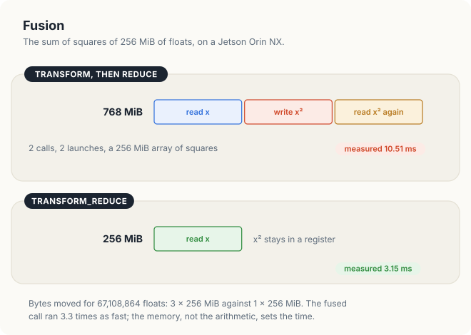
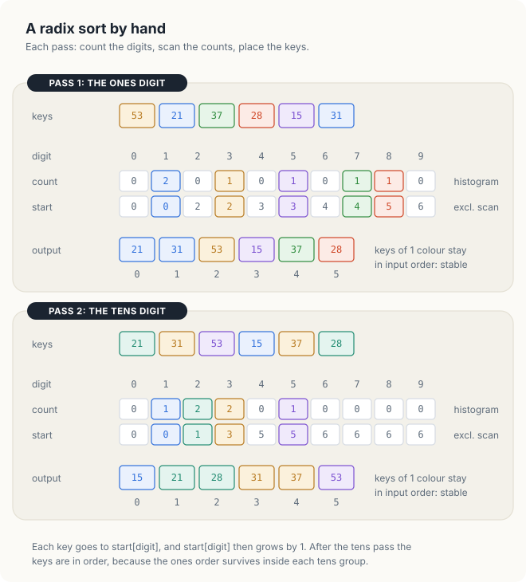
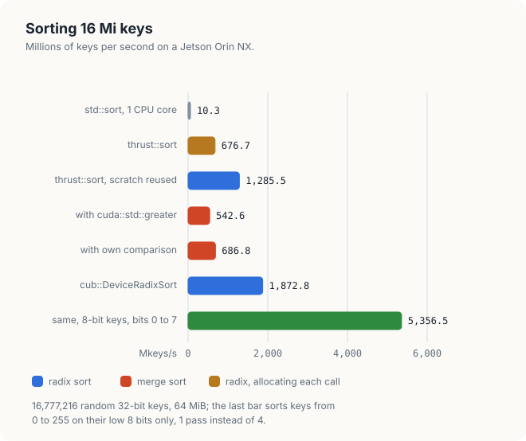
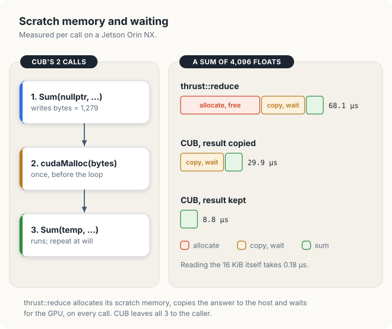
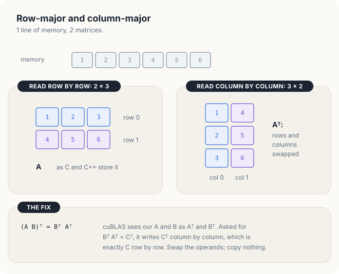
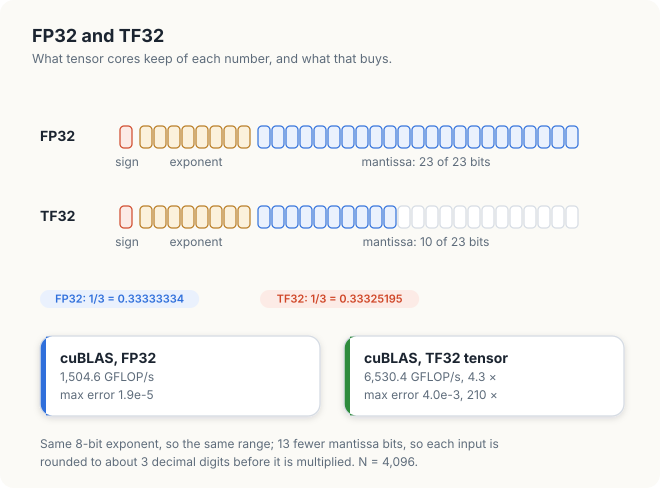
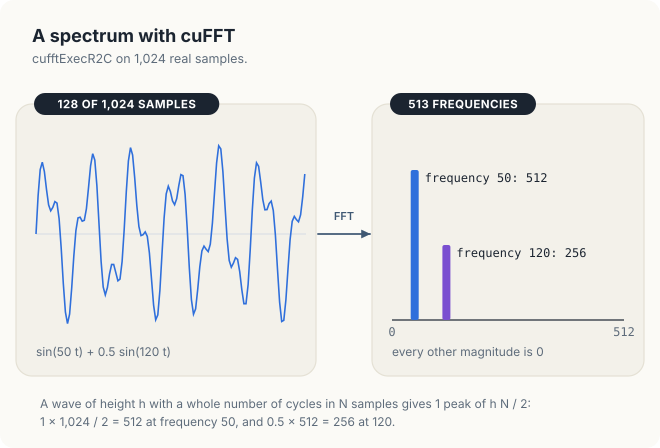
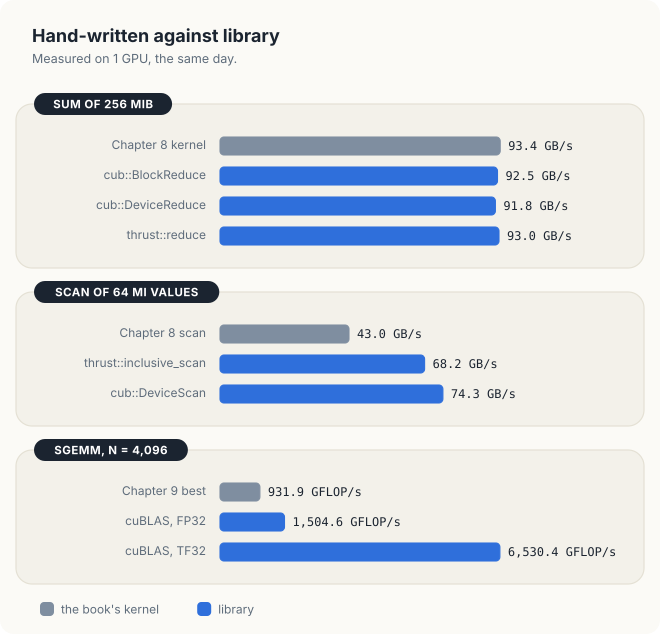

# Chapter 11: The Library Ecosystem - Thrust, CUB & cuBLAS

In Chapters 8 and 9, we wrote a sum, a scan, a histogram and a matrix product as our own
kernels and measured each version. The CUDA toolkit already contains tuned implementations
of all of these operations. A **library** is a collection of routines written, tested and
tuned by other programmers, which a program calls instead of implementing the operation
itself. NVIDIA ships several libraries with every toolkit and tunes them for each new GPU
generation.

In this chapter, we place each library next to the kernel it replaces and measure both on the
same GPU. The measurements come from a Jetson Orin NX, an integrated GPU with 8 SMs (streaming
multiprocessors), 102 GB/s of memory bandwidth and 2.4 TFLOP/s of FP32 throughput, with all runs
made on the same day. **FP32** is the 32-bit floating-point format of the C++ type `float`, and
1 TFLOP/s is 10<sup>12</sup> floating-point operations per second. We will use them to answer 2
practical questions: when a library is as fast as a hand-written kernel, and what a library call
costs beyond the kernels it launches. We will find that on large inputs the libraries match or
exceed our kernels, while on small inputs most of the time of a convenient library call goes to
memory allocation and synchronization rather than to computation. **Synchronization** here means
that the host stops and waits until the GPU has finished the work submitted so far.

<div class="covers" markdown="1">

This chapter covers

- the libraries Thrust, CUB, cuBLAS, cuFFT and cuRAND, and the kernels of earlier chapters
  that each one replaces
- reductions with Thrust, and fusing 2 passes into 1 with `transform_reduce`
- the single-pass scan, which moves half the bytes of the scan in Chapter 8
- radix sort, built from a histogram and a scan
- the temporary storage that a library call needs, and the cost of allocating it on every call
- CUB's block-level primitives inside a custom kernel, and their counterparts in cuda-oxide
- calling cuBLAS with row-major matrices
- TF32 tensor cores: speed and accuracy
- choosing between a library and a custom kernel

</div>

The code of the chapter is in
[`code/ch11_libraries/`](https://github.com/arpanpathak/gpu-parallel-book/tree/main/code/ch11_libraries)
for C++ and in
[`code/oxide/ch11_blocks/`](https://github.com/arpanpathak/gpu-parallel-book/tree/main/code/oxide/ch11_blocks)
for Rust.

## 11.1 Libraries in the CUDA toolkit

### 11.1.1 The libraries and what they replace

The 5 libraries of this chapter cover most of the algorithms of Part III, as well as a few
that we do not implement by hand. All of them are installed with the CUDA toolkit.
Before we look at the table below, we need 4 terms. A **reduction** combines all the elements
of an array into 1 value with an operation such as addition; the sum of Chapter 8 is a
reduction. **GEMM** (general matrix multiply) is the matrix product \\(C = AB\\) of Chapter 9,
and **SGEMM** is its single-precision version, on floats. **Temporary storage**, also called
scratch memory, is device memory that an algorithm needs only while it runs. For example, a
sum of 1,024 blocks writes 1 partial sum per block, 1,024 floats or 4 KiB, which the final step
adds and which are not needed afterward. A **header** is a source file that a program includes
with `#include`, and a **link flag** such as `-lcublas` tells the linker to add a compiled
library file to the executable.

| Library | What it provides | Replaces | Header, link flag |
|---|---|---|---|
| **Thrust** | whole-array algorithms called from the host: `reduce`, `transform`, `scan`, `sort` | Chapter 8's sum and scan | `<thrust/...>`, none |
| **CUB** | the same algorithms with temporary storage managed by the caller, and primitives for use inside a kernel | Chapter 8's block sum and block scan | `<cub/cub.cuh>`, none |
| **cuBLAS** | dense linear algebra: SGEMM, matrix-vector products, dot products | Chapter 9's SGEMM | `<cublas_v2.h>`, `-lcublas` |
| **cuFFT** | fast Fourier transforms | not implemented in this book | `<cufft.h>`, `-lcufft` |
| **cuRAND** | random numbers on the GPU | not implemented in this book | `<curand.h>`, `-lcurand` |

Thrust and CUB consist entirely of C++ templates (Chapter 10) in header files. They are compiled
into the program together with the rest of its code and therefore need no link flag. Both belong
to the **CUDA C++ Core Libraries** (CCCL), together with `libcu++`, which provides the
`cuda::std::` versions of the C++ standard library that we use below. The CCCL version is tied
to the toolkit: CUDA 12.6 ships CCCL 2.5, and CUDA 13.2 ships CCCL 3.2. cuBLAS, cuFFT and
cuRAND, on the other hand, are compiled libraries and must be linked with a flag.

We describe each library briefly before we arrange them. **Thrust** is a library of
algorithms on whole arrays, such as sum, sort and scan, that a host program calls in 1 line,
in the manner of the C++ standard library; Thrust launches the kernels itself. **CUB** (CUDA
UnBound) provides the same algorithms with more control left to the caller, and also provides
building blocks, such as the sum of the values of 1 block, that a programmer calls from inside
a kernel of their own. **cuBLAS** is NVIDIA's implementation of the standard routines of linear
algebra, among them GEMM. For example, a sum of 1,000,000 floats is 1 call of `thrust::reduce`,
2 calls of `cub::DeviceReduce::Sum`, or 1 kernel of our own in which each block calls
`cub::BlockReduce` and writes 1 partial sum.

Fig. 11.1 arranges the libraries by where they are called from and by who manages the
memory they use.

<figure>

<figcaption><b>Figure 11.1</b> Thrust is built on CUB. The levels run from calls made on the host down to primitives used inside a kernel; cuBLAS, cuFFT and cuRAND are separate libraries.</figcaption>
</figure>

The 3 levels trade convenience for control. A Thrust call does everything for the
programmer. It allocates its temporary storage, launches its kernels and, in the case of a
reduction, returns the result to the host. A CUB device-wide call performs the same work but
leaves 2 decisions to the caller: where the temporary storage comes from, and when the host
waits for the result. A CUB block-level call performs only 1 step of an algorithm, inside a
kernel that the programmer writes. Since Thrust is built on CUB, the kernels launched at the
top 2 levels are the same. In Sections 11.2 and 11.3, we measure what the difference in
convenience costs.

### 11.1.2 Advantages and limits of a library

A library has 3 advantages over a kernel written for a single program. First, its authors
select a different kernel for each GPU generation, the family of GPUs that share 1 design, such
as the GPUs of compute capability 8.x, with block sizes, load widths and
algorithms tuned on that hardware. Second, it can use algorithms whose implementation effort
a single program could not justify. The scan of Section 11.2.3, for example, relies on a
protocol between thread blocks that we did not attempt in Chapter 8. Third, it is tested on
every release against reference results and on a wide range of input shapes.

A library also has a limitation, which we measure in this chapter. It does not know the
context in which it is called. It cannot know that the same temporary storage could serve 1,000
consecutive calls, or that the result will be used by another kernel on the GPU rather than by
the host. The programmer knows these facts and can pass them to the library by calling it at
one of the lower levels of Fig. 11.1.

<div class="callout note" markdown="1">

**NOTE:** cuda-oxide, the Rust compiler used in this book, has no bindings to Thrust, CUB,
cuBLAS, cuFFT or cuRAND at revision `b7fe543`. A Rust program can call these C libraries
through Rust's **foreign function interface** (FFI), the mechanism by which Rust code declares
and calls functions written in C. We use it for NVRTC in Chapter 12; its use for these
libraries is beyond the scope of this chapter.
cuda-oxide does provide its own block-level primitives for use inside a kernel, the
counterparts of CUB's lowest level, and we measure them in Section 11.3.2.

</div>

## 11.2 Thrust: whole-array algorithms

### 11.2.1 Reduction with `thrust::reduce`

Thrust's algorithms have the names and parameters of the algorithms in the C++ standard library.
A range of elements is given by 2 positions, `first` and `last`. Such a position is called an
**iterator**: an object that marks 1 element of a sequence and can be advanced to the next. A
raw pointer is the simplest iterator. The range is **half-open**: it contains `first` and every
element up to, but not including, `last`. For example, with `in` pointing to an array of 8
floats, the range `in` to `in + 8` covers elements 0 to 7, and `in + 8` itself marks the
position just past the end. The first argument of the call is an **execution policy**, which
specifies where the algorithm runs. The policy `thrust::device` runs the algorithm on the GPU,
on data in device memory.

```text
thrust::reduce(policy, first, last, initial value)
    → initial value + every element in [first, last), combined in any order
```

The phrase "in any order" matters, and a small example shows why. Take the 8 values 3, 1, 2, 0,
1, 2, 0, 1. A sequential loop adds them from left to right: 3, 4, 6, 6, 7, 9, 9, 10. A **tree**
reduction, as in the kernels of Chapter 8, adds neighboring pairs in rounds. Round 1 gives 3 +
1 = 4, 2 + 0 = 2, 1 + 2 = 3 and 0 + 1 = 1; round 2 gives 4 + 2 = 6 and 3 + 1 = 4; round 3 gives
6 + 4 = 10. Both orders reach 10, but the tree takes 3 rounds instead of 7 steps, and the 4
additions of round 1 can run at the same time on 4 threads. With integers the order makes no
difference. With floats, every addition rounds, and different orders round at different places.

<div class="key-observation">

<span class="box-label">Key observation</span> A parallel reduction adds the same elements in a
different order from a sequential loop. With floats, the 2 results can differ in their last
digits, although neither is less accurate.

</div>

Like the kernels of Chapter 8, `thrust::reduce` adds the elements in a tree. The order of the
additions therefore differs from that of a sequential loop, and the result is rounded
differently, though not less accurately. Listing 11.1 times `thrust::reduce` on the
67,108,864 floats (256 MiB) of Chapter 8, next to the fastest kernel of that chapter.

<p class="listing"><b>Listing 11.1</b> A sum with <code>thrust::reduce</code>, timed. <a href="https://github.com/arpanpathak/gpu-parallel-book/blob/main/code/ch11_libraries/reduce_scan.cu">code/ch11_libraries/reduce_scan.cu</a></p>

<div class="code-tabs">
<div class="code-tab" data-lang="Rust">

```rust,ignore
fn main() -> Result<(), Error> {
    // ...
{{#include ../../../../code/oxide/ch11_blocks/src/main.rs:306:312}}
    // ...
}
```

</div>
<div class="code-tab" data-lang="C++">

```cpp
bool sums(const float* in, float* partial, float* total, int n, double exact)
{
    // ...
{{#include ../../../../code/ch11_libraries/reduce_scan.cu:166:169}}
    // ...
}
```

</div>
</div>

cuda-oxide has no call that sums a whole array, so the Rust tab times the 2 launches of
`block_reduce` from Section 11.3.2.

Note that `thrust::reduce` returns the sum to the host as a `float`. The call therefore also
waits for the GPU to finish and copies 4 bytes back to the host. The program compares every
sum with a sum computed in double precision and prints PASSED when all of them agree to 1 part
in 100,000.

```console
$ ./reduce_scan
GPU: Orin, 8 SMs, L2 cache 2 MiB
sum of 67108864 floats (256 MiB), average of 20 runs
  Chapter 8, float4 + shuffles    2.87 ms    93.4 GB/s  sum 33557628.0
  same, cub::BlockReduce          2.90 ms    92.5 GB/s  sum 33557624.0
  cub::DeviceReduce::Sum          2.92 ms    91.8 GB/s  sum 33557628.0
    (CUB asked for 1279 bytes of temporary storage)
  thrust::reduce                  2.89 ms    93.0 GB/s  sum 33557628.0
```

The 4 implementations ran within 2% of each other, at 91.8 to 93.4 GB/s, which is 90% to 92%
of the GPU's 102 GB/s. Recall from Chapter 8 that this is the limit for a sum: the kernel reads
each byte once and performs 1 addition for every 4 bytes, so its speed is set by the memory.
A kernel is said to be **memory-bound** if its performance is limited by the memory bandwidth
of the hardware, and no library can read data faster than the memory delivers it. The sums
differ in their last digits because each implementation adds the elements in a different
order. All of them are within 7 of the exact value 33,557,630.3, a relative error of
2 × 10<sup>−7</sup>. The times varied by up to 20% across 3 runs, so a difference of a few
percent between the 4 lines is not significant.

### 11.2.2 Fusing transform and reduce

The sum of squares \\(\sum_i x_i^2\\) can be written with 2 Thrust calls.
`thrust::transform` squares every element and writes the squares to a second array, and
`thrust::reduce` then adds the elements of the second array. Let us count the memory traffic
for the 4 floats 1, 2, 3, 4, which occupy 16 bytes. The first call reads the 16 bytes and
writes the squares 1, 4, 9, 16 into a second array of 16 bytes. The second call reads those 16
bytes again and adds them to 30. In all, 48 bytes cross the memory bus. A single loop could
instead read 1, square it, add it to a running total, and go on to 2, so that each square exists
only in a **register**, the storage of 1 thread inside the SM, and never reaches memory. The
same total 30 then costs 16 bytes of traffic.

<div class="definition">

<span class="box-label">Definition 11.1</span> **Pass and fusion.** A **pass** is 1 traversal
of an array in memory. **Fusion** combines several passes into 1, so that each intermediate
value is passed on in a register instead of being written to memory and read back.

*Example.* `thrust::transform` followed by `thrust::reduce` makes 2 passes over the sum of
squares; `thrust::transform_reduce` makes 1, squaring each element as it reads it and adding the
square immediately.

</div>

The benefit of fusion follows from the number of bytes each version moves. For 256 MiB of
floats, `transform` reads 256 MiB and writes 256 MiB of squares, and `reduce` reads the 256
MiB of squares again, for a total of 768 MiB, 3 times the input. `transform_reduce` reads the
input once, 256 MiB. At the 92 GB/s measured in Section 11.2.1, 768 MiB (805 MB) take about
8.8 ms and 256 MiB (268 MB) take about 2.9 ms.

<figure>

<figcaption><b>Figure 11.2</b> Bytes moved by 2 separate passes and by 1 fused pass over 256 MiB.</figcaption>
</figure>

Thrust takes the operation to apply to each element as a **functor**, an object that can be
called like a function, as the function objects of Chapter 10 are. An object `sq` of a struct
whose `operator()` returns `x * x` gives `sq(3.0f)` = 9.0. In Listing 11.2, the functor `Square`
is declared `__host__ __device__` so that it is compiled for the GPU, and
`cuda::std::plus<float>` is the addition of the standard library, in the `cuda::std` version
that can be called on both the host and the device.

<p class="listing"><b>Listing 11.2</b> The sum of squares in 2 passes and in 1.</p>

<div class="code-tabs">
<div class="code-tab" data-lang="Rust">

```rust,ignore
mod kernels {
    // ...
{{#include ../../../../code/oxide/ch11_blocks/src/main.rs:101:142}}
}

{{#include ../../../../code/oxide/ch11_blocks/src/main.rs:174:219}}
```

</div>
<div class="code-tab" data-lang="C++">

```cpp
{{#include ../../../../code/ch11_libraries/reduce_scan.cu:117:119}}

{{#include ../../../../code/ch11_libraries/reduce_scan.cu:175:196}}
```

</div>
</div>

In the Rust tab, the generic kernels `map` and `map_sum` take the closure `square` in the role
of the functor `Square`.

```console
sum of squares, GB/s of input read
  transform, then reduce         10.51 ms    25.5 GB/s  sum 22372548.0
  transform_reduce                3.15 ms    85.3 GB/s  sum 22372548.0
```

The fused version ran 3.3 times as fast, close to the factor of 3 predicted from the bytes
moved. The remainder is accounted for by the second kernel launch and the allocation of the
intermediate array in the 2-pass version. Note that the GB/s column counts only the 256 MiB of
input. The 2-pass version therefore shows a third of the memory bandwidth, although the memory
was as busy as in the fused version.

<div class="bee bee-shocked" markdown="1">

A chain of library calls writes every intermediate result to memory and reads it back. For
memory-bound work, fusing the chain into a single call divides the time by the number of
passes saved.

</div>

### 11.2.3 Single-pass scan

A **scan**, or prefix sum, replaces each element of an array by the running total up to that
element. An **inclusive** scan includes the element itself in its total, whereas an
**exclusive** scan stops immediately before it and therefore starts at 0. For the values 3, 1,
2, 0, the 2 scans are:

| i | 0 | 1 | 2 | 3 |
|---|---|---|---|---|
| value | 3 | 1 | 2 | 0 |
| inclusive scan | 3 | 4 | 6 | 6 |
| exclusive scan | 0 | 3 | 4 | 6 |

The exclusive scan is the inclusive scan shifted right by 1 position. Element \\(i\\) of the
exclusive scan is the number of items that come before position \\(i\\), and we use exactly
this property in Section 11.2.4.

<div class="definition">

<span class="box-label">Definition 11.2</span> **Scan.** The **inclusive scan** of
\\(x_0, x_1, \dots, x_{n-1}\\) is the array \\(y\\) with
\\(y_i = x_0 + x_1 + \dots + x_i\\). The **exclusive scan** is the array \\(z\\) with
\\(z_0 = 0\\) and \\(z_i = x_0 + \dots + x_{i-1}\\).

*Example.* For 3, 1, 2, 0, element 2 of the inclusive scan is 3 + 1 + 2 = 6, and element 2 of
the exclusive scan is 3 + 1 = 4.

</div>

The scan of Chapter 8 made 3 passes. Each block scanned its 1,024 values and wrote them out,
a second kernel scanned the block totals, and a third kernel read every value again to add the
offset of its block. CUB, which Thrust calls internally, performs the scan in a single pass
with a method called **decoupled look-back**.

To see how 1 pass can suffice, consider 4 blocks whose values add up to the block totals 6, 10,
4 and 8. Block 2 needs to know the sum of everything before it, 6 + 10 = 16, before it can write
its first output. In the method of Chapter 8, a separate kernel computed 16 after every block
had finished. In decoupled look-back, each block keeps a small record in global memory, a
**flag** with 2 fields: a status and a number. The status is *aggregate* when the number is the
block's own total, and *prefix* when the number is the running total up to and including that
block.

Let us follow block 2. It scans its own values in registers, finds its total 4, and publishes
*aggregate 4*. It then looks at the flag of block 1, the block to its left. Suppose block 1 has
so far published only *aggregate 10*. Block 2 adds 10 and looks one block further left, at block
0, which has published *prefix 6*. Block 2 adds 6, and the sum before it is 10 + 6 = 16. It
publishes *prefix 16 + 4 = 20* for the blocks to its right, adds 16 to each of its scanned
values, and writes them out once, in their final form. The search to the left stops at the first
*prefix* it finds, so it is usually short.

<div class="key-observation">

<span class="box-label">Key observation</span> A block needs only the total of the elements
before it, not the elements themselves. Blocks therefore wait for each other only on a few bytes
of flags, never on the data, and every value is read once and written once.

</div>

The saving can again be counted in bytes. For 64 Mi values of 4 bytes (256 MiB), the first
kernel of Chapter 8 reads 256 MiB and writes 256 MiB, and the third kernel reads and writes
them again; the block totals are 1,024 times smaller and add little. The total is 1,024 MiB.
Decoupled look-back reads 256 MiB and writes 256 MiB, a total of 512 MiB. Measured on the same
day, the scan of Chapter 8 took 12.49 ms, which corresponds to 1,074 MB / 12.49 ms = 86 GB/s
of actual memory traffic, although its program reports 43.0 GB/s because it counts only the
512 MiB that a scan must move.

<p class="listing"><b>Listing 11.3</b> An inclusive scan with Thrust, an exclusive scan with CUB.</p>

<div class="code-tabs">
<div class="code-tab" data-lang="Rust">

```rust,ignore
fn main() -> Result<(), Error> {
    // ...
{{#include ../../../../code/oxide/ch11_blocks/src/main.rs:315:321}}
    // ...
}
```

</div>
<div class="code-tab" data-lang="C++">

```cpp
bool scans(int n)
{
    // ...
{{#include ../../../../code/ch11_libraries/reduce_scan.cu:244:258}}
    // ...
}
```

</div>
</div>

cuda-oxide has no scan of a whole array; the Rust tab scans each block of 256 values with
`block_scan`, the kernel of Listing 11.8.

```console
scan of 67108864 values 0 to 3, average of 20 runs
  thrust::inclusive_scan           7.88 ms    68.2 GB/s  last 100652862  correct: yes
  cub::DeviceScan::ExclusiveSum    7.23 ms    74.3 GB/s  last 100652860  correct: yes
```

Both lines count 512 MiB, the bytes a scan must move. The library scans ran at 68.2 and 74.3
GB/s, against 43.0 GB/s for the scan of Chapter 8: 1.6 to 1.7 times as fast, almost entirely
because they move half the bytes. The 2 last values differ by 2, the value of the last
element, which the exclusive scan does not include.

### 11.2.4 Radix sort

Sorting is the clearest case for a library, because the fastest GPU sorting algorithm is long
and difficult to write. The algorithm is **radix sort**. Most sorting algorithms, such as the
`std::sort` of the C++ library, are **comparison sorts**: they learn the order only by asking
which of 2 keys comes first. Radix sort never compares 2 keys. It sorts them 1 digit at a time,
starting with the lowest digit.

<div class="definition">

<span class="box-label">Definition 11.3</span> **Radix sort and stability.** A **radix sort**
sorts keys in 1 pass per digit, from the lowest digit to the highest, and in each pass orders
the keys by that digit alone. A pass is **stable** if keys with the same digit keep the relative
order they had before the pass.

*Example.* The keys 21 and 28 have the same tens digit, 2. After the pass on the ones digit, 21
comes before 28; a stable pass on the tens digit keeps 21 before 28.

</div>

Stability is what preserves the order established by the lower digits. Each pass is built from
two algorithms of Chapter 8. A **histogram** counts how many keys have each digit. An exclusive
scan of the counts then gives the first output position of each digit's group. Finally, every
key is written to the next free position of its group. Writing each element to a position
computed for it, rather than to the next position in order, is called a **scatter**:

```text
radix sort, digits of b bits, keys of B bits:
    for shift ← 0, b, 2b, … , B − b:
        digit(k) ← (k >> shift) mod 2^b
        count[d] ← number of keys with digit d          # a histogram
        start[d] ← count[0] + … + count[d − 1]          # an exclusive scan
        for each key k, in order:                       # a stable scatter
            out[start[digit(k)]] ← k
            start[digit(k)] ← start[digit(k)] + 1
        keys ← out
```

Fig. 11.3 sorts 6 keys of 2 decimal digits, so that the digits can be read directly.

<div class="example" markdown="1">

Worked example: 53, 21, 37, 28, 15, 31

1. Pass 1, the ones digit: 3, 1, 7, 8, 5, 1. Counts: digit 1 twice, digits 3, 5, 7 and 8
   once each.
2. Exclusive scan of the counts: digit 1 starts at 0, digit 3 at 2, digit 5 at 3, digit 7 at
   4, digit 8 at 5.
3. Scatter, in input order: 21 → 0, 31 → 1, 53 → 2, 15 → 3, 37 → 4, 28 → 5. Result: 21, 31,
   53, 15, 37, 28.
4. Pass 2, the tens digit: 2, 3, 5, 1, 3, 2. Starts: digit 1 at 0, digit 2 at 1, digit 3 at
   3, digit 5 at 5.
5. Scatter: 15, 21, 28, 31, 37, 53. The keys are sorted after 2 passes, 1 for each digit.

</div>

<figure>

<figcaption><b>Figure 11.3</b> A radix sort. Each pass consists of a histogram, an exclusive scan and a stable scatter.</figcaption>
</figure>

On a GPU the digits are binary. CUB sorts 8 bits per pass, which gives 256 possible digits,
so a 32-bit key takes 4 passes, and each pass reads and writes every key. The work of a radix
sort therefore grows with the number of keys times the number of passes, not with
\\(n \log n\\) as the work of a comparison sort does. For \\(n\\) = 16,777,216 =
2<sup>24</sup> keys, a comparison sort needs on the order of \\(n \log_2 n\\) = 24\\(n\\)
comparisons, while a radix sort on 32-bit keys makes 4 passes over the \\(n\\) keys.

Radix sort has 1 requirement. It must know what the bits of a key mean. Thrust uses it only
when the keys are numbers and the order is a standard one, `less` or `greater`. If the
program supplies any other comparison, such as the functor `Ascending` in Listing 11.4,
Thrust cannot look inside it and falls back to a **merge sort**, a comparison sort that
repeatedly merges 2 sorted runs of keys into 1 longer sorted run and only asks the comparison
which of 2 keys comes first. `Ascending` produces the same order as `less`, so the
2 results are identical; only the algorithm differs.

Thrust also needs temporary storage to sort: a second array of keys, plus space for the counts.
By default it allocates this memory with `cudaMalloc` at the start of each call and frees it
with `cudaFree` at the end. An **allocator** is an object that provides memory on request.
Thrust accepts an allocator as part of its execution policy, `thrust::cuda::par(allocator)`, and
then takes its temporary storage from the allocator. The allocator `Arena` in Listing 11.4 keeps
1 large buffer and hands out pieces of it. During 1 sort, Thrust asks for several pieces, and
`Arena` hands them out one after another from the start of the buffer. Before the sort returns,
Thrust gives every piece back, and `Arena` then starts again from the beginning. The next sort
therefore receives the same memory, with no call to `cudaMalloc` or `cudaFree` in between.

<p class="listing"><b>Listing 11.4</b> A comparison Thrust cannot see inside, and an allocator that reuses 1 buffer. <a href="https://github.com/arpanpathak/gpu-parallel-book/blob/main/code/ch11_libraries/sort.cu">code/ch11_libraries/sort.cu</a></p>

```cpp
{{#include ../../../../code/ch11_libraries/sort.cu:37:74}}
```

<p class="listing"><b>Listing 11.5</b> 4 ways to sort with Thrust.</p>

```cpp
int main()
{
    // ...
{{#include ../../../../code/ch11_libraries/sort.cu:141:161}}
    // ...
}
```

cuda-oxide provides no sort, so Listings 11.4 and 11.5 have no Rust form; in Chapter 22 we
write a radix sort in Rust from its histogram, scan and scatter.

The program sorts 16,777,216 random 32-bit keys (64 MiB) and checks each result against
`std::sort` on the CPU. It also runs CUB's own radix sort, `cub::DeviceRadixSort`, with its
temporary storage allocated once, as described in Section 11.3.3.

```console
$ ./sort
GPU: Orin, 8 SMs
sort of 16777216 random 32-bit keys, average of 5 runs
  std::sort, 1 CPU core              1626.26 ms     10.3 Mkeys/s
  thrust::sort                         24.79 ms    676.7 Mkeys/s  correct: yes
  thrust::sort, scratch reused         13.05 ms   1285.5 Mkeys/s  correct: yes
    ... with cuda::std::greater        30.92 ms    542.6 Mkeys/s  correct: yes
    ... with own comparison            24.43 ms    686.8 Mkeys/s  correct: yes
  cub::DeviceRadixSort                  8.96 ms   1872.8 Mkeys/s  correct: yes
sort of 16777216 keys from 0 to 255
  cub::DeviceRadixSort, bits 0 to 31    8.12 ms   2067.2 Mkeys/s  correct: yes
  cub::DeviceRadixSort, bits 0 to 7     3.13 ms   5356.5 Mkeys/s  correct: yes
PASSED
```

Mkeys/s is millions of keys sorted per second. The output supports 5 observations.

1. **The GPU sorts 66 to 180 times as fast as 1 CPU core**: 24.79 ms or less, against
   1,626 ms.
2. **Allocation accounts for almost half the time of the plain `thrust::sort`.** With the
   temporary storage reused, the sort took 13.05 ms instead of 24.79 ms, so about 12 ms of
   each call went to `cudaMalloc` and `cudaFree`. A separate test on the same GPU timed 1
   `cudaMalloc` and `cudaFree` of 64 MiB at 10 ms, and of 128 MiB at 20 ms. The cost depends on
   the state of the system: across 9 runs the difference ranged from 1 ms to 18 ms. On an
   integrated GPU the device memory is the system memory, which other programs on the CPU
   use as well.
3. **Merge sort is slower than radix sort.** With the comparison hidden in a functor, the same
   order took 24.43 ms instead of 13.05 ms, 1.9 times as long.
4. **The fast path depends on what the library recognizes.** In CCCL 2.5, Thrust selects radix
   sort only if the type of the comparison is exactly `thrust::less<Key>` or
   `thrust::greater<Key>`. `cuda::std::greater` is a different type in that version, so the
   descending sort fell back to merge sort and took 30.92 ms. CCCL 3.2 makes `thrust::greater`
   another name for `cuda::std::greater`, and the same source code then takes the radix path
   and runs as fast as the ascending sort. Only a measurement shows which path a call took.
5. **Fewer key bits mean fewer passes.** For keys from 0 to 255, only bits 0 to 7 differ.
   When told so with `begin_bit` = 0 and `end_bit` = 8, CUB made 1 pass instead of 4 and
   finished 2.6 times as fast, in 3.13 ms instead of 8.12 ms. The range of the keys is known
   to the program, not to the library.

The 2 merge sorts differ by 26%, more than their code differs. Sorts that take 20 to 30 ms
varied by 20% to 30% between runs, so this difference is within the noise of the measurement.

<figure>

<figcaption><b>Figure 11.4</b> Sorting 16 Mi keys, in millions of keys per second.</figcaption>
</figure>

<details class="check"><summary>Why does a radix sort need every pass to be stable?</summary>

After pass 1 the keys are in order of their lowest digit. Pass 2 groups them by the next
digit; within a group, the keys must stay in the order pass 1 left them, or the order of the
lower digit is lost. In Fig. 11.3, 21 and 28 share the tens digit 2, and 21 stays ahead of 28
only because pass 2 keeps the order of pass 1.

</details>

## 11.3 CUB: block-level and device-wide primitives

### 11.3.1 Block-wide reduction with `cub::BlockReduce`

The lowest level of CUB is used inside a kernel that the programmer writes. Recall that a
**block** is a group of threads of a kernel that run on the same SM and share its **shared
memory**, and that a **warp** is a group of 32 threads of a block that execute each
instruction together. `cub::BlockReduce` combines 1 value from each thread of a block into a
single value, the task performed by the function `blockSum` in Chapter 8. That function
first reduced the values within each warp with **shuffles**, instructions that pass a value
from 1 thread of a warp to another. It then stored 1 partial sum per warp in shared memory
and reduced those partial sums with a final round of shuffles in warp 0.

Let us count the steps for a block of 256 threads, which form 256 / 32 = 8 warps. In the first
step, each warp halves its 32 values 5 times with shuffles, 32 → 16 → 8 → 4 → 2 → 1, and the
thread at **lane** 0, the position 0 within the warp, holds the warp's total. In the second
step, the 8 lane-0 threads write 8 totals to shared memory. In the third step, warp 0 reads the
8 totals and reduces them with 3 more shuffles, 8 → 4 → 2 → 1. Thread 0 of the block then holds
the total of all 256 values. Listing 11.6 is the fastest kernel of Chapter 8 with `blockSum`
replaced by CUB.

<p class="listing"><b>Listing 11.6</b> Chapter 8's sum with <code>cub::BlockReduce</code>.</p>

<div class="code-tabs">
<div class="code-tab" data-lang="Rust">

```rust,ignore
mod kernels {
    // ...
{{#include ../../../../code/oxide/ch11_blocks/src/main.rs:64:84}}
    // ...
}
```

</div>
<div class="code-tab" data-lang="C++">

```cpp
{{#include ../../../../code/ch11_libraries/reduce_scan.cu:99:115}}
```

</div>
</div>

`cub::BlockReduce<float, BLOCK>` is a class template, a class written in terms of template
parameters (Chapter 10), here the element type and the number of threads. Both are fixed when
the program is compiled, and CUB selects its algorithm from them.
`TempStorage` is a type defined inside the class: a region of shared memory sized for the
selected algorithm. The reason for making it a type is that shared memory must be declared
with a size known at compile time, and only CUB knows how many bytes its algorithm needs for
256 floats. Declaring a `__shared__` variable of type `TempStorage` passes that size to the
compiler. The expression `BlockReduce(temp)` constructs the object on that storage, and
`.Sum(sum)` returns the total of the block in thread 0.

In the measurements of Section 11.2.1 this kernel ran at 92.5 GB/s, against 93.4 GB/s for the
kernel of Chapter 8, which is within the noise. CUB does not make the kernel faster. It
replaces 25 lines that had to be written and verified by hand, and it handles cases that the
code of Chapter 8 did not, such as block sizes that are not a multiple of 32 and element types
other than `float`. The same header provides `cub::BlockScan`, `cub::BlockHistogram`,
`cub::BlockRadixSort`, `cub::WarpReduce` and `cub::WarpScan`, which are used in the same way.

### 11.3.2 Block-wide primitives in cuda-oxide

The `cooperative_groups` module of cuda-oxide provides the Rust counterparts: `warp_reduce`,
`warp_scan`, `block_reduce` and `block_scan`, for the types `u32`, `i32` and `f32` and the
operations `Sum`, `Min` and `Max`. They work in the same 3 steps as `cub::BlockReduce`. Each
warp reduces its 32 values with shuffles, lane 0 of each warp writes the warp's total to a
slot in shared memory, and warp 0 reduces the slots. The slots are a `SharedArray`,
cuda-oxide's type for an array in shared memory, with one element per warp, which is 256 / 32 = 8
elements for a block of 256 threads. The kernel declares the array as a `static mut`, a variable
that exists once for the whole block rather than once per thread, and that may be modified. A
Rust **reference** is a pointer that the compiler checks: while a mutable reference exists, the
compiler assumes that nothing else modifies the value. The threads of a block access the array
at the same time, so the compiler cannot guarantee that assumption, and Rust 2024 does not allow
a reference to a `static mut`. The kernel therefore passes `&raw mut WARPS`, the Rust 2024
way to obtain a raw pointer to a `static mut` without creating a reference.

<p class="listing"><b>Listing 11.7</b> Chapter 8's sum with <code>block_reduce</code>. <a href="https://github.com/arpanpathak/gpu-parallel-book/blob/main/code/oxide/ch11_blocks/src/main.rs">code/oxide/ch11_blocks/src/main.rs</a></p>

<div class="code-tabs">
<div class="code-tab" data-lang="Rust">

```rust,ignore
mod kernels {
    // ...
{{#include ../../../../code/oxide/ch11_blocks/src/main.rs:64:84}}
    // ...
}
```

</div>
<div class="code-tab" data-lang="C++">

```cpp
{{#include ../../../../code/ch11_libraries/reduce_scan.cu:99:115}}
```

</div>
</div>

The `8` in `block_reduce::<f32, Sum, 8>` is the number of warps, and the call checks it at
compile time: a block of more than 32 warps fails to build. `block_scan` has the same form.
Listing 11.8 scans each block of 256 values, 1 value per thread. The call `out.get_mut(i)`
returns an `Option`, a Rust value that is either `Some(slot)` or `None`. It is `Some` for a
thread whose index lies inside the array and `None` for the threads beyond its end, so the
kernel writes its results without `unsafe`.

<p class="listing"><b>Listing 11.8</b> A scan of each block with <code>block_scan</code>.</p>

<div class="code-tabs">
<div class="code-tab" data-lang="Rust">

```rust,ignore
mod kernels {
    // ...
{{#include ../../../../code/oxide/ch11_blocks/src/main.rs:86:99}}
    // ...
}
```

</div>
<div class="code-tab" data-lang="C++">

```cpp
{{#include ../../../../code/ch11_libraries/reduce_scan.cu:274:286}}
```

</div>
</div>

```console
$ cargo oxide run
sum of 67108864 floats, average of 20 runs
  Chapter 8, by hand    3.95 ms    68.0 GB/s  sum 33557632.0
  block_reduce          4.10 ms    65.5 GB/s  sum 33557632.0
  exact (f64)                               sum 33557630.3
block_scan of 67108864 values, 256 per block
  first block: [0, 1, 1, 3, 5, 5, 5, 6] ... 403
sum of squares, GB/s of input read
  map, then map_sum     14.67 ms    18.3 GB/s  sum 22372548.0
  map_sum, fused         4.17 ms    64.4 GB/s  sum 22372548.0
  exact (f64)                               sum 22372547.9
sum of 4096 floats, microseconds per sum
  allocated each time, result copied    40.7 us
  allocated once, result copied         24.1 us
  allocated once, result kept            8.4 us
PASSED
```

The 2 Rust sums ran within 4% of each other and produced the same total. Both kernels read 1
float per load, so they reach 68 GB/s rather than the 93 GB/s of the C++ kernels, which use
`float4` loads, each of which reads 4 floats, 16 bytes, in 1 instruction; we measured
the same difference in Chapter 8. The first 8 scanned values increase by
0 to 3 at each step, as the inputs 0, 1, 0, 2, 2, 0, 0, 1 require, and the program checked all
67,108,864 results. The last 8 lines are the Rust counterparts of Listings 11.2 and
11.10: the fused sum of squares ran 3.5 times as fast as the 2 passes, and the small sum took
8.4 µs instead of 40.7 µs once the allocation and the copy were removed.

### 11.3.3 Device-wide calls and temporary storage

The middle level of CUB runs a complete algorithm on a complete array, as Thrust does, but
takes its temporary storage from the caller. The caller, however, does not know how many bytes
CUB needs: the number depends on the algorithm that CUB selects for the GPU and for the size of
the array. CUB therefore answers that question in a first call, and does the work in a second
call. A CUB device-wide call is made twice:

```text
1. call with no temporary storage (nullptr) → CUB writes the number of bytes it needs
2. allocate that many bytes, once
3. call with the temporary storage          → CUB launches its kernels and returns at once
   (repeat step 3 as often as needed, with the same storage)
```

<p class="listing"><b>Listing 11.9</b> <code>cub::DeviceReduce::Sum</code>, called twice.</p>

<div class="code-tabs">
<div class="code-tab" data-lang="Rust">

```rust,ignore
fn small_sums(
    module: &kernels::LoadedModule,
    stream: &Arc<CudaStream>,
    values: &[f32],
) -> Result<(), Error> {
    // ...
{{#include ../../../../code/oxide/ch11_blocks/src/main.rs:249:264}}
    // ...
}
```

</div>
<div class="code-tab" data-lang="C++">

```cpp
bool sums(const float* in, float* partial, float* total, int n, double exact)
{
    // ...
{{#include ../../../../code/ch11_libraries/reduce_scan.cu:157:164}}
    // ...
}
```

</div>
</div>

The Rust kernels need no temporary storage beyond the partial sums, whose number the program
knows, so the Rust tab allocates them once and reuses them.

For the sum of 64 Mi floats, CUB asked for 1,279 bytes, enough for the partial sums of its
blocks. The result `total` remains in device memory, and the call returns without waiting for
the GPU. A call that returns before the GPU has finished the work it requested is called
**asynchronous**; the host can go on to queue the next kernel while the sum runs. On 256 MiB of
data, where the work itself takes 2.9 ms, neither difference from `thrust::reduce` matters. On a
small array, however, they determine the time.

Consider a sum of 4,096 floats, 16 KiB. At 92 GB/s, reading 16 KiB takes 16,384 B / 92 GB/s
= 0.18 µs. Listing 11.10 measures three ways of computing this sum. `thrust::reduce` took 68.1 µs
per sum, CUB with the result copied to the host took 29.9 µs, and CUB with the result left on
the GPU took 8.8 µs. The differences identify where the time goes. Allocating and freeing the
temporary storage costs 68.1 − 29.9 = 38.2 µs, and copying 4 bytes back and waiting for the
GPU costs 29.9 − 8.8 = 21.1 µs. The remaining 8.8 µs are the launch and execution of CUB's
kernel, which is still 49 times the time the memory needs.

<p class="listing"><b>Listing 11.10</b> 3 ways to sum 4,096 floats.</p>

<div class="code-tabs">
<div class="code-tab" data-lang="Rust">

```rust,ignore
{{#include ../../../../code/oxide/ch11_blocks/src/main.rs:221:266}}
```

</div>
<div class="code-tab" data-lang="C++">

```cpp
{{#include ../../../../code/ch11_libraries/reduce_scan.cu:198:224}}
```

</div>
</div>

```console
sum of 4096 floats, microseconds per sum
  thrust::reduce                     68.1 us
  cub::DeviceReduce, result copied   29.9 us
  cub::DeviceReduce, result kept      8.8 us
```

Across 6 runs, `thrust::reduce` took 44 to 68 µs and CUB with the result kept on the GPU 4.7
to 8.8 µs. In 5 of the 6 runs the 3 lines appeared in the order shown. In the remaining run
the copy back was slow, and CUB with the result copied took 78.6 µs. Operations that wait for
the host vary the most.

<figure>

<figcaption><b>Figure 11.5</b> CUB's 2-call pattern, and the components of the 68.1 µs of a small Thrust sum.</figcaption>
</figure>

A program that sums 1,000 small arrays per second therefore spends 68 ms of each second in
`thrust::reduce`, and less than 9 ms with CUB when the result stays on the GPU for the next
kernel. The algorithm is the same in both cases. The difference lies in the information the
program gave the library.

<div class="bee bee-shocked" markdown="1">

On small inputs, the cost of a library call is allocation and synchronization, not
arithmetic. Allocate temporary storage once, and keep results on the GPU when the next step
runs there.

</div>

## 11.4 cuBLAS: dense linear algebra

### 11.4.1 The cuBLAS handle

cuBLAS implements the **BLAS** (Basic Linear Algebra Subprograms), a standard set of
routines first published for Fortran in 1979. The routines are organized in 3 levels: dot
products and vector updates (level 1), matrix-vector products (level 2) and matrix-matrix
products (level 3), among them SGEMM.

A cuBLAS call needs more information than its arguments carry. It must know which stream to
submit its kernels to, where its temporary storage is, and whether it may trade accuracy for
speed. A **stream** (Chapter 6) is a queue of GPU work that runs in order. cuBLAS could keep
these settings in global variables, but then 2 host threads that use cuBLAS at the same time, 1
with stream 1 and 1 with stream 2, would overwrite each other's setting. cuBLAS instead keeps
them in an object that the program creates and passes to every call.

<div class="definition">

<span class="box-label">Definition 11.4</span> **Handle.** A **handle** is an object, created
once by the program, that holds the state of a library: its temporary storage, its stream and
its settings. The program passes the handle as the first argument of every call.

*Example.* `cublasCreate(&handle)` creates a cuBLAS handle; `cublasSetStream(handle, s)` makes
every later call with `handle` submit its kernels to stream `s`; a second host thread uses its
own handle with its own stream.

</div>

The settings in a handle include the math mode of Section 11.4.3. Keeping this state in a handle
rather than in global variables allows 2 threads of a program to use cuBLAS at the same time,
each with its own handle.

Creating a handle is slow. The program of this section measures it:

```console
cublasCreate took 13.2 ms
```

13.2 ms is 3,500 times the 3.77 µs per launch of an empty kernel measured in Section 6.7. A
program should therefore create 1 handle at startup and pass it to every call.

### 11.4.2 Row-major and column-major storage

A matrix is stored in memory as a 1-dimensional sequence of numbers, so a program must decide
in which order the entries are laid out. We work with 1 small matrix throughout this section,
\\(A = [1\ 2\ 3;\ 4\ 5\ 6]\\), which has 2 rows and 3 columns; the semicolon separates the
rows. We number the entries by (row, column) from 0, so the entry 6 is
at (1, 2). In every chapter of this book we have stored a matrix row by row, as C and C++
arrays do: row 0 occupies locations 0 to 2 and row 1 locations 3 to 5, so memory holds
1, 2, 3, 4, 5, 6.
To find entry (r, c), we skip r complete rows of 3 entries and then c entries, which gives
location \\(3r + c\\). The entry 6 at (1, 2) is at location 3 + 2 = 5.

Fortran, and the original BLAS written in it, store a matrix column by column instead: column 0
occupies locations 0 and 1, column 1 locations 2 and 3, and column 2 locations 4 and 5, so
memory holds 1, 4, 2, 5, 3, 6. To find entry (r, c), we skip c complete columns of 2 entries and
then r entries, which gives location \\(2c + r\\). The entry 6 at (1, 2) is now at location
2 × 2 + 1 = 5, and location 1, which held 2 in the first layout, now holds 4.

<div class="definition">

<span class="box-label">Definition 11.5</span> **Row-major and column-major order.** In
**row-major** order, the rows of a matrix are stored one after another; in a matrix with \\(n\\)
columns, entry (r, c) is at location \\(r n + c\\). In **column-major** order, the columns are
stored one after another; in a matrix with \\(m\\) rows, entry (r, c) is at location
\\(c m + r\\).

*Example.* For the 2 × 3 matrix \\(A\\) above, entry (0, 1) = 2 is at location 1 in row-major
order and at location 2 in column-major order.

</div>

cuBLAS keeps the column-major convention of the original BLAS. Let us therefore ask what cuBLAS
sees when it receives our row-major memory 1, 2, 3, 4, 5, 6 and is told that the matrix has 3
rows and 2 columns. It reads column 0 from locations 0 to 2, which hold 1, 2, 3, and column 1
from locations 3 to 5, which hold 4, 5, 6. The matrix it sees is \\([1\ 4;\ 2\ 5;\ 3\ 6]\\).
It is the **transpose** of \\(A\\), written \\(A^T\\), the matrix in which rows and columns
are exchanged, so that entry (r, c) of \\(A^T\\) is entry (c, r) of \\(A\\).

<div class="key-observation">

<span class="box-label">Key observation</span> Entry (r, c) of a row-major \\(m \times n\\)
matrix is at location \\(r n + c\\), and entry (c, r) of a column-major \\(n \times m\\) matrix
is at location \\(r n + c\\) as well. A row-major matrix and its column-major transpose occupy
memory identically, so a row-major array passed to a column-major library is seen as its
transpose.

</div>

<figure>

<figcaption><b>Figure 11.6</b> The same 6 numbers form A when read row by row and the transpose of A when read column by column.</figcaption>
</figure>

The transpose of a product reverses the order of its factors: \\((AB)^T = B^T A^T\\). This
identity gives the solution. cuBLAS sees our arrays for \\(A\\) and \\(B\\) as \\(A^T\\) and
\\(B^T\\). If we ask cuBLAS for the product of \\(B^T\\) as its first operand and \\(A^T\\) as
its second, it computes \\(B^T A^T = (AB)^T = C^T\\) and stores it column by column. A
column-major \\(C^T\\) occupies memory exactly as a row-major \\(C\\) does. For example, with
the matrix \\(B\\) of the worked example below, \\(C = AB = [58\ 64;\ 139\ 154]\\), so
\\(C^T = [58\ 139;\ 64\ 154]\\). Stored column by column, \\(C^T\\) is 58, 64, 139, 154, which
is \\(C\\) stored row by row. Swapping the 2 operands, together with the 2 outer dimensions, is
therefore sufficient; no data is copied or transposed.

The location formula \\(c m + r\\) of column-major order needs 1 more number from the program:
how far apart 2 consecutive columns start. For our 2 × 3 matrix, column 1 starts 2 locations
after column 0. Now suppose a program stores a 4 × 4 matrix in column-major order and wants
cuBLAS to work on its top-left 2 × 2 corner. The corner has 2 rows, but its column 0 starts at
location 0 and its column 1 at location 4, because the 4 entries of the first column of the
large matrix lie in between. cuBLAS must therefore be told 4, not 2.

<div class="definition">

<span class="box-label">Definition 11.6</span> **Leading dimension.** The **leading dimension**
of a column-major matrix is the distance in elements between the starts of 2 consecutive
columns. Entry (r, c) is at location \\(c \cdot ld + r\\), where \\(ld\\) is the leading
dimension.

*Example.* For a complete matrix it equals the number of rows that cuBLAS sees: 2 for the
2 × 3 matrix \\(A\\). For the 2 × 2 corner of a 4 × 4 matrix it is 4.

</div>

<div class="example" markdown="1">

Worked example: \\(A\\) is 2 × 3, \\(B = [7\ 8;\ 9\ 10;\ 11\ 12]\\) is 3 × 2

1. The correct result: row 0 of \\(C\\) is 1 × 7 + 2 × 9 + 3 × 11 = 58 and 1 × 8 + 2 × 10 +
   3 × 12 = 64; row 1 is 139 and 154.
2. The incorrect call passes \\(A\\) and \\(B\\) as given. cuBLAS reads the memory of \\(A\\)
   as 2 rows with leading dimension 2, so its columns are (1, 2), (3, 4), (5, 6): the matrix
   \\([1\ 3\ 5;\ 2\ 4\ 6]\\). It reads \\(B\\) as \\([7\ 10;\ 8\ 11;\ 9\ 12]\\).
3. Their product is \\([76\ 103;\ 100\ 136]\\), since 1 × 7 + 3 × 8 + 5 × 9 = 76. cuBLAS
   stores it column by column: 76, 100, 103, 136. The program reads that memory row by row,
   as \\([76\ 100;\ 103\ 136]\\). No error is reported, and every element is wrong.
4. The correct call passes \\(B\\) first, with leading dimension 2, and \\(A\\) second, with
   leading dimension 3.

</div>

<p class="listing"><b>Listing 11.11</b> The incorrect call and the correct one. <a href="https://github.com/arpanpathak/gpu-parallel-book/blob/main/code/ch11_libraries/gemm.cu">code/ch11_libraries/gemm.cu</a></p>

<div class="code-tabs">
<div class="code-tab" data-lang="Rust">

```rust,ignore
fn small_product(handle: Handle, stream: &Arc<CudaStream>) -> Result<bool, Error> {
    // ...
{{#include ../../../../code/oxide/ch11_blocks/src/bin/gemm.rs:99:126}}
    // ...
}
```

</div>
<div class="code-tab" data-lang="C++">

```cpp
// C = A B for a 2 x 3 matrix A and a 3 x 2 matrix B, all stored row by row.
bool smallProduct(cublasHandle_t handle)
{
    // ...
{{#include ../../../../code/ch11_libraries/gemm.cu:85:100}}
    // ...
}
```

</div>
</div>

The Rust program declares `cublasSgemm_v2`, the C function behind `cublasSgemm`, with
`#[link(name = "cublas")]`, and passes the same arguments.

The 2 calls differ only in the order of their operands and leading dimensions. cuBLAS
computes \\(C \leftarrow \alpha \cdot \mathrm{op}(A)\\,\mathrm{op}(B) + \beta C\\), where
\\(\alpha\\) and \\(\beta\\) are scalars and \\(\mathrm{op}\\) either leaves an operand as it is
or transposes it. With \\(\alpha = 1\\) and \\(\beta = 0\\), the formula reduces to
\\(C \leftarrow AB\\); with \\(\beta = 1\\), it adds the product to the previous contents of
\\(C\\). The arguments after the handle follow that formula:

| Arguments | Meaning | In the correct call |
|---|---|---|
| `op, op` | an operation on each operand; `CUBLAS_OP_N` means none | none, none |
| `2, 2, 3` | \\(m\\), \\(n\\), \\(k\\): an \\(m \times k\\) operand times a \\(k \times n\\) operand | 2, 2, 3 |
| `&one` | the factor \\(\alpha\\) | 1 |
| `B, 2` | the first operand and its leading dimension | \\(B^T\\), 2 rows |
| `A, 3` | the second operand and its leading dimension | \\(A^T\\), 3 rows |
| `&zero` | the factor \\(\beta\\); 0 ignores the previous contents of \\(C\\) | 0 |
| `C, 2` | the result and its leading dimension | \\(C^T\\), 2 rows |

```console
C = A B with A 2 x 3 and B 3 x 2, stored row by row
  A = [1 2 3; 4 5 6]
  B = [7 8; 9 10; 11 12]
  C, operands as given   = [76 100; 103 136]
  C, operands swapped    = [58 64; 139 154]
```

Both lines agree with the values computed by hand. In Chapter 9, we called cuBLAS in the same
way for square matrices. There the 2 outer dimensions are equal, so only the order of the
operands differs, and a test with square matrices alone would not have exposed a wrong
leading dimension.

### 11.4.3 SGEMM performance and TF32 tensor cores

Listing 11.12 runs the product of Chapter 9 with \\(N\\) = 4,096 twice. The first call uses
cuBLAS's default **math mode**, the setting in the handle that states which number formats and
arithmetic units cuBLAS may use; the default is FP32 on the ordinary arithmetic units. Before
the second call, `cublasSetMathMode` allows the library to use **TF32**, a number format
described below, on the **tensor cores**, units that multiply small matrices in a single
instruction.

<p class="listing"><b>Listing 11.12</b> SGEMM in FP32, then with TF32 tensor cores allowed.</p>

<div class="code-tabs">
<div class="code-tab" data-lang="Rust">

```rust,ignore
fn main() -> Result<(), Error> {
    // ...
{{#include ../../../../code/oxide/ch11_blocks/src/bin/gemm.rs:194:226}}
    // ...
}
```

</div>
<div class="code-tab" data-lang="C++">

```cpp
int main()
{
    // ...
{{#include ../../../../code/ch11_libraries/gemm.cu:160:183}}
    // ...
}
```

</div>
</div>

```console
$ ./gemm
C = A B, 4096 x 4096 floats, average of 10 runs
  cuBLAS, FP32              91.34 ms   1504.6 GFLOP/s  max error 1.9e-05
  cuBLAS, TF32 tensor       21.05 ms   6530.4 GFLOP/s  max error 4.0e-03
PASSED
```

In FP32, cuBLAS reached 1,504.6 GFLOP/s, 63% of the GPU's FP32 peak of 2.4 TFLOP/s. The
best kernel of Chapter 9 reached 931.9 GFLOP/s, which is 62% of cuBLAS. The column `max
error` compares 64 elements with a product computed in double precision, as in Chapter 9.

With tensor cores allowed, the same call ran 4.3 times as fast, at 6,530.4 GFLOP/s, which is 2.7
times the FP32 peak of the ordinary units. Its error, however, grew 210 times, from 1.9 ×
10<sup>−5</sup> to 4.0 × 10<sup>−3</sup>. The reason is the number format. A floating-point
number is stored in 3 fields: a sign, an **exponent** and a **mantissa**, and its value is
±1.*mantissa* × 2<sup>*exponent*</sup> in binary. For example, 6 = 1.1 (binary) × 2<sup>2</sup>,
with exponent 2 and mantissa bits 1000…. The exponent sets the range of magnitudes that the
format can hold, and the number of mantissa bits sets how many significant digits it keeps. TF32
(TensorFloat-32) keeps the 8-bit exponent of FP32 and therefore covers the same range of
magnitudes, but it keeps only 10 of the 23 bits of the mantissa. Each input is rounded to 10
mantissa bits before it is multiplied, and the products are added in FP32.

The effect of the rounding can be seen on the number 1/3. In binary, 1/3 = 1.010101… ×
2<sup>−2</sup>, with the pattern 01 repeating in the mantissa. FP32 keeps 23 bits of it and
stores 0.33333334. TF32 keeps 10 bits, 1.0101010101 in binary, which is 1 + 341/1,024 =
1.3330078, and multiplied by 2<sup>−2</sup> gives 0.33325195. The error of 8.1 ×
10<sup>−5</sup> is 2.4 × 10<sup>−4</sup> of the value, against 3 × 10<sup>−8</sup> of the
value in FP32. A sum of 4,096 such products carries this error into each element of the
result.

<figure>

<figcaption><b>Figure 11.7</b> TF32 keeps the range of FP32 and 10 of its 23 mantissa bits. The measured SGEMM ran 4.3 times as fast with 210 times the error.</figcaption>
</figure>

The gain from tensor cores varies widely between GPUs, because data-center GPUs devote a much
larger share of the chip to them than consumer GPUs do:

| GPU | FP32 peak | TF32 tensor peak, dense | Ratio |
|---|---|---|---|
| A100 SXM | 19.5 TFLOP/s | 156 TFLOP/s | 8.0 |
| H100 SXM | 67 TFLOP/s | 495 TFLOP/s | 7.4 |
| GeForce RTX 4090 | 82.6 TFLOP/s | 82.6 TFLOP/s | 1.0 |
| The measured GPU | 1.50 TFLOP/s (cuBLAS) | 6.53 TFLOP/s (cuBLAS) | 4.3 |

The peak rates are taken from NVIDIA's A100, H100 and Ada architecture documents; "dense"
excludes the doubled rates quoted for sparse matrices, matrices in which a fixed fraction of the
entries is 0 and is skipped by the hardware. TF32 is the default for training
neural networks, whose results tolerate errors far larger than 10<sup>−3</sup>. A simulation
that needs 7 correct digits must not use it, and cuBLAS does not use it unless the program
asks for it.

## 11.5 cuFFT and cuRAND

### 11.5.1 Random number generation with cuRAND

cuRAND generates random numbers on the GPU, either into an array from a call on the host or
inside a kernel, 1 number per thread. A **pseudo-random generator** computes a sequence that
appears random from a starting value called the **seed**. The same seed always produces the
same sequence, which makes a run repeatable. `CURAND_RNG_PSEUDO_PHILOX4_32_10` selects the
Philox generator, which is **counter-based**: number \\(i\\) of the sequence is computed by a
scrambling function from \\(i\\) and the seed alone. A classical generator instead computes
each number from the previous one, so number 1,000 can be obtained only after numbers 0 to 999.
With a counter-based generator, thread 1,000 applies the function to the counter 1,000 and the
seed directly. Every thread can therefore compute its own numbers without waiting for the
numbers that precede them.

<p class="listing"><b>Listing 11.13</b> 16 Mi normal numbers with cuRAND. <a href="https://github.com/arpanpathak/gpu-parallel-book/blob/main/code/ch11_libraries/fft_rand.cu">code/ch11_libraries/fft_rand.cu</a></p>

<div class="code-tabs">
<div class="code-tab" data-lang="Rust">

```rust,ignore
fn normal_numbers(stream: &Arc<CudaStream>) -> Result<bool, Error> {
    // ...
{{#include ../../../../code/oxide/ch11_blocks/src/bin/fft_rand.rs:63:87}}
    // ...
}
```

</div>
<div class="code-tab" data-lang="C++">

```cpp
// 16 Mi numbers from the normal distribution; their mean should be near 0 and their
// standard deviation near 1.
bool normalNumbers()
{
    // ...
{{#include ../../../../code/ch11_libraries/fft_rand.cu:52:66}}
    // ...
}
```

</div>
</div>

The program draws 16,777,216 numbers from the **normal distribution** with mean 0 and
standard deviation 1, the bell-shaped distribution in which about 68% of the values lie between
−1 and 1. The **mean** is the average of the values, and the **standard deviation** measures
their typical distance from the mean; it is the square root of the mean of the squared
distances. The program checks both parameters with 2 Thrust reductions, one over the numbers and
one over their squares.

```console
$ ./fft_rand
cuRAND, 16777216 normal numbers in 1.01 ms (16688 million per second)
  mean -0.00042, standard deviation 0.99994
```

Writing 64 MiB of numbers in 1.01 ms corresponds to 66 GB/s, so the generator runs close to
the speed of the memory. The mean of a finite sample is itself random. Its typical deviation
from the true mean, called the **standard error**, is the standard deviation divided by the
square root of the number of samples. For 16.8 million samples, the mean of a correct
generator is therefore expected to deviate from 0 by about 1 / √16,777,216 = 0.00024. The
measured −0.00042 is within 2 of these standard errors.

### 11.5.2 Fast Fourier transforms with cuFFT

A **Fourier transform** represents a signal as a sum of waves and gives, for each frequency,
the strength of the corresponding wave. For \\(N\\) samples, the **discrete Fourier
transform** produces \\(N\\) complex numbers. Computed directly, each of them takes \\(N\\)
multiplications, \\(N^2\\) in total. The **fast Fourier transform** (FFT), published by Cooley
and Tukey in 1965, divides the problem in halves recursively and needs about \\(N \log_2 N\\)
operations: for \\(N\\) = 1,024, about 10,240 instead of 1,048,576.

cuFFT works with a **plan**, which is created once for a given size and kind of transform and
can then be executed on any number of arrays of that shape. A plan plays the role of the cuBLAS
handle. It holds the choices that cuFFT makes once for a size, such as how to split 1,024 into
halves, so that later transforms of that size can skip them. The list of magnitudes, 1 per
frequency, is called the **spectrum** of the signal. For real input, cuFFT returns
\\(N/2 + 1\\) frequencies; the remaining half of the spectrum is a mirror image and carries no
additional information. For \\(N\\) = 1,024, that is 513 frequencies, numbered 0 to 512.

As a test, the program transforms 1,024 samples of \\(\sin(50t) + 0.5 \sin(120t)\\). The
signal consists of 2 waves: 50 cycles over the 1,024 samples with height 1, and 120 cycles
with height 0.5. A wave of height \\(h\\) that completes a whole number of cycles appears as a
single frequency of magnitude \\(hN/2\\). We therefore expect 1 × 1,024 / 2 = 512 at
frequency 50, 0.5 × 512 = 256 at frequency 120, and 0, up to rounding, at every other
frequency.

<p class="listing"><b>Listing 11.14</b> A plan, then the transform.</p>

<div class="code-tabs">
<div class="code-tab" data-lang="Rust">

```rust,ignore
fn spectrum(stream: &Arc<CudaStream>) -> Result<bool, Error> {
    // ...
{{#include ../../../../code/oxide/ch11_blocks/src/bin/fft_rand.rs:127:138}}
    // ...
}
```

</div>
<div class="code-tab" data-lang="C++">

```cpp
// 1,024 samples of sin(50 t) + 0.5 sin(120 t), with t running once around the circle.
// The transform should show 2 peaks, at frequencies 50 and 120, and nothing else.
bool spectrum()
{
    // ...
{{#include ../../../../code/ch11_libraries/fft_rand.cu:107:112}}
    // ...
}
```

</div>
</div>

```console
cuFFT, 1024 samples of sin(50 t) + 0.5 sin(120 t)
  frequency  50: magnitude 512.0
  frequency 120: magnitude 256.0
PASSED
```

<figure>

<figcaption><b>Figure 11.8</b> 1,024 samples in, 513 frequencies out, with peaks at 50 and 120.</figcaption>
</figure>

The program prints every frequency whose magnitude exceeds 1. Only the 2 expected
frequencies appear, with the expected magnitudes.

## 11.6 Choosing between a library and a custom kernel

Fig. 11.9 collects the measurements of this chapter for the three algorithms that we also
implemented by hand.

<figure>

<figcaption><b>Figure 11.9</b> The kernels of Chapters 8 and 9 compared with the libraries, on the same GPU.</figcaption>
</figure>

<div class="lld" markdown="1">

| Problem | Library | Book's kernel | Measured | Choice |
|---|---|---|---|---|
| sum of a large array | `thrust::reduce` or CUB | Chapter 8 | 93.0 vs 93.4 GB/s | library: same speed, no code |
| sum of a small array, often | CUB, storage reused, result kept | Chapter 8 | 8.8 µs vs 68.1 µs for `thrust::reduce` | CUB device-wide call |
| scan | CUB or Thrust | Chapter 8 | 74.3 vs 43.0 GB/s | library: half the bytes |
| sort | CUB radix sort | none | 1,873 Mkeys/s, 180 times 1 CPU core | library |
| SGEMM | cuBLAS | Chapter 9 | 1,505 vs 932 GFLOP/s | library; TF32 if 10 bits suffice |
| a step inside a custom kernel | CUB block level | Chapter 8 | 92.5 vs 93.4 GB/s | CUB inside the kernel |
| a stencil with a halo | none | custom | | custom kernel |

</div>

The table suggests a sequence of questions to ask when an operation is needed.

1. **Is the algorithm available in a library?** If so, call the library and measure the call.
   On large inputs, the libraries matched or exceeded every kernel of Part III.
2. **Is the call slow because of its convenience?** On small or repeated inputs, move down a
   level in Fig. 11.1: use CUB's device-wide call with temporary storage allocated once and
   results kept on the GPU, or give Thrust an allocator.
3. **Does the problem need custom logic for each element?** Then write a kernel, but use the
   block-level primitives of CUB or cuda-oxide inside it. A custom kernel does not have to be
   written from scratch.
4. **Is a chain of library calls memory-bound?** Each call is a pass over memory. Fuse the
   calls, with `transform_reduce`, with Thrust's transform iterators, or with a single custom
   kernel. A **transform iterator** is an iterator that applies a functor to each element as
   it is read, so that `thrust::reduce` over a transform iterator that squares its elements
   computes the sum of squares in 1 pass.

The following 2 examples apply these questions.

**Normalizing 100,000,000 floats** to the range 0 to 1 requires the smallest and largest
values, followed by 1 multiply-add per element. `thrust::minmax_element` finds both values
in a single pass that reads 400 MB, and `thrust::transform` reads the 400 MB again and writes
400 MB of results. The total of 1.2 GB takes about 13 ms at 92 GB/s. A custom kernel cannot
avoid the second pass, because no element can be scaled before the largest value is known,
so it would save nothing.

**A 7-point blur of each frame of a video** reads 3 neighbors on each side of every pixel. A
computation in which each output is computed from a fixed pattern of neighboring inputs is
called a **stencil**, and the inputs that a tile of outputs needs from beyond its own edges are
its **halo**. For a row of 256 pixels, the blur needs 3 more pixels on each side, 262 in all. No
library call fits a stencil with a halo of neighbors, so the blur requires a custom kernel.
It should read along rows, so that neighboring threads read neighboring pixels (Chapter 7).
Tiling in shared memory should be added only if the profiler of Chapter 25 shows the blur to
be the slowest stage of the pipeline.

## 11.7 The complete programs

<p class="listing"><b>Listing 11.15</b> The complete programs for the sums and scans.</p>

<div class="code-tabs">
<div class="code-tab" data-lang="Rust">

```rust,ignore
{{#include ../../../../code/oxide/ch11_blocks/src/main.rs}}
```

</div>
<div class="code-tab" data-lang="C++">

```cpp
{{#include ../../../../code/ch11_libraries/reduce_scan.cu}}
```

</div>
</div>

<p class="listing"><b>Listing 11.16</b> The complete <code>sort.cu</code>. <a href="https://github.com/arpanpathak/gpu-parallel-book/blob/main/code/ch11_libraries/sort.cu">code/ch11_libraries/sort.cu</a></p>

```cpp
{{#include ../../../../code/ch11_libraries/sort.cu}}
```

The sort has no Rust program, because cuda-oxide provides no sort (Section 11.2.4).

<p class="listing"><b>Listing 11.17</b> The complete cuBLAS programs.</p>

<div class="code-tabs">
<div class="code-tab" data-lang="Rust">

```rust,ignore
{{#include ../../../../code/oxide/ch11_blocks/src/bin/gemm.rs}}
```

</div>
<div class="code-tab" data-lang="C++">

```cpp
{{#include ../../../../code/ch11_libraries/gemm.cu}}
```

</div>
</div>

<p class="listing"><b>Listing 11.18</b> The complete cuRAND and cuFFT programs.</p>

<div class="code-tabs">
<div class="code-tab" data-lang="Rust">

```rust,ignore
{{#include ../../../../code/oxide/ch11_blocks/src/bin/fft_rand.rs}}
```

</div>
<div class="code-tab" data-lang="C++">

```cpp
{{#include ../../../../code/ch11_libraries/fft_rand.cu}}
```

</div>
</div>

The 3 Rust programs run with `cargo oxide run`, `cargo oxide run --bin gemm` and
`cargo oxide run --bin fft_rand` in `code/oxide/ch11_blocks`.

## Common mistakes

- **Passing row-major data to cuBLAS unchanged.** The result is the product of 2 different
  matrices, and no error is reported. Swap the operands, and check a non-square case by hand.
- **Testing only with square matrices.** With \\(m = n = k\\), a wrong leading dimension can
  go unnoticed; the 2 × 3 example of Section 11.4.2 exposes it.
- **Calling a library in a loop over small inputs.** Each `thrust::reduce` call allocated,
  waited and copied: 68.1 µs for 0.18 µs of reading. Reuse temporary storage and keep results
  on the GPU.
- **Creating a cuBLAS handle for every call.** `cublasCreate` took 13 to 22 ms.
- **Chaining Thrust calls on memory-bound data.** Every call is a pass over memory; fuse them.
- **Assuming the fast path.** A custom comparison, or a standard one that the library version
  does not recognize, turned a radix sort into a merge sort at half the speed.
- **Leaving TF32 enabled where 7 digits are needed.** TF32 multiplies with 10-bit mantissas;
  the SGEMM error grew from 1.9 × 10<sup>−5</sup> to 4.0 × 10<sup>−3</sup>.
- **Sorting all 32 bits of keys that use 8.** `begin_bit` and `end_bit` reduce the number of
  passes from 4 to 1.

<div class="summary" markdown="1">

## Summary

- Thrust provides whole-array algorithms called from the host. CUB provides the same
  algorithms with temporary storage managed by the caller, as well as primitives for use
  inside a kernel. cuBLAS, cuFFT and cuRAND work through a handle or a plan created once.
- On 256 MiB, `thrust::reduce`, CUB and the best kernel of Chapter 8 all ran at 92 to 93
  GB/s. Memory-bound work runs at the speed of the memory, regardless of who wrote the kernel.
- `transform_reduce` fused 2 passes into 1 and ran 3.3 times as fast as `transform`
  followed by `reduce`.
- CUB's single-pass scan moves 512 MiB where the scan of Chapter 8 moves 1,024 MiB, and it ran
  1.7 times as fast.
- A radix sort performs a histogram, an exclusive scan and a stable scatter for each digit.
  On 16 Mi keys the GPU sorted up to 180 times as fast as 1 CPU core. Reusing temporary
  storage nearly halved the time of `thrust::sort`, and a comparison hidden in a functor
  nearly doubled it.
- On a sum of 4,096 floats, `thrust::reduce` took 68.1 µs, of which 38.2 µs went to
  allocation and 21.1 µs to copying and waiting. CUB with its temporary storage reused and the
  result kept on the GPU took 8.8 µs.
- `cub::BlockReduce` and cuda-oxide's `block_reduce` replace the hand-written block sum of
  Chapter 8 at the same speed. `TempStorage` is a type so that its size is known at compile
  time.
- A row-major array is seen by cuBLAS as its transpose; requesting \\(B^T A^T\\) writes
  \\(C\\) in row-major order. cuBLAS ran SGEMM at 1,505 GFLOP/s in FP32, 1.6 times the best
  kernel of Chapter 9, and at 6,530 GFLOP/s with TF32 tensor cores, with 210 times the error.

</div>

In Chapter 12, we go below the libraries. We compile CUDA source code while the program runs,
with NVRTC, and load and launch the result through the driver API.

## Exercises

1. Change the sum of 4,096 floats in `reduce_scan.cu` to 65,536 and to 1,048,576 floats. At
   what size does `thrust::reduce` come within 10% of CUB with the result kept on the GPU?
   Explain the size from the 38.2 µs and 21.1 µs of Section 11.3.3.
2. Write the sum of squares as `thrust::transform` into a `thrust::device_vector` followed by
   `thrust::reduce`, and as a single custom kernel. Predict both times from the bytes moved,
   then measure them.
3. Sort the 6 keys 47, 12, 40, 18, 42, 11 by hand with a radix sort on 2 decimal digits.
   Write the counts, the starting positions and the output of both passes.
4. Use `cub::BlockScan` in place of `warpScan` in the `scanBlocks` kernel of Chapter 8. Count
   the lines saved and measure the speed.
5. In `gemm.cu`, compute \\(C = AB\\) for a 3 × 2 matrix \\(A\\) and a 2 × 4 matrix \\(B\\),
   both stored row by row. Work out all 6 arguments that change, then check the result by hand.
6. Instead of swapping the operands, call `cublasSgemm` with `CUBLAS_OP_T` for both operands.
   What does cuBLAS then compute, and in which order is the result stored?
7. Rerun `sort.cu` with `thrust::greater<unsigned>` in place of `cuda::std::greater<unsigned>`.
   With which toolkit does the time change, and why?
8. The measured GPU ran TF32 SGEMM 4.3 times as fast as FP32. The peak rates of the A100
   differ by a factor of 8, and those of the RTX 4090 not at all. Look up the FP32 and TF32
   peaks of your GPU, predict the ratio, and measure it with `gemm.cu`.
9. Generate 16 Mi uniform numbers with `curandGenerateUniform` and estimate π by counting
   the pairs \\((x, y)\\) with \\(x^2 + y^2 < 1\\), using `thrust::count_if` on a zipped pair
   of arrays. How many correct digits do 8 Mi pairs give?

## Sources and further reading

- NVIDIA, *CUDA C++ Core Libraries (CCCL)*: Thrust, CUB and libcu++: <https://nvidia.github.io/cccl/>
- NVIDIA, *cuBLAS Library*, `cublasSgemm`, leading dimensions and `cublasSetMathMode`:
  <https://docs.nvidia.com/cuda/cublas/>
- NVIDIA, *cuFFT Library User's Guide*: <https://docs.nvidia.com/cuda/cufft/>
- NVIDIA, *cuRAND Library*: <https://docs.nvidia.com/cuda/curand/>
- NVIDIA, *A100 Tensor Core GPU Architecture* (2020), TF32; *H100 Tensor Core GPU
  Architecture* (2022); *Ada GPU Architecture* (2022), the peak rates of Section 11.4.3.
- D. Merrill and M. Garland, "Single-pass Parallel Prefix Scan with Decoupled Look-back",
  NVIDIA Technical Report NVR-2016-002, 2016.
- A. Adinets and D. Merrill, "Onesweep: A Faster Least Significant Digit Radix Sort for
  GPUs", 2022.
- C. Lawson, R. Hanson, D. Kincaid and F. Krogh, "Basic Linear Algebra Subprograms for Fortran
  Usage", *ACM Transactions on Mathematical Software* 5(3), 1979.
- J. Salmon, M. Moraes, R. Dror and D. Shaw, "Parallel Random Numbers: As Easy as 1, 2, 3",
  SC11, 2011 (the Philox generator).
- J. Cooley and J. Tukey, "An Algorithm for the Machine Calculation of Complex Fourier
  Series", *Mathematics of Computation* 19, 1965.
- cuda-oxide, `cuda_device::cooperative_groups` (`block_reduce`, `block_scan`), revision
  `b7fe543`: <https://github.com/NVlabs/cuda-oxide>
