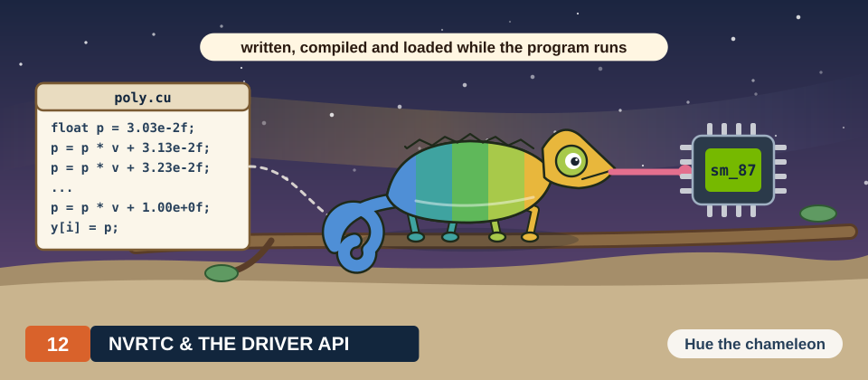
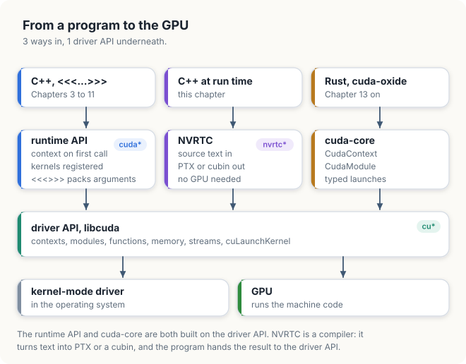
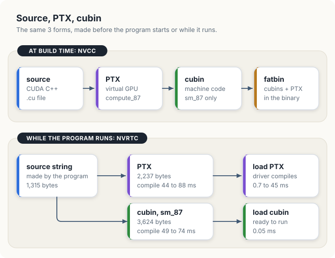
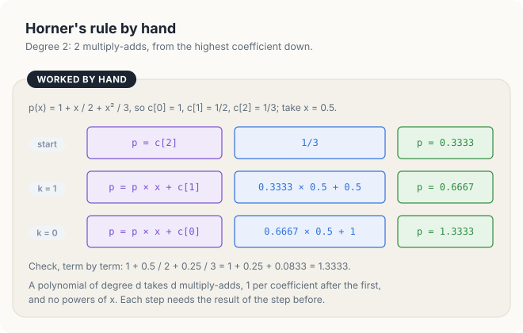
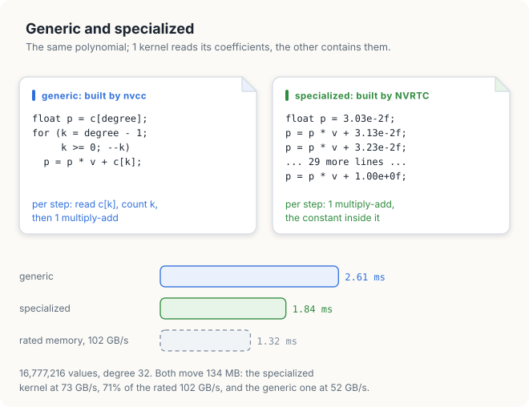
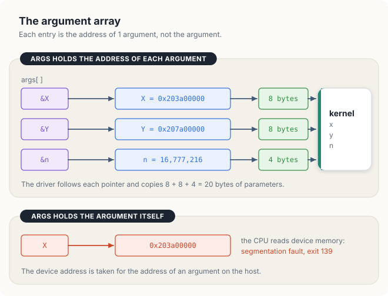
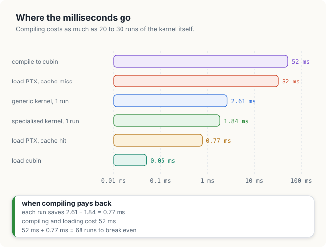
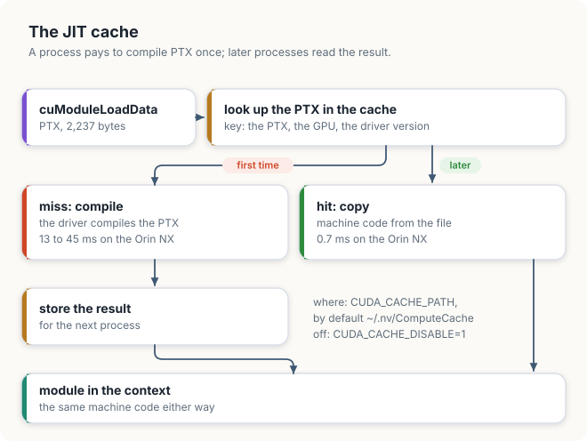
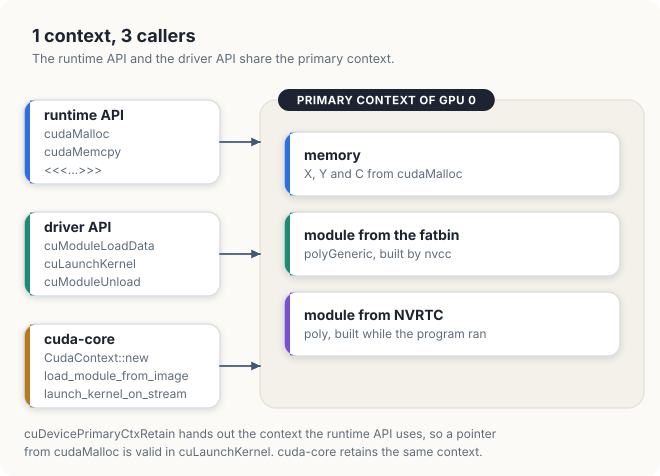

# Chapter 12: NVRTC, Runtime Compilation & the Driver API

So far, every kernel in this book has been compiled by `nvcc`, the CUDA compiler, together with
the host code of its program. The **machine code** of the kernel, the binary instructions that
the GPU executes, is placed inside the executable, and the CUDA runtime finds it there when the
host code launches the kernel with `<<<...>>>`. The data that a kernel
processes arrives at run time, but the instructions that process the data are fixed when the
program is built.

Some applications need kernels that cannot be written in advance. A deep-learning framework
fuses several operations into 1 kernel after it has seen the shapes of the **tensors**, the
multi-dimensional arrays on which it computes, such as a batch of 32 images of 224 × 224 pixels.
A simulation reads its coefficients from an input file. A tool may let its users write their own
kernels. In each case, the best kernel, or the only possible one, is known only while the
program runs. In this chapter, we show how a program can generate the source code of a kernel as
a string, compile it with **NVRTC**, the CUDA runtime compilation library, and load and launch
the result through the **driver API**, the lower-level interface on which the CUDA runtime
itself is built.

We use 1 example throughout the chapter: a polynomial of degree 32, evaluated at 16,777,216
points. A generic kernel reads the 33 coefficients from memory. A specialised kernel, generated
by the program after the coefficients are known, contains them as constants. The 2 kernels
produce bit-identical results, and we will measure both what the specialised kernel gains and
what it costs to compile. The times in this chapter were measured on a Jetson Orin NX, an
integrated GPU of compute capability 8.7 with 102 GB/s of memory bandwidth; the programs were
also run on a Jetson AGX Thor, of compute capability 11.0.

<div class="covers" markdown="1">

This chapter covers

- the services of the runtime API, and the driver API objects beneath it: context, module and
  function
- PTX, cubin and fatbin, and the rules for which code runs on which GPU
- Horner's rule, and a kernel specialised to its coefficients
- compiling CUDA C++ source from a string with NVRTC, and reading the compilation log
- loading a module, looking up a kernel, and launching it with an array of argument addresses
- the same steps in Rust, where cuda-core is built directly on the driver API
- the cost and benefit of runtime compilation, and the driver's JIT cache
- sharing 1 context between the runtime API and the driver API

</div>

The code of the chapter is in
[`code/ch12_nvrtc/`](https://github.com/arpanpathak/gpu-parallel-book/tree/main/code/ch12_nvrtc)
for C++ and in
[`code/oxide/ch12_driver/`](https://github.com/arpanpathak/gpu-parallel-book/tree/main/code/oxide/ch12_driver)
for Rust.

## 12.1 The runtime API and the driver API

### 12.1.1 What the runtime API does

Recall from Chapter 3 that a **kernel** is a function that executes on the GPU, once for each
thread of a launch. The functions we have used so far to allocate memory, copy data and launch
kernels, such as `cudaMalloc`, `cudaMemcpy` and the `<<<...>>>` syntax, belong to the **CUDA
runtime API**. The runtime API is implemented by a library called `libcudart`, and the names of
its functions begin with `cuda`.

To see what the runtime API does for a program, let us list what must be known before the launch
`polyGeneric<<<65536, 256>>>(X, Y, n, C, degree)` of this chapter can start. First, the GPU must
know which memory belongs to the program: `X` holds a device address such as 0x203a00000, which
is meaningful only among the allocations of this program on this GPU. Second, someone must know
where the machine code of `polyGeneric` is, among the kernels of the executable. Third, someone
must copy the 5 argument values into the launch: 8 bytes for each of the pointers `X`, `Y` and
`C`, and 4 bytes for each of the integers `n` and `degree`. The program states none of these
facts. The runtime API supplies them with 3 services that we have relied on without noticing
them.

1. **It creates a context.** A context, defined below, holds the state of a program on 1 GPU.
   The runtime API creates 1 context per GPU the first time the program uses that GPU, and every
   later runtime call uses it.
2. **It registers the kernels.** `nvcc` adds code to the executable that runs before `main`. This
   code gives the runtime the machine code of every kernel in the source file, together with the
   host-side function that represents each kernel. When the program launches `polyGeneric`, the
   runtime therefore already knows which machine code the name refers to.
3. **It packs the arguments.** In a launch such as
`polyGeneric<<<blocks, threads>>>(X, Y, n, C, degree)`, the compiler knows the parameter list of
the kernel. It checks the types of the 5 arguments and generates the code that copies their
values into the launch.

<div class="definition">

<span class="box-label">Definition 12.1</span> **Context.** A **context** holds the state of a
program on 1 GPU: the memory the program has allocated, the kernels it has loaded, and its
streams. A device address is valid only in the context that allocated it.

*Example.* When the program of this chapter calls `cudaMalloc` for `X`, the 64 MiB at
0x203a00000 are recorded in the context of GPU 0; the module that holds `polyGeneric` is
recorded in the same context.

</div>

A context plays a role for the GPU similar to the role a process plays for the CPU: 2 programs
on the same GPU have 2 contexts, and neither can use the addresses of the other.

All 3 services depend on the kernel being known when the program is compiled. A kernel that is
generated while the program runs has not been registered, and the compiler never saw its
parameter list. The runtime API therefore has no way to launch it, and we need the lower-level
interface.

### 12.1.2 Driver API objects

The runtime API is built on the **CUDA driver API**. The driver API is implemented by `libcuda`,
and the names of its functions begin with `cu`. Note that `libcuda` is part of the GPU driver,
not of the CUDA toolkit, so it is present on every machine that has an NVIDIA driver installed.
The driver API exposes as explicit objects the things that the runtime API manages for us:

| Object | What it is | Created by |
|---|---|---|
| device (`CUdevice`) | 1 GPU, by number | `cuDeviceGet` |
| context (`CUcontext`) | the memory, kernels and streams of 1 program on 1 GPU | `cuDevicePrimaryCtxRetain` |
| module (`CUmodule`) | 1 loaded piece of GPU code, holding one or more kernels | `cuModuleLoadData` |
| function (`CUfunction`) | 1 kernel inside a module, found by its name | `cuModuleGetFunction` |

Let us follow the specialised kernel of this chapter through the 4 objects. The program asks for
device 0, the Orin GPU, and receives a `CUdevice`. It obtains the context of that device, in
which its arrays `X` and `Y` live. It hands the driver 3,624 bytes of compiled code that contain
1 kernel, and the driver loads them into the context and returns a module. Finally, it asks the
module for the kernel named `poly` and receives a function, which it can launch on `X` and `Y`.

<div class="definition">

<span class="box-label">Definition 12.2</span> **Module and function.** A **module** is a piece
of GPU code loaded into a context; it holds one or more kernels, each recorded under its
**symbol name**, the name by which the code refers to it. A **function** (`CUfunction`) is a
handle to 1 kernel of a loaded module, obtained by looking up its symbol name.

*Example.* Loading the 3,624-byte cubin of section 12.4 gives a module that holds 1 kernel;
looking up the name `poly` in it gives the function that `cuLaunchKernel` launches.

</div>

Once a program holds a function object, it can launch the kernel with `cuLaunchKernel`,
regardless of how the code of the kernel was produced. Figure 12.1 shows the layers. The runtime
API, NVRTC and the Rust crate cuda-core all rest on the same driver API.

<figure>

<figcaption><b>Figure 12.1</b> The runtime API, NVRTC and cuda-core, each built on the driver API.</figcaption>
</figure>

Most runtime API calls correspond to one or more driver API calls:

| Runtime API | Driver API |
|---|---|
| first call creates the context | `cuInit`, `cuDeviceGet`, `cuDevicePrimaryCtxRetain` |
| `cudaMalloc`, `cudaFree` | `cuMemAlloc`, `cuMemFree` |
| `cudaMemcpy` | `cuMemcpyHtoD`, `cuMemcpyDtoH` |
| kernels registered before `main` | `cuModuleLoadData`, `cuModuleGetFunction` |
| `kernel<<<grid, block>>>(args...)` | `cuLaunchKernel(function, grid, block, ..., args)` |

### 12.1.3 cuda-core and the driver API

The Rust programs of this book have used the driver API from the beginning. cuda-core, the host
**crate** (Rust package) of cuda-oxide, calls `libcuda` directly and does not use the runtime
API at all. `CudaContext::new(0)` calls `cuInit`, `cuDeviceGet` and `cuDevicePrimaryCtxRetain`,
and `kernels::load(&ctx)` passes the GPU code that cargo-oxide embedded in the executable to
`cuModuleLoadData`. A Rust program that compiles a kernel at run time therefore needs no new
crate. It passes the code it has compiled to the same functions.

## 12.2 PTX, cubin and fatbin

### 12.2.1 Virtual and real architectures

Each generation of NVIDIA GPUs has its own **instruction set**, the set of machine instructions
that its processors understand, together with their binary encoding. The **compute capability**
identifies a generation and its features with 2 numbers, a major and a minor version: 8.7 for
the Jetson Orin NX and 9.0 for the H100. A compiler target for a particular compute capability
is written as `sm_87` or `sm_90`. Machine code compiled for `sm_90` does not run on an `sm_87`
GPU, because some of its instructions do not exist on the older generation.

To allow code to run on GPUs that did not exist when it was compiled, NVIDIA defines a second,
portable form of GPU code, and compilation is split into 2 steps. Let us follow the polynomial
kernel of this chapter through them. The source text of the kernel is 1,315 bytes long. The
first step translates it into a list of operations for an idealised GPU that no hardware
implements directly, for example "multiply-add 3 registers of 32-bit floats", without choosing
the binary encoding of any real GPU. For our kernel, this intermediate form is 2,237 bytes of
text, and it is almost the same for every target: 2,237 bytes for the Orin and 2,250 bytes for
the Thor. The second step translates the intermediate form into the machine code of 1 real GPU:
3,624 bytes for `sm_87` and 6,368 bytes for `sm_110`. The second step can run when the program
is built, or later, on the machine where the program runs, once the GPU is known.

<div class="key-observation">

<span class="box-label">Key observation</span> The first step does not depend on the GPU that
will run the code, and the second step does. If a program carries the intermediate form, the
choice of GPU can wait until the program runs.

</div>

<div class="definition">

<span class="box-label">Definition 12.3</span> **PTX and JIT compilation.** **PTX** is the
instruction set of a *virtual* GPU, stored as text. PTX is compiled for a **virtual
architecture**, such as `compute_87`, which determines the features the code may use but not the
machine instructions. Compiling code at the moment it is needed, on the machine where it runs,
is called **just-in-time (JIT) compilation**.

*Example.* When a program loads the 2,237 bytes of PTX of the polynomial kernel on the Orin, the
GPU driver JIT-compiles them into machine code for `sm_87`.

</div>

The machine code itself is stored in 1 of 2 containers.

<div class="definition">

<span class="box-label">Definition 12.4</span> **Cubin and fatbin.** A **cubin** (CUDA binary)
holds machine code for 1 real architecture, such as `sm_87`. A **fatbin** (fat binary) bundles
several cubins and PTX in 1 file, so that 1 executable can run on many GPUs.

*Example.* A fatbin with a cubin for `sm_87`, a cubin for `sm_90` and PTX for `compute_87` runs
the first cubin on an Orin, the second on an H100, and JIT-compiles the PTX on a Thor.

</div>

`nvcc` embeds a fatbin in every executable it builds. When the program loads it, the driver
selects the cubin that matches the GPU, or JIT-compiles the PTX if no cubin matches.

Figure 12.2 shows the 3 forms twice: produced by `nvcc` before the program runs, and produced by
NVRTC while it runs. The sizes are those of the polynomial kernel of this chapter, compiled for
`sm_87`.

<figure>

<figcaption><b>Figure 12.2</b> Source, PTX and cubin, produced before the program starts or while it runs.</figcaption>
</figure>

### 12.2.2 Binary and PTX compatibility

The CUDA programming guide gives 2 rules that decide whether a piece of GPU code can run on a
given GPU:

- A cubin built for compute capability X.y runs on a GPU of compute capability X.z only if
  z ≥ y. That is, the GPU must belong to the same major generation and have the same or a later
  minor version.
- PTX compiled for `compute_X.y` can be JIT-compiled for any GPU of compute capability X.y or
  higher, including GPUs of later major generations.

The following table applies the 2 rules to code compiled for compute capability 8.0.

| GPU | Compute capability | Real architecture | Runs a cubin for `sm_80`? | Runs PTX for `compute_80`? |
|---|---|---|---|---|
| A100 | 8.0 | `sm_80` | yes | yes |
| Jetson Orin NX | 8.7 | `sm_87` | yes, 8.7 ≥ 8.0 | yes |
| GeForce RTX 4090 | 8.9 | `sm_89` | yes, 8.9 ≥ 8.0 | yes |
| H100 | 9.0 | `sm_90` | no, major 9 ≠ 8 | yes |
| Jetson AGX Thor | 11.0 | `sm_110` | no | yes |
| GeForce RTX 5090 | 12.0 | `sm_120` | no | yes |
| DGX Spark (GB10) | 12.1 | `sm_121` | no | yes |

A program that compiles its kernels at run time does not face this question. It can ask the
driver which GPU it is running on and compile for exactly that GPU, as we will see in section
12.4.2.

## 12.3 A kernel that depends on run-time values

### 12.3.1 Horner's rule

A polynomial of degree \\(d\\) has \\(d + 1\\) coefficients:

\\[ p(x) = c_0 + c_1 x + c_2 x^2 + \dots + c_d x^d \\]

Computing each power of \\(x\\) separately wastes multiplications. **Horner's rule** rewrites
the polynomial so that each coefficient costs 1 multiplication and 1 addition:

\\[ p(x) = c_0 + x\,(c_1 + x\,(c_2 + \dots + x\,c_d)) \\]

The evaluation starts with the highest coefficient. At each step, it multiplies the running
value by \\(x\\) and adds the next lower coefficient. For example, consider \\(p(x) = 1 + x/2 +
x^2/3\\) at \\(x = 0.5\\). We start with \\(p = c_2 = 0.3333\\). The first step computes \\(p =
0.3333 \times 0.5 + 0.5 = 0.6667\\), and the second step computes \\(p = 0.6667 \times 0.5 + 1 =
1.3333\\). Evaluating the terms separately gives the same value, \\(1 + 0.25 + 0.0833 =
1.3333\\). Figure 12.3 shows the 2 steps.

<figure>

<figcaption><b>Figure 12.3</b> Horner's rule for a polynomial of degree 2: 2 multiply-adds, from the highest coefficient down.</figcaption>
</figure>

On a GPU, a multiplication followed by an addition is a single instruction, the **fused
multiply-add (FMA)**, which rounds the result once instead of twice. A polynomial of degree
\\(d\\) therefore costs \\(d\\) FMAs per point, or \\(2d\\) floating-point operations (FLOP):

```text
HORNER(c[0..d], x):
    p ← c[d]
    for k ← d − 1 down to 0:
        p ← p × x + c[k]            # 1 fused multiply-add
    return p
```

The example of this chapter has degree \\(d\\) = 32 and coefficients \\(c_k = 1/(k + 1)\\), that
is, 1, 0.5, 0.3333, and so on down to 0.0303. The polynomial is evaluated at \\(N\\) =
2<sup>24</sup> = 16,777,216 points spread evenly over \\([-1, 1)\\). The whole evaluation
performs \\(2dN\\) = 2 × 32 × 16,777,216 = 1.07 GFLOP and moves \\(8N\\) = 134.2 MB, since each
point requires reading 4 bytes and writing 4 bytes.

### 12.3.2 The generic kernel

The **generic** kernel receives the degree and the coefficients as arguments, and each thread
evaluates the polynomial at 1 point. Since `nvcc` compiles this kernel together with the rest of
the program, before the coefficients are known, the kernel must work for any degree and any
coefficients.

<p class="listing"><b>Listing 12.1</b> The generic kernel.</p>

<div class="code-tabs">
<div class="code-tab" data-lang="Rust">

```rust,ignore
{{#include ../../../../code/oxide/ch12_driver/src/main.rs:19:41}}
```

</div>
<div class="code-tab" data-lang="C++">

```cpp
{{#include ../../../../code/ch12_nvrtc/nvrtc.cu:66:80}}
```

</div>
</div>

In each of the 32 iterations of the loop, the thread reads `c[k]` from memory, because the
compiler does not know its value. It then decrements and tests `k`, and finally performs 1 FMA.
All threads of a warp read the same `c[k]`, so the read is served by the **cache**, a small,
fast memory on the chip that keeps recently read values. However, it is
still an instruction that the GPU must issue, together with the loop instructions, for every one
of the 32 FMAs.

The Rust kernel contains the same loop. It obtains the degree from the length of the slice `c`,
so it also works for any degree. Note the call to `mul_add`, which requests the fused
multiply-add explicitly. Unlike a C++ compiler, the Rust compiler does not fuse `p * v + c[k]`
on its own, because fusing changes the rounding of the result.

### 12.3.3 Generating the specialised kernel source

Once the program knows the coefficients, it can generate a kernel that contains them. Consider
first the polynomial of degree 2 of Figure 12.3, with the coefficients 1, 0.5 and 0.3333. For
each step of Horner's rule, the generic kernel performs 4 operations: it reads `c[k]` from
memory, decrements `k`, tests whether the loop continues, and performs the FMA. If the program
writes the coefficients into the source text, the same evaluation becomes 3 lines with no loop
and no reads:

```text
p = 0.3333
p = p × v + 0.5          # 1 FMA with a constant
p = p × v + 1            # 1 FMA with a constant
```

Each step is now 1 operation instead of 4, and the 3 lines compute the same value, 1.3333 at
v = 0.5.

<div class="definition">

<span class="box-label">Definition 12.5</span> **Specialised kernel.** **Specialising** a kernel
means compiling it for particular values that a generic kernel would receive as arguments, so
that the values appear in the source as constants.

*Example.* The polynomial kernel specialised to the coefficients \\(c_k = 1/(k + 1)\\) contains
the constant 3.125000000e-02 for \\(c_{31}\\) = 1/32, where the generic kernel reads `c[31]`
from memory.

</div>

The specialised polynomial kernel of degree 32 has no loop and no reads of `c`. Its body
consists of 32 lines, each of which is 1 FMA with a constant:

```text
SPECIALISED SOURCE(c[0..d]):
    text ← kernel header, i, bounds test, v ← x[i]
    append "p = c[d];"                       written as a number
    for k ← d − 1 down to 0:
        append "p = p * v + c[k];"           written as a number
    append "y[i] = p;"
    return text
```

<p class="listing"><b>Listing 12.2</b> The program generates the source of the specialised kernel.</p>

<div class="code-tabs">
<div class="code-tab" data-lang="Rust">

```rust,ignore
{{#include ../../../../code/oxide/ch12_driver/src/main.rs:68:90}}
```

</div>
<div class="code-tab" data-lang="C++">

```cpp
{{#include ../../../../code/ch12_nvrtc/nvrtc.cu:82:104}}
```

</div>
</div>

3 details of the generated text deserve attention. First, the kernel is declared **`extern
"C"`**, which keeps its name exactly `poly`. C++ allows **overloaded functions**, several
functions with the same name and different parameter types, such as `poly(const float*, float*,
int)` and `poly(const double*, double*, int)`. To give each of them a distinct symbol name, the
C++ compiler encodes the parameter types into the name. Our kernel becomes `_Z4polyPKfPfi`: `_Z`
starts an encoded name, `4poly` is the 4-letter name, `PKf` is a pointer to a constant float,
`Pf` a pointer to a float, and `i` an int. This encoding is called **name mangling**. Since
we look up the kernel by its name in section 12.5.2, the name must be predictable. Second, the
format **`%.9e`** of `snprintf` prints each coefficient in scientific notation: 1 digit, a decimal
point and 9 more digits, followed by a power of 10, for example `3.125000000e-02` = 3.125 ×
10<sup>−2</sup> for 1/32. 9 significant decimal digits are sufficient to represent every `float`
value exactly, and the format prints 10, so each constant in the text is the same `float` that
the generic kernel reads from memory. Third, the **`f` suffix** makes each constant a `float`.
Without the suffix, `3.125000000e-02` is a `double` in C++, and the entire FMA would be
performed in double precision.

Figure 12.4 compares the 2 kernels, together with the execution times that we will measure in
section 12.6.

<figure>

<figcaption><b>Figure 12.4</b> The generic kernel reads its coefficients from memory; the specialised kernel contains them as constants.</figcaption>
</figure>

## 12.4 Compiling source at run time with NVRTC

### 12.4.1 The NVRTC calls

**NVRTC** (NVIDIA Runtime Compilation) is a library, `libnvrtc`, that compiles CUDA C++ source
code held in a string. It contains the same compiler **front end** as `nvcc`, the part of a
compiler that reads the source text, checks it and translates it into an intermediate form, but
it requires no files, no `nvcc` installation and no GPU, and it returns PTX or a cubin as bytes
in memory.

Before we list the calls, let us follow the polynomial kernel from text to launch, with the
sizes measured on the Orin. The program holds the source as a string of 1,315 bytes. NVRTC
compiles the string in 44 to 88 ms and returns either 2,237 bytes of PTX or a cubin of 3,624
bytes for `sm_87`. The driver loads the image into the context as a module: the cubin in 0.05
ms, the PTX in 13 to 45 ms because the driver must first JIT-compile it, or in about 0.7 ms if
it finds the result of an earlier compilation in its cache (section 12.7). The program looks up
`poly` in the module and launches it with `cuLaunchKernel`. In Sections 12.4 and 12.5 we take
these steps in order: compile, load and look up, launch.

A compilation consists of 5 steps:

```text
COMPILE(source, target):
    prog ← nvrtcCreateProgram(source, name for messages)
    if nvrtcCompileProgram(prog, ["--gpu-architecture=" + target]) fails:
        print nvrtcGetProgramLog(prog)          # the compiler's error messages
        return nothing
    image ← nvrtcGetCUBIN(prog)  if target is real, such as sm_87
            nvrtcGetPTX(prog)    if target is virtual, such as compute_87
    nvrtcDestroyProgram(prog)
    return image
```

<p class="listing"><b>Listing 12.3</b> Compiling a string with NVRTC.</p>

<div class="code-tabs">
<div class="code-tab" data-lang="Rust">

```rust,ignore
{{#include ../../../../code/oxide/ch12_driver/src/main.rs:92:133}}
```

</div>
<div class="code-tab" data-lang="C++">

```cpp
{{#include ../../../../code/ch12_nvrtc/nvrtc.cu:106:142}}
```

</div>
</div>

The option `--gpu-architecture` determines what NVRTC produces. If the target is a real
architecture, such as `sm_87`, NVRTC produces a cubin, which the program retrieves with
`nvrtcGetCUBIN`. If the target is a virtual architecture, such as `compute_87`, NVRTC produces
only PTX. The other options are the same as those of `nvcc`, passed as strings: `-std=c++17`,
`-default-device`, `-I` and so on.

### 12.4.2 Selecting the target architecture

The program asks the driver for the compute capability of the GPU and builds the architecture
name from it. For example, a major version of 8 and a minor version of 7 give `sm_87`. The same
lines of code also create the context described in section 12.5.1.

<p class="listing"><b>Listing 12.4</b> Creating a context and selecting the target for the GPU the program runs on.</p>

<div class="code-tabs">
<div class="code-tab" data-lang="Rust">

```rust,ignore
{{#include ../../../../code/oxide/ch12_driver/src/main.rs:152:159}}
    // ...
}
```

</div>
<div class="code-tab" data-lang="C++">

```cpp
{{#include ../../../../code/ch12_nvrtc/nvrtc.cu:154:173}}
    // ...
}
```

</div>
</div>

```console
GPU: Orin, compute capability 8.7, target sm_87
GPU: NVIDIA Thor, compute capability 11.0, target sm_110
```

The same source compiles to a cubin of 3,624 bytes for `sm_87` and of 6,368 bytes for `sm_110`.
The PTX, in contrast, hardly changes, at 2,237 bytes and 2,250 bytes, because it describes the
same virtual machine in both cases.

### 12.4.3 The compilation log

A program that generates source code can make mistakes in it, as a programmer can. NVRTC
does not print its error messages. Instead, it stores them in the **log** of the program object,
and the host code must retrieve the log with `nvrtcGetProgramLogSize` and `nvrtcGetProgramLog`.
To demonstrate, our program compiles a second copy of its source in which `y[i] = p` has been
changed to `y[i] = q`, and prints the log:

```console
a source with a mistake
  compile failed, log:
poly.cu(42): error: identifier "q" is undefined
      y[i] = q;
             ^

1 error detected in the compilation of "poly.cu".
```

`poly.cu` is the name the program passed to `nvrtcCreateProgram`; no file of that name exists.
Line 42 is the last line of the generated text: 8 lines of header, 1 line for `float p`, 32
lines of FMAs, and then `y[i] = q`. Without the log, the program would only know that the
compilation failed, not why.

### 12.4.4 Calling NVRTC from Rust

cuda-oxide does not provide an NVRTC wrapper at the revision used in this book, and the Rust
program needs only 7 NVRTC functions, so it declares them itself. A declaration of functions
that are implemented in another language is called a **foreign function interface (FFI)**. The
**linker** is the program that combines the compiled code of a program with the libraries it
calls into 1 executable. The attribute `#[link(name = "nvrtc")]`, an annotation on the block of
declarations, instructs the linker to link `libnvrtc`. cuda-oxide's `cuda-bindings` crate
already adds the toolkit's `lib64` directory to the linker's search path, so `Cargo.toml` is the
same as in Chapter 13 and needs no new dependency. In Rust 2024, the block must be written as
`unsafe extern "C"`, because the compiler cannot verify that the declarations match the library;
the programmer is responsible for that.

<p class="listing"><b>Listing 12.5</b> The 7 NVRTC functions, declared in Rust and taken from the header in C++.</p>

<div class="code-tabs">
<div class="code-tab" data-lang="Rust">

```rust,ignore
{{#include ../../../../code/oxide/ch12_driver/src/main.rs:43:66}}
```

</div>
<div class="code-tab" data-lang="C++">

```cpp
{{#include ../../../../code/ch12_nvrtc/nvrtc.cu:12:12}}
```

</div>
</div>

The type `Program` represents NVRTC's `nvrtcProgram`, a pointer to an object whose layout only
NVRTC knows. Each function returns an `nvrtcResult`, in which 0 indicates success, so `c_int` is
the appropriate Rust type. The `compile` function follows the same 5 steps as the C++ version. A
C string has no stored length; it ends at the first byte with the value 0, called the **NUL
byte**, so the 4 characters `poly` occupy 5 bytes. `CString` appends this byte, and the small
helper function `ok` converts a nonzero result into a Rust error so that the `?` operator can
propagate it.

<p class="listing"><b>Listing 12.6</b> The <code>compile</code> function, which calls the functions of Listing 12.5.</p>

<div class="code-tabs">
<div class="code-tab" data-lang="Rust">

```rust,ignore
{{#include ../../../../code/oxide/ch12_driver/src/main.rs:92:133}}
```

</div>
<div class="code-tab" data-lang="C++">

```cpp
{{#include ../../../../code/ch12_nvrtc/nvrtc.cu:106:142}}
```

</div>
</div>

The source text generated by the Rust program describes the same kernel. Rust prints the
exponent of a floating-point number without a leading zero, as in `3.125000000e-2`, so its
source is 1,281 bytes long instead of 1,315. The CUDA C++ compiler reads both spellings as the
same number.

## 12.5 Loading and launching with the driver API

### 12.5.1 Contexts

Listing 12.4 began with 4 driver API calls. `cuInit(0)` initialises the driver API. It must be
called before any other `cu` function, and its argument must be 0. `cuDeviceGet` converts the
device number 0 into a `CUdevice`. `cuDevicePrimaryCtxRetain` returns the **primary context** of
the device, which is the single context per GPU that the runtime API uses, and increments the
count of its users. The driver destroys the primary context only when this count returns to 0,
so a context retained by 2 parts of a program, for example the runtime API and our own code,
survives until both have released it. Finally, `cuCtxSetCurrent` makes this context the
**current context** of the calling host thread: every later driver call made by that CPU thread,
such as `cuModuleLoadData`, operates on this context without naming it.

The driver API can also create additional contexts with `cuCtxCreate`. However, a device pointer
belongs to the context that allocated it and is not valid in any other context. A program that
combined the runtime API with a context of its own would therefore hold 2 separate sets of
memory. By retaining the primary context, the program uses a single context throughout, as
we discuss further in section 12.8. At the end of the program, `cuDevicePrimaryCtxRelease`
decrements the count of users.

### 12.5.2 Modules and functions

`cuModuleLoadData` loads 1 image, which may be PTX, a cubin or a fatbin, into the current
context and returns a module. `cuModuleGetFunction` then looks up a kernel in the module by its
name.

<p class="listing"><b>Listing 12.7</b> Loading an image and looking up the kernel in it.</p>

<div class="code-tabs">
<div class="code-tab" data-lang="Rust">

```rust,ignore
fn main() -> Result<(), Error> {
    // ...
{{#include ../../../../code/oxide/ch12_driver/src/main.rs:171:175}}
    // ...
}
```

</div>
<div class="code-tab" data-lang="C++">

```cpp
{{#include ../../../../code/ch12_nvrtc/nvrtc.cu:144:152}}
```

</div>
</div>

The name passed to `cuModuleGetFunction` must be the symbol name in the machine code. In section
12.3.3, we used `extern "C"` to keep that name as `poly`. A copy of the program whose generated
source omitted `extern "C"` compiled without any error, but then failed at the lookup:

```console
GPU: Orin, compute capability 8.7, target sm_87
NVRTC, a polynomial of degree 32, 1304 bytes of source
  compile to PTX        50.01 ms    2309 bytes
  compile to cubin      51.30 ms    3752 bytes
CUDA driver error: CUDA_ERROR_NOT_FOUND
```

The module contained a kernel named `_Z4polyPKfPfi`, but no kernel named `poly`. A second copy
of the program, which compiled its cubin for `sm_90` and loaded it on the `sm_87` GPU, failed
one step earlier, in `cuModuleLoadData`, with `CUDA_ERROR_INVALID_SOURCE`. As the compatibility
rules of section 12.2.2 state, the driver does not load machine code built for a different
generation.

### 12.5.3 Kernel arguments

`cuLaunchKernel` takes the function, the grid and block dimensions, the number of bytes of
**dynamic shared memory**, which is shared memory whose size is chosen at the launch rather than
written into the kernel, a stream, and the arguments of the kernel. Unlike the `<<<...>>>`
syntax, the driver API does not know the parameter list of the kernel at compile time. The
driver obtains the size of each parameter from the module, so it needs only 1 piece of
information from the program for each parameter: the **address** at which the value of the
argument is stored. The program passes these addresses as an array of `void*`.

For example, the specialised kernel is declared as `poly(const float* x, float* y, int n)`. The
host variables `X` and `Y` hold device addresses, and the host variable `n` holds 16,777,216.
The argument array is therefore `args[0] = &X`, `args[1] = &Y` and `args[2] = &n`. At the
launch, the driver reads 8 bytes at `args[0]`, 8 bytes at `args[1]` and 4 bytes at `args[2]`, a
total of 8 + 8 + 4 = 20 bytes, and copies them into the parameters `x`, `y` and `n` of the
kernel.

<p class="listing"><b>Listing 12.8</b> The argument array and the 2 launches.</p>

<div class="code-tabs">
<div class="code-tab" data-lang="Rust">

```rust,ignore
fn main() -> Result<(), Error> {
    // ...
{{#include ../../../../code/oxide/ch12_driver/src/main.rs:184:206}}
    // ...
}
```

</div>
<div class="code-tab" data-lang="C++">

```cpp
int main()
{
    // ...
{{#include ../../../../code/ch12_nvrtc/nvrtc.cu:213:222}}
    // ...
}
```

</div>
</div>

The lambda `special` launches 65,536 blocks of 256 threads, 1 thread per point, on the
**default stream**, the stream used when the program names none (`nullptr`), and with no dynamic
shared memory (0). The last argument, `extra`, provides an
alternative way to pass the arguments as a single packed buffer; we leave it empty.

A common mistake is to write `X` where `&X` is required. Figure 12.5 shows why this fails. We
ran a copy of the program with `void* args[] = {X, Y, &n};`. It ran the generic kernel and then
terminated at the first `cuLaunchKernel`:

```console
$ ./nvrtc                                         # with void* args[] = {X, Y, &n};
GPU: Orin, compute capability 8.7, target sm_87
NVRTC, a polynomial of degree 32, 1315 bytes of source
  ...
  generic, nvcc, <<<...>>>          2.897 ms   370.6 GFLOP/s
Segmentation fault
$ echo $?
139
```

The driver interpreted the device address stored in `X` as the host address of an argument, and
the CPU's read from that address failed. A **segmentation fault** is the error that the
operating system raises when a program accesses an address that it is not allowed to access; the
system then stops the program with the signal `SIGSEGV`, number 11. A shell reports a program
stopped by signal \\(s\\) with the exit code 128 + \\(s\\), so exit code 139 is 128 + 11, signal
11, `SIGSEGV`. On another system, the read might succeed and silently pass a meaningless value
to the kernel instead.

<figure>

<figcaption><b>Figure 12.5</b> Each entry of the argument array is the address of 1 argument, not the argument itself.</figcaption>
</figure>

<div class="bee bee-shocked" markdown="1">

`cuLaunchKernel` reads each argument through the address the program gives it. Pass `&X`, never
`X`.

</div>

### 12.5.4 Loading and launching from Rust

cuda-core wraps the same 3 driver steps. `CudaContext::load_module_from_image` calls
`cuModuleLoadData` and returns a `CudaModule`, which unloads itself with `cuModuleUnload` when
it is dropped. `load_function` calls `cuModuleGetFunction`. `launch_kernel_on_stream` calls
`cuLaunchKernel` with a slice of argument addresses. This function is marked `unsafe` because,
like the C++ driver API, it cannot check that the addresses match the parameters of the kernel.

<p class="listing"><b>Listing 12.9</b> Loading the NVRTC cubin, with the raw launch beside the typed launch.</p>

<div class="code-tabs">
<div class="code-tab" data-lang="Rust">

```rust,ignore
fn main() -> Result<(), Error> {
    // ...
{{#include ../../../../code/oxide/ch12_driver/src/main.rs:171:206}}
    // ...
}
```

</div>
<div class="code-tab" data-lang="C++">

```cpp
int main()
{
    // ...
{{#include ../../../../code/ch12_nvrtc/nvrtc.cu:195:202}}
    // ...
{{#include ../../../../code/ch12_nvrtc/nvrtc.cu:213:222}}
    // ...
}
```

</div>
</div>

`x.cu_deviceptr()` returns the device address held by a `DeviceBuffer` as a `u64`, so `x_ptr`
plays the role of `X` in the C++ program. The expression `&raw mut x_ptr` takes the address of
`x_ptr` without creating a Rust reference, and `.cast()` converts it into the untyped
`*mut c_void` that the driver expects.

The typed launch, `module.poly_generic(...)`, performs the same work behind a checked
**signature**, the list of parameter types of a function, which the compiler compares with the
arguments of each call. The `#[cuda_module]` attribute reads the parameter list of each kernel
when the crate is compiled and generates a method with matching Rust types, so a misplaced
argument becomes a compile error rather than a crash. A copy of the crate that swapped `&mut y`
and `&c` failed to build:

```console
error[E0308]: mismatched types
   --> src/main.rs:188:62
    |
188 |         Ok(module.poly_generic(&stream, &config, &x, &mut y, &c)?)
    |                   ------------                               ^^ types differ in mutability
    |                   |
    |                   arguments to this method are incorrect
    |
    = note: expected mutable reference `&mut DeviceBuffer<_>`
                       found reference `&DeviceBuffer<_>`
```

A kernel compiled at run time has no such signature at build time, in either language. When we
compile kernels at run time, the program, not the compiler, is responsible for passing correct
arguments.

## 12.6 Cost and benefit of runtime compilation

We now measure what runtime compilation costs and what it gains. The C++ program compiles the
specialised kernel to PTX and to a cubin and loads both. It then runs the generic kernel for
about 0.4 s so that the GPU reaches its steady clock frequency, and times 20 runs of each
kernel. To verify the results, it compares all 16,777,216 outputs of the 2 kernels with each
other, and checks every 4,099th output against Horner's rule evaluated in double precision on
the CPU.

```console
$ ./nvrtc
GPU: Orin, compute capability 8.7, target sm_87
NVRTC, a polynomial of degree 32, 1315 bytes of source
  compile to PTX        45.74 ms    2237 bytes
  compile to cubin      51.99 ms    3624 bytes
  load PTX               0.68 ms
  load cubin             0.05 ms
p(x) for 16777216 values of x
  generic, nvcc, <<<...>>>          2.605 ms   412.1 GFLOP/s
  specialised, NVRTC, cuLaunch      1.840 ms   583.4 GFLOP/s
  max error 5.1e-07, generic vs specialised 0.0e+00
a source with a mistake
  ...
PASSED
```

Compiling the source took 45.74 ms to produce PTX and 51.99 ms to produce a cubin, because NVRTC
runs the complete compiler on the CPU once for each output. Across repeated runs, the compile
time ranged from 44 ms to 88 ms, depending on the load that other programs placed on the CPU.
Loading the PTX took only 0.68 ms in this run because the driver found a compiled copy in its
cache; in section 12.7 we explain the cache and show that a load without it costs 13 to 45 ms.
Loading the cubin took 0.05 ms, since a cubin is already machine code and only needs to be
copied into the context.

The specialised kernel ran 2.605 / 1.840 = 1.42 times as fast as the generic kernel. Across the
quiet runs, the ratio ranged from 1.3 to 1.46, because the GPU clock varies between runs, as we
observed in Chapter 6. The 2 kernels agree to the last bit, a difference of 0.0, because both
perform the same FMAs on the same `float` values in the same order. Both are within
5.1 × 10<sup>−7</sup> of the double-precision value.

To understand why the specialised kernel is faster, let us apply the analysis of arithmetic
intensity from Chapter 1. Recall that the **arithmetic intensity** of a kernel is the number of
floating-point operations it performs per byte it moves to or from memory. For each point, the
kernel performs 32 FMAs, which are 64 FLOP, and moves 8 bytes, so its arithmetic intensity is 64
/ 8 = 8 FLOP/B. The **ridge point** of a GPU is the intensity at which the time for the
arithmetic equals the time for the memory traffic: its peak rate of operations divided by its
memory bandwidth. A kernel below the ridge point waits for memory; a kernel above it waits for
arithmetic. The GPU on which we measured can perform 2,400 GFLOP/s, and its memory delivers 102
GB/s, so its ridge point is 2,400 / 102 = 23.5 FLOP/B. Since 8 FLOP/B is below the ridge point,
the computation is memory-bound, and its shortest possible time is the time to move 134.2 MB at
102 GB/s, or 1.32 ms. The specialised kernel took 1.840 ms, which corresponds to 134.2 MB /
1.840 ms = 72.9 GB/s, or 71% of the rated bandwidth. This is about the rate that a plain copy
reaches on the same GPU, 68 to 78 GB/s in Chapter 7. The generic kernel, at 2.605 ms, reached
only 51.5 GB/s.

The specialised kernel therefore runs at the speed of memory, and its 32 FMAs per point add no
time. The generic kernel, however, issues more instructions per point: a read of `c[k]` and the
loop control for `k` at each step. Since an intensity of 8 FLOP/B is not far below the ridge
point, these additional instructions make the SMs, rather than memory, the limiting resource. A
polynomial of lower degree would leave more headroom, and specialisation would gain less; a
polynomial of higher degree would gain more. Exercise 3 asks you to measure this.

The Rust program gives the same result:

```console
$ cargo oxide run
GPU: Orin, compute capability 8.7, target sm_87
NVRTC, 1281 bytes of source
  compile to cubin      57.66 ms    3624 bytes
  load cubin             0.56 ms
p(x) for 16777216 values of x
  generic, typed launch        2.857 ms   375.9 GFLOP/s
  specialised, raw launch      1.955 ms   549.3 GFLOP/s
  max error 5.1e-7, generic vs specialised 0.0e0
a source with a mistake
  ...
PASSED
```

The specialised kernel is the same NVRTC cubin as in C++, and its time of 1.96 ms against 1.84
ms is within the 10% by which runs vary. The generic Rust kernel, compiled by cuda-oxide, ran
within 10% of the generic C++ kernel, and its results match those of the specialised kernel bit
for bit, because `mul_add` performs the same fused operation. When you run the programs on your
own GPU, the ratio of the 2 kernel times is the number to compare.

Whether runtime compilation pays off depends on how often the kernel runs. Each run of the
specialised kernel saves 2.61 − 1.84 = 0.77 ms, while compiling the cubin and loading it costs
51.99 + 0.05 = 52 ms once. If \\(T_c\\) is the time to compile and load, and \\(t_g\\) and
\\(t_s\\) are the times of 1 run of the generic and the specialised kernel, the number of runs
needed to break even is

\\[ \frac{T_c}{t_g - t_s} = \frac{52 \text{ ms}}{0.77 \text{ ms}} = 68 \\]

A program that evaluates the polynomial 68 times or more gains from compiling it; a program that
evaluates it once loses about 51 ms. Figure 12.6 places all of these costs on a single
logarithmic time axis.

<figure>

<figcaption><b>Figure 12.6</b> The costs of runtime compilation on 1 time axis. Compiling costs as much as 20 to 30 runs of the kernel and is repaid after 68 runs.</figcaption>
</figure>

<div class="bee bee-happy" markdown="1">

Runtime compilation costs tens of milliseconds once. It pays off when the kernel it produces
runs many times.

</div>

## 12.7 The JIT cache

Loading PTX requires the driver to compile it into machine code, and this compilation takes
time. Consider a program that loads the 2,237 bytes of PTX of our kernel and is started 10 times
a day. Without help, the driver compiles the same PTX for the same GPU 10 times, at 13 to 45 ms
each, and produces the same machine code each time. The result of the first compilation could
have served all 10 runs, provided that it is stored somewhere that outlives the process and is
found again by a later process.

<div class="definition">

<span class="box-label">Definition 12.6</span> **JIT cache.** The **JIT cache** is a directory
in which the driver stores machine code that it has JIT-compiled from PTX. Each entry is found
by a key derived from the PTX, the GPU and the driver version.

*Example.* The first load of the polynomial PTX on the Orin compiles it in 31.98 ms and stores
the result; the next process that loads the same PTX copies the stored code in 0.77 ms.

</div>

The first load of a given PTX compiles it and stores the result. Later loads, in the same
process or in any later process, copy the stored machine code instead, as figure 12.7 shows.

<figure>

<figcaption><b>Figure 12.7</b> The first process compiles the PTX and stores the result; later processes read it from the cache.</figcaption>
</figure>

4 **environment variables**, named text values that a shell passes to every program it starts,
control the cache:

| Variable | Effect |
|---|---|
| `CUDA_CACHE_PATH` | the cache directory; `~/.nv/ComputeCache` when unset |
| `CUDA_CACHE_MAXSIZE` | the most the cache may hold, in bytes |
| `CUDA_CACHE_DISABLE` | `1` turns the cache off |
| `CUDA_FORCE_PTX_JIT` | `1` makes the driver ignore cubins and JIT-compile the PTX of every fatbin |

To measure the effect of the cache, we pointed `CUDA_CACHE_PATH` at an empty directory and ran
the program twice, and then once more with the cache disabled:

```console
$ export CUDA_CACHE_PATH=$PWD/jitcache            # an empty directory
$ ./nvrtc | grep 'load PTX'
  load PTX              31.98 ms                  # miss: compiled, then stored
$ ./nvrtc | grep 'load PTX'
  load PTX               0.77 ms                  # hit
$ CUDA_CACHE_DISABLE=1 ./nvrtc | grep 'load PTX'
  load PTX              14.44 ms                  # compiled every time
```

In this sequence, a load that hit the cache was 31.98 / 0.77 = 42 times faster than a load that
missed it. Across repeated runs, a load without the cache took 13 to 45 ms, and a load from the
cache 0.68 to 0.97 ms. After the 3 runs, the cache directory held 24 KB. The driver discards the
cache whenever it is upgraded, because a new driver version may compile the same PTX
differently.

Note that the cache stores the work of the driver, not the work of NVRTC. A program that
compiles source code at run time pays the NVRTC compile time, 44 to 88 ms in our measurements,
every time it runs, unless it keeps the result itself. A long-running program can compile each
distinct source once and keep the module loaded. A program that is started often can save the
cubin to a file, named by a hash of the source, the target architecture and the NVRTC version,
and load the file on the next run. A **hash** is a short number computed from the bytes of its
input, such that a change of any byte almost certainly changes the number; 2 sources with the
same hash can therefore be treated as the same source.

## 12.8 Using the runtime API and the driver API together

The C++ program of this chapter uses both APIs in the same process. The runtime API allocates
memory, copies data and launches `polyGeneric` with `<<<...>>>`, while the driver API loads the
modules produced by NVRTC and launches `poly`. The pointer `X` returned by `cudaMalloc` is
passed directly in the argument array of `cuLaunchKernel`. This works because both APIs operate
on the same context: the primary context, which the runtime API uses for all of its calls and
which `cuDevicePrimaryCtxRetain` returns, as figure 12.8 shows.

<figure>

<figcaption><b>Figure 12.8</b> The runtime API, the driver API and cuda-core share the primary context.</figcaption>
</figure>

Since CUDA 12.2, the driver also loads the kernels of a module lazily by default
(`CUDA_MODULE_LOADING=LAZY`). **Lazy loading** postpones the preparation of each kernel until
the kernel is first needed: part of the loading work moves from `cuModuleLoadData` to the first
launch of each kernel, and a kernel that is never launched is never prepared. The warm-up runs
of section 12.6 absorb this cost, so the measured times include only the kernels themselves.

## 12.9 When to compile at run time

Runtime compilation is worth its cost in 3 situations:

1. **The kernel depends on values known only at run time**, and it runs often enough to repay
the compilation, as in section 12.6. Typical values are sizes, shapes, coefficients, and the
choice of operations to fuse. The PyTorch compiler, for example, generates fused kernels after
it has seen the tensor shapes of a model.
2. **The kernel source comes from outside the program.** A tool that lets its users write kernels,
   or a Python library such as CuPy that accepts CUDA C++ source as a string, compiles that
   source with NVRTC.
3. **The program must run on GPUs it was not built for.** Compiling at start-up for the GPU that
   is present produces the best machine code for that GPU, including GPUs released after the
   program.

Runtime compilation is the wrong choice for a kernel whose source never changes. Such a kernel
is better compiled once by `nvcc` on the developer's machine, where the compiler warnings are
visible to the developer. A fatbin with cubins for the known GPUs and PTX for the newest virtual
architecture also covers future GPUs:

```console
$ nvcc app.cu -o app -gencode arch=compute_87,code=[sm_87,sm_90,compute_87]
```

Here, `arch=compute_87` names the virtual architecture for which the source is compiled, and
`code=` lists the contents of the fatbin: cubins for `sm_87` and `sm_90`, and the `compute_87`
PTX itself, which the driver can JIT-compile on any later GPU. The following table summarises
the choices.

| Situation | Choose |
|---|---|
| fixed kernel, known GPUs | `nvcc`, cubins in the fatbin |
| fixed kernel, future GPUs too | `nvcc`, cubins + PTX for the newest virtual architecture |
| kernel depends on run-time values, runs many times | NVRTC to a cubin for the GPU found |
| user-supplied kernel | NVRTC, with the log shown to the user |
| kernel depends on run-time values, runs once | the generic kernel |

## 12.10 The complete programs

<p class="listing"><b>Listing 12.10</b> The complete programs.</p>

<div class="code-tabs">
<div class="code-tab" data-lang="Rust">

```rust,ignore
{{#include ../../../../code/oxide/ch12_driver/src/main.rs}}
```

</div>
<div class="code-tab" data-lang="C++">

```cpp
{{#include ../../../../code/ch12_nvrtc/nvrtc.cu}}
```

</div>
</div>

## Common mistakes

- **Passing `X` instead of `&X` in the argument array.** The driver reads each argument through
  the address in the array; with the device address in its place, the program crashed with a
  segmentation fault.
- **Omitting `extern "C"` from the kernel declaration.** The name is mangled, and
  `cuModuleGetFunction` returns `CUDA_ERROR_NOT_FOUND`.
- **Ignoring the compilation log.** `nvrtcCompileProgram` reports only that the compilation
  failed; the reason is in the log.
- **Writing a constant without the `f` suffix.** `0.5` is a `double` in C++, and the arithmetic
  around it is performed in double precision.
- **Loading a cubin built for another GPU.** A cubin for `sm_90` does not load on an `sm_87` GPU.
  Ask the driver for the compute capability and compile for it.
- **Creating a second context.** Memory from `cudaMalloc` belongs to the primary context. Retain
  that context instead of creating a new one with `cuCtxCreate`.
- **Compiling in a loop.** Compile each distinct source once, keep the module, and reuse it.

<div class="summary" markdown="1">

## Summary

- The runtime API creates a context, registers kernels and packs arguments, and all 3 services
  require the kernel to exist when the program is built. The driver API exposes the objects
  beneath it: device, context, module and function. cuda-core is built directly on the driver
  API.
- PTX is portable code for a virtual GPU and is JIT-compiled by the driver; a cubin is machine
  code for 1 GPU generation; a fatbin bundles both.
- NVRTC compiles CUDA C++ from a string in 5 calls, to PTX or to a cubin for the GPU that the
  program finds. Its error messages are in the compilation log.
- `cuModuleLoadData`, `cuModuleGetFunction` and `cuLaunchKernel` load, look up and launch the
  result. The argument array holds the address of each argument.
- A polynomial of degree 32 specialised to its coefficients ran 1.3 to 1.46 times as fast as the
  generic kernel, at 71% of the rated memory bandwidth, with bit-identical results. Compiling
  it cost about 52 ms, which was repaid after 68 runs.
- The JIT cache reduced a PTX load of 13 to 45 ms to about 0.7 ms for every later process.
- Retaining the primary context allows the runtime API and the driver API to share memory.

</div>

In Chapter 13 we begin Part V, in which every kernel is written in Rust with cuda-oxide. The
`kernels::load` call in each of those programs is the driver API load described in this chapter.

## Exercises

1. Compile the specialised source to a cubin for `compute_87` instead of `sm_87`. What does
   `nvrtcGetCUBINSize` return, and why?
2. Change the program to load only the PTX, with `CUDA_CACHE_DISABLE=1`, and time 10 loads in 1
   process. Does the driver compile the PTX again each time?
3. Run the program for degrees 4, 8, 16, 32, 64 and 128. Plot the time of both kernels against
the degree, mark the degree at which the computation stops being memory-bound on your GPU, and
explain where the ratio of the 2 kernel times grows.
4. Write the coefficients with `%.3e` instead of `%.9e`. Does the result still match the generic
   kernel bit for bit? How large is the difference?
5. Remove `extern "C"` from the generated source, and look up the kernel by its mangled name,
   `_Z4polyPKfPfi`. Then find the name without guessing: NVRTC's `nvrtcAddNameExpression` and
   `nvrtcGetLoweredName` return the mangled name of a C++ function.
6. Save the cubin to a file named by a hash of the source and the target, and load it with
   `cuModuleLoadData` on the next run. How long does the program take to reach the first launch?
7. In the Rust program, change `args` to hold `x_ptr as *mut c_void` instead of its address. Run
   it, and explain the result with figure 12.5.
8. Using the break-even formula of section 12.6, how many runs would repay the compilation on a
   GPU on which the specialised and generic kernels take 0.08 ms and 0.11 ms?
9. The program compiles for `sm_87` rather than for `compute_60`, which would run on every GPU
   since 2016. Explain why, using the load times of the cubin and the PTX in sections 12.6 and
   12.7, and what an older virtual architecture prevents the compiler from using.
10. A data centre upgrades its GPU driver overnight. What happens to the first run of each
    program the next morning? Which programs are not affected, and why?

## Sources and further reading

- NVIDIA, *NVRTC User Guide*: <https://docs.nvidia.com/cuda/nvrtc/>
- NVIDIA, *CUDA Driver API*, modules and execution control:
  <https://docs.nvidia.com/cuda/cuda-driver-api/>
- NVIDIA, *CUDA C++ Programming Guide*, "Compilation with NVCC", "Binary Compatibility", "PTX
  Compatibility", "Just-in-Time Compilation" and "Lazy Loading":
  <https://docs.nvidia.com/cuda/cuda-c-programming-guide/>
- NVIDIA, *CUDA Environment Variables*: <https://docs.nvidia.com/cuda/cuda-c-programming-guide/#cuda-environment-variables>
- NVIDIA, *NVCC*, "GPU Compilation" and `-gencode`: <https://docs.nvidia.com/cuda/cuda-compiler-driver-nvcc/>
- NVIDIA, cuda-oxide, `cuda-core` crate (`CudaContext`, `CudaModule`, `launch_kernel_on_stream`),
  rev b7fe543: <https://github.com/NVlabs/cuda-oxide>
