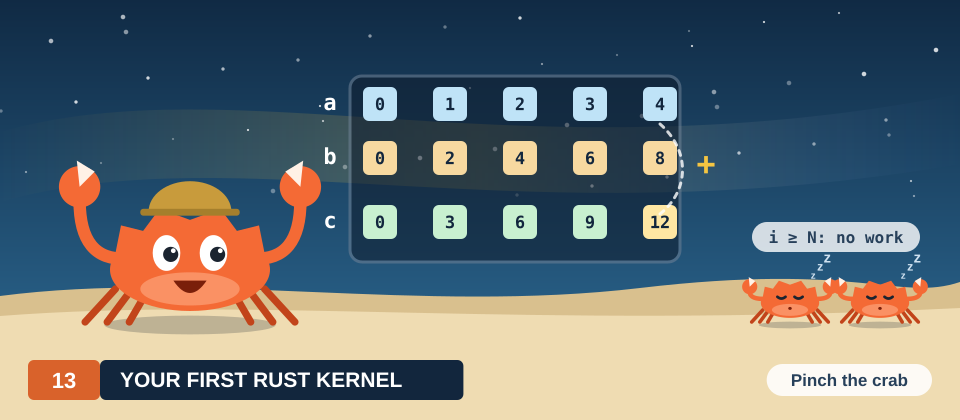
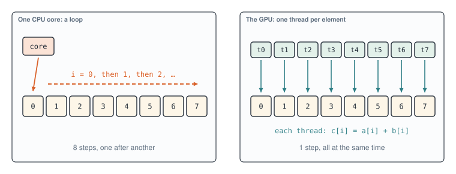
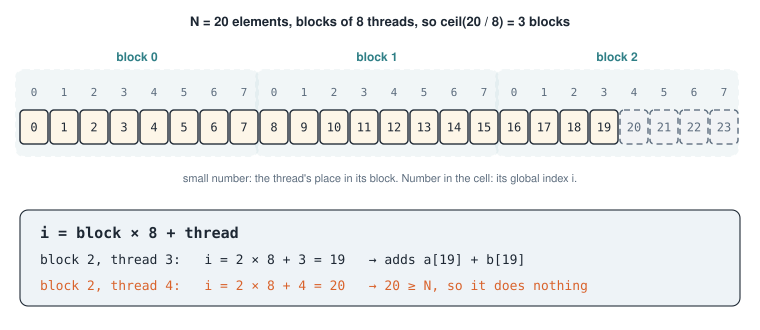
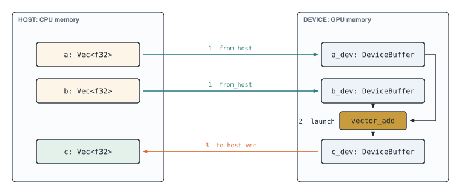
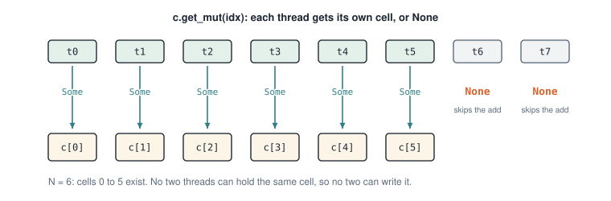
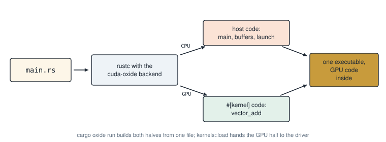

# Chapter 13: Your First Rust Kernel

<div class="covers">

This chapter covers

- The one idea behind every GPU kernel: give each element its own thread
- How a thread works out which element is its own, by hand, before any code
- Setting up cuda-oxide, and what to write in `Cargo.toml`
- A vector-addition kernel in pure Rust, read one piece at a time
- The host program: copying data to the GPU, launching, copying back
- Two mistakes everyone makes once, and what each one looks like when you run it

</div>

This part of the book writes GPU kernels in Rust with **cuda-oxide**, NVIDIA's compiler that turns ordinary Rust functions into GPU code. The kernel and the program that launches it live in the same `.rs` file and build with one command.

The first kernel adds two vectors. The arithmetic is trivial on purpose: with nothing to think about in the maths, you can watch the machinery. Every later kernel in this part (dot products, matrix multiplication, stencils, scans) reuses the steps you learn here.

## 13.1 The problem in plain words

You have two lists of numbers, `a` and `b`, of the same length `N`. You want a third list `c` where each entry is the sum of the two entries at the same position:

```text
c[i] = a[i] + b[i]      for every i from 0 to N - 1
```

Work four elements by hand:

| i | a[i] | b[i] | c[i] |
|---|------|------|------|
| 0 | 0.0  | 0.0  | 0.0  |
| 1 | 1.0  | 2.0  | 3.0  |
| 2 | 2.0  | 4.0  | 6.0  |
| 3 | 3.0  | 6.0  | 9.0  |

Look at how you filled the table. To get `c[2]` you needed `a[2]` and `b[2]`, and nothing else. You did not need `c[1]` first. Each row is its own small job.

That observation is the whole reason a GPU helps. Jobs that do not depend on each other can all run at the same time.

## 13.2 The big idea: one thread per element

On a CPU you write a loop. One core walks the rows in order: row 0, then row 1, then row 2.

On a GPU you write the body of the loop, and the GPU starts one copy of it for every row. Each copy is a **thread**. Thread 0 computes `c[0]`, thread 1 computes `c[1]`, and so on, all at once (figure 13.1).

<figure>

<figcaption><b>Figure 13.1</b> The same work as a loop on one core and as one thread per element on a GPU.</figcaption>
</figure>

The cover of this book shows the same picture as a beehive. The queen gives one order, `c[i] = a[i] + b[i]`, and every worker carries it out on its own honeycomb cell. In GPU terms, the queen is your host program on the CPU, the order is the **kernel**, and the workers are threads.

> **NOTE:** A **kernel** is a function that runs on the GPU, once per thread. You write it once. The GPU decides how many threads run it at the same moment.

## 13.3 How a thread finds its element

Every thread runs the same code. So how does thread 7 know to add `a[7]` and `b[7]`, rather than some other pair? It asks the GPU where it is.

Threads are launched in groups called **blocks**. All blocks in one launch have the same number of threads, and together they form the **grid**. Every thread can read two numbers:

- which block it is in: the **block index**
- its place inside that block: the **thread index**

From those it computes its global position:

```text
i = block_index × threads_per_block + thread_index
```

Work through a small case by hand. Take `N = 20` elements and blocks of 8 threads. You need enough blocks to cover 20 elements, so you round up: 20 / 8 = 2.5, which becomes 3 blocks, or 24 threads (figure 13.2).

<figure>

<figcaption><b>Figure 13.2</b> Three blocks of 8 threads cover 20 elements. The last 4 threads land past the end and must do nothing.</figcaption>
</figure>

Block 2, thread 3 computes 2 × 8 + 3 = 19 and adds `a[19] + b[19]`. Block 2, thread 4 computes 20. There is no element 20, so this thread must not touch memory.

Those spare threads at the end appear whenever `N` is not a multiple of the block size, and in real programs it almost never is. Every kernel therefore carries a guard: *if my index is past the end, do nothing.* In CUDA C++ you write that guard by hand, and forgetting it is a classic bug. In cuda-oxide the type system writes it for you, as section 13.6 shows.

## 13.4 The plan in pseudocode

Here is the whole program before any Rust. The kernel is four lines. The rest is the host program that prepares the data and launches it.

```text
KERNEL vector_add(a, b, c):
    i ← block_index × block_size + thread_index
    if i < length(c):
        c[i] ← a[i] + b[i]

HOST:
    make a and b in CPU memory
    copy a and b to GPU memory; make an empty c there
    blocks ← ceil(N / block_size)
    launch vector_add with (blocks × block_size) threads
    copy c back to CPU memory
    check c against a plain CPU loop
```

Data has to travel. The GPU works on its own memory, so the host copies the inputs over, launches the kernel, and copies the answer back (figure 13.3).

<figure>

<figcaption><b>Figure 13.3</b> The round trip: copy in, launch, copy out.</figcaption>
</figure>

> **NOTE:** On a Jetson the CPU and GPU share the same physical memory chips, yet the program still copies. The copy places the data where the GPU's memory system expects it, and the same code then works unchanged on a desktop card with its own memory. Later chapters look at ways to avoid the copy.

## 13.5 Setting up cuda-oxide

You need four things:

| You need | Version | How to check |
|---|---|---|
| Linux | Ubuntu 22.04 or 24.04 | `lsb_release -a` |
| An NVIDIA GPU | Ampere or newer (`sm_80`+) | `nvidia-smi` |
| The CUDA Toolkit | 12.x or 13.x | `nvcc --version` |
| Rust nightly | the version cuda-oxide pins | installed for you by `rustup` |

The examples in this book were built and run on a Jetson Orin NX 16 GB developer kit (`sm_87`, 8 SMs) with CUDA 12.6.

Install the cargo subcommand that drives the build, then ask it to check your machine:

```console
$ cargo +nightly-2026-04-03 install --git https://github.com/NVlabs/cuda-oxide.git cargo-oxide
$ cargo oxide doctor
```

`doctor` reports anything missing: a GPU, the toolkit, LLVM, or the compiler backend. On first use, `cargo-oxide` downloads and builds that backend once and caches it. Fix whatever `doctor` reports before you go on.

### The project

Make a directory with three files:

```text
vector_add/
├── Cargo.toml
├── rust-toolchain.toml
└── src/
    └── main.rs
```

> **TIP:** `cargo oxide new vector_add` creates the same layout with a working example inside. Writing the three files by hand once shows you what each one is for.

### `rust-toolchain.toml`

cuda-oxide plugs into the Rust compiler itself, so it needs one exact nightly compiler. This file makes `cargo` pick that version whenever you work in the directory:

```toml
{{#include ../../../../code/oxide/vector_add/rust-toolchain.toml}}
```

`rust-src` lets the compiler build the standard library for the GPU. `rustc-dev` holds the compiler internals the backend links against. `llvm-tools` provides the code generator that turns the kernel into GPU instructions.

### `Cargo.toml`

```toml
{{#include ../../../../code/oxide/vector_add/Cargo.toml}}
```

Read it line by line:

- `edition = "2024"` is the Rust edition cuda-oxide is written for.
- The empty `[workspace]` table marks this crate as standalone. Without it, cargo looks upward for a parent workspace, and inside this book's repository it would find the wrong one.
- **`cuda-device`** is everything the kernel uses while it runs on the GPU: `#[kernel]`, thread indices, `DisjointSlice`.
- **`cuda-host`** provides `#[cuda_module]`, the macro that writes the host-side launch functions for your kernels.
- **`cuda-core`** is the host runtime: the GPU context, streams, device buffers, and launch configurations.
- All three come from the same git repository. `rev` pins one exact commit, so the program builds the same way next year. Pick a recent commit from the repository, and use the same one for all three crates.

## 13.6 The kernel, piece by piece

First the imports. Each name is explained as it is used below.

```rust,ignore
{{#include ../../../../code/oxide/vector_add/src/main.rs:7:10}}
```

Two constants set the size of the problem. `N` is deliberately not a multiple of 256, so the last block has spare threads, just as in figure 13.2.

```rust,ignore
{{#include ../../../../code/oxide/vector_add/src/main.rs:12:17}}
```

Now the kernel itself:

```rust,ignore
{{#include ../../../../code/oxide/vector_add/src/main.rs:19:35}}
```

Take it from the outside in.

**`#[cuda_module] mod kernels`** groups the kernels the program will launch. When you build, cuda-oxide compiles everything inside for the GPU and embeds the result in your executable. It also generates host functions to load that code and to launch each kernel, which you meet in section 13.7.

**`#[kernel]`** marks `vector_add` as a GPU entry point: a function the host can launch. The CPU never runs its body. It is type-checked like any other Rust function, so a type error in a kernel is a compile error, the same as anywhere else.

**`#[launch_bounds(256)]`** tells the compiler that a block will never have more than 256 threads. With that limit known, the compiler can plan how many registers each thread may use.

**`#[launch_contract(domain = 1, block = (256, 1, 1))]`** is a promise about how the kernel must be launched: a one-dimensional grid, and blocks of exactly 256 threads. The host checks the promise before each launch. Section 13.8 shows what happens when you break it.

**The parameters** are plain Rust types. `a` and `b` are ordinary shared slices, `&[f32]`, because every thread may read any element. The output is a `DisjointSlice<f32>`. That type is the key to the safety story.

### `DisjointSlice`: each thread gets its own cell

If two threads wrote the same element at the same time, the result would depend on which one happened to win. That is a **data race**, and Rust's whole design exists to rule it out. A plain `&mut [f32]` cannot be handed to a million threads at once, because `&mut` means *one* writer.

`DisjointSlice` solves this differently. It never hands out the whole slice. Each thread may ask for exactly one element: the one at its own index (figure 13.4).

<figure>

<figcaption><b>Figure 13.4</b> <code>get_mut</code> returns <code>Some</code> with the thread's own cell, or <code>None</code> for a thread past the end.</figcaption>
</figure>

Three lines do the work:

```rust,ignore
let idx = thread::index_1d();
let i = idx.get();

if let Some(out) = c.get_mut(idx) {
    *out = a[i] + b[i];
}
```

- `thread::index_1d()` computes block index × block size + thread index, the formula from section 13.3, and returns it wrapped in a special index type. The only way to get that type is from the thread's own position, so a thread cannot invent someone else's index.
- `idx.get()` gives the same number as a plain `usize`, for reading `a` and `b`.
- `c.get_mut(idx)` returns `Some(&mut f32)` when the index is inside `c`, and `None` when it is past the end. This is the guard from section 13.3. You did not write `if i < n`; the type made you handle the spare threads.
- `a[i]` and `b[i]` are ordinary Rust indexing, so they are bounds-checked. If `a` were shorter than `c`, the thread would stop with an error rather than read memory it does not own.

That last point is a real difference from CUDA C++, where reading past the end of an array returns whatever bytes happen to be there.

## 13.7 The host program, piece by piece

The host side follows the pseudocode from section 13.4 step by step. The kernel and this code live in the same file and are compiled by one command (figure 13.5).

<figure>

<figcaption><b>Figure 13.5</b> One source file, two programs, one executable.</figcaption>
</figure>

### Steps 1 to 3: inputs, a context, device buffers

```rust,ignore
fn main() -> Result<(), Box<dyn std::error::Error>> {
{{#include ../../../../code/oxide/vector_add/src/main.rs:46:57}}
    // ...
}
```

- `CudaContext::new(0)` opens GPU number 0. A **context** holds everything your program owns on that GPU: its memory and its loaded code.
- A **stream** is a queue of GPU work. Operations put on the same stream run in the order you issued them. That ordering is what makes "copy, then launch, then copy back" safe without any extra waiting.
- `DeviceBuffer::from_host` allocates GPU memory and copies a slice into it. `DeviceBuffer::zeroed` allocates GPU memory filled with zeros. Each buffer frees its GPU memory when it is dropped, just as a `Vec` frees its heap memory.

### Steps 4 to 6: load, prepare, launch

```rust,ignore
fn main() -> Result<(), Box<dyn std::error::Error>> {
    // ...
{{#include ../../../../code/oxide/vector_add/src/main.rs:59:71}}
    // ...
}
```

**Loading.** `kernels::load` was generated by `#[cuda_module]`. It takes the GPU code embedded in the executable and hands it to the driver. It is `unsafe` because the program promises that the embedded code really came from this `kernels` module. The comment above it says so, as every `unsafe` block should.

**Choosing the grid.** `div_ceil` divides and rounds up. 1,000,003 / 256 = 3906.26, so you get 3907 blocks. Rounding down would leave the last elements without a thread.

**Preparing.** `prepare_vector_add` is also generated, from the launch contract. It checks your configuration against the promise in `#[launch_contract]` and against the limits of the GPU you are running on. If everything holds, it returns a `PreparedLaunch` value, which is proof that the check passed.

**Launching.** `module.vector_add(...)` takes that proof plus the buffers. Notice what is *not* here: no `unsafe`. The contract was checked, the buffer types match the kernel's parameter types, and so the launch is safe Rust.

**Copying back.** `to_host_vec` copies `c_dev` into a new `Vec<f32>`. It is queued on the same stream as the launch, so it waits for the kernel to finish first.

### Step 7: check the answer

A GPU result you have not checked is a guess. The program computes the same sum with a plain CPU iterator and compares every element:

```rust,ignore
{{#include ../../../../code/oxide/vector_add/src/main.rs:37:43}}
```

```rust,ignore
fn main() -> Result<(), Box<dyn std::error::Error>> {
    // ...
{{#include ../../../../code/oxide/vector_add/src/main.rs:73:82}}
    // ...
}
```

Comparing with `!=` is fine here. One addition of two `f32` values gives the same bits on the GPU as on the CPU. Later chapters add up many numbers in a different order on each side, and those comparisons will need a tolerance.

## 13.8 Run it

From the `vector_add` directory:

```console
$ cargo oxide run
```

The first build takes a minute or two while cargo compiles the cuda-oxide crates. Later builds take a few seconds. On the Jetson Orin NX the output was:

```text
elements      1000003
blocks        3907 x 256 threads = 1000192 threads
idle threads  189
c[0..4]       [0.0, 3.0, 6.0, 9.0]
c[N-1]        3000006
gpu + copy    2.756107ms
cpu           1.814993ms
PASSED: all 1000003 elements match the CPU
```

Read it against what you worked out by hand:

- 3907 blocks of 256 give 1,000,192 threads, and 189 of them are spare. Those are the dozing crabs on this chapter's plate: they asked `get_mut` for a cell and got `None`.
- `c[0..4]` matches the table in section 13.1.
- The last element is `a + b = 1,000,002 + 2,000,004 = 3,000,006`.

### Why the GPU did not win

The timing line looks like bad news: the GPU took longer than one CPU core. It is the most useful number in the chapter.

For each element, the kernel reads 8 bytes, writes 4 bytes, and does one addition. That is one floating-point operation for every 12 bytes moved. Chapter 1 called this ratio **arithmetic intensity**, and at 1/12 it is about as low as a kernel gets. The GPU's thousands of adders spend almost all their time waiting for memory. The `gpu + copy` timer also includes copying 4 MB back to the CPU and the first launch of a kernel in this process.

Two runs on the same machine gave 2.8 ms and 3.1 ms on the GPU line, and 1.8 ms and 2.2 ms on the CPU line, so treat these as rough figures. The lesson holds either way. A GPU wins when each byte it loads is used for a lot of arithmetic, or when the data stays on the GPU across many kernels. Matrix multiplication, later in this part, is the first kernel in this part where that is true.

## 13.9 When it goes wrong

Two mistakes catch nearly everyone once. Both were run on the same machine to show you what they really do.

**The block size does not match the contract.** Change the launch to blocks of 128 threads:

```rust,ignore
LaunchConfig1D::new(blocks, 128, 0)
```

`prepare_vector_add` refuses before anything reaches the GPU:

```text
Error: BlockShapeMismatch { kernel: "vector_add", required: (256, 1, 1), actual: (128, 1, 1) }
```

Without the contract, this kernel would run with half as many threads as planned and silently leave half of `c` as zeros. The contract turns a wrong answer into an error message.

**Rounding the number of blocks down.** Replace `div_ceil` with plain integer division:

```rust,ignore
let blocks = N as u32 / BLOCK;   // 3906 blocks: 67 threads short
```

This one passes every check, because a smaller grid is a legal launch. The answer is wrong:

```text
c[N-1]        0
Error: "FAILED: 67 elements differ from the CPU"
```

3906 × 256 = 999,936 threads, 67 short of `N`. The last 67 elements never had a thread, so they kept the zeros from `DeviceBuffer::zeroed`. This is why the program checks every element against the CPU: no type can catch a grid that is too small.

## 13.10 The complete program

`code/oxide/vector_add/src/main.rs`, as built and run above:

```rust,ignore
{{#include ../../../../code/oxide/vector_add/src/main.rs}}
```

## Summary

- A kernel is the body of a loop. The GPU runs one copy per thread, and each thread handles one element.
- A thread finds its element with `i = block index × block size + thread index`. The number of blocks is `ceil(N / block size)`, so the last block usually has spare threads.
- `DisjointSlice::get_mut` gives each thread its own output cell, or `None` past the end. Data races and the forgotten bounds guard are both ruled out by the type.
- `#[launch_contract]` makes the launch itself checked and safe. Only loading the embedded GPU code stays `unsafe`.
- The host program copies in, launches, copies out, and checks against the CPU.
- Vector addition is memory-bound: one addition for every 12 bytes. The GPU earns its keep on kernels that do more arithmetic per byte.

The next chapter makes the kernel generic. One `map` kernel takes any closure, so `c[i] = a[i] + b[i]`, SAXPY (`y = αx + y`), and a hundred other element-wise operations share one kernel. It also launches fewer threads than there are elements, using the *grid-stride loop*.

## Exercises

1. Change `N` to 1024. How many blocks does the program launch, and how many threads are idle? Predict, then run.
2. Write `vector_sub`, which computes `c[i] = a[i] - b[i]`, as a second `#[kernel]` in the same module, and launch it after `vector_add`.
3. Change `a` so that it has one element fewer than `b` and `c`. Which line stops the kernel, and why does `get_mut` not catch it?
4. Move the `Instant::now()` for the GPU so that it measures only the launch, without `to_host_vec`. What do you see, and why? (Hint: a launch only *queues* work on the stream.)
