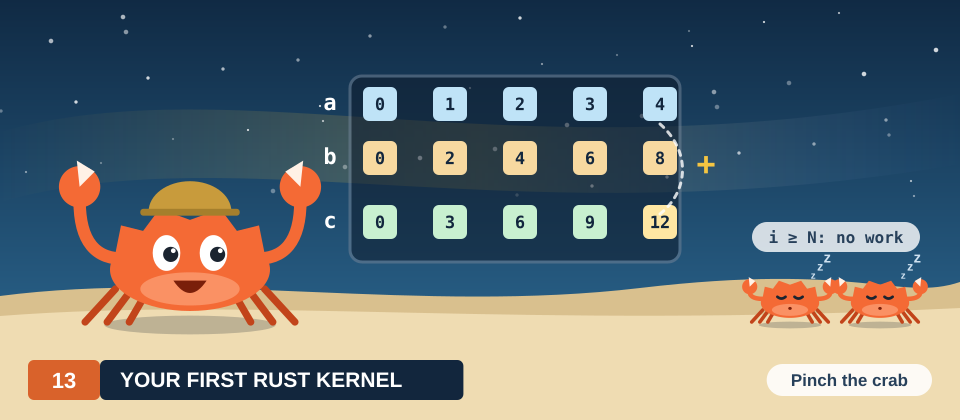
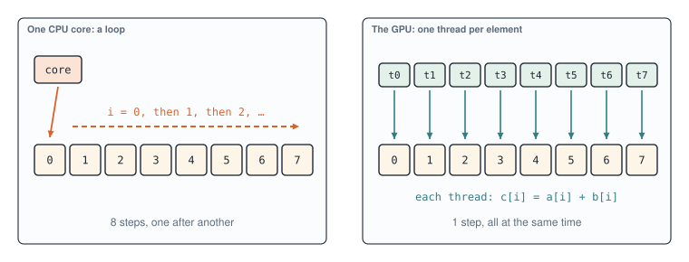
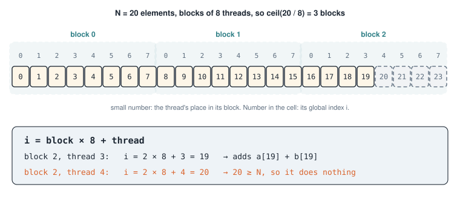
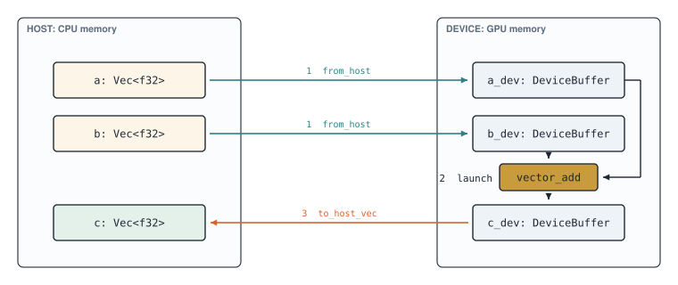
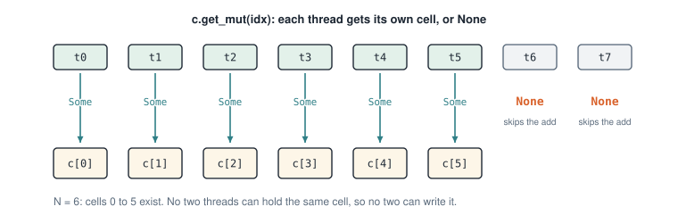
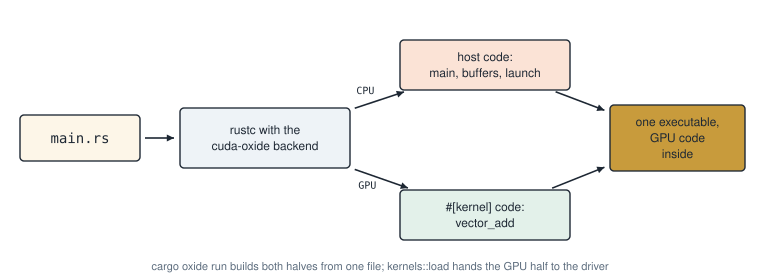

# Chapter 13: Your First Rust Kernel

<div class="covers">

This chapter covers

- the mapping of data elements to GPU threads
- the computation of a thread's global index from its block index and thread index
- the installation of cuda-oxide and the contents of `Cargo.toml`
- a vector-addition kernel written in Rust
- the host program: device buffers, the kernel launch and the copy back
- 2 common launch errors and their real output

</div>

In this part we write GPU kernels in Rust with **cuda-oxide**, NVIDIA's compiler backend that compiles ordinary Rust functions into GPU code. The kernel and the host program that launches it are written in the same `.rs` file, and both are built with a single command.

The first kernel adds 2 vectors. We choose this computation because its arithmetic is trivial, so that we can concentrate on the structure of a GPU program: how threads are mapped to data, how data is moved between host and device, and how a kernel is launched. The kernels of the later chapters in this part, dot products, matrix multiplication, stencils and scans, use the same structure.

## 13.1 Vector addition

Vector addition takes 2 vectors `a` and `b` of the same length `N` and produces a third vector `c`, each of whose elements is the sum of the 2 input elements at the same position:

```text
c[i] = a[i] + b[i]      for every i from 0 to N - 1
```

For 4 elements:

| i | a[i] | b[i] | c[i] |
|---|------|------|------|
| 0 | 0.0  | 0.0  | 0.0  |
| 1 | 1.0  | 2.0  | 3.0  |
| 2 | 2.0  | 4.0  | 6.0  |
| 3 | 3.0  | 6.0  | 9.0  |

Note that the computation of `c[2]` requires only `a[2]` and `b[2]`. It does not require `c[1]` or any other element of `c`. The elements of `c` are therefore independent of each other, and they can be computed in any order, or all at the same time. This independence is what allows a GPU to speed up the computation.

## 13.2 One thread per element

On a CPU, vector addition is written as a loop, and 1 core executes the iterations one after another: element 0, then element 1, then element 2.

On a GPU, the programmer writes the body of the loop as a function, and the GPU executes 1 instance of that function for each element. Each instance is executed by a **thread**. Thread 0 computes `c[0]`, thread 1 computes `c[1]`, and so on, and the threads run at the same time (figure 13.1). The loop has been replaced by the set of threads: each thread corresponds to 1 iteration of the original loop.

<figure>

<figcaption><b>Figure 13.1</b> The same work as a loop on 1 core and as 1 thread per element on a GPU.</figcaption>
</figure>

The function that the threads execute is called a kernel. The host program, which runs on the CPU, launches the kernel and decides how many threads execute it.

> **NOTE:** A **kernel** is a function that runs on the GPU, once per thread. It is written once. The hardware decides how many of the threads run at the same moment.

## 13.3 Thread indices

Since every thread executes the same code, each thread needs a way to determine which element it is responsible for. Thread 7, for example, must add `a[7]` and `b[7]` and not some other pair. The GPU provides this information through built-in indices.

Threads are launched in groups called **blocks**. All blocks of a launch contain the same number of threads, and the blocks of a launch together form the **grid**. Each thread can read 2 numbers:

- the index of the block it belongs to, the **block index**
- its position within that block, the **thread index**

From these 2 numbers the thread computes its global index:

```text
i = block_index × threads_per_block + thread_index
```

Consider `N = 20` elements and blocks of 8 threads. The grid must contain at least 20 threads, so the number of blocks is 20 / 8 = 2.5 rounded up to 3, which gives 24 threads (figure 13.2).

<figure>

<figcaption><b>Figure 13.2</b> 3 blocks of 8 threads cover 20 elements. The last 4 threads fall past the end and must do nothing.</figcaption>
</figure>

Thread 3 of block 2 computes 2 × 8 + 3 = 19 and adds `a[19]` and `b[19]`. Thread 4 of block 2 computes 20. There is no element 20, so this thread must not access memory.

Such spare threads exist whenever `N` is not a multiple of the block size, which is the usual case. Every kernel therefore contains a guard that disables the threads whose index lies past the end of the data. In CUDA C++ the programmer writes this guard by hand, and omitting it is a common bug. In cuda-oxide the guard is enforced by the type of the output parameter, as we show in section 13.6.

## 13.4 Structure of the program

The complete program is given below in pseudocode. The kernel consists of 4 lines. The rest is the host program, which prepares the data and launches the kernel.

```text
KERNEL vector_add(a, b, c):
    i ← block_index × block_size + thread_index
    if i < length(c):
        c[i] ← a[i] + b[i]

HOST:
    make a and b in CPU memory
    copy a and b to GPU memory; make an empty c there
    blocks ← ceil(N / block_size)
    launch vector_add with (blocks × block_size) threads
    copy c back to CPU memory
    check c against a plain CPU loop
```

The kernel operates on GPU memory. The host program therefore copies the inputs to the GPU, launches the kernel, and copies the result back to CPU memory (figure 13.3).

<figure>

<figcaption><b>Figure 13.3</b> Copy in, launch, copy out.</figcaption>
</figure>

> **NOTE:** On an integrated GPU, the CPU and the GPU share the same physical memory, and the program still copies. The copy places the data in memory allocated for the GPU, and the same code then runs unchanged on a discrete GPU with its own memory. We describe ways to avoid the copy in later chapters.

## 13.5 Setting up cuda-oxide

A cuda-oxide program requires 4 components:

| You need | Version | How to check |
|---|---|---|
| Linux | Ubuntu 22.04 or 24.04 | `lsb_release -a` |
| An NVIDIA GPU | Ampere or newer (`sm_80`+) | `nvidia-smi` |
| The CUDA Toolkit | 12.x or 13.x | `nvcc --version` |
| Rust nightly | the version cuda-oxide pins | installed for you by `rustup` |

The build is driven by a cargo subcommand. We install it and then let it check the machine:

```console
$ cargo +nightly-2026-04-03 install --git https://github.com/NVlabs/cuda-oxide.git cargo-oxide
$ cargo oxide doctor
```

`doctor` reports any missing component: a GPU, the toolkit, LLVM, or the compiler backend. On first use, `cargo-oxide` downloads and builds the backend once and caches it. Any problem that `doctor` reports must be fixed before the program can be built.

### Project layout

The project consists of 3 files:

```text
vector_add/
├── Cargo.toml
├── rust-toolchain.toml
└── src/
    └── main.rs
```

> **TIP:** `cargo oxide new vector_add` creates the same layout with a working example inside. Writing the 3 files by hand once shows the purpose of each.

### `rust-toolchain.toml`

cuda-oxide is a backend of the Rust compiler, so it requires 1 exact nightly version of the compiler. This file makes `cargo` select that version for every command run in the directory:

```toml
{{#include ../../../../code/oxide/vector_add/rust-toolchain.toml}}
```

The component `rust-src` allows the compiler to build the standard library for the GPU. `rustc-dev` contains the compiler internals that the backend links against. `llvm-tools` provides the code generator that translates the kernel into GPU instructions.

### `Cargo.toml`

```toml
{{#include ../../../../code/oxide/vector_add/Cargo.toml}}
```

The entries have the following meaning:

- `edition = "2024"` is the Rust edition for which cuda-oxide is written.
- The empty `[workspace]` table marks the crate as standalone. Without it, cargo searches the parent directories for a workspace, and inside this book's repository it would find the wrong one.
- **`cuda-device`** contains everything the kernel uses on the GPU: `#[kernel]`, the thread indices and `DisjointSlice`.
- **`cuda-host`** provides `#[cuda_module]`, the macro that generates the host-side launch functions for the kernels.
- **`cuda-core`** is the host runtime: the GPU context, streams, device buffers and launch configurations.
- All 3 crates come from the same git repository. `rev` pins 1 exact commit, so that the program builds the same way in the future. The same commit must be used for all 3 crates.

## 13.6 The kernel

The program begins with its imports. Each name is explained where it is used.

```rust,ignore
{{#include ../../../../code/oxide/vector_add/src/main.rs:7:10}}
```

2 constants set the size of the problem. `N` is chosen not to be a multiple of 256, so that the last block contains spare threads, as in figure 13.2.

```rust,ignore
{{#include ../../../../code/oxide/vector_add/src/main.rs:12:17}}
```

The kernel itself is defined inside a module:

```rust,ignore
{{#include ../../../../code/oxide/vector_add/src/main.rs:19:35}}
```

We examine its parts from the outside in.

**`#[cuda_module] mod kernels`** groups the kernels that the program launches. At build time, cuda-oxide compiles everything inside the module for the GPU and embeds the result in the executable. It also generates host functions that load this code and launch each kernel; we use them in section 13.7.

**`#[kernel]`** marks `vector_add` as a GPU entry point, a function that the host can launch. The CPU never executes its body. The function is type-checked like any other Rust function, so a type error in a kernel is a compile error.

**`#[launch_bounds(256)]`** tells the compiler that a block never contains more than 256 threads. With this limit known, the compiler can decide how many registers each thread may use.

**`#[launch_contract(domain = 1, block = (256, 1, 1))]`** states how the kernel must be launched: with a 1-dimensional grid, and with blocks of exactly 256 threads. The host checks the contract before every launch. In Section 13.9 we show what happens when a launch violates it.

**The parameters** have ordinary Rust types. `a` and `b` are shared slices, `&[f32]`, because every thread may read any element of them. The output `c` has the type `DisjointSlice<f32>`, which is what makes the kernel free of data races.

### `DisjointSlice`

If 2 threads wrote the same element at the same time, the final value would depend on which write happened last. Such a situation is called a **data race**, and Rust's ownership rules are designed to exclude it. A `&mut [f32]` cannot be given to many threads at once, because a mutable reference permits only 1 writer.

`DisjointSlice` never gives a thread access to the whole slice. Instead, each thread may request exactly 1 element, the element at its own global index (figure 13.4).

<figure>

<figcaption><b>Figure 13.4</b> <code>get_mut</code> returns <code>Some</code> with the thread's own element, or <code>None</code> for a thread past the end.</figcaption>
</figure>

The body of the kernel consists of the following statements:

```rust,ignore
let idx = thread::index_1d();
let i = idx.get();

if let Some(out) = c.get_mut(idx) {
    *out = a[i] + b[i];
}
```

- `thread::index_1d()` computes block index × block size + thread index, the formula of section 13.3, and returns the result as a special index type. A value of this type can only be obtained from the thread's own position, so a thread cannot construct the index of another thread.
- `idx.get()` returns the same number as a plain `usize`, which is used to read `a` and `b`.
- `c.get_mut(idx)` returns `Some(&mut f32)` when the index lies inside `c`, and `None` when it lies past the end. This is the guard of section 13.3. The kernel contains no explicit `if i < n`; the type of `c` requires the kernel to handle the spare threads.
- `a[i]` and `b[i]` are ordinary Rust indexing operations and are bounds-checked. If `a` were shorter than `c`, the thread would stop with an error instead of reading memory outside the array.

The last point differs from CUDA C++, where a read past the end of an array returns whatever bytes are stored at that address.

## 13.7 The host program

The host program follows the pseudocode of section 13.4 step by step. It is compiled together with the kernel, from the same file, by a single command (figure 13.5).

<figure>

<figcaption><b>Figure 13.5</b> 1 source file is compiled into host code and GPU code, which are linked into 1 executable.</figcaption>
</figure>

### Context, stream and device buffers

```rust,ignore
fn main() -> Result<(), Box<dyn std::error::Error>> {
{{#include ../../../../code/oxide/vector_add/src/main.rs:46:57}}
    // ...
}
```

- `CudaContext::new(0)` opens GPU number 0. A **context** holds all the state that the program owns on that GPU, including its memory allocations and its loaded code.
- A **stream** is a queue of GPU work. Operations issued to the same stream are executed in the order in which they were issued. This ordering guarantees that the copy, the launch and the copy back happen in sequence without any explicit synchronisation.
- `DeviceBuffer::from_host` allocates GPU memory and copies a slice into it. `DeviceBuffer::zeroed` allocates GPU memory and fills it with zeros. Each buffer frees its GPU memory when it is dropped, in the same way that a `Vec` frees its heap memory.

### Loading the module and launching the kernel

```rust,ignore
fn main() -> Result<(), Box<dyn std::error::Error>> {
    // ...
{{#include ../../../../code/oxide/vector_add/src/main.rs:59:71}}
    // ...
}
```

**Loading.** `kernels::load` is generated by `#[cuda_module]`. It passes the GPU code embedded in the executable to the driver. The call is `unsafe` because the program asserts that the embedded code was generated from this `kernels` module. The comment above the call states this, as the comment of every `unsafe` block should.

**Grid size.** `div_ceil` divides and rounds up. 1,000,003 / 256 = 3906.26, so the grid contains 3907 blocks. Rounding down would leave the last elements without a thread.

**Preparation.** `prepare_vector_add` is also generated, from the launch contract. It checks the launch configuration against the contract in `#[launch_contract]` and against the limits of the GPU. If both checks pass, it returns a `PreparedLaunch` value, which records that the configuration has been checked.

**Launch.** `module.vector_add(...)` takes the `PreparedLaunch` value and the buffers. Note that the launch requires no `unsafe`: the configuration has been checked, and the buffer types match the parameter types of the kernel, so the launch is safe Rust.

**Copy back.** `to_host_vec` copies `c_dev` into a new `Vec<f32>`. It is issued to the same stream as the launch, so it begins only after the kernel has finished.

### Checking the result

A GPU result must be checked against an independent computation. The program computes the same sums with a plain CPU iterator and compares every element:

```rust,ignore
{{#include ../../../../code/oxide/vector_add/src/main.rs:37:43}}
```

```rust,ignore
fn main() -> Result<(), Box<dyn std::error::Error>> {
    // ...
{{#include ../../../../code/oxide/vector_add/src/main.rs:73:82}}
    // ...
}
```

An exact comparison with `!=` is correct here, because a single addition of 2 `f32` values gives the same bits on the GPU as on the CPU. In later chapters we add many numbers in a different order on each side, and those comparisons need a tolerance.

## 13.8 Running the program

The program is built and run from the `vector_add` directory:

```console
$ cargo oxide run
```

The first build takes 1 to 2 minutes, because cargo compiles the cuda-oxide crates. Later builds take a few seconds. On a Jetson Orin NX 16 GB (`sm_87`, 8 SMs) with CUDA 12.6, the program printed:

```text
elements      1000003
blocks        3907 x 256 threads = 1000192 threads
idle threads  189
c[0..4]       [0.0, 3.0, 6.0, 9.0]
c[N-1]        3000006
gpu + copy    2.756107ms
cpu           1.814993ms
PASSED: all 1000003 elements match the CPU
```

The output agrees with the hand calculation:

- 3907 blocks of 256 threads give 1,000,192 threads, of which 189 are spare. These threads called `get_mut` and received `None`.
- `c[0..4]` matches the table of section 13.1.
- The last element is `a + b = 1,000,002 + 2,000,004 = 3,000,006`.

### Performance

The timing lines show that the GPU took longer than 1 CPU core. The reason lies in the ratio of arithmetic to memory traffic.

For each element, the kernel reads 8 bytes, writes 4 bytes, and performs 1 addition: 1 floating-point operation for every 12 bytes moved. In Chapter 1 we called this ratio the **arithmetic intensity**, and a value of 1/12 FLOP/byte is among the lowest a kernel can have. The arithmetic units of the GPU spend almost all their time waiting for memory. In addition, the `gpu + copy` timer includes the copy of 4 MB back to the CPU and the first kernel launch of the process.

2 runs on the same machine gave 2.8 ms and 3.1 ms for the GPU line, and 1.8 ms and 2.2 ms for the CPU line, so these values are approximate. The conclusion does not depend on them. A GPU is faster when each byte it loads is used for many arithmetic operations, or when the data remain on the GPU across many kernels. Matrix multiplication, later in this part, is the first kernel in this part for which this holds.

## 13.9 Common launch errors

2 mistakes are common in a first kernel. The real output of each is shown below.

**The block size does not match the contract.** The launch is changed to blocks of 128 threads:

```rust,ignore
LaunchConfig1D::new(blocks, 128, 0)
```

`prepare_vector_add` rejects the configuration before any work reaches the GPU:

```text
Error: BlockShapeMismatch { kernel: "vector_add", required: (256, 1, 1), actual: (128, 1, 1) }
```

Without the contract, the kernel would run with half the planned number of threads and leave half of `c` as zeros, without any error. The contract turns a wrong result into an error message.

**The number of blocks is rounded down.** `div_ceil` is replaced by integer division:

```rust,ignore
let blocks = N as u32 / BLOCK;   // 3906 blocks: 67 threads short
```

This configuration passes every check, because a smaller grid is a legal launch. The result is wrong:

```text
c[N-1]        0
Error: "FAILED: 67 elements differ from the CPU"
```

3906 × 256 = 999,936 threads, 67 fewer than `N`. The last 67 elements were not assigned to any thread, so they kept the zeros written by `DeviceBuffer::zeroed`. The comparison of every element with the CPU result detects this error; no type can detect a grid that is too small.

## 13.10 The complete program

`code/oxide/vector_add/src/main.rs`, as built and run above:

```rust,ignore
{{#include ../../../../code/oxide/vector_add/src/main.rs}}
```

## Summary

- A kernel is the body of a loop. The GPU runs 1 instance per thread, and each thread computes 1 element.
- A thread computes its element as `i = block index × block size + thread index`. The number of blocks is `ceil(N / block size)`, so the last block usually contains spare threads.
- `DisjointSlice::get_mut` gives each thread its own output element, or `None` past the end. The type excludes both data races and a missing bounds guard.
- `#[launch_contract]` makes the launch checked and safe. Only the loading of the embedded GPU code remains `unsafe`.
- The host program copies the inputs to the GPU, launches the kernel, copies the result back, and checks it against the CPU.
- Vector addition is memory-bound: it performs 1 addition for every 12 bytes. The GPU is faster on kernels that perform more arithmetic per byte.

In the next chapter we make the kernel generic. A single `map` kernel takes any closure, so that `c[i] = a[i] + b[i]`, SAXPY (`y = αx + y`) and other element-wise operations share 1 kernel. It also launches fewer threads than there are elements, using the *grid-stride loop*.

## Exercises

1. Change `N` to 1024. How many blocks does the program launch, and how many threads are idle? Predict the numbers, then run the program.
2. Write `vector_sub`, which computes `c[i] = a[i] - b[i]`, as a second `#[kernel]` in the same module, and launch it after `vector_add`.
3. Change `a` so that it has 1 element fewer than `b` and `c`. Which line stops the kernel, and why does `get_mut` not catch the error?
4. Move the `Instant::now()` for the GPU so that it measures only the launch, without `to_host_vec`. What do you observe, and why? (Hint: a launch only *queues* work on the stream.)
