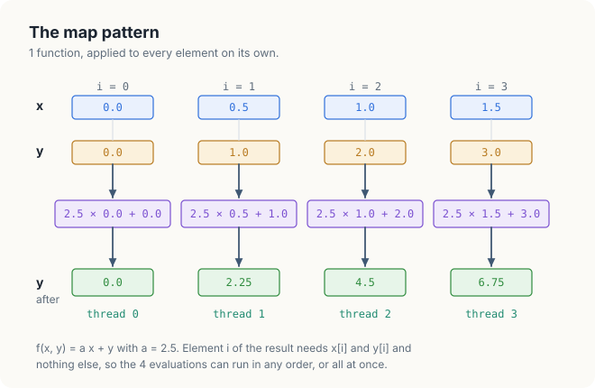
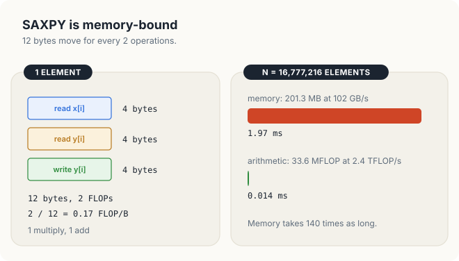
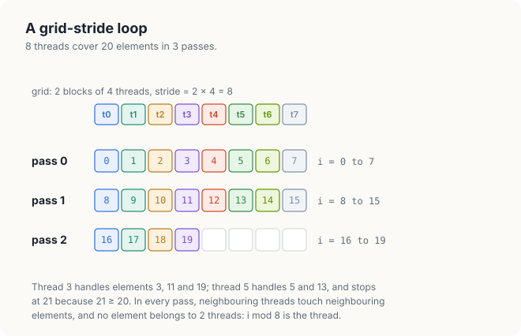
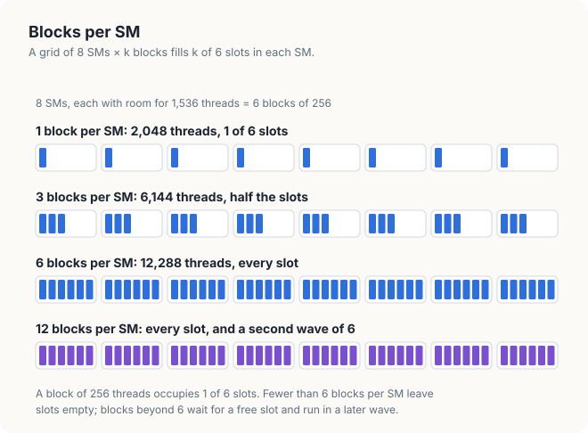
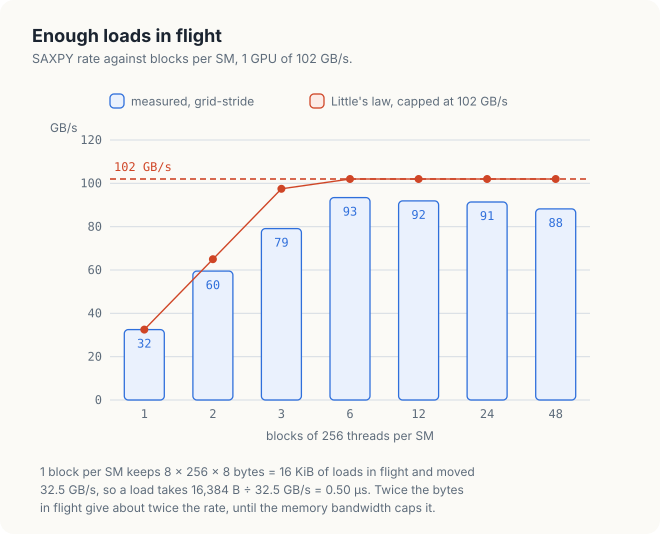

# Chapter 14: Map, SAXPY and Closures

The vector addition of Chapter 13 belongs to a large family of computations in which every
element of the output is computed from the elements at the same position in the inputs, and
from nothing else. Scaling an array, converting colours, applying an activation function to
every value of a tensor and adding 2 vectors are all members of this family. A computation of
this form is called a *map*, and it is the simplest parallel pattern: the elements are
independent, so each can be given to its own thread.

In this chapter, we use the map pattern to introduce 3 features of cuda-oxide that the later
chapters of this part rely on. The first is a kernel with a scalar argument, SAXPY, which is
also the standard example of a memory-bound computation. The second is a generic kernel that
accepts a Rust closure, so that 1 kernel can apply any element-wise function. The third is the
grid-stride loop, in which a grid of a fixed size processes an array of any size, and which in
Rust requires an explicit argument that no 2 threads write the same element. We measure each
version and use Little's law from Chapter 1 to explain how large a grid must be.

<div class="covers" markdown="1">

This chapter covers

- the map pattern and its independence between elements
- SAXPY: its operations, its memory traffic and the bound that the bandwidth sets
- a SAXPY kernel with a scalar argument
- closures in Rust, and a generic map kernel that takes a closure as an argument
- the cost of a closure, measured against a hand-written kernel
- the grid-stride loop in Rust, and why it needs `get_unchecked_mut` and a safety argument
- the number of blocks per SM that a memory-bound kernel needs, from Little's law
- 2 mistakes: an index that `DisjointSlice` rejects, and a closure that captures host memory

</div>

The code of the chapter is in
[`code/oxide/ch14_map_saxpy/`](https://github.com/arpanpathak/gpu-parallel-book/tree/main/code/oxide/ch14_map_saxpy).
It uses the same 3 dependencies as the crate of Chapter 13, so its `Cargo.toml` and
`rust-toolchain.toml` are copies of those in `code/oxide/vector_add`.

## 14.1 The map pattern

A **map** applies the same function \\(f\\) to every element of 1 or more input arrays of equal
length and produces an output array of the same length, in which element \\(i\\) depends only on
element \\(i\\) of each input:

\\[ y_i = f(x_i, y_i) \qquad \text{for } i = 0, 1, \ldots, N - 1 \\]

The function may take 1 input or several. Vector addition is a map with \\(f(a, b) = a + b\\).
Converting an image from colour to grey is a map over pixels, and the activation function of a
neural network layer is a map over the values of a tensor.

The defining property of a map is that no element of the output depends on another element of
the output. The \\(N\\) evaluations of \\(f\\) can therefore be performed in any order, and in
particular all at the same time. A sequential program computes them 1 after another:

```text
for i ← 0 to N − 1:
    y[i] ← f(x[i], y[i])
```

A parallel program removes the loop and gives each value of \\(i\\) to its own thread, as the
vector addition of Chapter 13 did. Figure 14.1 shows the 4 evaluations for the first 4 elements of
the arrays that this chapter uses, with \\(f(x, y) = 2.5x + y\\). Each thread reads 2 values,
evaluates \\(f\\), and writes 1 value, and none of them needs to know what the others are doing.

<figure>

<figcaption><b>Figure 14.1</b> A map: the same function on every element, each result from its own inputs.</figcaption>
</figure>

Because the threads never communicate, a map needs no barriers, no shared memory and no atomic
operations. Its speed is decided by how fast the inputs can be read and the outputs written,
which we examine next with SAXPY, a map that numerical libraries have provided since the 1970s.

## 14.2 SAXPY

### 14.2.1 The operation

**SAXPY** computes

\\[ y \leftarrow a\,x + y \\]

for a scalar \\(a\\) and 2 vectors \\(x\\) and \\(y\\) of \\(N\\) single-precision floats. The name
is the one given to the routine in the Basic Linear Algebra Subprograms (BLAS), the standard
library interface for linear algebra published in 1979: *S* for single precision, and *A X Plus
Y*. The result overwrites \\(y\\). SAXPY is a map with 2 inputs and the function
\\(f(x, y) = a x + y\\), in which \\(a\\) is the same for every element.

For the arrays of figure 14.1, \\(a = 2.5\\), \\(x = (0, 0.5, 1.0, 1.5)\\) and
\\(y = (0, 1, 2, 3)\\). The 4 results are \\(2.5 \times 0 + 0 = 0\\),
\\(2.5 \times 0.5 + 1 = 2.25\\), \\(2.5 \times 1.0 + 2 = 4.5\\) and
\\(2.5 \times 1.5 + 3 = 6.75\\). The program of this chapter fills \\(x\\) and \\(y\\) with the same
pattern over \\(N = 16{,}777{,}216\\) elements: \\(x_i\\) is \\((i \bmod 1024) \times 0.5\\) and
\\(y_i\\) is \\(i \bmod 7\\). Every product \\(2.5\,x_i\\) is a multiple of 1.25 below 1,280, and
every such number is exactly representable as a float, so the GPU's results can be compared with
the CPU's for exact equality.

### 14.2.2 Operations and memory traffic

Each element of SAXPY performs 2 floating-point operations, a multiplication and an addition, and
moves 12 bytes: it reads \\(x_i\\) and \\(y_i\\), 4 bytes each, and writes \\(y_i\\), 4 bytes. Its
arithmetic intensity, the ratio of operations to bytes defined in Section 1.8, is therefore
2 / 12 = 0.17 FLOP/B.

Recall that a kernel is memory-bound when its arithmetic intensity is below the ridge point of
the GPU, the ratio of the GPU's peak arithmetic rate to its memory bandwidth. For a GPU with an
FP32 peak of 2.4 TFLOP/s and a bandwidth of 102 GB/s, the ridge point is 2,400 / 102 = 23.5
FLOP/B, about 140 times the intensity of SAXPY. Every GPU in the comparison of Chapter 2 has a
ridge point of at least 10 FLOP/B, so SAXPY is memory-bound on all of them, and its running time
is set by the bytes it moves:

\\[ T \ge \frac{12N}{B} \\]

| Symbol | Meaning | In the example |
|---|---|---|
| \\(N\\) | number of elements | 16,777,216 |
| \\(12N\\) | bytes read and written | 201,326,592 B, 201.3 MB |
| \\(B\\) | memory bandwidth of the GPU | 102 GB/s |
| \\(T\\) | shortest possible time | 201.3 MB / 102 GB/s = 1.97 ms |

The arithmetic of the same computation, 2 × 16,777,216 = 33.6 MFLOP at 2.4 TFLOP/s, would take
0.014 ms. Figure 14.2 compares the 2 times. A faster arithmetic unit would not change the time of
SAXPY at all, and a kernel that reaches 1.97 ms has done everything that can be done.

<figure>

<figcaption><b>Figure 14.2</b> The bytes of SAXPY take 140 times as long as its arithmetic.</figcaption>
</figure>

The same bound applies to every GPU, with that GPU's bandwidth in place of \\(B\\). Table 14.1
gives the bound for 4 GPUs of different sizes, together with the floating-point rate that
SAXPY reaches at the bound, \\(B \times 0.17\\) FLOP/B.

| GPU | Memory bandwidth | Shortest time for N = 16,777,216 | FP32 rate at the bound |
|---|---|---|---|
| Jetson Orin NX 16 GB | 102 GB/s | 1.97 ms | 17 GFLOP/s |
| Jetson AGX Thor | 273 GB/s | 0.74 ms | 46 GFLOP/s |
| GeForce RTX 4090 | 1,008 GB/s | 0.20 ms | 168 GFLOP/s |
| H100 SXM | 3,350 GB/s | 0.060 ms | 558 GFLOP/s |

<p class="listing"><b>Table 14.1</b> The time that memory bandwidth allows SAXPY on 4 GPUs. Bandwidths from NVIDIA's data sheets.</p>

Even on an H100, SAXPY reaches 558 GFLOP/s, about 0.8% of its 67 TFLOP/s FP32 peak. This is the
normal condition of a map: its speed is measured in GB/s, and the goal of an implementation is
to come as close to the bandwidth of the GPU as possible.

### 14.2.3 The SAXPY kernel

Listing 14.1 shows SAXPY as a cuda-oxide kernel.

<p class="listing"><b>Listing 14.1</b> SAXPY, 1 thread per element. <a href="https://github.com/arpanpathak/gpu-parallel-book/blob/main/code/oxide/ch14_map_saxpy/src/main.rs">code/oxide/ch14_map_saxpy/src/main.rs</a></p>

```rust,ignore
mod kernels {
    // ...
{{#include ../../../../code/oxide/ch14_map_saxpy/src/main.rs:24:34}}
    // ...
}
```

The kernel has the shape of the vector addition kernel of Section 13.6, with 2 differences. The
first parameter, `a: f32`, is a scalar. A scalar kernel argument is passed by value: the host
copies its 4 bytes into the parameters of the launch, and every thread reads the same value.
The second difference is that the output is also an input. `y` is a `DisjointSlice<f32>`, and
`y.get_mut(idx)` returns a mutable reference to the 1 element that belongs to this thread, so the
statement `*yi = a * x[i] + *yi` reads the old value through the reference and writes the new
value through the same reference. No other thread can obtain a reference to that element, which
is why reading and then writing it is safe without any synchronisation.

The launch contract fixes the block at 256 threads. The host launches
\\(\lceil N / 256 \rceil\\) = 65,536 blocks, 1 thread for every element, and prepares the launch
as in Chapter 13:

<p class="listing"><b>Listing 14.2</b> Preparing and launching SAXPY.</p>

```rust,ignore
fn main() -> Result<(), Error> {
    // ...
{{#include ../../../../code/oxide/ch14_map_saxpy/src/main.rs:138:139}}
    // ...
{{#include ../../../../code/oxide/ch14_map_saxpy/src/main.rs:144:151}}
    // ...
}
```

`launch` is a host closure that runs the kernel on a given buffer, and the program uses it
twice. The function `wrong` resets `y` to its initial values, launches once, and counts the
elements that differ from \\(a x + y\\) computed on the CPU. The function `time_ms` launches
the kernel for 500 ms to let the GPU's clocks rise, and then times 50 launches with CUDA events,
as in Chapter 6. The rate is the 12N bytes of 1 launch divided by its
time.

## 14.3 Closures as kernel arguments

### 14.3.1 Closures in Rust

The SAXPY kernel computes 1 function. A second map, such as \\(y \leftarrow \max(x, y)\\), would
need a second kernel with the same indexing, the same guard and a different line in the middle.
Rust allows us to write the indexing once and pass the function as an argument.

A **closure** in Rust is an anonymous function that can use variables of the scope in which it
is written. The expression

```rust,ignore
let a = A;
let axpy = move |x: f32, y: f32| a * x + y;
```

defines a closure with 2 parameters, `x` and `y`, whose body uses the variable `a` from the
enclosing function. A variable that a closure uses in this way is said to be **captured**. The
keyword `move` makes the closure capture `a` by value: the closure holds its own copy of the 4
bytes of `a`, rather than a reference to the variable `a` on the host's stack.

The compiler gives every closure its own type, which has no name that a program can write. The
type contains the captured values as fields, so the type of `axpy` is a structure with 1 field
of type `f32`, and a closure that captures nothing has no fields at all. Every closure type
implements 1 or more of the traits `Fn`, `FnMut` and `FnOnce`, which describe how the closure
may be called. A closure that only reads its captures implements `Fn`. Because `axpy` captures
only an `f32`, which can be copied, its type also implements `Copy`.

### 14.3.2 A generic map kernel

Listing 14.3 shows a kernel that applies any closure of 2 floats to every element.

<p class="listing"><b>Listing 14.3</b> A map kernel generic over the function.</p>

```rust,ignore
mod kernels {
    // ...
{{#include ../../../../code/oxide/ch14_map_saxpy/src/main.rs:36:49}}
    // ...
}
```

The kernel has a type parameter `F`, and the `where` clause requires that `F` can be called with 2
`f32` values and returns an `f32` (`Fn(f32, f32) -> f32`), and that it can be copied (`Copy`).
The body is that of the SAXPY kernel with the expression `a * x[i] + *yi` replaced by the call
`f(x[i], *yi)`.

The host launches the kernel by passing a closure as the first argument:

<p class="listing"><b>Listing 14.4</b> Launching the map kernel with 2 different closures.</p>

```rust,ignore
fn main() -> Result<(), Error> {
    // ...
{{#include ../../../../code/oxide/ch14_map_saxpy/src/main.rs:135:136}}
    // ...
{{#include ../../../../code/oxide/ch14_map_saxpy/src/main.rs:153:171}}
    // ...
}
```

2 mechanisms make this work, and figure 14.3 shows both. The first is *monomorphisation*. A
generic Rust function is not compiled once for all types; the compiler generates a separate copy
for every combination of type arguments with which the function is used, as a C++ compiler does
for the templates of Section 10.3. The program launches `map` with 2 closures, `axpy` and
`larger`, which have 2 different types, so the GPU code of the crate contains 2 kernels, 1 for
each closure type. In each of them, the call `f(x[i], *yi)` is a call to the code of 1 known
closure.

The second mechanism is the way the closure reaches the GPU. A closure value is the structure of
its captured values, and cuda-oxide passes that structure as a single kernel parameter, in the
same way as the scalar `a` of Listing 14.1. For `axpy` the parameter holds the 4 bytes of
`a = 2.5`; for `larger`, which captures nothing, it is empty. The `Copy` bound allows this: the
host copies the bytes of the closure into the launch, and every thread receives the
same bytes.

<figure>

<figcaption><b>Figure 14.3</b> Each closure type gets its own kernel, and each closure value travels as 1 parameter.</figcaption>
</figure>

A closure can capture only values that are meaningful on the GPU. A float, an integer or a
structure of them can be copied into a kernel parameter. A reference to a host variable cannot:
its value is an address in the host's memory, and the Common mistakes at the end of the chapter
show what happens when a kernel uses it.

### 14.3.3 The cost of a closure

The program times the SAXPY kernel of Listing 14.1 and the map kernel with the closure `axpy`
under the same conditions. The measurements of this chapter were made on a Jetson Orin NX 16 GB,
an integrated GPU with 8 SMs and 102 GB/s of memory bandwidth. In the run quoted in Section
14.5, the 2 kernels took 2.220 ms and 2.233 ms, 90.7 GB/s and 90.1 GB/s. The rates are the same,
well within the variation between repeated runs, which reached 25% on this GPU. This is the
result that monomorphisation predicts. The kernel generated for `axpy` computes the same
expression on the same data as the hand-written kernel, and the value of `a` arrives in a kernel
parameter in both cases.

Both rates are about 89% of the GPU's 102 GB/s, and the time of 2.22 ms is within 13% of the bound
of 1.97 ms from Section 14.2.2. For a kernel that reads 2 arrays and writes 1, without any
reuse of data, this is close to the best that the memory system delivers.

<div class="bee bee-happy" markdown="1">

A closure passed to a generic kernel costs nothing at run time: the compiler builds a separate
kernel for each closure type, and the captured values arrive as 1 kernel parameter.

</div>

## 14.4 Grid-stride loops in Rust

### 14.4.1 The loop

The kernels so far launch 1 thread for every element. Section 7.3 introduced the alternative, the
**grid-stride loop**, in which a grid of a fixed size covers an array of any size. Each thread
starts at its global index \\(t\\) and advances by the **stride** \\(s\\), the total number of
threads in the grid:

```text
s ← number of blocks × threads per block
i ← t
while i < N:
    y[i] ← f(x[i], y[i])
    i ← i + s
```

Figure 14.4 works the loop for 20 elements and a grid of 2 blocks of 4 threads, so that
\\(s = 2 \times 4 = 8\\). In the first pass, threads 0 to 7 process elements 0 to 7. In the second
pass they process elements 8 to 15, and in the third pass threads 0 to 3 process elements 16 to
19, while threads 4 to 7 find \\(i \ge 20\\) and leave the loop. Thread 3, for example, processes
elements 3, 11 and 19. In every pass, neighbouring threads access neighbouring elements, so the
accesses of a warp remain coalesced, as Section 7.3 explained.

<figure>

<figcaption><b>Figure 14.4</b> A grid-stride loop with a stride of 8 over 20 elements.</figcaption>
</figure>

### 14.4.2 The safety argument

Listing 14.5 shows the grid-stride version of the map kernel.

<p class="listing"><b>Listing 14.5</b> The map kernel with a grid-stride loop.</p>

```rust,ignore
mod kernels {
    // ...
{{#include ../../../../code/oxide/ch14_map_saxpy/src/main.rs:51:68}}
}
```

Line by line, the kernel computes the stride from the number of blocks in the grid,
`thread::gridDim_x()`, and the block size of the contract, 256. It starts `i` at the thread's
global index and processes elements until `i` reaches the length of `y`, adding the stride after
each element.

The new part is the way the kernel obtains a mutable reference to `y[i]`. In Listings 14.1 and
14.3, `y.get_mut(idx)` takes a value of type `ThreadIndex`, which only `thread::index_1d()` can
produce. A `ThreadIndex` is the index of the calling thread, and because every thread has a
different one, `get_mut` can hand out mutable references without any risk that 2 threads receive
a reference to the same element. The type system enforces the rule that each thread writes only
its own element.

A grid-stride thread writes many elements, and only the first of them is its own index. The
index `i` in the loop is an ordinary `usize`, and `get_mut` does not accept it; the Common
mistakes at the end of the chapter show the compiler's error. The kernel therefore calls
`get_unchecked_mut(i)`, which accepts any index and is marked `unsafe`: the compiler no longer
checks that 2 threads never write the same element, and the programmer must state why they do
not. The `SAFETY` comment gives the argument. Thread \\(t\\) visits the elements \\(t, t + s, t
+ 2s, \ldots\\), all of which leave the remainder \\(t\\) when divided by \\(s\\). Since the
grid has exactly \\(s\\) threads with the indices 0 to \\(s - 1\\), each remainder belongs to
exactly 1 thread, and every element is written by exactly 1 thread. Figure 14.4 shows the same
fact as colours: every element has the colour of thread \\(i \bmod 8\\).

`get_unchecked_mut` also omits the bounds check. The loop condition `i < y.len()` guarantees that
`i` is a valid index before every call, so no check is needed.

### 14.4.3 Blocks per SM

A grid-stride kernel can be launched with any number of blocks. The question is how many it
needs. The program launches the kernel with \\(8k\\) blocks, where 8 is the number of SMs of the
measured GPU and \\(k\\) takes the values 1, 2, 3, 6, 12, 24 and 48.

The answer depends on how many blocks an SM can run at the same time. The measured GPU reports at
most 1,536 resident threads per SM, so it can hold 1,536 / 256 = 6 blocks of 256 threads at once.
Figure 14.5 draws these 6 places per SM. With 1 block per SM, 5 of the 6 places stay empty. With
6 blocks per SM, every place is filled. With 12, the first 6 blocks of each SM run while the
other 6 wait, and they start as places become free; the grid runs in 2 *waves*.

<figure>

<figcaption><b>Figure 14.5</b> On a GPU with 1,536 threads per SM, 6 blocks of 256 fill an SM.</figcaption>
</figure>

The measured rates are in table 14.2.

| Blocks per SM | Threads | Elements per thread | Time | Rate |
|---|---|---|---|---|
| 1 | 2,048 | 8,192 | 6.204 ms | 32.5 GB/s |
| 2 | 4,096 | 4,096 | 3.384 ms | 59.5 GB/s |
| 3 | 6,144 | 2,731 | 2.545 ms | 79.1 GB/s |
| 6 | 12,288 | 1,365 | 2.156 ms | 93.4 GB/s |
| 12 | 24,576 | 683 | 2.192 ms | 91.9 GB/s |
| 24 | 49,152 | 341 | 2.203 ms | 91.4 GB/s |
| 48 | 98,304 | 171 | 2.282 ms | 88.2 GB/s |
| 1 thread per element | 16,777,216 | 1 | 2.233 ms | 90.1 GB/s |

<p class="listing"><b>Table 14.2</b> The grid-stride map kernel with the closure <code>axpy</code>, for 8 SMs × k blocks of 256 threads.</p>

With 1 block per SM the kernel reaches only 32.5 GB/s, a third of the bandwidth. The rate almost
doubles with 2 blocks, rises again with 3, and from 6 blocks per SM on it is the same as that of
the kernel with 1 thread per element.

Little's law, from Section 1.1.4, explains the first rows. The law states that the throughput
\\(X\\) of a system equals its concurrency \\(C\\), the number of operations in flight, divided by
the latency \\(L\\) of each operation:

\\[ X = \frac{C}{L} \\]

| Symbol | Meaning | With 1 block per SM |
|---|---|---|
| \\(C\\) | bytes of loads in flight | 8 SMs × 256 threads × 8 B = 16,384 B |
| \\(X\\) | rate at which memory delivers bytes | 32.5 GB/s, measured |
| \\(L\\) | time from a load's start to its data | 16,384 B / 32.5 GB/s = 0.50 µs |

In each pass of the loop, a thread loads `x[i]` and `y[i]`, 8 bytes, and it cannot start the
loads of the next pass before it has computed and stored the current element. We therefore
assume that each thread has the 8 bytes of 1 pass in flight. 1 block per SM then keeps
8 × 256 × 8 = 16,384 bytes in flight, and the measured rate of 32.5 GB/s implies a latency of
0.50 µs. At a clock of about 1 GHz this is about 500 cycles, the latency of a read from main
memory that Section 1.1.2 gave.

With the latency fixed, the law predicts that twice the concurrency gives twice the rate. 2 blocks
per SM keep 32,768 bytes in flight, for a predicted 65 GB/s, against 59.5 GB/s measured. 3 blocks
keep 49,152 bytes in flight, for 97.5 GB/s, against 79.1 GB/s measured. Beyond that point the
memory bandwidth, not the concurrency, sets the rate, and more blocks bring no gain.

Read the other way, the law states how much concurrency the memory needs. To deliver 102 GB/s
with a latency of 0.50 µs, \\(C = X \times L\\) = 102 GB/s × 0.50 µs = 51 KB must be in flight.
That is 6,400 threads with 8 bytes each, a little more than 3 blocks of 256 on each of the 8 SMs.
Figure 14.6 plots the measured rates against this prediction.

<figure>

<figcaption><b>Figure 14.6</b> The measured rate follows the bytes in flight until the bandwidth caps it.</figcaption>
</figure>

The measured rates fall below the prediction at 2 and 3 blocks per SM, and the reason is that the
model is simple. Latency rises as the memory system becomes busier, and not every thread has a
full 8 bytes in flight at every moment, because each spends part of its time computing, storing
and testing the loop condition. The model nevertheless gives the right shape and the right point
at which the curve flattens.

### 14.4.4 When to use a grid-stride loop

For SAXPY, the grid-stride loop is not faster than 1 thread per element: at 6 blocks per SM or
more the 2 versions reach the same rate. The loop is not a speed optimisation for a simple map.
Its value lies elsewhere.

- **The grid size no longer depends on the data.** A grid of 6 blocks per SM fills the GPU for
  any \\(N\\), and the same launch configuration can be prepared once and reused for arrays of
  different lengths.
- **Work done once per thread is shared by many elements.** A kernel that loads coefficients,
  computes addresses or initialises a private accumulator before its loop does this once per
  thread instead of once per element. The reductions of Chapter 8 rely on this: each thread
  accumulates a private sum over many elements before it combines its sum with those of other
  threads.
- **The number of threads can be chosen for the hardware.** The grid can be sized from the
  number of SMs and the number of blocks that fit on each, which the program reads from the
  device at run time.

The measurement also shows the condition for using the loop well: the grid must hold enough
threads to keep the memory busy. On the measured GPU that means at least 3 blocks of 256 threads
per SM, and the safe choice is a full wave, 6 blocks per SM.

<div class="bee bee-shocked" markdown="1">

A grid-stride kernel launched with too few blocks is slow for a reason that has nothing to do
with its code: it does not keep enough loads in flight to cover the latency of memory.

</div>

## 14.5 Running the program

The host part of the program performs the steps described above in order. It prints the
properties of the GPU and initialises \\(x\\) and \\(y\\). It then measures and verifies the
SAXPY kernel, the map kernel with `axpy`, the map kernel with `larger`, and the grid-stride kernel
for 7 grid sizes. The run below is the first of 3.

```console
$ cargo oxide run
GPU: Orin, 8 SMs, at most 1536 threads per SM
SAXPY on 16777216 floats, a = 2.5: 12 bytes and 2 FLOPs per element
  kernel               threads per thr     time        rate wrong
  saxpy               16777216     1.0   2.220 ms   90.7 GB/s     0
  map(closure)        16777216     1.0   2.233 ms   90.1 GB/s     0
  map(x.max(y)): 0 wrong
  stride, 1 blk/SM        2048  8192.0   6.204 ms   32.5 GB/s     0
  stride, 2 blk/SM        4096  4096.0   3.384 ms   59.5 GB/s     0
  stride, 3 blk/SM        6144  2730.7   2.545 ms   79.1 GB/s     0
  stride, 6 blk/SM       12288  1365.3   2.156 ms   93.4 GB/s     0
  stride, 12 blk/SM      24576   682.7   2.192 ms   91.9 GB/s     0
  stride, 24 blk/SM      49152   341.3   2.203 ms   91.4 GB/s     0
  stride, 48 blk/SM      98304   170.7   2.282 ms   88.2 GB/s     0
PASSED
```

The first line gives the 2 numbers that Section 14.4.3 used: 8 SMs, and 1,536 threads, or 6
blocks of 256, per SM. The last column counts the elements that differ from the CPU's result,
and it is 0 for every kernel, including the second closure, which computes \\(\max(x_i, y_i)\\)
through the same generic kernel. The column `per thr` is \\(N\\) divided by the number of
threads; for the grid of 1 block per SM, each of the 2,048 threads processes 8,192 elements.

The rates of 90.7 GB/s and 90.1 GB/s for the first 2 kernels are the result of Section 14.3.3,
and the grid-stride rows are those of table 14.2. In the other 2 runs, individual rows were
lower by up to 25%, for example 66.1 GB/s for the map kernel in 1 run, while the order of the
rows and the shape of the curve stayed the same. To time the kernels on another GPU, run the
program there; the first line reports the number of SMs and the threads per SM that the grid
sizes depend on.

## 14.6 The complete program

<p class="listing"><b>Listing 14.6</b> The complete Rust program. <a href="https://github.com/arpanpathak/gpu-parallel-book/blob/main/code/oxide/ch14_map_saxpy/src/main.rs">code/oxide/ch14_map_saxpy/src/main.rs</a></p>

```rust,ignore
{{#include ../../../../code/oxide/ch14_map_saxpy/src/main.rs}}
```

## Common mistakes

**Using `get_mut` with a computed index.** Inside a grid-stride loop, the index `i` is a `usize`,
and `DisjointSlice::get_mut` accepts only the `ThreadIndex` of the calling thread. Replacing
`get_unchecked_mut(i)` in Listing 14.5 by `y.get_mut(i)` stops the build:

```console
error[E0308]: mismatched types
   --> src/main.rs:62:41
    |
 62 |             if let Some(yi) = y.get_mut(i) {
    |                                 ------- ^ expected `ThreadIndex<'_>`, found `usize`
    |                                 |
    |                                 arguments to this method are incorrect
```

The error is the type system doing its job: it cannot verify that a computed index belongs to
1 thread only. The correction is `get_unchecked_mut` together with the argument of Section
14.4.2, written in a `SAFETY` comment.

**Capturing host memory in a closure.** A closure that refers to a host variable captures a
reference, that is, a host address. The closure

```rust,ignore
let host = &x0;
let peek = move |x: f32, y: f32| x + y + host[0];
```

compiles, because a reference can be copied, and the kernel then reads `host[0]` through an
address that is valid only on the CPU. On the measured GPU the next synchronisation reports the
failure:

```console
Error: DriverError(700, "an illegal memory access was encountered")
```

Data that a kernel needs must be in a `DeviceBuffer` and passed as a slice argument, or captured
by value. A closure written without `move` captures the variables it uses by reference, so it
has the same defect even when the variables are plain numbers.

**Launching a grid-stride kernel with too few blocks.** A grid of 1 block per SM reached 32.5
GB/s, a third of the rate of a full grid (Section 14.4.3). Size the grid from the number of SMs
and the number of blocks that fit on each, and keep at least 1 full wave.

**Measuring arrays that fit in the cache.** A GPU with a large L2 cache can hold small arrays
between launches, and the measured rate then describes the cache, not the memory. The program
uses 2 arrays of 64 MiB, 128 MiB together, more than the L2 cache of any GPU in table 14.1;
the largest, that of the RTX 4090, holds 72 MB.

## Summary

- A map applies 1 function to every element independently, so each element can be given to its
  own thread, with no barriers, shared memory or atomic operations.
- SAXPY, \\(y \leftarrow a x + y\\), moves 12 bytes for 2 floating-point operations, 0.17 FLOP/B.
  It is memory-bound on every GPU, and its time is at least \\(12N / B\\): 1.97 ms for
  16,777,216 elements at 102 GB/s. The measured kernel took 2.22 ms, 89% of the bandwidth.
- A closure is an anonymous function with captured values. A generic kernel with a parameter
  `F: Fn(f32, f32) -> f32 + Copy` accepts any such closure; the compiler generates 1 kernel per
  closure type, and the closure's captures travel as 1 kernel parameter. The closure version ran
  at the same rate as the hand-written kernel.
- A grid-stride loop lets a grid of fixed size process any number of elements. In Rust it writes
  through `get_unchecked_mut`, justified by the fact that thread \\(t\\) writes only elements
  with \\(i \bmod s = t\\).
- By Little's law, the rate of a memory-bound kernel is the bytes in flight divided by the
  latency. 1 block of 256 threads per SM kept 16 KiB in flight and reached 32.5 GB/s. 6 blocks
  per SM filled the GPU and reached 93.4 GB/s.

The next chapter turns from maps to reductions, in which the threads must combine their results,
and uses the grid-stride loop of this chapter to give each thread a private partial sum.

## Exercises

1. Compute the arithmetic intensity and the shortest possible time of DAXPY, the double-precision
   version of SAXPY, for 16,777,216 elements on a GPU with 102 GB/s. How does the time compare with
   that of SAXPY?
2. Write a map kernel that computes \\(y_i = \sqrt{x_i^2 + y_i^2}\\) by launching the generic kernel
   of Listing 14.3 with a new closure. How many bytes and floating-point operations does it perform
   per element, and what rate do you expect?
3. Change the closure `axpy` so that it captures 2 values, `a` and a second scalar `b`, and computes
   \\(a x + b y\\). How large is the kernel parameter that carries the closure?
4. The grid-stride kernel of Listing 14.5 computes the stride from `thread::gridDim_x()` and the
   constant 256. Why would it be wrong to compute the stride from a block size passed as a separate
   kernel argument that differs from the launch contract?
5. Using the latency of 0.50 µs from Section 14.4.3, predict the rate of the grid-stride kernel on a
   GPU with 16 SMs, 102 GB/s and 1 block of 256 threads per SM. Then predict the number of blocks
   per SM needed to reach 102 GB/s.
6. Suppose each thread of the grid-stride kernel processed 2 elements per pass, loading 16 bytes
   before computing. By Little's law, how many blocks per SM would be needed to keep 51 KB in
   flight on the measured GPU?
7. Run the program on your GPU. From the first line of its output, compute the number of blocks of
   256 threads that fit on 1 SM, and check whether the rate of the grid-stride kernel stops rising
   at about that number of blocks per SM.

## Sources and further reading

- C. L. Lawson, R. J. Hanson, D. R. Kincaid and F. T. Krogh, "Basic Linear Algebra Subprograms
  for Fortran Usage", *ACM Transactions on Mathematical Software* 5(3), 1979. The original
  definition of SAXPY and the other level-1 BLAS routines.
- M. Harris, "CUDA Pro Tip: Write Flexible Kernels with Grid-Stride Loops", NVIDIA Technical Blog,
  2013.
- J. D. C. Little, "A Proof for the Queuing Formula: L = λW", *Operations Research* 9(3), 1961.
- *The Rust Reference*, chapters "Closure expressions" and "Closure types".
- NVIDIA, *CUDA C++ Programming Guide*, section "Compute Capabilities": the maximum number of
  resident threads per SM for each compute capability.
- cuda-oxide, the `host_closure` example in the repository, which launches generic kernels with
  closures of 0 to 4 captures.

