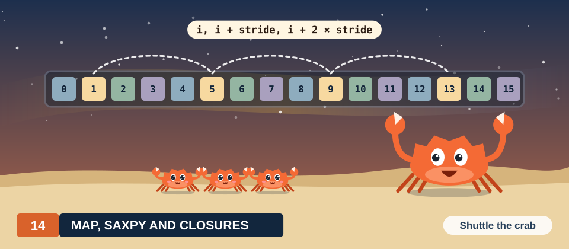

# Chapter 14: Map and SAXPY

This chapter depicts what happens under the hood when a GPU applies the same small calculation to
every element of an array. We'll examine how we give the elements to threads, how the threads'
reads reach memory, and why the speed of such a program is set by the memory and not by the
arithmetic units.

So far we've written one kernel, the vector addition of Chapter 13. In that kernel, we used one
thread for each element, and each thread added 2 numbers. Vector addition belongs to a large
family of computations called maps. In a map, every output element depends only on the input
elements at the same position. Scaling a vector, converting the pixels of an image to gray and
applying an activation function to every value of a tensor are all maps. In this chapter, we study
the family through one member, SAXPY, and we build two GPU versions of it. In the first version,
we again use one thread per element. In the second version, we use fewer threads than elements and
let each thread process several elements in a loop.

<div class="covers" markdown="1">

This chapter covers

- SAXPY and the map pattern, worked by hand on 12 elements
- the sequential loop and its count of operations and bytes
- one thread per element, the grid that covers \\(n\\) elements, and the guard \\(i < n\\)
- the grid-stride loop, for grids with fewer threads than elements
- a proof that the grid-stride loop updates every element exactly once
- 2 broken variants, a missing guard and a wrong stride
- arithmetic intensity, and why SAXPY is limited by memory bandwidth
- generic maps with Rust closures and C++ lambdas
- measured bandwidth, and the number of blocks a loop needs to reach it

</div>

The code of this chapter is in
[`code/oxide/ch14_map_saxpy/`](https://github.com/arpanpathak/gpu-parallel-book/tree/main/code/oxide/ch14_map_saxpy)
for Rust and in
[`code/cuda/ch14_map_saxpy/`](https://github.com/arpanpathak/gpu-parallel-book/tree/main/code/cuda/ch14_map_saxpy)
for C++. The Rust crate uses the same `Cargo.toml` and `rust-toolchain.toml` as the vector addition
of Chapter 13.

## 14.1 Updating every element of an array

### 14.1.1 A worked example

We use one pair of vectors for the whole chapter, so that you can check every number with a
pencil. Each vector has 12 elements. We also need one number by which we multiply the first vector.
This number is called the scalar, and we choose \\(a = 2\\).

\\[
x = (2, 7, 1, 8, 2, 8, 1, 8, 2, 8, 4, 5), \qquad y = (3, 1, 4, 1, 5, 9, 2, 6, 5, 3, 5, 8).
\\]

We number the positions of a vector from 0. We write \\(x_i\\) for the element of \\(x\\) at
position \\(i\\). For example, \\(x_0 = 2\\) is the first element of \\(x\\), and \\(x_9 = 8\\) is
the tenth.

The calculation we want is simple to state. For every position \\(i\\), we take twice the element
of \\(x\\) and add the element of \\(y\\) at the same position. For position 0, this gives
\\(2 \cdot 2 + 3 = 7\\). For position 1, it gives \\(2 \cdot 7 + 1 = 15\\). We continue in the same
way for the other 10 positions. Figure 14.1 shows all 12 results.

<figure>
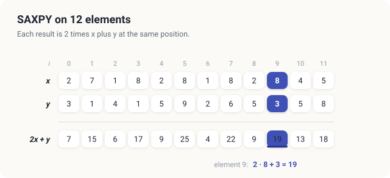
<figcaption><b>Figure 14.1</b> SAXPY on the worked example with \(a = 2\). Element 9 is \(2 \cdot 8 + 3 = 19\).</figcaption>
</figure>

We'll follow one of these results through every version of the program in this chapter. It is
position 9, where \\(2 \cdot 8 + 3 = 19\\). We'll also meet a faulty program in Section 14.5. That
program produces 8 at position 2, where the correct result is \\(2 \cdot 1 + 4 = 6\\).

### 14.1.2 SAXPY and the map pattern

We need one piece of notation before we state the definition. We write \\([a, b)\\) for the
integers from \\(a\\) up to, but not including, \\(b\\). For example, \\(i \in [0, 12)\\) means
that \\(i\\) takes the values \\(0, 1, \ldots, 11\\). These are exactly the 12 positions of our
vectors.

<div class="definition">

<span class="box-label">Definition 14.1</span> **SAXPY.** Let \\(a\\) be a number, and let \\(x\\)
and \\(y\\) be vectors of \\(n\\) single-precision floating-point numbers. SAXPY replaces each
element of \\(y\\) by \\(a\\) times the element of \\(x\\) plus the old element of \\(y\\).

\\[ y_i \leftarrow a\\,x_i + y_i \qquad \text{for every } i \in [0, n). \\]

*Example.* With \\(a = 2\\), \\(x_9 = 8\\) and \\(y_9 = 3\\), SAXPY sets \\(y_9\\) to 19.

</div>

| Symbol | Meaning | In the example |
|---|---|---|
| \\(n\\) | number of elements in each vector | 12 |
| \\(i\\) | position of an element, from 0 to \\(n - 1\\) | 9 |
| \\(a\\) | the scalar that multiplies \\(x\\) | 2 |
| \\(x_i\\) | element of \\(x\\) at position \\(i\\) | \\(x_9 = 8\\) |
| \\(y_i\\) | element of \\(y\\) at position \\(i\\), before and after the update | \\(y_9 = 3\\), then 19 |
| \\(\leftarrow\\) | "is replaced by" | |

The arrow \\(\leftarrow\\) means that we compute the right-hand side with the old value of
\\(y_i\\) and then store the result in \\(y_i\\). The new value takes the place of the old one.
A computation that stores its result in one of its inputs is said to work **in place**.

The name SAXPY comes from the Basic Linear Algebra Subprograms, usually called BLAS. BLAS is a
standard collection of routines for linear algebra. Its first version appeared in 1979, when
scientific programs were written in Fortran and every computer vendor shipped its own fast version
of the same routines.[^blas] The letter *S* stands for single precision, and *AXPY* stands for
"\\(a\\) times \\(x\\) plus \\(y\\)". The routine is still in every BLAS library today, including
NVIDIA's cuBLAS.

SAXPY is one member of a larger family. In every member of the family, we compute output element
\\(i\\) from the input elements at position \\(i\\), and from nothing else.

<div class="definition">

<span class="box-label">Definition 14.2</span> **Map.** A map applies one function \\(f\\) to the
elements at each position of one or more input arrays of length \\(n\\). It produces an output
array of length \\(n\\).

\\[ z_i = f(x_i, y_i, \ldots) \qquad \text{for every } i \in [0, n). \\]

*Example.* SAXPY is a map with 2 inputs and \\(f(x, y) = a x + y\\). Vector addition is a map with
\\(f(x, y) = x + y\\). The computation \\(y_i \leftarrow \max(x_i, y_i)\\) is a map with
\\(f(x, y) = \max(x, y)\\).

</div>

| Symbol | Meaning | SAXPY on the example |
|---|---|---|
| \\(f\\) | the function we apply at every position | \\(f(x, y) = 2x + y\\) |
| \\(x_i, y_i, \ldots\\) | the input elements at position \\(i\\), one from each input array | \\(x_9 = 8\\), \\(y_9 = 3\\) |
| \\(z_i\\) | the output element at position \\(i\\) | \\(z_9 = f(8, 3) = 19\\) |

The dots in \\(f(x_i, y_i, \ldots)\\) mean that a map may have any number of input arrays. In
SAXPY, the output array \\(z\\) is the array \\(y\\) itself, because SAXPY works in place.

<div class="exercises">

Exercises

14.1 Compute elements 0 to 3 of SAXPY on the worked example with \\(a = 3\\) instead of 2.<br>
14.2 Which of these computations are maps? (a) \\(z_i = x_i^2\\); (b) \\(z_i = x_i - x_{i-1}\\);
(c) \\(z_i = x_i / s\\), where \\(s\\) is the sum of all elements of \\(x\\). Explain your answer.<br>
14.3 SAXPY overwrites \\(y\\). Name one advantage and one risk of computing in place.

</div>

## 14.2 The sequential algorithm

### 14.2.1 The loop

On a CPU, we write Definition 14.1 as a single loop. The loop visits the positions one after
another and updates each of them.

<div class="algo">
<p class="algo-name">Saxpy<span style="font-variant: normal">(\(a, x, y, n\))</span></p>
<ol>
<li><b class="kw">for</b> \(\mathsf{index} \in [0, n)\) {</li>
<li style="--d:1">\(y_{\mathsf{index}} = a \cdot x_{\mathsf{index}} + y_{\mathsf{index}}\) <span class="c">// 2 reads, 1 write, 2 FLOP</span></li>
<li>}</li>
</ol>
</div>

We want to judge the cost of this loop later, so we count 2 quantities for each pass through it.
The first quantity is the arithmetic. A **floating-point operation**, written FLOP for short, is
one addition, subtraction, multiplication or division of floating-point numbers. Line 2 performs 2
of them. It multiplies \\(a\\) by \\(x_i\\), and it adds \\(y_i\\) to the product.

The second quantity is the data that line 2 moves between the processor and memory. Line 2 reads 2
values, \\(x_i\\) and \\(y_i\\). It writes one value, the new \\(y_i\\). Each value is a float of 4
bytes, so line 2 moves \\(3 \cdot 4 = 12\\) bytes.

Line 2 runs once for each position, that is, \\(n\\) times. For our 12 elements, the loop therefore
performs \\(12 \cdot 2 = 24\\) FLOP and moves \\(12 \cdot 12 = 144\\) bytes. At the end of the
chapter, we measure arrays of \\(n = 16{,}777{,}216 = 2^{24}\\) elements. For those arrays, the loop
performs 33.6 million FLOP and moves 201.3 MB. A CPU core performs the passes one after another, in
the order shown in Figure 14.2.

<figure>
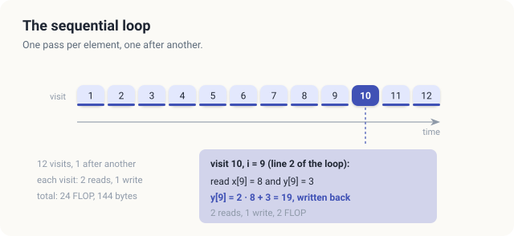
<figcaption><b>Figure 14.2</b> The order in which <span class="sc">Saxpy</span> visits the elements. Visit 10 computes element 9 with 2 reads, 1 write and 2 FLOP.</figcaption>
</figure>

### 14.2.2 Whether the passes depend on each other

Before we run the passes of the loop at the same time, we must know whether any pass needs the
result of another pass. If pass 9 needed the value that pass 8 writes, pass 9 would have to wait
for pass 8, and the two could not run together.

Let us look at what each pass uses. Pass \\(i\\) reads \\(x_i\\) and \\(y_i\\), and it writes
\\(y_i\\). For example, pass 9 reads \\(x_9 = 8\\) and \\(y_9 = 3\\), and it writes 19. No other
pass reads or writes position 9. The same is true at every position. The 12 passes therefore use 12
separate pairs of memory locations, and no pass ever needs a value that another pass produces.

This property is not automatic. A computation can look similar and still lack it. Consider the
running sum of \\(y\\), defined by \\(s_i = s_{i-1} + y_i\\). The value \\(s_i\\) is the sum of the
first \\(i + 1\\) elements of \\(y\\), and we compute it from the previous sum \\(s_{i-1}\\). To
compute \\(s_9\\), we therefore need \\(s_8\\). To compute \\(s_8\\), we need \\(s_7\\), and so
the chain continues back to \\(s_0\\). The top half of Figure 14.3 draws the data that each result
of SAXPY uses. Every arrow stays inside its own column. The bottom half draws the same for the
running sum, where every result is joined to the result before it.

<figure>
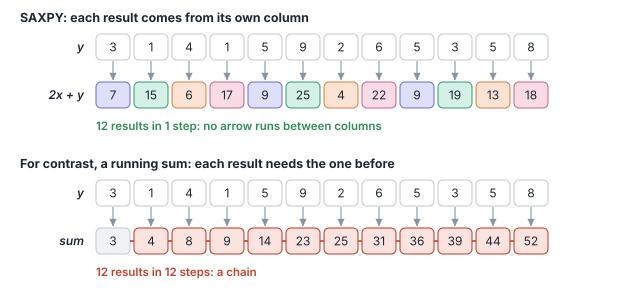
<figcaption><b>Figure 14.3</b> Top: each result of SAXPY uses only its own column. Bottom: each result of a running sum uses the result before it.</figcaption>
</figure>

<div class="key-observation">

<span class="box-label">Key observation</span> Pass \\(i\\) of <span class="sc">Saxpy</span> reads
and writes only position \\(i\\). No pass uses a value that another pass produces. We may
therefore run the 12 passes in any order, and in particular all at the same time, each on its own
thread.

</div>

The running sum does not have this property, and it needs a different algorithm. In Chapter 15,
we develop such an algorithm for a closely related computation, the sum of all elements of an
array. In Chapter 21, we return to the running sum itself.

<div class="exercises">

Exercises

14.4 How many FLOP and how many bytes does <span class="sc">Saxpy</span> need for
\\(n = 1{,}000\\)?<br>
14.5 The loop \\(y_i = y_{i+1} + x_i\\) for \\(i \in [0, n - 1)\\) also reads and writes \\(y\\).
Is it a map? What goes wrong if we run its passes at the same time?

</div>

## 14.3 Giving every element its own thread

### 14.3.1 Numbering the threads

The key observation suggests that we give every position its own thread. To do so, we need the
terms with which a GPU program describes its threads. We met them in Chapter 13, and we recall them
here.

<div class="definition">

<span class="box-label">Definition 14.3</span> **Kernel and thread.** A **kernel** is a function
that the GPU runs many times at once. Each of these runs is a **thread**. All threads run the same
code, and each thread has its own position and its own variables.

*Example.* We'll run SAXPY on the example as a kernel with 16 threads. We use 12 of them to compute
one element each.

</div>

<div class="definition">

<span class="box-label">Definition 14.4</span> **Block and grid.** A **block** is a group of
threads that run on the same streaming multiprocessor (SM) of the GPU. The threads of a block can
share a fast memory and can wait for one another. The **grid** is the set of all blocks of one
launch of a kernel. Each thread can read 3 numbers. The number `blockIdx.x` is the index of its
block in the grid, `blockDim.x` is the number of threads in a block, and `threadIdx.x` is the
index of the thread within its block.

*Example.* A grid of 2 blocks of 8 threads has 16 threads. Thread 1 of block 1 reads
`blockIdx.x = 1`, `blockDim.x = 8` and `threadIdx.x = 1`.

</div>

We want each thread to find the element it is responsible for. The simplest plan is to number all
threads of the grid in one sequence, starting at 0, and to let thread number \\(\mathsf{globalIdx}\\) handle element
\\(\mathsf{globalIdx}\\). The 3 numbers above are enough to compute this sequence number.

Let us work it out for block number \\(b\\). Blocks 0 to \\(b - 1\\) come before block \\(b\\).
Each of them holds `blockDim.x` threads, so together they hold \\(b \cdot\\) `blockDim.x` threads.
The first thread of block \\(b\\) therefore gets the number \\(b \cdot\\) `blockDim.x`. The other
threads of block \\(b\\) follow it, so we add the index of a thread within its block. The result
is called the **global index** of the thread, and we write it as \\(\mathsf{globalIdx}\\).

\\[ \mathsf{globalIdx} = \mathsf{blockIdx{.}x} \cdot \mathsf{blockDim{.}x} + \mathsf{threadIdx{.}x}. \\]

| Symbol | Meaning | Thread 1 of block 1 |
|---|---|---|
| \\(\mathsf{blockIdx{.}x}\\) | number of the thread's block in the grid | 1 |
| \\(\mathsf{blockDim{.}x}\\) | number of threads in every block | 8 |
| \\(\mathsf{blockIdx{.}x} \cdot \mathsf{blockDim{.}x}\\) | number of threads in the blocks before this one | \\(1 \cdot 8 = 8\\) |
| \\(\mathsf{threadIdx{.}x}\\) | index of the thread within its block | 1 |
| \\(\mathsf{globalIdx}\\) | global index, the thread's number in the whole grid | \\(8 + 1 = 9\\) |

In our example, thread 1 of block 1 has the global index \\(1 \cdot 8 + 1 = 9\\). We therefore use
this thread to compute element 9, as shown in Figure 14.4. No 2 threads of the grid get the same
global index. Threads of the same block differ in `threadIdx.x`. Threads of different blocks fall
into different runs of `blockDim.x` consecutive numbers.

### 14.3.2 Covering an array of any length

When we launch a kernel, we choose 2 numbers. The first is the number of threads in each block,
which we call \\(\mathsf{blockDim{.}x}\\). The second is the number of blocks in the grid. To give every element its
own thread, we need at least \\(n\\) threads. A grid of \\(\mathsf{blocks}\\) blocks holds \\(\mathsf{blocks} \cdot \mathsf{blockDim{.}x}\\) threads, so
we need \\(\mathsf{blocks} \cdot \mathsf{blockDim{.}x} \ge n\\), which means at least \\(n / \mathsf{blockDim{.}x}\\) blocks. The number of blocks must be a
whole number, so we round \\(n / \mathsf{blockDim{.}x}\\) up to the next integer.

\\[ \text{blocks} = \lceil n / B \rceil. \\]

| Symbol | Meaning | In the example |
|---|---|---|
| \\(n\\) | number of elements | 12 |
| \\(\mathsf{blockDim{.}x}\\) | number of threads in each block (`blockDim.x`) | 8 |
| \\(\lceil n / \mathsf{blockDim{.}x} \rceil\\) | \\(n / \mathsf{blockDim{.}x}\\) rounded up to the next integer | \\(\lceil 1.5 \rceil = 2\\) |

With \\(n = 12\\) and \\(\mathsf{blockDim{.}x} = 8\\), the quotient \\(12 / 8 = 1.5\\) is rounded up to 2. The 2 blocks
hold 16 threads. Threads 0 to 11 each have one element. Threads 12 to 15, the last 4 threads of
block 1, have no element at all. In general, the grid has \\(\mathsf{blockDim{.}x} \cdot \lceil n / \mathsf{blockDim{.}x} \rceil - n\\) threads
without an element, which is always fewer than \\(\mathsf{blockDim{.}x}\\). In our example, there are
\\(16 - 12 = 4\\) of them. For the measured arrays, \\(n = 2^{24}\\) is a multiple of
\\(\mathsf{blockDim{.}x} = 256\\), so the grid has exactly 65,536 blocks and every thread has an element.

<figure>
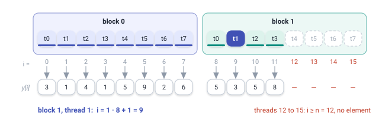
<figcaption><b>Figure 14.4</b> 12 elements in 2 blocks of 8 threads. Thread 1 of block 1 owns element \(1 \cdot 8 + 1 = 9\); threads 12 to 15 own nothing.</figcaption>
</figure>

A thread without an element must not read or write memory, because the positions from \\(n\\)
onwards do not belong to \\(y\\). We therefore let every thread first compare its global index with
\\(n\\). We now obtain the parallel algorithm from <span class="sc">Saxpy</span>. We delete the
loop, and we let the global index play the role of the loop variable \\(\mathsf{index}\\). Every thread runs
the following procedure.

<div class="algo">
<p class="algo-name">Saxpy-Kernel<span style="font-variant: normal">(\(a, x, y, n\))</span></p>
<ol>
<li>\(\mathsf{index} = \mathsf{blockIdx{.}x} \cdot \mathsf{blockDim{.}x} + \mathsf{threadIdx{.}x}\) <span class="c">// the global index</span></li>
<li><b class="kw">if</b> \(\mathsf{index} \lt n\) { <span class="c">// the guard</span></li>
<li style="--d:1">\(y_{\mathsf{index}} = a \cdot x_{\mathsf{index}} + y_{\mathsf{index}}\) <span class="c">// 2 reads, 1 write in global memory</span></li>
<li>}</li>
</ol>
</div>

We launch <span class="sc">Saxpy-Kernel</span> on a grid of \\(\lceil n / \mathsf{blockDim{.}x} \rceil\\) blocks of
\\(\mathsf{blockDim{.}x}\\) threads. Line 1 computes the global index with the formula of Section 14.3.1. Line 2 is
called the **guard**, also known as the bounds check. When a thread's index lies at or beyond the
end of the array, line 2 skips the update, and the thread does nothing. Line 3 is line 2 of
<span class="sc">Saxpy</span>. We now run it once per thread instead of once per pass of a loop.
In our example, thread 9 passes the guard because \\(9 < 12\\), and it computes \\(y_9 = 19\\).
Thread 13 fails the guard because \\(13 \ge 12\\), and it does nothing.

### 14.3.3 What one thread reads and writes

To understand the cost of a thread's work, we need to know where the vectors are stored. They are
stored in the main memory of the GPU.

<div class="definition">

<span class="box-label">Definition 14.5</span> **Global memory and registers.** **Global memory**
is the main memory of the GPU, also called device memory. Every thread of every block can read and
write it. It holds gigabytes, and a read takes several hundred clock cycles to return its value.
**Registers** hold the variables of a single thread and return a value in about one cycle.

*Example.* The vectors \\(x\\) and \\(y\\) are in global memory. The product \\(2 \cdot 8\\) that
we compute in thread 1 of block 1 is in a register.

</div>

Figure 14.5 follows thread 1 of block 1. We read \\(x_9 = 8\\) and \\(y_9 = 3\\) from global
memory, compute \\(2 \cdot 8 + 3 = 19\\) in registers, and write 19 back to \\(y_9\\). The thread
makes 2 reads and one write, moves 12 bytes and performs 2 FLOP. This is exactly the work of one
pass of the sequential loop.

<figure>
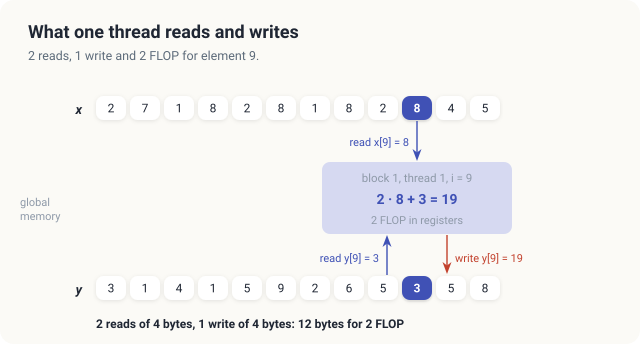
<figcaption><b>Figure 14.5</b> The work of 1 thread of <span class="sc">Saxpy-Kernel</span>: 2 reads and 1 write in global memory, 2 FLOP in registers.</figcaption>
</figure>

The parallel algorithm therefore does the same total work as the sequential one. On the example,
it performs 24 FLOP and moves 144 bytes, and in general it moves 12 bytes per element. What
changes is the time. The \\(n\\) passes no longer form a sequence of \\(n\\) steps. With enough
threads, we can perform all of them in a single step.

One cost stays the same, however. We still move 12 bytes per element through global memory, and
no arrangement of threads can reduce this amount. Every value of \\(x\\) and \\(y\\) is used
exactly once, so there is nothing that one thread could reuse from another. In Section 14.6, we
show that this cost of 12 bytes per element sets the speed of SAXPY.

<div class="exercises">

Exercises

14.6 With blocks of 8 threads, which thread computes element 5, and which element does thread 3
of block 1 compute?<br>
14.7 How many blocks of 256 threads cover \\(n = 1{,}000{,}000\\) elements, and how many threads
have no element?<br>
14.8 A program launches \\(n / B\\) blocks, rounded down, instead of \\(\lceil n / B \rceil\\).
Which elements of the example are never computed with \\(B = 8\\)?

</div>

## 14.4 Arrays with more elements than threads

### 14.4.1 Why we might want fewer threads

With <span class="sc">Saxpy-Kernel</span>, we launch one thread for every element. For the
measured arrays of 16,777,216 elements, we therefore launch 16,777,216 threads. The GPU can't hold
all of these threads at the same time. An SM of the measured GPU can hold up to 1,536 threads, and
with 8 SMs the whole GPU can hold up to 12,288. The hardware therefore runs the 65,536 blocks of
256 threads in about 1,366 rounds. It starts a new block whenever an earlier block finishes.

This arrangement works well. In Section 14.8, we measure that it runs close to the speed of the
memory. It does, however, tie the size of the grid to the length of the array. There are three
situations in which we would rather choose the number of threads ourselves.

The first situation arises when a kernel does some work once per thread, in addition to its work
per element. The dot product of Chapter 15 is an example. There, we let every thread add up its
products in a register. At the end, we must combine the sums of all threads, and this costs time in
proportion to the number of threads. If each thread handles 64 elements instead of one, we have 64
times fewer sums to combine.

The second situation arises when we want the grid to fit the GPU. The measured GPU can hold up to
12,288 threads at once. A grid of 6 blocks of 256 threads per SM fills all of its SMs, whatever
the length of the array. We can then choose the grid from 2 properties of the GPU, its number of
SMs and the number of threads that each SM can hold, instead of from \\(n\\).

The third situation arises when we process many arrays of different lengths. In cuda-oxide, we
prepare a launch once for a given grid, with a method such as `prepare_saxpy`, and we can then
launch it many times. If the grid does not depend on \\(n\\), one prepared launch serves arrays of
every length.

### 14.4.2 Dividing the elements among the threads

Suppose now that the grid has \\(\mathsf{gridSize}\\) threads in total and that \\(\mathsf{gridSize}\\) is smaller than \\(n\\).
Each thread must then process several elements. We must divide the elements so that every element
is processed exactly once. In our example, we use \\(\mathsf{gridSize} = 4\\) threads, arranged as 2 blocks of 2
threads, for the 12 elements. Each thread then processes \\(12 / 4 = 3\\) elements.

There are 2 natural ways to divide the elements. Both are drawn in Figure 14.6, and in both we
write \\(\mathsf{globalIdx}\\) for the global index of a thread, from 0 to 3. In the first way, which we call
chunks, thread \\(\mathsf{globalIdx}\\) takes the 3 neighboring elements \\(3 \cdot \mathsf{globalIdx}\\), \\(3 \cdot \mathsf{globalIdx} + 1\\) and \\(3 \cdot \mathsf{globalIdx} + 2\\).
For example, thread 3 takes elements 9, 10 and 11. In the second way, which we call a stride,
thread \\(\mathsf{globalIdx}\\) takes every fourth element, starting at its own index. It takes elements \\(\mathsf{globalIdx}\\),
\\(\mathsf{globalIdx} + 4\\) and \\(\mathsf{globalIdx} + 8\\). For example, thread 1 takes elements 1, 5 and 9.

Both ways are correct, because each gives every element to exactly one thread. They are not
equally fast. The difference comes from 2 properties of the hardware. Threads run in groups of 32,
and global memory is read in pieces of 32 bytes. We define both properties now.

<div class="definition">

<span class="box-label">Definition 14.6</span> **Warp and lane.** A **warp** is a group of 32
threads of a block with consecutive indices, such as threads 0 to 31 or threads 32 to 63. The SM
issues each instruction for a whole warp at once, so the 32 threads of a warp perform their reads
at the same moment. The position of a thread within its warp, from 0 to 31, is called its
**lane**.

*Example.* A block of 256 threads consists of 8 warps. In our small example, the 4 threads play the
role of the lanes of one warp.

</div>

<div class="definition">

<span class="box-label">Definition 14.7</span> **Coalesced access.** The memory system reads global
memory in aligned pieces of 32 bytes, called segments. A read by a warp is **coalesced** when its
32 threads use neighboring addresses. The 32 reads of 4 bytes then fall into 4 segments of 32
bytes, 128 bytes in all, and every byte that the memory delivers is used.

*Example.* If lanes 0 to 31 read \\(x_0\\) to \\(x_{31}\\), the warp reads 128 neighboring bytes,
and the read is coalesced.

</div>

<div class="callout note" markdown="1">

**Parcels on a delivery van.** Picture a courier company whose van always drives to one
street and carries a crate of 8 parcels for 8 neighboring houses. The crate is filled at the depot,
and it goes out whole, even if only one house on that street ordered something. Suppose 32 people
order parcels at the same time. If they live in 32 neighboring houses, the company needs 4 trips,
and every parcel in every crate is wanted. If they live 3 houses apart from each other, the 32
houses are spread over 12 streets. The company now needs 12 trips, and two thirds of each crate is
unwanted.

The analogy maps directly onto the hardware. The 32 people are the 32 threads of a warp. The houses
are memory addresses, and a parcel is one float of 4 bytes. A street with its crate of 8 parcels is
a segment of 32 bytes, and a trip of the van is one segment read from memory. The analogy breaks
down in one respect. A real van could leave the unwanted parcels behind, but the memory always
delivers the whole segment, so the unused bytes still cost time on the memory bus.

</div>

We can now compare the 2 ways of dividing the elements. Each thread processes its elements one
after another, in steps. In each step, the threads of a warp issue their reads together.

Consider the first step of the chunk division. The 4 threads of our example read elements 0, 3, 6
and 9. These lie 12 bytes apart and are spread over 40 bytes. In a real warp of 32 threads with
chunks of 3 elements, the 32 addresses of one read instruction are again 12 bytes apart, and they
span 384 bytes. That is 12 segments of 32 bytes. The memory delivers all 384 bytes, but the warp
uses only the 128 bytes that hold its 32 floats. Two thirds of the bytes read are wasted.

Now consider the first step of the stride division. The 4 threads read elements 0, 1, 2 and 3,
which occupy 16 neighboring bytes. In a warp of 32 threads, the 32 floats occupy 128 neighboring
bytes, which is exactly 4 segments. Every byte that the memory delivers is used. The same holds in
every later step, because each step moves all addresses forward by the same amount. The stride
division therefore keeps every read of every warp coalesced. Figure 14.6 shows all 3 steps.

<figure>
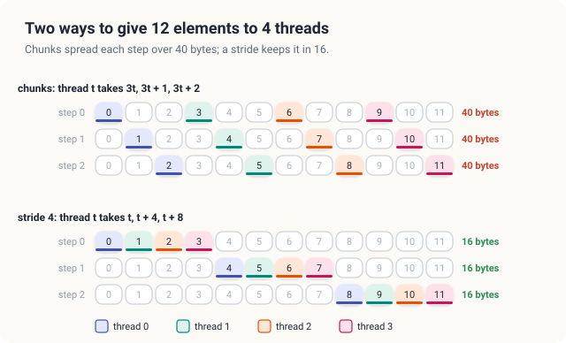
<figcaption><b>Figure 14.6</b> 12 elements on 4 threads. Chunks spread the 4 accesses of each step over 40 bytes; a stride of 4 keeps them in 16 neighboring bytes.</figcaption>
</figure>

| Thread \\(\mathsf{globalIdx}\\) | Block, thread in block | Elements | Values of \\(y\\) after SAXPY |
|---|---|---|---|
| 0 | 0, 0 | 0, 4, 8 | 7, 9, 9 |
| 1 | 0, 1 | 1, 5, 9 | 15, 25, 19 |
| 2 | 1, 0 | 2, 6, 10 | 6, 4, 13 |
| 3 | 1, 1 | 3, 7, 11 | 17, 22, 18 |

<p class="listing"><b>Table 14.1</b> The stride assignment on the example: 4 threads, 12 elements, \\(\mathsf{gridSize} = 4\\).</p>

### 14.4.3 The grid-stride loop

Table 14.1 lists the stride division for the example. Thread 1 starts at element 1. Each further
element lies 4 places after the previous one, because 4 is the number of threads in the grid. In
general, the stride division gives thread \\(\mathsf{globalIdx}\\) the elements \\(\mathsf{globalIdx}, \mathsf{globalIdx} + \mathsf{gridSize}, \mathsf{globalIdx} + 2 \cdot \mathsf{gridSize}, \ldots\\) that
lie below \\(n\\). Here \\(\mathsf{globalIdx}\\) is the global index of Section 14.3.1, and \\(\mathsf{gridSize}\\) is the number of
threads in the grid. A loop that walks through these elements is called a grid-stride loop. Mark
Harris of NVIDIA gave the pattern this name in a widely read article in 2013.[^harris]

<div class="definition">

<span class="box-label">Definition 14.8</span> **Grid-stride loop.** In a grid-stride loop, each
thread starts at its global index \\(\mathsf{globalIdx}\\) and moves forward by the number of threads in the grid,
\\(\mathsf{gridSize} = \mathsf{gridDim{.}x} \cdot \mathsf{blockDim{.}x}\\). Here `gridDim.x` is the number of blocks of
the grid. The distance \\(\mathsf{gridSize}\\) is called the **stride**.

*Example.* With 2 blocks of 2 threads, \\(\mathsf{gridSize} = 4\\). Thread 1 of block 0, whose global index is 1,
visits elements 1, 5 and 9.

</div>

<div class="algo">
<p class="algo-name">Grid-Stride-Saxpy<span style="font-variant: normal">(\(a, x, y, n\))</span></p>
<ol>
<li>\(\mathsf{gridSize} = \mathsf{gridDim{.}x} \cdot \mathsf{blockDim{.}x}\) <span class="c">// threads in the grid</span></li>
<li>\(\mathsf{index} = \mathsf{blockIdx{.}x} \cdot \mathsf{blockDim{.}x} + \mathsf{threadIdx{.}x}\) <span class="c">// the global index</span></li>
<li><b class="kw">while</b> \(\mathsf{index} \lt n\) {</li>
<li style="--d:1">\(y_{\mathsf{index}} = a \cdot x_{\mathsf{index}} + y_{\mathsf{index}}\)</li>
<li style="--d:1">\(\mathsf{index} = \mathsf{index} + \mathsf{gridSize}\)</li>
<li>}</li>
</ol>
</div>

Lines 2 and 4 are lines 1 and 3 of <span class="sc">Saxpy-Kernel</span>. The guard of
<span class="sc">Saxpy-Kernel</span> has become the condition of the loop in line 3. A thread
whose index is already at least \\(n\\) therefore runs the loop 0 times. Line 5 moves the index
forward by the stride. In our example, thread 1 runs the loop 3 times, with \\(\mathsf{index} = 1\\), 5 and 9.
It computes 15, 25 and 19, and it leaves the loop when \\(\mathsf{index} = 13\\), because \\(13 \ge 12\\).

Let us count how many elements a thread processes. We number the passes through the loop with
\\(\mathsf{pass}\\), starting from 0. In pass \\(\mathsf{pass}\\), the thread is at element \\(\mathsf{globalIdx} + \mathsf{pass} \cdot \mathsf{gridSize}\\). Thread \\(\mathsf{globalIdx}\\)
processes every element \\(\mathsf{globalIdx} + \mathsf{pass} \cdot \mathsf{gridSize}\\) that is smaller than \\(n\\), and there are
\\(\lceil (n - \mathsf{globalIdx}) / \mathsf{gridSize} \rceil\\) of them. For thread 1 of our example,
\\(\lceil (12 - 1) / 4 \rceil = \lceil 2.75 \rceil = 3\\), which matches its 3 passes.

| Symbol | Meaning | Thread 1 of the example |
|---|---|---|
| \\(\mathsf{globalIdx}\\) | global index of the thread, which is also its first element | 1 |
| \\(\mathsf{gridSize}\\) | number of threads in the grid, the stride | 4 |
| \\(\mathsf{pass}\\) | number of the pass through the loop, from 0 | 0, 1, 2 |
| \\(\mathsf{globalIdx} + \mathsf{pass} \cdot \mathsf{gridSize}\\) | element processed in pass \\(\mathsf{pass}\\) | 1, 5, 9 |
| \\(\lceil (n - \mathsf{globalIdx}) / \mathsf{gridSize} \rceil\\) | number of elements the thread processes | 3 |

For \\(n = 12\\) and \\(\mathsf{gridSize} = 4\\), each of the 4 threads processes 3 elements. For \\(\mathsf{gridSize} = 5\\),
threads 0 and 1 process 3 elements, and threads 2, 3 and 4 process 2. The loop therefore handles a
length \\(n\\) that is not a multiple of \\(\mathsf{gridSize}\\) without any extra code.

<div class="exercises">

Exercises

14.9 With \\(\mathsf{gridSize} = 5\\), list the elements of the example that each thread processes.<br>
14.10 A warp of 32 threads uses chunks of 4 elements. How many 32-byte segments does one read
instruction need, and how many of the delivered bytes are used?<br>
14.11 How many times does the loop of <span class="sc">Grid-Stride-Saxpy</span> run for thread 7
of a grid of 2,048 threads and \\(n = 16{,}777{,}216\\)?

</div>

## 14.5 Making sure every element is updated exactly once

Both kernels are short, but each depends on one detail that is easy to get wrong. In
<span class="sc">Saxpy-Kernel</span>, this detail is the guard. In
<span class="sc">Grid-Stride-Saxpy</span>, it is the stride. In this section, we remove or change
each of them in turn and follow the effect on the example.

### 14.5.1 Threads past the end of the array

Suppose that we delete line 2 of <span class="sc">Saxpy-Kernel</span> and keep the launch of 2
blocks of 8 threads. Threads 12 to 15 then no longer stop. Each of them computes the address of
its element \\(y_{\mathsf{index}}\\), which lies \\(4 \cdot \mathsf{index}\\) bytes after the start of \\(y\\). The 4 threads therefore
use the addresses 48 to 60 bytes past the start of \\(y\\). They write \\(2 x_{\mathsf{index}} + y_{\mathsf{index}}\\) there,
into memory that does not belong to \\(y\\), as shown in Figure 14.7.

<figure>
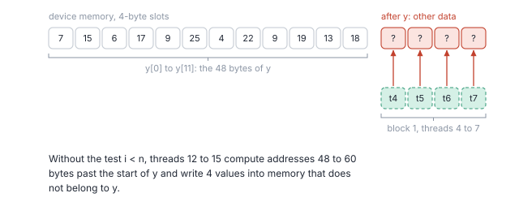
<figcaption><b>Figure 14.7</b> Without the guard, threads 12 to 15 write into the 4 slots after \(y\).</figcaption>
</figure>

We ran the C++ kernel without the guard. To make the effect visible, we placed 4 more slots of
other data after each vector. The slots after \\(x\\) held the value 1, and the slots after \\(y\\)
held 100. The program printed the following.

```console
y[0..12):    7 15  6 17  9 25  4 22  9 19 13 18
other data:  102 102 102 102
no error
```

The 12 elements of \\(y\\) are correct. The 4 values after \\(y\\), however, have changed from 100
to \\(2 \cdot 1 + 100 = 102\\). The GPU reported no error. The 4 slots lay inside memory that the
program owned, so nothing stopped the writes. In a real program, those slots would hold another
array. The wrong values would then appear later, in a computation that has nothing to do with
SAXPY, and the cause would be hard to find.

In Rust, we cannot make this mistake in the same kernel. Its output is a `DisjointSlice<f32>`. The
only way to obtain a writable element of it is `y.get_mut(thread_id)`, and that method returns `None`
when `thread_id` lies at or beyond the end of the slice. The guard is therefore part of the type of the
output, and a kernel without it does not compile.

### 14.5.2 A proof that the grid-stride loop is correct

<span class="sc">Grid-Stride-Saxpy</span> is correct only if it updates every element exactly
once. An element that is never updated keeps its old value. An element that is updated twice
receives \\(a x_{\mathsf{index}}\\) twice, because the second update reads the result of the first. For example,
if \\(y_9\\) were updated twice, it would become \\(2 \cdot 8 + 19 = 35\\) instead of 19. We
therefore prove that the grid-stride loop updates every element exactly once.

Table 14.1 already suggests which thread updates which element. Thread 1 updates elements 1, 5 and
9. Each of these leaves the remainder 1 when we divide it by \\(\mathsf{gridSize} = 4\\). We write \\(\mathsf{element} \bmod \mathsf{gridSize}\\)
for the remainder of \\(\mathsf{element}\\) divided by \\(\mathsf{gridSize}\\). For example, \\(9 \bmod 4 = 1\\), because
\\(9 = 2 \cdot 4 + 1\\), and element 9 is indeed updated by thread 1. The theorem states that the
same holds for every element.

<div class="theorem">

<span class="box-label">Theorem 14.1</span> When every thread of a grid of \\(\mathsf{gridSize}\\) threads has
finished <span class="sc">Grid-Stride-Saxpy</span>, every element \\(y_{\mathsf{element}}\\) with
\\(\mathsf{element} \in [0, n)\\) has been updated exactly once, by the thread whose global index is
\\(\mathsf{element} \bmod \mathsf{gridSize}\\).

</div>

<div class="proof">

*Proof.* The proof has 2 parts. In the first part, we describe what one thread does. In the second
part, we show that the threads together update every element once.

Fix a thread with global index \\(\mathsf{globalIdx} \in [0, \mathsf{gridSize})\\). We show that the loop of lines 3 to 6 keeps the
following statement true at the start of every pass. Such a statement is called a **loop
invariant**. *At the start of pass \\(\mathsf{pass}\\), \\(\mathsf{index} = \mathsf{globalIdx} + \mathsf{pass} \cdot \mathsf{gridSize}\\), and the thread has updated exactly the
elements \\(\mathsf{globalIdx} + j \cdot \mathsf{gridSize}\\) with \\(j \in [0, \mathsf{pass})\\).* For thread 1 of the example, at the start of pass
2, the invariant says that \\(\mathsf{index} = 1 + 2 \cdot 4 = 9\\) and that the thread has updated elements 1
and 5.

*Initialization.* Before pass 0, line 2 has set \\(\mathsf{index} = \mathsf{globalIdx}\\), and the thread has not yet updated any
element. Both parts of the invariant hold with \\(\mathsf{pass} = 0\\), because \\(\mathsf{globalIdx} + 0 \cdot \mathsf{gridSize} = \mathsf{globalIdx}\\) and the
range \\([0, 0)\\) is empty.

*Maintenance.* Assume that the invariant holds at the start of pass \\(\mathsf{pass}\\), and that \\(\mathsf{index} < n\\),
so that the pass runs. Line 4 updates element \\(\mathsf{index} = \mathsf{globalIdx} + \mathsf{pass} \cdot \mathsf{gridSize}\\). Line 5 sets
\\(\mathsf{index} = \mathsf{globalIdx} + \mathsf{pass} \cdot \mathsf{gridSize} + \mathsf{gridSize} = \mathsf{globalIdx} + (\mathsf{pass} + 1) \cdot \mathsf{gridSize}\\). The thread has now updated the elements \\(\mathsf{globalIdx} + j \cdot \mathsf{gridSize}\\) with
\\(j \in [0, \mathsf{pass} + 1)\\), which is the invariant for pass \\(\mathsf{pass} + 1\\).

*Termination.* The loop ends at the first \\(\mathsf{pass}\\) with \\(\mathsf{globalIdx} + \mathsf{pass} \cdot \mathsf{gridSize} \ge n\\). By the invariant, the
thread has then updated exactly the elements below \\(n\\) of the form \\(\mathsf{globalIdx} + j \cdot \mathsf{gridSize}\\). It has updated
each of them only once, because \\(\mathsf{index}\\) grows with every pass, so no value of \\(\mathsf{index}\\) repeats.

For the second part, take any element \\(\mathsf{element} \in [0, n)\\), and write \\(\mathsf{element} = j \cdot \mathsf{gridSize} + r\\) with
\\(r = \mathsf{element} \bmod \mathsf{gridSize}\\). The thread with \\(\mathsf{globalIdx} = r\\) updates \\(\mathsf{element}\\) in its pass \\(j\\). Every other
thread updates only elements whose remainder is its own index \\(\mathsf{globalIdx} \ne r\\), so it never updates
\\(\mathsf{element}\\). Hence \\(\mathsf{element}\\) is updated exactly once. In the example, element \\(9 = 2 \cdot 4 + 1\\) is
updated by thread 1 in its pass 2, and by no other thread.

</div>

The proof relies on 2 facts about the launch. The first is that the grid has exactly \\(\mathsf{gridSize}\\)
threads, with the global indices 0 to \\(\mathsf{gridSize} - 1\\). The second is that line 1 computes this same
\\(\mathsf{gridSize}\\). If line 1 computes a different number, the remainders no longer separate the threads, and
2 threads may update the same element. The next section shows what happens then.

### 14.5.3 A stride that is too small

A common mistake is to move forward by the number of threads in a block, `blockDim.x`, instead of
the number of threads in the grid. In our example, line 1 then computes \\(\mathsf{gridSize} = 2\\) instead of 4.
Thread 0 visits elements 0, 2, 4, 6, 8 and 10. Thread 2, which is thread 0 of block 1, starts at
element 2 and visits elements 2, 4, 6, 8 and 10. In the same way, threads 1 and 3 both visit the
odd elements from 3 onwards. Each of the elements 2 to 11 is therefore updated by 2 threads.

Figure 14.8 shows one order in which the 2 updates of element 2 can happen. Thread 0 updates
\\(y_2\\) from 4 to \\(2 \cdot 1 + 4 = 6\\). Thread 2 then reads the 6 and writes
\\(2 \cdot 1 + 6 = 8\\).

<figure>
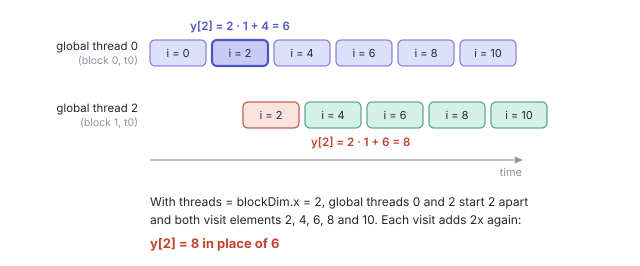
<figcaption><b>Figure 14.8</b> With a stride of 2 in place of 4, 2 threads update \(y_2\). If the second reads the first's result, \(y_2 = 8\) in place of 6.</figcaption>
</figure>

We ran the C++ program with `int threads = blockDim.x;` in place of `gridDim.x * blockDim.x`. On
the 12 elements of the example, the output was correct. The 2 blocks ran at the same moment on 2
SMs. Both threads read \\(y_2 = 4\\) before either of them wrote, and both wrote 6. On the measured
arrays, with 8 blocks of 256 threads, the program used \\(\mathsf{gridSize} = 256\\) instead of 2,048, and it
reported the following errors.

```console
  y[256] = 644, expected 324 (x = 128, y = 4)
  y[257] = 647.5, expected 326.25 (x = 128.5, y = 5)
  y[258] = 651, expected 328.5 (x = 129, y = 6)
  loop, 1 per SM: 2366 wrong elements
```

Let us check the first line. Element 256 is visited by thread 0 of block 0 in its second pass,
because \\(0 + 1 \cdot 256 = 256\\). It is also visited by thread 0 of block 1 in its first pass,
because that thread's global index is 256. The measured program uses \\(a = 2.5\\) and
\\(x_{256} = 128\\), so each update adds \\(2.5 \cdot 128 = 320\\). The second visit read the
result of the first and added 320 again. The result is \\(4 + 320 + 320 = 644\\), where the correct
value is 324.

In 3 further runs, the count of wrong elements was 3,197, 2,781 and 3,038. In most double visits,
the second thread read \\(y_{\mathsf{index}}\\) before the first thread's write had arrived, and it wrote the
correct value by chance. A bug of this kind can pass a small test and fail a large one, and it can
fail by a different amount on every run.

<div class="rule-box">

<span class="box-label">Rule</span> In an in-place map, every element must be updated by exactly
one thread, exactly once. Compute the stride from the whole grid, `gridDim.x * blockDim.x`, and the
starting index from the global index.

</div>

Rust does not catch this mistake. In the grid-stride kernel, we cannot use `get_mut`, because
`get_mut` accepts only the index of the calling thread, while the loop writes at the computed
indices \\(\mathsf{globalIdx} + \mathsf{pass} \cdot \mathsf{gridSize}\\). We therefore call `get_unchecked_mut(index)` inside an `unsafe` block. Above the
block, we write a comment that begins with `// SAFETY:` and states the argument of Theorem 14.1 in
2 lines. The compiler does not check this argument. A wrong stride therefore compiles in Rust as
well, and the comment then states something false.

<div class="exercises">

Exercises

14.12 In Theorem 14.1, where does the proof use the fact that line 1 computes the number of
threads of the whole grid?<br>
14.13 With the wrong stride \\(\mathsf{gridSize} = 2\\) on the example, which elements can end up wrong, and what
is the wrong value of \\(y_9\\) if both updates happen one after the other?<br>
14.14 A kernel computes the starting index as `threadIdx.x` instead of the global index, with the
correct stride. Which elements of the example are updated twice, and which are never updated?

</div>

## 14.6 What limits the speed of SAXPY

### 14.6.1 Arithmetic intensity

Recall from Section 14.3.3 that SAXPY moves 12 bytes for every 2 FLOP. A GPU has 2 separate
limits. Its memory can deliver only so many bytes per second, and its arithmetic units can perform
only so many FLOP per second. To find out which limit SAXPY reaches first, we compare the FLOP
that SAXPY performs per byte with the FLOP that the GPU can perform per byte.

<div class="definition">

<span class="box-label">Definition 14.9</span> **Memory bandwidth and peak arithmetic rate.** The
**memory bandwidth** of a GPU is the largest number of bytes per second that its global memory can
deliver. The **peak arithmetic rate** is the largest number of FLOP per second that its arithmetic
units can perform.

*Example.* The Jetson Orin NX has a memory bandwidth of 102 GB/s and a single-precision peak of
2.4 TFLOP/s. The Jetson AGX Thor has 273 GB/s and 8.1 TFLOP/s.

</div>

<div class="definition">

<span class="box-label">Definition 14.10</span> **Arithmetic intensity and ridge point.** The
**arithmetic intensity** of a kernel is the number of FLOP it performs per byte it moves to or from
global memory. The **ridge point** of a GPU is its peak arithmetic rate divided by its memory
bandwidth. It is the number of FLOP the GPU can perform in the time its memory delivers one byte. A
kernel whose arithmetic intensity lies below the ridge point is called **memory-bound**, which
means that its speed is limited by the memory bandwidth.

*Example.* SAXPY has an arithmetic intensity of \\(2 / 12 = 0.17\\) FLOP/B. The ridge point of the
Orin NX is \\(2{,}400 / 102 = 23.5\\) FLOP/B.

</div>

To read the ridge point, consider the Orin NX. In the time its memory needs to deliver one byte, its
arithmetic units can perform 23.5 FLOP. SAXPY has only 0.17 FLOP of work for each byte. The
arithmetic units therefore spend most of their time waiting for data. The ridge point of the Thor
is \\(8{,}100 / 273 = 29.7\\) FLOP/B. The arithmetic intensity of SAXPY lies 141 times below the
first ridge point and 178 times below the second, as shown in Figure 14.9. Every GPU in the table of
Chapter 2 has a ridge point above 10 FLOP/B, so SAXPY is memory-bound on all of them.

<figure>
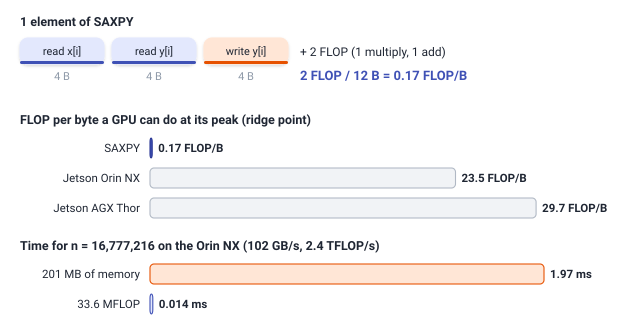
<figcaption><b>Figure 14.9</b> SAXPY performs 0.17 FLOP per byte, far below the ridge points of the 2 GPUs. Its memory traffic takes 140 times as long as its arithmetic.</figcaption>
</figure>

### 14.6.2 The shortest time the memory allows

A memory-bound kernel cannot finish before all of its bytes have passed through the memory. SAXPY
on \\(n\\) elements moves \\(12n\\) bytes. A GPU whose memory bandwidth is \\(W\\) bytes per second
needs at least \\(12n / W\\) seconds to move them. The time \\(T\\) of SAXPY therefore satisfies

\\[ T \ge \frac{12\\,n}{W}. \\]

| Symbol | Meaning | Measured arrays on the Orin NX |
|---|---|---|
| \\(T\\) | time of one run of SAXPY | at least 1.97 ms |
| \\(n\\) | number of elements | \\(2^{24} = 16{,}777{,}216\\) |
| \\(12\\) | bytes moved per element, 2 reads and one write of 4 bytes | 12 |
| \\(12n\\) | bytes moved in total | 201.3 MB |
| \\(W\\) | memory bandwidth of the GPU | 102 GB/s |

For \\(n = 2^{24}\\), the 201.3 MB of SAXPY need at least
\\(201.3 \text{ MB} / 102 \text{ GB/s} = 1.97\\) ms on the Orin NX. Its 33.6 million FLOP would take
only \\(33.6 \text{ MFLOP} / 2.4 \text{ TFLOP/s} = 0.014\\) ms. A faster arithmetic unit would
therefore not change the time of SAXPY at all. Only a faster memory would. Table 14.2 gives this
shortest time for 4 GPUs.

| GPU | Memory bandwidth | Least time for \\(n = 2^{24}\\) | FLOP rate at that time |
|---|---|---|---|
| Jetson Orin NX 16 GB | 102 GB/s | 1.97 ms | 17 GFLOP/s |
| Jetson AGX Thor | 273 GB/s | 0.74 ms | 46 GFLOP/s |
| GeForce RTX 4090 | 1,008 GB/s | 0.20 ms | 168 GFLOP/s |
| H100 SXM | 3,350 GB/s | 0.060 ms | 558 GFLOP/s |

<p class="listing"><b>Table 14.2</b> The least time of SAXPY on \(2^{24}\) elements, from the memory bandwidth. Bandwidths from NVIDIA's data sheets.</p>

The last column divides the 33.6 million FLOP by the least time. Even on an H100, SAXPY at its
shortest time performs 558 GFLOP/s, less than 1% of that GPU's single-precision peak of
67 TFLOP/s. We therefore measure the speed of a map in bytes per second, and we judge a map
program by how close it comes to the memory bandwidth. In Section 14.8, we measure how close our
programs come.

<div class="exercises">

Exercises

14.15 DAXPY is SAXPY on 8-byte double-precision values. What is its arithmetic intensity, and
what is its least time for \\(n = 2^{24}\\) on the Orin NX?<br>
14.16 A map computes \\(z_i = \sqrt{x_i^2 + y_i^2}\\) into a third array. Count its bytes per
element, counting a square root as one FLOP, and decide whether it is memory-bound on the Orin NX.

</div>

## 14.7 Writing the kernels in Rust and C++

### 14.7.1 The SAXPY kernel

We now turn the pseudocode into code. Listing 14.1 shows <span class="sc">Saxpy-Kernel</span> in
both languages, with one thread per element.

<p class="listing"><b>Listing 14.1</b> SAXPY, one thread per element. <a href="https://github.com/arpanpathak/gpu-parallel-book/blob/main/code/oxide/ch14_map_saxpy/src/main.rs">Rust</a> <a href="https://github.com/arpanpathak/gpu-parallel-book/blob/main/code/cuda/ch14_map_saxpy/saxpy.cu">C++</a></p>

<div class="code-tabs">
<div class="code-tab" data-lang="Rust">

```rust,ignore
mod kernels {
    // ...
{{#include ../../../../code/oxide/ch14_map_saxpy/src/main.rs:29:40}}
    // ...
}
```

</div>
<div class="code-tab" data-lang="C++">

```cpp
{{#include ../../../../code/cuda/ch14_map_saxpy/saxpy.cu:30:38}}
```

</div>
</div>

In C++, we write line 1 of the pseudocode out with `blockIdx.x`, `blockDim.x` and `threadIdx.x`,
and the guard of line 2 is the `if (i < n)`. In Rust, `thread::index_1d()` computes the same global
index, and `y.get_mut(thread_id)` performs the guard. It returns `Some` with a mutable reference to
element `thread_id` when the index is in range, and `None` otherwise. Recall from Chapter 13 that the
type of `thread_id` is `ThreadIndex`, and that only `thread::index_1d()` can create one. A thread can
therefore obtain a writable reference only to its own element. In both languages, we pass the
scalar `a` by value. The host copies its 4 bytes into the launch, and every thread reads the same
value.

The 2 attributes above the Rust kernel describe how we may launch it. `#[launch_bounds(256)]`
promises that no block has more than 256 threads. `#[launch_contract(domain = 1)]` states that the
kernel uses a one-dimensional grid. Together they let the host prepare a launch with any block
size up to 256 and check it once, before the first launch, so that the launch call itself needs no
`unsafe`. We use this freedom for the worked example. The following code runs the kernel on 2
blocks of 8 threads, the grid of Figure 14.4.

<div class="code-tabs">
<div class="code-tab" data-lang="Rust">

```rust,ignore
fn worked_example(
    module: &kernels::LoadedModule,
    stream: &Arc<CudaStream>,
) -> Result<usize, Error> {
    // ...
{{#include ../../../../code/oxide/ch14_map_saxpy/src/main.rs:147:148}}
    // ...
}
```

</div>
<div class="code-tab" data-lang="C++">

```cpp
// Runs SAXPY with a = 2 on the 12 elements of the worked example, first with 2 blocks
// of 8 threads, then with a grid-stride loop on 2 blocks of 2 threads. Returns the
// number of wrong elements.
int workedExample()
{
    // ...
{{#include ../../../../code/cuda/ch14_map_saxpy/saxpy.cu:144:144}}
    // ...
}
```

</div>
</div>

### 14.7.2 Passing the function as an argument

We write the grid-stride loop as a generic map. A generic map is a kernel that applies any function
`f` of 2 floats, and the function of SAXPY is one example. We pass the function to the kernel as an argument.
In Rust, `f` is a closure. In C++, it is a lambda.

<div class="definition">

<span class="box-label">Definition 14.11</span> **Closure.** A **closure** is a function without a
name, written inside another function, that can use the variables of the function in which it is
written. A variable that a closure uses is said to be **captured**. C++ calls the same construct a
**lambda**.

*Example.* In Rust, `move |x: f32, y: f32| a * x + y` is a closure of 2 parameters that captures
`a`. In C++, `[a] __device__ (float x, float y) { return a * x + y; }` is the corresponding lambda.

</div>

Listing 14.2 shows the grid-stride kernel. In each pass of its loop, it applies the function `f`
to one element.

<p class="listing"><b>Listing 14.2</b> The grid-stride loop, generic over the function applied to each element.</p>

<div class="code-tabs">
<div class="code-tab" data-lang="Rust">

```rust,ignore
mod kernels {
    // ...
{{#include ../../../../code/oxide/ch14_map_saxpy/src/main.rs:58:77}}
}
```

</div>
<div class="code-tab" data-lang="C++">

```cpp
{{#include ../../../../code/cuda/ch14_map_saxpy/saxpy.cu:51:61}}
```

</div>
</div>

The code follows the pseudocode line by line. The variable `grid_size` (`gridSize` in C++) is \\(\mathsf{gridSize}\\) of line
1. The first value of `index` is line 2, and the loop condition is line 3. Line 4 has become the call
`f(x[index], y[index])`, and line 5 is the step `index += grid_size`. In C++, we write the loop as a `for`
statement. In Rust, we write it as a `while` loop over a plain `usize`.

The Rust loop writes at the computed index `index`, which is not the thread's own `ThreadIndex`. We
therefore call `get_unchecked_mut(index)` in an `unsafe` block, and its `SAFETY` comment repeats the
argument of Theorem 14.1. The method also skips the bounds check, which the loop condition
`index < y.len()` already makes unnecessary.

We pass the function as the first argument of the launch. Listing 14.3 builds the SAXPY closure,
prepares the launch for the example's 2 blocks of 2 threads, and launches the kernel.

<p class="listing"><b>Listing 14.3</b> A closure that captures \(a\), passed to the grid-stride kernel.</p>

<div class="code-tabs">
<div class="code-tab" data-lang="Rust">

```rust,ignore
fn worked_example(
    module: &kernels::LoadedModule,
    stream: &Arc<CudaStream>,
) -> Result<usize, Error> {
    // ...
{{#include ../../../../code/oxide/ch14_map_saxpy/src/main.rs:152:156}}
    // ...
}
```

</div>
<div class="code-tab" data-lang="C++">

```cpp
// Runs SAXPY with a = 2 on the 12 elements of the worked example, first with 2 blocks
// of 8 threads, then with a grid-stride loop on 2 blocks of 2 threads. Returns the
// number of wrong elements.
int workedExample()
{
    // ...
{{#include ../../../../code/cuda/ch14_map_saxpy/saxpy.cu:148:151}}
    // ...
}
```

</div>
</div>

Two mechanisms make a function argument work on the GPU. They are the same in both languages, and
Figure 14.10 draws them.

The first mechanism concerns the code of the function. Every closure has its own type, and the
program cannot write down the name of that type. In Rust, we therefore make the kernel generic over
a type parameter `F` with the bound `Fn(f32, f32) -> f32 + Copy`. The bound says that we can call a
value of type `F` with 2 floats and get a float back, and that we can copy its values byte for
byte. The compiler then generates a separate copy of the kernel for every closure type with which
we launch it. This process is called **monomorphization**. In C++, the kernel is a template,
`template <typename F>`, and the compiler instantiates it once for every lambda type in the same
way. Inside each copy, the call `f(...)` calls one known function, so the compiler can place its
body directly into the loop. This step is called **inlining**.

The second mechanism concerns the data of the function. A closure value consists of the variables
it captures. The closure `axpy` holds the 4 bytes of `a`. The launch copies these bytes into a
kernel parameter, exactly as it copies the scalar `a` of Listing 14.1.

<figure>
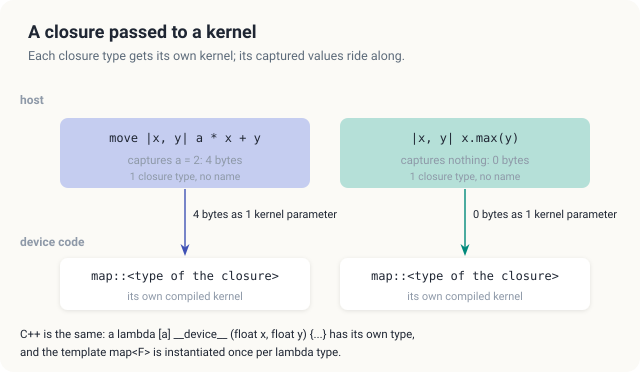 work the same way.">
<figcaption><b>Figure 14.10</b> Each closure type gets its own compiled kernel, and each closure value travels as 1 kernel parameter.</figcaption>
</figure>

The 2 languages check different properties of the function argument. C++ requires the lambda to be
marked `__device__`, and `nvcc` accepts such a lambda in host code only with the option
`--extended-lambda`. It rejects a lambda that captures by reference, `[&]`, with the error
`An extended __device__ lambda cannot capture variables by reference`. A lambda that captures a
host pointer by value, however, compiles. In Rust, the bound `Copy` rejects any closure that owns
memory, such as a closure that captures a `Vec<f32>`. The keyword `move` makes the closure copy `a`
instead of borrowing it. A Rust closure that borrows a host variable still compiles, because a
reference is `Copy`. In both cases, the GPU then reads a host address. We show the result in the
Common mistakes at the end of the chapter.

We also launch the one-thread-per-element form of the generic map, the kernel `map`. We launch it
with the closure `axpy` and with a second closure, `|x, y| x.max(y)`, which captures nothing. We
check both results element by element against the CPU.

<div class="exercises">

Exercises

14.17 Write the closure, in Rust and in C++, that turns the generic map into
\\(y_i \leftarrow x_i - y_i\\). How many bytes does its kernel parameter hold?<br>
14.18 Why must the Rust bound include `Copy`? What would a closure that captured a `Vec<f32>` mean
on the GPU?<br>
14.19 Listing 14.2 computes `grid_size` from `blockDim_x()` in Rust and `blockDim.x` in C++. Why is
this safer than a constant 256?

</div>

## 14.8 Measurements

### 14.8.1 Platform and method

The measurements come from an integrated GPU, a Jetson Orin NX 16 GB, with 8 SMs and a memory
bandwidth of 102 GB/s. We fill \\(x\\) and \\(y\\) with \\(2^{24}\\) values each, which is 64 MiB
per vector. This is much more than the 2 MiB L2 cache of the GPU, so every launch reads and writes
global memory and not the cache. The values are \\(x_i = (i \bmod 1024) \cdot 0.5\\),
\\(y_i = i \bmod 7\\) and \\(a = 2.5\\). With these values, every product \\(2.5\\,x_i\\) is a
multiple of 1.25 below 1,280, and a float represents every such number exactly. For example,
\\(x_{256} = 128\\) gives the product 320. No result is rounded, so we can compare the GPU's
results with the CPU's for exact equality.

We first run each kernel for 500 ms, so that the GPU raises its clock. We then time 50 launches
with CUDA events. The rate is the 201.3 MB of one launch divided by the time of one launch.
Repeated runs differed by up to 5%.

### 14.8.2 Results

The Rust program printed the following lines. The C++ program prints the same lines, with "lambda"
in place of "closure".

```console
$ cargo oxide run
GPU: Orin, 8 SMs, at most 1536 threads per SM
worked example: n = 12, a = 2
  x                     2  7  1  8  2  8  1  8  2  8  4  5
  y                     3  1  4  1  5  9  2  6  5  3  5  8
  2 blocks of 8         7 15  6 17  9 25  4 22  9 19 13 18
  2 blocks of 2, loop   7 15  6 17  9 25  4 22  9 19 13 18
SAXPY on 16777216 floats, a = 2.5: 12 bytes and 2 FLOP per element
  kernel                 threads per thr     time        rate wrong
  saxpy                 16777216     1.0   2.240 ms   89.9 GB/s     0
  map, closure axpy     16777216     1.0   2.215 ms   90.9 GB/s     0
  map, closure max: 0 wrong
  loop, 1 per SM            2048  8192.0   6.122 ms   32.9 GB/s     0
  loop, 2 per SM            4096  4096.0   3.373 ms   59.7 GB/s     0
  loop, 3 per SM            6144  2730.7   2.575 ms   78.2 GB/s     0
  loop, 6 per SM           12288  1365.3   2.279 ms   88.3 GB/s     0
  loop, 12 per SM          24576   682.7   2.186 ms   92.1 GB/s     0
  loop, 48 per SM          98304   170.7   2.191 ms   91.9 GB/s     0
  device-to-device copy, 8 bytes per element    1.579 ms   85.0 GB/s
PASSED
```

The first 6 lines are the worked example. Both kernels produce the row of Figure 14.1, with
\\(y_9 = 19\\). In the table below the example, the column `per thr` is the number of elements per
thread. The column `wrong` counts the elements that differ from the CPU's result, and it is 0 for
every kernel. Table 14.3 collects the times of both languages.

| Kernel | Threads | Rust time | Rust rate | C++ time | C++ rate |
|---|---|---|---|---|---|
| SAXPY, one thread per element | 16,777,216 | 2.240 ms | 89.9 GB/s | 2.208 ms | 91.2 GB/s |
| generic map, closure or lambda | 16,777,216 | 2.215 ms | 90.9 GB/s | 2.219 ms | 90.7 GB/s |
| grid-stride loop, 1 block per SM | 2,048 | 6.122 ms | 32.9 GB/s | 5.949 ms | 33.8 GB/s |
| grid-stride loop, 2 blocks per SM | 4,096 | 3.373 ms | 59.7 GB/s | 3.292 ms | 61.1 GB/s |
| grid-stride loop, 3 blocks per SM | 6,144 | 2.575 ms | 78.2 GB/s | 2.502 ms | 80.5 GB/s |
| grid-stride loop, 6 blocks per SM | 12,288 | 2.279 ms | 88.3 GB/s | 2.163 ms | 93.1 GB/s |
| grid-stride loop, 12 blocks per SM | 24,576 | 2.186 ms | 92.1 GB/s | 2.178 ms | 92.4 GB/s |
| grid-stride loop, 48 blocks per SM | 98,304 | 2.191 ms | 91.9 GB/s | 2.232 ms | 90.2 GB/s |
| device-to-device copy (driver) | | 1.579 ms | 85.0 GB/s | 1.579 ms | 85.0 GB/s |

<p class="listing"><b>Table 14.3</b> SAXPY on \(2^{24}\) elements on the measured GPU. The rate is 201.3 MB divided by the time; the copy moves 134.2 MB.</p>

Figure 14.11 plots the same rates. We draw 3 conclusions from them. First, the 2 languages run at
the same speed, within the variation between runs. Second, the generic map with a closure or a
lambda is as fast as the hand-written SAXPY kernel. Monomorphization produced the same arithmetic on
the same data, and the value of `a` arrives in a kernel parameter in both cases. Third, no kernel
exceeds 93.1 GB/s, which is 91% of the 102 GB/s of the memory.

<figure>
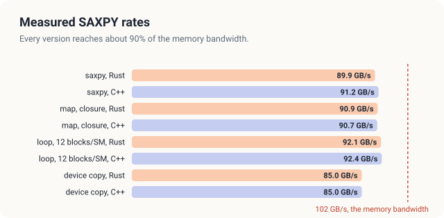
<figcaption><b>Figure 14.11</b> Measured rates of SAXPY on the measured GPU against the memory bandwidth of 102 GB/s.</figcaption>
</figure>

### 14.8.3 Why SAXPY reaches 91 GB/s and not 102 GB/s

In Section 14.6.2, we predicted a time of at least 1.97 ms at 102 GB/s. The kernels took 2.16 ms
to 2.24 ms, which is 10% to 14% longer.

The figure of 102 GB/s is the rate at the pins of the memory chips. The memory bus of the measured
GPU is 128 bits wide, so it moves 16 bytes per transfer, and it performs 6,400 million transfers
per second. This gives \\(16 \text{ B} \cdot 6.4 \cdot 10^9 \text{ /s} = 102.4 \text{ GB/s}\\).
The memory cannot use every one of those transfers for our data, however. It must refresh its
rows at regular intervals. It must open a row before it can read from it. It also loses time each
time the bus turns around from reading to writing. SAXPY writes one value for every 2 values that it
reads, so its stream of requests changes direction often.[^dram]

We have 2 other measurements that tell us what a program can expect from this memory. The driver's
own device-to-device copy, which also reads and writes, reached 85.0 GB/s, which is less than
SAXPY. The dot product of Chapter 15, which only reads, reaches 92 GB/s to 100 GB/s. The 90 GB/s to
93 GB/s of SAXPY lie between these 2 rates, at 88% to 91% of the pin rate. We have nothing left to
remove from the kernel. It reads each input once, writes each output once, and every read and
write is coalesced.

### 14.8.4 How many blocks a grid-stride loop needs

The grid-stride rows of Table 14.3 show a second effect. With one block of 256 threads per SM, the
loop reaches only 32.9 GB/s, which is a third of the bandwidth. The rate almost doubles with 2
blocks per SM and rises again with 3. From 6 blocks onwards, it matches the kernel with one thread
per element. The kernel is the same in every row. Only the number of threads changes.

To explain this effect, we use a law from the theory of queues. The law relates the rate at which a
system completes requests to the number of requests it works on at once.

<div class="definition">

<span class="box-label">Definition 14.12</span> **Little's law.** In a system that serves requests,
the **throughput** \\(X\\) is the number of requests completed per unit of time. The **latency**
\\(L\\) is the time from the start of a request to its completion. The **concurrency** \\(C\\) is
the number of requests in progress at once. In a steady state, the 3 quantities satisfy

\\[ X = \frac{C}{L}. \\]

*Example.* With 16,384 bytes of reads in progress and a latency of 0.50 µs, the memory delivers
\\(16{,}384 \text{ B} / 0.50\ \mu\text{s} = 32.8\\) GB/s.

</div>

| Symbol | Meaning | 1 block per SM |
|---|---|---|
| \\(X\\) | throughput, the bytes delivered by the memory per second | 32.9 GB/s measured |
| \\(C\\) | concurrency, the bytes of reads in progress at once | 16,384 B |
| \\(L\\) | latency, the time from issuing a read to receiving its data | 0.50 µs |

<div class="callout note" markdown="1">

**A pizza kitchen.** Picture a kitchen with a large oven. Every pizza needs 10 minutes
in the oven, however many pizzas are inside. If the cooks put in one pizza at a time, the kitchen
finishes 6 pizzas an hour. If they keep 4 pizzas in the oven at all times, it finishes 24 an hour.
The oven did not get faster. The kitchen only kept more orders in progress. The rate goes on rising
in this way until the oven is full, and after that more waiting orders do not help.

The mapping to the hardware is direct. The oven is the memory system, and the 10 minutes are the
latency \\(L\\) of a read. The pizzas in the oven are the bytes of reads in progress, \\(C\\), and
the pizzas finished per hour are the throughput \\(X\\). A full oven is the memory bandwidth. The
analogy breaks down in one respect. A real oven bakes every pizza in the same time, while the
latency of a memory read grows as the memory gets busier.

</div>

The reasoning behind the law is short. If the memory works on \\(C\\) bytes at a time, and each
byte takes \\(L\\) seconds to arrive, then \\(C\\) bytes are completed every \\(L\\) seconds. The
memory therefore delivers \\(C / L\\) bytes per second. To raise the throughput without changing
the latency, a program must keep more bytes in progress at once.

We now apply the law to the grid-stride loop. In each pass, a thread issues its 2 reads of 4 bytes,
8 bytes in all. It cannot issue the reads of the next pass before it has stored the current
result. Each thread therefore keeps about 8 bytes in flight. With one block per SM, the GPU runs
\\(8 \cdot 256 = 2{,}048\\) threads, which keep \\(2{,}048 \cdot 8 = 16{,}384\\) bytes in flight.
The measured 32.9 GB/s then gives a latency of
\\(L = C / X = 16{,}384 \text{ B} / 32.9 \text{ GB/s} = 0.50\\) µs. That is about 500 cycles of
the GPU's clock, which matches the latency of global memory in Definition 14.5.

If the latency stays fixed, the law predicts twice the rate for twice the concurrency. For 2 blocks
per SM, it predicts 65.8 GB/s, and we measured 59.7 GB/s and 61.1 GB/s. For 3 blocks, it predicts
98.7 GB/s, and we measured 78.2 GB/s and 80.5 GB/s. Beyond 3 blocks, the bandwidth caps the rate,
as shown in Figure 14.12. The measurements fall below the prediction at 2 and 3 blocks for 2
reasons. The latency grows as the memory gets busier, and a thread does not have 8 bytes in flight
at every moment, because it also computes, stores and tests the loop condition.

We can also read the law the other way, to find how many bytes must be in flight to reach the
bandwidth. The answer is \\(C = X L = 102 \text{ GB/s} \cdot 0.50\ \mu\text{s} = 51\\) KB. At 8
bytes per thread, this is 6,375 threads, or about 3.1 blocks of 256 threads on each of the 8 SMs.

<figure>
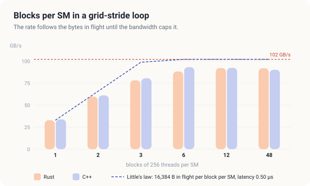
<figcaption><b>Figure 14.12</b> The rate of the grid-stride loop follows the bytes in flight, as Little's law predicts, until the bandwidth caps it.</figcaption>
</figure>

The measured GPU can hold up to 1,536 threads per SM, which is 6 blocks of 256 threads. A grid of 6
blocks per SM therefore fills the GPU in one round, and the measurements show no gain beyond it. In
general, we should launch a grid-stride loop with at least as many blocks as the GPU can hold at
once. The host program computes this number from 2 values that it reads from the device, the number
of SMs and the number of threads per SM.

<div class="exercises">

Exercises

14.20 From Table 14.3, compute the fraction of the 102 GB/s that each language reaches with one
thread per element.<br>
14.21 A GPU with 132 SMs, 2,048 threads per SM and 3,350 GB/s has a memory latency of about 0.6 µs.
How many bytes must be in flight to reach its bandwidth, and how many blocks of 256 threads per SM
provide them at 8 bytes per thread?

</div>

## 14.9 Limits of what we built

Our kernels reach about 90% of the memory's pin rate, and no change to the kernel can do much
better, because the kernel already reads and writes each byte only once. The only way to make SAXPY
faster is to move fewer bytes. In a real program, we do this by fusing SAXPY with the computation
that comes before it or after it. If the next step of the program reads \\(y\\) again, a single
kernel that computes both steps saves one write and one read of the whole array. In Chapter 15,
we fuse a map with a sum in exactly this way.

In practice, most programs do not write SAXPY by hand. They call `cublasSaxpy` from NVIDIA's cuBLAS
library, or they write `thrust::transform` with a lambda in C++. These library calls are memory-bound
in the same way as our kernels. We build the kernel by hand because
every map, and every library call that implements one, faces the same questions of grid size,
guard, stride and bytes per element.

## 14.10 The complete programs

Listing 14.4 gives the complete programs, from which every piece of code in this chapter was taken.

<p class="listing"><b>Listing 14.4</b> The complete programs. <a href="https://github.com/arpanpathak/gpu-parallel-book/blob/main/code/oxide/ch14_map_saxpy/src/main.rs">code/oxide/ch14_map_saxpy/src/main.rs</a> <a href="https://github.com/arpanpathak/gpu-parallel-book/blob/main/code/cuda/ch14_map_saxpy/saxpy.cu">code/cuda/ch14_map_saxpy/saxpy.cu</a></p>

<div class="code-tabs">
<div class="code-tab" data-lang="Rust">

```rust,ignore
{{#include ../../../../code/oxide/ch14_map_saxpy/src/main.rs}}
```

</div>
<div class="code-tab" data-lang="C++">

```cpp
{{#include ../../../../code/cuda/ch14_map_saxpy/saxpy.cu}}
```

</div>
</div>

## Common mistakes

A missing guard lets threads write past the end of an array. Without `if (i < n)`, the threads of
the last block whose index lies at or beyond \\(n\\) write past the end of the array, and the GPU
usually reports nothing (Section 14.5.1). In Rust, `DisjointSlice::get_mut` makes the guard part of
the type.

A stride computed from the block instead of the grid makes several blocks update the same
elements. With `blockDim.x` in place of `gridDim.x * blockDim.x`, the result of an in-place map is
wrong, by a different amount on each run (Section 14.5.3).

Calling `get_mut` with a computed index does not compile. In a grid-stride loop, the index `index` is a
`usize`, and `get_mut` accepts only the `ThreadIndex` of the calling thread. If we replace
`get_unchecked_mut(index)` in Listing 14.2 by `y.get_mut(index)`, the build stops with the following error.

```console
$ cargo oxide build
error[E0308]: mismatched types
   --> src/main.rs:73:48
    |
 73 |             if let Some(y_element) = y.get_mut(index) {
    |                                        ------- ^^^^^ expected `ThreadIndex<'_>`, found `usize`
    |                                        |
    |                                        arguments to this method are incorrect
```

A closure that refers to a host variable makes the GPU read a host address. The Rust closure
`move |x: f32, y: f32| x + y + host[0]`, with `let host = &x0;`, compiles, because a reference is
`Copy`. On the measured GPU, the next synchronization then reports
`Error: DriverError(700, "an illegal memory access was encountered")`. A C++ lambda that captures a
host pointer by value, `[hp]`, compiles and fails with the same error. `nvcc` rejects a capture by
reference outright.

A grid-stride loop with too few blocks leaves the memory idle. With one block of 256 threads per
SM, the loop reached a third of the bandwidth (Section 14.8.4). We should size the grid from the
number of SMs, so that it contains at least one full round of resident blocks.

Arrays that fit in the cache give misleading rates. A GPU with a large L2 cache keeps small arrays
between launches, and the measured rate then describes the cache and not the memory. The arrays of
this chapter, 128 MiB together, are larger than the L2 cache of every GPU in Table 14.2.

## Summary

- A map computes each output element from the input elements at the same position. SAXPY,
  \\(y \leftarrow a x + y\\), is a map. On the example, it turns \\(y_9 = 3\\) into
  \\(2 \cdot 8 + 3 = 19\\).
- The sequential loop performs \\(n\\) passes of 2 FLOP and 12 bytes each. No pass uses a value that
  another pass produces, so we can give each pass its own thread.
- With blocks of \\(B\\) threads, \\(\lceil n / B \rceil\\) blocks cover \\(n\\) elements, and the
  guard \\(i < n\\) stops the extra threads. For the example, this means 2 blocks of 8 threads and
  4 idle threads.
- A grid-stride loop lets \\(P < n\\) threads cover the array. Thread \\(t\\) takes
  \\(t, t + P, t + 2P, \ldots\\), which keeps every read of every warp coalesced. Theorem 14.1
  proves that each element is updated exactly once. With a wrong stride, 2,366 elements of the
  measured arrays were updated twice.
- SAXPY performs 0.17 FLOP per byte, far below the ridge point of every GPU, so its time is at
  least \\(12 n / W\\). For \\(2^{24}\\) elements at 102 GB/s, this is 1.97 ms.
- A generic map takes a Rust closure or a C++ lambda. The compiler builds one kernel per closure
  type, and the captured values travel in one kernel parameter.
- On the measured GPU, SAXPY ran at 90 GB/s to 93 GB/s in both languages, about 90% of the 102 GB/s
  of the memory. A grid-stride loop needs about 3 blocks of 256 threads per SM to keep enough bytes
  in flight, and 6 to fill the GPU.

In Chapter 15, we combine many values into one, which is the second basic pattern of parallel
programming.

## Exercises

1. Run the program on your GPU. From its first line, compute how many blocks of 256 threads fit on
   one SM, and check whether the grid-stride rate stops rising at about that number of blocks per
   SM.
2. Write a generic map that computes \\(y_i \leftarrow \max(0, x_i) + y_i\\) and measure it. Does
   the extra comparison change the rate? Explain your answer with the arithmetic intensity.
3. Change the Rust closure `axpy` so that it captures 2 values, `a` and `b`, and computes
   \\(a x + b y\\). How large is the kernel parameter that carries it?
4. Using the latency of 0.50 µs from Section 14.8.4, predict the rate of the grid-stride kernel
   with one block of 256 threads per SM on a GPU with 20 SMs and 273 GB/s. How many blocks per SM
   would reach the bandwidth?
5. Suppose each thread of the grid-stride loop handled 2 elements per pass and issued 16 bytes of
   reads before computing. By Little's law, how many blocks per SM would keep the memory of the
   measured GPU busy?
6. Prove that <span class="sc">Saxpy-Kernel</span> updates every element exactly once when we launch
   it with \\(\lceil n / B \rceil\\) blocks of \\(B\\) threads.
7. Write SAXPY on `f64` in both languages and measure it. Is its time twice that of the `f32`
   version, as the byte count predicts?

## Sources and further reading

- A. Pathak, *An Introduction to Tiled Parallel Programming, Simplified*, 2026. The style of worked
  example, pseudocode and proof used in this part of the book.
- T. H. Cormen, C. E. Leiserson, R. L. Rivest and C. Stein, *Introduction to Algorithms*, 4th ed.,
  MIT Press, 2022. The pseudocode conventions and loop-invariant proofs.
- C. L. Lawson, R. J. Hanson, D. R. Kincaid and F. T. Krogh, "Basic Linear Algebra Subprograms for
  Fortran Usage", *ACM Transactions on Mathematical Software* 5(3), 1979. The original definition
  of SAXPY.
- M. Harris, "CUDA Pro Tip: Write Flexible Kernels with Grid-Stride Loops", NVIDIA Technical Blog,
  2013.
- J. D. C. Little, "A Proof for the Queuing Formula: L = λW", *Operations Research* 9(3), 1961.
- NVIDIA, *CUDA C++ Programming Guide*, sections "Extended Lambdas" and "Compute Capabilities".
- *The Rust Reference*, chapters "Closure expressions" and "Closure types". The cuda-oxide
  repository, <https://github.com/NVlabs/cuda-oxide>.

[^blas]: Lawson, Hanson, Kincaid and Krogh published the first set of these routines in 1979. Later
    sets, called Level 2 and Level 3 BLAS, added matrix-vector and matrix-matrix routines.

[^harris]: M. Harris, "CUDA Pro Tip: Write Flexible Kernels with Grid-Stride Loops", NVIDIA
    Technical Blog, 2013.

[^dram]: The memory chips are LPDDR5 on this GPU. A refresh, a row opening and a change of
    direction each take a fixed number of cycles during which the bus carries no data.
