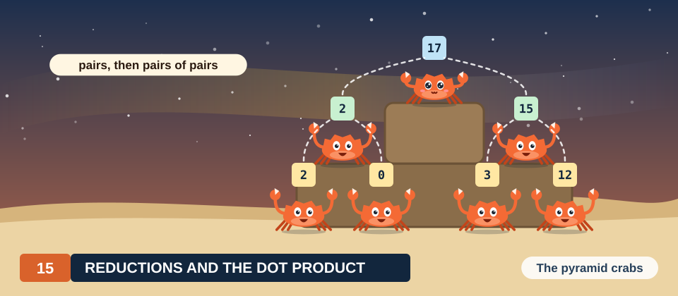

# Chapter 15: Reduction and the Dot Product

The dot product of 2 vectors multiplies the vectors element by element and adds up the products.
It is the inner loop of a matrix-vector product, it gives the length of a vector and the angle
between 2 vectors, and every iterative solver computes several dot products in each step to decide
how far it is from convergence. The multiplications form a map, the pattern of Chapter 14, and they
can run in parallel in the same way. The additions cannot be treated in this way. All products must
flow into a single number, and the obvious loop adds them one after another, each addition waiting
for the one before it. A computation that combines many values into 1 value in this way is called a
reduction, and it is the second basic pattern of parallel programming.

In this chapter, we develop the parallel reduction on the dot product of 2 vectors of 16 small
integers. We first write the sequential loop and examine its chain of dependent additions. We then
use the associativity of addition to regroup the additions into a tree, in which many additions can
be performed at the same time. The tree becomes a kernel in which the threads of a block add their
values in shared memory, step by step, with a barrier between consecutive steps. We remove a
barrier to see the wrong sum that results, and we prove with a loop invariant that the tree is
correct when all barriers are present. After that, we replace most of the barriers by warp
shuffles, and we compare two ways of combining the sums of different blocks, a second launch and
atomic additions. Finally, we implement all designs in Rust with cuda-oxide and in CUDA C++. From
the measurements, we explain why the fused kernel runs more than twice as fast as a map followed by
a separate reduction, and why atomic additions change the last bits of the result from run to
run.

<div class="covers" markdown="1">

This chapter covers

- the dot product as a map followed by a reduction, worked by hand on 16 elements
- the sequential sum and its chain of dependent additions
- associativity, commutativity and the reduction tree
- the tree in shared memory: strides, active threads and barriers, step by step
- a missing barrier and the wrong sum it produces
- a loop-invariant proof that the tree computes the sum
- warp shuffles and a block sum with 1 barrier
- combining the block sums with a second launch or with atomic additions
- why the order of float additions changes the result
- measured rates in Rust and C++ against the memory bandwidth

</div>

The code of the chapter is in
[`code/oxide/ch15_dot_product/`](https://github.com/arpanpathak/gpu-parallel-book/tree/main/code/oxide/ch15_dot_product)
(Rust) and
[`code/cuda/ch15_dot_product/`](https://github.com/arpanpathak/gpu-parallel-book/tree/main/code/cuda/ch15_dot_product)
(C++). The Rust crate uses the same `Cargo.toml` and `rust-toolchain.toml` as Chapter 13.

## 15.1 The problem

### 15.1.1 A worked example

We use the same pair of vectors throughout the chapter, so that every number can be checked by
hand. Each vector holds 16 small integers.

\\[
\begin{aligned}
a &= (1, 2, 3, 1, 5, 1, 2, 3,\ 3, 1, 2, 3, 1, 3, 2, 1),\\\\
b &= (2, 3, 1, 4, 1, 1, 4, 1,\ 1, 2, 2, 2, 1, 3, 1, 4).
\end{aligned}
\\]

As in Chapter 14, we number the positions from 0 and write \\(a_i\\) for the element of \\(a\\)
at position \\(i\\), so that \\(a_0 = 1\\) and \\(b_0 = 2\\). We multiply the 2 vectors position by
position. The first 8 products are \\(a_0 b_0 = 1 \cdot 2 = 2\\), \\(a_1 b_1 = 2 \cdot 3 = 6\\),
3, 4, 5, 1, 8 and 3, and they add up to 32. The last 8 products are 3, 2, 4, 6, 1, 9, 2 and 4, and
they add up to 31. The dot product is therefore \\(32 + 31 = 63\\), as shown in Figure 15.1.

<figure>
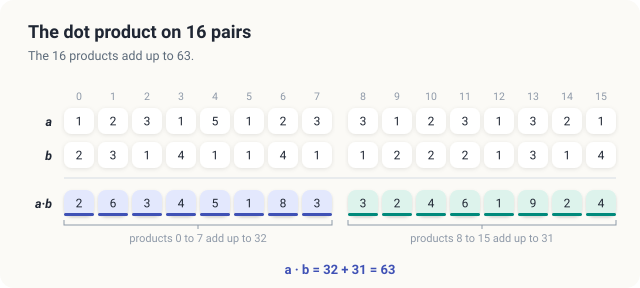
<figcaption><b>Figure 15.1</b> The worked example. The 16 products add up to \(32 + 31 = 63\).</figcaption>
</figure>

The example contains 3 numbers that appear again and again in the chapter. The first 8 products add up
to 32, the last 8 products add up to 31, and all 16 products add up to 63. Later in the chapter,
the GPU splits the work exactly along this line, with one block for each half of the vectors. The
faulty kernels of Sections 15.4 and 15.6 then produce 24 instead of 32, and 31 instead of 63.

### 15.1.2 Definitions

<div class="definition">

<span class="box-label">Definition 15.1</span> **Dot product.** The dot product of 2 vectors
\\(a\\) and \\(b\\) of \\(n\\) elements is

\\[ a \cdot b = \sum_{i \in [0, n)} a_i\, b_i . \\]

*Example.* For the vectors above, \\(a \cdot b = 2 + 6 + 3 + \cdots + 4 = 63\\).

</div>

| Symbol | Meaning | In the example |
|---|---|---|
| \\(n\\) | number of elements in each vector | 16 |
| \\(i\\) | position, from 0 to \\(n - 1\\) | 0 to 15 |
| \\(a_i, b_i\\) | elements of \\(a\\) and \\(b\\) at position \\(i\\) | \\(a_1 = 2\\), \\(b_1 = 3\\) |
| \\(a_i\, b_i\\) | product at position \\(i\\) | \\(a_1 b_1 = 6\\) |
| \\(\sum_{i \in [0, n)}\\) | sum over all positions \\(i\\) from 0 to \\(n - 1\\) | \\(2 + 6 + \cdots + 4\\) |
| \\(a \cdot b\\) | the dot product | 63 |

The dot product consists of two parts. The first part computes the products, which we call
\\(p_i = a_i b_i\\), so that \\(p_0 = 2\\) and \\(p_1 = 6\\) in our example. The products form a map
in the sense of Definition 14.2, since each of them depends only on the elements at position
\\(i\\). The second part, the sum, then combines all \\(n\\) products into 1 number. A computation
of this second kind has a name of its own.

<div class="definition">

<span class="box-label">Definition 15.2</span> **Reduction.** A reduction combines the \\(n\\)
elements of an array into 1 value with a binary operator \\(\oplus\\), as
\\(p_0 \oplus p_1 \oplus \cdots \oplus p_{n-1}\\). The **identity** of the operator is the value
\\(e\\) with \\(e \oplus v = v\\) for every \\(v\\).

*Example.* The sum is a reduction with \\(\oplus = +\\) and identity 0. The maximum is a reduction
with \\(\oplus = \max\\) and identity \\(-\infty\\).

</div>

The symbol \\(\oplus\\) stands for any operator that takes 2 values and returns 1 value. For the dot
product, \\(\oplus\\) is ordinary addition, so the reduction is \\(p_0 + p_1 + \cdots + p_{15} = 2 + 6 +
\cdots + 4 = 63\\). The identity is the value that changes nothing when it is combined with
another value. For addition, the identity is 0, since \\(0 + 6 = 6\\). We need the identity later,
when a thread that has no value of its own must still contribute something to a reduction.

<div class="exercises">

Exercises

15.1 Compute the dot product of \\((1, 0, 2, 3)\\) and \\((4, 5, 1, 2)\\).<br>
15.2 What are the operator and the identity of a reduction that counts the elements of an array
that are larger than 10?<br>
15.3 In the worked example, which position contributes the largest product, and how much does it
contribute?

</div>

## 15.2 The sequential algorithm

### 15.2.1 The loop and its chain

On a CPU, Definition 15.1 becomes a single loop that keeps a running sum \\(\mathit{sum}\\) and adds 1 product
to it in each iteration.

<div class="algo">
<p class="algo-name">Dot<span style="font-variant: normal">(\(a, b, n\))</span></p>
<ol>
<li>\(\mathit{sum} = 0\)</li>
<li>for \(i \in [0, n)\) {</li>
<li style="--d:1">\(\mathit{sum} = \mathit{sum} + a_i \cdot b_i\) <span class="c">// 2 reads, 2 FLOP</span></li>
<li>}</li>
<li class="gap">return \(\mathit{sum}\)</li>
</ol>
</div>

Line 3 executes \\(n\\) times. Each time, it reads 2 floats, which is 8 bytes, and performs 2 FLOP,
1 multiplication and 1 addition. Our example therefore performs 32 FLOP on 128 bytes. The vectors
that we measure at the end of the chapter have \\(n = 2^{24}\\) elements, and for them the loop
performs 33.6 million FLOP on 134.2 MB.

Recall that in the loop of SAXPY in Chapter 14, the iterations shared nothing. This loop is
different. Iteration \\(i\\) reads \\(\mathit{sum}\\), which iteration \\(i - 1\\) wrote, so it cannot start
before iteration \\(i - 1\\) has finished. In our example, the running sum takes the values 2, 8,
11, 15, 20, 21, 29, 32, 35, 37, 41, 47, 48, 57, 59 and 63, and each of these values is obtained
from the one before it, as shown in Figure 15.2. For example, the value 11 after iteration 2 is
\\(8 + 3\\), and it could not be computed before the 8 was known. The 16 multiplications are
independent of each other, but the 16 additions form a chain of 16 steps. As long as the additions
are performed in this order, no number of threads can shorten the chain.

<figure>
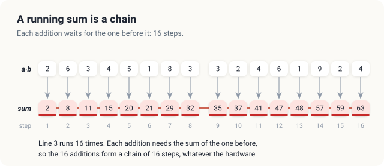
<figcaption><b>Figure 15.2</b> The running sum of <span class="sc">Dot</span>: each addition needs the result of the one before, a chain of 16 steps.</figcaption>
</figure>

### 15.2.2 Regrouping the additions

Note, however, that the order of the chain is a choice that the loop makes, not a property of the
sum. The sum \\(2 + 6 + 3 + 4\\) can also be computed as \\((2 + 6) + (3 + 4) = 8 + 7 = 15\\), and in
this form the 2 additions inside the parentheses do not depend on each other. Addition has 2
properties that allow this and any other order.

<div class="definition">

<span class="box-label">Definition 15.3</span> **Associative and commutative operators.** An
operator \\(\oplus\\) is **associative** if \\((u \oplus v) \oplus w = u \oplus (v \oplus w)\\)
for all values, so that the parentheses of a long expression may be placed anywhere. It is
**commutative** if \\(u \oplus v = v \oplus u\\), so that the operands may be reordered.

*Example.* Integer addition is both: \\((2 + 6) + 3 = 2 + (6 + 3) = 11\\) and \\(2 + 6 = 6 + 2\\).
Subtraction is neither: \\((2 - 6) - 3 = -7\\), but \\(2 - (6 - 3) = -1\\).

</div>

Associativity lets us add the 16 products in pairs, then add the sums of the pairs in pairs, and
continue in this way until 1 value remains, as shown in Figure 15.3. The first step adds 8
independent pairs, from \\(2 + 6 = 8\\) and \\(3 + 4 = 7\\) to \\(2 + 4 = 6\\). The second step adds 4
pairs of these sums, the third step adds 2 pairs, and the fourth step adds \\(32 + 31 = 63\\). The
tree performs \\(8 + 4 + 2 + 1 = 15\\) additions, which is as many as the chain needs after its
first addition to 0. It performs them, however, in 4 steps instead of 16, because the additions
within each step are independent of each other.

<figure>
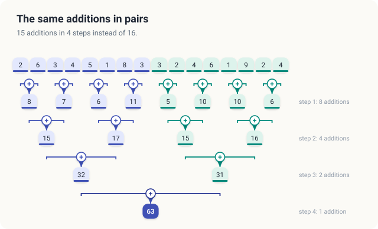
<figcaption><b>Figure 15.3</b> The 16 products added in pairs: 15 additions in 4 steps.</figcaption>
</figure>

In general, a tree reduces \\(n\\) values with \\(n - 1\\) operations. Every step halves the number of
values, so the number of steps is the number of times that \\(n\\) can be halved before 1 value
remains. This number is \\(\log_2 n\\), rounded up when \\(n\\) is not a power of 2, which we write
\\(\lceil \log_2 n \rceil\\). For our 16 products, \\(\log_2 16 = 4\\), since 16 halves to 8, 4, 2 and 1
in 4 steps. For \\(n = 2^{24}\\), the chain is 16,777,216 steps long, while the tree is only 24 steps
deep.

<div class="key-observation">

<span class="box-label">Key observation</span> Because addition is associative and commutative,
the 16 products may be added in any grouping. Added in pairs, then in pairs of pairs, they need 4
steps instead of 16, and the additions within each step are independent, so a different thread can
perform each of them.

</div>

Floating-point addition is associative only approximately, because every addition rounds its
result. In Section 15.6.3, we show what this changes. Until then, we work with the exact integers
of the example.

<div class="exercises">

Exercises

15.4 Draw the tree for the 8 values \\(4, 1, 3, 5, 2, 2, 6, 1\\). How many additions and how many
steps does it take?<br>
15.5 How many steps does a tree need for \\(n = 1{,}000\\) values? Explain the rounding up.<br>
15.6 The maximum is associative and commutative. Run the tree of Figure 15.3 with \\(\max\\) in
place of \\(+\\).

</div>

## 15.3 A tree in shared memory

### 15.3.1 What the threads of a block need

Suppose that we give each addition of the tree to its own thread. In the second step, for example,
some thread must add the sums 8 and 7, which were computed in the first step by 2 other threads.
Each addition therefore combines 2 values that 2 different threads produced in the step before.
The threads must exchange values, and a thread must know when the value that it needs is ready.
Recall from Definition 14.4 that a block provides both: a memory that all of its threads can read
and write, and a way for its threads to wait for one another.

<div class="definition">

<span class="box-label">Definition 15.4</span> **Shared memory.** Shared memory is a small memory
on each SM, typically 48 KB to 228 KB, that the threads of 1 block can all read and write and no
other thread can access. It responds within a few cycles. Each block receives its own copy of
every shared array, which exists from the start of the block to its end and starts with undefined
contents.

*Example.* Block 0 of our example holds its 8 products in a shared array `cells` of 8 floats;
block 1 has its own `cells`.

</div>

<div class="definition">

<span class="box-label">Definition 15.5</span> **Barrier.** A barrier is a point in a kernel that
no thread of a block may pass until every thread of the block has reached it. All writes to shared
memory made before the barrier are visible to every thread of the block after it. In CUDA C++, the
barrier is `__syncthreads()`, and in cuda-oxide, it is `thread::sync_threads()`.

*Example.* After a barrier, thread 0 of block 0 can read the product that thread 4 stored before
the barrier.

</div>

### 15.3.2 Which cells a thread adds

We now place the values of a block in a shared array, 1 value per thread, and call the elements of
this array *cells*. In block 0 of our example, cell \\(k\\) holds the product \\(p_k\\), so the 8 cells
hold 2, 6, 3, 4, 5, 1, 8 and 3. The tree of Figure 15.3 adds neighboring cells: cells 0 and 1,
cells 2 and 3, cells 4 and 5, and cells 6 and 7. On a GPU, we prefer a different pairing, in which
the 2 cells of a pair lie a fixed distance apart. We call this distance the **stride**. Recall that
\\(\textit{threadIdx.x}\\) is the position of a thread in its block. In a step with a given
\\(\mathit{stride}\\), we let every thread whose \\(\textit{threadIdx.x}\\) is smaller than \\(\mathit{stride}\\)
add cell \\(\textit{threadIdx.x} + \mathit{stride}\\) into its own cell, \\(\textit{threadIdx.x}\\). With 8 cells,
the strides are 4, 2 and 1. In the first step, with \\(\mathit{stride} = 4\\), threads 0 to 3 add cells 4 to 7 into cells 0 to 3. For
example, thread 2 adds cell \\(2 + 4 = 6\\) into cell 2. In the second step, with \\(\mathit{stride} = 2\\),
threads 0 and 1 add cells 2 and 3 into cells 0 and 1. In the third step, with \\(\mathit{stride} = 1\\), thread 0
adds cell 1 into cell 0.

| Symbol | Meaning | Thread 2, first step of block 0 |
|---|---|---|
| \\(\mathit{stride}\\) | stride: distance between the 2 cells of a pair, and number of working threads | 4 |
| \\(\textit{threadIdx.x}\\) | index of the thread in its block, which works only if \\(\textit{threadIdx.x} < \mathit{stride}\\) | 2 |
| \\(\textit{threadIdx.x} + \mathit{stride}\\) | cell that the thread reads and adds into its own cell | 6 |

The stride pairing adds \\(p_0 + p_4\\) where Figure 15.3 added \\(p_0 + p_1\\), so it relies on
commutativity as well as on associativity. In return, the threads that work in each step are always
the lowest \\(\mathit{stride}\\) threads, 0 to \\(\mathit{stride} - 1\\), and they read the neighboring cells \\(\mathit{stride}\\) to
\\(2\,\mathit{stride} - 1\\). This has 2 advantages in a block of 256 threads. In the first steps, whole warps are
busy and whole warps are idle, instead of half the threads of every warp being idle, and the cells
that a warp reads at once are neighbors in memory.

In Figure 15.4, we run this pairing in block 0 of the example. The 8 cells start with the products
2, 6, 3, 4, 5, 1, 8 and 3. With \\(\mathit{stride} = 4\\), threads 0 to 3 compute \\(2 + 5 = 7\\), \\(6 + 1 = 7\\),
\\(3 + 8 = 11\\) and \\(4 + 3 = 7\\). With \\(\mathit{stride} = 2\\), threads 0 and 1 compute \\(7 + 11 = 18\\) and
\\(7 + 7 = 14\\). With \\(\mathit{stride} = 1\\), thread 0 computes \\(18 + 14 = 32\\). In the same way, block 1
computes 4, 11, 6 and 10 in the first step, 10 and 21 in the second, and 31 in the third.

<figure>
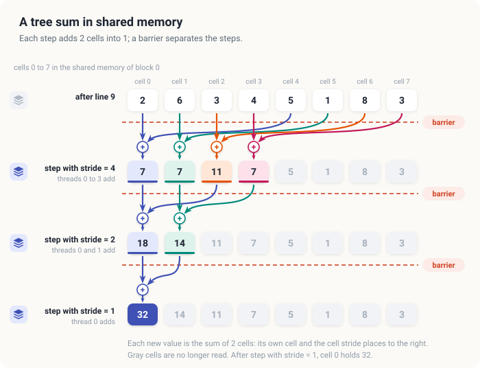
<figcaption><b>Figure 15.4</b> The tree in the shared memory of block 0. Each color is 1 thread; a barrier separates the steps.</figcaption>
</figure>

### 15.3.3 The algorithm

In our example, each block has 8 threads, and each thread holds exactly 1 product. A real block,
however, has \\(\textit{blockDim.x} = 256\\) threads, and a real vector has millions of elements, many more than the
threads of the grid. Each thread therefore begins with the grid-stride loop of Chapter 14. It
multiplies the elements \\(\mathit{index}, \mathit{index} + \mathit{gridSize}, \mathit{index} + 2\,\mathit{gridSize}, \ldots\\) of the 2 vectors and adds the products in a
register, where \\(\mathit{index}\\) starts at the thread's global index and \\(\mathit{gridSize}\\) is the number of threads in the grid. The
products are never stored in memory. The tree then combines the \\(\textit{blockDim.x}\\) register sums of the block,
and thread 0 writes the block's sum to a **partial sum** array, which holds one element per block.
Every thread executes the following procedure, in which `cells` is a shared array of \\(\textit{blockDim.x}\\)
floats and \\(\mathit{mySum}\\) is the thread's register sum.

<div class="algo">
<p class="algo-name">Dot-Block<span style="font-variant: normal">(\(a, b, \mathit{partial}, n\))</span></p>
<ol>
<li>\(\mathit{index} = \textit{blockIdx.x} \times \textit{blockDim.x} + \textit{threadIdx.x}\) <span class="c">// first element</span></li>
<li>\(\mathit{gridSize} = \textit{gridDim.x} \times \textit{blockDim.x}\) <span class="c">// threads in the grid</span></li>
<li class="gap">\(\mathit{mySum} = 0\)</li>
<li>while \(\mathit{index} \lt n\) { <span class="c">// the grid-stride loop of Chapter 14</span></li>
<li style="--d:1">\(\mathit{mySum} = \mathit{mySum} + a_{\mathit{index}} \times b_{\mathit{index}}\)</li>
<li style="--d:1">\(\mathit{index} = \mathit{index} + \mathit{gridSize}\)</li>
<li>}</li>
<li class="gap">\(\mathit{cells}[\textit{threadIdx.x}] = \mathit{mySum}\)</li>
<li><span class="sc">Barrier</span>() <span class="c">// every cell holds its value</span></li>
<li class="gap">for \(\mathit{stride} = \textit{blockDim.x}/2, \textit{blockDim.x}/4, \ldots, 1\) {</li>
<li style="--d:1">if \(\textit{threadIdx.x} \lt \mathit{stride}\) {</li>
<li style="--d:2">\(\mathit{cells}[\textit{threadIdx.x}] = \mathit{cells}[\textit{threadIdx.x}] + \mathit{cells}[\textit{threadIdx.x} + \mathit{stride}]\)</li>
<li style="--d:1">}</li>
<li style="--d:1"><span class="sc">Barrier</span>() <span class="c">// this step is complete</span></li>
<li>}</li>
<li class="gap">if \(\textit{threadIdx.x} = 0\) {</li>
<li style="--d:1">\(\mathit{partial}[\textit{blockIdx.x}] = \mathit{cells}[0]\)</li>
<li>}</li>
</ol>
</div>

| Symbol | Meaning | Thread 2 of block 0, example |
|---|---|---|
| \\(\textit{blockDim.x}\\) | number of threads in a block | 8 (256 in the measured program) |
| \\(\textit{threadIdx.x}\\) | index of the thread in its block (`threadIdx.x`) | 2 |
| \\(\mathit{index}\\) | element the thread processes next; starts at its global index | 2 |
| \\(\mathit{gridSize}\\) | number of threads in the grid, and the distance from one of the thread's elements to the next | \\(2 \cdot 8 = 16\\) |
| \\(\mathit{mySum}\\) | the thread's register sum | \\(a_2 b_2 = 3\\) |
| \\(\mathit{stride}\\) | stride of the current step of the tree | 4, 2, 1 |

Lines 1 to 7 compute the thread's register sum. On the example, launched with 2 blocks of 8
threads, \\(\mathit{gridSize} = 16 = n\\), so the loop runs once, and \\(\mathit{mySum}\\) is the thread's single product. For
instance, thread 2 of block 0 sets \\(\mathit{mySum} = a_2 b_2 = 3 \cdot 1 = 3\\) and then leaves the loop, since
\\(2 + 16 = 18 \ge 16\\). Line 8 stores the sum in the thread's own cell, and the barrier of line 9
waits until all \\(\textit{blockDim.x}\\) cells are filled. Lines 10 to 15 are the tree of Figure 15.4, with a barrier
after every step, and lines 16 to 18 write the block's sum. On the example, block 0 writes 32 into
`partial[0]`, and block 1 writes 31 into `partial[1]`. In Section 15.6, we add the partial sums.

Note that lines 9 and 14 lie outside every `if`. The barrier of line 14 is therefore executed by
all \\(\textit{blockDim.x}\\) threads in every step, including the threads with \\(\textit{threadIdx.x} \ge \mathit{stride}\\), which have nothing to
add.

### 15.3.4 Counting

Let us count the work of the tree. A block of \\(\textit{blockDim.x}\\) threads performs \\(\textit{blockDim.x} - 1\\) additions in its
tree, in \\(\log_2 \textit{blockDim.x}\\) steps, with \\(\log_2 \textit{blockDim.x} + 1\\) barriers: 1 barrier in line 9 and 1 barrier
after each step. For our block of 8 threads, this is 7 additions in 3 steps, with 4 barriers. For
\\(\textit{blockDim.x} = 256\\), it is 255 additions in 8 steps, with 9 barriers. The number of working threads halves
in every step, from 128 through 64, 32, 16, 8, 4 and 2 to 1. In the last 5 steps, at most 16
threads work, all of them in warp 0, and the other 7 warps wait at the barrier.

The cost of the tree is paid once per block, not once per element. With a grid of 1,024 blocks of
256 threads, \\(\mathit{gridSize} = 262{,}144\\), and each thread adds \\(2^{24} / 262{,}144 = 64\\) products in
lines 4 to 7 before the tree begins. The kernel reads every element of \\(a\\) and \\(b\\) exactly
once, which is 8 bytes per element, and it performs 2 FLOP per element. Its arithmetic intensity is
therefore \\(2 / 8 = 0.25\\) FLOP/B, far below the ridge point of any GPU (Section 14.6). Like
SAXPY, the dot product is memory-bound.

<div class="exercises">

Exercises

15.7 Run Figure 15.4 for block 1, whose cells start with 3, 2, 4, 6, 1, 9, 2, 4. Which threads
work in each step, and what does each compute?<br>
15.8 For \\(\textit{blockDim.x} = 512\\), how many steps, additions and barriers does the tree take?<br>
15.9 With 1,024 blocks of 256 threads and \\(n = 10^6\\), how many products does thread 0 add in
lines 4 to 7, and how many does thread 262,143 add?

</div>

## 15.4 Correctness

The threads of a block run at different speeds, and they read cells that other threads write. As a
result, 2 things can go wrong. A thread can read a cell before the thread responsible for it has
written the value of the current step, and a thread can overwrite a cell that another thread has
not yet read. The 2 barriers prevent both errors. In this section, we remove the barrier of line 14
and follow the effect on the example, and we then prove that the kernel with both barriers is
correct.

### 15.4.1 Without the barrier between the steps

Suppose that line 14 is deleted, and that in block 0, thread 2 runs late. Thread 0 finishes its
addition for \\(\mathit{stride} = 4\\), which is \\(2 + 5 = 7\\), and moves on to \\(\mathit{stride} = 2\\), where it needs cell 2.
Thread 2 should have stored \\(3 + 8 = 11\\) there, but it has not yet done so, and cell 2 still
holds the product 3, as shown in Figure 15.5. Thread 0 therefore computes \\(7 + 3 = 10\\) instead
of 18, and in the last step, it computes \\(10 + 14 = 24\\) instead of 32.

<figure>
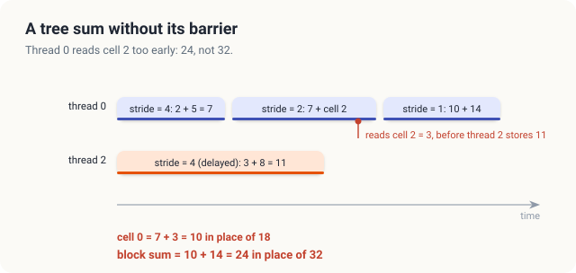
<figcaption><b>Figure 15.5</b> Without the barrier of line 14, thread 0 reads cell 2 before thread 2 has updated it. Block 0 sums to 24 in place of 32.</figcaption>
</figure>

We deleted the barrier from both programs and ran them. The C++ build also contained the faulty
plain addition of Section 15.6.2, which affects only the last column of the output. The C++
program printed the following lines.

```console
exact tests                   map+red      tree   shuffle    atomic
  worked example, 16 pairs          63        26        63        63   expected 63
  0s and 1s, 16777216 pairs    2796203    760424   2796203    338598   expected 2796203
```

The column `tree` holds the results of the kernel without the barrier, 26 instead of 63 for the
worked example. The Rust program returned 36 for the worked example and 778,180 for the second
test. On \\(2^{24}\\) floats in \\([0, 1)\\), the tree returned 920,497.0 (C++) and 1,159,452.9 (Rust)
instead of 4,195,680.0, and a second run gave different wrong values, 756,503 and 778,042, for the
second test. The program runs the example on the real block of 256 threads, so the precise wrong
value differs from the 24 of Figure 15.5. Without the barrier, nothing orders the store of 1 step
before the loads of the next step. The warps of a block reach each step at different times, and
the compiler may also load a cell earlier than the program text suggests, because it assumes that
no other thread changes the cell in between. Every wrong value has the same cause as the wrong
value in Figure 15.5.

The barrier of line 9 protects the first step in the same way. Without it, thread 0 could add cell
4 before thread 4 has stored its sum there, and it would then add whatever the undefined shared
memory held.

### 15.4.2 A proof that the tree is correct

With both barriers in place, the tree computes the block's sum. To prove this, we follow which
products each cell holds at the start of every step, as shown in Figure 15.6. At the start of the
step with stride \\(\mathit{stride} = 4\\), cell 0 holds \\(p_0\\). At the start of the step with \\(\mathit{stride} = 2\\), it holds
\\(p_0 + p_4\\), and at the start of the step with \\(\mathit{stride} = 1\\), it holds \\(p_0 + p_2 + p_4 + p_6\\).
After the last step, it holds all 8 products. We can describe this pattern with remainders. At the
start of the step with stride \\(\mathit{stride}\\), cell \\(k\\) holds the products whose index \\(j\\) leaves the
remainder \\(k\\) when divided by \\(2\,\mathit{stride}\\). For example, at the start of the step with \\(\mathit{stride} = 2\\), we
have \\(2\,\mathit{stride} = 4\\), and the indices 0 and 4 are exactly the indices below 8 that leave the remainder
0 when divided by 4, so cell 0 holds \\(p_0 + p_4 = 2 + 5 = 7\\).

<figure>
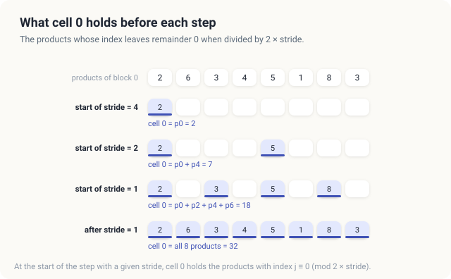
<figcaption><b>Figure 15.6</b> The loop invariant for cell 0 of block 0: at the start of the step with stride \(\mathit{stride}\), it holds the products with index \(j \equiv 0 \pmod{2\,\mathit{stride}}\).</figcaption>
</figure>

We write \\(j \equiv k \pmod{2\,\mathit{stride}}\\), read "\\(j\\) is congruent to \\(k\\) modulo \\(2\,\mathit{stride}\\)", when \\(j\\) and
\\(k\\) leave the same remainder when divided by \\(2\,\mathit{stride}\\). For example, \\(6 \equiv 2 \pmod{4}\\), since
both 6 and 2 leave the remainder 2 when divided by 4. The theorem and its proof use this notation.

<div class="theorem">

<span class="box-label">Theorem 15.1</span> Let \\(\textit{blockDim.x}\\) be a power of 2 and let \\(v_j\\) be the
value that thread \\(j\\) of a block stores in line 8 of <span class="sc">Dot-Block</span>. When
the loop of lines 10 to 15 finishes, \\(\mathit{cells}[0] = \sum_{j \in [0, \textit{blockDim.x})} v_j\\).

</div>

<div class="proof">

*Proof.* We show that the loop maintains the following invariant: *at the start of the iteration
with stride \\(\mathit{stride}\\), for every \\(k \in [0, 2\,\mathit{stride})\\),*

\\[ \mathit{cells}[k] = \sum_{j \in [0, B),\ j \equiv k \ (\mathrm{mod}\ 2s)} v_j . \\]

| Symbol | Meaning | Block 0 of the example, \\(\mathit{stride} = 2\\), \\(k = 1\\) |
|---|---|---|
| \\(\textit{blockDim.x}\\) | number of threads, and cells, in the block | 8 |
| \\(v_j\\) | value stored by thread \\(j\\) in line 8 | \\(v_1 = 6\\), \\(v_5 = 1\\) |
| \\(\mathit{stride}\\) | stride of the current iteration | 2 |
| \\(k\\) | a cell that is still read, \\(k < 2\,\mathit{stride}\\) | 1 |
| \\(j \equiv k \pmod{2\,\mathit{stride}}\\) | \\(j\\) leaves the remainder \\(k\\) when divided by \\(2\,\mathit{stride}\\) | \\(j = 1, 5\\) |
| \\(\mathit{cells}[k]\\) | content of cell \\(k\\) at the start of the iteration | \\(6 + 1 = 7\\) |

In words, at the start of each iteration, the first \\(2\,\mathit{stride}\\) cells together hold all \\(\textit{blockDim.x}\\) values,
and cell \\(k\\) holds those values whose index leaves the remainder \\(k\\). In Figure 15.4, at the
start of the step with \\(\mathit{stride} = 2\\), cell 1 indeed holds \\(6 + 1 = 7\\), the sum of \\(v_1\\) and
\\(v_5\\).

*Initialization.* The first iteration has \\(\mathit{stride} = \textit{blockDim.x}/2\\), so \\(2\,\mathit{stride} = \textit{blockDim.x}\\), and the only
\\(j \in [0, \textit{blockDim.x})\\) with \\(j \equiv k \pmod{\textit{blockDim.x}}\\) is \\(k\\) itself. The sum in the invariant therefore
consists of the single value \\(v_k\\). Line 8 stored \\(v_k\\) in \\(\mathit{cells}[k]\\), and the
barrier of line 9 makes every one of these stores complete before any thread reads a cell in
line 12. The invariant therefore holds.

*Maintenance.* Assume that the invariant holds at the start of the iteration with stride \\(\mathit{stride}\\).
In line 12, each thread \\(\textit{threadIdx.x} < \mathit{stride}\\) reads cells \\(\textit{threadIdx.x}\\) and \\(\textit{threadIdx.x} + \mathit{stride}\\) and writes cell \\(\textit{threadIdx.x}\\). The
cells written, \\([0, \mathit{stride})\\), and the cells that are only read, \\([\mathit{stride}, 2\,\mathit{stride})\\), do not overlap, and each
cell of \\([0, \mathit{stride})\\) is written by exactly 1 thread. Hence, no read in this iteration sees a write
of this iteration, except the thread's own. After line 12, for \\(\textit{threadIdx.x} < \mathit{stride}\\), cell \\(\textit{threadIdx.x}\\) holds the
sum over \\(j \equiv \textit{threadIdx.x} \pmod{2\,\mathit{stride}}\\) plus the sum over \\(j \equiv \textit{threadIdx.x} + \mathit{stride} \pmod{2\,\mathit{stride}}\\). An index
\\(j\\) belongs to one of these 2 groups exactly when it leaves the remainder \\(\textit{threadIdx.x}\\) when divided by
\\(\mathit{stride}\\), so the 2 sums together are the sum over \\(j \equiv \textit{threadIdx.x} \pmod{\mathit{stride}}\\). For example, with
\\(\mathit{stride} = 2\\) and \\(\textit{threadIdx.x} = 1\\), cell 1 holds \\(v_1 + v_5\\) and cell 3 holds \\(v_3 + v_7\\), and their
sum is the sum over the odd \\(j\\), that is, over \\(j \equiv 1 \pmod{2}\\). The barrier of line 14
makes these writes complete before any thread starts the next iteration. That iteration has the
stride \\(\mathit{stride}/2\\), and \\(2 \cdot (\mathit{stride}/2) = \mathit{stride}\\), so the invariant holds for the next iteration.

*Termination.* After the iteration with \\(\mathit{stride} = 1\\), the maintenance step shows that cell 0 holds
the sum over \\(j \equiv 0 \pmod{1}\\). Every integer leaves the remainder 0 when divided by 1, so
this is the sum over all \\(j \in [0, \textit{blockDim.x})\\).

</div>

The proof uses each barrier once, the barrier of line 9 in the initialization and the
barrier of line 14 in the maintenance. Removing either barrier breaks exactly the step of the proof
that uses it, and in Section 15.4.1, we saw the wrong value that follows.

<div class="rule-box">

<span class="box-label">Rule</span> Every thread of a block must reach every barrier. Never place
a barrier inside a branch that only some threads of the block take, such as the `if` of line 11.

</div>

A barrier inside `if t < s` would be reached by \\(\mathit{stride}\\) threads but awaited by all \\(\textit{blockDim.x}\\) threads.
The behavior of such a kernel is undefined, and in practice, it hangs or returns wrong values.

### 15.4.3 Shared memory in Rust

In cuda-oxide, a shared array is a `static mut` of type `SharedArray<f32, 256>` declared inside
the kernel. Rust requires an `unsafe` block for every access to a `static mut`, because the
compiler cannot prove that 2 threads do not access it at the same time. If we write the store of
line 8 without the block, the build stops with the following error.

```console
$ cargo oxide build
error[E0133]: use of mutable static is unsafe and requires unsafe block
   --> src/main.rs:117:9
    |
117 |         CELLS[t] = products(a, b);
    |         ^^^^^ use of mutable static
    |
    = note: mutable statics can be mutated by multiple threads: aliasing violations or data races will cause undefined behavior
```

The program's `// SAFETY:` comments state the two facts that the proof of Theorem 15.1 uses. The
first is that each thread writes only its own cell before the barrier of line 9. The second is that
in each step, each working thread alone writes its own cell and reads cell
\\(\textit{threadIdx.x} + \mathit{stride}\\), which no thread writes in that step. The compiler accepts the program without the barrier as well, because the `unsafe`
blocks are still there, and only the argument in their comments is then false.

<div class="exercises">

Exercises

15.10 Without the barrier of line 14, suppose thread 1 of block 1 runs late in step \\(\mathit{stride} = 4\\).
Which cell does thread 0 read too early in step \\(\mathit{stride} = 2\\), and what block sum results?<br>
15.11 In the proof of Theorem 15.1, where is it used that \\(\textit{blockDim.x}\\) is a power of 2? What goes wrong
for \\(\textit{blockDim.x} = 6\\)?<br>
15.12 Explain why moving the barrier of line 14 inside the `if` of line 11 can make the kernel
hang.

</div>

## 15.5 Warp shuffles

### 15.5.1 Exchanging registers within a warp

Recall from Section 15.3.4 that the last 5 steps of the tree in a block of 256 threads run with
16, 8, 4, 2 and 1 working threads, all of them in warp 0. Each of these steps nevertheless ends
with a barrier for the whole block, at which 7 idle warps wait. The threads of 1 warp, however,
can exchange values without shared memory and without a barrier.

<div class="definition">

<span class="box-label">Definition 15.6</span> **Warp shuffle.** A warp shuffle is an instruction
with which every lane of a warp (Definition 14.6) reads a register of another lane of the same
warp. In the form *shuffle down* with offset \\(\mathit{distance}\\), lane \\(k\\) receives the value that lane
\\(k + \mathit{distance}\\) holds; a lane with \\(k + \mathit{distance} \ge 32\\) receives its own value. All lanes named in the
instruction's mask execute it together, so the values are exchanged without a barrier.

*Example.* With offset 4, lane 0 receives the value of lane 4, and lane 3 the value of lane 7.

</div>

A shuffle closely resembles a step of the tree. In a tree step, each working thread adds cell
\\(\textit{threadIdx.x} + \mathit{stride}\\) into its own cell. A shuffle-down by \\(\mathit{distance}\\),
followed by an addition, lets each lane add the register of the lane \\(\mathit{distance}\\) places to its
right into its own register, which is the same step with
registers in place of cells and \\(\mathit{distance}\\) in place of \\(\mathit{stride}\\). A sequence of shuffles with offsets 16, 8,
4, 2 and 1, each followed by an addition, is therefore the tree of Section 15.3 inside 1 warp. In
Figure 15.7, we draw it on 8 lanes with the products of block 0, so that only the last 3 of the 5
steps, with offsets 4, 2 and 1, are needed. The registers take the same values as the cells of
Figure 15.4: 7, 7, 11 and 7 after offset 4, then 18 and 14, and finally 32.

<figure>
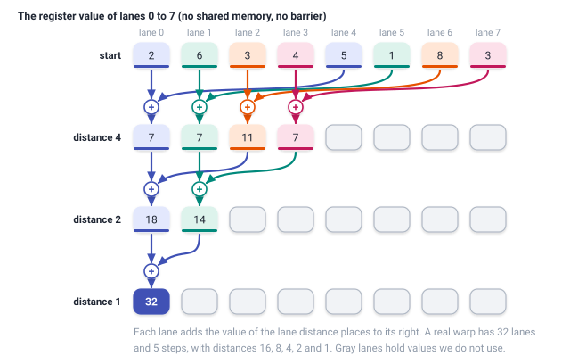
<figcaption><b>Figure 15.7</b> A warp sum by shuffles, drawn on 8 lanes with the products of block 0. The values are those of Figure 15.4.</figcaption>
</figure>

<div class="algo">
<p class="algo-name">Warp-Sum<span style="font-variant: normal">(\(\mathit{value}\))</span></p>
<ol>
<li>for \(\mathit{distance} = 16, 8, 4, 2, 1\) {</li>
<li style="--d:1">\(\mathit{value} = \mathit{value} + \) <span class="sc">Shuffle-Down</span>\((\mathit{value}, \mathit{distance})\) <span class="c">// lane k adds lane k + distance</span></li>
<li>}</li>
<li>return \(\mathit{value}\) <span class="c">// the sum of the warp, in lane 0</span></li>
</ol>
</div>

### 15.5.2 A block sum with 1 barrier

A shuffle reaches only the lanes of its own warp, so <span class="sc">Warp-Sum</span> alone
cannot add the values of a whole block. A block of 256 threads consists of 8 warps. Each warp first
reduces its 32 values with <span class="sc">Warp-Sum</span>, and lane 0 of each warp stores the
warp's sum in 1 of 8 shared slots, called \\(\mathit{warps}[0]\\) to \\(\mathit{warps}[7]\\). A
single barrier makes the 8 sums visible to all threads, and warp 0 then reduces them with a second
<span class="sc">Warp-Sum</span>, as shown in Figure 15.8. In the procedure below, \\(\mathit{lane}\\)
is the position of the thread within its warp and \\(\mathit{warpIndex}\\) is the number of its warp. For example,
thread 70 of the block has \\(\mathit{lane} = 70 \bmod 32 = 6\\) and \\(w = \lfloor 70 / 32 \rfloor =
2\\), where \\(\lfloor \cdot \rfloor\\) rounds down.

<div class="algo">
<p class="algo-name">Block-Sum<span style="font-variant: normal">(\(\mathit{mySum}\))</span></p>
<ol>
<li>\(\mathit{lane} = \textit{threadIdx.x} \bmod 32\) <span class="c">// position in the warp</span></li>
<li>\(\mathit{warpIndex} = \lfloor \textit{threadIdx.x} / 32 \rfloor\) <span class="c">// warp number in the block</span></li>
<li class="gap">\(\mathit{warpTotal} = \) <span class="sc">Warp-Sum</span>\((\mathit{mySum})\)</li>
<li>if \(\mathit{lane} = 0\) {</li>
<li style="--d:1">\(\mathit{warpSums}[\mathit{warpIndex}] = \mathit{warpTotal}\)</li>
<li>}</li>
<li class="gap"><span class="sc">Barrier</span>()</li>
<li>if \(\mathit{warpIndex} \ne 0\) {</li>
<li style="--d:1">return 0 <span class="c">// only warp 0 finishes the sum</span></li>
<li>}</li>
<li class="gap">\(\mathit{value} = \mathit{warpSums}[\mathit{lane}]\) if \(\mathit{lane} \lt 8\), else 0</li>
<li>return <span class="sc">Warp-Sum</span>\((\mathit{value})\) <span class="c">// the block sum, in thread 0</span></li>
</ol>
</div>

<figure>
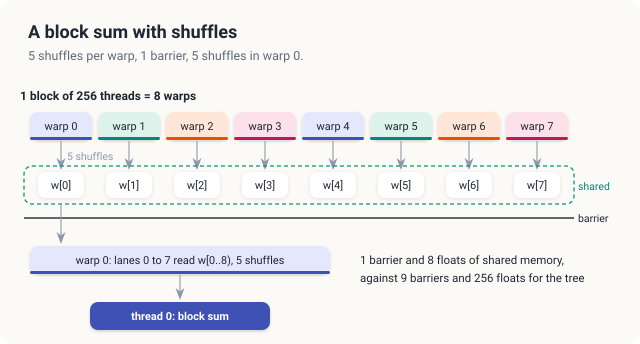
<figcaption><b>Figure 15.8</b> The block sum: 5 shuffles in every warp, 1 barrier, 5 shuffles in warp 0.</figcaption>
</figure>

In line 11, lanes 8 to 31 of warp 0 contribute 0, the identity of addition, so the second
<span class="sc">Warp-Sum</span> adds exactly the 8 warp sums. Only warp 0 calls
<span class="sc">Warp-Sum</span> the second time, and all 32 of its lanes do so, as the shuffle
requires. Compared with the tree of Section 15.3, <span class="sc">Block-Sum</span> uses 1 barrier
instead of 9, and 8 floats of shared memory instead of 256. A fused kernel with shuffles computes
the register sum \\(\mathit{mySum}\\) with lines 1 to 7 of <span class="sc">Dot-Block</span>, and it replaces
lines 8 to 15 by \\(\mathit{mySum} = \\) <span class="sc">Block-Sum</span>\\((\mathit{mySum})\\).

<div class="exercises">

Exercises

15.13 In <span class="sc">Warp-Sum</span> on 32 lanes holding the values 0 to 31, what does lane
0 hold after each of the 5 steps?<br>
15.14 Why may lines 11 and 12 of <span class="sc">Block-Sum</span> not read `warpSums` before the
barrier of line 7?

</div>

## 15.6 Combining the block results

### 15.6.1 A second launch

After <span class="sc">Dot-Block</span> has run on the example, `partial[0] = 32` and
`partial[1] = 31`. The 2 numbers were computed by different blocks, and the threads of different
blocks can share neither a barrier nor shared memory. In fact, the blocks of a large grid do not
even run at the same time. The end of a kernel, however, is a point that every block has passed. A
second kernel launched on the same stream starts only after the first kernel has finished, so it
sees every partial sum. We therefore launch a sum kernel with 1 block, which adds the partial sums
with the same grid-stride loop and block sum. On the example, it computes \\(32 + 31 = 63\\), as shown
on the left of Figure 15.9.

### 15.6.2 Atomic additions

The second launch can be avoided if every block adds its sum directly into the result. This
requires an addition that no other thread can interrupt.

<div class="definition">

<span class="box-label">Definition 15.7</span> **Atomic operation.** An atomic operation is a
read-modify-write of 1 memory location that executes as 1 indivisible step. No other thread can
access the location between the read and the write. `atomicAdd(p, v)` in C++ and
`fetch_add(v, ...)` on a `DeviceAtomicF32` in Rust add \\(\mathit{mySum}\\) to the value at \\(p\\) atomically.

*Example.* If block 1 finishes first, it atomically changes the result from 0 to 31, and block 0
then changes it from 31 to 63.

</div>

Figure 15.9 compares the two methods. With the second launch, the 2 partial sums are added in an
order that the program fixes. With atomic additions, they are added in the order in which the
blocks finish, and this order changes from run to run.

<figure>
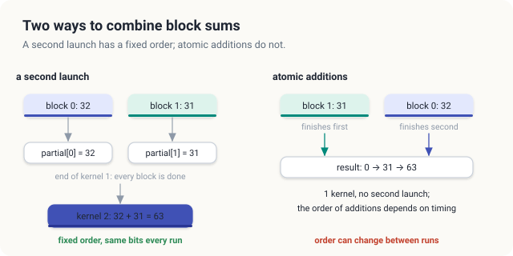
<figcaption><b>Figure 15.9</b> Left: a second launch adds the partial sums in a fixed order. Right: atomic additions add them in the order the blocks finish.</figcaption>
</figure>

The addition must be atomic. With an ordinary `*result += total`, a block reads the result, adds
its sum and writes the result back, in 3 separate steps. Suppose that block 0 and block 1 both read
0 before either of them writes. Block 0 then writes \\(0 + 32 = 32\\), block 1 writes \\(0 + 31 =
31\\), and the later write wins, so the result is 31 instead of 63, as shown in Figure 15.10.

<figure>
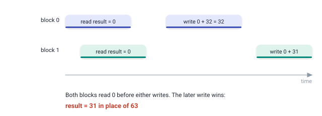
<figcaption><b>Figure 15.10</b> With a plain addition, both blocks read 0 and the later write wins: 31 in place of 63.</figcaption>
</figure>

We replaced `atomicAdd(result, total)` by `*result += total` in the C++ program. The 0-and-1 test
returned 338,598 instead of 2,796,203, and the dot product of the random floats returned 100
different values in 100 runs, from 479,931.1 to 528,424.6, which is about 12% of the correct
4,195,680. The worked example was launched with 1,024 blocks, of which only block 0 has a nonzero
sum. It returned the correct 63 in 1 run and 0 in another run, because a block with the sum 0 read
the result before block 0 wrote 63, and it wrote its 0 afterward.

### 15.6.3 The order of float additions

The 2 correct methods add the same numbers in different orders. For integers, the order does not
matter. For floats, it does, because every addition rounds its result to the nearest float.

A float has 24 significant bits. Every integer up to \\(2^{24} = 16{,}777{,}216\\) can therefore be
represented as a float, but beyond \\(2^{24}\\), the floats are 2 apart, so only the even integers
are floats. In Figure 15.11, we add 16,777,216, 1 and 1 in 2 orders. From left to right, the first
addition gives \\(16{,}777{,}216 + 1 = 16{,}777{,}217\\), which is not a float and rounds back to
16,777,216, and the second \\(+ 1\\) is lost in the same way. With the small values first,
\\(1 + 1 = 2\\), and \\(16{,}777{,}216 + 2 = 16{,}777{,}218\\) is exact.

<figure>
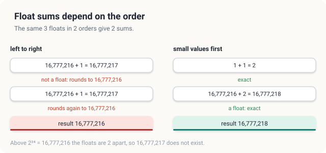
<figcaption><b>Figure 15.11</b> The same 3 floats added in 2 orders give 2 different sums.</figcaption>
</figure>

With a second launch, the order of every addition is fixed. We let each thread add its elements in the
order of its loop, the shuffles combine fixed pairs of lanes, and the last block adds the partial
sums in a fixed pattern. The result is therefore the same, bit for bit, in every run with the same
grid. With atomic additions, the 1,024 block sums arrive in an order that depends on timing, and
the last bits of the result can change from run to run. Both results are correct to the precision
of a float.

The program uses this observation to verify itself exactly, in the same way as the paper on tiled
matrix multiplication does with small integers. Its second test fills \\(a\\) with 1 at every
position divisible by 3 and \\(b\\) with 1 at every position divisible by 2, and with 0 elsewhere.
Every product, every partial sum and the total are then integers no larger than \\(2^{24}\\), and all
of them are floats. No addition rounds, every order gives the same result, and every method must
return exactly 2,796,203, the number of positions below \\(2^{24}\\) that are divisible by 6.

<div class="exercises">

Exercises

15.15 With 4 blocks whose sums are 10, 20, 30 and 40, list 2 orders of atomic additions and the
intermediate values of the result for each.<br>
15.16 Why does the 0-and-1 test stay exact with \\(n = 2^{24}\\), but not necessarily with
\\(n = 2^{25}\\)?<br>
15.17 In the faulty plain addition, what is the smallest wrong result the worked example can
produce, and what is the largest?

</div>

## 15.7 Implementation

### 15.7.1 The register sum

We implement the grid-stride loop of lines 1 to 7 as a device function, that is, a function that
runs on the GPU and is called from kernels rather than launched by the host. In C++, a device
function is marked `__device__`, and in Rust, it is marked `#[device]`. The following code computes
the register sum of 1 thread.

<p class="listing"><b>Listing 15.1</b> The register sum of 1 thread: lines 1 to 7 of <span class="sc">Dot-Block</span>.</p>

<div class="code-tabs">
<div class="code-tab" data-lang="Rust">

```rust,ignore
mod kernels {
    // ...
{{#include ../../../../code/oxide/ch15_dot_product/src/main.rs:63:75}}
    // ...
}
```

</div>
<div class="code-tab" data-lang="C++">

```cpp
{{#include ../../../../code/cuda/ch15_dot_product/dot.cu:57:67}}
```

</div>
</div>

The loop reads `a[i]` and `b[i]` and adds their product to `sum` without storing the product. In
Rust, the slices are indexed with an ordinary `usize`. The loop condition `i < a.len()` lets the
compiler drop the bounds check on `a`, and the check on `b` costs 1 comparison per 8 bytes loaded,
which does not change the speed of a memory-bound loop. The Rust function computes \\(\mathit{gridSize}\\) from the
constant `BLOCK`, which the launch contract of every kernel that calls the function fixes at 256.

### 15.7.2 The tree kernel

Listing 15.2 shows the complete fused kernel with the tree in shared memory, which is
<span class="sc">Dot-Block</span> in both languages.

<p class="listing"><b>Listing 15.2</b> The fused kernel with the tree in shared memory: <span class="sc">Dot-Block</span>.</p>

<div class="code-tabs">
<div class="code-tab" data-lang="Rust">

```rust,ignore
mod kernels {
    // ...
{{#include ../../../../code/oxide/ch15_dot_product/src/main.rs:109:137}}
    // ...
}
```

</div>
<div class="code-tab" data-lang="C++">

```cpp
{{#include ../../../../code/cuda/ch15_dot_product/dot.cu:95:113}}
```

</div>
</div>

The call `products(a, b)` performs lines 1 to 7, the store into `cells[t]` or `CELLS[t]` is
line 8, and the first barrier is line 9. The loop performs lines 10 to 15, with the barrier of
line 14 after the `if`, and the final `if t == 0` performs lines 16 to 18.

The two languages differ in 3 places. First, C++ declares the shared array with `__shared__`, while
Rust declares a `static mut SharedArray<f32, 256>`. The length of the Rust array is part of its
type, and this is why the Rust kernel's launch contract fixes the block at exactly 256 threads.
Every access to the array is in an `unsafe` block with its argument (Section 15.4.3). Second, the
C++ loop halves `stride` directly, whereas the Rust loop counts `step` from 0 to 7 and computes
`stride = 128 >> step`, which is 128, 64, 32 and so on down to 1. The reason is that cuda-oxide unrolls a
loop marked `#[unroll]` only when the loop has an integer counter that is compared with a constant
and increased by a constant. With `s /= 2`, the compiler reports that the loop was not unrolled.
Third, thread 0 writes `partial[blockIdx.x]`, at an index that is not its own global index, so Rust
uses `get_unchecked_mut`, with the argument that only thread 0 of each block writes, and only at
its own block number.

### 15.7.3 The warp and block sums

Listing 15.3 shows <span class="sc">Warp-Sum</span> and <span class="sc">Block-Sum</span> as device
functions.

<p class="listing"><b>Listing 15.3</b> <span class="sc">Warp-Sum</span> and <span class="sc">Block-Sum</span>.</p>

<div class="code-tabs">
<div class="code-tab" data-lang="Rust">

```rust,ignore
mod kernels {
    // ...
{{#include ../../../../code/oxide/ch15_dot_product/src/main.rs:31:61}}
    // ...
}
```

</div>
<div class="code-tab" data-lang="C++">

```cpp
{{#include ../../../../code/cuda/ch15_dot_product/dot.cu:31:55}}
```

</div>
</div>

The calls `__shfl_down_sync(0xffffffff, v, offset)` and `warp::shuffle_down_f32(v, offset)` are
the shuffle of Definition 15.6. The mask `0xffffffff` has all 32 bits set and therefore names all
32 lanes, and the Rust function applies the same mask. In Rust, the offset is computed as
`16u32 >> step`, which gives 16, 8, 4, 2 and 1 for `step` from 0 to 4. The counter is declared
`u32`, and the shifted constant is written `16u32`, because with both types left to inference, the
GPU backend of cuda-oxide stopped with an internal error about a shift of a 64-bit value by a
32-bit amount. The shared array `WARP_SUMS` is declared inside the device function, and every block
that calls `block_sum` still receives its own 8 slots.

### 15.7.4 Combining the block sums

Listing 15.4 shows the fused kernel that combines the block sums with 1 atomic addition per block.

<p class="listing"><b>Listing 15.4</b> The fused kernel with an atomic addition per block.</p>

<div class="code-tabs">
<div class="code-tab" data-lang="Rust">

```rust,ignore
mod kernels {
    // ...
{{#include ../../../../code/oxide/ch15_dot_product/src/main.rs:169:178}}
}
```

</div>
<div class="code-tab" data-lang="C++">

```cpp
{{#include ../../../../code/cuda/ch15_dot_product/dot.cu:125:133}}
```

</div>
</div>

In Rust, the result is a slice of `DeviceAtomicF32`, received as a shared reference `&[...]`
rather than a mutable one. Like the atomic types of the Rust standard library, the atomic type
permits modification through a shared reference, because each modification is 1 indivisible
operation. The kernel therefore needs no `unsafe`. `AtomicOrdering::Relaxed` asks for atomicity and
nothing more, which suffices here, because the host reads the result only after the kernel has
finished. A device buffer of `DeviceAtomicF32` cannot be copied with `to_host_vec`, so the Rust
program uses 2 small kernels, `clear` and `publish`. The first sets the result to 0 before the
launch, and the second copies it into an ordinary float afterward. In C++, the program sets the
result to 0 with `cudaMemsetAsync`.

The host prepares every launch once, and it runs the 4 designs with 1 closure in Rust and 1
function in C++. Listing 15.5 shows the launches. The map followed by a reduction needs 3 launches,
each fused kernel with a second launch needs 2, and the atomic design needs 3 in Rust and 2 in
C++.

<p class="listing"><b>Listing 15.5</b> The launches of the 4 designs.</p>

<div class="code-tabs">
<div class="code-tab" data-lang="Rust">

```rust,ignore
fn main() -> Result<(), Error> {
    // ...
{{#include ../../../../code/oxide/ch15_dot_product/src/main.rs:306:343}}
    // ...
}
```

</div>
<div class="code-tab" data-lang="C++">

```cpp
{{#include ../../../../code/cuda/ch15_dot_product/dot.cu:182:208}}
```

</div>
</div>

<div class="exercises">

Exercises

15.18 Write a fused kernel that combines 1 atomic addition per warp instead of per block. How many
atomic operations does 1 run perform with 1,024 blocks of 256 threads?<br>
15.19 Reuse `block_sum` to compute \\(\sum a_i^2\\), the squared length of a vector. How many bytes
per element does it read?

</div>

## 15.8 Measurements

### 15.8.1 Platform and method

The measurements come from an integrated GPU, a Jetson Orin NX 16 GB, with 8 SMs and a memory
bandwidth of 102 GB/s. Each program first runs the 2 exact tests of Section 15.6.3. It then
computes the dot product of \\(2^{24}\\) pairs of floats in \\([0, 1)\\), drawn from a fixed generator,
with each of the 4 designs, which is 64 MiB per vector. Every design runs 10 times as a warm-up and
20 times under CUDA events. The rate is the number of bytes that the design must move, 16 or 8 per
pair, divided by its time. The program then runs the second-launch and atomic designs 100 times
each and counts the distinct results. Repeated runs differed by up to 9%.

### 15.8.2 Results

The Rust program printed the following lines.

```console
$ cargo oxide run
GPU: Orin, 8 SMs
exact tests                   map+red      tree   shuffle    atomic
  worked example, 16 pairs          63        63        63        63   expected 63
  0s and 1s, 16777216 pairs    2796203   2796203   2796203   2796203   expected 2796203
16777216 pairs of floats in [0, 1), 20 runs
  method                    time   bytes/pair      rate      result
  map, then reduce        3.334 ms       16 B    80.5 GB/s  4195680.0
  fused, shared tree      1.409 ms        8 B    95.2 GB/s  4195680.0
  fused, shuffles         1.405 ms        8 B    95.5 GB/s  4195680.0
  fused, atomic combine   1.405 ms        8 B    95.5 GB/s  4195681.0
  exact, in double precision                             4195680.2
distinct results in 100 runs
  second launch    1  from 4195680.0 to 4195680.0
  atomic           3  from 4195680.5 to 4195681.5
largest relative error 3.20e-7
PASSED
```

Every design returns 63 for the worked example and exactly 2,796,203 for the 0-and-1 test. In the
table of floats, the column `bytes/pair` gives the bytes that each design moves per pair of
elements, and the line `exact, in double precision` gives the exact result for comparison.
Table 15.1 collects the times of both languages.

| Design | Bytes per pair | Rust time | Rust rate | C++ time | C++ rate |
|---|---|---|---|---|---|
| map, then reduce | 16 | 3.334 ms | 80.5 GB/s | 3.096 ms | 86.7 GB/s |
| fused, tree in shared memory | 8 | 1.409 ms | 95.2 GB/s | 1.412 ms | 95.1 GB/s |
| fused, warp shuffles | 8 | 1.405 ms | 95.5 GB/s | 1.456 ms | 92.2 GB/s |
| fused, atomic combine | 8 | 1.405 ms | 95.5 GB/s | 1.389 ms | 96.6 GB/s |

<p class="listing"><b>Table 15.1</b> The dot product of \(2^{24}\) pairs on the measured GPU. Least times at 102 GB/s: 2.63 ms for 16 bytes per pair, 1.32 ms for 8.</p>

<figure>
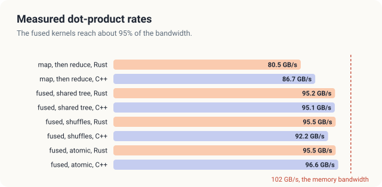
<figcaption><b>Figure 15.12</b> Measured rates of the 4 designs against the memory bandwidth of 102 GB/s.</figcaption>
</figure>

### 15.8.3 Why the fused kernel is more than twice as fast

We first count the bytes. The design that stores the products reads \\(a_i\\) and \\(b_i\\), writes
\\(p_i\\), and reads \\(p_i\\) back in the reduction. These are 4 accesses of 4 bytes each, so the
design moves 16 bytes per pair, or 268 MB for \\(2^{24}\\) pairs. The fused kernels read only
\\(a_i\\) and \\(b_i\\), which is 8 bytes per pair, or 134 MB, as shown in Figure 15.13. At
102 GB/s, these amounts take at least 2.63 ms and 1.32 ms, a ratio of 2.

<figure>
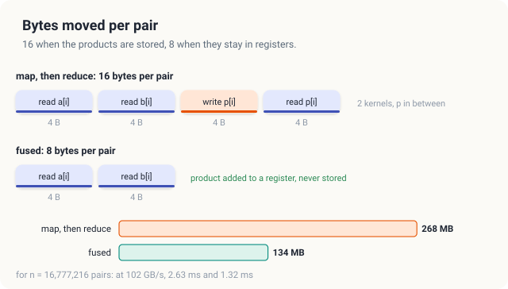
<figcaption><b>Figure 15.13</b> Bytes moved per pair: 16 when the products are stored, 8 when they stay in registers.</figcaption>
</figure>

The measured ratio is \\(3.334 / 1.405 = 2.4\\) in Rust and \\(3.096 / 1.412 = 2.2\\) in C++.
Halving the bytes accounts for a factor of 2. The rest comes from the lower rate of the first
design, 80.5 GB/s and 86.7 GB/s against 95 GB/s. Its multiplication kernel writes one value for every
2 values that it reads, as SAXPY does, and recall from Chapter 14 that SAXPY reached at most
93 GB/s, for the reasons given in Section 14.8.3. The fused kernels only read, and they reach
92 GB/s to 97 GB/s, which is 90% to 95% of the pin rate of the memory. The Rust map-then-reduce
design ran 8% to 11% slower than the C++ design in every run, while the fused kernels ran at the
same speed in both languages.

### 15.8.4 Barriers, shuffles and atomics

The tree with 9 barriers and the warp shuffles with 1 barrier run at the same speed, 1.409 ms and
1.405 ms in Rust. We let each thread add 64 products in its register before the block sum begins, so the 9 barriers of a
block cost time only once per \\(64 \cdot 256 = 16{,}384\\) products, which is a small
part of its time. In Chapter 8, we found the same for the plain sum. After coarsening, its tree and
its shuffle sum ran at 64.1 GB/s and 64.4 GB/s. Shuffles matter where combinations are frequent,
as in the many short reductions of a softmax over the rows of a matrix (Chapter 23).

The atomic design is as fast as the others, because its 1,024 atomic additions are few, and its
extra launches, `clear` and `publish`, each run only 1 block. Its results, however, differ. The
exact dot product, computed in double precision on the CPU, is 4,195,680.2. Between
\\(2^{22} = 4{,}194{,}304\\) and \\(2^{23}\\), the floats are 0.5 apart, so the nearest float is
4,195,680.0. The second-launch designs return exactly this value, and the 100 runs of the shuffle
design returned the same bits every time. The atomic design returned 3 different values in 100
runs, 4,195,680.5, 4,195,681.0 and 4,195,681.5, which lie 1 to 3 float steps above the nearest
float, and in other runs, it also returned 4,195,680.0. All of these values are correct to a
relative error of \\(3.2 \cdot 10^{-7}\\), which is about the precision of a float. A program that
must reproduce its results bit for bit, for example to compare two versions of a simulation, needs
the second launch.

<div class="exercises">

Exercises

15.20 From Table 15.1, compute the fraction of the 102 GB/s that each fused design reaches in each
language.<br>
15.21 Predict the time of the fused dot product of \\(2^{26}\\) pairs on the measured GPU, and on a GPU
with 3,350 GB/s.

</div>

## 15.9 The complete programs

Listing 15.6 gives the complete programs, from which every excerpt of this chapter was taken.

<p class="listing"><b>Listing 15.6</b> The complete programs. <a href="https://github.com/arpanpathak/gpu-parallel-book/blob/main/code/oxide/ch15_dot_product/src/main.rs">code/oxide/ch15_dot_product/src/main.rs</a> <a href="https://github.com/arpanpathak/gpu-parallel-book/blob/main/code/cuda/ch15_dot_product/dot.cu">code/cuda/ch15_dot_product/dot.cu</a></p>

<div class="code-tabs">
<div class="code-tab" data-lang="Rust">

```rust,ignore
{{#include ../../../../code/oxide/ch15_dot_product/src/main.rs}}
```

</div>
<div class="code-tab" data-lang="C++">

```cpp
{{#include ../../../../code/cuda/ch15_dot_product/dot.cu}}
```

</div>
</div>

## Common mistakes

**Storing the products of a map that a reduction consumes.** The array of products doubles the
memory traffic of a memory-bound computation. The map should instead be fused into the reduction,
so that the products stay in a register.

**A missing barrier between the steps of the tree.** The kernel compiles in both languages and
returns a wrong sum that changes from run to run (Section 15.4.1).

**A barrier inside a branch that only some threads take.** Every thread of the block must reach
every `__syncthreads()` or `thread::sync_threads()`.

**A plain addition where an atomic one is needed.** `*result += total` from many blocks loses most
of the additions (Section 15.6.2).

**Expecting identical bits from atomic float additions.** The order of the additions changes from
run to run, and so can the last bits of the result. When results must repeat exactly, the block
sums should be combined with a second launch.

**An `unsafe` block without its argument.** Each access to a shared array needs a stated reason
why no other thread writes the same element at the same time, and this reason usually names a
barrier.

## Summary

- The dot product is a map, \\(p_i = a_i b_i\\), followed by a reduction, the sum. On the example,
  the 16 products add up to \\(32 + 31 = 63\\).
- The sequential sum is a chain of \\(n\\) dependent additions. Because addition is associative
  and commutative, the additions can be regrouped into a tree of \\(\log_2 n\\) steps, 4 for the
  example.
- In shared memory, each step lets the threads with \\(\textit{threadIdx.x} < \mathit{stride}\\) add cell
  \\(\textit{threadIdx.x} + \mathit{stride}\\) into their own cell; block 0 of the example computes 7, 7, 11, 7, then 18, 14, then 32. A barrier must
  follow every step: without it, the example's block summed to 24 instead of 32, and the real
  programs returned 26 and 36 instead of 63.
- Theorem 15.1 proves the tree correct with the invariant that, at the start of the step with
  stride \\(\mathit{stride}\\), cell \\(k\\) holds the values whose index \\(j\\) leaves the remainder \\(k\\) when
  divided by \\(2\,\mathit{stride}\\).
- Warp shuffles exchange registers within a warp without a barrier; a block sum with shuffles
  needs 1 barrier and 8 shared floats instead of 9 and 256.
- Block sums are combined by a second launch, in a fixed order, or by atomic additions, in the
  order the blocks finish. A plain addition loses sums. Atomic float additions gave 3 different
  last bits in 100 runs; the second launch gave the same bits every time.
- The fused kernels read 8 bytes per pair and ran at 92 GB/s to 97 GB/s on the measured GPU, 2.2 to
  2.4 times as fast as a map followed by a reduction, which moves 16.

## Exercises

1. Compute the least time of the fused dot product of \\(2^{26}\\) pairs on your GPU from its
   memory bandwidth. Change `N` in both programs and compare.
2. Change both programs to `f64`. The fused kernel then reads 16 bytes per pair. Is its time twice
   that of the `f32` version?
3. Change `GRID` from 1,024 to 64 and to 8,192. How many products does each thread add in each
   case, and how do the times of the tree and shuffle kernels change?
4. In Listing 15.2, which cells does thread 5 read and write in each of the 8 steps? In which
   steps is it idle?
5. Write the maximum of an array as a reduction, reusing the tree of
   <span class="sc">Dot-Block</span> with \\(\max\\) in place of \\(+\\). What must the threads
   with no element store in line 8?
6. Prove that <span class="sc">Block-Sum</span> returns the sum of the 256 values to thread 0,
   using Theorem 15.1 for each warp.
7. The exact dot product of the measured vectors is 4,195,680.2. Explain why no float program can
   return it, and which float is the best possible answer.

## Sources and further reading

- A. Pathak, *An Introduction to Tiled Parallel Programming, Simplified*, 2026. The style of
  worked example, broken variants and loop-invariant proof used here, and the exact verification
  with small integers.
- T. H. Cormen, C. E. Leiserson, R. L. Rivest and C. Stein, *Introduction to Algorithms*, 4th ed.,
  MIT Press, 2022. Pseudocode conventions and loop invariants.
- M. Harris, "Optimizing Parallel Reduction in CUDA", NVIDIA, 2007.
- J. Luitjens, "Faster Parallel Reductions on Kepler", NVIDIA Technical Blog, 2014.
- D. Goldberg, "What Every Computer Scientist Should Know About Floating-Point Arithmetic", *ACM
  Computing Surveys* 23(1), 1991.
- NVIDIA, *CUDA C++ Programming Guide*, sections "Warp Shuffle Functions", "Atomic Functions" and
  "Synchronization Functions".
- *The Rust Reference*, "Static items" and "Unsafety"; the cuda-oxide repository,
  <https://github.com/NVlabs/cuda-oxide>.
