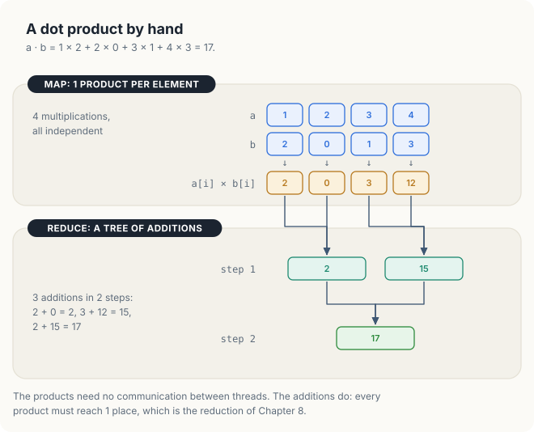
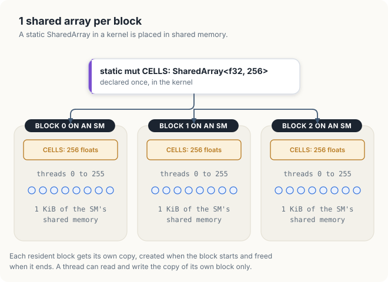
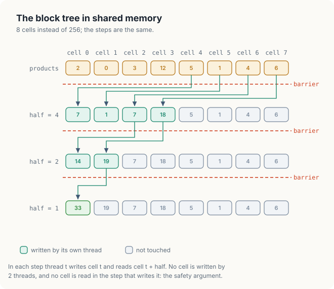
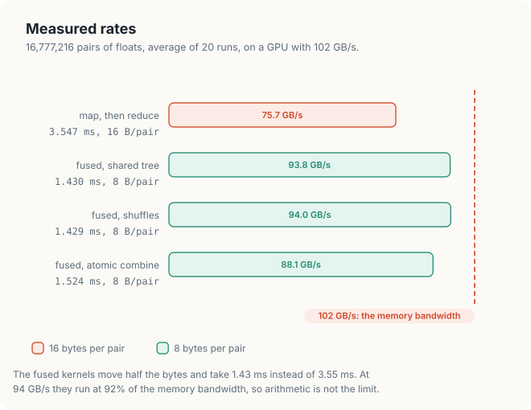

# Chapter 15: Reductions and the Dot Product

The dot product of 2 vectors multiplies them element by element and adds the products. It is one
of the most common operations in numerical computing: it is the inner loop of a matrix-vector
product, it measures the length of a vector and the angle between 2 vectors, and it appears in
every iterative solver that checks how far it is from convergence. On a GPU the multiplications
are independent of each other, but the additions are not. Every product must contribute to a
single number, so the threads must combine their results.

In Chapter 8 we developed the parallel sum of an array: a tree of additions in shared memory
(Section 8.3), a grid-stride loop that gives each thread many elements (Section 8.4), and warp
shuffles that remove most of the barriers (Section 8.5). In this chapter, we apply that work to
the dot product and write it in Rust with cuda-oxide. The algorithms are the same as in Chapter
8. What is new is the way Rust expresses them: a shared array declared as a `static`, the
`unsafe` blocks and safety arguments that shared memory requires, helper functions marked
`#[device]`, and a device-wide atomic type for the final combination. We compare 4 designs and
measure how much each one costs, and we examine why 2 of them give results that differ in the
last bits.

<div class="covers" markdown="1">

This chapter covers

- the dot product as a map followed by a reduction, and the memory traffic of each design
- a fused kernel that never stores its products
- shared memory in Rust: `SharedArray`, `static mut`, and the safety argument for each access
- barriers with `thread::sync_threads()`, and what happens without them
- warp shuffles in a `#[device]` helper function, with a loop that the compiler unrolls
- 2 ways to combine the block results: a second launch, and `DeviceAtomicF32`
- why the atomic combination changes the last bits of the result from run to run

</div>

The code of the chapter is in
[`code/oxide/ch15_dot_product/`](https://github.com/arpanpathak/gpu-parallel-book/tree/main/code/oxide/ch15_dot_product).
It uses the same `Cargo.toml` and `rust-toolchain.toml` as the vector addition of Chapter 13,
with no new dependencies, and it is built and run with `cargo oxide run`.

## 15.1 The dot product

### 15.1.1 Definition

The **dot product** of 2 vectors \\(a\\) and \\(b\\) of \\(N\\) elements is the sum of the
products of their corresponding elements:

\\[ a \cdot b = \sum_{i=0}^{N-1} a_i b_i \\]

For example, with \\(a = (1, 2, 3, 4)\\) and \\(b = (2, 0, 1, 3)\\), the products are 2, 0, 3 and
12, and their sum is 17. Figure 15.1 shows the same computation in the order that a parallel
program performs it. The 4 multiplications are independent, so 4 threads can perform them at the
same time. The additions are then arranged as a tree: 2 + 0 = 2 and 3 + 12 = 15 in the first
step, and 2 + 15 = 17 in the second. A tree adds \\(N\\) values in \\(\log_2 N\\) steps, as we
saw in Section 8.1.2.

<figure>

<figcaption><b>Figure 15.1</b> A dot product of 4 elements: 4 independent products, then a tree of 3 additions.</figcaption>
</figure>

### 15.1.2 A map followed by a reduction

A **map** is an operation that applies the same function to every element of its input,
independently, and produces 1 output element for each input element. A **reduction**, as defined
in Chapter 8, combines all the elements of its input into a single value with an associative
operator. The dot product is a map, the element-wise multiplication, followed by a reduction, the
sum. This view suggests a first implementation with 2 kernels: a map kernel that writes the
products into an array \\(p\\), and the sum kernel of Chapter 8 applied to \\(p\\).

```text
map:     for every i in parallel:  p[i] ← a[i] × b[i]
reduce:  each block b:             partial[b] ← sum of its share of p
         1 block:                  total ← sum of partial[0 .. blocks − 1]
```

The map and the reduction can also be **fused** into a single kernel. In a fused kernel, each
thread multiplies its elements and adds each product to a running sum in a register as soon as
the product is computed. The products are never stored in memory.

```text
fused:   each thread t:  s ← 0
                         for i = t, t + T, t + 2T, … < N:  s ← s + a[i] × b[i]
         each block b:   partial[b] ← sum of s over the threads of b
         1 block:        total ← sum of partial[0 .. blocks − 1]
```

Here \\(T\\) is the total number of threads in the grid, and the loop over \\(i\\) is the
grid-stride loop of Section 8.4.

### 15.1.3 Memory traffic

Both designs perform the same arithmetic: \\(N\\) multiplications and about \\(N\\) additions.
They differ in the number of bytes they move. Recall from Chapter 1 that a kernel that performs
few operations per byte is limited by memory bandwidth, and the dot product performs only 2
floating-point operations, a multiplication and an addition, for every 8 bytes it reads. Its
arithmetic intensity is therefore 2 / 8 = 0.25 FLOP/B, far below the ridge point of any GPU in
the table of Section 2.1.5. Its time is set by the bytes it moves.

Figure 15.2 counts those bytes. The map-then-reduce design reads `a[i]` and `b[i]`, writes
`p[i]`, and reads `p[i]` back in the reduction: 4 accesses of 4 bytes, 16 bytes per pair of
elements. The fused design reads only `a[i]` and `b[i]`: 8 bytes per pair. For \\(N\\) =
16,777,216 pairs, the first design moves 16 × 16,777,216 = 268 MB and the second 134 MB. On a
GPU with 102 GB/s of memory bandwidth, these amounts take at least 268 / 102 = 2.6 ms and
134 / 102 = 1.3 ms. We therefore expect the fused kernel to be about twice as fast.

<figure>

<figcaption><b>Figure 15.2</b> Bytes moved per pair of elements: 16 for map then reduce, 8 for the fused kernel.</figcaption>
</figure>

| Symbol | Meaning | In the example |
|---|---|---|
| \\(N\\) | number of pairs of elements | 16,777,216 |
| \\(B\\) | bytes moved per pair | 16 (map, then reduce) or 8 (fused) |
| \\(W\\) | memory bandwidth of the GPU | 102 GB/s |
| \\(N B / W\\) | least time the kernel can take | 2.6 ms or 1.3 ms |

The program of this chapter implements the map-then-reduce design and 3 fused designs, which
differ in the way the threads of a block combine their sums and in the way the block results are
combined. We start with the map and the reduction.

## 15.2 Map, then reduce

### 15.2.1 The map kernel

Listing 15.1 shows the map kernel. It has the same structure as the vector addition kernel of
Chapter 13, with a multiplication in place of the addition.

<p class="listing"><b>Listing 15.1</b> The map: 1 product per thread. <a href="https://github.com/arpanpathak/gpu-parallel-book/blob/main/code/oxide/ch15_dot_product/src/main.rs">code/oxide/ch15_dot_product/src/main.rs</a></p>

```rust,ignore
{{#include ../../../../code/oxide/ch15_dot_product/src/main.rs:70:80}}
```

The launch contract states that the kernel is launched with 1-dimensional blocks of 256 threads.
Each thread obtains its global index with `thread::index_1d()`, which returns a value of a
special index type rather than a plain integer. The output parameter `p` is a `DisjointSlice`,
the type that cuda-oxide uses for an array in which every thread writes a different element.
`p.get_mut(idx)` accepts only the index type, so a thread can obtain a mutable reference only to
its own element, and it returns `None` when the index lies beyond the end of the array. As we saw
in Chapter 13, these 2 properties together replace the bounds check `if (i < n)` of a C++ kernel
and make the kernel free of write conflicts without any `unsafe` code.

### 15.2.2 The reduction kernel

The reduction kernel in Listing 15.2 sums an array into 1 partial sum per block. It is the
coarsened warp-shuffle sum of Section 8.5, rewritten so that its parts can be reused by the
fused kernels.

<p class="listing"><b>Listing 15.2</b> The reduction: a grid-stride loop, then a block sum.</p>

```rust,ignore
{{#include ../../../../code/oxide/ch15_dot_product/src/main.rs:82:100}}
```

Each thread first adds the elements `i`, `i + stride`, `i + 2 × stride` and so on into the
register variable `v`, where `stride` is the total number of threads in the grid. With 1,024
blocks of 256 threads, the stride is 262,144, and each thread of the map-then-reduce design adds
16,777,216 / 262,144 = 64 products. Consecutive threads read consecutive elements in every pass
of the loop, so the reads are coalesced.

The call `block_sum(v)` then adds the 256 values of the block and returns the sum to thread 0.
We examine this function in Section 15.4. Finally, thread 0 writes the block's sum into
`partial` at the position given by the block index. This write does not follow the pattern that
`DisjointSlice` checks, 1 element per thread at the thread's own global index, so it is done with
`get_unchecked_mut` inside an `unsafe` block. The comment above it states why the write is safe:
only thread 0 of each block writes, and each block writes a different element. In Rust, an
`unsafe` block does not turn off any checks of the compiler; it marks a place where the
programmer, rather than the compiler, guarantees a property, and the `// SAFETY:` comment records
that guarantee for the reader.

The host launches the reduction twice. The first launch, with 1,024 blocks, reduces the
16,777,216 products to 1,024 partial sums. The second launch, with a single block, reduces the
1,024 partial sums to the final result. With 256 threads, each thread of the second launch adds
4 partial sums before the block sum.

The 3 launches of the map-then-reduce design are part of the host function `run`, which we show
in Section 15.5. Before we measure them, we turn to the fused kernels, and first to the kernel
that keeps its partial sums in shared memory.

## 15.3 Shared memory and barriers in Rust

### 15.3.1 Shared arrays

**Shared memory** is the on-chip memory of an SM that the threads of a block can all read and
write, as described in Chapter 2. In CUDA C++, an array in shared memory is declared with the
`__shared__` qualifier. In cuda-oxide, it is declared as a `static mut` variable of type
`SharedArray<T, N>`, where `T` is the element type and `N` the number of elements:

```rust,ignore
static mut CELLS: SharedArray<f32, 256> = SharedArray::UNINIT;
```

The declaration appears once in the kernel, but each block that runs the kernel receives its own
copy, placed in the shared memory of the SM that runs the block. The copy exists from the moment
the block starts until it finishes, and only the threads of that block can access it. Figure 15.3
shows 3 blocks, each with its own 256 floats, or 1 KiB, of shared memory. The initial value
`SharedArray::UNINIT` states that the array starts uninitialized: shared memory is not cleared
when a block starts, so a kernel must write each element before it reads it.

<figure>

<figcaption><b>Figure 15.3</b> 1 declaration of a shared array, 1 copy per block.</figcaption>
</figure>

In Rust, every access to a `static mut` requires an `unsafe` block, because the compiler cannot
prove that 2 threads do not access the variable at the same time. The rule is not specific to
GPUs; it applies to any mutable global variable in a multithreaded program. If we write the
first assignment of the tree kernel without the `unsafe` block, the compiler rejects the
program:

```console
$ cargo oxide build
error[E0133]: use of mutable static is unsafe and requires unsafe block
   --> src/main.rs:110:9
    |
110 |         CELLS[tid] = products(a, b);
    |         ^^^^^ use of mutable static
    |
    = note: mutable statics can be mutated by multiple threads: aliasing violations or data races will cause undefined behavior
```

The responsibility that the compiler declines to take falls to the kernel: every access to the
shared array must be free of data races, and the code must say why. A **data race**, as defined
in Chapter 5, occurs when 2 threads access the same location, at least 1 of them writes it, and
nothing orders the 2 accesses. In a block, the ordering tool is the barrier.

### 15.3.2 The tree in shared memory

Listing 15.3 shows the fused kernel that combines the threads' sums with a tree in shared
memory, the algorithm of Section 8.3.

<p class="listing"><b>Listing 15.3</b> The fused kernel with a tree in shared memory.</p>

```rust,ignore
{{#include ../../../../code/oxide/ch15_dot_product/src/main.rs:102:130}}
```

The kernel calls the helper `products(a, b)`, shown in Listing 15.4, which returns the sum of the
products of the thread's elements. Each thread stores that sum in its own cell, `CELLS[tid]`,
where `tid` is the thread's index within the block. Since each thread writes a different cell,
these writes cannot conflict, and the comment says so.

The call `thread::sync_threads()` is the barrier of the block, the equivalent of
`__syncthreads()` in CUDA C++. No thread of the block continues past the barrier until every
thread of the block has reached it, and the writes made before the barrier are visible to every
thread of the block after it. The barrier therefore guarantees that all 256 cells hold their
values before any thread reads a cell written by another thread.

The loop then performs 8 steps. In step \\(s\\), the variable `half` is 128 >> \\(s\\), that is
128, 64, 32 and so on down to 1. Threads with `tid < half` add cell `tid + half` into cell `tid`.
Figure 15.4 traces the same procedure on 8 cells holding the products 2, 0, 3, 12, 5, 1, 4 and
6. With half = 4, threads 0 to 3 add cells 4 to 7 into cells 0 to 3, which then hold 7, 1, 7 and
18. With half = 2, threads 0 and 1 produce 14 and 19. With half = 1, thread 0 produces 33, the
sum of the 8 products. A block of 256 threads performs the same procedure in 8 steps instead of
3.

<figure>

<figcaption><b>Figure 15.4</b> The tree in shared memory on 8 cells, with a barrier after every step.</figcaption>
</figure>

The safety argument for the addition `CELLS[tid] += CELLS[tid + half]` has 2 parts, which the
comment in the listing states. First, within a step, each cell is written by at most 1 thread:
thread `tid` writes only cell `tid`. Second, the cell that a thread reads, `tid + half`, is not
written by any thread in the same step, since only cells below `half` are written. Accesses in
different steps are ordered by the barrier at the end of each step. Together, these facts mean
that no 2 accesses to the same cell are unordered while 1 of them is a write.

The barrier is placed outside the `if tid < half` statement, so that every thread of
the block reaches it in every step, including the threads that have no addition to perform. A
barrier inside a branch that only some threads take is an error, as explained in Section 5.3.3:
the threads that skip it never arrive, and the behavior of the block is undefined.

### 15.3.3 A missing barrier

The barrier in the loop is necessary for correctness, not only for performance. We removed the
call `thread::sync_threads()` from the loop, kept the first barrier, and ran the program. The
tree kernel produced the following line, with the other kernels unchanged:

```console
  fused, shared tree      1.437 ms   8 B/pair    93.4 GB/s  1163323.5
  ...
largest relative error 7.23e-1: FAILED
```

The result is 1,163,323.5, 28% of the correct 4,195,680.2. A second run produced 1,156,703.5,
a different wrong value. Without the barrier, a thread in a later step can read a cell before the
thread responsible for it has added the previous step's value, and the order in which the warps
of the block reach each step varies from run to run. The compiler accepted this version, because
the `unsafe` blocks are still present; only their safety argument, the ordering of the steps,
was no longer true.

The loop has 1 more property, which affects performance. It is written as a `while` loop with
a counter `step` that runs from 0 to 7, and it carries the attribute `#[unroll]`. As we found in
Section 9.7, cuda-oxide unrolls a loop only when it is written in this form, with an integer
counter that is compared with a constant and increased by a constant. Our first version of the
loop halved `half` directly, `half /= 2`, and the compiler reported that it could not unroll it:
"`#[unroll]` requested but the loop was not unrolled: no recognized induction variable (loop
counter)". Computing `half` from the counter, `128 >> step`, gives the compiler the loop counter it needs.

## 15.4 Warp shuffles in Rust

### 15.4.1 Device functions

The 2 remaining fused kernels share 2 pieces of code: the loop that computes a thread's products
and the sum of a value over the block. In cuda-oxide, such shared code is written as a function
marked `#[device]`. A **device function** is a function that runs on the GPU and is called from a
kernel or from another device function; it cannot be launched from the host. It corresponds to a
`__device__` function in CUDA C++. The compiler normally inlines a small device function into its
caller, so the division of a kernel into functions has no cost at run time.

<p class="listing"><b>Listing 15.4</b> The products of a thread's elements, in a grid-stride loop.</p>

```rust,ignore
{{#include ../../../../code/oxide/ch15_dot_product/src/main.rs:56:68}}
```

The function `products` is the fused form of the map. The loop reads `a[i]` and `b[i]` and adds
their product to `sum` without storing it. The slices `a` and `b` are indexed with
plain integers, so each access is bounds-checked; with 2 loads per iteration of 4 bytes each and
a loop limited by memory bandwidth, the checks do not affect the speed, as the measurements of
Section 15.6 show.

### 15.4.2 The warp sum

A **warp shuffle** is an instruction that lets a thread read a register of another thread in the
same warp, without going through shared memory, as described in Section 8.5.1. cuda-oxide
provides it as `warp::shuffle_down_f32(v, offset)`, which returns to lane \\(k\\) the value of `v`
held by lane \\(k\\) + `offset`.

<p class="listing"><b>Listing 15.5</b> The sum over a warp, with 5 shuffles.</p>

```rust,ignore
{{#include ../../../../code/oxide/ch15_dot_product/src/main.rs:24:35}}
```

The loop performs 5 steps with offsets 16 >> step, that is 16, 8, 4, 2 and 1. In the first step,
lanes 0 to 15 add the values of lanes 16 to 31; in the second, lanes 0 to 7 add the values of
lanes 8 to 15; after the fifth step, lane 0 holds the sum of all 32 values. The other lanes also
perform the additions, with values that are not used, since all lanes of a warp execute the
shuffle together. Figure 8.4 shows the 5 steps on 32 lanes. As in the tree, the loop is written
with a counter and `#[unroll]`, so the compiler replaces it with 5 consecutive shuffles and
additions.

The counter is declared with an explicit type, `let mut step: u32`, and the shifted constant as
`16u32`. In our first attempt, the integer types of the shift were left to inference, and the
compiler's GPU backend stopped with an internal error about a shift of a 64-bit value by a 32-bit
amount. Explicit types avoid the problem. The second argument of `shuffle_down_f32` is a `u32`,
and the shift then operates on 2 values of the same width.

### 15.4.3 The block sum

The function `block_sum` in Listing 15.6 combines the warp sums of a block of 256 threads, which
form 8 warps.

<p class="listing"><b>Listing 15.6</b> The sum over a block: 8 warp sums, 1 barrier, 1 more warp sum.</p>

```rust,ignore
{{#include ../../../../code/oxide/ch15_dot_product/src/main.rs:37:54}}
```

Each warp first computes its sum with `warp_sum`, and lane 0 of each warp stores that sum in the
shared array `WARPS`, at the position given by the warp's index within the block. After the
barrier, the 8 values are complete. Lanes 0 to 7 of every warp read them, the other lanes use 0,
and warp 0 adds them with a second `warp_sum`. The function returns the block's total to thread
0; the other threads receive 0.0, a value that their callers do not use.

The shared array is declared inside the device function, not in a kernel. Each block that calls
`block_sum` still receives its own copy of `WARPS`, 8 floats of shared memory. This placement
keeps the declaration next to the only code that uses it.

Compared with the tree of Listing 15.3, `block_sum` uses 1 barrier instead of 9 and 8 floats of
shared memory instead of 256. The fused kernel that uses it, `dot_shuffle`, is only a few lines
long:

<p class="listing"><b>Listing 15.7</b> The fused kernel with warp shuffles.</p>

```rust,ignore
{{#include ../../../../code/oxide/ch15_dot_product/src/main.rs:132:142}}
```

Like the tree kernel, it writes 1 partial sum per block, and the host combines the 1,024 partial
sums with a second launch. We now consider an alternative to that second launch.

## 15.5 Combining the block results

### 15.5.1 A second launch

The threads of different blocks cannot synchronize with each other inside a kernel: CUDA provides
no barrier across the blocks of a grid, because the blocks of a large grid do not all run at the
same time. The end of a kernel, however, is a point that every block has passed. A second launch
on the same stream starts only after the first has finished, so it sees every partial sum that
the first wrote. This is the method we have used so far: the second launch, with 1 block of 256
threads, adds the 1,024 partial sums. The left half of Figure 15.5 shows it.

<figure>

<figcaption><b>Figure 15.5</b> The block sums are combined by a second launch, or by 1 atomic addition per block.</figcaption>
</figure>

### 15.5.2 An atomic addition

An **atomic operation** is a read-modify-write of a memory location that no other thread can
interrupt, as described in Section 5.5. With an atomic addition, each block can add its sum
directly into the final result, and the second launch is not needed. In cuda-oxide, a float that
is updated atomically in device memory has the type `DeviceAtomicF32`, and a kernel receives it as
a slice `&[DeviceAtomicF32]`.

<p class="listing"><b>Listing 15.8</b> The fused kernel with an atomic addition per block.</p>

```rust,ignore
{{#include ../../../../code/oxide/ch15_dot_product/src/main.rs:162:171}}
```

The parameter `result` is an ordinary shared reference, `&[...]`, and not a mutable one. The atomic
type permits modification through a shared reference, in the same way as the atomic types of the
Rust standard library, because each modification is a single indivisible operation. No `unsafe`
block is therefore needed. The argument `AtomicOrdering::Relaxed` requests only atomicity, with no
ordering of other memory accesses, which is sufficient here, since the result is read only after
the kernel has finished.

The result must be 0 before the kernel starts, and the host must be able to read it afterwards.
The device buffer of type `DeviceAtomicF32` cannot be copied to the host with `to_host_vec`,
since the atomic type is not one of the plain data types that cuda-core copies. The program
therefore uses 2 small kernels, `clear` and `publish`, which store 0.0 into the result before the
dot product and copy it into an ordinary float afterwards.

<p class="listing"><b>Listing 15.9</b> Setting the atomic result to 0, and copying it to a plain float.</p>

```rust,ignore
{{#include ../../../../code/oxide/ch15_dot_product/src/main.rs:144:160}}
```

Listing 15.10 shows the host function `run`, which launches each of the 4 designs. The buffers of
the program are kept in a struct, `Buffers`, so that `run` can borrow each buffer mutably for
exactly the duration of 1 launch.

<p class="listing"><b>Listing 15.10</b> The launches of the 4 designs.</p>

```rust,ignore
{{#include ../../../../code/oxide/ch15_dot_product/src/main.rs:193:233}}
```

The map-then-reduce design makes 3 launches, the tree and shuffle designs 2, and the atomic
design 3, of which 2 are the single-block `clear` and `publish`.

### 15.5.3 The order of float additions

Mathematically, the 2 ways of combining the block sums add the same 1,024 numbers and must give
the same result. In floating-point arithmetic they do not always do so. Floating-point addition is
not associative, as explained in Section 5.6: the result of each addition is rounded to the
nearest representable float, and the rounding errors depend on the order in which the values are
added.

Figure 15.6 shows the effect on 3 numbers. A 32-bit float has 24 bits of significand, so above
\\(2^{24}\\) = 16,777,216 the representable floats are 2 apart. Added from left to right,
16,777,216 + 1 = 16,777,217 lies exactly between 2 floats and rounds to the even one,
16,777,216; the second + 1 is lost in the same way, and the sum is 16,777,216. Added with the 2
small values first, 1 + 1 = 2, and 16,777,216 + 2 = 16,777,218, which is exact.

<figure>

<figcaption><b>Figure 15.6</b> The same 3 floats, added in 2 orders, give 2 different sums.</figcaption>
</figure>

With a second launch, the order of every addition is fixed by the program: each thread adds its
elements in the order of the grid-stride loop, the shuffles combine lanes in a fixed pattern, and
the last block adds the partial sums in a fixed pattern as well. The result is therefore the same,
bit for bit, in every run. With the atomic addition, the 1,024 block sums are added in the order
in which the blocks finish, and that order depends on the timing of the run. Different orders
round differently, and the result can change in its last bits from run to run.

## 15.6 Results

The measurements in this chapter come from a Jetson Orin NX, an integrated GPU with 8 SMs and
102 GB/s of memory bandwidth. The program computes the dot product of 16,777,216 pairs of floats
between 0 and 1, so the 2 input vectors occupy 64 MiB each. It times each design over 20 runs
after 10 warm-up runs, then runs the second-launch and atomic designs 100 times each and counts
the distinct results. It compares every result with the exact dot product computed in double
precision on the CPU.

```console
$ cargo oxide run
dot product of 16777216 pairs of floats, average of 20 runs
  map, then reduce        3.547 ms  16 B/pair    75.7 GB/s  4195680.0
  fused, shared tree      1.430 ms   8 B/pair    93.8 GB/s  4195680.0
  fused, shuffles         1.429 ms   8 B/pair    94.0 GB/s  4195680.0
  fused, atomic combine   1.524 ms   8 B/pair    88.1 GB/s  4195681.0
  exact (f64)                                    4195680.2
distinct results in 100 runs
  second launch    1  from 4195680.0 to 4195680.0
  atomic           3  from 4195680.5 to 4195681.5
largest relative error 3.20e-7: PASSED
```

The rates in the fourth column are computed from the bytes of Section 15.1.3: 268 MB for the
first design and 134 MB for the others, divided by the time. Figure 15.7 shows them against the
memory bandwidth. Times varied by 10% to 40% between runs; the run shown is the quietest of 9.

<figure>

<figcaption><b>Figure 15.7</b> Measured rates of the 4 designs on a GPU with 102 GB/s of memory bandwidth.</figcaption>
</figure>

Several observations follow from these numbers.

The fused kernels are 3.547 / 1.429 = 2.5 times as fast as the map-then-reduce design. The
halving of the bytes accounts for a factor of 2. The rest comes from the lower rate of the first
design, 75.7 GB/s against 94.0 GB/s: it writes 64 MiB of products that it reads back later, and
it makes 3 launches. The fused kernels reach 94 GB/s, 92% of the memory bandwidth, so their
arithmetic and their bounds checks are not what limits them.

The shared-memory tree and the warp shuffles run at the same speed, 1.430 ms and 1.429 ms, as
the coarsened tree and the shuffle sum did in Section 8.5. Each thread adds 64 products before
the block sum begins, so the block sum, with its 9 barriers or its 1 barrier, is a small part of
the run time either way. The fused kernels also reach 94 GB/s without the `float4`
loads of Section 8.6, while the shuffle sum of Chapter 8 reached 64 GB/s without them. Each
iteration of the loop in `products` issues 2 independent loads, one from each vector, which keeps
twice as many memory requests in flight per thread.

The atomic design takes 1.524 ms, about 0.1 ms more than the shuffle design. It has 1 launch more
than the shuffle design, `clear` and `publish` in place of the second sum, and its 1,024 atomic
additions are few. The difference is consistent with the cost of 1 additional launch.

The exact dot product is 4,195,680.2. Between \\(2^{22}\\) = 4,194,304 and \\(2^{23}\\), floats
are \\(2^{22-23}\\) = 0.5 apart, so the nearest float to the exact value is 4,195,680.0. The 3
designs that use a second launch return exactly that value, and the 100 runs of the shuffle
design all return the same bits. The atomic design returned 3 different values in 100 runs,
4,195,680.5, 4,195,681.0 and 4,195,681.5, which are 1, 2 and 3 float steps above the nearest
float. All of them are correct to a relative error of 3.2 × 10<sup>−7</sup>, close to the
precision of a float, but a program that must reproduce its results bit for bit, for example to
compare 2 versions of a simulation, needs the second launch.

<div class="bee bee-happy" markdown="1">

A reduction that combines its block results with atomic additions is fast and correct to float
precision, but its last bits depend on the order in which the blocks finish. A second launch
gives the same bits in every run.

</div>

## 15.7 The complete program

<p class="listing"><b>Listing 15.11</b> The complete Rust program. <a href="https://github.com/arpanpathak/gpu-parallel-book/blob/main/code/oxide/ch15_dot_product/src/main.rs">code/oxide/ch15_dot_product/src/main.rs</a></p>

```rust,ignore
{{#include ../../../../code/oxide/ch15_dot_product/src/main.rs}}
```

## Common mistakes

- **Storing the products of a map that a reduction consumes.** The array of products doubles the
  memory traffic of a memory-bound computation; fuse the map into the reduction.
- **A missing barrier between the steps of a tree.** The compiler accepts the `unsafe` accesses,
  and the result is wrong by a different amount in each run.
- **A barrier inside a branch that only some threads take.** Every thread of the block must reach
  every `thread::sync_threads()`.
- **An `unsafe` block without its argument.** Each access to a shared array needs a stated reason
  why no other thread writes the same element at the same time.
- **A loop meant for `#[unroll]` without a counter.** cuda-oxide unrolls `while` loops with an
  integer counter increased by a constant; derive other values from the counter.
- **Expecting identical bits from atomic float additions.** The order of the additions changes
  from run to run, and so can the result.

<div class="summary" markdown="1">

## Summary

- The dot product is a map, \\(a_i b_i\\), followed by a reduction, the sum. It performs 2
  operations per 8 bytes read and is limited by memory bandwidth.
- Storing the products moves 16 bytes per pair; a fused kernel moves 8. The fused kernels ran 2.5
  times as fast, at 94 GB/s, 92% of the 102 GB/s memory bandwidth.
- In cuda-oxide, shared memory is a `static mut SharedArray<T, N>`. Each block receives its own
  copy, and every access is an `unsafe` block whose safety argument usually rests on a barrier,
  `thread::sync_threads()`.
- Without the barrier between the steps of the tree, the result was 28% of the correct value and
  changed from run to run.
- Code shared by kernels is written in `#[device]` functions. A warp sum is 5 shuffles in a loop
  that `#[unroll]` turns into straight-line code when the loop has an integer counter.
- Block results are combined by a second launch or by `DeviceAtomicF32::fetch_add`. The second
  launch gave the same bits in 100 runs; the atomic addition gave 3 different results, each within
  3 float steps of the nearest float to the exact value.

</div>

Chapter 16 applies the same tools to a computation with much more reuse, the product of 2
matrices, in Rust.

## Exercises

1. Compute the least time of the fused dot product of 67,108,864 pairs of floats on your GPU from
   its memory bandwidth. Run the program with that size and compare.
2. A dot product of 2 vectors of doubles moves 16 bytes per pair in its fused form. Change the
   program to `f64` and measure the rate in GB/s. Is the time twice that of the float version?
3. Change `GRID` from 1,024 to 64 and to 8,192. How many products does each thread add in each
   case, and how do the times of the shuffle and tree kernels change?
4. In Listing 15.3, which cells does thread 5 read and write in each of the 8 steps? In which
   steps is it idle?
5. Move the barrier of the loop in Listing 15.3 inside the `if tid < half` block. Explain, without
   running it, why the program may hang or give wrong results.
6. Replace the atomic addition by 1 atomic addition per warp instead of per block. How many atomic
   operations does a run perform? Measure the time and count the distinct results in 100 runs.
7. The exact dot product of this chapter's vectors is 4,195,680.2. Explain why no float program can
   return it, and which float is the best possible answer.
8. Write the sum of squares \\(\sum a_i^2\\), the square of the length of a vector, by reusing
   `block_sum`. How many bytes per element does it move?

## Sources and further reading

- NVIDIA, *CUDA C++ Programming Guide*, "Warp Shuffle Functions", "Atomic Functions" and
  "Synchronization Functions": <https://docs.nvidia.com/cuda/cuda-c-programming-guide/>
- M. Harris, "Optimizing Parallel Reduction in CUDA", NVIDIA, 2007.
- J. Luitjens, "Faster Parallel Reductions on Kepler", NVIDIA Technical Blog, 2014.
- D. Goldberg, "What Every Computer Scientist Should Know About Floating-Point Arithmetic", ACM
  Computing Surveys 23(1), 1991.
- The Rust Reference, "Static items" and "Unsafety": <https://doc.rust-lang.org/reference/>
- cuda-oxide, examples and API documentation: <https://github.com/NVlabs/cuda-oxide>
