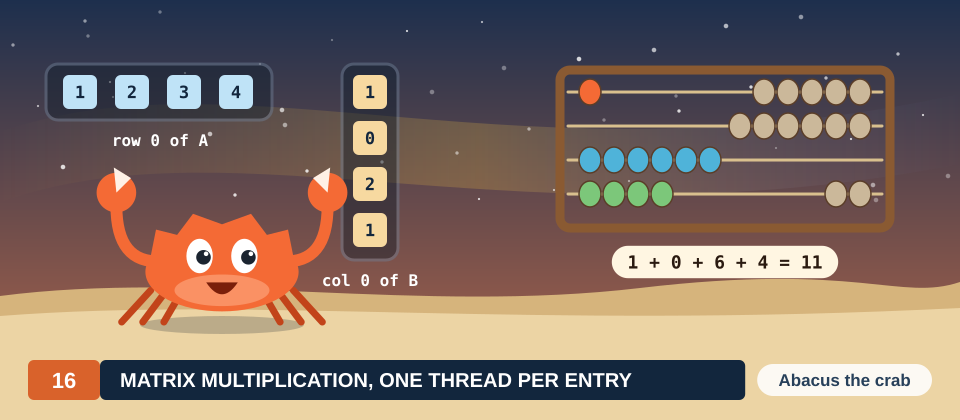

# Chapter 16: Matrix Multiplication, One Thread per Entry

The product of 2 matrices is the most studied computation on the GPU. It is the core of the
dense linear algebra in simulations, and the layers of a neural network spend most of their
time in it. It is also the standard first example of a parallel algorithm, because every entry
of the result can be computed independently of every other entry, and because the same input
values are needed by many entries, which makes the cost of reading memory easy to count.

In this chapter we derive the simplest GPU kernel for the matrix product. We work with a single
pair of 4 × 4 matrices from the first section to the last, small enough to check every number
with a pencil. We first compute the product by hand and on a CPU, then introduce the parts of
the GPU that the kernel needs: threads, blocks and grids, and the memories of the device. We
then write the direct kernel, in which 1 thread computes 1 entry of the result, count how often
it reads each input value from memory, and arrive at the observation on which the tiled kernel
of Chapter 17 is built. The kernel is implemented in Rust with cuda-oxide and in CUDA C++.

<div class="covers">

This chapter covers

- the matrix product, worked by hand on a 4 × 4 example
- row-major storage and the sequential algorithm, with a count of its work
- threads, blocks and grids in 1, 2 and 3 dimensions
- the memories of the device, and why global memory is the expensive one
- the direct kernel, and the number of values it fetches from global memory
- the kernel in Rust (`DisjointSlice`, `Runtime2DIndex`, launch contracts, a generic element
  type) and in CUDA C++ (a template)
- measured speeds, and why they are far below the arithmetic peak

</div>

The code of the chapter is in
[`code/oxide/ch16_matmul_naive/`](https://github.com/arpanpathak/gpu-parallel-book/tree/main/code/oxide/ch16_matmul_naive)
for Rust and in
[`code/cuda/ch16_matmul_naive/`](https://github.com/arpanpathak/gpu-parallel-book/tree/main/code/cuda/ch16_matmul_naive)
for C++.

We write algorithms in the style of Cormen, Leiserson, Rivest and Stein: procedure names in
small capitals, numbered lines, mathematical notation, and braces that delimit blocks. The range
\\([a, b)\\) denotes the integers \\(a, a + 1, \ldots, b - 1\\), exactly like `a..b` in Rust, so
\\(i \in [0, M)\\) runs over \\(0, 1, \ldots, M - 1\\). Indices start at 0.

## 16.1 The matrix product

### 16.1.1 A worked example

We use the same pair of matrices throughout this chapter and the 2 that follow it. Here are both
factors and their product:

\\[
\underbrace{\begin{pmatrix} 1 & 2 & 3 & 4 \\\\ 5 & 6 & 7 & 8 \\\\ 9 & 10 & 11 & 12 \\\\ 13 & 14 & 15 & 16 \end{pmatrix}}_{A}
\times
\underbrace{\begin{pmatrix} 1 & 0 & 2 & 1 \\\\ 0 & 1 & 1 & 2 \\\\ 2 & 1 & 0 & 1 \\\\ 1 & 2 & 1 & 0 \end{pmatrix}}_{B}
=
\underbrace{\begin{pmatrix} 11 & 13 & 8 & 8 \\\\ 27 & 29 & 24 & 24 \\\\ 43 & 45 & 40 & 40 \\\\ 59 & 61 & 56 & 56 \end{pmatrix}}_{C}.
\\]

Each entry of \\(C\\) comes from 1 row of \\(A\\) and 1 column of \\(B\\). To obtain the top-left
entry, 11, we walk along row 0 of \\(A\\) and down column 0 of \\(B\\) together, multiply the
numbers we meet in pairs, and add the 4 products: \\(1 \cdot 1 + 2 \cdot 0 + 3 \cdot 2 + 4 \cdot 1
= 1 + 0 + 6 + 4 = 11\\) (Figure 16.1). Every other entry of \\(C\\) is made in the same way from a
different row and a different column. The entry in row 0 and column 1, for example, pairs row 0
of \\(A\\) with column 1 of \\(B\\), \\(1 \cdot 0 + 2 \cdot 1 + 3 \cdot 1 + 4 \cdot 2 = 13\\).

<figure>
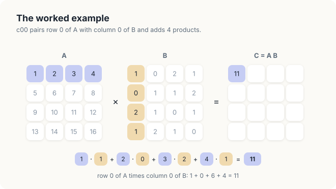
<figcaption><b>Figure 16.1</b> The entry c<sub>00</sub>: row 0 of A paired with column 0 of B. The 4 products sum to 11.</figcaption>
</figure>

We ask the reader to keep 2 of these entries in mind, \\(c_{00} = 11\\) and \\(c_{01} = 13\\).
In Chapter 17 we will remove 1 line at a time from a correct kernel, and the 2 broken kernels
will produce 7 and 15 in their place.

### 16.1.2 Definition

The rule pairs a row of \\(A\\) with a column of \\(B\\), so a row of \\(A\\) and a column of
\\(B\\) must have the same length. We call that length \\(K\\).

<div class="definition">

<span class="box-label">Definition 16.1</span> **Matrix product.** Let \\(A\\) be an
\\(M \times K\\) matrix and \\(B\\) a \\(K \times N\\) matrix. Their product \\(C = AB\\) is the
\\(M \times N\\) matrix with entries

\\[ c_{ij} = \sum_{s \in [0, K)} a_{is}\\, b_{sj}, \qquad i \in [0, M),\ j \in [0, N). \\]

In words, \\(c_{ij}\\) is the dot product of row \\(i\\) of \\(A\\) and column \\(j\\) of \\(B\\):
the sum of the products of their entries, taken in pairs.

*Example.* In our example \\(M = K = N = 4\\), and the definition gives
\\(c_{00} = 1 \cdot 1 + 2 \cdot 0 + 3 \cdot 2 + 4 \cdot 1 = 11\\), the sum of Figure 16.1.

</div>

The 3 sizes play different roles. \\(M\\) is the number of rows of \\(A\\) and of \\(C\\),
\\(N\\) the number of columns of \\(B\\) and of \\(C\\), and \\(K\\) the length of every dot
product. \\(K\\) does not appear in the shape of the result at all; it only says how much work
each entry takes. The kernels of this part accept any 3 sizes, and we measure them on square
matrices, \\(M = N = K = n\\).

### 16.1.3 Storage in row-major order

The memory of a computer is a single line of numbered locations, so a 2-dimensional matrix must
be laid out along that line. The usual choice copies the matrix out in the order in which we
read a page: row 0, then row 1, and so on (Figure 16.2). The entry 10 of \\(A\\) lies in row 2
and column 1. Rows 0 and 1 come before it, 8 values, and 1 entry of its own row, so it is stored
at location \\(2 \cdot 4 + 1 = 9\\).

<figure>
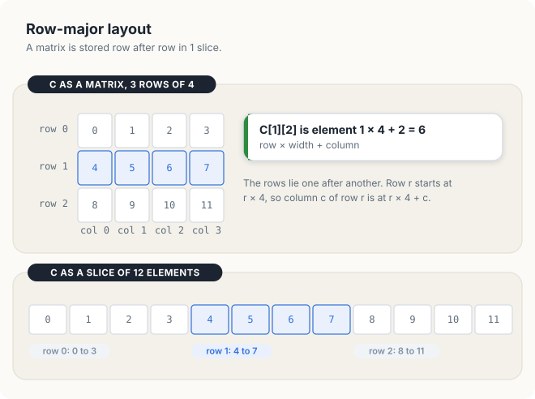
<figcaption><b>Figure 16.2</b> Matrix A in row-major order, 1 colour per row. Entry 10, in row 2 and column 1, lands at location 2 · 4 + 1 = 9.</figcaption>
</figure>

To find entry \\((r, c)\\), we skip the \\(r\\) complete rows above it and then the \\(c\\)
entries before it in its own row.

<div class="definition">

<span class="box-label">Definition 16.2</span> **Row-major order.** In row-major order the rows
of a matrix are stored one after another. In a matrix whose rows have width \\(W\\), entry
\\((r, c)\\) is stored at location

\\[ \text{Index}(r, c, W) = r \cdot W + c. \\]

The number \\(W\\) is called the **row width** of the matrix.

*Example.* \\(A\\) has rows of width 4, so \\(a_{21} = 10\\) is stored at
\\(\text{Index}(2, 1, 4) = 9\\).

</div>

A consequence that the later chapters use often: neighbours in a row are neighbours in memory,
while neighbours in a column lie \\(W\\) locations apart. In the product, matrix \\(A\\) has rows
of width \\(K\\), and matrices \\(B\\) and \\(C\\) have rows of width \\(N\\). Entry \\(a_{is}\\)
is therefore at location \\(iK + s\\), \\(b_{sj}\\) at \\(sN + j\\) and \\(c_{ij}\\) at
\\(iN + j\\). Rust slices, C arrays, and every matrix in this book use row-major order.

<div class="exercises">

Exercises

16.1 Compute \\(c_{23}\\) from Definition 16.1. Which row of \\(A\\) and which column of \\(B\\)
do you use?<br>
16.2 At which location is \\(b_{31}\\) stored, in row-major order with \\(W = 4\\)? Which value
does it hold?<br>
16.3 A matrix of 3 rows is stored in row-major order in 12 locations. What is its row width, and
where is entry \\((2, 0)\\)?

</div>

## 16.2 The sequential algorithm

On a CPU, Definition 16.1 becomes 3 nested loops. The outer 2 loops choose an entry of \\(C\\),
and the inner loop adds up the products for that entry.

<div class="algo">
<p class="algo-name">Matrix-Multiply(\(A, B, C, M, K, N\))</p>
<ol>
<li>for \(i \in [0, M)\) {</li>
<li style="--d:1">for \(j \in [0, N)\) {</li>
<li style="--d:2">\(c_{ij} = 0\)</li>
<li style="--d:2">for \(s \in [0, K)\) {</li>
<li style="--d:3">\(c_{ij} = c_{ij} + a_{is} \cdot b_{sj}\)</li>
<li style="--d:2">}</li>
<li style="--d:1">}</li>
<li>}</li>
</ol>
</div>

Line 5 executes once for every choice of \\(i\\), \\(j\\) and \\(s\\), that is \\(MNK\\) times.
Each execution is 1 **multiply-add**: 1 multiplication followed by 1 addition. We count work in
**floating-point operations** (FLOP), so 1 multiply-add is 2 FLOP and the whole product is
\\(2MNK\\) FLOP. Our example needs \\(4 \cdot 4 \cdot 4 = 64\\) multiply-adds, 128 FLOP. Two
matrices of size 1,024 × 1,024 need \\(1{,}024^3 = 1.07 \times 10^9\\) multiply-adds, and 2 of
size 4,096 × 4,096 need \\(6.9 \times 10^{10}\\), which is \\(1.37 \times 10^{11}\\) FLOP.

The CPU performs these multiply-adds one after another and visits the entries of \\(C\\) in
order (Figure 16.3). At visit 7 it computes \\(c_{12}\\), and line 5 runs for \\(s = 0, 1, 2, 3\\):
\\(c_{12} = 5 \cdot 2 + 6 \cdot 1 + 7 \cdot 0 + 8 \cdot 1 = 24\\).

<figure>
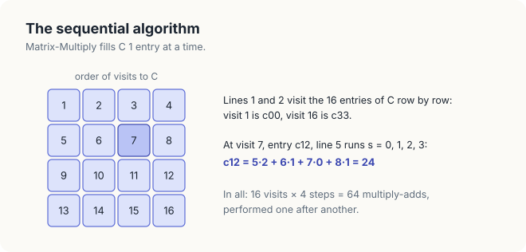
<figcaption><b>Figure 16.3</b> The order in which <span style="font-variant: small-caps">Matrix-Multiply</span> fills C. Visit 7 computes c<sub>12</sub> = 24 with 4 multiply-adds.</figcaption>
</figure>

Nothing in the algorithm forces this order. Visit 7 uses row 1 of \\(A\\) and column 2 of \\(B\\),
which no visit changes, and it writes \\(c_{12}\\), which no other visit reads or writes. The 16
visits are therefore independent of one another, and they could all take place at the same
time. A GPU is built for that situation, and the next section describes the parts of it that
we need.

<div class="exercises">

Exercises

16.4 Show that <span style="font-variant: small-caps">Matrix-Multiply</span> reads each entry of
\\(A\\) exactly \\(N\\) times. How many times does it read each entry of \\(B\\)?<br>
16.5 How many FLOP does the product of a 300 × 500 matrix and a 500 × 700 matrix take?<br>
16.6 Exchange the loops over \\(j\\) and \\(s\\) in the algorithm. Is the result still correct?
Which line must move?

</div>

## 16.3 The graphics processor

### 16.3.1 Host and device

A computer with a GPU contains 2 processors, each with its own memory. We call the CPU and its
memory the **host**, and the GPU and its memory the **device**. Data move between the 2 memories
only when the program copies them, so every program of this part follows the same 5 steps
(Figure 16.4): the host creates \\(A\\) and \\(B\\), copies them to the device, launches the
computation, copies \\(C\\) back, and checks it.

<figure>

<figcaption><b>Figure 16.4</b> The 5 steps of every program, and the system. Host and device each have a processor and a memory, and the link between them carries only explicit copies.</figcaption>
</figure>

On an integrated GPU, host and device
share 1 physical memory, but the program still copies between the host's buffers and the
device's buffers, and the 5 steps are the same.

### 16.3.2 Threads, blocks and grids

Look again at the 16 entries of \\(C\\). No entry depends on any other, so all of them may be
computed at the same time. A GPU runs 1 function many times at once.

<div class="definition">

<span class="box-label">Definition 16.3</span> **Kernel and thread.** A **kernel** is a function
that the GPU runs many times at once. Each of these runs is a **thread**; every thread has its
own position and its own variables.

*Example.* We will run the direct kernel of Section 16.4 with 16 threads, 1 per entry of
\\(C\\); the thread at row 1 and column 2 computes \\(c_{12} = 24\\).

</div>

The GPU organizes threads on 2 levels.

<div class="definition">

<span class="box-label">Definition 16.4</span> **Block and grid.** A **block** is a group of
threads that run on the same processor of the device, share a region of fast memory, and can
wait for one another. The **grid** is the set of all blocks of 1 launch.

*Example.* With blocks of 2 × 2 threads, a grid of 2 × 2 blocks covers \\(C\\); block
\\((0, 0)\\) computes \\(c_{00}\\), \\(c_{01}\\), \\(c_{10}\\) and \\(c_{11}\\).

</div>

<figure>
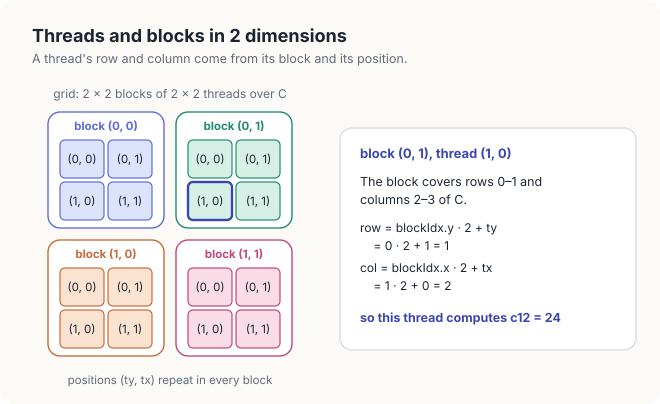
<figcaption><b>Figure 16.5</b> A grid of 2 × 2 blocks of 2 × 2 threads over C, 1 colour per block. Thread (1, 0) of block (0, 1) computes c<sub>12</sub>.</figcaption>
</figure>

Blocks and grids can extend along 1, 2 or 3 axes, named \\(x\\), \\(y\\) and \\(z\\), and we choose
the shape to match the data. Every thread can ask the GPU 3 questions: in which block am I
(*blockIdx*), where am I inside my block (*threadIdx*), and how big is a block (*blockDim*)? From
the 3 answers, a thread works out which piece of the data belongs to it. We first see how in 1
dimension.

**1 dimension.** Take a vector of 12 elements, handled by blocks of 4 threads: 3 blocks side by
side (Figure 16.6). Which element belongs to thread 1 of block 2? Blocks 0 and 1 come first and
cover elements 0 to 7, so block 2 starts at element 8, and its thread 1 takes element
\\(8 + 1 = 9\\). In general, block \\(b\\) starts at element \\(b \cdot \textit{blockDim.x}\\),
and thread \\(t\\) of that block handles element

\\[ i = \textit{blockIdx.x} \cdot \textit{blockDim.x} + \textit{threadIdx.x}. \\]

<figure>
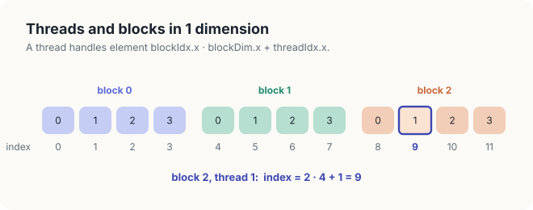
<figcaption><b>Figure 16.6</b> 1 dimension: 12 elements in 3 blocks of 4 threads. Thread 1 of block 2 handles element 2 · 4 + 1 = 9.</figcaption>
</figure>

**2 dimensions.** A matrix has rows and columns, so we arrange blocks and threads in the same way,
with \\(x\\) counting columns and \\(y\\) counting rows. For the matrix product we cut \\(C\\) into
squares of \\(T \times T\\) entries and give each square to 1 block of \\(T \times T\\) threads.
We write positions as (row, column), that is \\((y, x)\\). Which entry belongs to the outlined
thread of Figure 16.5? It is thread \\((1, 0)\\) of block \\((0, 1)\\). Its block covers rows 0 to
1 and columns 2 to 3 of \\(C\\), so the block's top-left corner is at row \\(0 \cdot T = 0\\) and
column \\(1 \cdot T = 2\\). Inside the block, the thread sits 1 row down and 0 columns across, so
it owns row \\(0 + 1 = 1\\) and column \\(2 + 0 = 2\\), and computes \\(c_{12}\\). The same
reasoning works for every thread:

\\[ \textit{row} = \textit{blockIdx.y} \cdot T + \textit{threadIdx.y}, \qquad
\textit{col} = \textit{blockIdx.x} \cdot T + \textit{threadIdx.x}. \\]

In cuda-oxide the 2 values are returned by `thread::index_2d_row()` and `thread::index_2d_col()`.
From here on we shorten *threadIdx.x* and *threadIdx.y* to *tx* and *ty*.

The choice of \\(x\\) for the column is not arbitrary. The GPU executes the threads of a block in
groups of 32 consecutive threads, numbered along \\(x\\) first.

<div class="definition">

<span class="box-label">Definition 16.5</span> **Warp.** A **warp** is a group of 32 threads of
a block with consecutive positions, counted along \\(x\\) first, that the hardware issues
together: 1 instruction is fetched and executed for all 32 threads at once.

*Example.* In a block of 16 × 16 threads, threads \\((0, 0)\\) to \\((0, 15)\\) and \\((1, 0)\\)
to \\((1, 15)\\) form warp 0.

</div>

With \\(x\\) along the columns, the threads of a warp compute neighbouring entries of a row of
\\(C\\). At each step of the dot product they read the same entry of \\(A\\) and neighbouring
entries of a row of \\(B\\), which lie next to each other in memory. Memory delivers such
neighbouring values together in 1 transaction. In Section 9.3 we measured the opposite choice,
\\(x\\) along the rows, as 5.4 times slower.

**3 dimensions.** For data in a volume, such as temperatures on a 3-dimensional mesh, we add the
axis \\(z\\) and reason in the same way along each of the 3 axes:

\\[ x = \textit{blockIdx.x} \cdot \textit{blockDim.x} + \textit{threadIdx.x}, \\]

and likewise for \\(y\\) and \\(z\\). Figure 16.7 covers a 4 × 2 × 4 volume with 4 blocks of
2 × 2 × 2 threads. Thread \\((1, 0, 0)\\) of block \\((1, 0, 1)\\), written as \\((x, y, z)\\),
sits at \\(x = 1 \cdot 2 + 1 = 3\\), \\(y = 0 \cdot 2 + 0 = 0\\) and \\(z = 1 \cdot 2 + 0 = 2\\).

<figure>
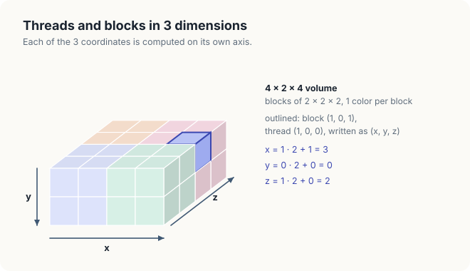
<figcaption><b>Figure 16.7</b> 3 dimensions: a 4 × 2 × 4 volume in 4 blocks of 2 × 2 × 2 threads. Thread (1, 0, 0) of block (1, 0, 1) sits at x = 3, y = 0, z = 2.</figcaption>
</figure>

When we launch a kernel, we give the sizes of the grid and of a block as triples \\((x, y, z)\\).
For the matrix product we use a grid of \\((\lceil N/T \rceil, \lceil M/T \rceil, 1)\\) blocks of
\\((T, T, 1)\\) threads. The ceilings matter when \\(T\\) does not divide the matrix: for
\\(N = 1{,}000\\) and \\(T = 16\\), \\(1{,}000 / 16 = 62.5\\), so the grid needs 63 blocks across,
and the last block has 8 threads that lie past the last column.

### 16.3.3 Scheduling and scope

The device executes blocks on processors of its own.

<div class="definition">

<span class="box-label">Definition 16.6</span> **Streaming multiprocessor.** A **streaming
multiprocessor** (SM) is 1 of the processors of a GPU. It contains arithmetic units, registers
and shared memory, and it runs whole blocks: at launch each block is assigned to 1 SM and stays
there until it finishes.

*Example.* The Jetson Orin NX has 8 SMs and the Jetson AGX Thor 20.

</div>

An SM can hold several blocks at once. If the grid has more blocks than the SMs can hold, the
remaining blocks wait and run in later **waves** (Figure 16.8). Blocks run in no guaranteed
order, so a correct kernel must never depend on the order of blocks.

<figure>
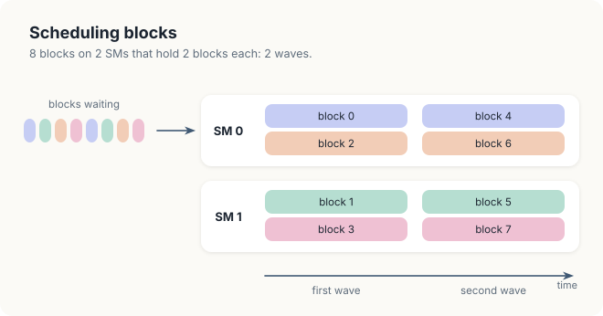
<figcaption><b>Figure 16.8</b> 8 blocks on 2 SMs that hold 2 blocks each. Blocks 0 to 3 run in the first wave and blocks 4 to 7 in the second.</figcaption>
</figure>

The block is also the unit of cooperation. Threads in the same block share a region of shared
memory and can meet at a barrier, which we define in Chapter 17; threads in different blocks can
do neither, and they exchange data only through global memory (Figure 16.9). The direct kernel of
this chapter needs no cooperation at all, since every thread works alone; the tiled kernel of
Chapter 17 depends on it.

<figure>
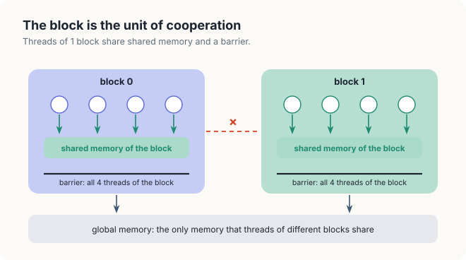
<figcaption><b>Figure 16.9</b> Threads of 1 block share shared memory and a barrier. Threads of different blocks can exchange data only through global memory.</figcaption>
</figure>

### 16.3.4 Memories of the device

To compute \\(c_{12}\\), a thread needs row 1 of \\(A\\) and column 2 of \\(B\\). How long it waits
for them depends on where they are stored, so we now look inside the device (Figure 16.10).

<figure>

<figcaption><b>Figure 16.10</b> The device. Each SM contains arithmetic units, registers and shared memory and runs whole blocks; all SMs reach global memory through a common L2 cache.</figcaption>
</figure>

<div class="definition">

<span class="box-label">Definition 16.7</span> **Registers, shared memory, global memory.**
**Registers** hold the variables of a single thread and respond in about 1 cycle. **Shared
memory** belongs to a block: every thread of the block can read and write it, no other thread
can, it responds within a few cycles, and values enter it only when threads of the block store
them there. **Global memory** is visible to every thread, holds gigabytes, and takes several
hundred cycles to respond. Between the SMs and global memory sits the **L2 cache**, which keeps
recently used values of global memory; the program has no control over its contents. Each SM
also has a smaller **L1 cache** of its own.

*Example.* In the direct kernel, `sum` lives in a register, and \\(A\\), \\(B\\) and \\(C\\) live
in global memory. The tiled kernel of Chapter 17 adds tiles in shared memory.

</div>

| Storage | Visible to | Latency | Capacity |
|---|---|---|---|
| Registers | 1 thread | about 1 cycle | 65,536 values of 4 bytes per SM |
| Shared memory | 1 block | a few cycles | 48 to 228 KB per SM |
| L2 cache | all SMs | tens to 100 cycles | a few MB to tens of MB |
| Global memory | all threads | hundreds of cycles | gigabytes |

From the table we can read off a strategy. Arithmetic and registers are cheap; global memory is
expensive. A fast kernel therefore fetches each value from global memory as few times as
possible and works from storage closer to the arithmetic units. The direct kernel of the next
section does not yet do this, and we will count what it costs.

<div class="exercises">

Exercises

16.7 Which entry of \\(C\\) does thread \\((0, 1)\\) of block \\((1, 1)\\) compute in Figure 16.5?<br>
16.8 With \\(T = 16\\), how many blocks cover a 1,000 × 1,000 matrix \\(C\\)? How many threads
in the edge blocks have no entry to compute?<br>
16.9 A grid has 132 blocks, and the device has 66 SMs that each hold 1 block at a time. How many
waves are needed?

</div>

## 16.4 The direct kernel

### 16.4.1 The algorithm

We obtain the simplest GPU kernel by deleting the 2 outer loops of
<span style="font-variant: small-caps">Matrix-Multiply</span>: the position of each thread now
plays the role of \\(i\\) and \\(j\\). Every thread executes the following procedure.

<div class="algo">
<p class="algo-name">Direct-Kernel(\(A, B, C, M, K, N\))</p>
<ol>
<li>\(tx = \textit{threadIdx.x}\), \(ty = \textit{threadIdx.y}\)</li>
<li>\(\textit{row} = \textit{blockIdx.y} \cdot T + ty\), \(\textit{col} = \textit{blockIdx.x} \cdot T + tx\)</li>
<li>if \(\textit{row} \notin [0, M)\) or \(\textit{col} \notin [0, N)\) { <span class="c">// thread lies outside C</span></li>
<li style="--d:1">return</li>
<li>}</li>
<li>\(\textit{sum} = 0\)</li>
<li>for \(s \in [0, K)\) {</li>
<li style="--d:1">\(\textit{sum} = \textit{sum} + a_{\textit{row}, s} \cdot b_{s, \textit{col}}\) <span class="c">// 2 fetches from global memory</span></li>
<li>}</li>
<li>\(c_{\textit{row}, \textit{col}} = \textit{sum}\)</li>
</ol>
</div>

Lines 1 and 2 compute the thread's entry with the formulas of Section 16.3.2. Lines 3 to 5 send
home any thread that lies outside \\(C\\), which happens when the matrix size is not a multiple
of \\(T\\). Lines 6 to 9 are the inner loop of
<span style="font-variant: small-caps">Matrix-Multiply</span>, with the partial sum kept in a
register, and line 10 stores the result. Since every thread writes a different entry of \\(C\\)
and reads only \\(A\\) and \\(B\\), which no thread writes, the threads never interfere with one
another. In Figure 16.11 we follow a single thread through its work.

<figure>
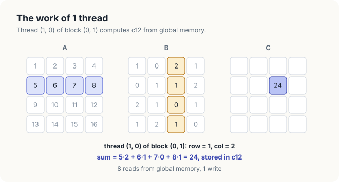
<figcaption><b>Figure 16.11</b> The work of 1 thread of the direct kernel: row 1 of A times column 2 of B gives c<sub>12</sub> = 24, with 8 fetches from global memory.</figcaption>
</figure>

The thread is thread \\((1, 0)\\) of block \\((0, 1)\\), with \\(T = 2\\). Line 2 gives
\\(\textit{row} = 0 \cdot 2 + 1 = 1\\) and \\(\textit{col} = 1 \cdot 2 + 0 = 2\\). The loop runs
for \\(s = 0, 1, 2, 3\\) and accumulates \\(5 \cdot 2 + 6 \cdot 1 + 7 \cdot 0 + 8 \cdot 1 = 24\\).
Each pass of line 8 fetches 1 value of \\(A\\) and 1 value of \\(B\\) from global memory, so the
thread makes 8 fetches and 1 write.

### 16.4.2 Correctness

The direct kernel needs only a short argument. Fix a thread with \\(\textit{row} \in [0, M)\\) and
\\(\textit{col} \in [0, N)\\). Before the pass of line 8 with index \\(s\\), the variable `sum`
holds \\(\sum_{s' \in [0, s)} a_{\textit{row}, s'}\\, b_{s', \textit{col}}\\): this holds for
\\(s = 0\\), where the sum is empty and `sum` is 0, and each pass adds the next term. When the loop
ends, \\(s = K\\) and `sum` is \\(c_{\textit{row}, \textit{col}}\\) by Definition 16.1. No other
thread has the same \\((\textit{row}, \textit{col})\\), because 2 threads differ in their block or
in their position inside it, so no other thread writes that entry.

The guard of lines 3 to 5 is the only part of the kernel that can go wrong. Without it, a thread past the last
column computes an index \\(\textit{row} \cdot N + \textit{col}\\) that lands at the start of the
next row, and a thread past the last row writes beyond the end of \\(C\\). We removed lines 3 to
5 from the C++ kernel and ran it on matrices of 1,000 × 1,000, which a grid of 63 × 63 blocks of
16 × 16 threads overhangs by 8 rows and 8 columns:

```console
kernel: an illegal memory access was encountered
```

The threads in the 8 extra rows read past the end of \\(A\\) and write past the end of \\(C\\),
and the GPU stopped the kernel. A smaller overhang can stay inside memory that the program owns,
and then the kernel finishes and the error shows only in the values. In Section 16.5.6 we make
the same change in Rust, where the outcome is different.

### 16.4.3 Counting the fetches

The kernel is correct, but it is wasteful. Consider the value \\(a_{01} = 2\\). It lies in row 0 of
\\(A\\), and all 4 entries of row 0 of \\(C\\) are built from row 0 of \\(A\\). So 4 threads need
\\(a_{01}\\), and in the direct kernel each of them fetches it from global memory on its own
(Figure 16.12).

<figure>
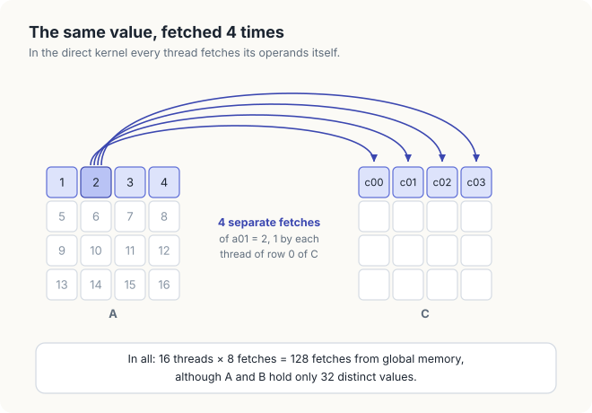
<figcaption><b>Figure 16.12</b> The 4 threads that compute row 0 of C each fetch a<sub>01</sub> from global memory: 4 fetches of the same value. In all, 128 fetches of 32 distinct values.</figcaption>
</figure>

The same holds for every value. Each entry of \\(A\\) is fetched by the 4 threads of its row of
\\(C\\), and each entry of \\(B\\) by the 4 threads of its column. In total, 16 threads each fetch
4 values of \\(A\\) and 4 of \\(B\\): 128 fetches, although the 2 matrices hold only 32 distinct
values.

In general, each of the \\(MN\\) threads makes \\(2K\\) fetches, so the direct kernel performs
\\(2MNK\\) fetches, 1 for every FLOP. Each entry of \\(A\\) is fetched \\(N\\) times and each
entry of \\(B\\) \\(M\\) times. For 2 matrices of 1,024 × 1,024 floats of 4 bytes, the kernel
makes \\(2 \cdot 1{,}024^3 = 2.1 \times 10^9\\) fetches, 8.6 GB of traffic, to read 8.4 MB of
input: every value is fetched 1,024 times, and each fetch that reaches global memory costs
hundreds of cycles. The ratio of work to traffic is 2 FLOP for every 2 floats fetched,
1 FLOP per float. Recall from Section 9.1.3 that a GPU needs about 100 FLOP per float fetched
from memory to keep its arithmetic units busy: 94 on the Orin NX and 119 on the Thor.

<div class="key-observation">

<span class="box-label">Key observation</span> The 4 threads computing row 0 of \\(C\\) all need
the same value \\(a_{01}\\). If these threads belong to the same block, 1 of them can copy
\\(a_{01}\\) into shared memory, and the other 3 can take it from there.

</div>

In Chapter 17 we turn this observation into the tiled kernel. In the rest of this chapter we
implement the direct kernel and measure how much the waste costs.

<div class="exercises">

Exercises

16.10 Which threads need \\(b_{21}\\)? How many times does the direct kernel fetch it?<br>
16.11 For \\(M = N = K = 2{,}048\\), how many times does the direct kernel fetch each entry of
\\(A\\), and how many bytes does it fetch in all?<br>
16.12 For \\(M = 3\\), \\(K = 3\\), \\(N = 3\\) and blocks of 2 × 2 threads, how many threads
does the grid hold, and how many of them return at line 4?

</div>

## 16.5 Implementation

We now turn the direct kernel into code. Both languages express the same procedure; they differ
in what the compiler checks. In each listing below, the Rust version is shown first and the C++
version in the second tab.

### 16.5.1 The kernel

In cuda-oxide, a kernel is an ordinary Rust function marked `#[kernel]`, placed inside a module
marked `#[cuda_module]`. The compiler turns the module into GPU code and generates, for each
kernel, host-side methods that prepare and launch it. In CUDA C++, a kernel is a function marked
`__global__`.

<div class="code-tabs">
<div class="code-tab" data-lang="Rust">

```rust,ignore
{{#include ../../../../code/oxide/ch16_matmul_naive/src/main.rs:24:61}}
```

</div>
<div class="code-tab" data-lang="C++">

```cpp
{{#include ../../../../code/cuda/ch16_matmul_naive/matmul_naive.cu:18:33}}
```

</div>
</div>

Both kernels match <span style="font-variant: small-caps">Direct-Kernel</span> almost line for
line. `index_2d_row()` and `index_2d_col()` in Rust, and the 2 expressions with `blockIdx` in
C++, are line 2 of the pseudocode, with `blockDim` in place of \\(T\\). The test of `row` and
`col` is lines 3 to 5, and the loop over `s` is lines 7 to 9. Every index uses
Definition 16.2: `a[row * k + s]` is \\(a_{\textit{row}, s}\\) in a matrix of row width \\(k\\),
and `b[s * n + col]` is \\(b_{s, \textit{col}}\\) in a matrix of row width \\(n\\). The Rust
kernel receives the sizes as `u32`, the type of a launch argument, and converts them to `usize`
once, so that all index arithmetic uses 1 type. Its loop is a `while` loop with `#[unroll(4)]`;
in Section 9.7 we explained that cuda-oxide unrolls a `while` loop marked `#[unroll]` and does not
unroll a `for` loop over a range.

### 16.5.2 The output slice

The 2 kernels differ in how they write \\(C\\). The C++ kernel receives a raw pointer `T* c` and
stores to `c[row * n + col]`. Nothing in the language prevents 2 threads from storing to the same
address, or a thread from storing past the end. In Rust, a kernel that takes `&mut [T]` would allow
every thread to write anywhere, which is a data race waiting to happen.

<div class="definition">

<span class="box-label">Definition 16.8</span> **Data race.** A **data race** occurs when 2
threads access the same memory location, at least 1 of them writes it, and nothing orders the 2
accesses. The value that results depends on the timing of the threads.

*Example.* If thread \\((0, 0)\\) and thread \\((0, 1)\\) both stored their sums to \\(c_{00}\\),
the entry would hold 11 or 13, depending on which store came last.

</div>

cuda-oxide therefore gives the output the type `DisjointSlice<T, IndexSpace>`. A thread can write
an element of it only through a **witness**: a value of type `ThreadIndex` that only the thread
itself can obtain, computed from its own coordinates, and that names the element it owns. The
second type parameter, the **index space**, states how coordinates become an element. The kernel
`matmul` uses `Runtime2DIndex`: the host binds the row width \\(n\\) to the buffer with
`RowWidth::new(&mut c, n)`, `thread::index_2d_runtime(&c)` returns a witness holding the thread's
row and column (or `None` if the column is not less than the bound width), and `c.get_mut(idx)`
returns a mutable reference to element \\(\textit{row} \cdot n + \textit{col}\\), or `None` if that
element lies past the end of `c`. The argument of Section 16.4.2 is now carried by the types: 2
threads have different coordinates, and for a fixed width and \\(\textit{col} < n\\) the map from
(row, col) to \\(\textit{row} \cdot n + \textit{col}\\) is 1 to 1, so 2 threads never hold the same
element. The kernel needs no `unsafe` block.

A second index space, `Index2D<W>`, puts the row width into the type. The kernel `matmul_fixed`
multiplies matrices of `FIXED` × `FIXED` = 1,024 × 1,024 floats with it:

<div class="code-tabs">
<div class="code-tab" data-lang="Rust">

```rust,ignore
{{#include ../../../../code/oxide/ch16_matmul_naive/src/main.rs:63:82}}
```

</div>
<div class="code-tab" data-lang="C++">

```cpp
{{#include ../../../../code/cuda/ch16_matmul_naive/matmul_naive.cu:35:50}}
```

</div>
</div>

`thread::index_2d::<FIXED>()` computes \\(\textit{row} \cdot 1{,}024 + \textit{col}\\) and returns
it as a witness of type `ThreadIndex<Index2D<1024>>`, which the `get_mut` of a
`DisjointSlice<f32, Index2D<1024>>` accepts. A witness made for another width has another type,
and passing it to this slice is a compile error. The C++ template `matmulFixed<W>` gains the same
constant width, but not the check: the index expression is written by hand, and a wrong width in
it compiles. The price in both languages is 1 compiled kernel per matrix size.

### 16.5.3 The launch contract

The attribute `#[launch_contract]` states the conditions under which a launch of the kernel is
correct, and cuda-oxide checks them on the host before the kernel starts. The contract of `matmul`
has 3 parts. `domain = 2` declares a 2-dimensional launch with \\(z = 1\\), which the 2-dimensional
index space needs; `coordinates = u32` requires every coordinate of the launch to fit in 32 bits;
and `#[launch_bounds(256)]` limits a block to 256 threads, so the same kernel serves the blocks of
2 × 2 threads of our example and the blocks of 16 × 16 threads of the measurements. The `requires`
clause adds 3 relations between the sizes and the buffers:

```rust,ignore
requires = (a.len() >= m * k, b.len() >= k * n, c.len() >= m * n)
```

The host prepares a launch once with `module.prepare_matmul::<T>(config)`, which checks the grid
and block shapes against the contract and against the limits of the GPU, and then launches with
`module.matmul(stream, &prepared, m, n, k, &a, &b, width)`, which evaluates the 3 relations with
the actual lengths and sizes. The program launches `matmul` once on purpose with buffers of
256 × 256 floats and \\(k = 512\\). The relation \\(a.\text{len}() \ge mk\\) becomes
\\(65{,}536 \ge 256 \cdot 512 = 131{,}072\\), which is false, and no kernel runs:

```console
k = 2 n refused before launch: matmul: size requirement `a.len() >= m * k` violated: left-hand side is 65536, right-hand side is 131072
```

The C++ launch `matmul<T><<<grid, block>>>(m, n, k, a, b, c)` has no such check. With the same
mistake, each thread would read row `row` of a matrix twice as wide as `a`, beyond its end.

<div class="code-tabs">
<div class="code-tab" data-lang="Rust">

```rust,ignore
{{#include ../../../../code/oxide/ch16_matmul_naive/src/main.rs:139:143}}

{{#include ../../../../code/oxide/ch16_matmul_naive/src/main.rs:198:204}}
```

</div>
<div class="code-tab" data-lang="C++">

```cpp
{{#include ../../../../code/cuda/ch16_matmul_naive/matmul_naive.cu:114:118}}

{{#include ../../../../code/cuda/ch16_matmul_naive/matmul_naive.cu:187:196}}
```

</div>
</div>

The function `config` computes the grid of Section 16.3.2, \\(\lceil n / T \rceil\\) blocks along
\\(x\\) and \\(\lceil m / T \rceil\\) along \\(y\\), with `div_ceil` rounding up. The Rust closure
creates a new `RowWidth` for every launch, because `RowWidth` holds the mutable borrow of `c` for
the duration of 1 launch. `time_ms` launches once without timing it and then averages `runs`
launches between 2 synchronisations of the stream.

### 16.5.4 One kernel for f32 and f64

Both kernels are written once for any element type. In C++, `template <typename T>` accepts any
type, and the compiler reports an error only if the body uses an operation the type lacks. In Rust,
the bound

```rust,ignore
T: Copy + Default + Add<Output = T> + Mul<Output = T>,
```

lists the operations the kernel performs: copying values, creating the initial 0 with
`T::default()`, adding, and multiplying. A type that lacks 1 of them is refused at the call, with
the missing trait named. cuda-oxide compiles 1 GPU function for each type with which the host
prepares the kernel, here `prepare_matmul::<f32>` and `prepare_matmul::<f64>`. The 2 versions
perform the same number of operations, but an `f64` occupies 8 bytes instead of 4, and a GPU has
separate units for 64-bit arithmetic, whose number differs widely between GPU models.

### 16.5.5 Exact verification

Both programs fill \\(A\\) and \\(B\\) with integers in \\([-5, 5]\\) from the same linear
congruential generator. Every product is then at most 25 in magnitude, and every partial sum at
most \\(25K = 102{,}400\\) for \\(K = 4{,}096\\). Single-precision floating point represents every
integer up to \\(2^{24} = 16{,}777{,}216\\) exactly, so each multiply-add is exact, the GPU and
the CPU must produce identical results whatever order they add in, and any difference signals a
bug. The programs compare 64 sampled entries of \\(C\\) with a product computed on the CPU and
require all 64 to be equal. They also run the 4 × 4 example with blocks of 2 × 2 threads, print
\\(C\\), and compare it with the product computed by hand in Section 16.1.

### 16.5.6 Removing the guard in Rust

In Section 16.4.2 we removed lines 3 to 5 from the C++ kernel and the kernel faulted. In the Rust
kernel, the guard is the condition `row < m && col < n` in front of the 2 `let` patterns. We removed
it and ran the kernel on matrices of 1,000 × 1,000, comparing all 1,000,000 entries with the CPU:

```console
no guard, n = 1000: 0 of 1000000 entries wrong
```

The result is correct. A thread past the last column receives `None` from `index_2d_runtime`, a
thread past the last row receives `None` from `get_mut`, and in both cases the thread skips the
loop and the write. The witness test is therefore a second guard. The explicit guard is still
needed: the width bound to `c` and the length of `c` are chosen by the host, and nothing forces
them to equal \\(n\\) and \\(mn\\). If the host bound a larger buffer, a thread in row \\(m\\) would
receive an element of `c` and then read row \\(m\\) of `a`, which does not exist. That read is
bounds-checked, so the kernel would stop with an error rather than read another buffer, but the
guard ties the reads to the sizes of `a` and `b` and keeps the kernel from failing at all.

<div class="exercises">

Exercises

16.13 Change the Rust launch to blocks of 32 × 8 threads. Which lines must change, and does the
contract accept the new shape?<br>
16.14 Write `matmul::<i32>` launches for the 4 × 4 example. Is the result exact? Which trait
bound does `i32` satisfy that a type such as `bool` does not?<br>
16.15 In the C++ kernel, exchange `blockIdx.x` and `blockIdx.y` in the computation of `row` and
`col` but not in the grid. For which matrix shapes is the result still correct?

</div>

## 16.6 Measurements

### 16.6.1 Platform and method

The measurements come from an integrated GPU, a Jetson Orin NX 16 GB (8 SMs, 102 GB/s, an FP32
peak of 2,400 GFLOP/s at 1.173 GHz). Each program warms the GPU up for
0.5 s so that its clocks reach their sustained values, launches each kernel once without timing,
and then averages up to 50 launches, fewer for the large sizes. Each program ran 3 times; the
tables show the quietest run, and repeated runs differed by up to 10%.

### 16.6.2 Results

The Rust program prints the following:

```console
$ cargo oxide run
C = A B on the 4 x 4 example, a grid of 2 x 2 blocks of 2 x 2 threads
    11   13    8    8
    27   29   24   24
    43   45   40   40
    59   61   56   56
equal to the product computed by hand: yes

C = A B, n x n, 1 thread per entry of C, blocks of 16 x 16 threads
      n  type              ms   GFLOP/s  fetched GB/s   exact
    512  f32            1.469     182.7      730.8     64 of 64
   1024  f32           15.659     137.1      548.6     64 of 64
   2048  f32          124.013     138.5      554.1     64 of 64
   4096  f32          997.150     137.8      551.3     64 of 64
   1024  f32 fixed     11.071     194.0      775.9     64 of 64
    512  f64            7.641      35.1      281.0     64 of 64
   1024  f64           61.076      35.2      281.3     64 of 64
   2048  f64          488.370      35.2      281.4     64 of 64
k = 2 n refused before launch: matmul: size requirement `a.len() >= m * k` violated: left-hand side is 65536, right-hand side is 131072
PASSED
```

The first lines reproduce the product of Section 16.1, with \\(c_{00} = 11\\) and
\\(c_{01} = 13\\). The C++ program prints the same example and the same table; the 2 sets of
times are side by side below.

| n | type | C++ time | C++ rate | Rust time | Rust rate | requested fetches (C++) |
|---|---|---|---|---|---|---|
| 512 | f32 | 1.465 ms | 183.2 GFLOP/s | 1.469 ms | 182.7 GFLOP/s | 732.9 GB/s |
| 1,024 | f32 | 11.803 ms | 181.9 GFLOP/s | 15.659 ms | 137.1 GFLOP/s | 727.8 GB/s |
| 2,048 | f32 | 93.828 ms | 183.1 GFLOP/s | 124.013 ms | 138.5 GFLOP/s | 732.4 GB/s |
| 4,096 | f32 | 743.091 ms | 185.0 GFLOP/s | 997.150 ms | 137.8 GFLOP/s | 739.8 GB/s |
| 1,024 | f32, fixed width | 11.493 ms | 186.9 GFLOP/s | 11.071 ms | 194.0 GFLOP/s | 747.4 GB/s |
| 512 | f64 | 7.588 ms | 35.4 GFLOP/s | 7.641 ms | 35.1 GFLOP/s | 283.0 GB/s |
| 1,024 | f64 | 61.045 ms | 35.2 GFLOP/s | 61.076 ms | 35.2 GFLOP/s | 281.4 GB/s |
| 2,048 | f64 | 487.566 ms | 35.2 GFLOP/s | 488.370 ms | 35.2 GFLOP/s | 281.9 GB/s |

The rate counts \\(2n^3\\) FLOP: for \\(n = 4{,}096\\), \\(2 \cdot 4{,}096^3 = 1.37 \times
10^{11}\\) FLOP in the time shown. The column *fetched GB/s* divides the fetches the kernel
requests, \\(2n^3\\) values of 4 or 8 bytes, by the time. All 64 sampled entries were exact in
every run, in single and in double precision.

<figure>

<figcaption><b>Figure 16.13</b> The direct kernel on the measured GPU: its rate against the FP32 peak, and its requested fetch rate against the bandwidth of global memory.</figcaption>
</figure>

### 16.6.3 Why the rate is far below the peak

The C++ kernel ran at 185.0 GFLOP/s for \\(n = 4{,}096\\), 7.7% of the FP32 peak of
2,400 GFLOP/s; the arithmetic units were idle more than 92% of the time. We gave the reason in
Section 16.4.3. The kernel fetches 1 float for every FLOP. If every fetch went to global memory, the
102 GB/s of the measured GPU would deliver \\(102 / 4 = 25.5 \times 10^9\\) floats per second, and the
kernel could perform at most 25.5 GFLOP/s.

The measured rate is 7.3 times that limit, and the fetch column shows how. The kernel requested
\\(2 \cdot 4{,}096^3 \cdot 4\\) bytes = 550 GB in 0.743 s, 739.8 GB/s, which is 7.3 times what
global memory can deliver. Since global memory delivers at most 102 GB/s, at least
\\(1 - 102/740 = 86\\%\\) of the requested fetches must have been answered by the L1 and L2 caches.
The repeated fetches of Figure 16.12 happen close together in time: the 16 threads of a warp that
share a row of \\(C\\) request the same value of \\(A\\) in the same instruction, which the hardware
delivers once to all of them, and neighbouring blocks request the same rows and columns shortly
after one another. The caches therefore recover much of the reuse, but by chance, and what remains
is waiting for memory: the kernel is limited by how fast the memory system delivers operands, not
by the arithmetic.

The `f64` kernel ran at 35.2 GFLOP/s. The measured GPU reports a ratio of 32 between its FP32 and FP64
rates, so its FP64 peak is \\(2{,}400 / 32 = 75\\) GFLOP/s, and the `f64` kernel reached 47% of
it, against 7.7% for `f32`. Its operands are twice as large, 282 GB/s of requests, but on this GPU
the few FP64 units, not the memory, set its speed. On a data-centre GPU with an FP32:FP64 ratio of
2, the `f64` kernel would be limited by memory like the `f32` one.

The 2 languages agree at 512 × 512 and in double precision. From 1,024 × 1,024 upwards, the
generic Rust kernel with its sizes known only at run time ran at 138 GFLOP/s against 182 to
185 GFLOP/s in C++, while the Rust kernel with the width in its type ran at 194.0 GFLOP/s, the
fastest of all. Both Rust kernels read the same values in the same order; they differ only in what
the compiler knows. With \\(n\\) and \\(k\\) constant, the loop has a fixed trip count, a multiple of
4, and the addresses of consecutive reads of `b` lie a constant 4,096 bytes apart; with run-time
sizes the compiler must handle a remainder and recompute every address. A width in the type costs
1 compiled kernel per matrix size, and in Chapter 17 we recover more speed for every size with
tiling.

The measured rates also show what does not matter. The block shape of 16 × 16 threads keeps the
reads of a warp contiguous, and the rates are almost the same at every size from 512 to 4,096:
once the matrices exceed the caches, every size waits for memory in the same proportion. The
remedy is to fetch less, which is what the key observation of Section 16.4.3 proposes.

## 16.7 The complete programs

<div class="code-tabs">
<div class="code-tab" data-lang="Rust">

```rust,ignore
{{#include ../../../../code/oxide/ch16_matmul_naive/src/main.rs}}
```

</div>
<div class="code-tab" data-lang="C++">

```cpp
{{#include ../../../../code/cuda/ch16_matmul_naive/matmul_naive.cu}}
```

</div>
</div>

Build and run the Rust program with `cargo oxide run` in its directory, and the C++ program with
`nvcc -O3 -arch=native matmul_naive.cu -o matmul_naive && ./matmul_naive`.

## Common mistakes

- **Taking the row from \\(x\\).** The result is still correct, but the 32 threads of a warp then
  walk down a column of \\(B\\), \\(N\\) floats apart, and the kernel runs several times slower
  (Section 9.3).
- **Rounding the grid down.** `n / 16` blocks leave the last \\(n \bmod 16\\) rows and columns of
  \\(C\\) unwritten. Round up with `div_ceil` or \\((n + 15) / 16\\).
- **Dropping the guard in C++.** Threads of the edge blocks then read and write outside the
  matrices; with \\(n = 1{,}000\\) the kernel stopped with an illegal memory access.
- **Binding the wrong row width.** `RowWidth::new(&mut c, k)` instead of `n` makes every thread
  write the element of a grid of width \\(k\\). The writes stay disjoint, so the program is safe,
  but the result is wrong unless \\(k = n\\).
- **Mixing up the 3 sizes.** \\(A\\) has row width \\(K\\), and \\(B\\) and \\(C\\) have row
  width \\(N\\). Square test matrices hide a mistake here; test a rectangular product.
- **Comparing random floats exactly.** With random real inputs the order of the additions changes
  the rounding. Use small integers, as here, or compare with a tolerance.

## Summary

<div class="summary">

- The product \\(C = AB\\) of an \\(M \times K\\) and a \\(K \times N\\) matrix has entries
  \\(c_{ij} = \sum_s a_{is} b_{sj}\\) and costs \\(MNK\\) multiply-adds, \\(2MNK\\) FLOP. Our
  4 × 4 example needs 64 multiply-adds, and \\(c_{00} = 11\\), \\(c_{01} = 13\\).
- In row-major order entry \\((r, c)\\) of a matrix of row width \\(W\\) is at \\(rW + c\\).
- A kernel runs as many threads, grouped in blocks of up to 1,024 threads that run on 1 SM and
  share shared memory, and a grid of blocks. A thread finds its entry from
  \\(\textit{blockIdx} \cdot T + \textit{threadIdx}\\) along each axis.
- Registers are fast and private, shared memory is fast and per block, global memory is large,
  shared by all and slow.
- The direct kernel gives each thread 1 entry of \\(C\\). It is correct, but it fetches every value
  of \\(A\\) \\(N\\) times and every value of \\(B\\) \\(M\\) times: \\(2MNK\\) fetches, 1 per FLOP.
- In Rust, `DisjointSlice` with `Runtime2DIndex` or `Index2D<W>` lets each thread write only its
  own entry without `unsafe`, and the launch contract refuses buffers too small for the sizes.
- On the measured GPU the kernel ran at about 7% of the FP32 peak; the caches answered most of its
  repeated fetches, and the rest of the time went to waiting for memory.

</div>

In Chapter 17 we let the threads of a block share the values they fetch, through shared memory,
and derive the tiled kernel from the key observation of Section 16.4.3.

## Exercises

1. Compute \\(c_{32}\\) of the example by hand, and identify the thread of Figure 16.5 that
   computes it.
2. For \\(n = 1{,}000\\) and blocks of 16 × 16 threads, how many threads does the grid contain,
   and what fraction of them fail the guard?
3. Extend the Rust host program to rectangular matrices and check the product for
   \\(M = 300\\), \\(K = 500\\), \\(N = 700\\).
4. Explain why the `f64` results of this chapter are exact. Would they stay exact for integers in
   \\([-1{,}000, 1{,}000]\\) and \\(K = 4{,}096\\)? And the `f32` results?
5. Using the FP32:FP64 ratio of your GPU, predict the rate of `matmul::<f64>` if it were limited by
   arithmetic, and compare with your measurement.
6. Remove `#[unroll(4)]` from `matmul` and measure again. What changes?
7. Write a kernel that computes \\(C = A^{\mathsf T} B\\) without forming \\(A^{\mathsf T}\\). Which
   index expression changes, and how does the access pattern of a warp change?
8. Suppose a cache holds every value that a block fetches. How many fetches does block \\((0, 0)\\)
   of Figure 16.5 then make from global memory, and how does that compare with the 32 fetches it
   requests?

## Sources and further reading

- A. Pathak, *An Introduction to Tiled Parallel Programming, Simplified*, 2026: the worked
  example, the direct kernel and its fetch count.
- T. H. Cormen, C. E. Leiserson, R. L. Rivest and C. Stein, *Introduction to Algorithms*, 4th ed.,
  MIT Press, 2022: the pseudocode conventions.
- NVIDIA, *CUDA C++ Programming Guide*, "Thread Hierarchy" and "Memory Hierarchy":
  <https://docs.nvidia.com/cuda/cuda-c-programming-guide/>
- cuda-oxide, rev b7fe543, `cuda-device` crate: `DisjointSlice`, `Index2D`, `Runtime2DIndex` and
  the thread index functions; `cuda-macros`: `#[launch_contract]`:
  <https://github.com/NVlabs/cuda-oxide>
- Chapter 9 of this book, for the same kernel in CUDA C++ and the effect of the block shape.
