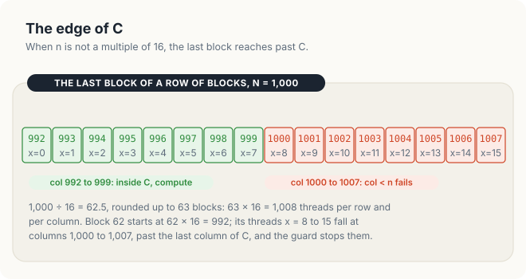
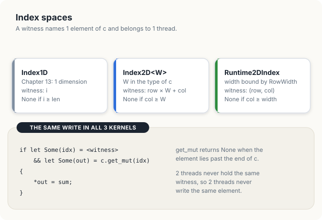
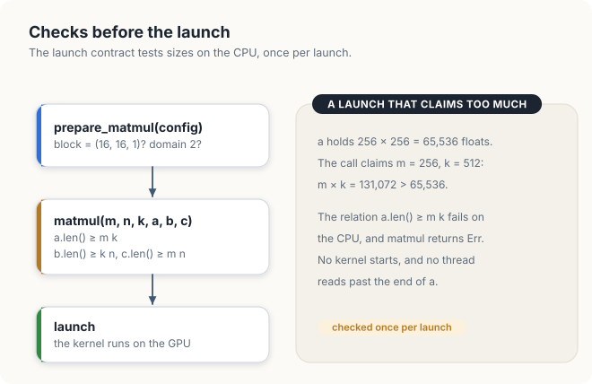
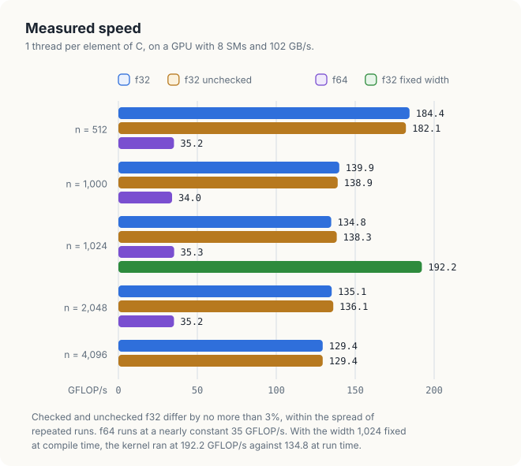
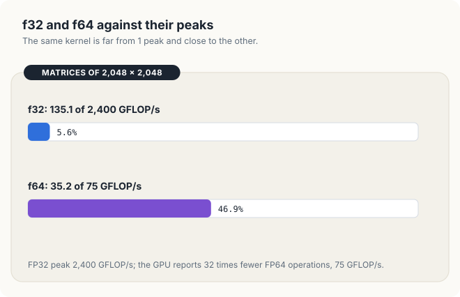

# Chapter 16: Matrix Multiplication in Rust, One Thread per Output

The kernels of Chapter 13 worked on vectors. Each thread received 1 index, and each index named
1 element of a 1-dimensional slice. Many problems are 2-dimensional: images, grids of a
simulation, and the matrices of linear algebra. For such data it is natural to arrange the threads
in 2 dimensions as well, so that a thread's coordinates name a row and a column of the result. In
this chapter, we write the simplest matrix multiplication kernel in cuda-oxide, with 1 thread for
each element of the product, and use it to study how cuda-oxide expresses 2-dimensional work.

Chapter 9 developed matrix multiplication in CUDA C++ through 4 stages of optimisation, and
Section 9.1 derived its arithmetic intensity. We do not repeat that analysis here. Instead, we
concentrate on the parts that are specific to Rust. We show how a matrix is stored in a slice
and how a 2-dimensional launch is configured. We then examine how the type of the output slice
decides which thread may write which element, how the launch contract checks the sizes of the
matrices before a kernel starts, and what the bounds checks on every read cost. We also write the kernel once for any
element type and run it in single and in double precision.

<div class="covers" markdown="1">

This chapter covers

- row-major storage of a matrix in a Rust slice
- 2-dimensional grids and blocks with `LaunchConfig2D`
- the index spaces `Index2D<W>` and `Runtime2DIndex`, and the row width bound with `RowWidth`
- why each thread's write to the output is disjoint from every other thread's
- size requirements in the launch contract, checked on the CPU before the launch
- the cost of bounds checks, and `#[kernel(unchecked_indexing)]`
- a generic kernel for `f32` and `f64`

</div>

The code of the chapter is in
[`code/oxide/ch16_matmul_naive/`](https://github.com/arpanpathak/gpu-parallel-book/tree/main/code/oxide/ch16_matmul_naive).

## 16.1 Matrices as slices

### 16.1.1 Row-major layout

A matrix with \\(m\\) rows and \\(n\\) columns holds \\(m \times n\\) values, but the memory of a
computer is a single sequence of addresses. A matrix must therefore be **linearized**: its
elements are placed in 1 sequence according to a fixed rule. In **row-major** layout, the rule
places all elements of row 0 first, then all elements of row 1, and so on. Rust arrays of
arrays, C and C++ use this layout, and every matrix in this book is stored this way.

Figure 16.1 shows a matrix \\(C\\) of 3 rows and 4 columns. Row 0 occupies elements 0 to 3 of
the slice, row 1 elements 4 to 7, and row 2 elements 8 to 11. To reach row \\(r\\), we skip the
\\(r\\) complete rows before it, \\(r \times 4\\) elements, and then move \\(c\\) elements along
the row. Element \\((1, 2)\\) is therefore element \\(1 \times 4 + 2 = 6\\) of the slice. In
general, for a matrix whose rows hold \\(w\\) elements,

\\[ \text{index}(r, c) = r \times w + c. \\]

The number \\(w\\) is called the **row width** of the matrix (or its stride). The formula needs
the row width and nothing else; in particular it does not need the number of rows.

<figure>

<figcaption><b>Figure 16.1</b> Row-major layout: element (r, c) of a matrix with rows of w elements is element r × w + c of the slice.</figcaption>
</figure>

### 16.1.2 The product of an m × k and a k × n matrix

Section 9.1.1 defined the product \\(C = AB\\) of square matrices. Here we allow rectangular ones.
If \\(A\\) has \\(m\\) rows and \\(k\\) columns and \\(B\\) has \\(k\\) rows and \\(n\\) columns,
the product \\(C\\) has \\(m\\) rows and \\(n\\) columns, and

\\[ C_{ij} = \sum_{p=0}^{k-1} A_{ip} B_{pj}. \\]

The 3 matrices have 3 different row widths. Row \\(i\\) of \\(A\\) starts at \\(i \times k\\), so
\\(A_{ip}\\) is element \\(i k + p\\) of `a`. Row \\(p\\) of \\(B\\) starts at \\(p \times n\\), so
\\(B_{pj}\\) is element \\(p n + j\\) of `b`. Element \\(C_{ij}\\) is element \\(i n + j\\) of `c`.
The algorithm for 1 thread follows directly:

```text
for each thread:                         # 1 thread per element of C
    i ← the thread's row,  j ← the thread's column
    if i < m and j < n:
        sum ← 0
        for p ← 0 to k − 1:
            sum ← sum + a[i·k + p] × b[p·n + j]
        c[i·n + j] ← sum
```

Section 9.1.1 worked 1 element by hand: row 1 of a 4 × 4 matrix \\(A\\) is 0, 1, 3, 2, column 2
of \\(B\\) is 0, 2, 1, 1, and \\(C_{12}\\) = 0 × 0 + 1 × 2 + 3 × 1 + 2 × 1 = 7. In the
algorithm above, that element is computed by the thread with \\(i = 1\\) and \\(j = 2\\), which
reads `a[4]` to `a[7]` and `b[2]`, `b[6]`, `b[10]` and `b[14]`, and writes `c[6]`.

## 16.2 Two-dimensional launches

### 16.2.1 Blocks and grids in 2 dimensions

A **2-dimensional block** is a block whose threads are numbered by 2 coordinates, `threadIdx.x`
and `threadIdx.y`. A **2-dimensional grid** is a grid whose blocks are numbered by 2 coordinates,
`blockIdx.x` and `blockIdx.y`. In cuda-oxide, a launch of this shape is described by
`LaunchConfig2D::new(grid, block, shared_bytes)`, where `grid` and `block` are pairs \\((x, y)\\).
The chapter's kernels use blocks of 16 × 16 = 256 threads, the size Chapter 9 used.

A thread computes its row and its column from its block and its position in the block, in the
same way as the 1-dimensional index of Chapter 13, once for each dimension:

\\[ \text{row} = \text{blockIdx.y} \times \text{blockDim.y} + \text{threadIdx.y}, \qquad
\text{col} = \text{blockIdx.x} \times \text{blockDim.x} + \text{threadIdx.x}. \\]

cuda-oxide provides the 2 formulas as `thread::index_2d_row()` and `thread::index_2d_col()`. The
\\(x\\) coordinate selects the column. Consecutive threads of a warp therefore have consecutive
columns, and at each step of the loop they read consecutive elements of `b`, which Section 9.3
showed to be the fast arrangement.

Figure 16.2 shows a grid of 3 × 3 blocks over a matrix of 40 × 40 elements. Thread \\((5, 3)\\)
of block \\((1, 2)\\), with \\(y\\) written first, has row \\(1 \times 16 + 5 = 21\\) and column
\\(2 \times 16 + 3 = 35\\), and it computes \\(C_{21,35}\\), element
\\(21 \times 40 + 35 = 875\\) of the slice.

<figure>

<figcaption><b>Figure 16.2</b> Block (1, 2) and thread (5, 3) give row 21 and column 35.</figcaption>
</figure>

### 16.2.2 Covering a matrix of any size

The grid must contain at least 1 thread for each element of \\(C\\). With blocks of 16 × 16
threads, a matrix of \\(n\\) columns needs \\(\lceil n / 16 \rceil\\) blocks in the \\(x\\)
direction, and likewise for the rows. The host computes this with `div_ceil`:

<p class="listing"><b>Listing 16.1</b> A grid of 16 × 16 blocks that covers an n × n matrix. <a href="https://github.com/arpanpathak/gpu-parallel-book/blob/main/code/oxide/ch16_matmul_naive/src/main.rs">code/oxide/ch16_matmul_naive/src/main.rs</a></p>

```rust,ignore
{{#include ../../../../code/oxide/ch16_matmul_naive/src/main.rs:180:184}}
```

When \\(n\\) is a multiple of 16, the grid covers \\(C\\) exactly. When it is not, the last block in
each direction extends past the matrix. For \\(n = 1{,}000\\), \\(1{,}000 / 16 = 62.5\\), which
rounds up to 63 blocks and \\(63 \times 16 = 1{,}008\\) threads in each direction. Block 62 starts
at column \\(62 \times 16 = 992\\), so its threads with \\(x = 8\\) to 15 fall on columns 1,000 to
1,007, which do not exist (figure 16.3). The same is true of the last 8 rows. These threads must
not read \\(A\\) or \\(B\\) and must not write \\(C\\); the test `i < m and j < n` of the
algorithm stops them.

<figure>

<figcaption><b>Figure 16.3</b> With n = 1,000, the threads of the last block at columns 1,000 to 1,007 have no element.</figcaption>
</figure>

## 16.3 Index spaces and disjoint writes

Chapter 13 introduced `DisjointSlice<T>`, the output type that gives each thread at most 1
element, through a **witness**: a value of type `ThreadIndex` that only the thread itself can
obtain and that names the element it owns. The second type parameter of `DisjointSlice` is the
**index space**, which states how a thread's coordinates are turned into an element. Chapter 13
used the default, `Index1D`, where the witness is the 1-dimensional index. For a matrix,
cuda-oxide offers 2 index spaces, which differ in where the row width is stored (figure 16.4).

<figure>

<figcaption><b>Figure 16.4</b> 3 index spaces of <code>DisjointSlice</code>, and the write that all 3 share.</figcaption>
</figure>

### 16.3.1 `Index2D<W>`: the row width in the type

In the index space `Index2D<W>`, the row width \\(W\\) is a constant that is part of the type of
the slice. The function `thread::index_2d::<W>()` computes \\(\text{row} \times W +
\text{col}\\) for the calling thread and returns it as a witness, or `None` if
\\(\text{col} \ge W\\). The kernel `matmul_fixed` multiplies 2 matrices of `FIXED` × `FIXED`
elements, with `FIXED` = 1,024:

<p class="listing"><b>Listing 16.2</b> A kernel whose row width is fixed when the program is compiled.</p>

```rust,ignore
mod kernels {
    // ...
{{#include ../../../../code/oxide/ch16_matmul_naive/src/main.rs:23:42}}
    // ...
}
```

Lines 27 and 28 compute the thread's row and column. Line 30 asks for the witness, and line 31
turns it into a mutable reference to the thread's element of `c`. `get_mut` returns `None` when
the element lies past the end of `c`, so a thread whose row is outside the matrix also receives
nothing. Only a thread that holds a reference enters the block of lines 33 to 40, which computes
the dot product of row `row` of \\(A\\) and column `col` of \\(B\\) and stores it. The loop is a
`while` loop with `#[unroll(4)]`, for the reason given in Section 9.7: the compiler unrolls a
`while` loop with a constant start, and does not unroll a `for` loop over a range.

The constant width has 2 consequences. The compiler knows \\(W\\), so it can compute
\\(\text{row} \times 1{,}024\\) with a shift and use constant offsets in the loop. And a mistake
in the width is a type error: a witness of type `ThreadIndex<Index2D<512>>` cannot be passed to
the `get_mut` of a `DisjointSlice<f32, Index2D<1024>>`, as Section 16.9 shows. The price is that
the kernel works for 1 size only. A program that multiplies matrices of several sizes would need
1 kernel for each width.

### 16.3.2 `Runtime2DIndex`: the row width bound on the host

In the index space `Runtime2DIndex`, the row width is a value chosen when the kernel is launched.
The host binds it to the output buffer with `RowWidth::new(&mut c, n)`, and the launch passes the
pointer, the length and the width to the kernel as 1 argument. Inside the kernel, the function
`thread::index_2d_runtime(&c)` returns a witness that holds the thread's row and column, or
`None` if the column is not less than the width stored in `c`. `get_mut` then computes
\\(\text{row} \times \text{width} + \text{col}\\) with the width of the slice it is called on.

The generic kernel `matmul` takes this form:

<p class="listing"><b>Listing 16.3</b> The kernel for any m × k times k × n product, with the row width bound at launch.</p>

```rust,ignore
mod kernels {
    // ...
{{#include ../../../../code/oxide/ch16_matmul_naive/src/main.rs:44:81}}
    // ...
}
```

The signature in lines 53 to 61 takes the 3 dimensions, the 2 inputs as shared slices and the
output as a `DisjointSlice` over `Runtime2DIndex`. Line 65 converts the dimensions to `usize`
once, so that the index arithmetic in the loop is done in 1 type. The condition in lines 67 to 70
combines 4 tests. The first 2 are the guard of the algorithm in Section 16.1.2. The last 2 obtain
the witness and the reference to the thread's element, as in `matmul_fixed`. Lines 72 to 79 are
the algorithm's inner loop: `sum` starts at `T::default()`, which is 0 for the number types, and
each step adds \\(A_{ip} B_{pj}\\), read from `a[row * k + i]` and `b[i * n + col]`.

The guard `row < m && col < n` may look redundant, since `get_mut` already refuses elements past
the end of `c`. It is needed for the reads. The width bound to `c` and the length of `c` are
chosen by the host, and nothing forces them to equal \\(n\\) and \\(m \times n\\). If the host
bound a larger buffer, a thread in row \\(m\\) would receive an element of `c` and then read row
\\(m\\) of `a`, which does not exist. The guard ties the reads to the dimensions that describe
`a` and `b`, independent of how `c` was bound.

### 16.3.3 Why the writes are disjoint

A data race occurs when 2 threads access the same memory location, at least 1 of them writes it,
and nothing orders the accesses (Section 5.1). A safe kernel must make it impossible for 2
threads to write the same element of `c`. `DisjointSlice` establishes this in 3 steps.

First, the witness can be created only by the functions of `thread`, inside a kernel, from the
calling thread's own coordinates. Safe code cannot construct a `ThreadIndex` with an arbitrary
value. Second, 2 different threads of a launch have different pairs (row, col), because their
blocks or their positions in the block differ. Third, the map from (row, col) to an element is 1
to 1 within a slice: for a fixed width \\(w\\) and \\(\text{col} < w\\), the value
\\(\text{row} \times w + \text{col}\\) determines both the row (the quotient by \\(w\\)) and the
column (the remainder). Different threads therefore obtain different elements.

The third step is the reason why `Runtime2DIndex` stores the row and the column and not the
product. Suppose a kernel holds 2 slices with widths 5 and 100. In the first, thread
\\((1, 0)\\) owns element \\(1 \times 5 + 0 = 5\\); in the second, thread \\((0, 5)\\) owns element
\\(0 \times 100 + 5 = 5\\). If witnesses stored the flat index 5, a thread could obtain a
witness from 1 slice and use it on the other, and 2 threads would write element 5 of the same
slice. Because the witness stores (row, col) and each slice applies its own width, a witness used
on any slice names the thread's own cell in that slice's grid.

## 16.4 The launch contract

### 16.4.1 The shape of the launch

The attribute `#[launch_contract]` states the conditions under which a launch of the kernel is
correct. The contracts of this chapter declare `domain = 2`, a 2-dimensional launch with \\(z = 1\\);
`coordinates = u32`, which requires every coordinate of the launch to fit in 32 bits; and
`block = (16, 16, 1)`, the exact block shape. The generated function `prepare_matmul` checks a
`LaunchConfig2D` against these conditions and against the limits of the GPU once, and returns a
`PreparedLaunch` that later launches reuse (Section 13.7).

### 16.4.2 Size requirements

The contract of `matmul` also has a `requires` clause (line 51):

```rust,ignore
requires = (a.len() >= m * k, b.len() >= k * n, c.len() >= m * n)
```

Each relation is evaluated on the CPU at every launch, with the actual lengths of the buffers and
the actual values of `m`, `n` and `k`, before the kernel is placed in the stream. The arithmetic is
done in 64 bits, so `m * k` cannot overflow. If any relation is false, the launch function returns
an error and no kernel runs (figure 16.5).

<figure>

<figcaption><b>Figure 16.5</b> The checks between the host's call and the GPU.</figcaption>
</figure>

The function `launch_too_long_k` makes this mistake on purpose. It allocates 3 buffers of
256 × 256 = 65,536 floats and launches `matmul` with \\(k = 512\\):

<p class="listing"><b>Listing 16.4</b> A launch whose k is twice the real one.</p>

```rust,ignore
{{#include ../../../../code/oxide/ch16_matmul_naive/src/main.rs:267:282}}
```

The relation `a.len() >= m * k` becomes \\(65{,}536 \ge 256 \times 512 = 131{,}072\\), which is
false, and the call in line 280 returns an error. The program prints it:

```console
k = 2 n refused before launch: matmul: size requirement `a.len() >= m * k` violated: left-hand side is 65536, right-hand side is 131072
```

Without the clause, the kernel would still be safe: every read of `a` and `b` is bounds-checked,
and a thread that read past the end of `a` would stop the kernel with an error. The clause turns
that error during execution into an error before the launch, with a message that names the
relation that failed.

## 16.5 Bounds checks

Every expression `a[index]` in safe Rust compares `index` with the length of `a` and stops the
program if the index is too large. In a kernel, the comparison and the branch are executed by
every thread at every step of the loop. The inner loop of `matmul` reads 2 values and performs 1
multiply-add per step, so it executes 2 comparisons and 2 branches for each multiply-add.

The attribute `#[kernel(unchecked_indexing)]` removes the comparisons from indexing expressions
in 1 kernel. The kernel `matmul_no_bounds` has the body of `matmul` for `f32`:

<p class="listing"><b>Listing 16.5</b> The same kernel without bounds checks on indexing.</p>

```rust,ignore
mod kernels {
    // ...
{{#include ../../../../code/oxide/ch16_matmul_naive/src/main.rs:83:118}}
    // ...
}
```

The attribute does not change what the program means; it changes what happens when an index is
out of range. With checks, such an index stops the kernel. Without them, the read returns
whatever lies at that address, or the kernel fails in an unpredictable way. The kernel is correct
only if every index is in range, and the programmer, not the compiler, must establish that. Here
the argument is short. A thread passes the guard only if \\(\text{row} < m\\) and
\\(\text{col} < n\\), and in the loop \\(i < k\\). Then \\(\text{row} \times k + i < m k \le\\)
`a.len()` and \\(i \times n + \text{col} < k n \le\\) `b.len()`, where the inequalities on the
right are exactly the relations of the `requires` clause. The contract and the guard together
prove that every read is in range. The writes still go through `get_mut`, which keeps its check.

## 16.6 One kernel for f32 and f64

`matmul` is generic over the element type `T`. The bound in line 61,

```rust,ignore
T: Copy + Default + Add<Output = T> + Mul<Output = T>,
```

lists exactly the operations the kernel performs: copying values, creating the initial 0 with
`Default`, adding, and multiplying. cuda-oxide compiles 1 GPU function for each type with which
the host launches the kernel. The host selects the type when it prepares the launch:
`module.prepare_matmul::<f32>(...)` or `module.prepare_matmul::<f64>(...)`.

The 2 versions perform the same number of operations but differ in 2 respects. An `f64` value
occupies 8 bytes instead of 4, so the kernel moves twice as many bytes. And a GPU has separate
units for 64-bit arithmetic, whose number differs widely between GPU models. The driver reports
the ratio as the device attribute `CU_DEVICE_ATTRIBUTE_SINGLE_TO_DOUBLE_PRECISION_PERF_RATIO`.
It is 2 on data-centre GPUs such as the A100 and H100, and 32 or 64 on most embedded and
consumer GPUs. Section 16.8.5 compares the 2 measured rates with this ratio.

## 16.7 The host program

The host program prepares 1 launch for each kernel and size, times it, and checks the result.
The function `run_generic` does this for `matmul::<T>`:

<p class="listing"><b>Listing 16.6</b> Timing and checking <code>matmul::&lt;T&gt;</code> on n × n matrices.</p>

```rust,ignore
{{#include ../../../../code/oxide/ch16_matmul_naive/src/main.rs:186:215}}
```

Lines 197 to 202 create 2 random matrices on the host, copy them to the device and allocate `c`.
Line 205 prepares the launch for the element type `T`. The closure in lines 206 to 209 binds the
row width \\(n\\) to `c` and launches the kernel; a new `RowWidth` is created for each launch
because it holds the mutable borrow of `c` only for the duration of that launch. Line 210 times
the launches with `time_ms`, which launches the kernel once untimed and then `runs` times between
2 synchronisations. Line 212 compares 64 elements of the result with a product computed on the
CPU in double precision and keeps the largest difference.

The function `main` warms the GPU up for 0.5 s, so that its clocks reach their sustained values
before the first measurement, and then runs the 3 kernels at each size:

<p class="listing"><b>Listing 16.7</b> The measurements and the final check.</p>

```rust,ignore
{{#include ../../../../code/oxide/ch16_matmul_naive/src/main.rs:302:338}}
```

The test `e < 1e-3` for `f32` allows for rounding. Each element is a sum of up to 4,096 products
of values in \\([-0.5, 0.5)\\), and the rounding errors of single precision, about
\\(6 \times 10^{-8}\\) of each partial sum, add up to a few times \\(10^{-5}\\) over such a sum. The
test `e < 1e-9` for `f64` is far tighter, since double precision rounds \\(2^{29}\\), about \\(5 \\times 10^{8}\\), times
more finely.

## 16.8 Results

The measurements in this section come from a Jetson Orin NX, an integrated GPU with 8 SMs,
102 GB/s of memory bandwidth and an FP32 peak of 2,400 GFLOP/s (8 SMs × 128 lanes × 2 operations
× 1.173 GHz). The program was run 6 times; the run below is the quietest, and the other runs were
up to 25% slower at some sizes. The same program also passes on a Jetson AGX Thor.

### 16.8.1 The output

```console
$ cargo oxide run
C = A B, n x n, 1 thread per element of C, blocks of 16 x 16 threads
       n  kernel                ms   GFLOP/s  max error
    1024  f32 fixed width    11.172     192.2     9.8e-6
     512  f32                1.455     184.4     2.2e-6
     512  f32 unchecked      1.474     182.1     2.2e-6
    1000  f32               14.294     139.9     4.6e-6
    1000  f32 unchecked     14.403     138.9     4.6e-6
    1024  f32               15.933     134.8     9.8e-6
    1024  f32 unchecked     15.528     138.3     9.8e-6
    2048  f32              127.169     135.1     1.8e-5
    2048  f32 unchecked    126.189     136.1     1.8e-5
    4096  f32             1061.949     129.4     3.4e-5
    4096  f32 unchecked   1062.366     129.4     3.4e-5
     512  f64                7.628      35.2      0.0e0
    1000  f64               58.870      34.0      0.0e0
    1024  f64               60.916      35.3      0.0e0
    2048  f64              488.549      35.2      0.0e0
k = 2 n refused before launch: matmul: size requirement `a.len() >= m * k` violated: left-hand side is 65536, right-hand side is 131072
PASSED
```

Each line gives the size, the kernel, the average time of 1 launch, the rate and the largest
difference from the double-precision reference. The rate counts \\(2n^3\\) operations, 1
multiplication and 1 addition for each of the \\(n\\) steps of each of the \\(n^2\\) elements. For
\\(n = 2{,}048\\), that is \\(2 \times 2{,}048^3 = 1.72 \times 10^{10}\\) operations in
127.169 ms, or \\(1.72 \times 10^{10} / 0.127169\\) s = 135.1 GFLOP/s. Figure 16.6 shows all the
rates.

<figure>

<figcaption><b>Figure 16.6</b> Measured rates of the 3 kernels, and of the fixed-width kernel at n = 1,024.</figcaption>
</figure>

### 16.8.2 Correctness

All 15 results passed. The `f32` errors grow with \\(n\\), from \\(2.2 \times 10^{-6}\\) at
\\(n = 512\\) to \\(3.4 \times 10^{-5}\\) at \\(n = 4{,}096\\), because each element is a sum of
\\(n\\) rounded terms and the rounding errors accumulate along the sum. The values are well inside
the tolerance of \\(10^{-3}\\).

The `f64` errors are exactly 0. The inputs are `f32` values converted to `f64`, so each has at
most 24 significant bits, and the product of 2 of them has at most 48 bits, which fits in the 53
bits of an `f64` without rounding. The kernel then adds the products in the order
\\(p = 0, 1, \ldots, k - 1\\), the same order as the loop of `max_error`, and each addition rounds
in the same way on both processors. The GPU and the CPU therefore perform the same sequence of
correctly rounded operations and obtain the same bits. The agreement is a property of these test
inputs; inputs with more than 24 significant bits would give products that must be rounded, and
the 2 processors could then differ in the last bit.

### 16.8.3 Bounds checks

The checked and the unchecked `f32` kernels differ by no more than 3% at any size, in either
direction, which is within the spread between repeated runs. Removing 2 comparisons and 2 branches
per multiply-add made no measurable difference. The reason is that this kernel does not wait for
its instructions; it waits for its data. Each step of the loop issues 2 loads, and a load that the
caches cannot serve takes hundreds of cycles (Section 1.1.2). While a warp waits for its loads, the
SM issues instructions from other warps, including their comparisons. The comparisons occupy
instruction slots that would otherwise stay empty.

The conclusion depends on the kernel. Section 9.7 measured the same switch on 3 kernels: it raised
the tiled kernel from 201.8 to 275.1 GFLOP/s, because that kernel spent its time on instructions
rather than on memory, and it barely changed the others. The safe default is therefore to keep the
checks, and to remove them only in a kernel where a measurement shows that they cost time.

### 16.8.4 A width fixed at compile time

At \\(n = 1{,}024\\), the kernel with the width in its type ran at 192.2 GFLOP/s and the generic
kernel at 134.8 GFLOP/s, so the fixed width made the kernel \\(192.2 / 134.8 = 1.43\\) times as
fast. The 2 kernels read the same elements in the same order. The difference lies in what the
compiler knows. With `FIXED` = 1,024 it knows the trip count of the loop, a multiple of 4, so the
unrolled loop needs no remainder. It also knows that consecutive reads of `b` lie exactly
4,096 bytes apart, so their addresses can be formed from 1 register and constant offsets. With
\\(n\\) and \\(k\\) known only at run time, every address requires its own arithmetic, and the
loop must handle a remainder. A likely consequence is that the fixed-width loop issues its loads
earlier and keeps more of them in flight, and a kernel that waits on memory runs faster
when more of its loads are in flight (Section 1.1).

The gain has a cost: 1 compiled kernel per size. A library that serves arbitrary sizes uses
runtime widths and recovers the speed by other means, such as the tiling of Chapter 17.

### 16.8.5 Single and double precision

For \\(n = 2{,}048\\), `f32` ran at 135.1 GFLOP/s and `f64` at 35.2 GFLOP/s, 3.8 times slower. The
measured GPU reports an FP32:FP64 ratio of 32, so its FP64 peak is
\\(2{,}400 / 32 = 75\\) GFLOP/s. Figure 16.7 places each rate against its own peak.

<figure>

<figcaption><b>Figure 16.7</b> The same kernel reaches 5.6% of the FP32 peak and 46.9% of the FP64 peak.</figcaption>
</figure>

The 2 percentages show that the 2 versions are limited by different things. The `f32` kernel uses
5.6% of the arithmetic units; it is limited by memory, as Section 9.2 found for the same kernel.
The `f64` kernel moves twice as many bytes for each operation, yet it runs only 3.8 times slower
rather than 2 times slower, and it reaches 46.9% of its arithmetic peak. On this GPU, double
precision makes the naive kernel approach the limit of the FP64 units. On a data-centre GPU
whose ratio is 2, the `f64` version would remain limited by memory, like the `f32` one.

### 16.8.6 What the measurements show

The naive kernel reaches 129 to 184 GFLOP/s, between 5% and 8% of the FP32 peak, at every size.
The cause is the one Section 9.1.3 identified: each value of \\(A\\) and \\(B\\) is used \\(n\\)
times by different threads, and the kernel fetches it from the memory system each time. Neither the
bounds checks nor the generic element type are responsible; removing the checks gained nothing, and
the fixed width, which helps the compiler, still left the kernel below 10% of the peak.

## 16.9 Errors found before the kernel runs

Rust and the launch contract detect 2 kinds of mistake before any thread executes. The first is
a mismatch between index spaces. Suppose the kernel `matmul_fixed` asked for its witness with
the wrong width, `thread::index_2d::<512>()`, while its output is a
`DisjointSlice<f32, Index2D<1024>>`. A witness for a grid of width 512 names different elements
from one for width 1,024, and the compiler refuses the program:

```console
error[E0308]: mismatched types
   --> src/main.rs:31:42
    |
 31 |             && let Some(out) = c.get_mut(idx)
    |                                  ------- ^^^ expected `1024`, found `512`
    |                                  |
    |                                  arguments to this method are incorrect
    |
    = note: expected struct `ThreadIndex<'_, cuda_device::Index2D<1024>>`
               found struct `ThreadIndex<'_, cuda_device::Index2D<512>>`
```

In CUDA C++, the same mistake is an index expression `row * 512 + col` in a kernel that is
launched over a matrix of width 1,024. It compiles, and each thread writes the wrong element;
threads of different rows can write the same element, and other elements are never written.

The second kind is a launch whose sizes do not match its buffers, such as the \\(k = 2n\\) of
Section 16.4.2. The `requires` clause detects it on the CPU and reports the relation that failed.
A third kind, a block of the wrong shape, is refused by `prepare_matmul`, as Section 13.9 showed
for a 1-dimensional kernel.

## 16.10 The complete program

<p class="listing"><b>Listing 16.8</b> The complete Rust program. <a href="https://github.com/arpanpathak/gpu-parallel-book/blob/main/code/oxide/ch16_matmul_naive/src/main.rs">code/oxide/ch16_matmul_naive/src/main.rs</a></p>

```rust,ignore
{{#include ../../../../code/oxide/ch16_matmul_naive/src/main.rs}}
```

## Common mistakes

- **Swapping the coordinates.** `index_2d_row()` uses \\(y\\) and `index_2d_col()` uses \\(x\\).
  If a kernel takes the row from \\(x\\), consecutive threads of a warp walk down a column of
  \\(B\\) and the kernel becomes several times slower (Section 9.3), although the result is
  still correct.
- **Rounding the grid down.** `n as u32 / 16` blocks leave the last \\(n \\bmod 16\\) rows and
  columns of \\(C\\) unwritten. Use `div_ceil`.
- **Binding the wrong row width.** `RowWidth::new(&mut c, k)` instead of `n` makes every thread
  write the element of a grid of width \\(k\\). The writes stay disjoint, so the program is
  safe, but the result is wrong unless \\(k = n\\).
- **Removing the guard in an unchecked kernel.** Without `row < m && col < n`, the reads in
  `matmul_no_bounds` are in range only if the host bound `c` with exactly \\(m \\times n\\)
  elements and width \\(n\\). With checks on, a mistake stops the kernel; without them, it reads
  memory that belongs to something else.
- **Comparing floats exactly.** A single-precision product differs from a reference by rounding.
  Compare against a double-precision reference with a tolerance, as `max_error` does.

## Summary

<div class="summary" markdown="1">

- A matrix with rows of \\(w\\) elements is stored row by row; element \\((r, c)\\) is element
  \\(r w + c\\) of the slice. In \\(C = AB\\) the 3 matrices have widths \\(k\\), \\(n\\) and \\(n\\).
- A 2-dimensional launch gives each thread a row,
  \\(\text{blockIdx.y} \times \text{blockDim.y} + \text{threadIdx.y}\\), and a column, from
  \\(x\\). `div_ceil` sizes the grid, and the guard `row < m && col < n` stops the extra threads.
- `Index2D<W>` puts the row width in the type; a wrong width is a compile error. `Runtime2DIndex`
  takes the width from `RowWidth` on the host. In both, a thread's witness names 1 element, and
  2 threads never hold the same one.
- A `requires` clause in the launch contract checks the buffer sizes on the CPU before every
  launch; a launch with \\(k = 2n\\) was refused with the relation that failed.
- Removing the bounds checks with `#[kernel(unchecked_indexing)]` changed the speed by no more
  than 3%: the kernel waits on memory, not on instructions.
- Fixing the width at compile time made the kernel 1.43 times as fast at \\(n = 1{,}024\\).
- 1 generic kernel served `f32` and `f64`. `f64` ran 3.8 times slower and reached 46.9% of the
  FP64 peak, against 5.6% of the FP32 peak for `f32`.

</div>

Chapter 17 keeps 1 thread per element of \\(C\\) but loads tiles of \\(A\\) and \\(B\\) into shared
memory, so that each value read from memory is used 16 times instead of once.

## Exercises

1. For \\(n = 1{,}000\\) and blocks of 16 × 16 threads, how many threads does the grid contain,
   and how many of them fail the guard? What fraction of the threads is that?
2. Change the block to 32 × 8 threads. Which lines of the program must change? Predict and
   measure the effect on the speed.
3. Extend `run_generic` to rectangular matrices with \\(m \\ne n \\ne k\\), and check the result
   against the CPU for \\(m = 300\\), \\(k = 500\\), \\(n = 700\\).
4. Run `matmul::<i32>` on matrices of small integers. Is the result exact? Why can the `f32`
   result not be exact?
5. Explain why the `f64` results of this chapter match the CPU reference exactly, while the
   `f32` results do not.
6. Remove `#[unroll(4)]` from `matmul` and measure again. What changes, and why?
7. Using the FP32:FP64 ratio of your GPU, predict the speed of `matmul::<f64>` if it were limited
   by arithmetic, and compare with your measurement.
8. Write a kernel that computes \\(C = A^{\\mathsf T} B\\) without forming \\(A^{\\mathsf T}\\).
   Which index expression changes, and how does the access pattern of the warp change?

## Sources and further reading

- cuda-oxide, `cuda-device` crate: `DisjointSlice`, `Index2D`, `Runtime2DIndex` and the thread
  index functions, rev b7fe543: <https://github.com/NVlabs/cuda-oxide>
- cuda-oxide examples `gemm`, `row_width_slice`, `gemm_views` and `unchecked_indexing`, in
  `crates/rustc-codegen-cuda/examples/`.
- NVIDIA, *CUDA C++ Programming Guide*, "Thread Hierarchy" (2-dimensional grids and blocks) and
  the device attribute `singleToDoublePrecisionPerfRatio`:
  <https://docs.nvidia.com/cuda/cuda-c-programming-guide/>
- NVIDIA, *CUDA Driver API*, `cuDeviceGetAttribute`:
  <https://docs.nvidia.com/cuda/cuda-driver-api/>
- The Rust Reference, "Generic parameters" and "Trait bounds":
  <https://doc.rust-lang.org/reference/>
