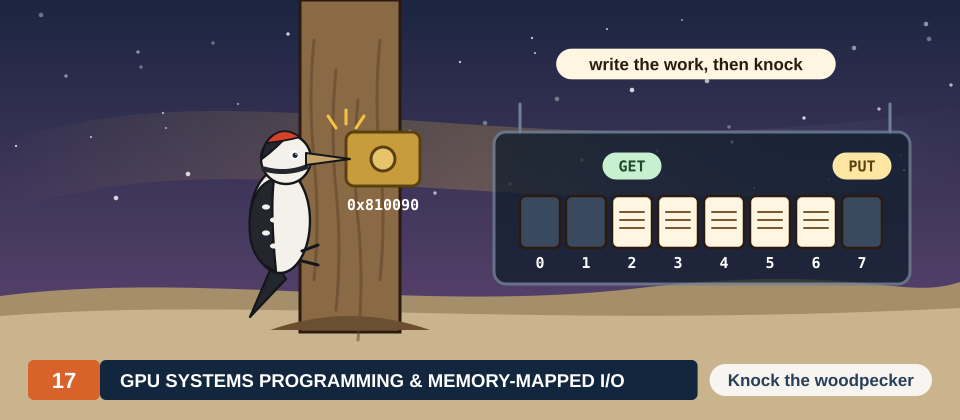
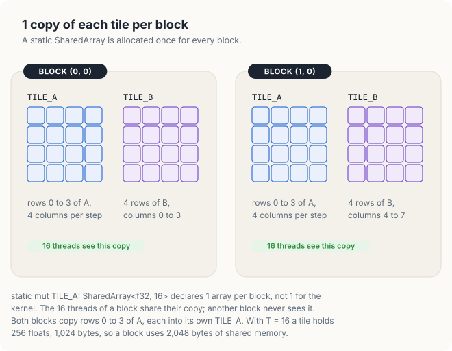
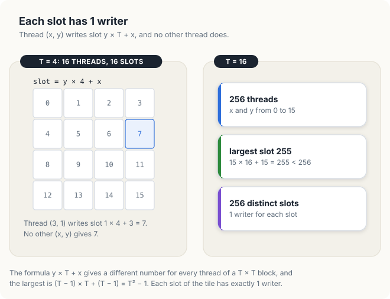
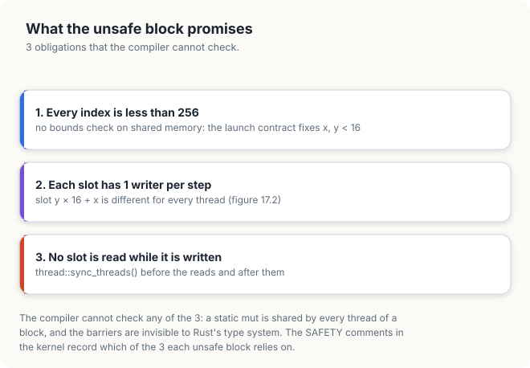
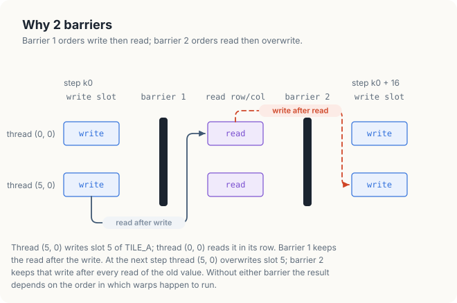
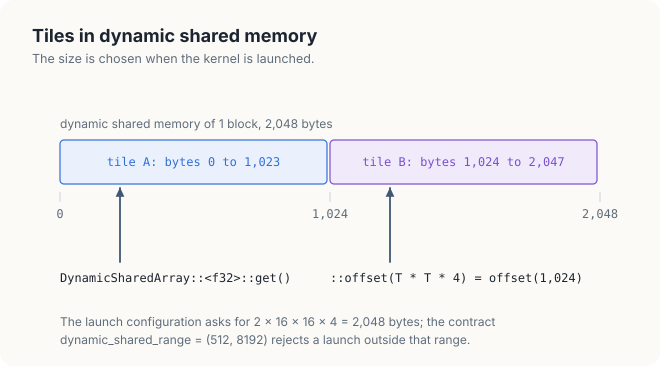
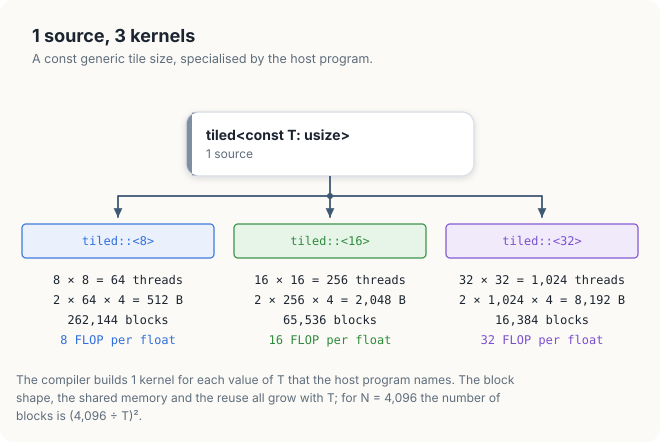

# Chapter 17: Tiled Matrix Multiplication in Shared Memory

<div class="covers" markdown="1">

This chapter covers

- the tiled matrix multiplication of Chapter 9, restated for a Rust kernel
- shared-memory tiles declared as `static mut SharedArray`, 1 copy per block
- why every access to a shared tile is `unsafe`, and the 3 conditions that make it correct
- the 2 barriers of the tiled kernel, and the results without each of them
- `while` loops with `#[unroll]` and `for` loops in the inner product
- a tile size given as a const generic parameter, with the tiles in dynamic shared memory
- generic device functions, and what calling one on the hot path costs
- measured speeds for tiles of 8, 16 and 32, against the naive kernel and against cuBLAS

</div>

The naive kernel of Chapter 16 computes each element of a matrix product with 1 thread, and that
thread reads every operand it needs from global memory. Each value of the 2 input matrices is
therefore requested many times, once for every element of the result that uses it. Chapter 9
showed, in CUDA C++, how a block of threads can copy a square piece of each input matrix into
shared memory once and then read it many times, and how this divides the traffic to global memory
by the width of the piece.

In this chapter, we write the same tiled kernel in Rust with cuda-oxide. The algorithm is the one
of Section 9.4, so we restate it only briefly. Most of the chapter concerns the Rust side: how
shared memory is declared, why the compiler treats every access to it as `unsafe`, which
conditions the programmer must establish in place of the compiler, and how a const generic
parameter lets 1 kernel source serve several tile sizes. We measure each version, including
versions in which 1 of the conditions is broken.

The code of the chapter is in
[`code/oxide/ch17_matmul_tiled/`](https://github.com/arpanpathak/gpu-parallel-book/tree/main/code/oxide/ch17_matmul_tiled).

## 17.1 Background

We compute \\(C = AB\\) for square matrices of \\(N \times N\\) floats, stored row by row, with
\\(N\\) = 4,096. Element \\((i, j)\\) of \\(C\\) is the dot product of row \\(i\\) of \\(A\\) and
column \\(j\\) of \\(B\\). The product consists of \\(N^3\\) multiply-adds, and each multiply-add is
2 floating-point operations, so it performs \\(2N^3\\) = 2 × 4,096<sup>3</sup> =
137.4 × 10<sup>9</sup> FLOP.

In the naive kernel, the thread that computes \\(C_{ij}\\) requests \\(A_{ik}\\) and \\(B_{kj}\\) from
global memory for every \\(k\\). It performs 2 FLOP for every 2 floats it requests, a ratio of
1 FLOP per float. Section 9.1.3 showed that a GPU needs about 100 FLOP for every float it reads
from memory to reach its arithmetic peak, so the naive kernel is limited by memory, and only the
caches keep it from being slower still.

The tiled kernel divides the work as follows. A block of \\(T \times T\\) threads computes a
\\(T \times T\\) tile of \\(C\\), 1 element per thread. The block needs \\(T\\) full rows of \\(A\\)
and \\(T\\) full columns of \\(B\\), and it walks along them in steps of \\(T\\). At each step, every
thread copies 1 element of \\(A\\) and 1 element of \\(B\\) into shared memory, so that together
the threads of the block hold a \\(T \times T\\) tile of each matrix. Every thread then adds the
\\(T\\) products of its row of the A tile and its column of the B tile to its sum.

```text
KERNEL tiled, blocks of T × T threads; thread (x, y) owns C[row][col]:
    sum ← 0
    for k0 ← 0, T, 2T, …, N − T:
        tileA[y][x] ← A[row][k0 + x]          # each thread copies 1 value of A
        tileB[y][x] ← B[k0 + y][col]          # and 1 value of B
        wait until every thread of the block has copied        # barrier 1
        for k ← 0 to T − 1:
            sum ← sum + tileA[y][k] × tileB[k][x]
        wait until every thread of the block has read          # barrier 2
    C[row][col] ← sum
```

At each step the block copies \\(2T^2\\) floats from global memory and performs
\\(T^2 \times T = T^3\\) multiply-adds, which is \\(2T^3\\) FLOP. The ratio is
\\(2T^3 / 2T^2 = T\\) FLOP per float. With \\(T\\) = 16, each float copied from global memory feeds
16 FLOP instead of 1.

The ratio sets an upper limit on the speed of the kernel when memory bandwidth is the only
constraint. The measurements in this chapter come from a Jetson Orin NX, an integrated GPU with
8 SMs, 102 GB/s of memory bandwidth and an FP32 peak of 2,400 GFLOP/s. At 4 bytes per float,
102 GB/s delivers 102 / 4 = 25.5 × 10<sup>9</sup> floats per second, and at \\(T\\) FLOP per float
the kernel can perform at most \\(25.5\,T\\) GFLOP/s.

| Tile width \\(T\\) | FLOP per float | Memory limit on the measured GPU |
|---|---|---|
| 1 (naive) | 1 | 25.5 GFLOP/s |
| 8 | 8 | 204 GFLOP/s |
| 16 | 16 | 408 GFLOP/s |
| 32 | 32 | 816 GFLOP/s |

The naive kernel runs much faster than its limit of 25.5 GFLOP/s, because the L1 and L2 caches
serve most of its repeated requests, while the limit assumes that every float comes from memory.
The tiled kernel places the reuse under the control of the program instead of leaving it to the
caches.

## 17.2 Shared memory in Rust

### 17.2.1 Declaring a tile

In cuda-oxide, a kernel declares shared memory as a `static mut` variable of type
`SharedArray<T, N>` inside the kernel function. The type parameter `T` is the element type, and the
const parameter `N` is the number of elements; both must be known when the kernel is compiled. The
initial value `SharedArray::UNINIT` states that the contents are undefined when the block starts.
Shared memory is not cleared between blocks, so it holds whatever the previous block on the same
SM left there.

<p class="listing"><b>Listing 17.1</b> The 2 tiles of the 16 × 16 kernel. <a href="https://github.com/arpanpathak/gpu-parallel-book/blob/main/code/oxide/ch17_matmul_tiled/src/main.rs">code/oxide/ch17_matmul_tiled/src/main.rs</a></p>

```rust,ignore
pub fn tiled16(a: &[f32], b: &[f32], mut c: DisjointSlice<f32, Index2D<N>>) {
{{#include ../../../../code/oxide/ch17_matmul_tiled/src/main.rs:46:47}}
    // ...
}
```

A `static` in ordinary Rust is a single variable for the whole program. Inside a kernel,
cuda-oxide gives `SharedArray` a different meaning: the compiler places the array in the shared
memory of the SM, and every block that runs the kernel receives its own copy. The 256 threads of
a block see the same `TILE_A`, and the threads of another block see a different one. Figure 17.1
shows 2 neighbouring blocks with \\(T\\) = 4. Both need rows 0 to 3 of \\(A\\), and each copies them
into its own `TILE_A`.

<figure>

<figcaption><b>Figure 17.1</b> Each block has its own copy of every shared array.</figcaption>
</figure>

With \\(T\\) = 16, a tile holds 256 floats of 4 bytes, 1,024 bytes, and the 2 tiles of a block
occupy 2,048 bytes. An SM of the measured GPU has 164 KiB of shared memory, so shared memory does
not limit how many blocks of this kernel an SM can hold at once.

### 17.2.2 Why access to a tile is `unsafe`

Every read and every write of `TILE_A` in the kernel stands inside an `unsafe` block. There are
3 separate reasons for this.

The first reason is a rule of the Rust language. Any use of a `static mut` requires `unsafe`, on
the CPU as well as on the GPU, because a mutable static can be reached from several threads at
once and the compiler cannot see which threads access it, or when. In a kernel this is exactly the
situation: all threads of a block share the array.

The second reason is the type itself. `SharedArray` is deliberately not `Sync`, the marker trait
which promises that a value may be shared between threads without further care. Whether 2 threads
may touch the same element depends on the barriers between their accesses, and a barrier is a
function call that the type system cannot connect to the memory it protects.

The third reason is that an index into a `SharedArray` is not checked. An index into a slice such
as `a` is compared with the length of the slice, and a thread whose index is too large stops the
kernel with an error. An index into a `SharedArray` compiles directly into an access to shared
memory, without a comparison. Section 17.4 runs a kernel that writes past the end of a tile, and
the GPU reports nothing.

### 17.2.3 The conditions that make the accesses correct

Since the compiler cannot check these accesses, the programmer must establish 3 conditions, and the
`// SAFETY:` comments of the kernel state which condition each `unsafe` block relies on.

1. **Every index is less than the length of the array.** For the 16 × 16 kernel, the launch
   contract `block = (16, 16, 1)` makes the host refuse any launch with another block shape, so
   `x` and `y` lie between 0 and 15. The largest slot a thread writes is 15 × 16 + 15 = 255, the
   last element of a 256-element array.
2. **Each element has 1 writer in each step.** Thread \\((x, y)\\) writes slot \\(16y + x\\).
   Different pairs \\((x, y)\\) give different slots, so the 256 threads of a block write the 256
   slots exactly once.
3. **No element is read while another thread writes it.** The barriers before and after the inner
   product separate the writes of a step from the reads of the same step, and those reads from the
   writes of the next step.

Figure 17.2 checks the second condition by hand for \\(T\\) = 4. Thread (3, 1) writes slot
1 × 4 + 3 = 7, and no other pair \\((x, y)\\) with \\(x, y < 4\\) gives 7. In general the largest
slot is \\((T-1)T + (T-1) = T^2 - 1\\), so the slots of a \\(T \times T\\) block fill a
\\(T^2\\)-element tile exactly once.

<figure>

<figcaption><b>Figure 17.2</b> Thread (x, y) writes slot y × T + x, and no other thread writes it.</figcaption>
</figure>

Figure 17.3 collects the 3 conditions and records which part of the program establishes each one.
The launch contract contributes to the first condition: the bound on the index is a
property of the launch, and the contract turns it into a check that the host performs before every
launch.

<figure>

<figcaption><b>Figure 17.3</b> The 3 conditions behind the <code>unsafe</code> blocks of the tiled kernel.</figcaption>
</figure>

## 17.3 The tiled kernel

### 17.3.1 Loading the tiles

Listing 17.2 shows the complete 16 × 16 kernel. Lines 46 and 47 declare the 2 tiles. Lines 49 and
50 read the position of the thread inside its block, which selects its slot in each tile, and
lines 51 and 52 read the row and the column of \\(C\\) that the thread computes. These are the same
values as in the naive kernel: `index_2d_row()` is `blockIdx.y × 16 + y`, and `index_2d_col()` is
`blockIdx.x × 16 + x`.

<p class="listing"><b>Listing 17.2</b> The tiled kernel with 16 × 16 tiles.</p>

```rust,ignore
mod kernels {
    // ...
{{#include ../../../../code/oxide/ch17_matmul_tiled/src/main.rs:42:81}}
    // ...
}
```

The loop of line 56 runs over the steps. In step `k0`, line 59 copies element
\\(A_{\text{row},\,k_0 + x}\\) into slot \\(16y + x\\) of `TILE_A`, and line 60 copies element
\\(B_{k_0 + y,\,\text{col}}\\) into slot \\(16y + x\\) of `TILE_B`. Let us check that the block
copies the tiles it needs. The 16 threads with the same `y` share the same `row` and differ in `x`,
so together they copy 16 consecutive elements of 1 row of \\(A\\), from column \\(k_0\\) to
\\(k_0 + 15\\). The 16 values of `y` give 16 such rows, which is the \\(16 \times 16\\) tile of
\\(A\\) at columns \\(k_0\\) to \\(k_0 + 15\\). In the same way, the threads with the same `y` copy 16
consecutive elements of row \\(k_0 + y\\) of \\(B\\), and the block copies the tile of \\(B\\) at rows
\\(k_0\\) to \\(k_0 + 15\\). Both copies are coalesced, since consecutive values of `x` read
consecutive addresses.

The global reads `a[row * N + k0 + x]` and `b[(k0 + y) * N + col]` are ordinary slice accesses,
and they are bounds-checked. Only the shared-memory side of each line needs `unsafe`.

### 17.3.2 Barriers and the dependences they enforce

The call `thread::sync_threads()` in line 62 is a barrier: no thread of the block continues past it
until every thread of the block has reached it. Recall from Chapter 5 that the barrier also makes
the shared-memory writes made before it visible to every thread of the block after it.

The 2 barriers of the kernel enforce 2 different kinds of dependence between threads, shown in
Figure 17.4. The first is a **read-after-write** dependence. In line 68, thread (0, 0) reads the
whole of row 0 of `TILE_A`, including slot 5, which thread (5, 0) wrote in line 59. The read must
come after the write, and the barrier in line 62 ensures that it does. This dependence is called a
true dependence, because the reading thread needs the value that the writing thread produces.

The second is a **write-after-read** dependence. In the next step, thread (5, 0) overwrites slot 5
with a new value. If it did so while thread (0, 0) was still in the loop of line 66, thread (0, 0)
would read a value of the wrong step. The barrier in line 71 keeps every overwrite after every read
of the old value. This dependence is called a false dependence: the writer needs nothing from the
reader, and the conflict exists only because both use the same location in consecutive steps.

<figure>

<figcaption><b>Figure 17.4</b> Barrier 1 orders the write before the read; barrier 2 orders the read before the next write.</figcaption>
</figure>

### 17.3.3 The inner product and the result

Lines 64 to 70 add the 16 products of row `y` of `TILE_A` and column `x` of `TILE_B` to `sum`.
`TILE_A[y * 16 + k]` walks along a row of the A tile, and `TILE_B[k * 16 + x]` walks down a column
of the B tile. The loop is a `while` loop with the attribute `#[unroll]`, for the reason given in
Section 17.5. The variable `sum` is local to the thread, so it stays in a register for the whole
kernel.

After 4,096 / 16 = 256 steps, each `sum` holds the complete dot product. Lines 76 to 80 write it
through the `DisjointSlice` exactly as the naive kernel does: `index_2d::<N>()` returns the index of
the thread's element, or `None` for a thread outside the matrix, and `get_mut` gives the thread a
mutable reference to its own element only.

## 17.4 Errors in the use of shared memory

We now break the conditions of Section 17.2.3 one at a time and run the result. The broken kernels
are copies of `tiled16` with 1 change each, run on matrices with \\(N\\) = 512 so that every element
of \\(C\\) can be compared with a product computed on the CPU in double precision. An element counts
as wrong when it differs from the exact value by more than 10<sup>−3</sup>.

The first copy omits the barrier of line 62, so a thread may read a tile before the other threads
have written it. The second omits the barrier of line 71, so a fast thread may overwrite a tile in
step \\(k_0 + 16\\) while a slower one still reads it in step \\(k_0\\). Each copy ran 3 times:

```console
correct      0 of 262144 wrong
no barrier 1 260639 of 262144 wrong
no barrier 1 260441 of 262144 wrong
no barrier 1 260369 of 262144 wrong
no barrier 2 45016 of 262144 wrong
no barrier 2 44704 of 262144 wrong
no barrier 2 40940 of 262144 wrong
```

Without the first barrier, 99.4% of the 262,144 elements are wrong. The reads of a step follow the
writes immediately, and almost every dot product meets at least 1 slot that another thread has not
filled yet. Without the second barrier, about 17% are wrong. That barrier is needed only when a
thread runs a whole step ahead of another, which happens less often. In both cases the number of
wrong elements changes from run to run, because the count is set by the order in which the warps of a
block happen to run. Neither program reported an error, and both compiled without a warning,
because a missing barrier breaks no rule that the compiler checks.

The third copy declares `TILE_A` with 240 elements instead of 256, so that the 16 threads with
`y` = 15 write slots 240 to 255, past the end of the array:

```rust,ignore
static mut TILE_A: SharedArray<f32, 240> = SharedArray::UNINIT;
```

```console
short tile launch: true
short tile sync: Ok(())
short tile   0 of 262144 wrong
```

The launch succeeded, the kernel finished without an error, and every result was correct. The 16
writes, and the later reads of the same slots, went to the 64 bytes of shared memory after
`TILE_A`, and in this build nothing else in the kernel used those bytes. With another arrangement
of the shared variables, the same writes would overwrite part of `TILE_B`, and the results would
be wrong, again without an error. An index into shared memory is correct only because the
programmer has shown it to be.

## 17.5 Loop forms in the inner product

Section 9.7 found that cuda-oxide does not unroll a `for` loop over a range, and that a fixed-count
loop written as a `while` loop with `#[unroll]` is unrolled. The kernel `tiled16_for` is `tiled16`
with the inner loop written as a `for` loop:

```rust,ignore
pub fn tiled16_for(a: &[f32], b: &[f32], mut c: DisjointSlice<f32, Index2D<N>>) {
    // ...
{{#include ../../../../code/oxide/ch17_matmul_tiled/src/main.rs:105:108}}
    // ...
}
```

The 2 kernels perform the same arithmetic on the same values in the same order, and they produce
identical results, with the same maximum error. Their speeds differ:

```console
  tiled16, while     501.66 ms    274.0 GFLOP/s  max error 3.4e-5
  tiled16, for       681.05 ms    201.8 GFLOP/s  max error 3.4e-5
```

The `for` loop takes 681.05 / 501.66 = 1.36 times as long, and its speed is 26% lower. An unrolled loop of 16 iterations is a straight sequence of 16
multiply-adds whose shared-memory addresses are fixed offsets from 2 base addresses. A loop that is
not unrolled must, in each iteration, increment its counter, compare it with 16, branch, and compute
the 2 addresses again. In a loop body that contains only 1 multiply-add and 2 reads, this overhead
is a large fraction of the work. For this reason, every fixed-count loop on the hot path of the
kernels in this book is a `while` loop with `#[unroll]`.

## 17.6 The tile size as a const generic parameter

### 17.6.1 Static shared memory and generic parameters

The tile width 16 appears in `tiled16` as a literal: in the length of the 2 arrays, in the slot
formula, in the inner loop and in the step of the outer loop. To measure other tile sizes, we would
like to write the kernel once with the width as a parameter. Rust provides **const generics** for
this purpose: a function declared as `fn tiled<const T: usize>(...)` takes a compile-time constant
`T`, and the compiler produces a separate copy of the function, a **specialization**, for every
value of `T` that the program uses. Inside each specialization `T` is a constant, so a loop
`while k < T` has a fixed count and can be unrolled.

The direct translation declares the tile with a length that depends on `T`:

```rust,ignore
#[kernel]
#[launch_bounds(1024)]
pub fn tiled<const T: usize>(a: &[f32], mut c: DisjointSlice<f32, Index2D<N>>) {
    static mut TILE_A: SharedArray<f32, { T * T }> = SharedArray::UNINIT;
    // ...
}
```

The Rust compiler rejects it. It reports the same error twice, once for each `T` in `{ T * T }`;
the first report reads:

```console
error[E0401]: can't use generic parameters from outer item
  --> src/main.rs:18:47
   |
17 |     pub fn tiled<const T: usize>(a: &[f32], mut c: DisjointSlice<f32, Index2D<N>>) {
   |                        - const parameter from outer item
18 |         static mut TILE_A: SharedArray<f32, { T * T }> = SharedArray::UNINIT;
   |                    ------                     ^ use of generic parameter from outer item
   |                    |
   |                    generic parameter used in this inner static item
   |
   = note: nested items are independent from their parent item for everything except for privacy and name resolution
   = note: a `static` is a separate item from the item that contains it
```

The 2 notes give the reason. A `static` declared inside a function is still a separate item of the
program, with exactly 1 instance; only its name is local to the function. A generic function, on
the other hand, exists once for every value of `T`. A single static cannot have a different length
in each specialization, so Rust does not allow the type of a static to mention a generic parameter
of the function that contains it.

### 17.6.2 Tiles in dynamic shared memory

CUDA offers a second kind of shared memory, whose size is chosen when the kernel is launched rather
than when it is compiled. **Dynamic shared memory** is a single region per block, whose size in
bytes the host program passes in the launch configuration. In cuda-oxide,
`DynamicSharedArray::<f32>::get()` returns a raw pointer `*mut f32` to the start of the region, and
`DynamicSharedArray::<f32>::offset(bytes)` returns a pointer `bytes` bytes further on. Since the
size is not part of any type, a generic kernel can use it.

Listing 17.3 shows the generic kernel. Lines 130 and 131 take the 2 tiles from the same region:
tile A starts at byte 0, and tile B starts at byte \\(4T^2\\), immediately after the \\(T^2\\) floats
of tile A. Figure 17.5 shows the layout for \\(T\\) = 16: 2,048 bytes, with tile B starting at byte
1,024.

<p class="listing"><b>Listing 17.3</b> The generic tiled kernel.</p>

```rust,ignore
mod kernels {
    // ...
{{#include ../../../../code/oxide/ch17_matmul_tiled/src/main.rs:121:169}}
    // ...
}
```

<figure>

<figcaption><b>Figure 17.5</b> The 2 tiles of <code>tiled::&lt;16&gt;</code> in 1 region of dynamic shared memory.</figcaption>
</figure>

The attributes of lines 123 and 124 differ from those of `tiled16`. An exact block shape such as
`block = (16, 16, 1)` must be written as literal numbers, so it cannot depend on `T`. The generic
kernel therefore states only an upper bound, `#[launch_bounds(1024)]`, the largest block that the
hardware allows. The contract field `dynamic_shared_range = (512, 8192)` states the sizes of
dynamic shared memory that the kernel accepts: from 512 bytes for \\(T\\) = 8 to 8,192 bytes for
\\(T\\) = 32. The host checks both before every launch. When it compiles a kernel that uses
`DynamicSharedArray`, cuda-oxide also prints a warning that the launch configuration must provide
enough shared memory. The warning is a reminder of that obligation, and the kernel compiles.

The body of the loop is the body of `tiled16` with 16 replaced by `T`, and with the tiles reached
through the 2 pointers. A write through a raw pointer, `*tile_a.add(y * T + x) = ...`, is `unsafe`
for the same 3 reasons as a write to a `SharedArray`, and the `SAFETY` comment of lines 141 to 143
states the same conditions in terms of `T`.

A single change goes beyond renaming. Lines 150 to 158 add the \\(T\\) products of a step into a new
variable `part`, and then add `part` to `sum`. The kernel performs the same number of operations
as `tiled16`, but in a different order: for \\(T\\) = 16, `sum` receives 256 partial sums of 16
products each, where `tiled16` adds 4,096 products one at a time into a single running total.
Section 8.2 showed that a float sum loses accuracy as its running total grows large compared with
each term. Summing in groups keeps each total small for longer, and the measured maximum error
falls from 3.4 × 10<sup>−5</sup> for `tiled16` to 6.3 × 10<sup>−6</sup> for `tiled::<16>`. It
is 3.9 × 10<sup>−6</sup> for \\(T\\) = 32, with 128 groups of 32 products, and
1.1 × 10<sup>−5</sup> for \\(T\\) = 8, with 512 groups of 8. All are far inside the tolerance of
10<sup>−3</sup>.

### 17.6.3 A generic device function

The inner product of a step is a natural candidate for a function of its own. The attribute
`#[device]` compiles a function for the GPU so that kernels can call it, and `tile_dot` in
Listing 17.4 is generic over `T` in the same way as the kernel.

<p class="listing"><b>Listing 17.4</b> The inner product of a row and a column of a tile, as a device function.</p>

```rust,ignore
mod kernels {
    // ...
{{#include ../../../../code/oxide/ch17_matmul_tiled/src/main.rs:212:232}}
}
```

The function is `unsafe` because its correctness depends on its caller: the 2 pointers must
address \\(T^2\\) floats each, and no thread may write them during the call. The `# Safety` section
of its documentation states this requirement. The kernel `tiled_fn` is `tiled` with lines 150 to
158 replaced by a call that meets the requirement, since it stands between the 2 barriers:

```rust,ignore
pub fn tiled_fn<const T: usize>(
    // ...
{{#include ../../../../code/oxide/ch17_matmul_tiled/src/main.rs:198:199}}
    // ...
}
```

The 2 kernels perform the same operations in the same order, and their results are identical. Their
speeds are not: `tiled_fn::<16>` ran at 168.2 GFLOP/s and `tiled::<16>` at 271.6 GFLOP/s, 38% less.
The difference comes from the way `#[device]` compiles a generic function. The macro marks every
specialization of a generic device function `#[inline(never)]`, so that each specialization remains
a separate function that cuda-oxide can find and translate. The kernel therefore calls `tile_dot`
once per step, with the 2 tile addresses as arguments, instead of containing its loop. For a short
loop on the hot path of a kernel, we write the loop in the kernel itself.

### 17.6.4 Launching the specializations

The host program names each specialization with a turbofish, `::<T>`, in 2 places: when it
prepares the launch and when it launches. The launch configuration must match `T` in 3 respects:
the block must have \\(T \times T\\) threads, the grid must have \\(N/T\\) blocks in each direction,
and the dynamic shared memory must hold 2 tiles, \\(2T^2 \times 4\\) bytes. The function
`tiled_config::<T>` computes all 3 from `T`, so that they cannot disagree with it.

<p class="listing"><b>Listing 17.5</b> The launch configuration of <code>tiled::&lt;T&gt;</code>, and the preparation of the specializations.</p>

```rust,ignore
{{#include ../../../../code/oxide/ch17_matmul_tiled/src/main.rs:235:241}}

fn main() -> Result<(), Error> {
    // ...
{{#include ../../../../code/oxide/ch17_matmul_tiled/src/main.rs:305:308}}
    // ...
}
```

For \\(T\\) = 16 the function returns a grid of 4,096 / 16 = 256 blocks in each direction, blocks
of 16 × 16 = 256 threads, and 2 × 16 × 16 × 4 = 2,048 bytes of dynamic shared memory. Figure 17.6
lists the 3 specializations of `tiled`.

<figure>
: 64 threads, 512 bytes of shared memory, 262,144 blocks, 8 FLOP per float. tiled::<16>: 256 threads, 2,048 bytes, 65,536 blocks, 16 FLOP per float. tiled::<32>: 1,024 threads, 8,192 bytes, 16,384 blocks, 32 FLOP per float.">
<figcaption><b>Figure 17.6</b> 1 source, 3 kernels: the launch shape and the reuse grow with T.</figcaption>
</figure>

The launch contract still checks what it can. A preparation of `tiled::<16>` with 16,384 bytes of
dynamic shared memory is refused before the kernel runs:

```console
16384 bytes: tiled: dynamic shared memory is 16384 bytes; contract permits 512..=8192
```

The block shape, however, is no longer checked exactly, because the contract states only the upper
bound of 1,024 threads. A launch of `tiled::<16>` with blocks of 8 × 8 threads, on matrices with
\\(N\\) = 512, is accepted, and it computes the wrong product. Each block has 64 threads instead of
256, so it fills only a quarter of each tile, and its threads read the other 3 quarters while they
still hold whatever was there before:

```console
tiled::<16> with 8 x 8 threads: sync Ok(())
tiled::<16>, 8 x 8 65498 of 262144 wrong
```

This is the cost of moving the tile size into a generic parameter: the exact block shape moves from
a checked contract into the program's own code. Deriving every part of the configuration from `T`
in a single function, as `tiled_config::<T>` does, keeps the 2 from disagreeing.

## 17.7 Performance

Listing 17.6 shows the output of the complete program on the measured GPU. Each line gives the
average time of 2 or 3 runs after a warm-up, the resulting speed for \\(2N^3\\) =
137.4 × 10<sup>9</sup> FLOP, and the largest difference from a double-precision product over 64
sampled elements of \\(C\\). Repeated runs of the program differed by up to 24%, because the
GPU shares its power budget with the CPU, and a busy CPU lowers the clock of the GPU. The run
shown is the fastest of 9; in the 3 quietest runs, every speed agreed within 2%.

<p class="listing"><b>Listing 17.6</b> The output of the program.</p>

```console
$ cargo oxide run
C = A B, 4096 x 4096 floats
  naive              712.01 ms    193.0 GFLOP/s  max error 3.4e-5
  tiled16, while     501.66 ms    274.0 GFLOP/s  max error 3.4e-5
  tiled16, for       681.05 ms    201.8 GFLOP/s  max error 3.4e-5
  tiled::<8>         940.22 ms    146.2 GFLOP/s  max error 1.1e-5
  tiled::<16>        506.13 ms    271.6 GFLOP/s  max error 6.3e-6
  tiled::<32>        630.65 ms    217.9 GFLOP/s  max error 3.9e-6
  tiled_fn::<16>     817.22 ms    168.2 GFLOP/s  max error 6.3e-6
PASSED
```

Figure 17.7 places these speeds next to the memory limits of Section 17.1, and next to 2 results of
Chapter 9 on the same GPU: the CUDA C++ kernel with 16 × 16 tiles, and cuBLAS.

<figure>

<figcaption><b>Figure 17.7</b> Measured speeds for N = 4,096, with the memory limit of each tile width.</figcaption>
</figure>

The 16 × 16 tiles run at 274.0 GFLOP/s, 1.42 times as fast as the naive kernel at 193.0 GFLOP/s.
The gain is smaller than the factor of 16 in reuse because the naive kernel was already served
mostly by the caches, as Section 17.1 noted. The generic `tiled::<16>` runs at 271.6 GFLOP/s, within
1% of `tiled16`: the const generic parameter and the dynamic shared memory cost nothing, since the
compiler builds the same kind of code for `T` = 16 as for the literal 16. The Rust kernel also
matches the CUDA C++ kernel of Section 9.4, which ran at 273.9 GFLOP/s on the same GPU.

Having established that the tiles help, we can ask how close each tile width comes to its memory
limit. For \\(T\\) = 16, the measured 274.0 GFLOP/s is 274.0 / 408 = 67% of the limit, and for
\\(T\\) = 8, 146.2 GFLOP/s is 146.2 / 204 = 72% of it. Both widths are therefore close to being
limited by memory, and the wider tile is faster because it reuses each float twice as often.

The width of 32 breaks this pattern. Its limit is 816 GFLOP/s, yet it ran at 217.9 GFLOP/s, 27% of
the limit and slower than the width of 16. The cause is the number of threads that an SM can hold.
An SM of the measured GPU holds at most 1,536 threads and 16 blocks. A block of 32 × 32 = 1,024
threads leaves room for no second block, since 2 blocks would need 2,048 threads, so each SM runs 1
block of 1,024 threads, 67% of its capacity. Moreover, when the threads of that block wait at a
barrier, the SM has no other block to run. With tiles of 16, 6 blocks of 256 threads fill all 1,536
places, and while 1 block waits at a barrier, the other 5 continue. The width of 8 is limited in
another way: 16 blocks of 64 threads give only 16 × 64 = 1,024 threads per SM, also 67%.

A second limit applies to every tile width. Section 9.4.2 showed that each multiply-add of a tiled
kernel reads 2 values from shared memory, and that an SM's shared memory delivers fewer values per
cycle than its arithmetic units could consume at that rate. A larger tile reduces the traffic to
global memory but not this traffic. The best tiled kernel here reaches 274.0 / 1,495.3 = 18% of the
speed of cuBLAS, and 274.0 / 2,400 = 11% of the FP32 peak of the GPU. Section 9.5 removed the second
limit by giving each thread a 4 × 4 patch of results in registers, which reached 844.9 GFLOP/s in
Rust on this GPU; the techniques of this chapter, shared tiles, barriers and unrolled `while`
loops, are the parts that kernel is built from.

## 17.8 The complete program

Listing 17.7 is the whole of `src/main.rs`: the naive kernel, the 2 kernels with 16 × 16 tiles in
static shared memory, the 2 generic kernels and the device function, and the host program that
times and checks each of them. `Cargo.toml` and `rust-toolchain.toml` are those of Chapter 13,
apart from the name of the package.

<p class="listing"><b>Listing 17.7</b> <a href="https://github.com/arpanpathak/gpu-parallel-book/blob/main/code/oxide/ch17_matmul_tiled/src/main.rs">code/oxide/ch17_matmul_tiled/src/main.rs</a></p>

```rust,ignore
{{#include ../../../../code/oxide/ch17_matmul_tiled/src/main.rs}}
```

## Common mistakes

- **Omitting a barrier.** Without the barrier after the copies, almost every result is wrong;
  without the barrier after the inner product, a smaller and varying fraction is. Neither produces
  an error or a compiler warning (Section 17.4).
- **Assuming that shared-memory indices are checked.** An index into a `SharedArray`, or through a
  pointer from `DynamicSharedArray`, is not compared with any length. A wrong index writes into
  other shared data without an error.
- **Writing a `SAFETY` comment that names no condition.** State the conditions: the bound on the
  index, the single writer of each slot, and the barrier that separates the writes from the reads.
- **Writing the inner loop as a `for` loop.** cuda-oxide does not unroll it, and the kernel ran
  26% slower (Section 17.5).
- **Declaring a generic tile as a `static`.** A static cannot depend on a generic parameter of the
  function that contains it; a tile whose size is a generic parameter belongs in dynamic shared
  memory.
- **Calling a generic device function in the innermost loop.** It is compiled as a separate
  function, and the kernel calls it instead of containing its loop (Section 17.6.3).
- **Launching a generic kernel with a configuration that does not match its parameter.** The
  contract of `tiled::<T>` checks only an upper bound on the block size and the range of dynamic
  shared memory. Compute the block shape, the grid and the shared memory from `T` in 1 function.
- **Choosing the largest tile.** Tiles of 32 × 32 reuse each float twice as often as tiles of
  16 × 16, but they ran slower on the measured GPU, because an SM holds only 1 block of 1,024
  threads (Section 17.7).

## Summary

- A tiled kernel copies a \\(T \times T\\) tile of each input matrix into shared memory and reads
  each copied value \\(T\\) times, which raises the ratio of operations to floats read from global
  memory from 1 to \\(T\\).
- In cuda-oxide, a kernel declares a fixed-size tile as `static mut SharedArray<f32, N>`. Each
  block receives its own copy.
- Every access to shared memory is `unsafe`. The programmer establishes 3 conditions: every index is
  in range, every element has 1 writer per step, and barriers separate the writes from the reads.
  The `SAFETY` comments state which condition each access relies on.
- The first barrier enforces a read-after-write dependence, the second a write-after-read
  dependence. Without them, 99.4% and about 17% of the results were wrong, with no error reported.
- Fixed-count loops on the hot path are written as `while` loops with `#[unroll]`; the `for` loop
  version was 26% slower.
- A const generic parameter gives 1 kernel source for several tile sizes. Its tiles live in dynamic
  shared memory, whose size the launch configuration supplies, and the contract checks that size and
  an upper bound on the block.
- A generic device function is compiled as a separate function and called once per step; on the
  hot path it cost 38%, so the inner loop belongs in the kernel.
- On the measured GPU, tiles of 16 × 16 ran at 274.0 GFLOP/s: 1.42 times the naive kernel, equal
  to the CUDA C++ kernel of Chapter 9, and 18% of cuBLAS. Tiles of 8 reuse each float less often,
  and tiles of 32 leave each SM with a single block of 1,024 threads.

Chapter 18 applies the same technique to a stencil computation, the Jacobi iteration for the
Laplace equation, in which each tile also needs a border of neighbouring values.

## Exercises

1. For \\(T\\) = 16 and \\(N\\) = 4,096, how many floats does 1 block copy from global memory over the
   whole kernel, and how many FLOP does it perform? Check that the ratio is 16.
2. Thread (7, 12) of block (3, 5) in `tiled16`: which slot of each tile does it write, and which
   elements of \\(A\\) and \\(B\\) does it copy in step \\(k_0\\) = 32?
3. Remove the second barrier from `tiled16` and run the program 5 times on your GPU. Record the
   number of wrong elements each time, and explain why the number varies.
4. Change `tiled16` so that the inner loop reads `TILE_A[k * 16 + y]` instead of
   `TILE_A[y * 16 + k]`, without changing the copy. Which of the 3 conditions of Section 17.2.3 does
   the new kernel still satisfy, and why are its results wrong?
5. Write a version of `tiled16` that handles any \\(N\\), not only multiples of 16. A thread whose
   element of \\(A\\) or \\(B\\) lies outside the matrix stores 0.0 in its slot. Use `a.get(i)` to
   read with a bounds test, and explain why 0.0 leaves every sum unchanged.
6. Add \\(T\\) = 4 to the program. Predict its memory limit on your GPU from Section 17.1, and
   compare the prediction with the measured speed.
7. For \\(N\\) = 4,096, compute the number of partial sums that the generic kernel adds for
   \\(T\\) = 8, 16 and 32, and compare their order with the order of the 3 maximum errors in the
   output.
8. Rewrite `tiled_config::<T>` so that it returns an error for a value of `T` that does not divide
   \\(N\\) or that gives more than 1,024 threads, and call it before each preparation.

## Sources and further reading

- The cuda-oxide sources at revision `b7fe543`: `crates/cuda-device/src/shared.rs` documents
  `SharedArray`, including why it is not `Sync`, and `DynamicSharedArray`; `crates/cuda-macros`
  documents `#[launch_contract]` with `dynamic_shared_range` and `#[launch_bounds]`, and contains
  the expansion of `#[device]` for generic functions.
- The Rust Reference, "Static items" and "Generic parameters", for the rules behind
  Section 17.6.1, and the explanation of error E0401 (`rustc --explain E0401`).
- NVIDIA, *CUDA C++ Programming Guide*, the sections on shared memory, dynamic shared memory and
  `__syncthreads()`.
- Chapter 9 of this book for the tiled algorithm in CUDA C++, register tiles and the comparison with
  cuBLAS, and Chapter 8 for the accuracy of float sums.
