# Chapter 17: Tiled Matrix Multiplication

A GPU can perform arithmetic far faster than it can read operands from its global memory. In the
direct kernel of Chapter 16, every thread read both of its operands from global memory for every
multiply-add it performed, so the kernel spent most of its time waiting for memory rather than
computing. Tiling is the standard technique for reducing this traffic. The threads of a block
first copy a small piece of each input matrix into the fast on-chip shared memory, and then every
thread of the block takes its operands from that copy. A value that would otherwise be read from
global memory by many threads is then read from global memory only once per block.

In this chapter, we develop the tiled kernel step by step, using the same pair of 4 × 4 matrices
as in Chapter 16, so that every number can be checked by hand. We first determine which values
one block needs and how often the direct kernel reads them. We then split each dot product into
phases, let the threads of a block load the pieces they need into shared memory together, and
count the reads from global memory again. After that, we remove each of the kernel's 2 barriers
in turn and follow the wrong values that appear, and we prove that the complete kernel is correct.
Finally, we implement the kernel in Rust and in CUDA C++, measure it, and explain why the measured
speedup is much smaller than the reduction in reads.

<div class="covers">

This chapter covers

- the values 1 block of the direct kernel needs, and how often it fetches them
- splitting a dot product into phases, and tiles in shared memory
- the barrier, and the tiled algorithm with its 2 barriers
- the fetches of the tiled kernel: \\(2MNK/T\\) instead of \\(2MNK\\)
- each barrier removed, with the wrong values 7 and 15 on the example
- a proof of correctness by a loop invariant, and matrices of any size
- shared memory in Rust (`SharedArray`, `DynamicSharedArray`, `unsafe` with `// SAFETY:`) and in
  CUDA C++ (`__shared__` arrays sized by a template parameter)
- measured speeds, and why the speedup is not \\(T\\)

</div>

The code of the chapter is in
[`code/oxide/ch17_matmul_tiled/`](https://github.com/arpanpathak/gpu-parallel-book/tree/main/code/oxide/ch17_matmul_tiled)
for Rust and in
[`code/cuda/ch17_matmul_tiled/`](https://github.com/arpanpathak/gpu-parallel-book/tree/main/code/cuda/ch17_matmul_tiled)
for C++. We use the notation of Chapter 16: \\(A\\) is \\(M \times K\\), \\(B\\) is
\\(K \times N\\), \\(C = AB\\), all stored in row-major order, and \\([a, b)\\) is the range of
integers from \\(a\\) to \\(b - 1\\).

## 17.1 Values needed by 1 block

Recall from Section 16.4.3 that the 4 threads computing row 0 of \\(C\\) all read the same value
\\(a_{01}\\) from global memory, each on its own. Our goal is to let such threads share a single
copy of the value. Since only threads of the same block can share data, we start by asking which
values one block needs. We take block \\((0, 0)\\) of the grid in Figure 16.5. Its 4 threads
compute the top-left 2 × 2 square of \\(C\\), that is, \\(c_{00} = 11\\), \\(c_{01} = 13\\),
\\(c_{10} = 27\\) and \\(c_{11} = 29\\). An entry \\(c_{ij}\\) needs row \\(i\\) of \\(A\\) and
column \\(j\\) of \\(B\\), so together the 4 threads need rows 0 and 1 of \\(A\\) and columns 0 and
1 of \\(B\\). These are 8 values from each matrix, 16 values in all, as shown in Figure 17.1.

<figure>
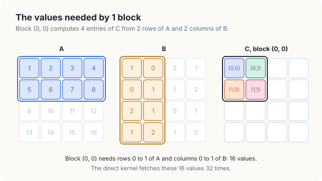
<figcaption><b>Figure 17.1</b> The values needed by block (0, 0): 2 rows of A and 2 columns of B.</figcaption>
</figure>

Let us count how often the direct kernel reads these 16 values. Thread \\((0, 0)\\) reads the 4
values of row 0 of \\(A\\) and the 4 values of column 0 of \\(B\\). Thread \\((0, 1)\\) reads the
same row 0 of \\(A\\) again, together with column 1 of \\(B\\). In the same way, each of the 4
threads makes 8 reads, so the block makes 32 reads in total, and every one of the 16 values is
read twice. If the block instead copied each of the 16 values into shared memory once, and its
threads then took their operands from that copy, the block would read global memory only 16
times, half as often.

This plan has one difficulty. Shared memory is small: a block can use at most 48 KB of it by
default, and a streaming multiprocessor (SM) has between 48 KB and 228 KB in total, shared by all
the blocks that it runs. In our example, the rows are only 4 values long, but in a real problem a
row of \\(A\\) holds thousands of values. For example, with \\(K = 4{,}096\\), a block of 16 × 16
threads needs 16 rows of \\(A\\) and 16 columns of \\(B\\), which hold
\\(2 \cdot 16 \cdot 4{,}096 = 131{,}072\\) floats, or 512 KB. Such a strip of rows and columns
does not fit into shared memory, so the block cannot copy everything it needs at once. In the next
section, we see that it does not have to.

## 17.2 Splitting the sum

The key to the solution is that a thread does not need its whole row and column at the same time.
The entry \\(c_{00}\\) is a sum of 4 products, and the terms of a sum may be added in any grouping.
Figure 17.2 groups the 4 terms of \\(c_{00}\\) in 2 pairs. The first pair uses the first 2 values
of row 0 of \\(A\\) and the first 2 values of column 0 of \\(B\\), and adds up to
\\(1 \cdot 1 + 2 \cdot 0 = 1\\). The second pair uses the last 2 values of each, and adds up to
\\(3 \cdot 2 + 4 \cdot 1 = 10\\). Together the 2 pairs give \\(1 + 10 = 11\\), which is
\\(c_{00}\\).

<figure>
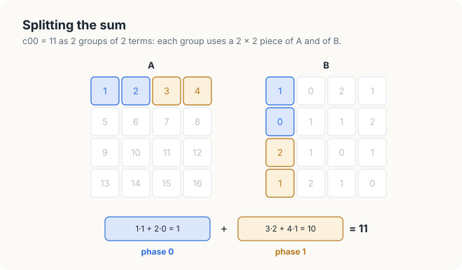
<figcaption><b>Figure 17.2</b> c<sub>00</sub> in 2 groups: phase 0 (blue) uses columns 0 and 1 of A and rows 0 and 1 of B, phase 1 (amber) the rest.</figcaption>
</figure>

Now consider all 4 threads of the block. For its first pair of terms, every thread needs only
columns 0 and 1 of rows 0 and 1 of \\(A\\), which form a 2 × 2 piece of \\(A\\), and rows 0 and 1
of columns 0 and 1 of \\(B\\), which form a 2 × 2 piece of \\(B\\). For its second pair, every
thread needs the 2 × 2 pieces next to these: columns 2 and 3 of \\(A\\), and rows 2 and 3 of
\\(B\\). The block can therefore work in 2 rounds. In each round, it copies 1 small piece of
\\(A\\) and 1 small piece of \\(B\\) into shared memory, and every thread adds the matching pair of
terms to its sum. At any moment, the block holds only 2 pieces of 4 values each in shared memory,
however long the rows are.

<div class="definition">

<span class="box-label">Definition 17.1</span> **Tile and phase.** A **tile** is a square piece of
\\(A\\) or \\(B\\), of \\(T\\) rows and \\(T\\) columns, that a block holds in shared memory. The
number \\(T\\) is called the **tile width**. A **phase** is 1 round of the tiled kernel: the block
copies 1 tile of \\(A\\) and 1 tile of \\(B\\) into shared memory, and every thread adds \\(T\\)
products to its sum.

*Example.* With \\(T = 2\\), block \\((0, 0)\\) runs 2 phases. In phase 0, it uses the tile of
\\(A\\) in rows 0 and 1 and columns 0 and 1; in phase 1, the tile of \\(A\\) in rows 0 and 1 and
columns 2 and 3.

</div>

We can now state the grouping in general. We number the phases 0, 1, 2 and so on, and we
write \\(\mathsf{phase}\\) for the number of a phase. Each phase handles \\(T\\) consecutive terms of
each sum, so phase 0 handles the terms with \\(s = 0, \ldots, T - 1\\), phase 1 the terms with
\\(s = T, \ldots, 2T - 1\\), and in general, the phase with number \\(\mathsf{phase}\\) handles the
\\(T\\) terms that begin at \\(s = \mathsf{phase} \cdot T\\). The product \\(\mathsf{phase} \cdot T\\)
is therefore the position at which the phase begins. In our example, with \\(T = 2\\), phase 0 begins at \\(s = 0\\) and
phase 1 at \\(s = 1 \cdot 2 = 2\\). We write the position of a term within its phase as \\(\mathsf{offset}\\),
which runs from 0 to \\(T - 1\\), so that every index \\(s\\) can be written as \\(s = \mathsf{phase} \cdot T + \mathsf{offset}\\).
For example, the term with \\(s = 3\\) is the term with \\(\mathsf{offset} = 1\\) in phase 1, since
\\(3 = 1 \cdot 2 + 1\\). With this notation, the definition of the matrix product in
Definition 16.1 becomes a sum over the phases of a sum within each phase:

\\[ c_{ij} = \sum_{\mathsf{phase} \in [0, \lceil K/T \rceil)} \\;
\underbrace{\sum_{\mathsf{offset} \in [0, T)} a_{i,\\, \mathsf{phase} \cdot T + \mathsf{offset}}\\;
b_{\mathsf{phase} \cdot T + \mathsf{offset},\\, j}}_{\text{one phase}}. \\]

| Symbol | Meaning | In the example |
|---|---|---|
| \\(T\\) | tile width: rows and columns of a tile, terms added per phase | 2 |
| \\(\mathsf{phase}\\) | number of the phase | 0 or 1 |
| \\(\mathsf{phase} \cdot T\\) | index \\(s\\) at which the phase begins | 0 in phase 0, 2 in phase 1 |
| \\(\mathsf{offset}\\) | position of a term inside its phase | 0 or 1 |
| \\(\lceil K/T \rceil\\) | number of phases, \\(K/T\\) rounded up | \\(4/2 = 2\\) |
| \\(a_{i,\\, \mathsf{phase} \cdot T + \mathsf{offset}}\\) | value of \\(A\\) in row \\(i\\), column \\(\mathsf{phase} \cdot T + \mathsf{offset}\\) | \\(a_{0,3} = 4\\) for \\(i = 0\\), \\(\mathsf{phase} = 1\\), \\(\mathsf{offset} = 1\\) |

The number of phases is \\(\lceil K/T \rceil\\), the quotient \\(K/T\\) rounded up, because when
\\(K\\) is not a multiple of \\(T\\), the last phase is only partly filled. In that case, we treat the
entries beyond the edge of a matrix as 0, so that the missing terms add nothing to the sum. Note
also how the tiles move. From 1 phase to the next, the tile of \\(A\\) moves \\(T\\) columns to the
right along the rows of the block, and the tile of \\(B\\) moves \\(T\\) rows down along its
columns. Each thread still uses its entire row of \\(A\\) and column of \\(B\\); it receives
them 1 tile at a time.

## 17.3 Loading a tile together

Next, we decide which thread copies which value of a tile. A tile holds \\(T \times T = T^2\\)
values, and a block of the tiled kernel has \\(T \times T = T^2\\) threads, so the work divides
evenly. We let each thread copy exactly 1 value of the tile of \\(A\\) and 1 value of the tile of
\\(B\\). The natural choice is to let every thread copy the value that belongs at its own position
in the tile. Recall from Chapter 16 that thread \\((\mathsf{threadIdx{.}y}, \mathsf{threadIdx{.}x})\\) is the thread in row \\(\mathsf{threadIdx{.}y}\\) and
column \\(\mathsf{threadIdx{.}x}\\) of its block, and that it computes the entry of \\(C\\) in row \\(\mathsf{row}\\)
and column \\(\mathsf{col}\\). We call the 2 tiles in shared memory *tileA* and *tileB*. In the phase
with number \\(\mathsf{phase}\\), thread \\((\mathsf{threadIdx{.}y}, \mathsf{threadIdx{.}x})\\) performs
the 2 copies

\\[ \mathsf{tileA}[\mathsf{threadIdx{.}y}][\mathsf{threadIdx{.}x}] = a_{\mathsf{row},\\; \mathsf{phase} \cdot T + \mathsf{threadIdx{.}x}}, \qquad
\mathsf{tileB}[\mathsf{threadIdx{.}y}][\mathsf{threadIdx{.}x}] = b_{\mathsf{phase} \cdot T + \mathsf{threadIdx{.}y},\\; \mathsf{col}}. \\]

The first copy reads from the thread's own row of \\(A\\), at column \\(\mathsf{phase} \cdot T + \mathsf{threadIdx{.}x}\\): the tile of
this phase begins at column \\(\mathsf{phase} \cdot T\\), and the thread takes the value \\(\mathsf{threadIdx{.}x}\\) places further
along. The second copy reads from the thread's own column of \\(B\\), at row \\(\mathsf{phase} \cdot T + \mathsf{threadIdx{.}y}\\), that is,
\\(\mathsf{threadIdx{.}y}\\) places below the first row of the tile. For example, in phase 1, thread \\((0, 1)\\) of
block \\((0, 0)\\) has \\(\mathsf{row} = 0\\) and \\(\mathsf{col} = 1\\), and copies
\\(a_{0,\\, 2 + 1} = a_{03} = 4\\) into *tileA*[0][1] and \\(b_{2 + 0,\\, 1} = b_{21} = 1\\) into
*tileB*[0][1].

| Symbol | Meaning | Thread \\((0, 1)\\), phase 1 |
|---|---|---|
| \\(\mathsf{threadIdx{.}y}, \mathsf{threadIdx{.}x}\\) | row and column of the thread within its block | 0, 1 |
| \\(\mathsf{row}, \mathsf{col}\\) | row and column of the entry of \\(C\\) the thread computes | 0, 1 |
| \\(\mathsf{phase} \cdot T + \mathsf{threadIdx{.}x}\\) | column of \\(A\\) the thread copies | \\(1 \cdot 2 + 1 = 3\\) |
| \\(\mathsf{phase} \cdot T + \mathsf{threadIdx{.}y}\\) | row of \\(B\\) the thread copies | \\(1 \cdot 2 + 0 = 2\\) |

As \\((\mathsf{threadIdx{.}y}, \mathsf{threadIdx{.}x})\\) runs over all threads of the block, these copies fill every position of both
tiles exactly once, so no value is copied twice and none is missed. Note also that the threads
with the same \\(\mathsf{threadIdx{.}y}\\) copy \\(T\\) neighboring values of the same row of \\(A\\), which lie next
to each other in memory, so their reads can be combined into few memory transactions. In
Figure 17.3, we follow block \\((0, 0)\\) through both phases. Each color belongs to 1 thread and
marks the values that the thread copies as well as the sum that it accumulates.

<figure>
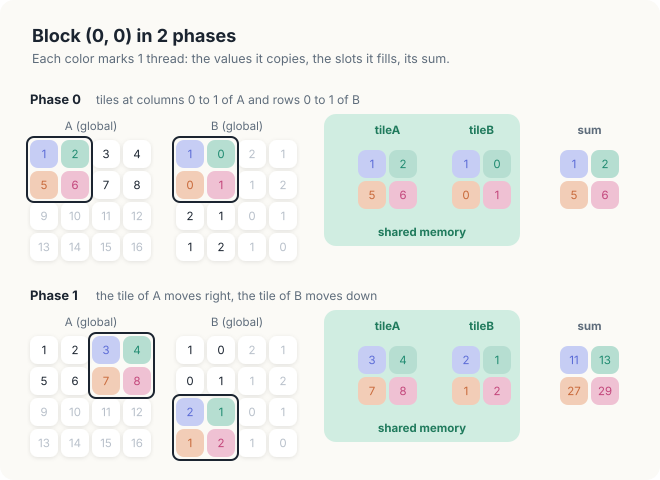
<figcaption><b>Figure 17.3</b> Block (0, 0) in 2 phases. Each color marks 1 thread: the values it copies, the shared-memory slots it fills, and the sum it accumulates.</figcaption>
</figure>

Let us follow thread \\((0, 0)\\). In phase 0, it copies \\(a_{00} = 1\\) and \\(b_{00} = 1\\),
while the other 3 threads of the block copy the remaining 6 values of the 2 tiles. Once both tiles
are complete, the thread multiplies row 0 of *tileA* by column 0 of *tileB* and obtains
\\(1 \cdot 1 + 2 \cdot 0 = 1\\). In phase 1, the tiles hold the next 2 pieces of \\(A\\) and
\\(B\\), and the thread adds \\(3 \cdot 2 + 4 \cdot 1 = 10\\), which brings its sum to
\\(c_{00} = 11\\). Thread \\((0, 1)\\) performs the same steps with column 1 of each tile of
\\(B\\). It obtains \\(1 \cdot 0 + 2 \cdot 1 = 2\\) in phase 0, and \\(2 + 3 \cdot 1 + 4 \cdot 2 =
13\\) after phase 1, which is \\(c_{01}\\).

We can now see where the saving comes from. Consider thread \\((0, 1)\\) in phase 0, shown in
Figure 17.4. It uses 4 values from shared memory, but it copied only 2 of them, \\(a_{01}\\) and
\\(b_{01}\\); the other 2 were copied by its neighbors. In general, each value of *tileA* is used
by the \\(T\\) threads in its row of the block, and each value of *tileB* by the \\(T\\) threads
in its column. Every value that the block reads from global memory is therefore used \\(T\\) times.

<figure>
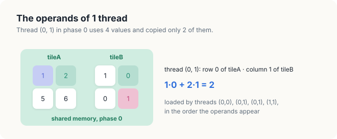
<figcaption><b>Figure 17.4</b> The operands of thread (0, 1) in phase 0. Other threads of the block copied 2 of the 4 operands.</figcaption>
</figure>

<div class="exercises">

Exercises

17.1 Carry out both phases of block \\((0, 1)\\), which computes \\(c_{02}\\), \\(c_{03}\\),
\\(c_{12}\\) and \\(c_{13}\\). Which values does thread \\((1, 0)\\) copy in each phase?<br>
17.2 With \\(T = 4\\), the whole example is a single block. How many phases does it run, and which
values does thread \\((2, 3)\\) copy?<br>
17.3 In the phase with number \\(\mathsf{phase}\\), which thread of block \\((\mathsf{blockIdx{.}y}, \mathsf{blockIdx{.}x})\\) copies \\(a_{i, s}\\)? Express \\(\mathsf{threadIdx{.}y}\\)
and \\(\mathsf{threadIdx{.}x}\\) in terms of \\(i\\), \\(s\\), \\(\mathsf{blockIdx{.}y}\\), \\(\mathsf{phase}\\) and \\(T\\).

</div>

## 17.4 The algorithm

### 17.4.1 The barrier

In Section 17.3, we let every thread copy 1 value of each tile and then compute with values that
other threads had copied. In Figure 17.4, for example, thread \\((0, 1)\\) uses
\\(\mathsf{tileA}[0][0] = 1\\), which thread \\((0, 0)\\) copied, and
\\(\mathsf{tileB}[1][1] = 1\\), which thread \\((1, 1)\\) copied. This is correct only if thread
\\((0, 1)\\) reads these 2 slots after its neighbors have stored their values in them. The
threads of a block, however, do not move in lockstep. One thread may run ahead while another falls
behind, because their warps are scheduled independently and their memory reads finish at different
times. From its own progress alone, thread \\((0, 1)\\) therefore cannot tell whether thread
\\((1, 1)\\) has already stored its value. When threads exchange data through shared memory, they
need a common point in the program at which all of them wait for one another, so that each thread
knows that the work of every other thread before that point is finished. Such a point is called a
barrier.

<div class="definition">

<span class="box-label">Definition 17.2</span> **Barrier.** A **barrier** is a point in a kernel
that no thread of a block may pass until every thread of the block has reached it. The writes to
shared memory that a thread made before the barrier are visible to every thread of the block after
it. In cuda-oxide, a barrier is `thread::sync_threads()`, and in CUDA C++, it is `__syncthreads()`.

*Example.* In Figure 17.5, thread 3 arrives first and waits; thread 1 arrives last, and then all 4
threads continue together.

</div>

<figure>
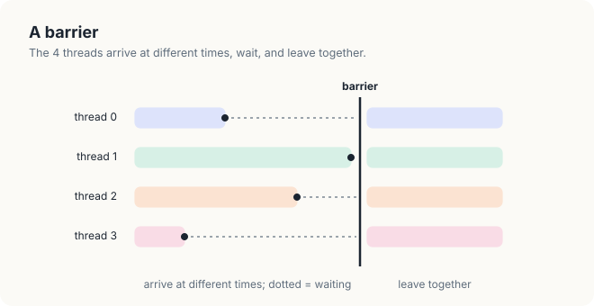
<figcaption><b>Figure 17.5</b> A barrier. The 4 threads arrive at different times, wait (dotted), and leave together.</figcaption>
</figure>

Note that a barrier costs time. In Figure 17.5, the threads that arrive early do no work between
their arrival and the arrival of thread 1, so the block as a whole advances at the pace of its
slowest thread. We will return to this cost in Section 17.8.2.

### 17.4.2 The tiled kernel

We now have all the pieces of the tiled kernel. In every phase, each thread performs the same 4
steps, shown in Figure 17.6. It first copies its 1 value of each tile. It then waits at a barrier
until the whole block has finished copying. Next, it adds the \\(T\\) products of the phase to its
sum, and finally, it waits at a second barrier until the whole block has finished reading the
tiles. The phase then begins again with the next pair of tiles. In Section 17.6, we explain why
each of the 2 barriers is needed.

<figure>
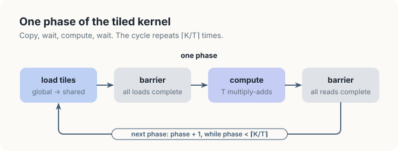
<figcaption><b>Figure 17.6</b> 1 phase of the tiled kernel. The cycle repeats ⌈K/T⌉ times.</figcaption>
</figure>

Every thread executes the following procedure. The arrays *tileA* and *tileB* live in shared
memory, and each block has its own pair of them.

<div class="algo">
<p class="algo-name">Tiled-Kernel(\(A, B, C, M, K, N\))</p>
<ol>
<li>\(\mathsf{row} = \mathsf{blockIdx{.}y} \cdot T + \mathsf{threadIdx{.}y}\)</li>
<li>\(\mathsf{col} = \mathsf{blockIdx{.}x} \cdot T + \mathsf{threadIdx{.}x}\)</li>
<li class="gap">\(\mathsf{sum} = 0\)</li>
<li class="gap"><b class="kw">for</b> \(\mathsf{phase} \in [0, \lceil K/T \rceil)\) {</li>
<li style="--d:1">\(\mathsf{aCol} = \mathsf{phase} \cdot T + \mathsf{threadIdx{.}x}\)</li>
<li style="--d:1">\(\mathsf{bRow} = \mathsf{phase} \cdot T + \mathsf{threadIdx{.}y}\)</li>
<li style="--d:1">\(\mathsf{tileA}[\mathsf{threadIdx{.}y}][\mathsf{threadIdx{.}x}] = a_{\mathsf{row},\, \mathsf{aCol}}\) <b class="kw">if</b> \(\mathsf{row} \in [0, M)\) <b class="kw">and</b> \(\mathsf{aCol} \in [0, K)\), <b class="kw">else</b> 0</li>
<li style="--d:1">\(\mathsf{tileB}[\mathsf{threadIdx{.}y}][\mathsf{threadIdx{.}x}] = b_{\mathsf{bRow},\, \mathsf{col}}\) <b class="kw">if</b> \(\mathsf{bRow} \in [0, K)\) <b class="kw">and</b> \(\mathsf{col} \in [0, N)\), <b class="kw">else</b> 0</li>
<li style="--d:1"><span class="sc">Barrier</span>() <span class="c">// wait until both tiles are full</span></li>
<li class="gap" style="--d:1"><b class="kw">for</b> \(\mathsf{offset} \in [0, T)\) {</li>
<li style="--d:2">\(\mathsf{sum} = \mathsf{sum} + \mathsf{tileA}[\mathsf{threadIdx{.}y}][\mathsf{offset}] \cdot \mathsf{tileB}[\mathsf{offset}][\mathsf{threadIdx{.}x}]\)</li>
<li style="--d:1">}</li>
<li class="gap" style="--d:1"><span class="sc">Barrier</span>() <span class="c">// wait until every thread has read the tiles</span></li>
<li>}</li>
<li class="gap"><b class="kw">if</b> \(\mathsf{row} \in [0, M)\) <b class="kw">and</b> \(\mathsf{col} \in [0, N)\) {</li>
<li style="--d:1">\(c_{\mathsf{row}, \mathsf{col}} = \mathsf{sum}\)</li>
<li>}</li>
</ol>
</div>

Lines 1 and 2 compute the row and column of the entry of \\(C\\) that the thread computes, as in
<span style="font-variant: small-caps">Direct-Kernel</span>. A block of the tiled kernel has
\\(T \times T\\) threads, so \\(\mathsf{blockDim{.}x} = \mathsf{blockDim{.}y} = T\\). For thread
\\((0, 1)\\) of block \\((0, 0)\\) with \\(T = 2\\), \\(\mathsf{threadIdx{.}y} = 0\\) and
\\(\mathsf{threadIdx{.}x} = 1\\), so the 2 lines give \\(\mathsf{row} = 0 \cdot 2 + 0 = 0\\) and
\\(\mathsf{col} = 0 \cdot 2 + 1 = 1\\). Line 3 sets the sum to 0, and line 4 starts the loop over
the \\(\lceil K/T \rceil\\) phases, of which there are 2 in our example. Lines 5 and 6 name the 2
positions that the thread copies in this phase, the column \\(\mathsf{aCol}\\) of \\(A\\) and the
row \\(\mathsf{bRow}\\) of \\(B\\). For thread \\((0, 1)\\) in phase 1, they are
\\(1 \cdot 2 + 1 = 3\\) and \\(1 \cdot 2 + 0 = 2\\). Lines 7 and 8 are the joint copy of
Section 17.3. Lines 10 to 12 add 1 phase of the sum, that is, the inner sum over \\(\mathsf{offset}\\) of
the formula in Section 17.2. In phase 0, for thread \\((0, 1)\\), they compute
\\(\mathsf{tileA}[0][0] \cdot \mathsf{tileB}[0][1] + \mathsf{tileA}[0][1] \cdot
\mathsf{tileB}[1][1] = 1 \cdot 0 + 2 \cdot 1 = 2\\). Lines 9 and 13 are the 2 barriers. The
conditions in lines 7 and 8, which store 0 in place of a value outside the matrix, handle matrices
whose size is not a multiple of \\(T\\); we treat both the barriers and these zeros in
Section 17.6. Finally, lines 15 to 17 store the result. They replace the early return of the
direct kernel, for a reason that we give in Section 17.6.5.

## 17.5 Counting the fetches again

We can now count how often the tiled kernel reads global memory, in the same way as we counted
the reads of the direct kernel in Section 17.1. As in Chapter 16, we call each read of a value from
global memory a fetch. In each phase, every thread fetches 2 values, 1 for each tile, in lines 7
and 8. Block \\((0, 0)\\) has 4 threads and runs 2 phases, so it makes \\(4 \cdot 2 \cdot 2 = 16\\)
fetches. This is half of the 32 fetches that the direct kernel makes for the same block, and it
equals the number of different values that the block needs, so the block now fetches each of
these values exactly once. The other 3 blocks behave in the same way, and over the whole grid we
count \\(4 \cdot 16 = 64\\) fetches instead of 128 (Figure 17.7).

<figure>
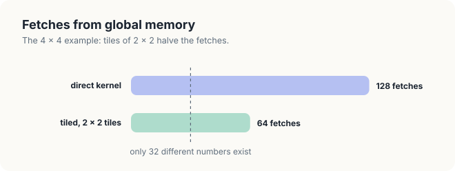
<figcaption><b>Figure 17.7</b> Fetches from global memory in the 4 × 4 example.</figcaption>
</figure>

The dashed line in Figure 17.7 marks the 32 different values of \\(A\\) and \\(B\\), which is the
least that any kernel must fetch. The tiled kernel still fetches each value twice, because 2
blocks need it. For example, \\(a_{00}\\) is fetched by block \\((0, 0)\\) and again by block
\\((0, 1)\\), which computes the right half of the same 2 rows of \\(C\\).

In general, a block has \\(T^2\\) threads, each of which fetches 2 values per phase, so a block
makes \\(2T^2\\) fetches per phase. When \\(T\\) divides every dimension, the grid has
\\((M/T)(N/T)\\) blocks, because each block covers a \\(T \times T\\) square of the
\\(M \times N\\) matrix \\(C\\), and each block runs \\(K/T\\) phases. The total number of fetches
is therefore

\\[ \frac{M}{T} \cdot \frac{N}{T} \cdot \frac{K}{T} \cdot 2T^2 = \frac{2MNK}{T}. \\]

| Symbol | Meaning | In the example |
|---|---|---|
| \\(M, N\\) | rows and columns of \\(C\\) | 4, 4 |
| \\(K\\) | columns of \\(A\\) and rows of \\(B\\), the length of each dot product | 4 |
| \\(T\\) | tile width | 2 |
| \\((M/T)(N/T)\\) | number of blocks in the grid | \\(2 \cdot 2 = 4\\) |
| \\(K/T\\) | number of phases each block runs | 2 |
| \\(2T^2\\) | fetches of 1 block in 1 phase | 8 |
| \\(2MNK/T\\) | fetches of the whole kernel | \\(2 \cdot 4 \cdot 4 \cdot 4 / 2 = 64\\) |

Recall that the direct kernel makes \\(2MNK\\) fetches, 2 for each of its \\(MNK\\)
multiply-adds, which in our example is \\(2 \cdot 64 = 128\\). Tiling therefore divides the traffic
to global memory by exactly \\(T\\). Equivalently, each value of \\(A\\) is fetched \\(N/T\\) times
instead of \\(N\\) times, once by each of the \\(N/T\\) blocks that compute its rows of \\(C\\), and
each value of \\(B\\) is fetched \\(M/T\\) times instead of \\(M\\) times. With \\(T = 16\\), the
product of 2 matrices of 1,024 × 1,024 moves 0.54 GB instead of 8.6 GB. In the units of
Chapter 9, the kernel performs \\(T\\) FLOP per float fetched from global memory, 16 instead of 1.

Since a larger tile saves more fetches, it is natural to ask how large \\(T\\) can be. There are 2
limits. A block holds at most 1,024 threads, and a block of the tiled kernel has \\(T^2\\) threads,
so \\(T \le 32\\). The 2 tiles hold \\(2T^2\\) values of 4 bytes each, which is 2 KB of shared
memory for \\(T = 16\\) and 8 KB for \\(T = 32\\), well within the 48 KB that a block may use.
The number of threads in a block, not the size of shared memory, therefore limits \\(T\\). In
Section 17.8, we will see that the largest \\(T\\) is nevertheless not the fastest.

<div class="exercises">

Exercises

17.4 With \\(T = 4\\), the example is 1 block. How many fetches does it make, and how often is each
value fetched?<br>
17.5 Let \\(M = N = K = 100\\) and \\(T = 16\\). How many phases does each block run, and what
fraction of the values copied in the last phase are zeros?<br>
17.6 For \\(M = N = K = 4{,}096\\) and \\(T = 32\\), how many bytes does the tiled kernel fetch
from global memory?

</div>

## 17.6 Correctness

In Section 17.4, we placed 2 barriers in every phase without explaining why both are needed. The
threads of a block run at different speeds, yet they read and write the same slots of shared
memory. Without coordination, 2 things can go wrong. A thread can read a slot before the thread
responsible for it has filled it, or a thread can overwrite a slot that another thread has not yet
finished reading. In this section, we remove the barriers of
<span style="font-variant: small-caps">Tiled-Kernel</span> one at a time and follow each error on
our example. We then prove that the kernel with both barriers is correct, and we extend it to
matrices of any size.

### 17.6.1 The first barrier: copy before computing

Suppose that we delete line 9, the first barrier. Consider phase 1 of block \\((0, 0)\\). Thread
\\((0, 0)\\) finishes its copies early and goes on to line 11, where it computes
\\(\mathsf{tileA}[0][0] \cdot \mathsf{tileB}[0][0] + \mathsf{tileA}[0][1] \cdot
\mathsf{tileB}[1][0]\\). The slot \\(\mathsf{tileB}[1][0]\\) belongs to thread \\((1, 0)\\), which
in phase 1 is to fill it with \\(b_{30} = 1\\). Thread \\((1, 0)\\), however, is running late, and
it has not yet stored this value when thread \\((0, 0)\\) reads the slot (Figure 17.8).

<figure>
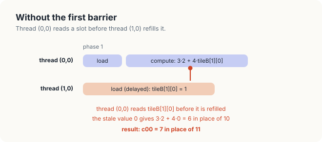
<figcaption><b>Figure 17.8</b> Without line 9. Thread (0, 0) reads a slot before thread (1, 0) refills it, and picks up the value left over from phase 0.</figcaption>
</figure>

The slot therefore still holds the value that thread \\((1, 0)\\) stored in phase 0, which is
\\(b_{10} = 0\\). Thread \\((0, 0)\\) adds \\(3 \cdot 2 + 4 \cdot 0 = 6\\) instead of
\\(3 \cdot 2 + 4 \cdot 1 = 10\\), and its sum becomes \\(c_{00} = 1 + 6 = 7\\) instead of 11.
Line 9 prevents this error, because no thread may start computing until every thread of the block
has finished copying.

### 17.6.2 The second barrier: compute before the next copy

Now we restore line 9 and delete line 13, the second barrier, instead. This time, the error occurs
at the end of a phase rather than at its start. In phase 0, thread \\((1, 1)\\) finishes its
multiply-adds early and moves on to phase 1, where its first task is to store \\(b_{31} = 2\\) in
\\(\mathsf{tileB}[1][1]\\). Thread \\((0, 1)\\), however, is still in phase 0, and it still needs
the old value of that slot, \\(b_{11} = 1\\) (Figure 17.9).

<figure>
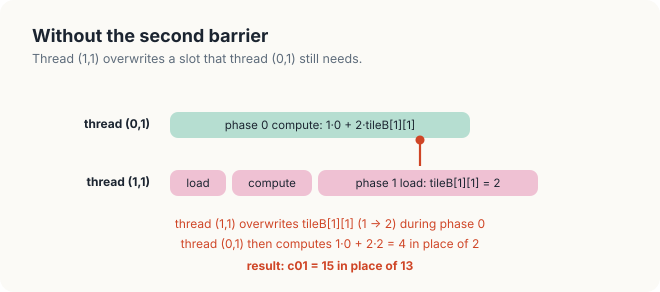
<figcaption><b>Figure 17.9</b> Without line 13. Thread (1, 1) overwrites a slot while thread (0, 1) still needs the old value.</figcaption>
</figure>

Thread \\((0, 1)\\) reads the new value and computes \\(1 \cdot 0 + 2 \cdot 2 = 4\\) instead of
\\(1 \cdot 0 + 2 \cdot 1 = 2\\) in phase 0. Phase 1 then adds the correct
\\(3 \cdot 1 + 4 \cdot 2 = 11\\), so this time we get \\(c_{01} = 4 + 11 = 15\\) instead of 13.
Line 13 prevents this error, because no thread may overwrite a tile until every thread of the
block has finished reading it. With both barriers in place, every phase follows the same orderly
schedule, shown in Figure 17.10. The threads copy, wait for the slowest of them, compute, and wait
again before the next copy.

<figure>
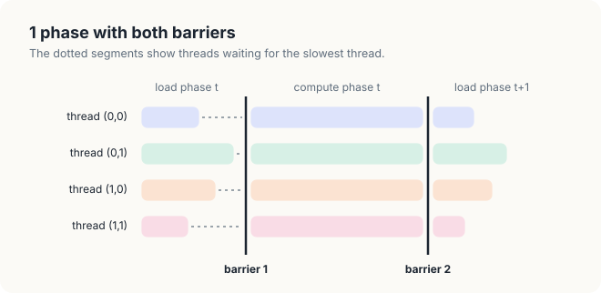
<figcaption><b>Figure 17.10</b> 1 phase with both barriers. The dotted segments show threads waiting for the slowest thread.</figcaption>
</figure>

The two errors are of different kinds. The first barrier orders a write of a slot before a read of
the same slot. Here, the reading thread needs the value that the writing thread produces, and such
an ordering is called a **read-after-write** dependence. In Section 17.6.1, thread \\((0, 0)\\) had
to read \\(\mathsf{tileB}[1][0]\\) after thread \\((1, 0)\\) had written it. The second barrier
orders a read of a slot before the next write of the same slot. Here, the writing thread needs
nothing from the reading thread, and the conflict exists only because both use the same slot in
consecutive phases. Such an ordering is called a **write-after-read** dependence. In
Section 17.6.2, thread \\((1, 1)\\) had to write \\(\mathsf{tileB}[1][1]\\) only after thread
\\((0, 1)\\) had read it. Both errors are data races in the sense of Definition 16.8.

### 17.6.3 The broken kernels on the GPU

Figures 17.8 and 17.9 show what can happen, but whether it actually happens depends on the timing
of the threads. To find out, we built the Rust kernel twice more, once without each barrier. We ran
each broken kernel 3 times on the 4 × 4 example with \\(T = 2\\) and 5 times on matrices of
512 × 512 with \\(T = 16\\), and we compared every entry of the result with a product computed on
the CPU. On the example, all 6 runs printed `equal to the product computed by hand: yes`. At
512 × 512, the kernel without the first barrier printed the following lines.

```console
without barrier 1, n = 512, T = 16: 260406 of 262144 entries wrong
without barrier 1, n = 512, T = 16: 260433 of 262144 entries wrong
without barrier 1, n = 512, T = 16: 260452 of 262144 entries wrong
without barrier 1, n = 512, T = 16: 260531 of 262144 entries wrong
without barrier 1, n = 512, T = 16: 260351 of 262144 entries wrong
```

The kernel without the second barrier printed the following lines.

```console
without barrier 2, n = 512, T = 16: 24255 of 262144 entries wrong
without barrier 2, n = 512, T = 16: 24704 of 262144 entries wrong
without barrier 2, n = 512, T = 16: 27347 of 262144 entries wrong
without barrier 2, n = 512, T = 16: 25287 of 262144 entries wrong
without barrier 2, n = 512, T = 16: 23913 of 262144 entries wrong
```

On the 4 × 4 example, both broken kernels happened to give the right product in every run. A
block of 2 × 2 threads consists of 4 threads of a single warp, and the hardware issued their loads
and their multiply-adds together, so no thread ran ahead of another. A missing barrier therefore
does not guarantee a wrong result; it only allows one. At 512 × 512, each block has 256 threads in
8 warps, which the SM schedules independently, and the errors appeared at once. Without the first
barrier, 99.3% of the entries were wrong, because almost every dot product met at least 1 slot
that its writer had not yet filled. Without the second barrier, about 9.5% were wrong. This error
is rarer, because it requires 1 warp to finish a whole phase while another warp of the same block
is still in it. In both cases, the count changed from run to run, since it depends on the order in
which the warps happen to run. The CUDA C++ kernels behaved in the same way, with 260,014 to
260,438 and 23,424 to 25,694 wrong entries. Neither program reported an error, and both compiled
without a warning, because a missing barrier breaks no rule that a compiler checks.

### 17.6.4 The proof

The experiments of Section 17.6.3 show that the kernel fails without its barriers, but tests on a
few matrices cannot show that it is correct with them. For that, we need a proof. The idea is to
follow the variable *sum* of 1 thread as it grows, phase by phase. Figure 17.11 shows this for
thread \\((0, 0)\\) with \\(T = 2\\). Before phase 0, *sum* is 0. Before phase 1, it holds the
first 2 terms of \\(c_{00}\\), \\(1 \cdot 1 + 2 \cdot 0 = 1\\), and after phase 1, it holds all 4
terms, which add up to 11. In general, before the phase with number \\(\mathsf{phase}\\), *sum* holds exactly the first \\(\mathsf{phase} \cdot T\\)
terms of the thread's entry of \\(C\\). A statement that holds every time a loop begins a new
iteration is called a loop invariant, and we prove the theorem by showing that this statement is
one.

<figure>
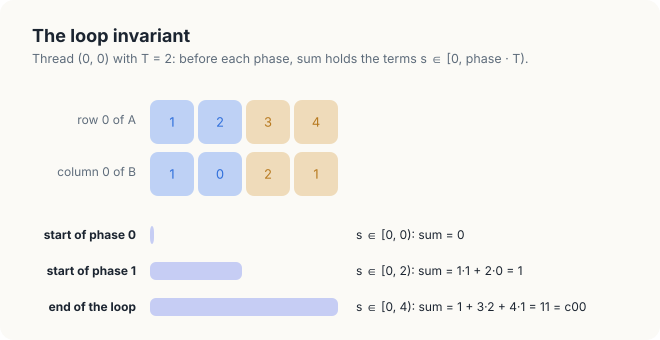
<figcaption><b>Figure 17.11</b> The loop invariant for thread (0, 0) with T = 2. Before each phase, sum covers the terms s ∈ [0, phase · T).</figcaption>
</figure>

<div class="theorem">

<span class="box-label">Theorem 17.1</span> When <span style="font-variant: small-caps">Tiled-Kernel</span>
finishes, every entry of \\(C\\) equals the corresponding entry of \\(AB\\).

</div>

<div class="proof">

*Proof.* Fix a thread with \\(\mathsf{row} \in [0, M)\\) and \\(\mathsf{col} \in [0, N)\\), and
treat entries beyond the edge of a matrix as 0. We show that the loop of lines 4 to 14 maintains
the invariant

\\[ \text{at the start of the phase with number } \mathsf{phase}, \qquad \mathsf{sum} = \sum_{s \in [0,\\, \mathsf{phase} \cdot T)}
a_{\mathsf{row}, s}\\; b_{s, \mathsf{col}}. \\]

| Symbol | Meaning | Thread \\((0, 0)\\), start of phase 1 |
|---|---|---|
| \\(\mathsf{phase}\\) | phase about to begin | 1 |
| \\(\mathsf{phase} \cdot T\\) | number of terms already added | \\(1 \cdot 2 = 2\\) |
| \\(s \in [0, \mathsf{phase} \cdot T)\\) | indices of the terms already added | 0 and 1 |
| \\(a_{\mathsf{row}, s}\\, b_{s, \mathsf{col}}\\) | term \\(s\\) of the dot product | \\(1 \cdot 1\\) and \\(2 \cdot 0\\) |
| \\(\mathsf{sum}\\) | value of the variable | 1 |

*Initialization.* Before phase 0, \\(\mathsf{sum} = 0\\), which is the empty sum.

*Maintenance.* Assume that the invariant holds at the start of the phase with number \\(\mathsf{phase}\\). In lines 7 and 8,
the threads of the block fill both tiles completely (Section 17.3). Because of the barrier in
line 9, every one of these stores is complete and visible before any thread reaches line 11; this
excludes the error of Section 17.6.1. Hence \\(\mathsf{tileA}[\mathsf{threadIdx{.}y}][\mathsf{offset}] = a_{\mathsf{row}, \mathsf{phase} \cdot T + \mathsf{offset}}\\)
and \\(\mathsf{tileB}[\mathsf{offset}][\mathsf{threadIdx{.}x}] = b_{\mathsf{phase} \cdot T + \mathsf{offset}, \mathsf{col}}\\) for every \\(\mathsf{offset} \in [0, T)\\), and lines 10
to 12 add exactly the terms with \\(s \in [\mathsf{phase} \cdot T, \mathsf{phase} \cdot T + T)\\). For thread \\((0, 0)\\) in phase 1, these
are the terms with \\(s = 2\\) and \\(s = 3\\), which add \\(3 \cdot 2 + 4 \cdot 1 = 10\\). Because
of the barrier in line 13, no thread overwrites a tile for the next phase while another thread is
still reading it in this one; this excludes the error of Section 17.6.2. Therefore, the
invariant holds at the start of the phase with number \\(\mathsf{phase} + 1\\).

*Termination.* The loop ends with \\(\mathsf{phase} = \lceil K/T \rceil\\), so \\(\mathsf{phase} \cdot T \ge K\\). All terms with
\\(s \ge K\\) are 0, hence \\(\mathsf{sum} = c_{\mathsf{row}, \mathsf{col}}\\), and line 16
stores it.

</div>

The proof uses each barrier exactly once, in the maintenance step, and each use excludes 1 of the
two errors of Sections 17.6.1 and 17.6.2. The proof covers only the threads that have an
entry of \\(C\\). A thread outside \\(C\\) stores nothing, so there is no result of its own to
prove correct. It still takes part in lines 7 to 13, however, and in the next section, we show
why it must.

### 17.6.5 Matrices of any size

So far, we have assumed that \\(T\\) divides every dimension of the matrices. Nothing in the
algorithm requires this, and in this section, we see how the kernel handles the other cases. Take
\\(C\\) of size 3 × 3 with \\(T = 2\\). A single block covers only a 2 × 2 square, so we still need
2 × 2 = 4 blocks to cover \\(C\\). Together they have 16 threads, but \\(C\\) has only 9 entries,
so the blocks stick out past the edge of \\(C\\), and 7 of their 16 threads have no entry to
compute. If also \\(K = 3\\), the matrix \\(A\\) has only 3 columns, and in phase 1, the tile of
\\(A\\), which covers columns 2 and 3, reaches for a column that does not exist (Figure 17.12).

<figure>
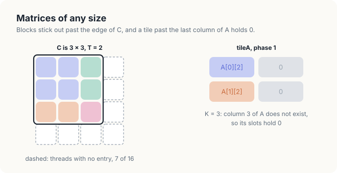
<figcaption><b>Figure 17.12</b> Left: 2 × 2 blocks over a 3 × 3 matrix; dashed cells are threads with no entry. Right: a tile that extends past the last column of A is filled with zeros.</figcaption>
</figure>

Lines 7 and 8 handle a missing value by storing 0 in its place, and a product with 0 adds nothing
to the sum. In Figure 17.12, the right column of *tileA* in phase 1 would hold column 3 of \\(A\\);
both of its slots hold 0, so the term with \\(s = 3\\), which does not exist, contributes nothing.

Threads with no entry need more care, and they explain the only structural difference between the
direct kernel and the tiled kernel. In the direct kernel, such a thread returns at once. In the
tiled kernel, it must not return, because a barrier releases the block only when every thread has
arrived. A thread that has returned never arrives, so the rest of the block would wait forever,
or, on some GPUs, continue with an undefined result. Instead, these threads stay in the loop, copy
zeros, wait at every barrier together with the other threads, and skip only the final store in
lines 15 to 17. For example, thread \\((1, 1)\\) of block \\((1, 1)\\) has \\(\mathsf{row} = 3\\)
and \\(\mathsf{col} = 3\\), outside the 3 × 3 matrix \\(C\\). In both phases, it copies 0 into both
tiles, since row 3 of \\(A\\) and column 3 of \\(B\\) do not exist, and it waits at all 4 barriers.
At line 15, the condition \\(\mathsf{row} \in [0, M)\\) is false, so it stores nothing. Both
programs check 3 shapes of this kind, comparing every entry: the 3 × 3 product with \\(T = 2\\), a
128 × 64 by 64 × 96 product, and a 1,000 × 1,000 product with \\(T = 16\\).

<div class="rule-box">

<span class="box-label">Rule</span> Every thread of a block must reach every barrier. Never place a
barrier where some threads of the block can skip it.

</div>

<div class="exercises">

Exercises

17.7 Without line 9, thread \\((1, 1)\\) might read \\(\mathsf{tileA}[1][0]\\) in phase 1 before
the slot is refilled. Which value would it use, and what would \\(c_{11}\\) become?<br>
17.8 Explain why the proof of Theorem 17.1 breaks when a thread returns early, even though that
thread writes no entry of \\(C\\).<br>
17.9 Without line 13, could \\(c_{00}\\) become wrong in our example? Which thread would have to
run ahead, and which slot would it overwrite?

</div>

## 17.7 Implementation

We now turn <span style="font-variant: small-caps">Tiled-Kernel</span> into code, in Rust and in
CUDA C++. The main new element in both languages is shared memory, so we begin with the
declaration of the 2 tiles.

### 17.7.1 Shared arrays

In CUDA C++, an array in shared memory is a local array declared with the qualifier `__shared__`.
Its length must be known at compile time, and a template parameter satisfies this requirement.
The kernel `matmulTiled<T>` therefore declares 2 tiles of `T` × `T` floats, and the compiler builds
1 kernel for each value of `T` that the program uses.

In cuda-oxide, a fixed-size array in shared memory is a `static mut` of type
`SharedArray<f32, N>` declared inside the kernel, where `N` must be known at compile time; we use
one in Chapter 18 for comparison. This form does not work for a kernel that is generic over the
tile width. A `static` declared inside a function is a separate item of the program, with exactly
1 instance, and Rust does not allow its type to mention a generic parameter of the function that
contains it. For example, `SharedArray<f32, { T * T }>` inside `fn matmul_tiled<const T: usize>` is
refused with error E0401. A kernel that is generic over the tile width therefore takes its tiles
from **dynamic shared memory**. This is a single region per block, whose size in bytes the host
passes in the launch configuration. The call `DynamicSharedArray::<f32>::get()` returns a raw
pointer of type `*mut f32` to the start of the region, and the call
`DynamicSharedArray::<f32>::offset(bytes)` returns a pointer that lies `bytes` bytes further on.

The following code declares the 2 tiles in each language.

<div class="code-tabs">
<div class="code-tab" data-lang="Rust">

```rust,ignore
mod kernels {
    // ...
    pub fn matmul_tiled<const T: usize>(
        m: u32,
        n: u32,
        k: u32,
        a: &[f32],
        b: &[f32],
        mut c: DisjointSlice<f32, Runtime2DIndex>,
    ) {
{{#include ../../../../code/oxide/ch17_matmul_tiled/src/main.rs:76:77}}
        // ...
    }
}
```

</div>
<div class="code-tab" data-lang="C++">

```cpp
// The same product with T x T tiles in shared memory. A block of T x T threads computes
// a T x T square of C in ceil(k / T) phases.
template <int T>
__global__ void matmulTiled(int m, int n, int k, const float* a, const float* b, float* c)
{
{{#include ../../../../code/cuda/ch17_matmul_tiled/matmul_tiled.cu:42:43}}
    // ...
}
```

</div>
</div>

In Rust, *tileA* starts at byte 0 of the region and *tileB* at byte \\(4T^2\\), immediately after
the \\(T^2\\) floats of *tileA*, each of which takes 4 bytes. With \\(T = 2\\), for example,
*tileA* occupies bytes 0 to 15 and *tileB* bytes 16 to 31, so the region must hold 32 bytes. Both
programs store a tile as a flat array of \\(T^2\\) values in row-major order (Figure 17.13). In
C++, the compiler lays out the 2-dimensional array `tile_a[threadIdx.y][threadIdx.x]` in this way, while the Rust
kernel computes the index \\(\mathsf{threadIdx{.}y} \cdot T + \mathsf{threadIdx{.}x}\\) of Definition 16.2 itself. In our example, slot
\\((1, 0)\\) of a 2 × 2 tile is at index \\(1 \cdot 2 + 0 = 2\\).

<figure>
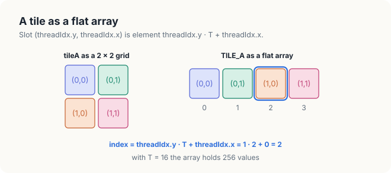
<figcaption><b>Figure 17.13</b> A 2 × 2 tile stored as a flat array of 4 slots. Slot (1, 0) is at 1 · 2 + 0 = 2.</figcaption>
</figure>

### 17.7.2 The tiled kernel

Before reading the code, we trace where the data of 1 thread travel (Figure 17.14). In each phase,
the thread copies 2 values from global memory into shared memory. From shared memory, it then
reads \\(2T\\) values, \\(T\\) from a row of *tileA* and \\(T\\) from a column of *tileB*, which
feed its \\(T\\) multiply-adds. Its sum stays in a register throughout, and at the end, a single
store writes it into \\(C\\). In our example with \\(T = 2\\), thread \\((0, 1)\\) copies 2 values
and reads 4 values in each phase, as in Figure 17.4.

<figure>
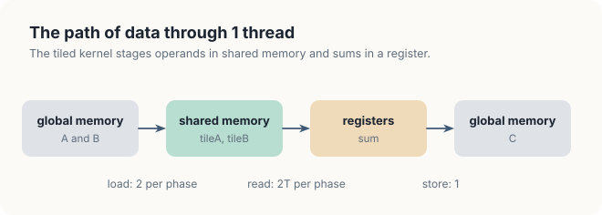
<figcaption><b>Figure 17.14</b> The path of data through 1 thread of the tiled kernel.</figcaption>
</figure>

The following code is the loop over the phases, lines 4 to 14 of the pseudocode, together with
the initialization of the sum in line 3.

<div class="code-tabs">
<div class="code-tab" data-lang="Rust">

```rust,ignore
mod kernels {
    // ...
    pub fn matmul_tiled<const T: usize>(
        m: u32,
        n: u32,
        k: u32,
        a: &[f32],
        b: &[f32],
        mut c: DisjointSlice<f32, Runtime2DIndex>,
    ) {
        // ...
{{#include ../../../../code/oxide/ch17_matmul_tiled/src/main.rs:85:114}}
        // ...
    }
}
```

</div>
<div class="code-tab" data-lang="C++">

```cpp
// The same product with T x T tiles in shared memory. A block of T x T threads computes
// a T x T square of C in ceil(k / T) phases.
template <int T>
__global__ void matmulTiled(int m, int n, int k, const float* a, const float* b, float* c)
{
    // ...
{{#include ../../../../code/cuda/ch17_matmul_tiled/matmul_tiled.cu:48:63}}
    // ...
}
```

</div>
</div>

The variable `phase` counts the phases of line 4. In Rust, the bound of the loop, `k.div_ceil(T)`, is
\\(\lceil K/T \rceil\\), the quotient \\(K/T\\) rounded up; in C++, the same bound is computed as
`(k + T - 1) / T` and stored in `phases`. The variables `a_col` and `b_row` are the indices
\\(\mathsf{phase} \cdot T + \mathsf{threadIdx{.}x}\\) and \\(\mathsf{phase} \cdot T + \mathsf{threadIdx{.}y}\\) of lines 7 and 8, that is, the column of \\(A\\) and the row of
\\(B\\) that the thread copies. For thread \\((0, 1)\\) in phase 1 with \\(T = 2\\), they are
\\(1 \cdot 2 + 1 = 3\\) and \\(1 \cdot 2 + 0 = 2\\), as in Section 17.3. When an index lies past
the edge of a matrix, the conditional expression yields 0 instead of reading memory. The first
call to the barrier, `thread::sync_threads()` in Rust and `__syncthreads()` in C++, is line 9. It
lies outside every `if`, so every thread reaches it, as the Rule of Section 17.6.5 requires.

In Rust, the copy is split into two halves. The reads `a[row * k + a_col]` and `b[b_row * n + col]`
are ordinary slice reads, bounds-checked like every slice access in safe Rust. The stores through
the raw pointers `tile_a` and `tile_b` are different. The compiler cannot check how many threads
write a slot of shared memory, or when, so every access to shared memory must stand in an
`unsafe` block. Each `unsafe` block carries a `// SAFETY:` comment, which is the Rust convention for
stating why the block is sound. The 2 comments of the kernel summarize Section 17.6. The first
states that every thread writes only its own slot, which lies inside the tile because the block
has \\(T \times T\\) threads, and that the barrier completes these writes before any thread reads
them. The second states that no thread writes either tile between the 2 barriers. In C++, the same
stores need no marking. The argument for their correctness is the same, but the language does not
ask for it.

The inner loop is lines 10 to 12 of the pseudocode. In Rust, `thread_x` and `thread_y` hold
\\(\mathsf{threadIdx{.}x}\\) and \\(\mathsf{threadIdx{.}y}\\). The slot `a_slot`, which is
`thread_y * T + offset`, is the flat index of
\\(\mathsf{tileA}[\mathsf{threadIdx{.}y}][\mathsf{offset}]\\), so as `offset` runs from 0 to \\(T - 1\\), the thread walks along
its own row of *tileA*. Likewise, `b_slot`, which is `offset * T + thread_x`, is the flat index of
\\(\mathsf{tileB}[\mathsf{offset}][\mathsf{threadIdx{.}x}]\\), and the thread walks down its own column of *tileB*. For thread
\\((0, 1)\\) with \\(T = 2\\), the flat indices are 0 and 1 in *tileA* and 1 and 3 in *tileB*. The
Rust loop is a `while` loop marked `#[unroll]`. Inside each specialization of the generic kernel,
`T` is a constant, so the loop has a fixed count, and the compiler replaces it by \\(T\\) copies of
its body. The C++ compiler unrolls the `for` loop over a template constant by itself. The second
barrier, line 13, again lies outside every `if`.

The following code stores the result, lines 15 to 17 of the pseudocode.

<div class="code-tabs">
<div class="code-tab" data-lang="Rust">

```rust,ignore
mod kernels {
    // ...
    pub fn matmul_tiled<const T: usize>(
        m: u32,
        n: u32,
        k: u32,
        a: &[f32],
        b: &[f32],
        mut c: DisjointSlice<f32, Runtime2DIndex>,
    ) {
        // ...
{{#include ../../../../code/oxide/ch17_matmul_tiled/src/main.rs:116:122}}
    }
}
```

</div>
<div class="code-tab" data-lang="C++">

```cpp
// The same product with T x T tiles in shared memory. A block of T x T threads computes
// a T x T square of C in ceil(k / T) phases.
template <int T>
__global__ void matmulTiled(int m, int n, int k, const float* a, const float* b, float* c)
{
    // ...
{{#include ../../../../code/cuda/ch17_matmul_tiled/matmul_tiled.cu:65:67}}
}
```

</div>
</div>

The final store goes through `DisjointSlice` exactly as in the direct kernel, guarded by the
condition `row < m && col < n`. Unlike the direct kernel, however, the tiled kernel has no early
return. A thread outside \\(C\\) reaches this point only after it has taken part in every phase,
and only then does it skip the store.

### 17.7.3 The launch

The launch configuration must match `T` in 3 respects. The block must have \\(T \times T\\)
threads, so that every slot of a tile has exactly 1 thread to fill it. The grid must have enough
blocks to cover \\(C\\). In Rust, the dynamic shared memory must also hold the 2 tiles, which take
\\(2T^2 \cdot 4\\) bytes. The following code builds this configuration and launches the kernel. In
Rust, the function `tiled_config` computes the configuration and the method `Problem::tiled`
launches the kernel with it; in C++, the function `launchTiled` does both.

<div class="code-tabs">
<div class="code-tab" data-lang="Rust">

```rust,ignore
{{#include ../../../../code/oxide/ch17_matmul_tiled/src/main.rs:126:133}}

impl Problem {
    // ...
{{#include ../../../../code/oxide/ch17_matmul_tiled/src/main.rs:201:212}}
    // ...
}
```

</div>
<div class="code-tab" data-lang="C++">

```cpp
{{#include ../../../../code/cuda/ch17_matmul_tiled/matmul_tiled.cu:76:81}}
```

</div>
</div>

For \\(T = 16\\) and \\(M = N = 1{,}000\\), `tiled_config` returns a grid of 63 × 63 blocks, since
\\(\lceil 1{,}000/16 \rceil = 63\\), with 16 × 16 threads per block and
\\(2 \cdot 16^2 \cdot 4 = 2{,}048\\) bytes of dynamic shared memory. The launch contract of the
Rust kernel checks what it can. The setting `dynamic_shared_range = (32, 8192)` accepts amounts
from the 32 bytes of \\(T = 2\\) up to the 8,192 bytes of \\(T = 32\\), and the attribute
`#[launch_bounds(1024)]` limits a block to 1,024 threads. The `requires` clause checks the lengths
of the buffers, as in Chapter 16. An exact block shape such as `block = (16, 16, 1)`, however, must
be written as literal numbers, so it cannot depend on `T`, and the contract therefore cannot check
that the block is \\(T \times T\\). This condition moves into the program instead. The function
`tiled_config::<T>` derives the block, the grid and the shared memory from `T` in 1 place, and the
`SAFETY` comment of the copy names it.

<div class="exercises">

Exercises

17.10 Set `T` to 32. Predict the effect on fetches from global memory and on shared memory per
block.<br>
17.11 Launch `matmul_tiled::<16>` with blocks of 8 × 8 threads and 2,048 bytes of dynamic shared
memory. Does the contract accept the launch? Which part of the `SAFETY` argument fails, and which
entries of \\(C\\) are wrong?<br>
17.12 Each thread of the tiled kernel performs 2 arithmetic operations for every 2 values it reads
from shared memory. Design a variant in which each thread computes several entries of \\(C\\), so
that every value read from shared memory is used more than once.

</div>

## 17.8 Measurements

### 17.8.1 Results

The measurements come from the GPU of Chapter 16, which has 8 SMs, a memory bandwidth of
102 GB/s and an FP32 peak of 2,400 GFLOP/s, and we use the method of Section 16.6.1. Both programs
time the direct kernel and the tiled kernel with \\(T = 8\\), 16 and 32, on square matrices from
512 × 512 to 4,096 × 4,096. The Rust program prints the following output.

```console
$ cargo oxide run
C = A B on the 4 x 4 example, tiles of 2 x 2, 2 phases
    11   13    8    8
    27   29   24   24
    43   45   40   40
    59   61   56   56
equal to the product computed by hand: yes

Sizes that are not multiples of the tile width
  m =    3, k =    3, n =    3, T =  2:       9 of       9 entries exact
  m =  128, k =   64, n =   96, T = 16:   12288 of   12288 entries exact
  m = 1000, k = 1000, n = 1000, T = 16: 1000000 of 1000000 entries exact

C = A B, n x n; fetched: the modelled reads from global memory
      n  kernel            ms   GFLOP/s  fetched MiB  fetch GB/s   exact
    512  direct         1.462     183.6       1024.0       734.3     64 of 64
    512  T = 8          1.918     140.0        128.0        70.0     64 of 64
    512  T = 16         0.946     283.6         64.0        70.9     64 of 64
    512  T = 32         1.133     237.0         32.0        29.6     64 of 64
   1024  direct        15.561     138.0       8192.0       552.0     64 of 64
   1024  T = 8         15.368     139.7       1024.0        69.9     64 of 64
   1024  T = 16         8.192     262.1        512.0        65.5     64 of 64
   1024  T = 32         9.816     218.8        256.0        27.3     64 of 64
   2048  direct       125.589     136.8      65536.0       547.2     64 of 64
   2048  T = 8        123.308     139.3       8192.0        69.7     64 of 64
   2048  T = 16        66.321     259.0       4096.0        64.8     64 of 64
   2048  T = 32        80.277     214.0       2048.0        26.8     64 of 64
   4096  direct       996.270     138.0     524288.0       551.8     64 of 64
   4096  T = 8       1004.860     136.8      65536.0        68.4     64 of 64
   4096  T = 16       531.679     258.5      32768.0        64.6     64 of 64
   4096  T = 32       668.652     205.5      16384.0        25.7     64 of 64
PASSED
```

The first part of the output repeats the 4 × 4 example and the 3 shapes of Section 17.6.5. In the
table that follows, the column *fetched MiB* is the model of Section 17.5, \\(2n^3/T\\) values of 4
bytes, where \\(n\\) is the size of the matrices and \\(T = 1\\) for the direct kernel. For example,
at \\(n = 512\\) with \\(T = 16\\), the model gives \\(2 \cdot 512^3 / 16 = 16{,}777{,}216\\)
values, or 64 MiB. The column *fetch GB/s* divides this amount by the time, so it is the rate at
which the kernel requests data from global memory, whether or not a cache answers the request. The
C++ program prints the same lines. The following table compares the two languages at the smallest
and the largest size.

| n | kernel | modeled fetches | C++ time | C++ rate | Rust time | Rust rate |
|---|---|---|---|---|---|---|
| 512 | direct | 1,024 MiB | 1.495 ms | 179.5 GFLOP/s | 1.462 ms | 183.6 GFLOP/s |
| 512 | \\(T = 8\\) | 128 MiB | 1.809 ms | 148.4 GFLOP/s | 1.918 ms | 140.0 GFLOP/s |
| 512 | \\(T = 16\\) | 64 MiB | 0.976 ms | 275.2 GFLOP/s | 0.946 ms | 283.6 GFLOP/s |
| 512 | \\(T = 32\\) | 32 MiB | 1.079 ms | 248.7 GFLOP/s | 1.133 ms | 237.0 GFLOP/s |
| 4,096 | direct | 524,288 MiB | 744.953 ms | 184.5 GFLOP/s | 996.270 ms | 138.0 GFLOP/s |
| 4,096 | \\(T = 8\\) | 65,536 MiB | 982.887 ms | 139.8 GFLOP/s | 1,004.860 ms | 136.8 GFLOP/s |
| 4,096 | \\(T = 16\\) | 32,768 MiB | 505.159 ms | 272.1 GFLOP/s | 531.679 ms | 258.5 GFLOP/s |
| 4,096 | \\(T = 32\\) | 16,384 MiB | 637.641 ms | 215.5 GFLOP/s | 668.652 ms | 205.5 GFLOP/s |

With \\(T = 16\\), the tiled kernel made, in the model of Section 17.5, 16 times fewer fetches than
the direct kernel. In C++, it ran 1.53 times as fast as the direct kernel at 512 × 512 (1.495 ms
against 0.976 ms) and 1.47 times as fast at 4,096 × 4,096. In Rust, the factors are 1.55 and 1.87.
The second Rust factor is larger because the generic Rust direct kernel is slower at large sizes
(Section 16.6.3). The Rust and C++ tiled kernels agree within 6% at every size. All checked
entries were exact, including those of the 3 shapes that are not multiples of the tile width.
Figure 17.15 shows the rates at \\(n = 4{,}096\\) against two limits, which we explain in the next
section.

<figure>
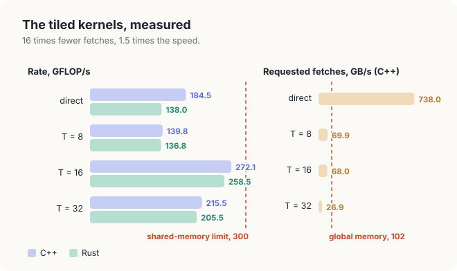
<figcaption><b>Figure 17.15</b> The kernels at n = 4,096 on the measured GPU: rates against the shared-memory limit, and requested fetch rates against the bandwidth of global memory.</figcaption>
</figure>

### 17.8.2 Why the speedup is 1.5, not 16

Tiling reduced the fetches by a factor of 16, yet the kernel became only about 1.5 times as fast.
The reason is that our model in Section 17.5 counted fetches as if every fetch went all the way to
global memory. In Section 16.6.3, we saw that this is not true for the direct kernel. It requested
738 GB/s, which is 7.2 times what global memory can deliver, so at least 86% of its fetches were
answered by the L1 and L2 caches. Tiling removes 15 of every 16 requested fetches, but most of the
fetches that it removes were already cheap. In effect, the hardware caches had already recovered
part of the reuse that tiling makes explicit.

The difference between the two approaches is control. A value stays in a cache only by chance, and
the chance shrinks as the matrices grow beyond the size of the cache. A value in shared memory
stays there for exactly 1 phase, by construction, at every matrix size. The tiled kernel with
\\(T = 16\\) requested 68 GB/s from global memory, two-thirds of the 102 GB/s available, so global
memory is no longer what limits it.

What limits the tiled kernel now is shared memory. Each execution of line 11 performs 1
multiply-add and reads 2 values from shared memory, \\(\mathsf{tileA}[\mathsf{threadIdx{.}y}][\mathsf{offset}]\\) and
\\(\mathsf{tileB}[\mathsf{offset}][\mathsf{threadIdx{.}x}]\\). The shared memory of an SM serves 1 read instruction of a warp per
cycle, that is, 32 values of 4 bytes, or 128 bytes per cycle, provided that the 32 addresses fall
in different banks or coincide. The 128 FP32 units of the SM, on the other hand, can perform 128
multiply-adds per cycle. Let us count for 1 warp. Its 32 multiply-adds need 2 read instructions, 1
for each tile, and therefore 2 cycles of shared memory. The SM thus completes at most
\\(32 / 2 = 16\\) multiply-adds per cycle, 1/8 of the 128 that its units could perform. On the
measured GPU, that limit is \\(2{,}400 / 8 = 300\\) GFLOP/s. The C++ kernel with \\(T = 16\\)
reached 272 to 275 GFLOP/s at every size, 91% of the limit, and the Rust kernel reached 259 to
284 GFLOP/s. A larger tile reduces the fetches from global memory, but it does not change this
ratio, because every multiply-add of the tiled kernel still costs 2 reads of shared memory.

The other 2 tile widths are slower, each for a reason of its own. To explain the first reason, we
need 1 more definition. A block of 32 × 32 = 1,024 threads leaves no room for a second block on an
SM of the measured GPU, which holds at most 1,536 threads.

<div class="definition">

<span class="box-label">Definition 17.3</span> **Occupancy.** The **occupancy** of a kernel is the
number of threads resident on an SM divided by the largest number the SM can hold.

*Example.* With \\(T = 32\\), each SM of the measured GPU runs 1 block of 1,024 threads out of
1,536, an occupancy of 67%; with \\(T = 16\\), it runs 6 blocks of 256 threads, an occupancy of
100%.

</div>

With \\(T = 32\\), the SM therefore runs a single block, and when the threads of that block wait at
a barrier, the SM has no other block to run, so it idles. This kernel ran at 216 GFLOP/s, although
it fetched half as much as the kernel with \\(T = 16\\). With \\(T = 8\\), a block has only 64
threads, and each thread performs only 8 multiply-adds between 2 barriers, so the copy and the
barriers take a larger share of each phase. Moreover, an SM holds at most 16 blocks, which with
\\(T = 8\\) is only 1,024 threads. This kernel ran at 140 GFLOP/s, slower than the direct kernel
in C++.

The speedup differs between GPUs, because it depends on how well the caches serve the direct
kernel. On a Jetson AGX Thor, Rust kernels for the same two algorithms with \\(T = 16\\) took
1.158 ms and 0.285 ms for 512 × 512 matrices, a speedup of 4.06 (Pathak, 2026). On that GPU, the
direct kernel requested 927 GB/s, 3.4 times the 273 GB/s of the Thor's memory, so the caches
answered at least 70% of its fetches, against 86% on the measured GPU, and tiling had more to
gain. The tiled kernel ran at 941.5 GFLOP/s, 93% of the Thor's shared-memory limit of
\\(8{,}100 / 8 = 1{,}012\\) GFLOP/s. On both GPUs, the tiled kernel ends near the same limit, 1/8
of the arithmetic peak, and we remove this limit in Chapter 18.

## 17.9 The complete programs

The following listings are the complete programs of this chapter, in Rust and in CUDA C++.

<div class="code-tabs">
<div class="code-tab" data-lang="Rust">

```rust,ignore
{{#include ../../../../code/oxide/ch17_matmul_tiled/src/main.rs}}
```

</div>
<div class="code-tab" data-lang="C++">

```cpp
{{#include ../../../../code/cuda/ch17_matmul_tiled/matmul_tiled.cu}}
```

</div>
</div>

The Rust program is built and run with `cargo oxide run` in its directory, and the C++ program
with `nvcc -O3 -arch=native matmul_tiled.cu -o matmul_tiled && ./matmul_tiled`.

## Common mistakes

- **Omitting a barrier.** Without the first barrier, threads read slots before they are filled.
  Without the second, a fast thread overwrites a tile that a slow thread is still reading. Neither
  mistake produces an error or a compiler warning (Section 17.6.3).
- **Returning early from a tiled kernel.** A thread outside \\(C\\) must still copy zeros and reach
  every barrier; only its final store is skipped.
- **Forgetting the zeros.** Without the `else 0` of lines 7 and 8, a tile at the edge holds values
  of the previous phase or of another matrix, and the last phase adds them to the sum.
- **A block shape that does not match the tile.** With fewer than \\(T \times T\\) threads, part of
  each tile is never filled; with more, threads write past the end of the tile. In Rust, the shape
  is best derived from `T` in 1 function.
- **Assuming that shared-memory indices are checked.** An index through the pointers of
  `DynamicSharedArray`, or into a C++ `__shared__` array, is not compared with any length.
- **Choosing the largest tile.** \\(T = 32\\) fetches half as much as \\(T = 16\\), but it ran
  slower, because a block of 1,024 threads fills an SM on its own (Section 17.8.2).

## Summary

<div class="summary">

- A block of \\(T \times T\\) threads needs \\(T\\) rows of \\(A\\) and \\(T\\) columns of \\(B\\),
  and the direct kernel fetches each of these values \\(T\\) times.
- Splitting each dot product into phases of \\(T\\) terms lets the block copy 1 tile of \\(A\\) and
  1 tile of \\(B\\) into shared memory per phase, 1 value per thread, after which every thread adds
  \\(T\\) terms from the copy.
- The tiled kernel fetches \\(2MNK/T\\) values instead of \\(2MNK\\), that is, it performs \\(T\\)
  FLOP per float fetched instead of 1.
- The first barrier orders the copy before the reads (without it, \\(c_{00} = 7\\)), and the second
  orders the reads before the next copy (without it, \\(c_{01} = 15\\)). A loop invariant proves the
  kernel correct, and the proof uses each barrier once.
- Zeros outside the matrices, together with threads that stay in the loop, handle matrices of any
  size. Every thread of a block must reach every barrier.
- In Rust, shared memory is `unsafe` to access, and each access states its argument in a
  `// SAFETY:` comment; a tile sized by a generic parameter lives in dynamic shared memory. In C++,
  a `__shared__` array can be sized by a template parameter.
- On the measured GPU, tiles of 16 × 16 ran about 1.5 times as fast as the direct kernel, not 16
  times. The caches had already absorbed most of the direct kernel's repeated fetches, and the
  tiled kernel is limited by its 2 shared-memory reads per multiply-add.

</div>

In Chapter 18, we remove the second limit by letting each thread compute several entries of \\(C\\)
and keep their sums in registers, so that each value read from shared memory is used several times.

## Exercises

1. For \\(T = 16\\) and \\(M = N = K = 4{,}096\\), how many floats does 1 block copy from global
   memory over the whole kernel, and how many FLOP does it perform? Check that the ratio is 16.
2. Thread \\((7, 12)\\) of block \\((3, 5)\\) with \\(T = 16\\): which slot of each tile does it write,
   and which entries of \\(A\\) and \\(B\\) does it copy in phase 2?
3. Remove the second barrier from the Rust kernel and run it 5 times on your GPU at
   512 × 512. Record the number of wrong entries each time, and explain why the number varies.
4. Change the phase sum to compute `a_slot` as `offset * T + thread_y` instead of
   `thread_y * T + offset`, without changing the copy. Which entries of the 4 × 4 example are still correct, and why?
5. Add \\(T = 4\\) to the program. Predict its fetches and its shared-memory limit, and compare with
   the measured rate.
6. Draw the timeline of Figure 17.8 for thread \\((1, 1)\\) instead of \\((0, 0)\\). Which entry
   becomes wrong, and what value does it take?
7. Rewrite `tiled_config::<T>` to return an error when `T * T` exceeds 1,024 threads, and call it
   for \\(T = 64\\).

## Sources and further reading

- A. Pathak, *An Introduction to Tiled Parallel Programming, Simplified*, 2026: the derivation of
  the tiled kernel on the 4 × 4 example, the 2 broken kernels, the proof, and the measurements on a
  Jetson AGX Thor quoted in Section 17.8.
- T. H. Cormen, C. E. Leiserson, R. L. Rivest and C. Stein, *Introduction to Algorithms*, 4th ed.,
  MIT Press, 2022: loop invariants.
- NVIDIA, *CUDA C++ Programming Guide*, "Shared Memory" and `__syncthreads()`:
  <https://docs.nvidia.com/cuda/cuda-c-programming-guide/>
- cuda-oxide, rev b7fe543, `crates/cuda-device/src/shared.rs`: `SharedArray` and
  `DynamicSharedArray`; `cuda-macros`: `dynamic_shared_range` and `#[launch_bounds]`.
- The Rust Reference, "Static items", and `rustc --explain E0401`.
- V. Volkov and J. Demmel, "Benchmarking GPUs to Tune Dense Linear Algebra", SC08, 2008.
- Chapter 9 of this book, for the same algorithm in CUDA C++ and the comparison with cuBLAS.
