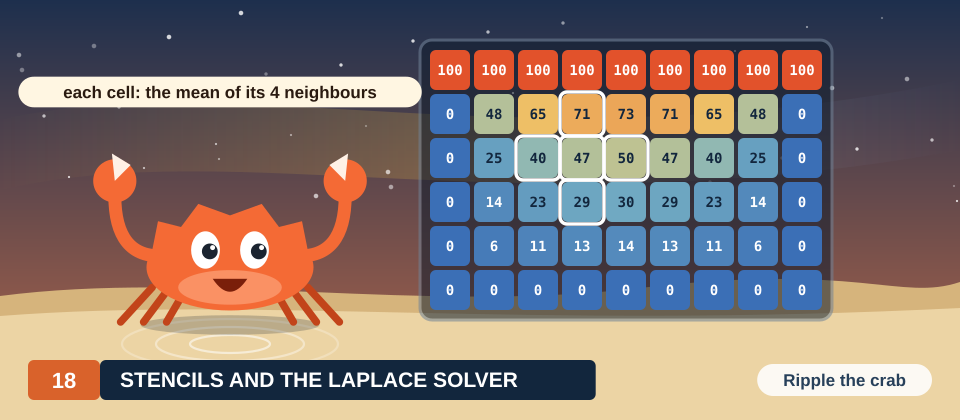
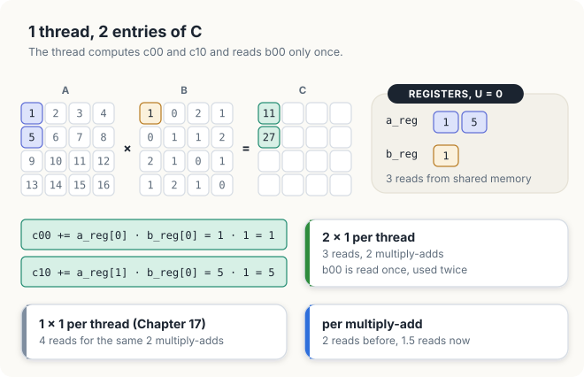
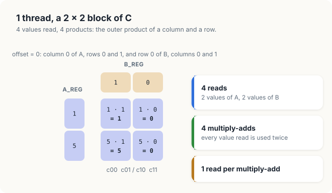
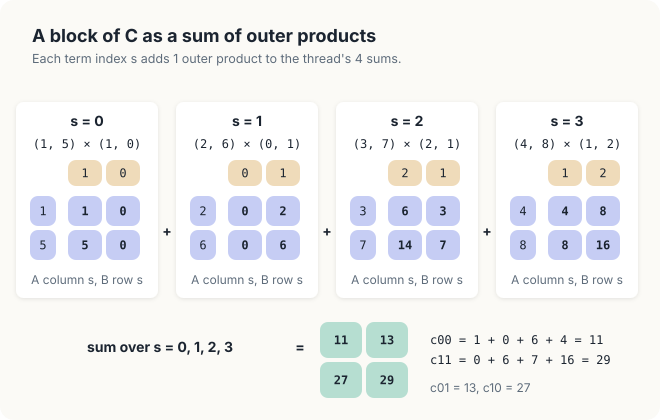
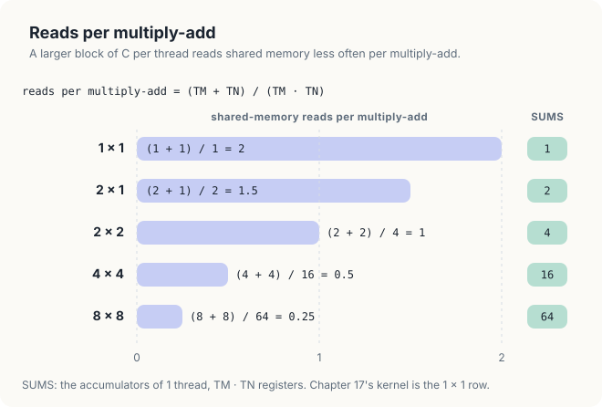
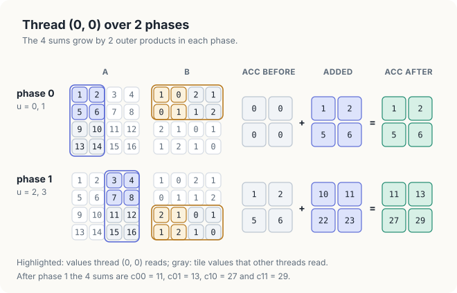
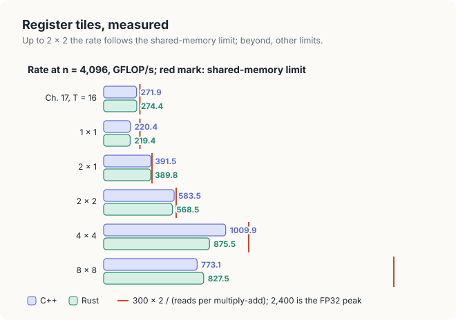

# Chapter 18: Register Tiling, Several Entries per Thread

Recall that in Chapter 17, the tiled kernel read each value from global memory 16 times less often
than the direct kernel of Chapter 16, and yet, on the GPU measured in that chapter, it ran only
about 1.5 times as fast. In Section 17.8.2, we found the reason. Every multiply-add of the tiled
kernel reads 2 values from shared memory, and shared memory cannot deliver values as fast as the
arithmetic units consume them. As a result, the tiled kernel reaches only about 1/8 of the
arithmetic peak on every GPU, whatever its tile width.

In this chapter, we remove this limit with the same idea that removed the first one, applied 1
level closer to the arithmetic units. In Chapter 17, the threads of a block shared each value
fetched from global memory by keeping it in shared memory. Here, a single thread reuses each value
read from shared memory by keeping it in a register and using it for several entries of \\(C\\).
We start from the observation of Exercise 17.12, that each thread of the tiled kernel performs
2 FLOP for every 2 values it reads from shared memory, and we work again with the 4 × 4 matrices
of Chapter 16. We first let 1 thread compute 2 entries of \\(C\\), and then a 2 × 2 group of
entries. We will see that the inner loop of the kernel then becomes a sum of outer products, in
which every value read from shared memory is used several times. We then count the reads per
multiply-add in general, derive the kernel in pseudocode, and prove it correct. Finally, we
implement the kernel in Rust and in CUDA C++, and we measure it against the tiled kernel of
Chapter 17 and the C++ kernels of Chapter 9.

<div class="covers">

This chapter covers

- the shared-memory reads of the tiled kernel, counted on the example
- One thread computing a 2 × 1 and then a 2 × 2 block of \\(C\\)
- the inner loop as a sum of outer products
- reads per multiply-add, \\((T_M + T_N) / (T_M T_N)\\), and registers as the third level of
  storage
- the register-tiled kernel in pseudocode, and its loop invariant
- the kernel in Rust (const generics, `#[unroll]`, `RuntimeRowMajorTiles`) and in CUDA C++
  (templates, `#pragma unroll`)
- measured speeds for thread tiles from 1 × 1 to 8 × 8, and what limits each

</div>

The code of the chapter is in
[`code/oxide/ch18_matmul_register_tiled/`](https://github.com/arpanpathak/gpu-parallel-book/tree/main/code/oxide/ch18_matmul_register_tiled)
for Rust and in
[`code/cuda/ch18_matmul_register_tiled/`](https://github.com/arpanpathak/gpu-parallel-book/tree/main/code/cuda/ch18_matmul_register_tiled)
for C++. In Chapter 9, we built a kernel in which each thread computes a 4 × 4 patch of \\(C\\),
in C++ and in Rust. In this chapter, we derive that kernel step by step from the tiled kernel, and
we generalize the shape of its patch. We keep the notation of Chapters 16 and 17: \\(A\\) is
\\(M \times K\\), \\(B\\) is \\(K \times N\\), and \\(C = AB\\); \\(T\\) is the tile width of the
tiled kernel, \\(t\\) the number of a phase, \\(tT\\) the index \\(s\\) at which phase \\(t\\)
begins, and *tileA* and *tileB* are the 2 tiles that a block holds in shared memory.

## 18.1 The reads of the tiled kernel

### 18.1.1 1 thread in 1 phase

To see where the reads of shared memory go, we return to block \\((0, 0)\\) of Chapter 17, with
tile width \\(T = 2\\), in phase 0. Recall from Figure 17.3 that in this phase, the 2 tiles in
shared memory hold
\\(\mathsf{tileA} = \begin{pmatrix} 1 & 2 \\\\ 5 & 6 \end{pmatrix}\\) and
\\(\mathsf{tileB} = \begin{pmatrix} 1 & 0 \\\\ 0 & 1 \end{pmatrix}\\), that is, columns 0 and 1
of rows 0 and 1 of \\(A\\), and rows 0 and 1 of columns 0 and 1 of \\(B\\). Thread \\((0, 0)\\)
computes \\(c_{00}\\), so in this phase it multiplies row 0 of *tileA* by column 0 of *tileB*. It
does so by running line 10 of <span style="font-variant: small-caps">Tiled-Kernel</span> twice,
once for each position \\(u\\) of a term within the phase. For \\(u = 0\\), it reads
\\(\mathsf{tileA}[0][0] = 1\\) and \\(\mathsf{tileB}[0][0] = 1\\) from shared memory and adds
\\(1 \cdot 1\\) to its sum. For \\(u = 1\\), it reads \\(\mathsf{tileA}[0][1] = 2\\) and
\\(\mathsf{tileB}[1][0] = 0\\) and adds \\(2 \cdot 0\\) (Figure 18.1). In this phase, the thread
therefore makes 4 reads from shared memory for 2 multiply-adds. Since a multiply-add counts as 2
floating-point operations, this is 4 reads for 4 FLOP.

<figure>

<figcaption><b>Figure 18.1</b> In the tiled kernel of Chapter 17, thread (0, 0) reads 2 values from shared memory for each multiply-add.</figcaption>
</figure>

Now consider the whole block. Each of its 4 threads makes 4 reads, so the block makes 16 reads
from shared memory for 8 multiply-adds in the phase. Many of these reads fetch a value that
another thread of the block also fetches. Thread \\((0, 1)\\) computes \\(c_{01}\\), so it reads
row 0 of *tileA* as well, the same 2 values, 1 and 2, that thread \\((0, 0)\\) read a moment
earlier. In the same way, thread \\((1, 0)\\) computes \\(c_{10}\\) and reads column 0 of *tileB*
again. In general, every value of *tileA* is read by the \\(T\\) threads in its row of the block,
and every value of *tileB* by the \\(T\\) threads in its column. This is the same waste that we
found for global memory in Section 16.4.3, now 1 level closer to the arithmetic units.

### 18.1.2 What the reads cost

In Section 17.8.2, we turned this count of reads into a limit on speed. Recall the two facts on
which the limit rests. The shared memory of an SM serves 1 read instruction of a warp per cycle,
which delivers 32 values, and in the same cycle, the 128 FP32 units of the SM could perform 128
multiply-adds. When every multiply-add needs 2 reads, the 32 values delivered in a cycle feed only
16 multiply-adds, so the SM completes at most 16 multiply-adds per cycle, 1/8 of its peak. On the
GPU of Chapter 17, this limit is 300 GFLOP/s, and the tiled kernel reached 272 GFLOP/s. In
general, a kernel that makes fewer reads per multiply-add has a proportionally higher limit: with
1 read per multiply-add, the 32 values of a cycle feed 32 multiply-adds, and the limit doubles to
600 GFLOP/s. Note that a larger tile does not help, because the ratio of 2 reads per multiply-add
does not depend on \\(T\\). Therefore, only a kernel that performs more multiply-adds for each
value it reads from shared memory can run faster.

<div class="exercises">

Exercises

18.1 In phase 1 of block \\((0, 0)\\), which values does thread \\((1, 1)\\) read from shared memory,
and which of them does another thread of the block also read?<br>
18.2 With \\(T = 16\\), how many reads from shared memory does 1 block make in 1 phase, and how many
distinct values do the 2 tiles hold?

</div>

## 18.2 Several entries per thread

### 18.2.1 A 2 × 1 block of C

The waste arises because 2 threads read the same value, and each of them uses it only once. If 1
thread computed both of the entries that need the value, it could read the value once and use it
twice. Let us try this with the smallest possible change, and let 1 thread compute 2 entries of
\\(C\\) instead of 1, namely \\(c_{00}\\) and \\(c_{10}\\), the top 2 entries of column 0. In this
chapter, we call such a rectangle of entries of \\(C\\) a *block of \\(C\\)*; it should not be
confused with a block of threads.

Both entries use column 0 of \\(B\\): \\(c_{00}\\) is row 0 of \\(A\\) times column 0 of \\(B\\),
and \\(c_{10}\\) is row 1 of \\(A\\) times the same column. Consider the first term of each sum,
the term with \\(u = 0\\). For \\(c_{00}\\), the thread needs \\(a_{00} = 1\\); for \\(c_{10}\\),
it needs \\(a_{10} = 5\\); and for both, it needs \\(b_{00} = 1\\). The thread reads these 3
values from shared memory once, keeps them in registers, and performs 2 multiply-adds. It adds
\\(1 \cdot 1 = 1\\) to the sum of \\(c_{00}\\), and \\(5 \cdot 1 = 5\\) to the sum of \\(c_{10}\\)
(Figure 18.2).

<figure>

<figcaption><b>Figure 18.2</b> A thread that computes c<sub>00</sub> and c<sub>10</sub> reads b<sub>00</sub> once and uses it twice: 3 reads for 2 multiply-adds.</figcaption>
</figure>

In the tiled kernel, the same 2 multiply-adds were performed by 2 threads, \\((0, 0)\\) and
\\((1, 0)\\), and took 4 reads, because each of the 2 threads read \\(b_{00}\\) on its own. Now
they are performed by 1 thread with 3 reads, which is \\(3/2 = 1.5\\) reads per multiply-add
instead of 2. The saving comes from the value of \\(B\\) that the 2 entries share. It is read once
and used twice from a register.

### 18.2.2 A 2 × 2 block of C

The 2 × 1 block shares only the values of \\(B\\). If the thread also computes the entries of a
second column, it can share the values of \\(A\\) as well. Let 1 thread compute \\(c_{00}\\),
\\(c_{01}\\), \\(c_{10}\\) and \\(c_{11}\\), the 4 entries that the whole block \\((0, 0)\\)
computed in Chapter 17. Let us list what these 4 entries need for 1 value of \\(u\\). The 2 entries
in row 0 need \\(a_{0u}\\), and the 2 entries in row 1 need \\(a_{1u}\\); these are 2 values from
column \\(u\\) of \\(A\\). The 2 entries in column 0 need \\(b_{u0}\\), and the 2 entries in
column 1 need \\(b_{u1}\\); these are 2 values from row \\(u\\) of \\(B\\). Each of the 4 entries
needs the product of 1 of the 2 values of \\(A\\) with 1 of the 2 values of \\(B\\); for example,
\\(c_{01}\\) needs \\(a_{0u} b_{u1}\\). Conversely, each value of \\(A\\) meets each value of
\\(B\\) in exactly 1 of the 4 entries.

For \\(u = 0\\), the thread therefore reads \\((a_{00}, a_{10}) = (1, 5)\\) from \\(A\\) and
\\((b_{00}, b_{01}) = (1, 0)\\) from \\(B\\), and it forms all 4 products of a value of the first
pair with a value of the second (Figure 18.3). If we write the 2 values of \\(A\\) as a column and
the 2 values of \\(B\\) as a row, the 4 products form a 2 × 2 matrix, whose entry in row \\(i\\)
and column \\(j\\) is the \\(i\\)-th value of the column times the \\(j\\)-th value of the row:

\\[ \begin{pmatrix} 1 \\\\ 5 \end{pmatrix} \begin{pmatrix} 1 & 0 \end{pmatrix}
= \begin{pmatrix} 1 \cdot 1 & 1 \cdot 0 \\\\ 5 \cdot 1 & 5 \cdot 0 \end{pmatrix}
= \begin{pmatrix} 1 & 0 \\\\ 5 & 0 \end{pmatrix}. \\]

The entry in row 0 and column 0, \\(1 \cdot 1 = 1\\), is the first term of \\(c_{00}\\); the entry
in row 1 and column 0, \\(5 \cdot 1 = 5\\), is the first term of \\(c_{10}\\); and in the same way,
the 2 zeros are the first terms of \\(c_{01}\\) and \\(c_{11}\\).

<figure>

<figcaption><b>Figure 18.3</b> For a 2 × 2 block of C, 1 thread reads 4 values and forms their 4 products, the outer product.</figcaption>
</figure>

This step costs 4 reads for 4 multiply-adds, which is 1 read per multiply-add, half the cost in the
tiled kernel. Every value read is used twice, once for each entry in its row or column of the
block. The product of a column with a row that we have just formed has a name.

<div class="definition">

<span class="box-label">Definition 18.1</span> **Outer product.** The **outer product** of a
column vector \\(x\\) of length \\(p\\) and a row vector \\(y\\) of length \\(q\\) is the
\\(p \times q\\) matrix \\(xy\\) with entries \\(x_i y_j\\). It contains every product of an entry
of \\(x\\) with an entry of \\(y\\): \\(pq\\) products from \\(p + q\\) values.

*Example.* The outer product of \\((1, 5)\\) and \\((1, 0)\\) is
\\(\begin{pmatrix} 1 & 0 \\\\ 5 & 0 \end{pmatrix}\\), the 4 products of Figure 18.3.

</div>

In our example, \\(x = (1, 5)\\) has length \\(p = 2\\), \\(y = (1, 0)\\) has length \\(q = 2\\),
and the outer product holds \\(pq = 4\\) products made from \\(p + q = 4\\) values. The name
distinguishes it from the inner product, or dot product, of 2 vectors of equal length, which is a
single number. Recall that each entry of \\(C\\) is an inner product of a row of \\(A\\) with a
column of \\(B\\); the outer product, in contrast, combines a column of \\(A\\) with a row of
\\(B\\).

### 18.2.3 The outer-product form

For \\(u = 0\\), the outer product gives the first term of each of the 4 sums. The remaining terms
come from the remaining values of \\(u\\). For now, we ignore the division into phases and let
\\(u\\) run over all \\(K = 4\\) terms of the sums. For \\(u = 1\\), the thread reads \\((2, 6)\\)
from column 1 of \\(A\\) and \\((0, 1)\\) from row 1 of \\(B\\); for \\(u = 2\\), it reads
\\((3, 7)\\) and \\((2, 1)\\); and for \\(u = 3\\), it reads \\((4, 8)\\) and \\((1, 2)\\). Each
pair gives 1 outer product, and the sum of the 4 outer products is the 2 × 2 block of \\(C\\)
(Figure 18.4):

\\[ \begin{pmatrix} 1 & 0 \\\\ 5 & 0 \end{pmatrix} + \begin{pmatrix} 0 & 2 \\\\ 0 & 6 \end{pmatrix} +
\begin{pmatrix} 6 & 3 \\\\ 14 & 7 \end{pmatrix} + \begin{pmatrix} 4 & 8 \\\\ 8 & 16 \end{pmatrix}
= \begin{pmatrix} 11 & 13 \\\\ 27 & 29 \end{pmatrix}. \\]

<figure>

<figcaption><b>Figure 18.4</b> The 2 × 2 block of C in rows 0 and 1 and columns 0 and 1 is the sum of 4 outer products, 1 for each u.</figcaption>
</figure>

Let us check 1 entry. The top-left entries of the 4 outer products add up to
\\(1 + 0 + 6 + 4 = 11\\), which is \\(c_{00}\\). These are the same 4 products as in Figure 16.1,
\\(1 \cdot 1\\), \\(2 \cdot 0\\), \\(3 \cdot 2\\) and \\(4 \cdot 1\\), added in the same order; only
the bookkeeping has changed. In the tiled kernel, each thread ran the loop over the terms inside
its single entry, so it completed the sum of 1 entry term by term. In the new form, the loop over
the terms is the outer loop, and inside it the thread touches every entry of its block once,
adding 1 term to each.

We now write this form in general. Let 1 thread compute a block of \\(C\\) with \\(T_M\\) rows and
\\(T_N\\) columns. The subscripts recall that the rows of \\(C\\) are counted by \\(M\\) and its
columns by \\(N\\). In the 2 × 1 example of Section 18.2.1, \\(T_M = 2\\) and \\(T_N = 1\\); in the
2 × 2 example, \\(T_M = T_N = 2\\). Let the block start at row \\(i_0\\) and column \\(j_0\\) of
\\(C\\), so that its top-left entry is \\(c_{i_0 j_0}\\); in the 2 × 2 example, \\(i_0 = j_0 = 0\\).
Within the block, we number the rows \\(i = 0, \ldots, T_M - 1\\) and the columns
\\(j = 0, \ldots, T_N - 1\\), so that entry \\((i, j)\\) of the block is the entry of \\(C\\) in
row \\(i_0 + i\\) and column \\(j_0 + j\\). As in Definition 16.1, we write \\(s\\) for the index of
a term. The \\(T_M T_N\\) entries that the thread computes are then

\\[ c_{i_0 + i,\\; j_0 + j} = \sum_{s \in [0, K)} a_{i_0 + i,\\, s}\\; b_{s,\\, j_0 + j},
\qquad i \in [0, T_M),\ j \in [0, T_N). \\]

| Symbol | Meaning | In the 2 × 2 example |
|---|---|---|
| \\(T_M\\) | rows of the block of \\(C\\) that 1 thread computes | 2 |
| \\(T_N\\) | columns of the block of \\(C\\) that 1 thread computes | 2 |
| \\(i_0, j_0\\) | row and column of \\(C\\) at which the thread's block begins | 0, 0 |
| \\(i, j\\) | row and column of an entry within the block | 0 or 1 each |
| \\(s\\) | index of a term of the sum | 0 to 3 |
| \\(a_{i_0 + i,\\, s}\\) | value of \\(A\\) in row \\(i_0 + i\\), column \\(s\\) | \\(a_{12} = 7\\) for \\(i = 1\\), \\(s = 2\\) |
| \\(b_{s,\\, j_0 + j}\\) | value of \\(B\\) in row \\(s\\), column \\(j_0 + j\\) | \\(b_{21} = 1\\) for \\(s = 2\\), \\(j = 1\\) |

In the outer-product form, the thread performs 1 step for each value of \\(s\\). The step reads the
\\(T_M\\) values \\(a_{i_0 + i, s}\\), which form the part of column \\(s\\) of \\(A\\) that lies in
the rows of the block, and the \\(T_N\\) values \\(b_{s, j_0 + j}\\), which form the part of row
\\(s\\) of \\(B\\) that lies in the columns of the block. It then adds their outer product to its
\\(T_M T_N\\) sums. For example, in the step for \\(s = 2\\), our thread reads \\(a_{02} = 3\\) and
\\(a_{12} = 7\\) from column 2 of \\(A\\), and \\(b_{20} = 2\\) and \\(b_{21} = 1\\) from row 2 of
\\(B\\), and it adds the third outer product of Figure 18.4 to its 4 sums.

### 18.2.4 Counting the reads

Let us now count the reads of 1 step in general. The step reads \\(T_M\\) values of \\(A\\) and
\\(T_N\\) values of \\(B\\), so it makes \\(T_M + T_N\\) reads, and it performs 1 multiply-add for
every entry of the block, \\(T_M T_N\\) multiply-adds in all. The number of reads per multiply-add
is therefore

\\[ \frac{T_M + T_N}{T_M T_N}. \\]

| Symbol | Meaning | In the 2 × 2 example |
|---|---|---|
| \\(T_M + T_N\\) | values read from shared memory in 1 step | \\(2 + 2 = 4\\) |
| \\(T_M T_N\\) | multiply-adds in 1 step, 1 per entry of the block | \\(2 \cdot 2 = 4\\) |
| \\((T_M + T_N)/(T_M T_N)\\) | reads per multiply-add | \\(4/4 = 1\\) |

For the 1 × 1 block, which is the tiled kernel, the ratio is \\(2/1 = 2\\). For a 2 × 1 block, it
is \\(3/2 = 1.5\\); for 2 × 2, it is \\(4/4 = 1\\); for 4 × 4, it is \\(8/16 = 0.5\\); and for
8 × 8, it is \\(16/64 = 0.25\\) (Figure 18.5). In general, for a square block whose side is
\\(T_M = T_N = R\\), the ratio is \\(2R/R^2 = 2/R\\). It therefore falls in proportion to the side
of the block, just as in Chapter 17, the fetches from global memory fell in proportion to \\(T\\).
The saving has a price, however. The thread must keep its \\(T_M T_N\\) sums for the whole kernel,
and in addition the \\(T_M + T_N\\) values of the current step. For a 4 × 4 block, these are 16 sums
and 8 values.

<figure>

<figcaption><b>Figure 18.5</b> Shared-memory reads per multiply-add, (T<sub>M</sub> + T<sub>N</sub>) / (T<sub>M</sub> · T<sub>N</sub>), and the sums each thread keeps in registers.</figcaption>
</figure>

<div class="key-observation">

<span class="box-label">Key observation</span> A thread that computes a \\(T_M \times T_N\\) block
of \\(C\\) can read \\(T_M\\) values of \\(A\\) and \\(T_N\\) values of \\(B\\) once per step, keep
them in registers, and use each of them \\(T_N\\) or \\(T_M\\) times. Its reads from shared memory
per multiply-add fall from 2 to \\((T_M + T_N) / (T_M T_N)\\).

</div>

<div class="exercises">

Exercises

18.3 Compute the outer products for the 2 × 2 block of \\(C\\) in rows 2 and 3 and columns 0 and 1,
and check that they sum to \\(\begin{pmatrix} 43 & 45 \\\\ 59 & 61 \end{pmatrix}\\).<br>
18.4 For a thread tile of 4 × 2, how many reads and how many multiply-adds does 1 step take? Which
is better for a fixed number of 8 sums, 4 × 2 or 8 × 1?<br>
18.5 Show that for a fixed number \\(P = T_M T_N\\) of sums, the reads per multiply-add are smallest
when \\(T_M = T_N\\).

</div>

## 18.3 Registers as the third level

The sums and the values of the current step in Section 18.2 must be kept close to the arithmetic
units, and the place for them is the registers. Recall that in Chapter 16, we described three kinds of
storage: global memory, shared memory and registers. The direct kernel took its operands from
global memory, the tiled kernel took them from shared memory, and the new kernel takes most of them
from registers.

<div class="definition">

<span class="box-label">Definition 18.2</span> **Register tile.** A **register tile**, or thread
tile, is a \\(T_M \times T_N\\) block of \\(C\\) that 1 thread computes, with its \\(T_M T_N\\) sums
held in registers for the whole kernel. **Register tiling** is the technique of giving each thread
a register tile and computing it as a sum of outer products.

*Example.* With \\(T_M = T_N = 2\\), thread \\((0, 0)\\) of our example holds the 4 sums of
\\(c_{00}\\), \\(c_{01}\\), \\(c_{10}\\) and \\(c_{11}\\) in 4 registers.

</div>

In the 2 × 1 example of Section 18.2.1, the register tile has \\(T_M = 2\\) rows and \\(T_N = 1\\)
column, and it holds the 2 sums of \\(c_{00}\\) and \\(c_{10}\\). In the rest of the chapter, we
describe a register tile by its shape, \\(T_M \times T_N\\), so that a 4 × 4 register tile is a
thread that keeps 16 sums.

Registers are the fastest storage of the GPU, but each SM has a fixed number of them: 65,536
registers of 4 bytes on both measured GPUs. These registers are divided among all the threads
resident on the SM, and a single thread may use at most 255 of them. Therefore, a kernel that uses
more registers per thread fits fewer threads on an SM, which lowers its occupancy
(Definition 17.3). For example, a thread with a 4 × 4 register tile needs 16 registers for its sums
and 8 for the values of the current step, plus registers for addresses and loop counters.

Figure 18.6 shows the 3 levels with the numbers of a kernel in which each thread computes a 4 × 4
register tile, as in Chapter 9. A block of 256 threads, arranged as 16 × 16, then computes a square
of \\(16 \cdot 4 = 64\\) rows and 64 columns of \\(C\\). Each phase of this kernel covers 16 terms
of each sum. In each phase, the block copies from global memory into shared memory a piece of
\\(A\\) with 64 rows and 16 columns and a piece of \\(B\\) with 16 rows and 64 columns. These are
2,048 floats, or 8 per thread. In each of the 16 steps of a phase, a thread then reads 8 floats from
shared memory and performs 16 multiply-adds on registers.

<figure>

<figcaption><b>Figure 18.6</b> The 3 levels of memory: global memory, shared memory and registers, with their counts for 4 × 4 entries per thread.</figcaption>
</figure>

The savings of the 2 levels of tiling multiply. To see this, we need names for the sizes of the
part of \\(C\\) that a block computes, since these are no longer tied to a single tile width
\\(T\\). We write \\(B_M\\) for the number of rows of \\(C\\) that a block computes, \\(B_N\\) for
the number of its columns, and \\(B_K\\) for the number of terms of each sum that a phase covers.
The letter \\(B\\) stands for *block*, and the subscript again names the dimension: \\(B_K\\) counts
along the dimension \\(K\\) that \\(A\\) and \\(B\\) share. In the configuration of Figure 18.6,
\\(B_M = B_N = 64\\) and \\(B_K = 16\\). In each phase, the block copies the \\(B_M \times B_K\\)
piece of \\(A\\) and the \\(B_K \times B_N\\) piece of \\(B\\), which are
\\(B_M B_K + B_K B_N\\) values, and it performs \\(B_M B_N B_K\\) multiply-adds. There are
\\(M/B_M\\) rows and \\(N/B_N\\) columns of blocks, and each block runs \\(K/B_K\\) phases, so over
the whole product the blocks fetch

\\[ \frac{M}{B_M} \cdot \frac{N}{B_N} \cdot \frac{K}{B_K} \cdot (B_M B_K + B_K B_N)
= MNK \left( \frac{1}{B_N} + \frac{1}{B_M} \right) \\]

values from global memory.

| Symbol | Meaning | In Figure 18.6 |
|---|---|---|
| \\(B_M\\) | rows of \\(C\\) that 1 block computes | 64 |
| \\(B_N\\) | columns of \\(C\\) that 1 block computes | 64 |
| \\(B_K\\) | terms of each sum covered by 1 phase | 16 |
| \\((M/B_M) \cdot (N/B_N)\\) | number of blocks | \\(64 \cdot 64 = 4{,}096\\) for \\(M = N = 4{,}096\\) |
| \\(K/B_K\\) | number of phases of each block | \\(4{,}096/16 = 256\\) for \\(K = 4{,}096\\) |
| \\(B_M B_K + B_K B_N\\) | values that a block copies in 1 phase | \\(1{,}024 + 1{,}024 = 2{,}048\\) |

For \\(B_M = B_N = 64\\), the count is \\(MNK (1/64 + 1/64) = 2MNK/64\\). Recall from Section 17.5
that the tiled kernel with \\(T = 16\\) fetches \\(2MNK/16\\) values, so the new kernel fetches 4
times fewer. In our 4 × 4 example, with \\(B_M = B_N = 4\\) and \\(B_K = 2\\), the formula gives
\\(4 \cdot 4 \cdot 4 \cdot (1/4 + 1/4) = 32\\), which means that each of the 32 values of \\(A\\)
and \\(B\\) is fetched exactly once. The number of fetches from global memory depends only
on the block's part of \\(C\\), \\(B_M \times B_N\\), whereas the number of reads from shared memory
per multiply-add, \\((T_M + T_N)/(T_M T_N)\\), depends only on the thread tile. The 2 can therefore
be chosen independently. In other words, global memory sees the block tile, shared memory sees the thread
tile, and the arithmetic units see registers.

<div class="exercises">

Exercises

18.6 For \\(B_M = B_N = 128\\), \\(B_K = 8\\) and 8 × 8 per thread, how many threads does a block
have, how many floats does each copy per phase, and how many FLOP per float does the kernel perform
on values fetched from global memory?<br>
18.7 At 110 registers per thread, how many blocks of 256 threads fit in the 65,536 registers of an
SM? What occupancy does that give on an SM that holds 1,536 threads?

</div>

## 18.4 The algorithm

### 18.4.1 Assigning the work to threads

We now assign the entries of \\(C\\) and the values of the tiles to the threads of a block. A block
computes \\(B_M \times B_N\\) entries, and each of its threads computes \\(T_M \times T_N\\) of them,
so the block needs \\((B_M / T_M) \cdot (B_N / T_N)\\) threads, arranged as \\(B_M/T_M\\) rows and
\\(B_N/T_N\\) columns. For the configuration of Figure 18.6, these are \\(64/4 = 16\\) rows and 16
columns of threads, 256 threads in all. Thread \\((\mathsf{ty}, \mathsf{tx})\\) of block \\((by, bx)\\) owns the
\\(T_M \times T_N\\) block of \\(C\\) whose top-left entry lies in row
\\(by \cdot B_M + \mathsf{ty} \cdot T_M\\) and column \\(bx \cdot B_N + \mathsf{tx} \cdot T_N\\). The first term,
\\(by \cdot B_M\\), is the first row of the block's part of \\(C\\), and the second term,
\\(\mathsf{ty} \cdot T_M\\), is the number of rows owned by the \\(\mathsf{ty}\\) rows of threads above the thread in
its block; the column is found in the same way.

In our example, we take \\(B_M = B_N = 4\\), \\(B_K = 2\\) and \\(T_M = T_N = 2\\). A single block
of 2 × 2 threads then covers all of \\(C\\), and each thread owns a 2 × 2 block of it
(Figure 18.7). For instance, thread \\((1, 0)\\) of block \\((0, 0)\\) owns the block that begins in
row \\(0 \cdot 4 + 1 \cdot 2 = 2\\) and column \\(0 \cdot 4 + 0 \cdot 2 = 0\\), that is, the entries
\\(c_{20} = 43\\), \\(c_{21} = 45\\), \\(c_{30} = 59\\) and \\(c_{31} = 61\\). Thread
\\((0, 0)\\) alone now computes the 4 entries that the 4 threads of block \\((0, 0)\\) computed in
Chapter 17.

| Symbol | Meaning | Thread \\((1, 0)\\) of the example |
|---|---|---|
| \\(by, bx\\) | row and column of the block in the grid | 0, 0 |
| \\(\mathsf{ty}, \mathsf{tx}\\) | row and column of the thread within its block | 1, 0 |
| \\(by \cdot B_M + \mathsf{ty} \cdot T_M\\) | first row of the thread's block of \\(C\\) | \\(0 \cdot 4 + 1 \cdot 2 = 2\\) |
| \\(bx \cdot B_N + \mathsf{tx} \cdot T_N\\) | first column of the thread's block of \\(C\\) | \\(0 \cdot 4 + 0 \cdot 2 = 0\\) |

<figure>

<figcaption><b>Figure 18.7</b> In the example, each thread of the single 2 × 2 block owns a 2 × 2 block of C and copies 2 values of each tile.</figcaption>
</figure>

The tiles are no longer square. In phase \\(t\\), the block needs the piece of \\(A\\) that lies in
its own \\(B_M\\) rows and in the \\(B_K\\) columns \\([tB_K, tB_K + B_K)\\), and the piece of
\\(B\\) that lies in the \\(B_K\\) rows \\([tB_K, tB_K + B_K)\\) and in its own \\(B_N\\) columns. As
in Chapter 17, the product \\(tB_K\\) is the index \\(s\\) at which phase \\(t\\) begins; in the
example, with \\(B_K = 2\\), phase 1 begins at column 2 of \\(A\\) and row 2 of \\(B\\). In the
example, *tileA* therefore has 4 rows and 2 columns, and *tileB* has 2 rows and 4 columns. Both
hold 8 values, and the block has only 4 threads, so each thread must copy 2 values of each tile.

In Chapter 17, each thread copied the value at its own position in the tile, but this rule no
longer works when a tile has more values than the block has threads. Instead, we number the threads
of a block in row-major order, \\(\mathsf{id} = \mathsf{ty} \cdot (B_N/T_N) + \mathsf{tx}\\), and we write \\(P\\)
for the number of threads. We also number the slots of each tile in row-major order, 0, 1, 2, and
so on, and we write \\(e\\) for the number of a slot. Thread \\(\mathsf{id}\\) then copies the slots
\\(e = \mathsf{id}\\), \\(\mathsf{id} + P\\), \\(\mathsf{id} + 2P\\), and so forth, up to the end of
the tile. Slot \\(e\\) of *tileA*, whose rows have \\(B_K\\) slots, lies in row
\\(\lfloor e/B_K \rfloor\\) and column \\(e \bmod B_K\\) of the tile. In the example, \\(P = 4\\),
and thread \\((0, 1)\\) has \\(\mathsf{id} = 0 \cdot 2 + 1 = 1\\), so it copies slots 1 and 5 of
each tile. Slot 5 of *tileA* lies in row \\(\lfloor 5/2 \rfloor = 2\\) and column
\\(5 \bmod 2 = 1\\), so in phase 0, the thread copies \\(a_{21} = 10\\) into it.

| Symbol | Meaning | Thread \\((0, 1)\\) of the example |
|---|---|---|
| \\(P\\) | number of threads in a block, \\((B_M/T_M)(B_N/T_N)\\) | \\(2 \cdot 2 = 4\\) |
| \\(\mathsf{id}\\) | number of the thread, \\(\mathsf{ty} \cdot (B_N/T_N) + \mathsf{tx}\\) | \\(0 \cdot 2 + 1 = 1\\) |
| \\(e\\) | number of a slot of a tile, in row-major order | 1 and 5 |
| \\(\lfloor e/B_K \rfloor\\) | row of slot \\(e\\) in *tileA* | \\(\lfloor 5/2 \rfloor = 2\\) |
| \\(e \bmod B_K\\) | column of slot \\(e\\) in *tileA* | \\(5 \bmod 2 = 1\\) |

With this numbering, consecutive threads copy consecutive values of a row, which lie next to each
other in global memory, so the reads of a warp can be combined into few memory transactions. For
the scheme to cover each tile exactly once, \\(P\\) must divide the sizes of both tiles,
\\(B_M B_K\\) and \\(B_K B_N\\). In the example, \\(P = 4\\) divides 8, and all our configurations
satisfy this condition.

### 18.4.2 The kernel

Every thread executes the following procedure. As in Chapter 17, the arrays *tileA* and *tileB*
live in shared memory, 1 pair per block, whereas *acc*, *aReg* and *bReg* are small arrays that
belong to the thread and are kept in its registers.

<div class="algo">
<p class="algo-name">Register-Tiled-Kernel(\(A, B, C, M, K, N\))</p>
<ol>
<li>\(P = (B_M/T_M)(B_N/T_N)\), \(\mathsf{id} = \mathsf{ty} \cdot (B_N/T_N) + \mathsf{tx}\) <span class="c">// threads, my number</span></li>
<li>\(r_0 = \mathsf{blockIdx{.}y} \cdot B_M\), \(c_0 = \mathsf{blockIdx{.}x} \cdot B_N\)</li>
<li>\(\mathsf{acc}[i][j] = 0\) <b class="kw">for</b> all \(i \in [0, T_M)\), \(j \in [0, T_N)\) <span class="c">// in registers</span></li>
<li><b class="kw">for</b> \(t \in [0, \lceil K/B_K \rceil)\) {</li>
<li style="--d:1"><b class="kw">for</b> \(e \in \{\mathsf{id}, \mathsf{id} + P, \ldots\} \cap [0, B_M B_K)\) { <span class="c">// copy tile A</span></li>
<li style="--d:2">\(\mathsf{tileA}[\lfloor e/B_K \rfloor][e \bmod B_K] = a_{r_0 + \lfloor e/B_K \rfloor,\, tB_K + e \bmod B_K}\), or 0 outside \(A\)</li>
<li style="--d:1">}</li>
<li style="--d:1"><b class="kw">for</b> \(e \in \{\mathsf{id}, \mathsf{id} + P, \ldots\} \cap [0, B_K B_N)\) { <span class="c">// copy tile B</span></li>
<li style="--d:2">\(\mathsf{tileB}[\lfloor e/B_N \rfloor][e \bmod B_N] = b_{tB_K + \lfloor e/B_N \rfloor,\, c_0 + e \bmod B_N}\), or 0 outside \(B\)</li>
<li style="--d:1">}</li>
<li style="--d:1"><span class="sc">Barrier</span>()</li>
<li style="--d:1"><b class="kw">for</b> \(u \in [0, B_K)\) {</li>
<li style="--d:2">\(\mathsf{aReg}[i] = \mathsf{tileA}[\mathsf{ty} \cdot T_M + i][u]\) <b class="kw">for</b> all \(i \in [0, T_M)\) <span class="c">// \(T_M\) reads</span></li>
<li style="--d:2">\(\mathsf{bReg}[j] = \mathsf{tileB}[u][\mathsf{tx} \cdot T_N + j]\) <b class="kw">for</b> all \(j \in [0, T_N)\) <span class="c">// \(T_N\) reads</span></li>
<li style="--d:2">\(\mathsf{acc}[i][j] = \mathsf{acc}[i][j] + \mathsf{aReg}[i] \cdot \mathsf{bReg}[j]\) <b class="kw">for</b> all \(i, j\) <span class="c">// outer product</span></li>
<li style="--d:1">}</li>
<li style="--d:1"><span class="sc">Barrier</span>()</li>
<li>}</li>
<li><b class="kw">for</b> \(i \in [0, T_M)\), \(j \in [0, T_N)\) {</li>
<li style="--d:1">\(\mathsf{row} = r_0 + \mathsf{ty} \cdot T_M + i\), \(\mathsf{col} = c_0 + \mathsf{tx} \cdot T_N + j\)</li>
<li style="--d:1"><b class="kw">if</b> \(\mathsf{row} \in [0, M)\) and \(\mathsf{col} \in [0, N)\) { \(c_{\mathsf{row}, \mathsf{col}} = \mathsf{acc}[i][j]\) }</li>
<li>}</li>
</ol>
</div>

The procedure has the shape of <span style="font-variant: small-caps">Tiled-Kernel</span>. Line 1
computes the number of threads \\(P\\) and the thread's number \\(\mathsf{id}\\), and line 2
computes the first row \\(r_0\\) and the first column \\(c_0\\) of the block's part of \\(C\\); in
the example, \\(r_0 = c_0 = 0\\). Line 3 sets the thread's \\(T_M T_N\\) sums to 0. Lines 5 to 10
are the joint copy of Section 18.4.1, now several values per thread. In line 6, slot \\(e\\) of
*tileA* receives the value of \\(A\\) in row \\(r_0 + \lfloor e/B_K \rfloor\\) and column
\\(tB_K + e \bmod B_K\\), that is, the value at the same position within the piece of \\(A\\) that
phase \\(t\\) needs; line 9 does the same for *tileB*, whose rows have \\(B_N\\) slots. Lines 11
and 17 are the 2 barriers.

Lines 12 to 16 replace the inner loop of
<span style="font-variant: small-caps">Tiled-Kernel</span>. Line 13 reads the \\(T_M\\) values of
column \\(u\\) of *tileA* that lie in the thread's own rows. For example, thread \\((1, 0)\\) owns
rows 2 and 3, so for \\(u = 0\\) in phase 0, it reads \\(\mathsf{tileA}[2][0] = a_{20} = 9\\) and
\\(\mathsf{tileA}[3][0] = a_{30} = 13\\). Line 14 reads, in the same way, the \\(T_N\\) values of
row \\(u\\) of *tileB* that lie in the thread's own columns. Line 15 then adds the outer product of
these values to the sums, \\(T_M T_N\\) multiply-adds that use registers only. Finally, lines 19 to
22 store the \\(T_M T_N\\) results. As in Chapter 17, every thread stays in the loop until the end
and reaches every barrier, and only the stores are guarded.

In Figure 18.8, we follow the procedure for thread \\((0, 0)\\) of the example. In phase 0,
*tileA* holds columns 0 and 1 of \\(A\\), and *tileB* holds rows 0 and 1 of \\(B\\). For
\\(u = 0\\), the thread reads *aReg* = (1, 5) and *bReg* = (1, 0) and adds their outer product; for
\\(u = 1\\), it reads (2, 6) and (0, 1). After phase 0, its sums are
\\(\begin{pmatrix} 1 & 2 \\\\ 5 & 6 \end{pmatrix}\\), the same 4 values that the 4 threads of
Chapter 17 held after phase 0 (Figure 17.3). Phase 1 adds
\\(\begin{pmatrix} 10 & 11 \\\\ 22 & 23 \end{pmatrix}\\), and the thread ends with
\\(c_{00} = 11\\), \\(c_{01} = 13\\), \\(c_{10} = 27\\) and \\(c_{11} = 29\\).

<figure>

<figcaption><b>Figure 18.8</b> The 4 sums of thread (0, 0) over the 2 phases: 1 2 / 5 6 after phase 0, then 11 13 / 27 29.</figcaption>
</figure>

<div class="exercises">

Exercises

18.8 Run phase 0 of the example for thread \\((1, 1)\\). Which values does it copy into each tile,
which values does it read for \\(u = 0\\), and what are its 4 sums after the phase?<br>
18.9 With \\(B_M = B_N = 64\\), \\(B_K = 16\\) and \\(T_M = T_N = 4\\), which slots of *tileA* does
thread \\(\mathsf{id} = 37\\) copy, and from which rows and columns of \\(A\\) in phase \\(t\\)?

</div>

## 18.5 Correctness

The register-tiled kernel changes which thread computes which entry, but it does not change the
order of the terms in any entry. Its proof is therefore the proof of Theorem 17.1, with the
invariant written for every sum of a thread.

<div class="theorem">

<span class="box-label">Theorem 18.1</span> When
<span style="font-variant: small-caps">Register-Tiled-Kernel</span> finishes, every entry of \\(C\\)
equals the corresponding entry of \\(AB\\), provided the block has \\(P\\) threads and \\(P\\) divides
\\(B_M B_K\\) and \\(B_K B_N\\).

</div>

<div class="proof">

*Proof.* Fix a thread and a pair \\(i \in [0, T_M)\\), \\(j \in [0, T_N)\\), let
\\(\mathsf{row} = r_0 + \mathsf{ty} \cdot T_M + i\\) and \\(\mathsf{col} = c_0 + \mathsf{tx} \cdot T_N + j\\), and
treat entries beyond the edge of a matrix as 0. We show that the loop of lines 4 to 18 maintains
the invariant

\\[ \text{at the start of phase } t, \qquad \mathsf{acc}[i][j] = \sum_{s \in [0,\\, tB_K)} a_{\mathsf{row}, s}\\;
b_{s, \mathsf{col}}. \\]

In words, at the start of each phase, every sum of the thread holds the terms of its entry that
precede the phase. For example, for thread \\((0, 1)\\) of the example with \\(i = 1\\) and
\\(j = 0\\), we have \\(\mathsf{row} = 0 + 0 \cdot 2 + 1 = 1\\) and
\\(\mathsf{col} = 0 + 1 \cdot 2 + 0 = 2\\), and at the start of phase 1, the invariant states that
\\(\mathsf{acc}[1][0] = a_{10} b_{02} + a_{11} b_{12} = 5 \cdot 2 + 6 \cdot 1 = 16\\).

| Symbol | Meaning | Thread \\((0, 1)\\), \\(i = 1\\), \\(j = 0\\), phase 1 |
|---|---|---|
| \\(\mathsf{row}, \mathsf{col}\\) | row and column of \\(C\\) of the sum \\(\mathsf{acc}[i][j]\\) | 1, 2 |
| \\(tB_K\\) | number of terms added before phase \\(t\\) | \\(1 \cdot 2 = 2\\) |
| \\(\mathsf{acc}[i][j]\\) | the thread's sum for entry \\((i, j)\\) of its block | 16 |

*Initialization.* Line 3 sets every sum to 0, the empty sum.

*Maintenance.* In lines 5 to 10, thread \\(\mathsf{id}\\) writes slots \\(\mathsf{id}\\),
\\(\mathsf{id} + P, \ldots\\) of each tile. Because \\(P\\) divides the size of each tile, the
\\(P\\) threads write every slot exactly once, and the barrier of line 11 makes every write visible
before any thread reaches line 13. Hence,
\\(\mathsf{tileA}[\mathsf{ty} \cdot T_M + i][u] = a_{\mathsf{row},\\, tB_K + u}\\) and
\\(\mathsf{tileB}[u][\mathsf{tx} \cdot T_N + j] = b_{tB_K + u,\\, \mathsf{col}}\\) for every
\\(u \in [0, B_K)\\), and over the \\(B_K\\) passes of lines 12 to 16, line 15 adds exactly the
terms with \\(s \in [tB_K, tB_K + B_K)\\) to \\(\mathsf{acc}[i][j]\\). Because of the barrier of
line 17, no thread overwrites a tile for phase \\(t + 1\\) while another thread still reads it in
phase \\(t\\). Therefore, the invariant holds at the start of phase \\(t + 1\\).

*Termination.* The loop ends with \\(t = \lceil K/B_K \rceil\\), so \\(tB_K \ge K\\), and
\\(\mathsf{acc}[i][j] = c_{\mathsf{row}, \mathsf{col}}\\). Line 21 stores it if
\\((\mathsf{row}, \mathsf{col})\\) lies in \\(C\\). Distinct threads and distinct \\((i, j)\\) give
distinct \\((\mathsf{row}, \mathsf{col})\\), so every entry of \\(C\\) is stored exactly once.

</div>

The 2 barriers play the same roles as in Chapter 17, and removing either of them produces the same
errors as in Sections 17.6.1 and 17.6.2. The only new condition is the one on \\(P\\). If the block
had fewer threads than \\(P\\), some slots of each tile would never be written, and the sums would
add values left over from an earlier phase. If \\(P\\) did not divide the size of a tile, the last
pass of the copy loop would run past the end of the tile. For this reason, the Rust host function
that builds the launch derives the block shape from the 5 constants, so that the caller cannot
break the condition. The same function also checks a second condition of the Rust implementation,
which we describe in Section 18.6.4.

<div class="rule-box">

<span class="box-label">Rule</span> The number of threads in a block must be the number the kernel
was derived for. Compute the block shape from the tile sizes, in 1 place.

</div>

<div class="exercises">

Exercises

18.10 Which line of the proof fails if the block has \\(P/2\\) threads? Which entries of the example
would then be wrong?<br>
18.11 Write the invariant of Theorem 18.1 for thread \\((1, 0)\\) of the example at the start of
phase 1, with numbers.

</div>

## 18.6 Implementation

### 18.6.1 The tile sizes as compile-time constants

The kernel has 5 sizes, \\(B_M\\), \\(B_N\\), \\(B_K\\), \\(T_M\\) and \\(T_N\\), and all 5 must be
known when the kernel is compiled. The reason is that the sums of a thread can stay in registers
only if the compiler knows how many there are and can give each of them a register of its own. A
register has a fixed name, chosen at compile time, and no instruction selects a register by an
index that is computed while the kernel runs. In C++, the 5 sizes are therefore template
parameters, and in Rust, they are const generic parameters. In both languages, the compiler
produces 1 compiled kernel for each combination of sizes that the program uses. The following code
shows the beginning of the kernel: its 5 sizes, the tiles in shared memory, the thread's numbers,
and the array of sums.

<div class="code-tabs">
<div class="code-tab" data-lang="Rust">

```rust,ignore
mod kernels {
    // ...
    pub fn matmul_register<
        const BM: usize,
        const BN: usize,
        const BK: usize,
        const TM: usize,
        const TN: usize,
    >(
        m: u32,
        n: u32,
        k: u32,
        a: &[f32],
        b: &[f32],
        mut c: DisjointSlice<f32, RuntimeRowMajorTiles<TM, TN>>,
    ) {
{{#include ../../../../code/oxide/ch18_matmul_register_tiled/src/main.rs:108:119}}
        // ...
    }
}
```

</div>
<div class="code-tab" data-lang="C++">

```cpp
{{#include ../../../../code/cuda/ch18_matmul_register_tiled/matmul_register_tiled.cu:20:39}}
    // ...
}
```

</div>
</div>

The register tile is the array `acc` of `TM` × `TN` floats, `[[0.0f32; TN]; TM]` in Rust and
`float acc[TM][TN] = {}` in C++. A Rust array type may use a const generic parameter as its length,
as here, but not an expression such as `TM * TN`; the 2-dimensional array needs no such expression.
The tiles in shared memory follow Chapter 17. C++ declares 2 `__shared__` arrays sized by the
template parameters, whereas Rust, which cannot size a `static` by a generic parameter, takes both
tiles from 1 region of dynamic shared memory.

Note that *tileA* has 1 column of padding, so each of its rows holds \\(B_K + 1\\) values. The
padding prevents a conflict between the reads of line 13. A warp of a 16 × 16 block consists of 2
rows of 16 threads, and in line 13, the 2 rows of threads read rows of *tileA* that are
\\(T_M\\) rows apart. Without padding, these rows are \\(T_M B_K\\) values apart, which is 64 values
for a 4 × 4 register tile with \\(B_K = 16\\). Since shared memory has 32 banks and 64 is a
multiple of 32, the 2 values fall in the same bank, and the 2 reads are served one after the other
(Section 9.5.3). With the padding, the 2 values are \\(T_M (B_K + 1) = 68\\) values apart, which
places them in different banks.

### 18.6.2 The copy and the outer product

The following code performs the copy of lines 5 to 11 of the pseudocode.

<div class="code-tabs">
<div class="code-tab" data-lang="Rust">

```rust,ignore
mod kernels {
    // ...
    pub fn matmul_register<
        const BM: usize,
        const BN: usize,
        const BK: usize,
        const TM: usize,
        const TN: usize,
    >(
        m: u32,
        n: u32,
        k: u32,
        a: &[f32],
        b: &[f32],
        mut c: DisjointSlice<f32, RuntimeRowMajorTiles<TM, TN>>,
    ) {
        // ...
        while t < k.div_ceil(BK) {
{{#include ../../../../code/oxide/ch18_matmul_register_tiled/src/main.rs:122:144}}
            // ...
        }
        // ...
    }
}
```

</div>
<div class="code-tab" data-lang="C++">

```cpp
// C (m x n) = A (m x k) B (k x n), all row-major. A block computes a BM x BN tile of C
// in phases of BK; thread (ty, tx) computes the TM x TN block of that tile that starts
// at row ty * TM and column tx * TN, and keeps its TM * TN sums in registers.
template <int BM, int BN, int BK, int TM, int TN>
__global__ void __launch_bounds__((BM / TM) * (BN / TN))
matmulRegister(int m, int n, int k, const float* a, const float* b, float* c)
{
    // ...
    for (int t = 0; t < phases; ++t) {
{{#include ../../../../code/cuda/ch18_matmul_register_tiled/matmul_register_tiled.cu:43:57}}
        // ...
    }
    // ...
}
```

</div>
</div>

In pass \\(q\\) of a copy loop, the thread copies slot \\(e = q \cdot P + \mathsf{id}\\), so the
passes \\(q = 0, 1, \ldots\\) visit exactly the slots \\(\mathsf{id}\\), \\(\mathsf{id} + P\\),
and so forth, of Section 18.4.1. The loops over `q` are therefore the loops of lines 5 and 8,
written with a fixed count: \\(B_M B_K / P\\) passes for *tileA* and \\(B_K B_N / P\\) passes for
*tileB*, which are \\(64 \cdot 16 / 256 = 4\\) passes each for the 4 × 4 configuration. With a
fixed count, the compiler can unroll the loop and issue all the loads from global memory of a phase
before the first store to shared memory, so that their waiting times overlap. An earlier version of
the kernel ran `e` from `id` in steps of \\(P\\) while \\(e < B_M B_K\\), the literal form of
line 5. It does the same work, but its count is unknown to the compiler, and on the measured GPU, it
ran the 2 × 2 configuration at 380 GFLOP/s, against 580 GFLOP/s with the fixed count.

The following code performs the steps of lines 12 to 16 of the pseudocode, the reads into
registers and the outer product.

<div class="code-tabs">
<div class="code-tab" data-lang="Rust">

```rust,ignore
mod kernels {
    // ...
    pub fn matmul_register<
        const BM: usize,
        const BN: usize,
        const BK: usize,
        const TM: usize,
        const TN: usize,
    >(
        m: u32,
        n: u32,
        k: u32,
        a: &[f32],
        b: &[f32],
        mut c: DisjointSlice<f32, RuntimeRowMajorTiles<TM, TN>>,
    ) {
        // ...
        while t < k.div_ceil(BK) {
            // ...
{{#include ../../../../code/oxide/ch18_matmul_register_tiled/src/main.rs:146:182}}
            // ...
        }
        // ...
    }
}
```

</div>
<div class="code-tab" data-lang="C++">

```cpp
// C (m x n) = A (m x k) B (k x n), all row-major. A block computes a BM x BN tile of C
// in phases of BK; thread (ty, tx) computes the TM x TN block of that tile that starts
// at row ty * TM and column tx * TN, and keeps its TM * TN sums in registers.
template <int BM, int BN, int BK, int TM, int TN>
__global__ void __launch_bounds__((BM / TM) * (BN / TN))
matmulRegister(int m, int n, int k, const float* a, const float* b, float* c)
{
    // ...
    for (int t = 0; t < phases; ++t) {
        // ...
{{#include ../../../../code/cuda/ch18_matmul_register_tiled/matmul_register_tiled.cu:59:77}}
    }
    // ...
}
```

</div>
</div>

Every loop in this code has a count that is fixed by the constants, and every one of them must be
unrolled. When the loops over `i` and `j` are unrolled, they become \\(T_M T_N\\) separate
multiply-adds with constant indices, and each of `acc[i][j]`, `a_reg[i]` and `b_reg[j]` names 1
register. If a loop is not unrolled, its index is computed at run time, and the compiler must then
keep `acc` in local memory, a per-thread area of global memory. In C++, `#pragma unroll` asks the
compiler to unroll the next loop. nvcc unrolls loops with constant bounds of this size on its own,
so the pragma mainly states the intent. In cuda-oxide, `#[unroll]` on a `while` loop does the same,
and there it is required: cuda-oxide at the revision used here does not unroll a `for` loop over a
range, and in Section 9.7, we measured the 4 × 4 kernel 33% slower with `for` loops.

### 18.6.3 Writing the register tile

We let each thread write \\(T_M T_N\\) entries of \\(C\\), not 1. In C++, the store of lines 19 to 22 is
a pair of loops with a guard. In Rust, the index space `Runtime2DIndex` of a `DisjointSlice` gives
each thread a single element. Recall that in Chapter 9, we therefore wrote the 4 × 4 patch through
`get_unchecked_mut`, an `unsafe` call whose `SAFETY` comment argued that the patches of different
threads do not overlap. cuda-oxide has an index space for this case, `RuntimeRowMajorTiles<TM, TN>`,
in which thread \\((y, x)\\) of the grid owns rows \\([y T_M, y T_M + T_M)\\) and columns
\\([x T_N, x T_N + T_N)\\) of a matrix whose row width the host binds with `RowWidth`, exactly as in
Chapter 16. For example, with \\(T_M = T_N = 2\\), thread \\((1, 0)\\) of the grid owns rows 2 and 3
and columns 0 and 1. The following code stores the register tile, lines 19 to 22 of the
pseudocode.

<div class="code-tabs">
<div class="code-tab" data-lang="Rust">

```rust,ignore
mod kernels {
    // ...
    pub fn matmul_register<
        const BM: usize,
        const BN: usize,
        const BK: usize,
        const TM: usize,
        const TN: usize,
    >(
        m: u32,
        n: u32,
        k: u32,
        a: &[f32],
        b: &[f32],
        mut c: DisjointSlice<f32, RuntimeRowMajorTiles<TM, TN>>,
    ) {
        // ...
{{#include ../../../../code/oxide/ch18_matmul_register_tiled/src/main.rs:187:203}}
    }
}
```

</div>
<div class="code-tab" data-lang="C++">

```cpp
// C (m x n) = A (m x k) B (k x n), all row-major. A block computes a BM x BN tile of C
// in phases of BK; thread (ty, tx) computes the TM x TN block of that tile that starts
// at row ty * TM and column tx * TN, and keeps its TM * TN sums in registers.
template <int BM, int BN, int BK, int TM, int TN>
__global__ void __launch_bounds__((BM / TM) * (BN / TN))
matmulRegister(int m, int n, int k, const float* a, const float* b, float* c)
{
    // ...
{{#include ../../../../code/cuda/ch18_matmul_register_tiled/matmul_register_tiled.cu:80:90}}
}
```

</div>
</div>

In the Rust code, `thread::coord_2d_u32(lc)` returns the thread's coordinates in the grid, row
\\(by \cdot (B_M/T_M) + \mathsf{ty}\\) and column \\(bx \cdot (B_N/T_N) + \mathsf{tx}\\). It is available only in a
kernel whose contract declares `domain = 2, coordinates = u32` and whose
`#[kernel(launch_context = lc)]` names the launch context; both attributes stand above the kernel
in the complete program of Section 18.8. Before it creates any pointer,
`c.tile_2d32_rt(...)` checks that the whole \\(T_M \times T_N\\) rectangle of this thread lies
inside a single row band of the slice, and it returns a tile view, or `None` if the rectangle does
not fit. `LocalIndex32::new(i)` turns `i` into an index that is known to be below `TM`, and
`tile.at(r, q).write(...)` stores the value without a further check. Distinct grid coordinates give
disjoint rectangles, so the write needs no `unsafe`. Note also that multiplying the grid
coordinates by the tile sizes gives exactly the ownership of Section 18.4.1: the row
\\((by \cdot (B_M/T_M) + \mathsf{ty}) \cdot T_M\\) equals \\(by \cdot B_M + \mathsf{ty} \cdot T_M\\).

### 18.6.4 The launch

The following functions compute the grid, the block and, in Rust, the dynamic shared memory from the
5 constants, and launch the kernel.

<div class="code-tabs">
<div class="code-tab" data-lang="Rust">

```rust,ignore
{{#include ../../../../code/oxide/ch18_matmul_register_tiled/src/main.rs:207:229}}
```

</div>
<div class="code-tab" data-lang="C++">

```cpp
{{#include ../../../../code/cuda/ch18_matmul_register_tiled/matmul_register_tiled.cu:132:138}}
```

</div>
</div>

Both functions derive the grid and the block from the constants, as the Rule of Section 18.5 asks:
\\(B_N/T_N\\) threads along \\(x\\), \\(B_M/T_M\\) threads along \\(y\\), and enough blocks to cover
\\(C\\). The Rust function also computes the dynamic shared memory,
\\((B_M (B_K + 1) + B_K B_N) \cdot 4\\) bytes, which is
\\((64 \cdot 17 + 16 \cdot 64) \cdot 4 = 8{,}448\\) bytes for the 4 × 4 configuration, inside the
range of 64 to 16,384 bytes that the contract accepts. In addition, it returns an error unless
\\(T_M\\) divides \\(m\\) and \\(T_N\\) divides \\(n\\). The reason is that `tile_2d32_rt` returns a
tile only when the whole rectangle fits, so a thread whose register tile crossed the edge of \\(C\\)
would write nothing, and its entries inside \\(C\\) would stay 0. The check turns that silent error
into a refused launch. The C++ store, in contrast, has a guard for each entry and handles partial
tiles, at the cost of a comparison per store. Both programs check every entry of a 1,000 × 1,000
product with the 4 × 4 configuration, whose 64 × 64 blocks overhang \\(C\\) by 24 rows and 24
columns.

<div class="exercises">

Exercises

18.12 Add the configuration \\(B_M = 64\\), \\(B_N = 32\\), \\(B_K = 16\\), \\(T_M = 4\\),
\\(T_N = 2\\) to both programs. How many threads does a block have, and how many values does each
copy per tile per phase?<br>
18.13 Remove `#[unroll]` from the loops over `i` and `j` in the Rust kernel, run the 4 × 4
configuration, and explain the change in speed.<br>
18.14 Launch the Rust kernel for a 1,002 × 1,002 product with the 4 × 4 configuration. What does
`regtile_config` return, and why?

</div>

## 18.7 Measurements

### 18.7.1 Results

The measurements come from the GPU of Chapters 16 and 17 (8 SMs, 102 GB/s, 2,400 GFLOP/s), and we
use the same method. Both programs first run the 4 × 4 example with 1 block of 2 × 2 threads, then
check the 1,000 × 1,000 product, and finally time 6 kernels on square matrices of size 1,024, 2,048
and 4,096. The 6 kernels are the tiled kernel of Chapter 17 with \\(T = 16\\), and the
register-tiled kernel with thread tiles of 1 × 1, 2 × 1, 2 × 2, 4 × 4 and 8 × 8, all with 256
threads per block.

The Rust program prints the following output.

```console
$ cargo oxide run
C = A B on the 4 x 4 example, 1 block of 2 x 2 threads, 2 x 2 entries per thread
    11   13    8    8
    27   29   24   24
    43   45   40   40
    59   61   56   56
equal to the product computed by hand: yes

  m = 1000, k = 1000, n = 1000, 4 x 4 per thread: 1000000 of 1000000 entries exact

C = A B, n x n, 256 threads per block
      n  thread        block        ms   GFLOP/s  reads/FMA  fetched MiB   exact
   1024  Ch. 17     16 x  16     7.888     272.2       2.00        512.0     64 of 64
   1024  1 x 1      16 x  16     9.657     222.4       2.00        512.0     64 of 64
   1024  2 x 1      32 x  16     5.559     386.3       1.50        384.0     64 of 64
   1024  2 x 2      32 x  32     3.792     566.2       1.00        256.0     64 of 64
   1024  4 x 4      64 x  64     2.541     845.1       0.50        128.0     64 of 64
   1024  8 x 8     128 x 128     2.821     761.2       0.25         64.0     64 of 64
   2048  Ch. 17     16 x  16    62.312     275.7       2.00       4096.0     64 of 64
   2048  1 x 1      16 x  16    78.145     219.8       2.00       4096.0     64 of 64
   2048  2 x 1      32 x  16    43.445     395.4       1.50       3072.0     64 of 64
   2048  2 x 2      32 x  32    30.245     568.0       1.00       2048.0     64 of 64
   2048  4 x 4      64 x  64    19.861     865.0       0.50       1024.0     64 of 64
   2048  8 x 8     128 x 128    21.330     805.4       0.25        512.0     64 of 64
   4096  Ch. 17     16 x  16   500.956     274.4       2.00      32768.0     64 of 64
   4096  1 x 1      16 x  16   626.368     219.4       2.00      32768.0     64 of 64
   4096  2 x 1      32 x  16   352.620     389.8       1.50      24576.0     64 of 64
   4096  2 x 2      32 x  32   241.749     568.5       1.00      16384.0     64 of 64
   4096  4 x 4      64 x  64   156.975     875.5       0.50       8192.0     64 of 64
   4096  8 x 8     128 x 128   166.083     827.5       0.25       4096.0     64 of 64
PASSED
```

The column *reads/FMA* is \\((T_M + T_N)/(T_M T_N)\\), and the column *fetched MiB* is the model of
Section 18.3, \\(n^3 (1/B_M + 1/B_N)\\) values of 4 bytes each. The C++ program prints the same
lines. The following table compares the two programs at \\(n = 4{,}096\\). It also lists the
shared-memory limit of Section 18.1.2 for each kernel, \\(300 \cdot 2 / r\\) GFLOP/s for \\(r\\)
reads per multiply-add, and the number of registers per thread that nvcc reports for each C++
kernel.

| Kernel | Reads per multiply-add | Limit | C++ rate | Rust rate | C++ registers |
|---|---|---|---|---|---|
| Chapter 17, \\(T = 16\\) | 2 | 300 GFLOP/s | 271.9 GFLOP/s | 274.4 GFLOP/s | 38 |
| 1 × 1, 16 × 16 block | 2 | 300 GFLOP/s | 220.4 GFLOP/s | 219.4 GFLOP/s | 37 |
| 2 × 1, 32 × 16 block | 1.5 | 400 GFLOP/s | 391.5 GFLOP/s | 389.8 GFLOP/s | 40 |
| 2 × 2, 32 × 32 block | 1 | 600 GFLOP/s | 583.5 GFLOP/s | 568.5 GFLOP/s | 40 |
| 4 × 4, 64 × 64 block | 0.5 | 1,200 GFLOP/s | 1,009.9 GFLOP/s | 875.5 GFLOP/s | 72 |
| 8 × 8, 128 × 128 block | 0.25 | 2,400 GFLOP/s | 773.1 GFLOP/s | 827.5 GFLOP/s | 138 |

<figure>

<figcaption><b>Figure 18.9</b> Register tiles on the measured GPU at n = 4,096, against the shared-memory limit of each thread tile.</figcaption>
</figure>

### 18.7.2 Comparison with the model

Up to the 2 × 2 register tile, the model of Section 18.1.2 predicts the measurements well. Halving
the reads per multiply-add from 2 to 1 doubled the rate, and each configuration ran within 3% to 5%
of its limit: in C++, 391.5 of 400 GFLOP/s for 2 × 1 and 583.5 of 600 GFLOP/s for 2 × 2, with Rust
within 3% of C++. The 1 × 1 configuration performs the same arithmetic as the tiled kernel of
Chapter 17 and fetches the same values, but it ran at 220 GFLOP/s instead of 272. The two kernels
differ only in their copy code, which in the general kernel computes each slot from the slot number
\\(e\\).

The 4 × 4 register tile reached 1,009.9 GFLOP/s in C++, which is 42% of the FP32 peak and 3.7
times the rate of the tiled kernel of Chapter 17, but only 84% of its limit of 1,200 GFLOP/s. At
this point, 2 other limits become visible. The first is global memory. A block performs 64 FLOP for
every float that it fetches, so at 102 GB/s, or 25.5 billion floats per second, the kernel can
perform at most \\(25.5 \cdot 64 = 1{,}632\\) GFLOP/s. The second is occupancy. With 72 registers
per thread, a block of 256 threads needs \\(72 \cdot 256 = 18{,}432\\) registers, so the 65,536
registers of an SM hold \\(65{,}536 / 18{,}432 = 3.6\\), that is, 3 blocks. These are 768 threads,
an occupancy of 50%. With half as many warps to switch between, the SM hides less of the time that
each warp spends waiting for shared memory and at the barriers.

The 8 × 8 register tile reads shared memory least, 0.25 times per multiply-add, but in C++, it ran
slower than the 4 × 4 tile. Its 64 sums and 16 operands took 138 registers per thread, so only
\\(65{,}536 / (138 \cdot 256) = 1.9\\), that is, 1 block of 256 threads fits on an SM, an occupancy
of 17%. When that block waits at a barrier, the SM has nothing else to run. The Rust compiler
allocated registers differently: its 8 × 8 kernel ran at 827.5 GFLOP/s, faster than the C++ one,
whereas its 4 × 4 kernel, at 875.5 GFLOP/s, was slower. In general, larger register tiles help only
as long as the registers they need leave enough threads on each SM.

These results agree with those of Chapter 9, where we measured a 4 × 4 patch kernel of the same
shape on the same GPU at 901.4 GFLOP/s in C++, at 931.9 GFLOP/s with `__launch_bounds__` asking for
4 blocks per SM, and at 844.9 GFLOP/s in Rust. Our C++ kernel is 8% faster than the best of those,
in part because of the fixed-count copy loops of Section 18.6.2. cuBLAS ran the same product at
1,495.3 GFLOP/s, 62% of the peak. The techniques that it adds are listed in Section 9.8; among them
are wider loads from shared memory and copying the next tiles while computing on the current ones.

From the direct kernel of Chapter 16 to the 4 × 4 register tile, the time of the 4,096 × 4,096
product fell from 743 ms to 136 ms in C++, a speedup of 5.5. Each step removed 1 measured limit:
tiling removed the dependence on global memory, and register tiling removed the dependence on
shared memory.

## 18.8 The complete programs

<div class="code-tabs">
<div class="code-tab" data-lang="Rust">

```rust,ignore
{{#include ../../../../code/oxide/ch18_matmul_register_tiled/src/main.rs}}
```

</div>
<div class="code-tab" data-lang="C++">

```cpp
{{#include ../../../../code/cuda/ch18_matmul_register_tiled/matmul_register_tiled.cu}}
```

</div>
</div>

To build and run the Rust program, we use `cargo oxide run` in its directory, and for the C++
program,
`nvcc -O3 -arch=native matmul_register_tiled.cu -o matmul_register_tiled && ./matmul_register_tiled`.

## Common mistakes

- **Loops that are not unrolled.** If the loops over the register tile are not unrolled, `acc`
  moves to local memory, and every multiply-add becomes a load and a store. In cuda-oxide, these
  loops must be `while` loops with `#[unroll]`.
- **Too large a register tile.** 64 sums per thread need more than 100 registers, so fewer blocks
  fit on an SM; on the measured GPU, the 8 × 8 tile ran slower than the 4 × 4 tile.
- **A block shape that does not match the constants.** The copy loop assumes exactly
  \\((B_M/T_M)(B_N/T_N)\\) threads, so the block shape should be derived from the constants in 1
  function.
- **Copy loops with a run-time count.** A copy loop whose count the compiler cannot see is not
  unrolled, and the loads of a phase wait one after another.
- **Forgetting the padding of tileA.** Without it, the threads of a warp read *tileA* in the same
  bank, and the reads are served one after another.
- **Partial thread tiles in Rust.** `tile_2d32_rt` writes only whole tiles, so a matrix size that is
  not a multiple of the thread tile must be refused or padded.

## Summary

<div class="summary">

- Each multiply-add of the tiled kernel reads 2 values from shared memory, which limits it to 1/8 of
  the arithmetic peak.
- A thread that computes a \\(T_M \times T_N\\) block of \\(C\\) reads \\(T_M\\) values of \\(A\\)
  and \\(T_N\\) values of \\(B\\) per step and adds their outer product to its sums. In the example,
  4 outer products give \\(\begin{pmatrix} 11 & 13 \\\\ 27 & 29 \end{pmatrix}\\).
- The reads per multiply-add fall to \\((T_M + T_N)/(T_M T_N)\\): 1.5, 1, 0.5 and 0.25 for 2 × 1,
  2 × 2, 4 × 4 and 8 × 8. The sums live in registers, the third level of storage.
- A block computes a \\(B_M \times B_N\\) part of \\(C\\) in phases of \\(B_K\\) terms, and it
  fetches \\(MNK(1/B_M + 1/B_N)\\) values from global memory.
- The proof of Chapter 17 carries over, with the invariant written for every sum; the block must
  have exactly the number of threads that the copy assumes.
- The 5 sizes are template parameters in C++ and const generic parameters in Rust, and every loop
  over the register tile is unrolled. In Rust, `RuntimeRowMajorTiles` lets each thread write its
  whole tile without `unsafe`.
- On the measured GPU, the rate followed the shared-memory limit up to the 2 × 2 tile (583.5 of
  600 GFLOP/s). The 4 × 4 tile reached 1,009.9 GFLOP/s in C++ and 875.5 GFLOP/s in Rust, 3.7 and
  3.2 times the rate of the tiled kernel. The 8 × 8 tile was slower in both languages, because its
  registers leave few blocks on each SM (1 in C++).

</div>

In Chapter 19, we turn to stencil computations, in which each output depends on a small
neighborhood of the input, and we apply the same staging in shared memory to a grid with borders.

## Exercises

1. Compute, for the example with \\(T_M = T_N = 2\\), the number of reads from shared memory and the
   number of multiply-adds of the whole kernel, and compare with the tiled kernel of Chapter 17.
2. For \\(B_M = B_N = 64\\), \\(B_K = 16\\), \\(T_M = T_N = 4\\) and \\(n = 4{,}096\\), compute the
   bytes fetched from global memory and the FLOP per float fetched.
3. Extend both programs with a 4 × 8 thread tile (\\(B_M = 64\\), \\(B_N = 128\\), \\(B_K = 8\\)).
   Predict its reads per multiply-add and its shared-memory limit, and measure it.
4. Store *tileA* transposed, as \\(B_K \times B_M\\), so that line 13 reads \\(T_M\\) consecutive
   values. Which loads into shared memory now conflict, and is the kernel faster?
5. Replace the Rust store through `RuntimeRowMajorTiles` by `get_unchecked_mut` as in Chapter 9, and
   write the `SAFETY` comment that the new code needs.
6. With the register counts of Section 18.7.2, compute the occupancy of each configuration on an SM
   that holds 1,536 threads and 65,536 registers.
7. The 8 × 8 configuration uses \\(B_K = 8\\). Predict the effect of \\(B_K = 16\\) on shared memory per
   block and on the number of barriers, and measure it.

## Sources and further reading

- A. Pathak, *An Introduction to Tiled Parallel Programming, Simplified*, 2026: the tiled kernel and
  its Exercise 7.2, from which we start in this chapter.
- V. Volkov and J. Demmel, "Benchmarking GPUs to Tune Dense Linear Algebra", SC08, 2008: register
  blocking of matrix products on GPUs.
- S. Boehm, "How to Optimize a CUDA Matmul Kernel for cuBLAS-like Performance", 2022.
- NVIDIA, *CUDA C++ Programming Guide*, "Shared Memory" (banks) and `#pragma unroll`:
  <https://docs.nvidia.com/cuda/cuda-c-programming-guide/>
- cuda-oxide, rev b7fe543, `crates/cuda-device/src/view.rs`: `RuntimeRowMajorTiles`,
  `tile_2d32_rt` and `LocalIndex32`; `crates/cuda-device/src/thread.rs`: `coord_2d_u32`.
- Chapter 9 of this book, for the 4 × 4 patch kernel in C++ and Rust, occupancy and
  `__launch_bounds__`, and the comparison with cuBLAS.
