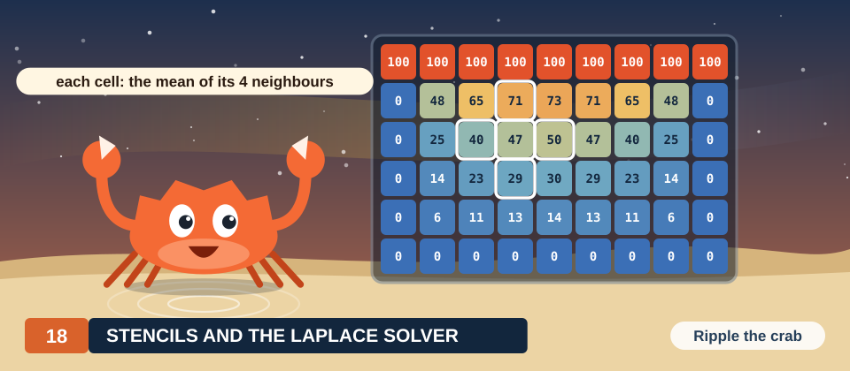
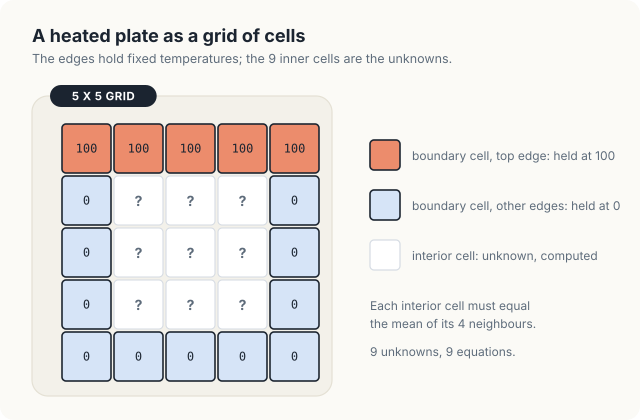
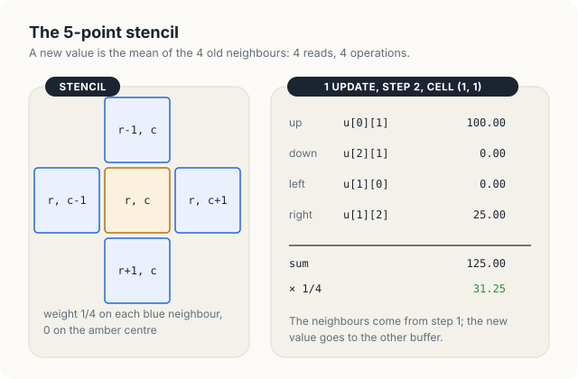
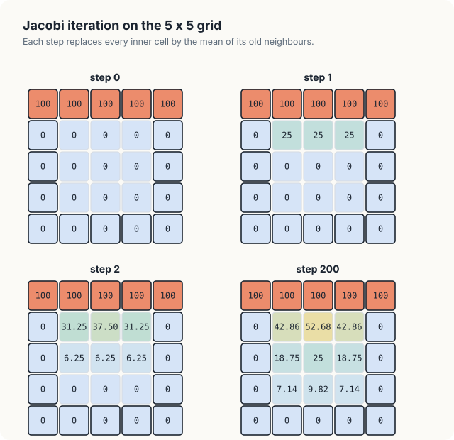
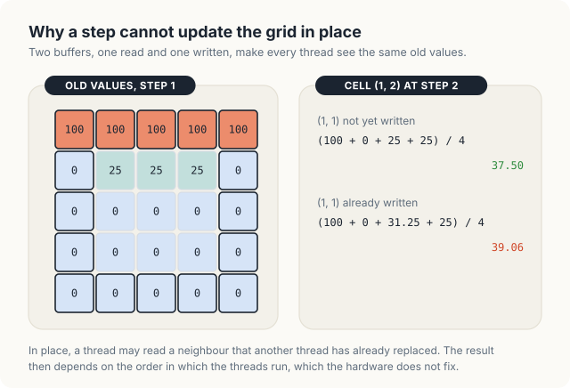
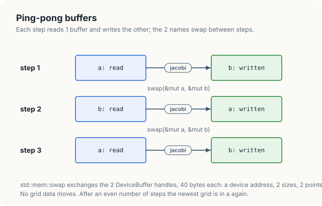
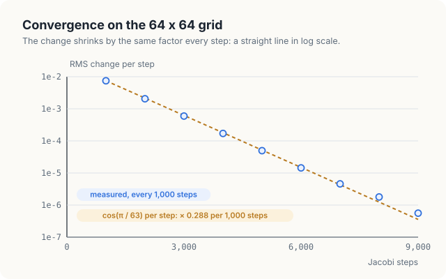
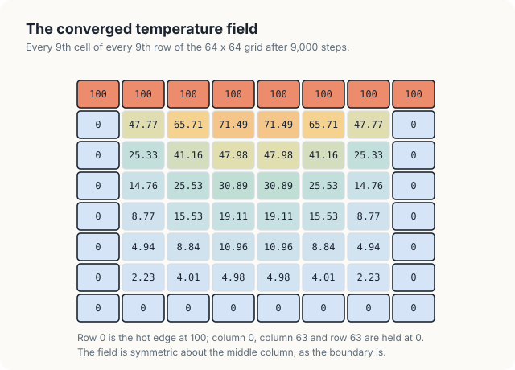
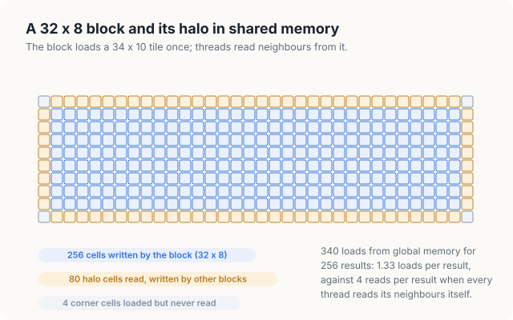
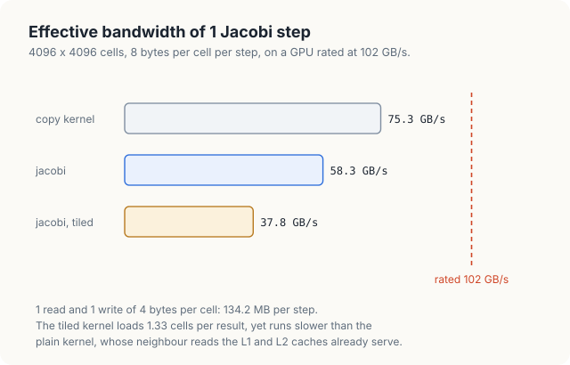

# Chapter 18: Stencils and the Laplace Solver

Many problems in physics and engineering are described by partial differential equations: the
temperature in a heated plate, the electric potential between charged conductors, the pressure in
a fluid at rest. A computer solves such an equation by replacing the continuous region with a grid
of points and the derivatives with differences between neighbouring points. The result is a
**stencil computation**, in which the new value of every grid point is computed from the old values
of a fixed pattern of neighbours. Stencils are among the most common GPU workloads, because every
point of the grid can be updated at the same time.

In this chapter, we solve the Laplace equation for the steady temperature of a square plate. We
derive the 5-point stencil from the equation, iterate it with the Jacobi method on a 5 x 5 grid by
hand, and then write the kernel in Rust. The Rust kernel writes into a 2-D grid whose width is
known only at run time, without any `unsafe` code, and the program moves between 2 buffers in a way
that the borrow checker verifies. We measure how fast the iteration converges, compare the result
with a CPU reference, and measure the memory bandwidth of a plain kernel and of a kernel that stages
its data in shared memory.

<div class="covers" markdown="1">

This chapter covers

- the Laplace equation on a grid, and the 5-point stencil derived from it
- boundary conditions and interior cells
- Jacobi iteration, worked by hand on a 5 x 5 grid
- why a step needs 2 buffers, and how Rust swaps them without copying
- `DisjointSlice<T, Runtime2DIndex>`: safe writes to a 2-D grid of run-time width
- measuring convergence with a block reduction, and the rate predicted by \\(\cos(\pi / 63)\\)
- arithmetic intensity of a stencil, and a tiled kernel with halo cells
- measured bandwidth of a copy, the plain kernel and the tiled kernel

</div>

The code of the chapter is in
[`code/oxide/ch18_stencil/`](https://github.com/arpanpathak/gpu-parallel-book/tree/main/code/oxide/ch18_stencil).
Its `Cargo.toml` and `rust-toolchain.toml` are those of Chapter 13; the chapter adds no dependency.
The measurements in this chapter come from a Jetson Orin NX, an integrated GPU with 8 SMs and
102 GB/s of memory bandwidth.

## 18.1 Background

### 18.1.1 The Laplace equation on a grid

Consider a thin square plate whose 4 edges are held at fixed temperatures: the top edge at 100
degrees and the other 3 edges at 0 degrees. Heat flows from the hot edge into the plate and out
through the cold edges. After enough time, the temperature at each point stops changing. This final
state is called the **steady state**, and the temperature \\(u(x, y)\\) in it satisfies the
**Laplace equation**:

\\[ \frac{\partial^2 u}{\partial x^2} + \frac{\partial^2 u}{\partial y^2} = 0 \\]

| Symbol | Meaning |
|---|---|
| \\(u(x, y)\\) | the temperature at the point \\((x, y)\\) of the plate |
| \\(\partial^2 u / \partial x^2\\) | the second derivative of \\(u\\) along \\(x\\): how fast the slope changes in the \\(x\\) direction |
| \\(\partial^2 u / \partial y^2\\) | the same along \\(y\\) |

The same equation describes the electric potential in a region free of charge and the pressure of
an incompressible fluid at rest, so a solver for one problem solves the others.

To solve the equation on a computer, we replace the plate with a **grid**: a set of points spaced a
distance \\(h\\) apart in both directions. We store the temperature at grid point \\((r, c)\\), in
row \\(r\\) and column \\(c\\), in an array element `u[r][c]`. Figure 18.1 shows the smallest grid
that we will work with, 5 x 5 points.

<figure>

<figcaption><b>Figure 18.1</b> A 5 x 5 grid: 16 boundary cells with fixed values and 9 interior cells to compute.</figcaption>
</figure>

The cells on the edge of the grid are called **boundary cells**. Their values are given by the
problem, 100 on the top edge and 0 on the others, and they never change. A fixed value at the
boundary of the region is called a **boundary condition**. The remaining cells are **interior
cells**, and their values are the unknowns. The 5 x 5 grid has 25 cells, of which 16 are on the
boundary and 9 are in the interior.

### 18.1.2 The 5-point stencil

A derivative cannot be evaluated on a grid directly, because the grid holds values only at points
spaced \\(h\\) apart. Instead, we approximate the derivative with a **finite difference**, an
expression in the values at neighbouring points. For the second derivative of a function \\(f\\) of
1 variable, the standard approximation is

\\[ f''(x) \approx \frac{f(x + h) - 2 f(x) + f(x - h)}{h^2} \\]

We can check the formula on \\(f(x) = x^2\\), whose second derivative is 2 everywhere. With
\\(x = 1\\) and \\(h = 1\\), the formula gives \\((4 - 2 \cdot 1 + 0) / 1 = 2\\), which is exact.
For a general function the error is proportional to \\(h^2\\), so a finer grid gives a more
accurate result.

Applying the approximation in both directions turns the Laplace equation into an equation for each
interior cell:

\\[ \frac{u_{r,c+1} - 2u_{r,c} + u_{r,c-1}}{h^2} + \frac{u_{r+1,c} - 2u_{r,c} + u_{r-1,c}}{h^2} = 0 \\]

Multiplying by \\(h^2\\) and solving for \\(u_{r,c}\\) gives

\\[ u_{r,c} = \frac{1}{4} \left( u_{r-1,c} + u_{r+1,c} + u_{r,c-1} + u_{r,c+1} \right) \\]

That is, at the steady state the temperature of each interior cell is the mean of the temperatures
of its 4 neighbours. The spacing \\(h\\) has dropped out of the equation. The pattern of cells that
the equation uses, a centre and its 4 neighbours, with weight 1/4 on each neighbour and 0 on the
centre, is called the **5-point stencil**. Figure 18.2 shows it, together with 1 update that we
will meet again in section 18.2.

<figure>

<figcaption><b>Figure 18.2</b> The 5-point stencil, and the update of cell (1, 1) in step 2 of the 5 x 5 example.</figcaption>
</figure>

### 18.1.3 A system of equations

The 9 interior cells of the 5 x 5 grid give 9 equations of this form, one for each cell, in 9
unknowns. For cell (1, 1), whose upper neighbour is a boundary cell at 100 and whose left
neighbour is a boundary cell at 0, the equation reads

\\[ u_{1,1} = \frac{1}{4} \left( 100 + u_{2,1} + 0 + u_{1,2} \right) \\]

A system of 9 equations can be solved directly, by Gaussian elimination. A grid of 4096 x 4096
cells, however, has about 16.7 million interior cells, and direct elimination on a system of that
size requires far more memory and time than the iteration we develop next. The iteration also maps
naturally onto a GPU: every cell is updated by the same arithmetic, and no cell depends on another
cell's new value.

## 18.2 Jacobi iteration

### 18.2.1 The iteration

**Jacobi iteration**, named after the mathematician Carl Gustav Jacob Jacobi, solves the system by
repeated averaging. We start from a guess for the interior, here 0 in every interior cell. In each
step, we compute a new value for every interior cell as the mean of its 4 neighbours, using only the
values from the previous step. The boundary cells keep their values. The steps are repeated until
the values stop changing to the precision we need.

Let us carry out the first 2 steps of the 5 x 5 example by hand. Before step 1, every interior cell
is 0. In step 1, each of the 3 cells in row 1 has the hot boundary cell above it and 3 neighbours at
0, so each becomes \\((100 + 0 + 0 + 0) / 4 = 25\\). The cells in rows 2 and 3 have only neighbours
at 0, so they stay at 0.

In step 2, cell (1, 1) has the neighbours 100 above, 0 below, 0 to the left (the boundary) and 25
to the right, so it becomes \\(125 / 4 = 31.25\\), as in Figure 18.2. Cell (1, 2) has 25 on both
sides, so it becomes \\((100 + 0 + 25 + 25) / 4 = 37.5\\). The cells of row 2 each have a cell at 25
above them and 0 elsewhere, so they become \\(25 / 4 = 6.25\\). Heat has moved 1 row further into
the plate. Figure 18.3 shows these steps and the grid after 200 steps.

<figure>

<figcaption><b>Figure 18.3</b> The 5 x 5 grid at steps 0, 1, 2 and 200.</figcaption>
</figure>

After 200 steps, the interior holds 42.86, 52.68 and 42.86 in row 1, 18.75, 25 and 18.75 in row 2,
and 7.14, 9.82 and 7.14 in row 3. These are the exact solutions of the 9 equations to 2 decimal
places: \\(300/7\\), \\(1475/28\\), \\(75/4\\), 25, \\(50/7\\) and \\(275/28\\). The centre value of
25 has a simple explanation. If each of the 4 edges in turn were the hot one, the centre would get
the same value each time by symmetry, and the 4 cases added together give a plate with all edges at
100, whose centre is 100. Each case therefore contributes 25. The program in section 18.4 prints
the same 3 grids.

### 18.2.2 Why a step needs 2 buffers

On a GPU, each interior cell of a step is computed by its own thread. If the threads wrote their
new values into the same array that they read from, a thread could read a neighbour that another
thread has already replaced. Figure 18.4 shows the effect on cell (1, 2) in step 2. If cell (1, 1)
still holds its old value 25, cell (1, 2) becomes 37.5. If the thread for cell (1, 1) has already
stored 31.25, cell (1, 2) becomes \\((100 + 0 + 31.25 + 25) / 4 = 39.06\\).

<figure>

<figcaption><b>Figure 18.4</b> An update in place gives a result that depends on the order in which threads run.</figcaption>
</figure>

The hardware does not fix the order in which threads and blocks run (Chapter 3), so an update in
place gives results that change from run to run. This is a race condition of the kind studied in
Chapter 5. Jacobi iteration avoids it by keeping 2 arrays: each step reads the old values from one
array and writes the new values into the other. Every thread then sees the same old values, and
the result does not depend on the order of the threads.

### 18.2.3 The algorithm

The complete method, with the 2 arrays named `a` and `b`, is:

```text
fill a and b with the initial grid           # boundary values in both
repeat:
    for every interior cell (r, c), in parallel:
        b[r][c] ← (a[r-1][c] + a[r+1][c] + a[r][c-1] + a[r][c+1]) / 4
    swap the names a and b                    # the new grid is now called a
until the change between a and b is small enough
```

Both arrays start with the boundary values, although the steps never write a boundary
cell. Each array is read in every second step, so both must hold the boundary. Section 18.4.3 shows
what happens when one of them does not.

## 18.3 A stencil kernel in Rust

### 18.3.1 Grids with a run-time width

In Chapter 13, each thread wrote its own element of a 1-D `DisjointSlice` through a `ThreadIndex`,
a value that only the launch can create and that is different for every thread. Chapter 7 used a
2-D form, `DisjointSlice<f32, Index2D<WIDTH>>`, in which the width of the grid is a constant fixed
when the program is compiled. A stencil program usually works with grids of several sizes, so the
width must be a run-time value.

cuda-oxide provides `DisjointSlice<T, Runtime2DIndex>` for this case. The host attaches the row
width to the buffer when it launches the kernel, with `RowWidth::new(&mut buffer, width)`. On the
device, `slice.row_width()` returns that width, and `thread::index_2d_runtime(&slice)` returns the
thread's position as a `ThreadIndex<Runtime2DIndex>` that carries the thread's row and column. The
method `get_mut(idx)` computes the element `row * width + col`, checks that the column is less than
the width and that the element is inside the slice, and returns `Some` with a mutable reference to
it, or `None`. Because every thread of the launch has a different (row, column) pair and all of
them use the same width, no 2 threads can obtain the same element. The write is therefore safe,
and the kernel needs no `unsafe` block.

### 18.3.2 The kernel

Listing 18.1 shows the Jacobi kernel.

<p class="listing"><b>Listing 18.1</b> 1 Jacobi step. <a href="https://github.com/arpanpathak/gpu-parallel-book/blob/main/code/oxide/ch18_stencil/src/main.rs">code/oxide/ch18_stencil/src/main.rs</a></p>

```rust,ignore
mod kernels {
    // ...
{{#include ../../../../code/oxide/ch18_stencil/src/main.rs:27:46}}
    // ...
}
```

The kernel takes the old grid as an ordinary shared slice, `old: &[f32]`, which any thread may read,
and the new grid as a `DisjointSlice` with a run-time width. The first 2 lines read the width that
the host attached and compute the height from the length of the slice. For the 5 x 5 grid, the
width is 5 and the length is 25, so the height is 5.

The call `thread::index_2d_runtime(&new)` returns `None` for a thread whose column is outside the
grid. For the remaining threads, `idx.row()` and `idx.col()` give the cell. The test on the next line
keeps only interior cells: a boundary cell is never written, so it keeps the value the host placed
in it. For an interior cell, the kernel computes the flat index `c = row * width + col` and reads
the 4 neighbours. The neighbours above and below are 1 row away, at `c - width` and `c + width`;
the neighbours to the left and right are at `c - 1` and `c + 1`. The reads use ordinary slice
indexing, which checks each index against the length of `old`.

The last statement stores the mean. The multiplication by 0.25 comes after the 3 additions, in the
same order as in the CPU reference of the program, so the GPU and the CPU compute the same rounded
result. The section on convergence confirms that they agree to the last bit.

### 18.3.3 Launching the kernel

The kernel's contract, `#[launch_contract(domain = 2, block = (32, 8, 1))]`, states that the kernel
must be launched with 2-D blocks of 32 x 8 threads. The host prepares each launch with a grid that
covers the whole array, using the function in Listing 18.2.

<p class="listing"><b>Listing 18.2</b> A 2-D launch configuration that covers a grid of any size.</p>

```rust,ignore
{{#include ../../../../code/oxide/ch18_stencil/src/main.rs:175:179}}
```

The block size of 32 x 8 places the 32 threads of each warp along a row of the grid. As we saw in
Chapter 7, neighbouring threads that read neighbouring addresses let the hardware combine a warp's
reads into a few memory transactions. A warp reads 3 rows for its 32 cells: the row above, its own
row with 1 extra cell at each end, and the row below, each as a contiguous segment. The 8 rows of
the block give 256 threads, a common block size. For the 5 x 5 grid, `div_ceil` gives 1 block in
each direction; 25 of its 256 threads fall inside the grid, and the other threads receive `None`
from `index_2d_runtime` or fail the interior test.

## 18.4 Ping-pong buffers

### 18.4.1 Swapping 2 device buffers

The host program keeps the 2 grids in 2 `DeviceBuffer`s, `a` and `b`. Each step reads `a` and
writes `b`; then the program exchanges the 2 names with `std::mem::swap(&mut a, &mut b)`, so that
the next step reads the grid that was written last. This arrangement is called **ping-pong
buffering**. Figure 18.5 shows 3 steps.

<figure>

<figcaption><b>Figure 18.5</b> Ping-pong buffers: the 2 names exchange their roles after every step.</figcaption>
</figure>

The swap moves no grid data. A `DeviceBuffer` is a small handle of 40 bytes, which holds the device
address of the allocation, its length in elements and in bytes, a reference-counted pointer to the
context and, for some allocations, a pointer to the stream that allocated it.
`std::mem::swap` exchanges the 2 handles in host memory; the grids stay where they are in device
memory. A step on a 4096 x 4096 grid moves 134.2 MB, while the swap exchanges 80 bytes.

Listing 18.3 shows the first part of the program, which runs 200 steps on the 5 x 5 grid and prints
the grid after steps 1, 2 and 200.

<p class="listing"><b>Listing 18.3</b> 200 steps on the 5 x 5 grid.</p>

```rust,ignore
fn main() -> Result<(), Error> {
    // ...
{{#include ../../../../code/oxide/ch18_stencil/src/main.rs:212:227}}
    // ...
}
```

Both buffers are created from the same host grid `start`, so both hold the boundary values. The
launch passes `&a` as the old grid and `RowWidth::new(&mut b, w as u32)` as the new one. After the
launch, the swap makes `a` the newest grid, which is why the program prints `a`.

### 18.4.2 Aliasing rejected by the compiler

Suppose we tried to update the grid in place, the mistake of section 18.2.2, by passing the same
buffer as both arguments:

```rust,ignore
module.jacobi(&stream, &small, &a, RowWidth::new(&mut a, w as u32))?;
```

The program does not compile. The kernel launch borrows `a` as a shared reference for the old grid
and as a mutable reference for the new grid, and Rust does not allow a value to be borrowed mutably
while a shared borrow of it is in use:

```console
error[E0502]: cannot borrow `a` as mutable because it is also borrowed as immutable
   --> src/main.rs:221:58
    |
221 |         module.jacobi(&stream, &small, &a, RowWidth::new(&mut a, w as u32))?;
    |                ------                  --                ^^^^^^ mutable borrow occurs here
    |                |                       |
    |                |                       immutable borrow occurs here
    |                immutable borrow later used by call
```

The rule that prevents aliasing between a `&` and a `&mut` reference in host code also covers the
arguments of a kernel launch. The race of Figure 18.4 therefore cannot be written by mistake in a
program that uses the safe launch path. A CUDA C++ kernel that takes 2 `float*` arguments accepts
the same pointer twice without a warning.

### 18.4.3 Boundary values in both buffers

The compiler cannot check the contents of the buffers. If the second buffer is created with
`DeviceBuffer::<f32>::zeroed(&stream, w * h)` instead of from `start`, its top edge holds 0, and
every second step reads a grid whose top edge is cold. This variant compiles and runs, and prints:

```console
1. 5 x 5 grid, top edge at 100
  after step 1
       0.00    0.00    0.00    0.00    0.00
       0.00   25.00   25.00   25.00    0.00
       0.00    0.00    0.00    0.00    0.00
       0.00    0.00    0.00    0.00    0.00
       0.00    0.00    0.00    0.00    0.00
  after step 2
     100.00  100.00  100.00  100.00  100.00
       0.00    6.25   12.50    6.25    0.00
       0.00    6.25    6.25    6.25    0.00
       0.00    0.00    0.00    0.00    0.00
       0.00    0.00    0.00    0.00    0.00
  after step 200
     100.00  100.00  100.00  100.00  100.00
       0.00    9.82   19.64    9.82    0.00
       0.00   12.50   12.50   12.50    0.00
       0.00    2.68    5.36    2.68    0.00
       0.00    0.00    0.00    0.00    0.00
```

After step 1, the grid printed is buffer `b`, whose top row is 0. In step 2, the kernel reads that
cold top edge, so row 1 falls to \\((0 + 0 + 0 + 25) / 4 = 6.25\\) instead of rising to 31.25. The
iteration still converges, but to the solution of a different problem, in which the top edge is hot
in every second step. The centre settles at 12.5, half the correct value of 25. No error is
reported. A check against a known answer, here the hand-worked values of section 18.2.1, is the
only way to find such a mistake.

### 18.4.4 Running the 5 x 5 example

The correct program prints the 3 grids of Figure 18.3:

```console
$ cargo oxide run
GPU: Orin, 8 SMs
1. 5 x 5 grid, top edge at 100
  after step 1
     100.00  100.00  100.00  100.00  100.00
       0.00   25.00   25.00   25.00    0.00
       0.00    0.00    0.00    0.00    0.00
       0.00    0.00    0.00    0.00    0.00
       0.00    0.00    0.00    0.00    0.00
  after step 2
     100.00  100.00  100.00  100.00  100.00
       0.00   31.25   37.50   31.25    0.00
       0.00    6.25    6.25    6.25    0.00
       0.00    0.00    0.00    0.00    0.00
       0.00    0.00    0.00    0.00    0.00
  after step 200
     100.00  100.00  100.00  100.00  100.00
       0.00   42.86   52.68   42.86    0.00
       0.00   18.75   25.00   18.75    0.00
       0.00    7.14    9.82    7.14    0.00
       0.00    0.00    0.00    0.00    0.00
```

Every value agrees with the hand calculation of section 18.2.1: 25 in row 1 after step 1, 31.25,
37.50 and 6.25 after step 2, and the exact solution after step 200.

## 18.5 Convergence

### 18.5.1 Measuring the change between steps

The 5 x 5 example ran for a fixed number of steps. A real solver stops when the grid has stopped
changing. We measure the change of a step by the **root-mean-square (RMS) change**: the square root
of the mean, over all \\(N\\) cells, of the squared difference between the new and the old value,

\\[ \Delta = \sqrt{\frac{1}{N} \sum_{i} \left( b_i - a_i \right)^2 } \\]

| Symbol | Meaning |
|---|---|
| \\(N\\) | the number of cells in the grid, 4,096 for a 64 x 64 grid |
| \\(a_i, b_i\\) | the value of cell \\(i\\) before and after the step |
| \\(\Delta\\) | the RMS change of the step, in degrees |

The sum over all cells is a reduction, and we compute it with the method of section 8.5. Each
thread sums the squared differences of a grid-stride share of the cells. Each warp then combines its
32 sums with shuffles, and the first warp of each block combines the 8 warp sums. Listing 18.4 shows the kernel.

<p class="listing"><b>Listing 18.4</b> The squared change, summed per block.</p>

```rust,ignore
mod kernels {
    // ...
{{#include ../../../../code/oxide/ch18_stencil/src/main.rs:103:144}}
}
```

The kernel writes 1 partial sum per block. With 64 blocks, the host copies 64 floats back, adds
them, divides by \\(N\\) and takes the square root. Listing 18.5 shows the loop that uses it.

<p class="listing"><b>Listing 18.5</b> Iterating the 64 x 64 grid until the RMS change is below 1e-6 degrees.</p>

```rust,ignore
fn main() -> Result<(), Error> {
    // ...
{{#include ../../../../code/oxide/ch18_stencil/src/main.rs:238:256}}
    // ...
}
```

The loop measures the change only every 1,000 steps. A measurement costs a reduction launch and a
copy to the host, which waits for the GPU to finish all earlier work. On a 64 x 64 grid a Jacobi
step takes a few microseconds, and a measurement after every step would take several times as long
as the step itself. Measuring every 1,000 steps adds 1 measurement to 1,000 steps and lets the loop
run at most 999 steps longer than necessary.

### 18.5.2 The rate of convergence

The program prints the RMS change every 1,000 steps:

```console
2. 64 x 64 grid until the RMS change per step is below 1e-6
  step  1000   RMS change 7.49e-3
  step  2000   RMS change 2.06e-3
  step  3000   RMS change 5.95e-4
  step  4000   RMS change 1.71e-4
  step  5000   RMS change 4.95e-5
  step  6000   RMS change 1.44e-5
  step  7000   RMS change 4.57e-6
  step  8000   RMS change 1.79e-6
  step  9000   RMS change 5.59e-7
```

The change shrinks by nearly the same factor every 1,000 steps: \\(2.06 / 7.49 = 0.275\\),
\\(0.595 / 2.06 = 0.289\\), \\(0.171 / 0.595 = 0.287\\) and \\(0.0495 / 0.171 = 0.289\\). A constant
factor per step appears as a straight line on a logarithmic scale, as in Figure 18.6.

<figure>

<figcaption><b>Figure 18.6</b> The RMS change per step on the 64 x 64 grid, measured and predicted.</figcaption>
</figure>

The factor can be predicted. The difference between the current grid and the solution, the
**error**, can be written as a sum of smooth and rough patterns. Averaging reduces rough patterns
quickly, because a cell that differs from its neighbours is pulled towards them in 1 step. The
smoothest pattern, a single bump that is 0 on the boundary and largest in the middle, shrinks the
slowest. On a grid of \\(n + 1\\) cells per side, numbered 0 to \\(n\\), that pattern is

\\[ e_{r,c} = \sin\frac{\pi r}{n} \, \sin\frac{\pi c}{n} \\]

The 2 neighbours of cell \\(r\\) in the same column hold \\(\sin(\pi (r - 1) / n)\\) and
\\(\sin(\pi (r + 1) / n)\\). By the identity \\(\sin(x - y) + \sin(x + y) = 2 \sin x \cos y\\)
their sum is \\(2 \cos(\pi / n)\\) times \\(\sin(\pi r / n)\\). The same holds along the row. The
mean of the 4 neighbours is therefore \\(\cos(\pi / n)\\) times the value of the cell itself, and 1
Jacobi step multiplies this pattern by

\\[ \rho = \cos\frac{\pi}{n} \\]

For the 64 x 64 grid, \\(n = 63\\), so \\(\rho = \cos(\pi / 63) = 0.998757\\), and 1,000 steps
multiply the error by \\(0.998757^{1000} = 0.288\\). The change between 2 steps is dominated by the
same pattern and shrinks by the same factor, which matches the measured 0.287 to 0.289. After step
7,000 the measured factor drifts upward, to 0.39 and 0.31, because the changes have become smaller
than the rounding error of single-precision values near 50, which is about \\(4 \times 10^{-6}\\).

The prediction also shows what the method costs on a large grid. To reduce the error by a factor
of \\(e\\), the iteration needs about \\(1 / (1 - \rho) \approx 2 n^2 / \pi^2\\) steps: about
800 for \\(n = 63\\), and about 3.4 million for a grid of 4096 x 4096 cells. Reducing
the error of the large grid by a factor of 10,000 would take about 31 million steps, or about 20
hours at the 2.3 ms per step measured in section 18.6. Jacobi iteration is therefore used on large
grids as a component of faster methods, such as multigrid, which apply a few Jacobi steps on a
series of coarser grids. The kernel of this chapter is the building block of those methods.

### 18.5.3 The converged field

The program stops after 9,000 steps and prints every 9th cell of every 9th row of the 64 x 64 grid:

```console
  every 9th cell of every 9th row (8 x 8 of the 64 x 64 cells)
    100.00 100.00 100.00 100.00 100.00 100.00 100.00 100.00
      0.00  47.77  65.71  71.49  71.49  65.71  47.77   0.00
      0.00  25.33  41.16  47.98  47.98  41.16  25.33   0.00
      0.00  14.76  25.53  30.89  30.89  25.53  14.76   0.00
      0.00   8.77  15.53  19.11  19.11  15.53   8.77   0.00
      0.00   4.94   8.84  10.96  10.96   8.84   4.94   0.00
      0.00   2.23   4.01   4.98   4.98   4.01   2.23   0.00
      0.00   0.00   0.00   0.00   0.00   0.00   0.00   0.00
  largest difference from the CPU after 9000 steps: 0.00e0
```

<figure>

<figcaption><b>Figure 18.7</b> The steady temperature of the plate, sampled from the 64 x 64 grid.</figcaption>
</figure>

The temperature falls from the hot edge towards the cold edges, and it is symmetric about the
vertical centre line, as the boundary conditions are. The centre line falls between columns 31
and 32, so the sampled columns 27 and 36, 4.5 cells to either side of it, hold equal values, 71.49
in row 9.

The last line compares the GPU result with the CPU function `cpu_step` of the program, applied the
same 9,000 times. The largest difference is 0: the 2 computations agree in every bit of every cell.
They agree because each cell is computed with the same 3 additions in the same order, followed by
the same multiplication, and IEEE 754 single-precision arithmetic gives the same rounded result on
both processors for the same sequence of operations.

## 18.6 Memory traffic and performance

### 18.6.1 Arithmetic intensity of the stencil

Each cell of a step costs 3 additions and 1 multiplication, 4 floating-point operations. If the
kernel reads each old value from memory once and writes each new value once, it moves 4 bytes in
and 4 bytes out per cell, 8 bytes. The arithmetic intensity, defined in section 1.8.1 as operations
per byte of memory traffic, is therefore \\(4 / 8 = 0.5\\) FLOP/B. The ridge points of the GPUs
compared in section 2.1.5 range from 10 to 114 FLOP/B; for the measured GPU it is about 24 FLOP/B,
and for an H100 about 20 FLOP/B. A Jacobi step is therefore memory-bound on every one of them, by a
factor of 20 or more, so its speed is set by the number of bytes it moves, and the fastest possible step moves each cell once in each direction, like a
copy. We therefore measure each kernel by its **effective bandwidth**: 8 bytes per cell divided by
the time of a step. On a 4096 x 4096 grid, each step moves at least \\(8 \times 4096^2\\) =
134,217,728 bytes, 134.2 MB.

The kernel of Listing 18.1 issues 4 loads per cell, 16 bytes. Most of them are served by the
caches. The 32 threads of a warp read 3 contiguous row segments, and the rows above and below a
warp's row are the rows of the neighbouring warps of the same block. A block of 32 x 8 threads
therefore needs 10 row segments of the old grid, its own 8 rows and 1 row on each side, for 8 rows
of results. If each segment comes from memory once, the block reads 1.25 old values per cell and
writes 1, 9 bytes per cell instead of 8.

### 18.6.2 A tiled kernel with halo cells

Chapter 7 used shared memory to make a block's reuse of data explicit. For a stencil, the block
copies its cells and the cells around them into a **tile** in shared memory once, waits at a
barrier, and then every thread reads its 4 neighbours from the tile. The cells around the block's
own cells are called **halo cells**. They are read by this block but computed by the neighbouring
blocks. Figure 18.8 shows the tile of a 32 x 8 block.

<figure>

<figcaption><b>Figure 18.8</b> The tile of a 32 x 8 block: 256 own cells, 80 halo cells and 4 unused corners.</figcaption>
</figure>

The tile is 34 x 10 cells, 340 in all: the block's 256 cells, a halo of 80 cells (32 above, 32
below, 8 on the left and 8 on the right), and 4 corner cells that the 5-point stencil never reads.
Listing 18.6 shows the kernel.

<p class="listing"><b>Listing 18.6</b> The Jacobi step with a tile in shared memory.</p>

```rust,ignore
mod kernels {
    // ...
{{#include ../../../../code/oxide/ch18_stencil/src/main.rs:48:89}}
    // ...
}
```

The tile is a `SharedArray<f32, { TW * TH }>` of 340 floats, where `TW = 34` and `TH = 10` are the
tile's width and height. `left` and `top` are the column and row of the block's first cell. The
loading loop numbers the tile's cells 0 to 339. Thread `k` of the block, numbered `ty * 32 + tx`,
loads cell `k`, and then cell `k + 256` if that number is below 340, so that the first 84 threads
load a second cell. Cell `k` of the tile lies in tile row `k / 34` and tile column `k % 34`, which
correspond to grid row `top + k / 34 - 1` and grid column `left + k % 34 - 1`; the subtraction of 1
places the tile's first row and column 1 cell before the block's first cell. For the block in the
top-left corner of the grid, that subtraction gives -1, which `wrapping_sub` turns into the largest
`usize`. The test `r < height && c < width` then fails, and the cell is filled with 0, which no
thread reads.

Each tile cell is written by exactly 1 thread, so the stores need no synchronisation among
themselves, and the `// SAFETY:` comment records that argument. The barrier
`thread::sync_threads()` then ensures that all 340 cells are written before any thread reads one
(Chapter 5). After the barrier, a thread at position (`tx`, `ty`) of the block finds its own cell
at `(ty + 1) * 34 + tx + 1` in the tile and its neighbours 34 cells above and below and 1 cell to
either side. The write of the result is the same safe `get_mut` as in the plain kernel.

The tile loads 340 cells for 256 results, 1.33 loads per result, from global memory, compared with
the 4 loads per result that the plain kernel issues. However, as section 18.6.1 showed, the caches
already reduce the plain kernel's traffic from memory to about 1.25 old values per result. The tile
cannot reduce the traffic below that. It also adds work that the plain kernel does not do. Every
loaded cell costs a division and a remainder by 34, and a store to shared memory and a load from it.
The second loading pass keeps only 84 of the 256 threads busy, and every thread waits at a barrier.

### 18.6.3 Measured bandwidth

The third part of the program times 3 kernels on a 4096 x 4096 grid, 64 MiB per buffer, much larger
than the GPU's L2 cache. The first is a copy of 1 buffer into the other, which moves the minimum of
8 bytes per cell; the others are the plain kernel and the tiled kernel. Listing 18.7 shows the timing of the 2 stencil kernels.
Each timed call performs 2 steps, from `a` to `b` and back, so the buffers return to their roles,
and the time is halved.

<p class="listing"><b>Listing 18.7</b> Timing 2 steps at a time, so the buffers return to their roles.</p>

```rust,ignore
fn main() -> Result<(), Error> {
    // ...
{{#include ../../../../code/oxide/ch18_stencil/src/main.rs:287:305}}
    // ...
}
```

The function `time_ms` runs the launch repeatedly for 0.4 s before timing, because the GPU raises
its clock frequency only under sustained load, and then averages 50 calls. The timings of repeated
runs differ by 10% to 20%.

```console
3. 4096 x 4096 grid, 8 bytes per cell per step (1 read, 1 write)
  copy kernel         1.782 ms     75.3 GB/s
  jacobi              2.302 ms     58.3 GB/s
  jacobi, tiled       3.549 ms     37.8 GB/s
  both kernels give the same bits after 10 steps: true
PASSED
```

<figure>

<figcaption><b>Figure 18.9</b> Effective bandwidth of a copy and of the 2 stencil kernels.</figcaption>
</figure>

The copy reaches 75.3 GB/s, 74% of the rated 102 GB/s; as the measurements of Chapter 7 showed,
no kernel reaches the rated figure. The copy is the ceiling for a Jacobi step, since a step must read and write every
cell. The plain kernel reaches 58.3 GB/s, 77% of the copy. If it moved the 9 bytes per cell
estimated in section 18.6.1, the copy's rate would allow \\(75.3 \times 8 / 9 = 66.9\\) GB/s of
effective bandwidth, so the plain kernel is within 13% of that estimate.

The tiled kernel is slower than the plain kernel: 37.8 GB/s, 65% of its speed. Its traffic to
memory is about the same as the plain kernel's, because the caches already provide the reuse that
the tile makes explicit, and the extra instructions, the second loading pass and the barrier cost
more than the tile saves. This differs from Chapter 9, where a tile reduced the traffic of a
matrix product by a factor equal to the tile width. A 5-point stencil uses each value in only 4
results, so there is little reuse for a tile to capture. A tile pays off for stencils that read
many neighbours, such as the high-order 3-D stencils of fluid simulations, and for kernels that
perform several steps on the tile before writing it back.

The last line of the output confirms that the 2 kernels compute the same grid: after 10 steps
each, their results are equal in every bit, for the same reason that the GPU and the CPU agree.

## 18.7 The complete program

`code/oxide/ch18_stencil/src/main.rs`, as built and run above:

```rust,ignore
{{#include ../../../../code/oxide/ch18_stencil/src/main.rs}}
```

## Common mistakes

- **Updating the grid in place.** Threads then read neighbours that other threads have already
  replaced, and the result depends on their order. Use 2 buffers. In Rust the safe launch path
  rejects the same buffer as both arguments (section 18.4.2).
- **Leaving the boundary out of 1 of the 2 buffers.** The kernel never writes boundary cells, so
  both buffers must hold them from the start. The mistake produces a wrong steady state and no error
  (section 18.4.3).
- **Copying the second buffer back after every step.** `std::mem::swap` exchanges the 40-byte
  handles; a copy would move the whole grid.
- **Checking convergence after every step.** Each check waits for the GPU and costs a reduction.
  Check every few hundred or few thousand steps.
- **Expecting Jacobi to converge quickly on a large grid.** The number of steps grows with the
  square of the grid's width. Use it inside a faster method, such as multigrid, for large grids.
- **Assuming that shared-memory tiling always helps.** For a 5-point stencil the caches already
  capture most of the reuse; measure both versions.

## Summary

- The Laplace equation, discretised with finite differences, says that at the steady state every
  interior cell equals the mean of its 4 neighbours: the 5-point stencil.
- Boundary cells hold fixed values and are never written; interior cells are the unknowns.
- Jacobi iteration replaces every interior cell by the mean of its old neighbours, step after step.
  On the 5 x 5 grid, the first 2 steps give 25, then 31.25, 37.5 and 6.25, and 200 steps reach the
  exact solution, with 25 at the centre.
- A step reads 1 buffer and writes another. `std::mem::swap` exchanges the 2 `DeviceBuffer` handles
  without moving data, and the borrow checker rejects passing 1 buffer as both arguments.
- `DisjointSlice<T, Runtime2DIndex>`, with `RowWidth` on the host and `index_2d_runtime` on the
  device, lets a kernel write a 2-D grid of run-time width with no `unsafe` code.
- The RMS change, computed with a block reduction, shrinks by \\(\cos(\pi / n)\\) per step: 0.288 per
  1,000 steps on a 64 x 64 grid, as measured. The steps needed grow with \\(n^2\\).
- A Jacobi step performs 0.5 FLOP per byte and is memory-bound. The plain kernel reached 58.3 GB/s,
  77% of a copy; the tiled kernel reached 37.8 GB/s, because the caches already provide the reuse.

The next chapter turns to scan and histogram, 2 patterns in which threads must combine results
across the whole grid rather than only with their neighbours.

## Exercises

1. Apply the finite-difference formula of section 18.1.2 to \\(f(x) = x^3\\) at \\(x = 1\\) with
   \\(h = 1\\) and with \\(h = 0.5\\). Compare both with the exact second derivative, 6, and
   confirm that halving \\(h\\) divides the error by 4.
2. Carry out step 3 of the 5 x 5 example by hand, starting from the step 2 values of Figure 18.3.
   Then change the program to print the grid after step 3 and compare.
3. Change the boundary so that the top edge is 100 and the left edge is 50. Predict the centre
   value of the 5 x 5 grid at the steady state with the symmetry argument of section 18.2.1, and
   check it with the program.
4. For a grid of 128 x 128 cells, predict \\(\rho\\) and the factor by which the RMS change shrinks
   per 1,000 steps. Run the program on that grid and compare.
5. The convergence loop measures the change every 1,000 steps. Measure the total time of the loop
   when it checks every 10, 100 and 1,000 steps, and explain the differences.
6. Change the block shape of both stencil kernels to 16 x 16 (update the launch contracts, `BX`,
   `BY` and `grid_2d`). Predict from section 18.3.3 how the plain kernel's reads change, then
   measure.
7. The tiled kernel computes `k / TW` and `k % TW` for every cell it loads. Rewrite the loading
   loop as 2 nested loops over the tile's rows and columns, measure, and compare with Figure 18.9.
8. A 9-point stencil also uses the 4 diagonal neighbours. Count its loads per result for the plain
   kernel and for a tile of 34 x 10 cells, including the corners. Would you expect tiling to help
   more or less than for the 5-point stencil?

## Sources and further reading

- R. J. LeVeque, *Finite Difference Methods for Ordinary and Partial Differential Equations*, SIAM,
  2007. Chapters 2 and 3 derive the 5-point Laplacian and its error; chapter 4 analyses Jacobi
  iteration and its convergence factor \\(\cos(\pi h)\\).
- Y. Saad, *Iterative Methods for Sparse Linear Systems*, 2nd edition, SIAM, 2003. Jacobi,
  Gauss-Seidel and their convergence.
- W. L. Briggs, V. E. Henson and S. F. McCormick, *A Multigrid Tutorial*, 2nd edition, SIAM, 2000.
  How Jacobi steps on coarser grids remove smooth errors quickly.
- NVlabs, *cuda-oxide*, rev `b7fe543`: `cuda-device/src/disjoint.rs` and `thread.rs` document
  `Runtime2DIndex`, `index_2d_runtime` and the argument for why `get_mut` on a run-time-width slice
  is safe.
- NVIDIA, *Jetson Orin NX Series Data Sheet*, for the 102 GB/s memory bandwidth.
