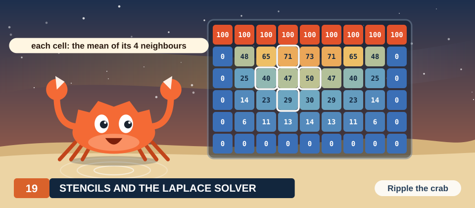
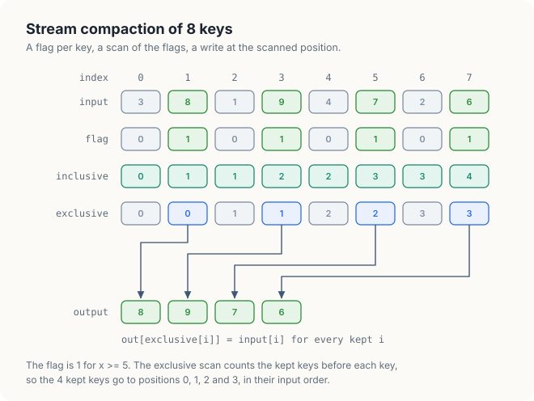
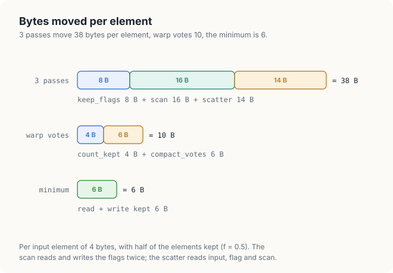
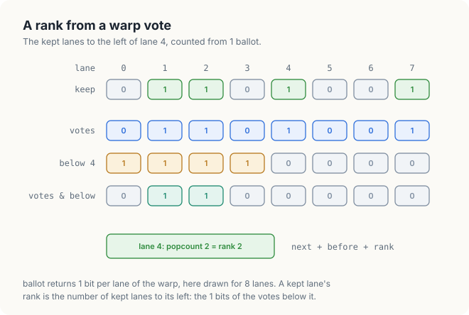
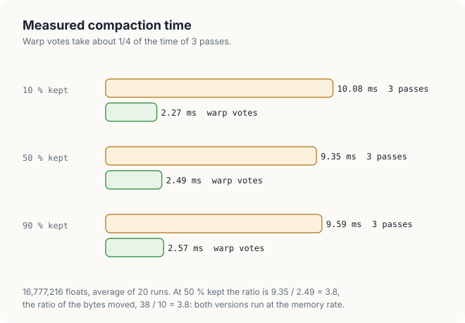
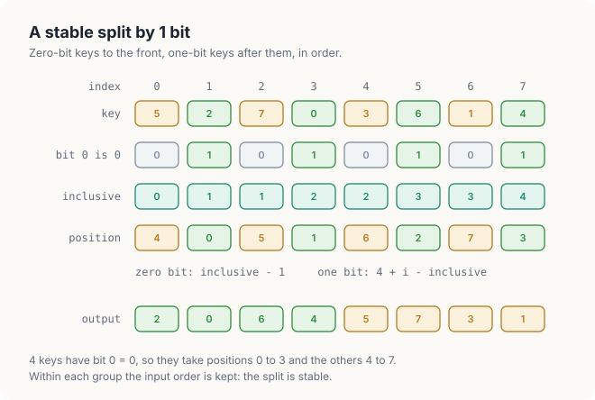
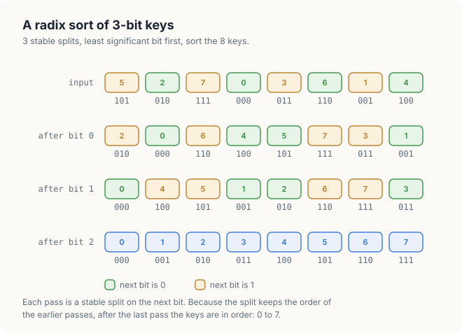
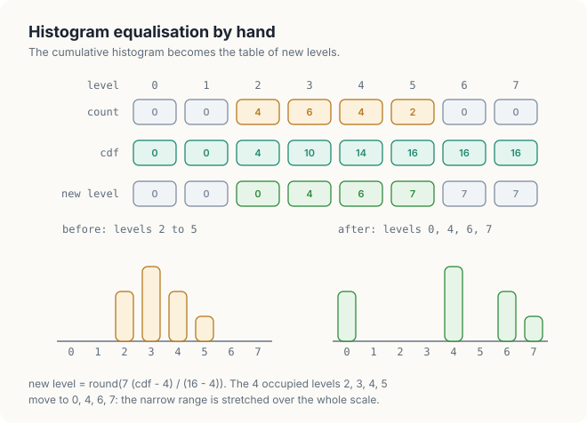
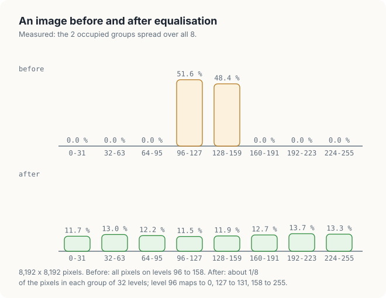

= 5, with a count chalked on each: 4 and 4. Tally holds the pebble 9 in one claw, on its way to the second crate. A tag reads count, scan, then place: a histogram and a scan decide where every item goes.">

# Chapter 19: Scan and Histogram in Rust

Chapter 8 developed 2 parallel patterns in CUDA C++ and in Rust: the scan, which computes the
running totals of an array, and the histogram, which counts how many elements fall into each of a
set of bins. Both are seldom the final goal of a program. A scan is usually computed so that each
element can find out where it belongs in an output array, and a histogram is usually computed so
that a program can decide what to do with each element. In both cases a second kernel reads the
result and moves or transforms the data.

In this chapter, we build 3 such applications in Rust with cuda-oxide. The first is **stream
compaction**, which removes the unwanted elements of an array and packs the remaining ones
together in their original order. The second is a **radix sort**, which sorts integer keys by
repeating a stable partition on 1 bit at a time. The third is **histogram equalisation**, which
spreads the grey levels of a low-contrast image over the whole range of levels. All 3 end with a
kernel that writes each element to a position computed from data, and such a write is the one
place where the safe interface of cuda-oxide cannot prove that threads write to distinct
elements. We study what the program must establish instead, and how to state it.

<div class="covers" markdown="1">

This chapter covers

- exclusive and inclusive scans, and how a scan of flags gives output positions
- stream compaction with a flag kernel, a scan and a scatter kernel
- why a scatter in Rust needs `get_unchecked_mut`, and the permutation argument that justifies it
- compaction with warp votes, and the bytes each method moves per element
- a stable split by 1 bit, and a radix sort of 32-bit keys built from 32 splits
- histogram equalisation: the cumulative histogram as a table of new grey levels
- measured times and bandwidths for all 3 applications

</div>

The code of the chapter is in
[`code/oxide/ch19_scan_apps/`](https://github.com/arpanpathak/gpu-parallel-book/tree/main/code/oxide/ch19_scan_apps).
It reuses 3 pieces of Chapter 8 unchanged: the warp scan of Section 8.7.2, the block scan of
Section 8.7.3 with its host function for arrays of any length (Section 8.7.4), and the histogram of
bytes in shared memory of Section 8.8. We do not repeat their derivations here.

## 19.1 Background

### 19.1.1 Inclusive and exclusive scans

Recall from Section 8.7 that the **inclusive scan** of an array `x` is the array `s` in which each
element is the sum of all input elements up to and including its own position:
`s[i] = x[0] + x[1] + ... + x[i]`. The **exclusive scan** `e` excludes the element at the position
itself: `e[i] = x[0] + ... + x[i - 1]`, and `e[0] = 0`. The 2 differ by exactly the element at each
position, so either can be computed from the other with 1 subtraction:

\\[ e_i = s_i - x_i \\]

For the array 0, 1, 0, 1, 0, 1, 0, 1, the inclusive scan is 0, 1, 1, 2, 2, 3, 3, 4 and the exclusive
scan is 0, 0, 1, 1, 2, 2, 3, 3. The kernels of Chapter 8 compute the inclusive scan. All the kernels
in this chapter need the exclusive scan, and they obtain it by subtracting their own element from
the inclusive result, so we can reuse the Chapter 8 code without modification.

### 19.1.2 Scans of flags

The applications of this chapter scan an array of **flags**, values that are 1 for the elements we
are interested in and 0 for the others. The exclusive scan of a flag array has a simple meaning:
`e[i]` is the number of flagged elements before position `i`. Suppose the flagged elements are to be
written to the front of an output array in their original order. The elements before element `i`
in the output are then the flagged elements before it in the input, and there are `e[i]` of them, so
`e[i]` is exactly the output position of element `i`. The last element of the inclusive scan,
`s[n - 1]`, is the total number of flagged elements.

### 19.1.3 Stability and permutations

A rearrangement of an array is **stable** if elements that the rearrangement does not distinguish
keep their relative order. For a compaction, stability means that the kept elements appear in the
output in the order they had in the input. For a sort, it means that equal keys keep their input
order. Radix sort depends on stability, as we will see in Section 19.4, because each pass relies
on the order established by the passes before it.

A **permutation** of the positions 0 to n - 1 is a rearrangement in which every position receives
exactly 1 element. When a kernel writes element `i` to position `p(i)`, the writes of different
threads go to different elements of the output if and only if `p` gives distinct positions to
distinct elements. This property is what the safety arguments of this chapter establish.

## 19.2 Stream compaction

### 19.2.1 The algorithm

**Stream compaction** takes an input array and a condition, and writes the elements that satisfy
the condition to the front of an output array, in their input order. It is also called a **stable
filter**. Compaction is used whenever a computation produces many candidates and only a few are
needed: the particles that are still inside a simulation domain, the rays that hit a surface, the
detections whose score exceeds a threshold.

The parallel algorithm has 3 steps. A flag kernel evaluates the condition for every element and
writes a flag of 1 or 0. A scan of the flags gives every kept element its output position, as
Section 19.1.2 showed. A scatter kernel then copies every kept element to its position.

```text
compact(input[0 .. n-1], condition) -> (out, count):
    for every i in parallel:                    # kernel 1: flags
        flag[i] <- 1 if condition(input[i]) else 0
    s <- inclusive_scan(flag)                   # kernels of Section 8.7.4
    for every i in parallel:                    # kernel 2: scatter
        if flag[i] = 1:
            out[s[i] - 1] <- input[i]           # s[i] - 1 is the exclusive scan
    count <- s[n - 1]
```

Figure 19.1 follows the algorithm on 8 keys with the condition x >= 5. The keys 8, 9, 7 and 6 at
positions 1, 3, 5 and 7 satisfy the condition, so the flags are 0, 1, 0, 1, 0, 1, 0, 1. Their
exclusive scan is 0, 0, 1, 1, 2, 2, 3, 3, and the 4 kept keys read their positions 0, 1, 2 and 3 from
it. The output is 8, 9, 7, 6, the kept keys in their input order, and the count is the last
element of the inclusive scan, 4.

<figure>
= 5. The inclusive scan of the flags is 0, 1, 1, 2, 2, 3, 3, 4 and the exclusive scan 0, 0, 1, 1, 2, 2, 3, 3. Arrows take the kept keys 8, 9, 7 and 6 from their exclusive positions 0, 1, 2, 3 to the output 8, 9, 7, 6.">
<figcaption><b>Figure 19.1</b> Stream compaction of 8 keys: flags, scan and scatter.</figcaption>
</figure>

The scatter is stable without any extra work. A kept element at a larger input position
has at least as many kept elements before it as one at a smaller position, plus the smaller one
itself, so it always receives a larger output position.

### 19.2.2 The flag kernel

Listing 19.1 shows the flag kernel. Each thread handles 1 element. `thread::index_1d()` returns the
thread's global index as a value of type `ThreadIndex`, and `flags.get_mut(idx)` returns a mutable
reference to element `idx` of the output, or `None` for the threads of the last block that lie
beyond the end of the array. The comparison `input[i] >= threshold` produces a `bool`, which the
cast `as u32` turns into 1 or 0.

<p class="listing"><b>Listing 19.1</b> The flag kernel. <a href="https://github.com/arpanpathak/gpu-parallel-book/blob/main/code/oxide/ch19_scan_apps/src/main.rs">code/oxide/ch19_scan_apps/src/main.rs</a></p>

```rust,ignore
mod kernels {
    // ...
{{#include ../../../../code/oxide/ch19_scan_apps/src/main.rs:119:129}}
    // ...
}
```

The output parameter has the type `DisjointSlice<u32>`, which Chapter 13 introduced. A
`DisjointSlice` can be written only through `get_mut`, and `get_mut` accepts only the index that
`thread::index_1d()` returned to the calling thread. Since every thread receives a different index,
the type itself guarantees that no 2 threads write the same element, and the kernel needs no
`unsafe` code.

### 19.2.3 Writing to computed positions

The scatter kernel cannot use the same mechanism. Thread `i` writes element `s[i] - 1` of the
output, a position computed from the contents of the scan buffer, and no type can express a
property of the contents of a buffer. The documentation of `DisjointSlice` at the version of
cuda-oxide used in this book describes this case explicitly. When a destination is drawn from
data, as in a scatter through a permutation, the fact that the permutation is a bijection belongs
to the buffer contents. Both the bounds check and the disjointness then become the obligation of
the caller. The method for such writes is `get_unchecked_mut`, which takes a plain `usize` and is
declared `unsafe`.

Listing 19.2 shows the scatter kernel. The guard `i < input.len() && flags[i] == 1` selects the
threads that hold a kept element. Each of them computes its exclusive scan as `scanned[i] - 1`, the
inclusive scan minus its own flag of 1, and writes its element there.

<p class="listing"><b>Listing 19.2</b> The scatter kernel, with its safety argument.</p>

```rust,ignore
mod kernels {
    // ...
{{#include ../../../../code/oxide/ch19_scan_apps/src/main.rs:131:148}}
    // ...
}
```

An `unsafe` block in Rust is a promise by the programmer that the conditions the compiler cannot
check do hold. The `// SAFETY:` comment states those conditions, so that a reader can check them.
For the scatter there are 2.

1. **Distinct positions.** Let `i < j` be 2 kept elements. The exclusive scan at `j` counts every
   kept element before `j`, which includes `i` and every kept element before `i`. Therefore
   `e[j] >= e[i] + 1`, and the 2 threads write different elements.
2. **Positions in bounds.** The largest position is the exclusive scan of the last kept element,
   which is `count - 1`. The output buffer holds `input.len()` elements, and `count` cannot exceed
   `input.len()`, so every position lies inside the buffer.

Both conditions follow from the scan being correct. If the scan were wrong, for example because the
host launched the scatter before the scan, the writes could collide or leave the buffer. The
argument therefore depends on the host code as well as on the kernel, which is why it is written
down beside the `unsafe` block rather than left implicit.

### 19.2.4 The host code

Listing 19.3 shows the host code that runs the 3 steps. The 3 launches are placed on the same
stream, so each one starts only after the previous one has finished (Chapter 6), and the scatter
always reads a complete scan. The function `scan` is the host function of Section 8.7.4. It launches
the block scan, scans the block totals by calling itself, and adds the scanned totals back to every
block. The buffers it needs for the block totals, `levels`, are allocated once before the loop, so
that no allocation is timed.

<p class="listing"><b>Listing 19.3</b> Compaction in 3 passes on the host.</p>

```rust,ignore
fn compaction(module: &Module, stream: &Arc<CudaStream>) -> Result<bool, Error> {
    // ...
    for threshold in [0.9f32, 0.5, 0.1] {
        // ...
{{#include ../../../../code/oxide/ch19_scan_apps/src/main.rs:516:523}}
        // ...
    }
    // ...
}
```

The program first runs the example of Figure 19.1 and prints every intermediate array. The
measurements in this chapter come from a Jetson Orin NX, an integrated GPU with 8 SMs and 102 GB/s
of memory bandwidth.

```console
$ cargo oxide run
compaction of [3.0, 8.0, 1.0, 9.0, 4.0, 7.0, 2.0, 6.0], keep x >= 5
  flags      [0, 1, 0, 1, 0, 1, 0, 1]
  inclusive  [0, 1, 1, 2, 2, 3, 3, 4]
  exclusive  [0, 0, 1, 1, 2, 2, 3, 3]
  output     [8.0, 9.0, 7.0, 6.0]
```

Every line matches Figure 19.1. The program then compacts 16,777,216 random floats in [0, 1) with
3 thresholds and compares every output with a compaction computed on the CPU. We discuss those times
in Section 19.3.4, together with a faster method.

### 19.2.5 A wrong position that no check detects

The safety argument of Section 19.2.3 is not a formality. Suppose the scatter used the inclusive
scan directly as the position, `let at = scanned[i] as usize;`, which is a natural mistake because
the inclusive scan is what the scan function returns. We ran this variant on the same 8 keys:

```console
compaction of [3.0, 8.0, 1.0, 9.0, 4.0, 7.0, 2.0, 6.0], keep x >= 5
  flags      [0, 1, 0, 1, 0, 1, 0, 1]
  inclusive  [0, 1, 1, 2, 2, 3, 3, 4]
  exclusive  [0, 0, 1, 1, 2, 2, 3, 3]
  output     [0.0, 8.0, 9.0, 7.0]
...
FAILED
```

Every kept key is written 1 position too far to the right. Position 0 keeps the 0.0 that the buffer
was initialised with, and the key 6 goes to position 4, which the program does not read as part of
the result. No error is reported, because position 4 lies inside the buffer of 8 elements: the
writes are distinct and in bounds, only wrong. The program detects the mistake only because it
compares its output with the CPU. A scatter must therefore always be tested against a reference,
and its safety comment must state exactly which scan it uses.

## 19.3 Compaction with warp votes

### 19.3.1 Bytes moved per element

Having established that the 3-pass compaction is correct, we can now ask how fast it can be.
Compaction performs almost no arithmetic, so, like the scan of Chapter 8, it is limited by memory
bandwidth, and its time is proportional to the number of bytes it moves. We count those bytes per
input element of 4 bytes, for a fraction f of kept elements.

- The flag kernel reads the input and writes the flag: 4 + 4 = 8 bytes.
- The scan reads and writes the flags in the block scan, then reads and writes them again when the
  block offsets are added: 16 bytes.
- The scatter reads every flag, 4 bytes. For a kept element it also reads the scan and the input and
  writes the output. Memory transfers whole 32-byte sectors of 8 floats (Chapter 7), and with
  f = 0.5 almost every sector contains a kept element, so the scan and the input are read in full:
  4 + 4 + 4 + 4f = 14 bytes at f = 0.5.

The total is 8 + 16 + 14 = 38 bytes per element at f = 0.5. The minimum for any compaction is to
read the input once and write the kept elements once, 4 + 4f = 6 bytes. The 3-pass method moves more
than 6 times the minimum, and most of the excess comes from writing the flags to memory and reading
them back 3 times.

<figure>

<figcaption><b>Figure 19.2</b> Bytes moved per element by the 2 compaction methods, with half the elements kept.</figcaption>
</figure>

The flags need not be stored at all. A block can count its kept elements while it reads them, and
only the counts of the blocks need to be scanned. The method of this section therefore divides the
input into **tiles** of 1,024 elements, 1 tile per block of 256 threads, and runs 2 kernels instead
of 3. The first counts the kept elements of each tile. A scan of these counts gives each tile the
position of its first kept element. The second kernel reads the input again, computes the position
of every kept element inside its tile, and writes it. The input is read twice and the output
written once: 4 + 4 + 4f = 10 bytes at f = 0.5, as Figure 19.2 shows. The scan of the tile counts
adds 1 count per 1,024 elements, which is negligible.

### 19.3.2 Counting with a warp vote

Both kernels need to know, inside a warp, which threads hold a kept element. CUDA provides this
information through a **warp vote**. The function `warp::ballot(predicate)` is called by all 32
threads of a warp, and it returns to every thread the same 32-bit value in which bit `k` is 1 if the
predicate of lane `k` is true. The number of kept elements in the warp is the number of 1 bits in
that value, which the method `count_ones` computes with a single population-count instruction.

The second kernel also needs the **rank** of each kept element in its warp, that is, the number of
kept elements in the lanes to its left. Lane `k` obtains it by masking the ballot with
`(1 << k) - 1`, a value whose bits 0 to k - 1 are 1, and counting the remaining 1 bits. Figure 19.3
works this out for lane 4 of a warp drawn with 8 lanes. The ballot is 0, 1, 1, 0, 1, 0, 0, 1, and the
mask of the lanes below lane 4 is 1, 1, 1, 1, 0, 0, 0, 0. Their combination is 0, 1, 1, 0, 0, 0, 0, 0,
and its 2 bits give lane 4 the rank 2.

<figure>

<figcaption><b>Figure 19.3</b> The rank of a lane among the kept lanes, from 1 ballot.</figcaption>
</figure>

Listing 19.4 shows the counting kernel. Each thread examines 4 elements of the tile, at positions
`k * 256 + tid` for `k` from 0 to 3, so that the 32 threads of a warp read 32 consecutive floats in
each step and the reads are coalesced. The test `i < input.len()` comes first in the condition, so
the threads of the last tile never read past the end of the input. Every thread calls
`ballot`, including those whose element lies beyond the end: a vote requires all lanes of the warp
to take part, and those lanes vote false. Lane 0 of each warp then stores the warp's count in
shared memory, and after the barrier thread 0 adds the 8 counts and writes the tile's total.

<p class="listing"><b>Listing 19.4</b> Counting the kept elements of each tile.</p>

```rust,ignore
mod kernels {
    // ...
{{#include ../../../../code/oxide/ch19_scan_apps/src/main.rs:150:187}}
    // ...
}
```

The write of the total uses `get_unchecked_mut` with the block number. The tile counts form an
array with 1 element per block, and the index space of `thread::index_1d()` has 1 element per
thread, so `get_mut` does not apply. The argument is the same as in the block scan of Chapter 8:
only thread 0 of each block writes, at its own block number.

### 19.3.3 Writing the kept elements in order

Listing 19.5 shows the second kernel. Before it runs, the host scans the tile counts with the same
`scan` function, so `scanned[b]` is the number of kept elements in tiles 0 to b, and the first kept
element of tile `b` belongs at `scanned[b - 1]`, or at 0 for the first tile. The kernel keeps this
position in the variable `next`.

<p class="listing"><b>Listing 19.5</b> Writing the kept elements of each tile at their positions.</p>

```rust,ignore
mod kernels {
    // ...
{{#include ../../../../code/oxide/ch19_scan_apps/src/main.rs:189:241}}
    // ...
}
```

The kernel processes the tile in 4 steps of 256 elements. In each step every warp takes a ballot,
and lane 0 stores the number of kept elements of its warp in the shared array `WARPS`. After the
barrier, every thread reads the 8 warp counts. It adds the counts of the warps with a smaller number
into `before`, and all 8 into `total`. A kept element is then written at

```text
position = next + before + rank
```

that is, after the kept elements of the earlier tiles and earlier steps (`next`), after those of
the earlier warps in this step (`before`), and after those of the earlier lanes in its own warp
(`rank`). After the write, `next` advances by the step's total. The second barrier makes every thread
finish reading `WARPS` before lane 0 of a warp overwrites it in the next step.

The order of the positions is the order of the input. Element `k * 256 + tid` of the tile is
processed in step `k`, by warp `tid / 32`, in lane `tid % 32`, and the position formula orders
elements first by step, then by warp, then by lane, which is exactly the order of their indices. The
2 conditions of Section 19.2.3 hold for the same reason as before: each kept element is counted
exactly once before all later kept elements, so the positions are distinct and run from 0 to
`count - 1`.

### 19.3.4 Measured compaction

The program times both methods on 16,777,216 floats for thresholds 0.9, 0.5 and 0.1, which keep
about 10%, 50% and 90% of the elements. Each time is the average of 20 runs after 0.4 s of warm-up,
and both outputs are compared with the CPU's.

```console
compaction of 16777216 floats in [0, 1), average of 20 runs
  keep x >=   kept   3 passes ms   GB/s   warp votes ms   GB/s   Gelem/s
        0.9   1677804      10.08       7.3         2.27      32.5     7.38
        0.5   8391791       9.35      10.8         2.49      40.4     6.74
        0.1  15100573       9.59      13.3         2.57      49.6     6.52
```

The GB/s columns count only the minimum traffic, 4 + 4f bytes per element, which is the useful work
of a compaction. At 50% kept, the 3 passes take 9.35 ms and the warp votes 2.49 ms. The ratio,
9.35 / 2.49 = 3.8, is the ratio of the bytes moved in Figure 19.2, 38 / 10 = 3.8. If we divide the
bytes that each method actually moves by its time, we obtain 38 × 16,777,216 = 637.5 MB in 9.35 ms,
or 68.2 GB/s, for the 3 passes, and 10 × 16,777,216 = 167.8 MB in 2.49 ms, or 67.4 GB/s, for the warp
votes. Both kernels run at the same rate, about 67% of the GPU's 102 GB/s, and the warp votes are
faster only because they move fewer bytes.

<figure>

<figcaption><b>Figure 19.4</b> Measured compaction time for 3 kept fractions.</figcaption>
</figure>

The time of the 3-pass method hardly depends on the kept fraction, because 24 of its 38 bytes, the
flag kernel and the scan, are the same for every threshold. The differences between its 3 rows are
within the variation between runs, which was up to 20% on this GPU. The warp-vote method writes
more as more elements are kept, and its time grows from 2.27 ms to 2.57 ms. It processes 6.5 to 7.4
billion elements per second.

## 19.4 Partition and radix sort

### 19.4.1 A stable split by 1 bit

A **partition** divides an array into 2 groups by a condition: the elements that satisfy it first,
then the others. It is a compaction that keeps both groups instead of discarding 1 of them. When
the condition is "bit b of the key is 0", the partition is called a **split** on bit b, and a
stable split is the step from which the radix sort of Section 19.4.2 is built.

The same scan gives positions to both groups. Let the flag of key `i` be 1 if its bit is 0, let `s`
be the inclusive scan of the flags, and let `zeros = s[n - 1]` be the number of keys whose bit is 0.
A key with flag 1 goes to its exclusive scan, `s[i] - 1`, exactly as in a compaction. A key with flag
0 goes after all the zero-bit keys, at `zeros` plus the number of one-bit keys before it. Of the `i`
keys before position `i`, `s[i]` minus its own flag of 0 have a zero bit, so `i - s[i]` have a one
bit:

```text
split(key[0 .. n-1], bit) -> out:
    for every i in parallel:
        flag[i] <- 1 - ((key[i] >> bit) & 1)        # 1 if the bit is 0
    s <- inclusive_scan(flag);  zeros <- s[n - 1]
    for every i in parallel:
        if flag[i] = 1:  out[s[i] - 1] <- key[i]
        else:            out[zeros + i - s[i]] <- key[i]
```

Figure 19.5 splits the keys 5, 2, 7, 0, 3, 6, 1, 4 on bit 0. The even keys 2, 0, 6 and 4 have flag 1,
so `zeros` is 4. Key 5 at position 0 has a one bit and goes to 4 + 0 - 0 = 4; key 2 at position 1 goes
to s[1] - 1 = 0; key 7 at position 2 goes to 4 + 2 - 1 = 5, and so on. The output is 2, 0, 6, 4, 5, 7, 3,
1: the even keys first and the odd keys after them, each group in input order.

<figure>

<figcaption><b>Figure 19.5</b> A stable split of 8 keys on bit 0.</figcaption>
</figure>

Listing 19.6 shows the 2 kernels. `zero_flags` writes the flags through `get_mut`, like the flag
kernel of Listing 19.1. `split_scatter` computes `zeros` from the last element of the scan; every
thread reads the same element, which the cache serves after the first read. It then applies the 2
formulas.

<p class="listing"><b>Listing 19.6</b> The flags and the scatter of a stable split.</p>

```rust,ignore
mod kernels {
    // ...
{{#include ../../../../code/oxide/ch19_scan_apps/src/main.rs:243:274}}
    // ...
}
```

Unlike the compaction scatter, `split_scatter` writes every element, and its safety comment must
show that the 2 formulas together form a permutation of 0 to n - 1. The zero-bit keys receive
distinct positions from 0 to `zeros - 1` by the argument of Section 19.2.3. The one-bit keys receive
`zeros` plus the number of one-bit keys before them, which is distinct for distinct one-bit keys and
runs from `zeros` to `n - 1`. The 2 ranges do not overlap and together contain n positions, so every
position is written exactly once.

The program prints the split of Figure 19.5:

```console
split of [5, 2, 7, 0, 3, 6, 1, 4] by bit 0
  zero flags [0, 1, 0, 1, 0, 1, 0, 1]
  inclusive  [0, 1, 1, 2, 2, 3, 3, 4]
  output     [2, 0, 6, 4, 5, 7, 3, 1]
```

### 19.4.2 Radix sort from splits

A **radix sort** sorts integer keys by their digits, 1 digit per pass, starting with the least
significant digit. Each pass must be stable. After the pass on digit d, the keys are ordered by
digits 0 to d: the pass orders them by digit d, and stability keeps the order by digits 0 to d - 1,
established by the earlier passes, among keys with the same digit d. After the pass on the most
significant digit, the keys are sorted.

With binary digits, each pass is a stable split. Figure 19.6 sorts the 8 keys of 3 bits in 3 passes.
After the split on bit 0, the even keys precede the odd ones. After the split on bit 1, the keys are
ordered by their 2 lowest bits: 0, 4 (00), then 5, 1 (01), then 2, 6 (10), then 7, 3 (11). After the
split on bit 2, they are sorted.

<figure>

<figcaption><b>Figure 19.6</b> A radix sort of 8 keys of 3 bits, 1 stable split per bit.</figcaption>
</figure>

For 32-bit keys the sort takes 32 splits. Listing 19.7 shows the host function. Each pass launches
the flag kernel, the scan and the split scatter into a second buffer, and then exchanges the 2
buffers with `std::mem::swap`, so that the next pass reads the result of this one. The exchange
swaps only the 2 `DeviceBuffer` values on the host, not the data on the GPU. After 32 passes, an
even number, the sorted keys are back in `keys`. The struct `SortBuffers` holds the 3 buffers the
sort needs besides the keys, so that they are allocated once for all passes.

<p class="listing"><b>Listing 19.7</b> A radix sort of 32-bit keys from 32 stable splits.</p>

```rust,ignore
{{#include ../../../../code/oxide/ch19_scan_apps/src/main.rs:547:573}}
```

The program sorts 16,777,216 random 32-bit keys, compares the result with `sort_unstable` from the
Rust standard library on 1 CPU core, and reports the best of 3 runs:

```console
radix sort of 16777216 keys, 32 passes of 1 bit, best of 3 runs
  GPU          299.97 ms     55.9 Mkeys/s
  CPU 1 core   475.07 ms     35.3 Mkeys/s  (sort_unstable)
```

The GPU sorts 55.9 million keys per second, 1.6 times as fast as 1 CPU core. That is a modest gain,
and the byte count explains it. Each pass moves 8 bytes per key in the flag kernel, 16 in the scan,
and 16 in the split scatter, which reads the key, the flag and the scan and writes the key: 40 bytes
per key, or 671 MB for 16,777,216 keys. A pass takes 299.97 / 32 = 9.37 ms, so the GPU moves
671 MB / 9.37 ms = 71.6 GB/s, again close to the rate of the compaction. The sort is limited by its
memory traffic, and it moves 32 × 671 MB = 21.5 GB to sort 64 MiB of keys.

The remedy is fewer passes. A sort that processes 4 bits per pass needs only 8 passes; each pass
computes a histogram of 16 digit values per tile, scans the histograms of all tiles, and scatters
each key to the position of its digit. The library sorts of Chapter 11 use this approach with
larger digits. Exercise 6 asks you to estimate the gain.

## 19.5 Histogram equalisation

### 19.5.1 The cumulative histogram as a table

An image whose pixels occupy only a narrow range of grey levels looks flat and grey: the darkest
pixel is not black and the brightest is not white. **Histogram equalisation** remaps the levels so
that the pixels spread over the whole range, with roughly equal numbers of pixels in equal ranges
of levels. The remapping is a table of 1 new level for each old level, and it is computed from the
**cumulative histogram**, the inclusive scan of the histogram: `cdf[v]` is the number of pixels
with level v or below.

For an image with n pixels and L levels, the new level of level v is

\\[ \text{new}(v) = \operatorname{round}\left( (L - 1) \frac{\text{cdf}(v) - \text{cdf}_{\min}}{n - \text{cdf}_{\min}} \right) \\]

| Symbol | Meaning | In the example |
|---|---|---|
| n | number of pixels | 16 |
| L | number of grey levels | 8 |
| cdf(v) | number of pixels with level v or below | 0, 0, 4, 10, 14, 16, 16, 16 |
| cdf<sub>min</sub> | cdf of the lowest level that occurs in the image | 4 |
| new(v) | the level that replaces v | 0, 4, 6, 7 for v = 2, 3, 4, 5 |

The fraction is the share of the pixels that lie at or below level v, not counting those at the
lowest occupied level. The lowest occupied level therefore maps to 0 and the highest to L - 1, and a
level below which a quarter of the pixels lie maps to about a quarter of the range.

Figure 19.7 works an example of 16 pixels with 8 levels. The pixels have levels 2 to 5, with counts
4, 6, 4 and 2, so the cumulative histogram is 0, 0, 4, 10, 14, 16, 16, 16 and cdf<sub>min</sub> = 4.
Level 3 maps to round(7 × (10 - 4) / 12) = round(3.5) = 4, level 4 to round(7 × 10 / 12) =
round(5.83) = 6, and levels 2 and 5 to 0 and 7. The 4 occupied levels, which spanned 2 to 5, now span
the full range 0 to 7.

<figure>

<figcaption><b>Figure 19.7</b> Histogram equalisation of a 16-pixel image with 8 grey levels.</figcaption>
</figure>

The computation has 3 steps, and only the first and the last touch every pixel:

```text
equalise(pixels[0 .. n-1]) -> out:
    bins <- histogram(pixels)                       # 256 bins, Section 8.8
    cdf  <- inclusive_scan(bins)                    # 256 values, 1 block
    low  <- cdf of the lowest occupied level
    for every level v in parallel:
        table[v] <- round(255 (cdf[v] - low) / (n - low))
    for every pixel p in parallel:
        out[p] <- table[pixels[p]]
```

### 19.5.2 The table kernel

The histogram kernel is the one of Section 8.8, which reads 4 pixels of 1 byte as 1 word of 4 bytes.
The table has only 256 entries, so it is computed by 1 block of 256 threads, 1 thread per level, as
shown in Listing 19.8. Computing it on the CPU would require copying the histogram to the host and
the table back, 2 transfers on the stream for a computation that takes the GPU a few microseconds.

<p class="listing"><b>Listing 19.8</b> The equalisation table, computed by 1 block.</p>

```rust,ignore
mod kernels {
    // ...
{{#include ../../../../code/oxide/ch19_scan_apps/src/main.rs:311:348}}
    // ...
}
```

The kernel starts with the scan of 256 values. Each warp scans its 32 counts with `warp_scan`, and
lane 31 of each warp stores its warp's total in `WARPS`. After the barrier, each thread adds the
totals of the warps before its own, which gives the inclusive scan `cdf` across the block. This is
the block scan of Section 8.7.3 with 1 value per thread instead of 4.

The kernel then needs cdf<sub>min</sub>. The lowest occupied level is the only level whose count is
greater than 0 and whose cumulative count equals its own count, since no pixels lie below it. The
condition `count > 0 && cdf == count` is therefore true in exactly 1 thread, which stores its value
in the shared variable `FIRST`. After a second barrier every thread reads it and evaluates the
formula. The arithmetic uses 64-bit integers, because 255 times a pixel count of 67,108,864 exceeds
the range of a 32-bit integer, and adding `range / 2` before the division rounds to the nearest
integer. The function `saturating_sub` gives 0 instead of a negative value for the levels below the
lowest occupied one, which no pixel uses. The guard `max(1)` avoids a division by 0 for an image with
a single level.

### 19.5.3 Applying the table

Listing 19.9 shows the last kernel. Each thread reads 1 word of 4 pixels, replaces each of the 4
bytes by its table entry, and writes the new word. The table is read through the cache: its 256
entries of 4 bytes, 1 KiB, stay in the L1 cache of every SM after the first reads.

<p class="listing"><b>Listing 19.9</b> Replacing every pixel by its table entry.</p>

```rust,ignore
mod kernels {
    // ...
{{#include ../../../../code/oxide/ch19_scan_apps/src/main.rs:350:369}}
    // ...
}
```

### 19.5.4 Results

The program builds a low-contrast image of 8,192 × 8,192 pixels, 64 MiB, whose levels lie between 96
and 158: a smooth pattern of 32 levels plus random grain of 32 levels. It equalises the image,
compares the histogram, the table and every output pixel with a computation on the CPU, and prints
the share of the pixels in each group of 32 levels before and after.

```console
histogram equalisation of 8192 x 8192 pixels, average of 20 runs
  histogram    1.368 ms    49.1 GB/s
  table        0.006 ms
  mapping      1.950 ms    68.8 GB/s
  levels    0-31  32-63  64-95 96-127 128-159 160-191 192-223 224-255
  before     0.0    0.0    0.0   51.6   48.4    0.0    0.0    0.0 %
  after     11.7   13.0   12.2   11.5   11.9   12.7   13.7   13.3 %
  table: level 96 -> 0, 127 -> 131, 158 -> 255
PASSED
```

Before the equalisation, all pixels lie in 2 of the 8 groups. Afterwards every group holds between
11.5% and 13.7% of the pixels, close to the ideal 1/8 = 12.5%. The shares cannot be exactly equal,
because all pixels of 1 old level move to the same new level: the image has 63 occupied levels, each
with about 1.6% of the pixels, and a group receives whole levels. The table maps the lowest level,
96, to 0 and the highest, 158, to 255, as the formula requires.

<figure>

<figcaption><b>Figure 19.8</b> The measured image before and after equalisation, in 8 groups of 32 levels.</figcaption>
</figure>

The whole equalisation takes 1.368 + 0.006 + 1.950 = 3.32 ms. The histogram reads 67.1 MB in 1.368 ms,
49.1 GB/s, and the mapping reads and writes 67.1 MB each in 1.950 ms, 68.8 GB/s. The table kernel
takes 6 µs, which is about the cost of launching any kernel: its 256 threads do almost no work. The
histogram reads 4 bytes per load; Section 8.8 showed that its rate rises when each thread loads 16
bytes at a time, and Exercise 9 applies that change here.

## 19.6 The complete program

`code/oxide/ch19_scan_apps/src/main.rs`, as built and run above:

<p class="listing"><b>Listing 19.10</b> The complete program. <a href="https://github.com/arpanpathak/gpu-parallel-book/blob/main/code/oxide/ch19_scan_apps/src/main.rs">code/oxide/ch19_scan_apps/src/main.rs</a></p>

```rust,ignore
{{#include ../../../../code/oxide/ch19_scan_apps/src/main.rs}}
```

## Common mistakes

- **Using the inclusive scan as the output position.** Every element is written 1 position too
  far, and the writes usually stay in bounds, so no error appears (Section 19.2.5). The position of
  element i is the exclusive scan, `s[i] - flag[i]`.
- **Calling `ballot` inside a branch.** A warp vote needs every lane of the warp. Compute the
  predicate for every lane, with the bounds test inside the predicate, and call `ballot`
  unconditionally, as Listing 19.4 does.
- **Reusing shared memory without a second barrier.** In Listing 19.5, lane 0 of a warp overwrites
  `WARPS` in the next step. Without the barrier at the end of each step, a fast warp can overwrite a
  count that a slow warp has not read yet.
- **An unstable pass in a radix sort.** Each pass relies on the order left by the earlier passes.
  A partition with atomic counters, which places elements in any order, does not sort.
- **Computing the equalisation table in 32-bit arithmetic.** 255 × 67,108,864 does not fit in 32
  bits; the overflow produces a table that is wrong for the upper levels without any error.
- **Checking a second method against stale output.** If 2 methods write the same output buffer,
  clear it before the second one runs, or the comparison tests the first method twice.

## Summary

- The exclusive scan of a flag array gives every flagged element its position in a packed output,
  in input order. It equals the inclusive scan minus the element's own flag.
- Stream compaction is a flag kernel, a scan and a scatter. The scatter writes to positions computed
  from data, so in Rust it uses `get_unchecked_mut`, and its safety comment states why the positions
  are distinct and in bounds.
- Compaction is memory-bound. Counting with warp votes per tile instead of storing flags reduces
  the traffic from 38 to 10 bytes per element at 50% kept, and the measured time from 9.35 ms to
  2.49 ms for 16,777,216 floats: both run at about 67 GB/s of real traffic.
- A stable split on 1 bit uses the same scan for both groups, and its 2 formulas form a permutation.
  32 splits sort 32-bit keys; the sort moves 40 bytes per key per pass, which limits it to 55.9
  million keys per second on the measured GPU.
- Histogram equalisation computes a histogram, scans its 256 bins into a table in 1 block, and maps
  every pixel through the table. The mapping runs at 68.8 GB/s, and the table costs 6 µs.

The next chapter turns to 2 operations at the heart of neural networks, softmax and layer
normalisation, which combine reductions with arithmetic on every element.

## Exercises

1. Compute by hand the flags, the inclusive scan, the exclusive scan and the output of a compaction
   of the keys 6, 1, 7, 7, 2, 9, 0, 5 with the condition x >= 5. Then change the 8 keys in
   `small_examples` and check your answer against the program.
2. The 3-pass method moves 38 bytes per element at f = 0.5. Count its bytes at f = 0.1, taking into
   account that a 32-byte sector of the input is read only if it holds at least 1 kept element.
   (The probability that a sector of 8 elements holds none is 0.9<sup>8</sup>.)
3. Change `compact_votes` so that each block processes a tile of 2,048 elements, 8 per thread. What
   must change in `count_kept` and in the host code? Does the time change, and why?
4. Write a kernel that removes adjacent duplicates from a sorted array, keeping the first element of
   each run of equal values. Which flag does it compute, and which elements does it read?
5. Show that the split of Section 19.4.1 is not stable if the scatter of one-bit keys is replaced by
   `out[n - 1 - (i - s[i])]`. What order do the one-bit keys end up in?
6. A radix sort with 4 bits per pass needs 8 passes. Each pass reads every key twice (once for the
   histogram of 16 digits per tile, once for the scatter) and writes it once. Estimate the bytes per
   key for the whole sort and the expected time at 70 GB/s, and compare with the 299.97 ms measured
   for 32 passes of 1 bit.
7. Equalise an image whose pixels all have the same level. What does the table kernel compute, and
   which line of Listing 19.8 prevents a division by 0?
8. In `equalise_lut`, the lowest occupied level is found by the condition `cdf == count`. Write a
   different kernel that finds it with a warp vote on `count > 0` in each warp and 1 shared value per
   warp, and compare the 2 methods for readability.
9. Change `hist_bytes` to read 4 words of 4 bytes per load, as the histogram of Section 8.8 does, and
   measure the histogram time of the equalisation again.

## Sources and further reading

- G. Blelloch, "Prefix Sums and Their Applications", Carnegie Mellon University, 1990.
- D. Merrill and A. Grimshaw, "High Performance and Scalable Radix Sorting", *Parallel Processing
  Letters*, 2011.
- N. Satish, M. Harris and M. Garland, "Designing Efficient Sorting Algorithms for Manycore GPUs",
  IEEE IPDPS, 2009.
- R. Gonzalez and R. Woods, *Digital Image Processing*, 4th ed., Pearson, 2018, section on
  histogram equalisation.
- NVIDIA, *CUDA C++ Programming Guide*, "Warp Vote Functions":
  <https://docs.nvidia.com/cuda/cuda-c-programming-guide/>
- cuda-oxide, documentation of `DisjointSlice::get_unchecked_mut`, crate `cuda-device`, revision
  b7fe543.
