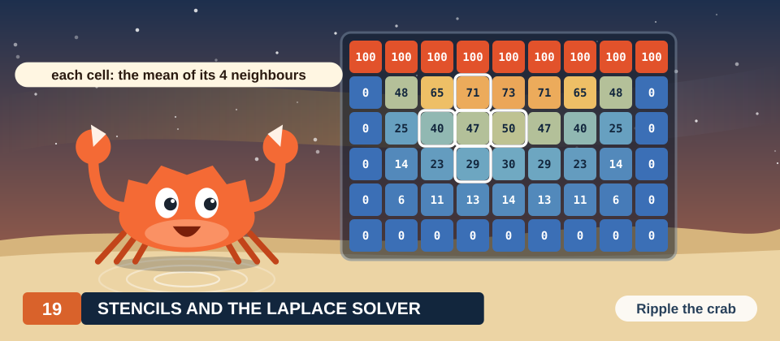

# Chapter 19: Stencils and Jacobi Iteration

The temperature inside a heated plate, the electric potential between charged conductors and the
pressure of a fluid at rest are all described by the same partial differential equation, the
Laplace equation. A computer solves this equation on a grid of points. The value at each point is
computed again and again from the values of its 4 neighbors, until the values stop changing. A
computation in which every point of a grid is updated from a fixed pattern of neighbors is called
a stencil computation. Stencils are among the most common workloads of a GPU, because all points of
a grid can be updated at the same time.

In this chapter, we derive the parallel algorithm for 1 stencil, the 5-point stencil of the Laplace
equation, together with its standard solver, Jacobi iteration. We work on a single 6 × 6 plate from
the first section to the last. We first compute its steps by hand and show why an update in place
produces a different answer. We then prove that 2 buffers used in turn compute Jacobi iteration
exactly, and we count the memory traffic that determines the speed of the kernel. Both
implementations, in Rust and in CUDA C++, check themselves against the values that we work out by
hand.

<div class="covers" markdown="1">

This chapter covers

- the Laplace equation on a grid, and the 5-point stencil derived from it
- Jacobi iteration, worked by hand on a 6 × 6 plate
- why an update in place computes a different method, and the exact wrong value it produces
- Two buffers used in turn, and a proof that they compute Jacobi iteration
- One thread per cell, in Rust with `DisjointSlice` and in C++ with `__restrict__`
- how fast the iteration converges, measured and predicted
- arithmetic intensity, and why a stencil is limited by memory bandwidth

</div>

The code of the chapter is in
[`code/oxide/ch19_stencil/`](https://github.com/arpanpathak/gpu-parallel-book/tree/main/code/oxide/ch19_stencil)
for Rust and in
[`code/cuda/ch19_stencil/`](https://github.com/arpanpathak/gpu-parallel-book/tree/main/code/cuda/ch19_stencil)
for C++.

## 19.1 The problem

### 19.1.1 A heated plate

We use the same example throughout the chapter. It is a square plate whose 4 edges are held at
fixed temperatures, the top edge at 100 degrees and the other 3 edges at 0 degrees. Heat flows into
the plate through the hot edge and out of it through the cold ones. After enough time, the
temperature at every point stops changing, and we want to know this final temperature at every
point of the plate.

A computer cannot store a temperature for each of the infinitely many points of the plate, so we
replace the plate by a grid of 6 × 6 cells and keep 1 temperature per cell. The rows and the
columns are numbered from 0 to 5, as shown in Figure 19.1. The cells on the edge of the grid have
known temperatures, and the 16 cells inside them are the unknowns that we want to compute.

<figure>
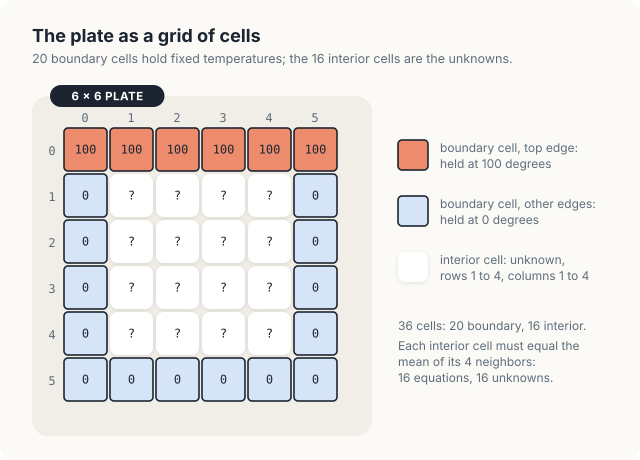
<figcaption><b>Figure 19.1</b> The 6 × 6 plate: 20 boundary cells with fixed temperatures and 16 interior cells to compute.</figcaption>
</figure>

<div class="definition">

<span class="box-label">Definition 19.1</span> **Grid, boundary cell, interior cell.** A **grid** of
\\(W \times H\\) cells holds one value per cell; cell \\((r, c)\\) lies in row \\(r \in [0, H)\\) and
column \\(c \in [0, W)\\). A **boundary cell** lies in the first or last row or column; its value is
given by the problem and never changes. Every other cell is an **interior cell**, and its value is
unknown.

*Example.* Our plate has \\(W = H = 6\\): 36 cells, of which 20 are boundary cells and \\(4 \times
4 = 16\\) are interior cells, in rows 1 to 4 and columns 1 to 4.

</div>

Here \\(W\\) is the width of the grid, that is, the number of cells in a row, and \\(H\\) is its
height, the number of cells in a column. As in the earlier chapters, \\([a, b)\\) denotes the
integers from \\(a\\) to \\(b - 1\\), so \\(r \in [0, 6)\\) means that the row number \\(r\\) is one
of 0, 1, 2, 3, 4 and 5.

The grid is stored in **row-major order**: the 6 cells of row 0 come first, followed by the 6 cells
of row 1, then those of row 2, until row 5 ends the array. Before cell \\((r, c)\\) there are
\\(r\\) complete rows of \\(W\\) cells each, followed by \\(c\\) cells of its own row, so cell
\\((r, c)\\) is element \\(rW + c\\) of the array. For example, cell (2, 3) of our plate is element
\\(2 \cdot 6 + 3 = 15\\). It follows that the 2 neighbors of a cell in the same row are 1 element
away from it, at elements 14 and 16 in this example, while the 2 neighbors in the same column are
\\(W\\) elements away, at elements \\(15 - 6 = 9\\) and \\(15 + 6 = 21\\).

### 19.1.2 The rule for the final temperature

Physics gives a simple rule that the final temperatures obey. At every interior cell, the
temperature is the mean of the temperatures of its 4 neighbors:

\\[ u_{r,c} = \frac{1}{4} \left( u_{r-1,c} + u_{r+1,c} + u_{r,c-1} + u_{r,c+1} \right). \\]

| Symbol | Meaning | In the example, cell (1, 1) |
|---|---|---|
| \\(u_{r,c}\\) | final temperature of the cell in row \\(r\\), column \\(c\\) | \\(u_{1,1} = 45.45\\) |
| \\(u_{r-1,c}\\), \\(u_{r+1,c}\\) | temperatures of the cells above and below | 100 and 22.35 |
| \\(u_{r,c-1}\\), \\(u_{r,c+1}\\) | temperatures of the cells to the left and right | 0 and 59.47 |
| \\(\frac{1}{4}\\) | weight of each neighbor; 4 weights of 1/4 form a mean | 0.25 |

The reason for the rule is that heat flows from warm to cold. If a cell were warmer than the mean
of its neighbors, it would lose more heat to them than it receives, and its temperature would
still be falling. If it were colder, it would still be rising. Only when every cell equals the mean
of its neighbors does the temperature stop changing. We can check the rule on the answer. In
Section 19.2, we compute the final temperatures of our plate, and there cell (1, 1) holds 45.45,
while its neighbors hold 100 above, 22.35 below, 0 to the left and 59.47 to the right. Their mean
is \\((100 + 22.35 + 0 + 59.47) / 4 = 181.82 / 4 = 45.45\\), which is the value of the cell itself,
as Figure 19.2 shows.

<figure>
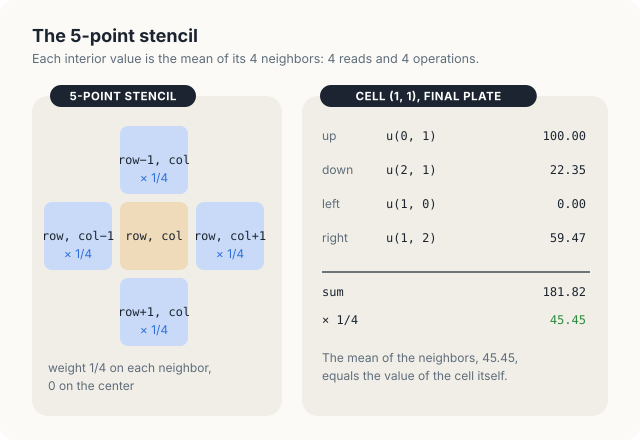
<figcaption><b>Figure 19.2</b> The 5-point stencil, checked on cell (1, 1) of the final plate.</figcaption>
</figure>

The rule is the discrete form of the **Laplace equation**. Let \\(u(x, y)\\) denote the temperature
at the point \\((x, y)\\) of the plate. The Laplace equation states that the sum of the second
derivatives of \\(u\\) along \\(x\\) and along \\(y\\) is 0 at every point inside the plate:

\\[ \frac{\partial^2 u}{\partial x^2} + \frac{\partial^2 u}{\partial y^2} = 0. \\]

| Symbol | Meaning | On the grid |
|---|---|---|
| \\(u(x, y)\\) | temperature at the point \\((x, y)\\) | \\(u_{r,c}\\), with \\(x\\) along the columns and \\(y\\) along the rows |
| \\(\partial^2 u / \partial x^2\\) | second derivative of \\(u\\) along \\(x\\): how fast the slope changes from left to right | a difference of the cells left and right |
| \\(\partial^2 u / \partial y^2\\) | the same along \\(y\\), from top to bottom | a difference of the cells above and below |

A grid has no derivatives, only values at cells, so we approximate each second derivative by a
difference of neighboring values. Let \\(h\\) be the spacing between the centers of 2 neighboring
cells. The second derivative along \\(x\\) at cell \\((r, c)\\) is approximated by the **finite
difference**

\\[ \frac{\partial^2 u}{\partial x^2} \approx \frac{u_{r,c+1} - 2u_{r,c} + u_{r,c-1}}{h^2}, \\]

and the second derivative along \\(y\\) by the same expression with the cells above and below. The
numerator compares the cell with its 2 neighbors in the row. It is 0 when the 3 values lie on a
straight line, and it measures how far they bend away from one when they do not. We can test the
approximation on a function whose second derivative we know. For \\(f(x) = x^2\\), whose second
derivative is 2 everywhere, the difference at \\(x = 1\\) with \\(h = 1\\) uses \\(f(2) = 4\\),
\\(f(1) = 1\\) and \\(f(0) = 0\\), and gives \\((4 - 2 \cdot 1 + 0) / 1^2 = 2\\), which is exact.

Substituting both differences into the Laplace equation gives

\\[ \frac{u_{r,c+1} - 2u_{r,c} + u_{r,c-1}}{h^2} + \frac{u_{r+1,c} - 2u_{r,c} + u_{r-1,c}}{h^2}
= 0. \\]

Multiplying by \\(h^2\\) removes the spacing, and moving the 4 terms \\(-2u_{r,c}\\) to the right
gives \\(u_{r-1,c} + u_{r+1,c} + u_{r,c-1} + u_{r,c+1} = 4u_{r,c}\\). Dividing by 4 gives the rule
above. Note that the spacing \\(h\\) has canceled, so the rule is the same however finely we cut
the plate.

<div class="definition">

<span class="box-label">Definition 19.2</span> **Stencil.** A **stencil** is a fixed pattern of
neighbors, with a weight for each, from which a new value of a cell is computed. A **stencil
computation** applies the same stencil to every interior cell of a grid. The **5-point stencil**
uses a cell and its 4 neighbors in the same row and column, with weight 1/4 on each neighbor and
0 on the cell itself.

*Example.* Applied to cell (1, 1) of the final plate, the 5-point stencil gives 45.45 (Figure
19.2).

</div>

The rule gives 1 equation for each of the 16 interior cells, and each equation contains up to 4
unknowns. For cell (1, 1), whose upper and left neighbors are boundary cells with the known values
100 and 0, the equation reads \\(u_{1,1} = (100 + u_{2,1} + 0 + u_{1,2}) / 4\\). A system of 16
equations can be solved by elimination, as in a first course in linear algebra. A grid of
4096 × 4096 cells, however, has 16.7 million interior cells, and elimination on a system of that
size needs far more memory and time than the iterative method of the next section.

<div class="exercises">

Exercises

19.1 Write the equation of the rule for cell (2, 3) of the plate. Which of its neighbors are
boundary cells?<br>
19.2 At which element of the array is cell (4, 1) stored, in row-major order with \\(W = 6\\)?<br>
19.3 Apply the finite difference to \\(f(x) = x^3\\) at \\(x = 1\\) with \\(h = 1\\) and with
\\(h = 0.5\\), and compare both with the exact second derivative, 6.

</div>

## 19.2 The sequential algorithm

### 19.2.1 Jacobi iteration

We do not know the final temperatures, but we do know a property that they have. Each interior
value is the mean of its neighbors. Jacobi iteration turns this property into a procedure. It
starts from a guess and replaces every interior value by the mean of its neighbors, again and
again. If the guess is wrong, the replacement moves each value toward the mean of its neighbors,
and after many repetitions the values settle at the point where the replacement no longer changes
them, which is exactly the final state.

<div class="definition">

<span class="box-label">Definition 19.3</span> **Jacobi iteration.** Let \\(u^{(0)}\\) be a grid
whose boundary cells hold the given values and whose interior cells hold a guess. **Jacobi
iteration** computes the grids \\(u^{(1)}, u^{(2)}, \ldots\\), where each step keeps the boundary
cells and sets every interior cell to

\\[ u^{(k+1)}_{r,c} = \frac{1}{4} \left( u^{(k)}_{r-1,c} + u^{(k)}_{r+1,c} + u^{(k)}_{r,c-1} +
u^{(k)}_{r,c+1} \right). \\]

The right-hand side uses only values of step \\(k\\).

*Example.* We start from 0 in every interior cell. After step 1, the 4 cells of row 1 hold 25; all
other interior cells still hold 0.

</div>

The superscript in parentheses is the number of the step, not a power. Thus \\(u^{(0)}\\) is the
starting grid, \\(u^{(1)}\\) the grid after 1 step, and \\(u^{(k)}_{r,c}\\) the value of cell
\\((r, c)\\) after \\(k\\) steps.

| Symbol | Meaning | In the example |
|---|---|---|
| \\(k\\) | number of steps already performed | \\(k = 0\\) when step 1 is computed |
| \\(u^{(k)}\\) | grid after \\(k\\) steps; the old grid that the step reads | \\(u^{(0)}\\): 100 on top, 0 inside |
| \\(u^{(k+1)}_{r,c}\\) | new value of cell \\((r, c)\\), written by the step | \\(u^{(1)}_{1,1} = 25\\) |
| \\(u^{(k)}_{r-1,c}\\) | old value of the cell above | \\(u^{(0)}_{0,1} = 100\\) |

The method is named after Carl Gustav Jacob Jacobi. Let us carry out its first 2 steps by hand,
starting from 0 in every interior cell. Before step 1, each of the 4 cells of row 1 has the hot
boundary cell above it and 3 neighbors at 0, so it becomes \\((100 + 0 + 0 + 0) / 4 = 25\\). Each
cell of rows 2 to 4 has only neighbors at 0, and it stays at 0.

In step 2, every cell again reads the values that the grid held before the step, which are now the
values of step 1. Cell (1, 1) has 100 above it, 0 below, 0 to its left and 25 to its right, so it
becomes \\(125 / 4 = 31.25\\). Cell (1, 2) has 25 on both sides and becomes
\\((100 + 0 + 25 + 25) / 4 = 37.5\\). Each cell of row 2 has 25 above it and 0 elsewhere, so it
becomes \\(25 / 4 = 6.25\\). After 2 steps, heat has therefore moved 2 rows into the plate, 1 row
per step, because a cell learns only about its direct neighbors in each step. Figure 19.3 shows
the 2 steps, together with the plate after 100 steps, when the values agree with the final
temperatures to 2 decimal places.

<figure>
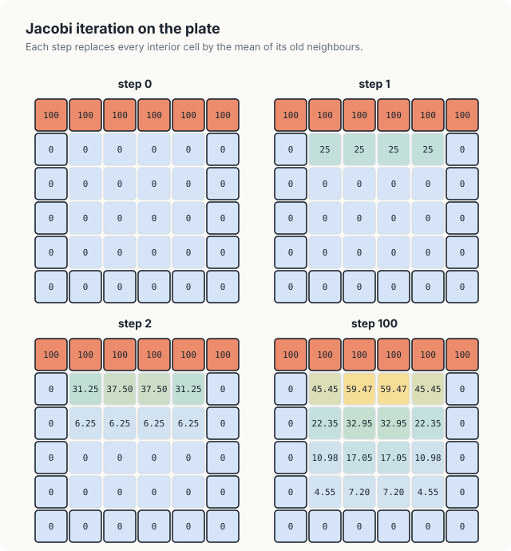
<figcaption><b>Figure 19.3</b> Jacobi iteration on the plate: steps 0, 1, 2 and 100.</figcaption>
</figure>

### 19.2.2 The algorithm

We now write 1 step as a procedure that reads the grid \\(u\\) and writes the grid \\(v\\), and the
iteration as a loop around that procedure. We write algorithms in the style of Cormen, Leiserson,
Rivest and Stein, with procedure names in small capitals, numbered lines, and the half-open range
\\([a, b)\\) for the integers \\(a, a + 1, \ldots, b - 1\\). In both procedures, \\(u\\) is the
old grid, \\(v\\) is the new grid, \\(W\\) and \\(H\\) are the width and height of Definition 19.1,
and \\(K\\) is the number of steps to perform.

<div class="algo">
<p class="algo-name">Jacobi-Step(\(u, v, W, H\))</p>
<ol>
<li><b class="kw">for</b> \(r \in [1, H - 1)\) {</li>
<li style="--d:1"><b class="kw">for</b> \(c \in [1, W - 1)\) {</li>
<li style="--d:2">\(v_{r,c} = (u_{r-1,c} + u_{r+1,c} + u_{r,c-1} + u_{r,c+1}) / 4\)</li>
<li style="--d:1">}</li>
<li>}</li>
</ol>
</div>

<div class="algo">
<p class="algo-name">Jacobi(\(u, W, H, K\))</p>
<ol>
<li>\(v = u\) <span class="c">// both grids hold the boundary</span></li>
<li><b class="kw">for</b> \(k \in [0, K)\) {</li>
<li style="--d:1"><span class="sc">Jacobi-Step</span>(\(u, v, W, H\))</li>
<li style="--d:1">exchange the names \(u\) and \(v\) <span class="c">// u is the newest grid</span></li>
<li>}</li>
<li><b class="kw">return</b> \(u\)</li>
</ol>
</div>

Lines 1 and 2 of Jacobi-Step visit the interior cells only. On our plate, \\(r\\) and \\(c\\) run
over \\([1, 5)\\), that is, over 1, 2, 3 and 4, so the boundary cells of \\(v\\) are never written.
For this reason, line 1 of Jacobi copies the whole starting grid into \\(v\\), so that \\(v\\)
holds the boundary values as well. Line 4 exchanges the names after each step, so that the grid
written last becomes the grid that the next step reads. After step 1, for example, the name \\(u\\)
refers to the grid that holds 25 in row 1, and step 2 reads that grid.

### 19.2.3 Counting the work

Line 3 of Jacobi-Step executes once for each interior cell. There are \\(W - 2\\) interior cells in
a row and \\(H - 2\\) in a column, so line 3 executes \\((W - 2)(H - 2)\\) times per step, which is
\\(4 \cdot 4 = 16\\) times on our plate. Each execution reads 4 values, performs 3 additions and
1 multiplication by 1/4, which are 4 floating-point operations, and writes 1 value. On our plate, a
step therefore performs 16 updates, with 64 reads, 64 operations and 16 writes. On a grid of
4096 × 4096 cells, a step performs 16.7 million updates, and in Section 19.7, we will see that such
a grid needs millions of steps. A CPU performs these updates one after another. In the next section,
we ask which of them may run at the same time.

<div class="exercises">

Exercises

19.4 Carry out step 3 of the plate by hand, starting from the values of step 2 in Figure 19.3.<br>
19.5 How many reads, writes and floating-point operations does Jacobi perform for \\(K = 100\\)
steps on the plate?<br>
19.6 Why does line 1 of Jacobi copy the whole grid and not only the boundary?

</div>

## 19.3 Updating in place

### 19.3.1 1 grid in place of 2

Jacobi keeps 2 grids, which doubles the memory it needs. A natural question is whether 1 grid would
be enough, with line 3 writing the new value of a cell into the same grid that it reads from. Let
us run step 1 in this way on our plate, visiting the cells row by row, in the order of the loops of
Jacobi-Step.

Cell (1, 1) is visited first and becomes \\((100 + 0 + 0 + 0) / 4 = 25\\), as before. Cell (1, 2)
is visited next. Its left neighbor is cell (1, 1), which now holds the new value 25 rather than
the old value 0, so cell (1, 2) becomes \\((100 + 0 + 25 + 0) / 4 = 31.25\\) instead of 25. The
error then spreads to later cells. Cell (1, 3) reads 31.25 on its left and becomes 32.81, and cell
(2, 1), whose upper neighbor already holds 25, becomes 6.25 instead of 0, as shown in Figure 19.4.

<figure>
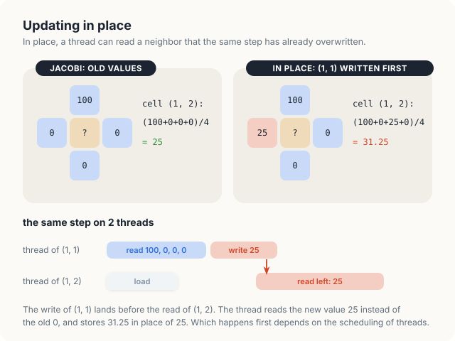
<figcaption><b>Figure 19.4</b> In place, cell (1, 2) reads a neighbor that step 1 has already overwritten, and becomes 31.25 in place of 25.</figcaption>
</figure>

On a CPU, the update in place gives another well-defined method, called Gauss-Seidel iteration,
which also converges. On a GPU, however, it gives no well-defined method at all, because the cells
are updated by different threads. The thread of cell (1, 2) may read its left neighbor before or
after the thread of cell (1, 1) writes it, and the order is decided by how the hardware schedules
the 2 threads. The result can be 25, 31.25, or a mixture of both across the grid, and it can change
from run to run. We run this variant in Section 19.5.

### 19.3.2 Which updates are independent

Recall the formula of Definition 19.3. Its right-hand side uses only values of step \\(k\\), and
its left-hand side writes only values of step \\(k + 1\\). No update of a step therefore uses the
result of another update of the same step. In step 2 of our plate, for example, cell (1, 2) needs
the value of cell (1, 1) after step 1, which is 25, and not the value 31.25 that cell (1, 1)
receives in step 2.

<div class="key-observation">

<span class="box-label">Key observation</span> The 16 updates of a Jacobi step read only the grid
of the previous step, so no update depends on another and all 16 can run at the same time,
provided that no update overwrites a value of the previous step that another update still has to
read.

</div>

The condition at the end of the observation is met by keeping the 2 grids of Jacobi apart. Every
update reads from one grid and writes into the other, and the next step exchanges their roles.
This arrangement has a name.

<div class="definition">

<span class="box-label">Definition 19.4</span> **Ping-pong buffers.** **Ping-pong buffering** keeps
2 buffers of the same size. Each step reads 1 buffer and writes the other, and after each step the
2 exchange roles, so that the buffer written last is the one read next.

*Example.* Step 1 of the plate reads buffer \\(a\\) and writes buffer \\(b\\); step 2 reads \\(b\\)
and writes \\(a\\); step 3 reads \\(a\\) again.

</div>

<div class="exercises">

Exercises

19.7 Finish step 1 in place for row 1 and row 2 of the plate, visiting the cells row by row. Which
of the 16 values differ from Jacobi's?<br>
19.8 Suppose the cells of a step in place were visited column by column instead. Which value would
cell (1, 2) receive in step 1?

</div>

## 19.4 The parallel algorithm

### 19.4.1 Threads and blocks

A GPU runs 1 function many times at once. The terms below were introduced in Chapters 3 and 13. We
restate them here because we use them throughout the rest of the chapter.

<div class="definition">

<span class="box-label">Definition 19.5</span> **Kernel, thread, block, grid of blocks, warp.** A
**kernel** is a function that the GPU runs many times at once; each run is a **thread**, with its
own position and its own variables. Threads are grouped into **blocks** of up to 1,024 threads that
run on the same streaming multiprocessor (SM), share a fast on-chip memory and can wait for one
another. The blocks of 1 launch form a **grid of blocks**. The SM issues instructions for 32
threads of a block at a time; such a group is a **warp**.

*Example.* For the plate, the program launches 1 block of 32 × 8 threads. Its 256 threads form 8
warps, 1 per row of the block.

</div>

The word "grid" now has 2 meanings, the grid of cells and the grid of blocks. In the rest of the
chapter, we say "grid" for the cells and "the blocks of a launch" for the other meaning.

We give each cell its own thread. A thread finds its cell from 3 values that the GPU supplies:
the position of its block among the blocks of the launch (blockIdx), its position inside the block
(threadIdx), and the size of a block (blockDim). We use blocks of \\(B_x \times B_y = 32 \times 8\\)
threads, that is, 32 threads along a row and 8 rows of threads. The thread at position
(threadIdx.x, threadIdx.y) of block (blockIdx.x, blockIdx.y) then owns the cell

\\[ row = \text{blockIdx.y} \cdot B_y + \text{threadIdx.y}, \qquad col = \text{blockIdx.x} \cdot
B_x + \text{threadIdx.x}. \\]

| Symbol | Meaning | Example: thread (4, 2) of block (1, 0) |
|---|---|---|
| \\(B_x, B_y\\) | width and height of a block in threads | 32, 8 |
| blockIdx.x, blockIdx.y | column and row of the block among the blocks | 1, 0 |
| threadIdx.x, threadIdx.y | column and row of the thread inside its block | 4, 2 |
| \\(\mathsf{row}\\) | row of the cell the thread owns | \\(0 \cdot 8 + 2 = 2\\) |
| \\(\mathsf{col}\\) | column of the cell the thread owns | \\(1 \cdot 32 + 4 = 36\\) |

The formula has a simple reading. Along a row, the blocks to the left of block blockIdx.x cover
\\(\text{blockIdx.x} \cdot B_x\\) columns, and the thread lies threadIdx.x columns further on. In
the example of the table, block 1 has 1 block of 32 columns to its left, so its thread 4 owns
column 36. The rows are counted in the same way.

A grid of \\(W \times H\\) cells needs \\(\lceil W / B_x \rceil \times \lceil H / B_y \rceil\\)
blocks, where \\(\lceil x \rceil\\) denotes \\(x\\) rounded up to the next integer, so that a
partly filled block at the edge is still counted. A grid of 4096 × 4096 cells needs
\\(4096 / 32 = 128\\) blocks along a row and \\(4096 / 8 = 512\\) along a column. For the plate,
\\(\lceil 6 / 32 \rceil = \lceil 6 / 8 \rceil = 1\\), so 1 block suffices. The threads of that
block with \\(\mathsf{col} \ge 6\\) or \\(\mathsf{row} \ge 6\\) have no cell, and of the 36 threads that do have a
cell, the 20 on the boundary have nothing to compute.

We choose blocks that are 32 threads wide because the 32 threads of a warp then lie along 1 row of
the grid. When they read their neighbors, they read 32 neighboring values, 128 bytes, at the same
time, and the hardware can serve such a read efficiently.

<div class="definition">

<span class="box-label">Definition 19.6</span> **Coalesced access.** Global memory moves data in
**sectors** of 32 bytes (Chapter 7). A warp's access is **coalesced** when its 32 threads read
neighboring addresses, so that the 32 values arrive in as few sectors as possible.

*Example.* A warp reading 32 neighboring floats of a row, 128 bytes, needs 4 sectors when the row
segment starts at a multiple of 32 bytes. A warp reading 32 floats of a column needs 32 sectors.

</div>

### 19.4.2 The kernel

Every thread executes the following procedure. The 2 grids \\(u\\) and \\(v\\) are 2 different
buffers in global memory, the large memory of the GPU that every thread can read and write.

<div class="algo">
<p class="algo-name">Jacobi-Kernel(\(u, v, W, H\))</p>
<ol>
<li>\(\mathsf{row} = \mathsf{blockIdx{.}y} \cdot B_y + \mathsf{threadIdx{.}y}\), \(\mathsf{col} = \mathsf{blockIdx{.}x} \cdot B_x + \mathsf{threadIdx{.}x}\)</li>
<li><b class="kw">if</b> \(\mathsf{row} \in [1, H - 1)\) and \(\mathsf{col} \in [1, W - 1)\) { <span class="c">// interior cells only</span></li>
<li style="--d:1">\(v_{row,\mathsf{col}} = (u_{row-1,\mathsf{col}} + u_{row+1,\mathsf{col}} + u_{row,\mathsf{col}-1} + u_{row,\mathsf{col}+1}) / 4\)</li>
<li>}</li>
</ol>
</div>

<div class="algo">
<p class="algo-name">Jacobi-GPU(\(u, W, H, K\))</p>
<ol>
<li>copy \(u\) into 2 device buffers \(a\) and \(b\) <span class="c">// both hold the boundary</span></li>
<li><b class="kw">for</b> \(k \in [0, K)\) {</li>
<li style="--d:1">launch <span class="sc">Jacobi-Kernel</span>(\(a, b, W, H\)) on \(\lceil W/B_x \rceil \times \lceil H/B_y \rceil\) blocks</li>
<li style="--d:1">exchange the names \(a\) and \(b\)</li>
<li>}</li>
<li>copy \(a\) to the host</li>
</ol>
</div>

Jacobi-Kernel is the body of Jacobi-Step with its 2 loops removed. The position of the thread,
computed in line 1, plays the role of the loop variables \\(r\\) and \\(c\\). Line 2 lets only the
threads of interior cells continue, and line 3 is line 3 of Jacobi-Step. Jacobi-GPU is Jacobi with
the call of Jacobi-Step replaced by a launch of the kernel, and \\(a\\) and \\(b\\) are the 2
buffers on the device. Launches issued one after another on the same stream run in that order, so
the launch of step \\(k + 1\\) starts only after every thread of step \\(k\\) has written its value.
The loop of the CPU is thus replaced by threads within a step, while the steps themselves still run
one after another.

### 19.4.3 The work of 1 thread

Figure 19.5 follows the thread of cell (2, 2) through step 2. The thread reads 4 values from buffer
\\(a\\), which holds the grid after step 1, namely 25 above, 0 below, 0 to the left and 0 to the
right. It then writes \\(25 / 4 = 6.25\\) into cell (2, 2) of buffer \\(b\\). In total, the thread
makes 4 reads from global memory and 1 write, and none of the values that it reads was written in
the same step.

<figure>
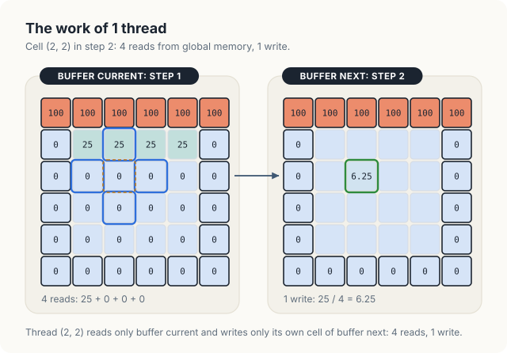
<figcaption><b>Figure 19.5</b> The work of 1 thread in step 2: 4 reads from buffer a, 1 write into buffer b.</figcaption>
</figure>

Over the whole step, the 16 interior threads of the plate read 64 values and write 16. A grid of
4096 × 4096 cells has 16.7 million interior threads per step, which read 67 million values, or
268 MB, and write 16.7 million values, or 67 MB. In Section 19.8, we will see that most of those
reads never reach the memory chips.

<div class="exercises">

Exercises

19.9 Which cell does thread (5, 3) of block (2, 1) own with blocks of 32 × 8 threads?<br>
19.10 How many blocks of 32 × 8 threads cover a grid of 1000 × 1000 cells, and how many of their
threads have no cell?<br>
19.11 Follow the thread of cell (1, 2) through step 2, as Figure 19.5 does for cell (2, 2).

</div>

## 19.5 Correctness

The kernel is correct only if the buffers are used as Jacobi-GPU prescribes. In this section, we
break the prescription in two ways and run each broken variant. We then prove that the correct
program computes Jacobi iteration exactly.

### 19.5.1 1 buffer for both arguments

Suppose that we launch the kernel with the same buffer as \\(u\\) and as \\(v\\). This is the
update in place of Section 19.3. In C++, the launch `jacobi<<<blocks, block>>>(a, a, w, h)`
compiles without a warning. We ran it for 10 steps on the 4096 × 4096 plate, 3 times, and compared
each result with the result of 10 correct steps. The program printed the following counts.

```console
in place, 4096 x 4096, run 1: 28420 of 16777216 cells differ from Jacobi after 10 steps
in place, 4096 x 4096, run 2: 28330 of 16777216 cells differ from Jacobi after 10 steps
in place, 4096 x 4096, run 3: 28464 of 16777216 cells differ from Jacobi after 10 steps
```

The number of wrong cells changes from run to run, as we predicted in Section 19.3. On the 6 × 6
plate, the same launch printed the correct values of Figure 19.3. There, all 36 cells belong to 1
block, and in our runs every thread of the block read its neighbors before any of them wrote.
Nothing in the hardware guarantees that order, however. A test on a small grid therefore cannot
show the error. The error appears where 1 block reads cells that another block, running earlier or
later, writes.

In Rust, the same mistake does not compile. The kernel takes the old grid as `&[f32]` and the new
one as a `DisjointSlice`, which the launch builds from a `&mut` borrow of a buffer. Passing the
same buffer as both arguments borrows it as shared and as mutable at the same time, which the
borrow checker rejects with the following message.

```console
error[E0502]: cannot borrow `a` as mutable because it is also borrowed as immutable
   --> src/main.rs:146:58
    |
146 |         module.jacobi(&stream, &small, &a, RowWidth::new(&mut a, w as u32))?;
    |                ------                  --                ^^^^^^ mutable borrow occurs here
    |                |                       |
    |                |                       immutable borrow occurs here
    |                immutable borrow later used by call
```

### 19.5.2 A buffer without the boundary

The compiler can check that the 2 arguments are different buffers, but it cannot check what a
buffer holds. Suppose that line 1 of Jacobi-GPU copies the plate into \\(a\\) only, and that \\(b\\)
is created filled with 0. The kernel never writes a boundary cell, so the top row of \\(b\\) stays
at 0. Step 1 is unaffected, because it reads \\(a\\). Step 2, however, reads \\(b\\), whose top
edge is cold, and cell (1, 1) becomes \\((0 + 0 + 0 + 25) / 4 = 6.25\\) instead of 31.25, as shown
in Figure 19.6. We ran this variant, and it printed the following grids.

```console
  zeroed second buffer, after step 2
     100.00  100.00  100.00  100.00  100.00  100.00
       0.00    6.25   12.50   12.50    6.25    0.00
       0.00    6.25    6.25    6.25    6.25    0.00
       0.00    0.00    0.00    0.00    0.00    0.00
       0.00    0.00    0.00    0.00    0.00    0.00
       0.00    0.00    0.00    0.00    0.00    0.00
  zeroed second buffer, after step 200
     100.00  100.00  100.00  100.00  100.00  100.00
       0.00   11.55   21.76   21.76   11.55    0.00
       0.00   13.88   17.55   17.55   13.88    0.00
       0.00    4.79    8.45    8.45    4.79    0.00
       0.00    2.45    3.58    3.58    2.45    0.00
       0.00    0.00    0.00    0.00    0.00    0.00
```

<figure>
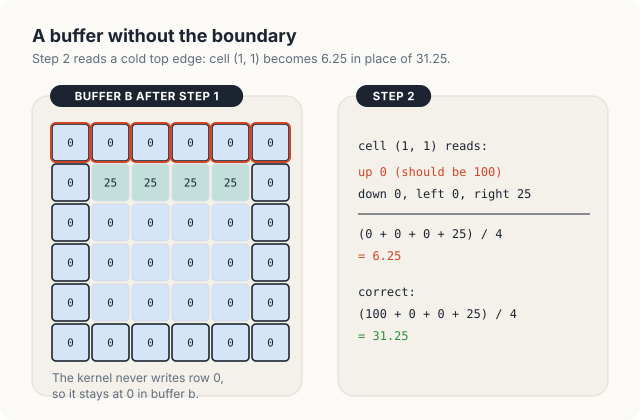
<figcaption><b>Figure 19.6</b> A second buffer without the boundary: step 2 reads a cold top edge, and cell (1, 1) becomes 6.25 in place of 31.25.</figcaption>
</figure>

The grid printed after step 2 shows 100 in its top row. The program printed buffer
\\(a\\), which holds the boundary, while the step itself had read the cold top row of \\(b\\). The
iteration still converges, but to the answer of a different problem, in which the top edge is hot
only in every second step. After 200 steps, cell (2, 2) holds 17.55, whereas the correct value is
32.95. No error is reported, and only a comparison with known values exposes the mistake.

### 19.5.3 A proof of correctness

We can now prove that the correct program computes Jacobi iteration. The proof follows the 2
buffers at the start of each pass through the loop of Jacobi-GPU, as shown in Figure 19.7.

<figure>
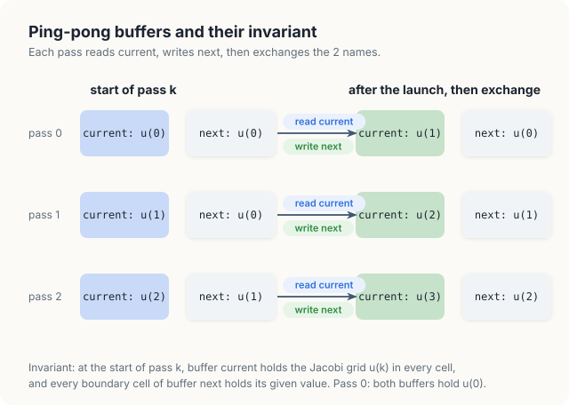
<figcaption><b>Figure 19.7</b> The 2 buffers at the start of each pass: a holds the newest grid, b holds the boundary.</figcaption>
</figure>

<div class="theorem">

<span class="box-label">Theorem 19.1</span> When Jacobi-GPU finishes, buffer \\(a\\) holds the grid
\\(u^{(K)}\\) of Definition 19.3, in every cell.

</div>

<div class="proof">

*Proof.* We show that the loop of lines 2 to 5 maintains the following invariant: at the start of
pass \\(k\\), (i) buffer \\(a\\) holds \\(u^{(k)}\\) in every cell, and (ii) every boundary cell of
\\(b\\) holds its given value.

*Initialization.* Before pass 0, line 1 has copied the starting grid \\(u = u^{(0)}\\) into both
buffers. Both parts of the invariant therefore hold.

*Maintenance.* Assume that the invariant holds at the start of pass \\(k\\). The launch in line 3
reads only \\(a\\) and writes only interior cells of \\(b\\), and \\(a\\) and \\(b\\) are different
buffers, so no thread reads a value that another thread of the launch writes. Every thread
therefore reads values of \\(u^{(k)}\\), and line 3 of Jacobi-Kernel stores \\(u^{(k+1)}_{r,c}\\)
into each interior cell of \\(b\\). The boundary cells of \\(b\\) are not written, so they still
hold the given values, which are also the boundary values of \\(u^{(k+1)}\\). Hence, \\(b\\) holds
\\(u^{(k+1)}\\) in every cell. Buffer \\(a\\) was not written, so its boundary cells still hold the
given values. Line 4 exchanges the names, after which (i) and (ii) hold for pass \\(k + 1\\). The
next launch starts only after this one has finished, because launches on 1 stream run in order.

*Termination.* The loop ends after \\(K\\) passes, so \\(a\\) holds \\(u^{(K)}\\), and line 6
copies it to the host.

</div>

Each broken variant of this section violates 1 step of the proof. The launch with 1 buffer violates
the condition "\\(a\\) and \\(b\\) are different buffers" in the maintenance step. The zeroed buffer
violates part (ii) of the invariant at initialization, and the proof then fails at the first
exchange, when \\(b\\) becomes the buffer that the next step reads.

<div class="rule-box">

<span class="box-label">Rule</span> A Jacobi step reads 1 buffer and writes the other, never the
same one, and both buffers hold the boundary values before the first step.

</div>

<div class="exercises">

Exercises

19.12 In the zeroed-buffer variant, compute cell (1, 2) after step 2 by hand and compare it with
the output above.<br>
19.13 Suppose the kernel also wrote the boundary cells, copying them from \\(u\\) to \\(v\\). Would
the zeroed second buffer still give a wrong answer? Which part of the invariant would the proof no
longer need?<br>
19.14 The output above shows the in-place launch with 3 different results. Why can a block of the
4096 × 4096 grid read a value that another block has already overwritten, while the single block of
the 6 × 6 plate did not?

</div>

## 19.6 Implementation

### 19.6.1 The kernel

Listing 19.1 shows the kernel in both languages. We let each thread compute its position, which is line 1
of Jacobi-Kernel, keeps only interior cells, which is line 2, and stores the mean of its 4
neighbors, which is line 3. In the flat array, the cell itself is element `c = row * width + col`.
Its neighbors above and below are \\(W\\) elements away, at `c - width` and `c + width`, and those
to the left and right are at `c - 1` and `c + 1`. For cell (2, 2) of the plate, `c` is
\\(2 \cdot 6 + 2 = 14\\), and the 4 neighbors are elements 8, 20, 13 and 15. Both versions add the
4 values in the same order and multiply by 0.25 last, as the CPU reference of the programs does,
so that the GPU and the CPU round identically.

<p class="listing"><b>Listing 19.1</b> 1 Jacobi step, 1 thread per cell.</p>

<div class="code-tabs">
<div class="code-tab" data-lang="Rust">

```rust,ignore
mod kernels {
    // ...
{{#include ../../../../code/oxide/ch19_stencil/src/main.rs:23:43}}
    // ...
}
```

</div>
<div class="code-tab" data-lang="C++">

```cpp
{{#include ../../../../code/cuda/ch19_stencil/stencil.cu:27:40}}
```

</div>
</div>

The two versions differ in how they state that the 2 grids do not overlap. The C++ kernel receives 2
raw pointers and marks them `__restrict__`, which is a promise to the compiler that no element is
reached through both pointers. The compiler does not check this promise. The Rust kernel receives
the old grid as a shared slice, `&[f32]`, and the new grid as a
`DisjointSlice<f32, Runtime2DIndex>`, a slice that each thread may write only at its own position.

The Rust kernel obtains that position in 3 steps. First, the host attaches the row width to the
buffer with `RowWidth::new`, and on the device, `row_width()` returns it. Second,
`thread::index_2d_runtime(&new)` returns the thread's (row, column) position as an index that only
this thread holds. Third, `get_mut` turns that index into element `row * width + col`, checks it
against the length of the slice, and returns a mutable reference to the element. Since no 2
threads hold the same index, no 2 threads can write the same element, and the write needs no
`unsafe` block. This is the same guarantee that the borrow checker enforced on the host in
Section 19.5.1, where it rejected 1 buffer passed as both arguments.

### 19.6.2 The host loop

Listing 19.2 implements Jacobi-GPU for the plate, that is, lines 1 to 5 of the pseudocode. It
fills both buffers from the same host grid, launches 100 steps, exchanges the 2 buffers after each
step, and prints the grid after steps 1, 2 and 100.

<p class="listing"><b>Listing 19.2</b> 100 steps on the 6 × 6 plate, with the 2 buffers exchanged after each step.</p>

<div class="code-tabs">
<div class="code-tab" data-lang="Rust">

```rust,ignore
fn main() -> Result<(), Error> {
    // ...
{{#include ../../../../code/oxide/ch19_stencil/src/main.rs:136:154}}
    // ...
}
```

</div>
<div class="code-tab" data-lang="C++">

```cpp
int main()
{
    // ...
{{#include ../../../../code/cuda/ch19_stencil/stencil.cu:153:175}}
    // ...
}
```

</div>
</div>

Both buffers are filled from the same host grid `start`, which is line 1 of Jacobi-GPU and
establishes part (ii) of the invariant. The exchange of line 4 moves no grid data. In C++,
`std::swap(a, b)` exchanges 2 pointers of 8 bytes each. In Rust, `std::mem::swap(&mut a, &mut b)`
exchanges 2 `DeviceBuffer` values, which are small handles of 40 bytes that hold the device address,
the length and a reference to the context, while the grids themselves stay where they are in
device memory. For comparison, a step on a 4096 × 4096 grid moves at least 134 MB, whereas the
exchange moves 80 bytes of host memory.

### 19.6.3 Running the example

Both programs print the same values. The Rust program prints the following output.

```console
$ cargo oxide run
GPU: Orin, 8 SMs
1. 6 x 6 plate, top edge at 100
  after step 1
     100.00  100.00  100.00  100.00  100.00  100.00
       0.00   25.00   25.00   25.00   25.00    0.00
       0.00    0.00    0.00    0.00    0.00    0.00
       0.00    0.00    0.00    0.00    0.00    0.00
       0.00    0.00    0.00    0.00    0.00    0.00
       0.00    0.00    0.00    0.00    0.00    0.00
  after step 2
     100.00  100.00  100.00  100.00  100.00  100.00
       0.00   31.25   37.50   37.50   31.25    0.00
       0.00    6.25    6.25    6.25    6.25    0.00
       0.00    0.00    0.00    0.00    0.00    0.00
       0.00    0.00    0.00    0.00    0.00    0.00
       0.00    0.00    0.00    0.00    0.00    0.00
  after step 100
     100.00  100.00  100.00  100.00  100.00  100.00
       0.00   45.45   59.47   59.47   45.45    0.00
       0.00   22.35   32.95   32.95   22.35    0.00
       0.00   10.98   17.05   17.05   10.98    0.00
       0.00    4.55    7.20    7.20    4.55    0.00
       0.00    0.00    0.00    0.00    0.00    0.00
```

Every value of steps 1 and 2 agrees with the values that we computed by hand in Section 19.2.1.
The program also runs the same 100 steps on the CPU with the function `cpu_step`, and it reports
`same bits as the CPU after 100 steps: true`. The 2 computations therefore agree in every bit of
every cell. This is possible because each cell is computed by the same 3 additions in the same
order, followed by the same multiplication, and IEEE 754 single-precision arithmetic rounds such a
sequence identically on both processors.

<div class="exercises">

Exercises

19.15 Change the programs to print the grid after step 3 and compare it with your answer to
Exercise 19.4.<br>
19.16 The Rust launch passes `&a` and `RowWidth::new(&mut b, ...)`. Explain why the borrow checker
accepts this call but rejects the one of Section 19.5.1.

</div>

## 19.7 Convergence

### 19.7.1 Measuring the change

After 100 steps, the plate agrees with the final temperatures to 2 decimal places. In general,
however, the final temperatures are not known in advance, so a solver must decide by itself when
to stop. It does so by measuring how much a step still changes the grid. When a step hardly
changes any value, the grid is close to the state in which every cell equals the mean of its
neighbors.

<div class="definition">

<span class="box-label">Definition 19.7</span> **RMS change.** The **root-mean-square (RMS) change**
of a step from grid \\(u\\) to grid \\(v\\) of \\(N\\) cells is

\\[ \Delta = \sqrt{\frac{1}{N} \sum_{i \in [0, N)} (v_i - u_i)^2 }. \\]

*Example.* Step 1 of the plate changes 4 of the 36 cells by 25 each:
\\(\Delta = \sqrt{4 \cdot 625 / 36} = 8.33\\) degrees.

</div>

| Symbol | Meaning | Step 1 of the plate |
|---|---|---|
| \\(N\\) | number of cells of the grid | 36 |
| \\(i\\) | position of a cell in the flat array | 0 to 35 |
| \\(u_i\\), \\(v_i\\) | value of cell \\(i\\) before and after the step | 0 and 25 for the 4 cells of row 1 |
| \\((v_i - u_i)^2\\) | square of the change of cell \\(i\\) | 625 for those 4 cells, 0 for the rest |
| \\(\Delta\\) | square root of the mean of the squares: a typical change per cell | 8.33 |

The squares make every change count as positive, so that a rise in 1 cell cannot cancel a fall in
another, and the square root at the end returns the result to degrees.

Both programs copy the 2 buffers to the host after every step of the plate and compute the RMS
change there. A 6 × 6 grid occupies only 144 bytes, so the copy costs microseconds. The programs
print the change and its ratio to the change of the step before, as follows.

```console
  RMS change per step, and its ratio to the step before
    step   1    8.33e+00
    step   2    3.90e+00   ratio 0.4677
    step   3    2.52e+00   ratio 0.6478
    step   4    1.82e+00   ratio 0.7192
    step  10    4.48e-01   ratio 0.8075
    step  20    5.38e-02   ratio 0.8090
    step  40    7.75e-04   ratio 0.8086
```

After the first few steps, the change shrinks by the same factor in every step, 0.809.

### 19.7.2 The rate of convergence

This factor can be predicted. Let the **error** of a grid be its difference from the final
temperatures, cell by cell. A Jacobi step leaves the final temperatures unchanged, since each of
them already equals the mean of its neighbors. A step therefore applies the same averaging to the
error that it applies to the grid, and the error after a step is the mean of the neighboring
errors before it. An error pattern that varies quickly from cell to cell, for example \\(+1\\) and
\\(-1\\) in alternating cells, is averaged away in a few steps, because neighboring values cancel.
The pattern that survives longest is the smoothest one that is 0 on the boundary, a single bump
that is largest in the middle of the plate. On a grid whose cells are numbered 0 to \\(n\\) along
each side, this pattern is

\\[ e_{r,c} = \sin\frac{\pi r}{n} \, \sin\frac{\pi c}{n}. \\]

| Symbol | Meaning | On the 6 × 6 plate |
|---|---|---|
| \\(n\\) | number of the last row and column; the boundary lies at 0 and \\(n\\) | 5 |
| \\(e_{r,c}\\) | error of cell \\((r, c)\\) in the slowest pattern | 0 on the boundary, largest in the center |
| \\(\sin(\pi r / n)\\) | a half wave along the rows, 0 at \\(r = 0\\) and at \\(r = n\\) | \\(\sin(\pi/5) = 0.588\\) at \\(r = 1\\) |

Let us apply 1 step to this pattern. The 2 neighbors of cell \\((r, c)\\) in its column hold
\\(\sin(\pi(r - 1)/n)\\) and \\(\sin(\pi(r + 1)/n)\\), each multiplied by the same column factor
\\(\sin(\pi c / n)\\). By the identity \\(\sin(x - y) + \sin(x + y) = 2 \sin x \cos y\\), their sum
is \\(2\cos(\pi/n)\\) times the value of the cell, and the same holds for the 2 neighbors in its
row. The sum of the 4 neighbors is therefore \\(4\cos(\pi/n)\\) times the value of the cell, their
mean is \\(\cos(\pi/n)\\) times that value, and 1 step multiplies the whole pattern by

\\[ \rho = \cos\frac{\pi}{n}. \\]

Our plate has \\(n = 5\\), and \\(\cos(\pi/5) = 0.8090\\), which is the ratio that the programs
measured from step 10 on. The early ratios are smaller, because the rougher error patterns, which
shrink faster, have not yet died out.

The same programs then iterate a 64 × 64 plate, for which \\(n = 63\\), until the RMS change of a
step falls below \\(10^{-6}\\) degrees. They measure the change every 1,000 steps and print the
following values.

```console
2. 64 x 64 plate until the RMS change per step is below 1e-6
  step  1000   RMS change 7.49e-03
  step  2000   RMS change 2.06e-03
  step  3000   RMS change 5.95e-04
  step  4000   RMS change 1.71e-04
  step  5000   RMS change 4.95e-05
  step  6000   RMS change 1.44e-05
  step  7000   RMS change 4.57e-06
  step  8000   RMS change 1.79e-06
  step  9000   RMS change 5.59e-07
  largest difference from the CPU after 9000 steps: 0.00e+00
```

The prediction is \\(\rho = \cos(\pi/63) = 0.998757\\) per step, so 1,000 steps multiply the change
by \\(0.998757^{1000} = 0.288\\). The measured ratios between consecutive lines are
\\(2.06 / 7.49 = 0.275\\), \\(0.595 / 2.06 = 0.289\\), \\(0.171 / 0.595 = 0.287\\) and
\\(0.0495 / 0.171 = 0.289\\), in close agreement with the prediction, as Figure 19.8 shows. After
step 7,000, the ratio drifts upward, to 0.39 and 0.31, because the changes have become smaller than
the rounding error of single-precision values near 50, which is about \\(4 \times 10^{-6}\\)
degrees.

<figure>
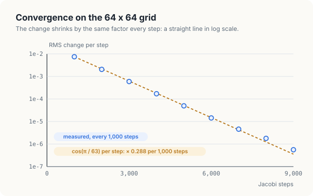
<figcaption><b>Figure 19.8</b> The RMS change per step falls by \(\cos(\pi/n)\) per step: 0.809 on the 6 × 6 plate and 0.288 per 1,000 steps on the 64 × 64 plate.</figcaption>
</figure>

The prediction also gives the cost of the method on a large grid. When \\(\rho\\) is close to 1,
each step removes only the small fraction \\(1 - \rho\\) of the remaining error, so reducing the
error by a factor of \\(e = 2.718\\) takes about \\(1 / (1 - \rho)\\) steps. For large \\(n\\),
\\(1 - \cos(\pi/n)\\) is close to \\(\pi^2 / (2n^2)\\), so this number of steps is about
\\(2n^2/\pi^2\\). It is 5 for our plate, about 800 for \\(n = 63\\), and about 3.4 million for a
grid of 4096 × 4096 cells. The number of steps grows with the square of the width, so large solvers
use Jacobi steps as one part of faster methods, such as multigrid, which apply a few Jacobi steps on
a series of coarser grids. A fast Jacobi step is the building block of those methods, and in the
rest of this chapter and in the next, we measure how fast a step can be.

<div class="exercises">

Exercises

19.17 Predict \\(\rho\\) and the factor per 1,000 steps for a 128 × 128 plate. Change the programs
and compare.<br>
19.18 About how many steps reduce the error of the 64 × 64 plate by a factor of 1,000?

</div>

## 19.8 Memory traffic and measurements

### 19.8.1 Arithmetic intensity

Each update performs 4 floating-point operations (FLOP). To judge whether this is much or little,
we compare it with the number of bytes that the update must move. Every old value must be read at
least once, and every new value must be written once. The least that any step can move is
therefore 1 read and 1 write of 4 bytes per cell, 8 bytes in total.

<div class="definition">

<span class="box-label">Definition 19.8</span> **Arithmetic intensity, memory-bound.** The
**arithmetic intensity** of a computation is the number of floating-point operations it performs per
byte it moves to or from memory. A kernel is **memory-bound** on a GPU when its arithmetic intensity
lies below the GPU's **ridge point**, its peak arithmetic rate divided by its memory bandwidth
(Chapter 2); its speed is then set by the bytes it moves, not by the operations it performs.

*Example.* A Jacobi step performs 4 FLOP per cell and moves at least 8 bytes per cell, so its
arithmetic intensity is at most \\(4 / 8 = 0.5\\) FLOP per byte.

</div>

The ridge point is the arithmetic intensity at which a kernel would keep both the arithmetic units
and the memory fully busy. The ridge points of the GPUs compared in Chapter 2 range from about 10
FLOP per byte for the A100 to about 114 FLOP per byte for the DGX Spark. The Jetson Orin NX lies at
about 24, and the Jetson AGX Thor at about 30, as Figure 19.9 shows. A Jacobi step lies below every
one of them by a factor of 20 or more, so it is memory-bound on every GPU of the table. Its speed is
therefore best measured by its **effective bandwidth**, the 8 bytes per cell that a step must move
divided by the time of the step. Since a copy of the grid moves the same 8 bytes per cell, a step
can be no faster than a copy.

<figure>
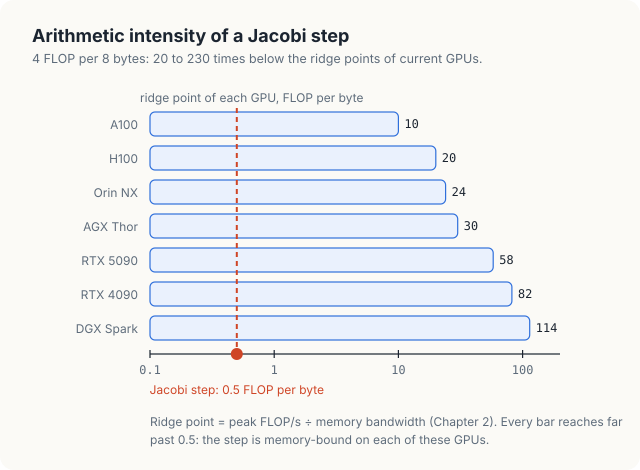
<figcaption><b>Figure 19.9</b> A Jacobi step, 0.5 FLOP per byte, lies far below the ridge point of every GPU.</figcaption>
</figure>

### 19.8.2 Measurements

The measurements come from a Jetson Orin NX, an integrated GPU with 8 SMs and 102 GB/s of memory
bandwidth. Both programs time a step on a 4096 × 4096 grid, which occupies 64 MiB per buffer. This
is far larger than the 2 MiB L2 cache of the measured GPU, so the grid must come from memory. Each
program first runs the kernel for 0.4 s, because these GPUs raise their clock frequency only under
sustained load, and then averages 50 calls. Repeated runs differ by 10 to 20%. On the measured GPU,
the C++ program printed

```console
3. 4096 x 4096 plate, 8 bytes per cell per step (1 read, 1 write)
  copy kernel         1.756 ms     76.4 GB/s
  jacobi              1.966 ms     68.3 GB/s
PASSED
```

and the Rust program printed

```console
3. 4096 x 4096 plate, 8 bytes per cell per step (1 read, 1 write)
  copy kernel         1.784 ms     75.2 GB/s
  jacobi              2.322 ms     57.8 GB/s
PASSED
```

The following table and Figure 19.10 collect these numbers. The last column gives the effective
bandwidth of each kernel as a share of the bandwidth of the copy.

| Kernel | Time per step | Effective bandwidth | Share of the copy |
|---|---|---|---|
| copy, C++ | 1.756 ms | 76.4 GB/s | 100% |
| Jacobi step, C++ | 1.966 ms | 68.3 GB/s | 89% |
| Jacobi step, Rust | 2.322 ms | 57.8 GB/s | 76% |

<figure>

<figcaption><b>Figure 19.10</b> Effective bandwidth of a copy and of the Jacobi step on the measured GPU.</figcaption>
</figure>

### 19.8.3 Why the step runs at 89% of a copy

The copy reaches 76.4 GB/s, which is 75% of the rated 102 GB/s. In Chapter 7, we saw that no
kernel reaches the rated figure, so the copy, not the rating, is the ceiling for a step. The C++
step reaches 89% of the copy. This is more than we should expect at first sight. If every one of
its 4 reads per cell went to memory, a step would move 16 bytes of reads and 4 bytes of writes,
20 bytes per cell, and it would take at least \\(20 / 8 = 2.5\\) times as long as the copy, that
is, 4.4 ms. It took 1.97 ms.

Let us compute what that time would require. Requesting 20 bytes for each of the 16.7 million
cells in 1.966 ms is a rate of \\(20 \cdot 16.7 \times 10^6 / 1.966 \times 10^{-3}\\) = 171 GB/s,
which is 1.7 times the 102 GB/s that the memory can deliver at all. At most 102 of every 171
requested bytes can therefore have come from memory, and at least \\(1 - 102/171 = 40\\%\\) of
them must have come from the L1 and L2 caches, the on-chip memories that keep recently read values.

The caches find those values because neighboring threads read neighboring rows, as Figure 19.11
shows. The 32 threads of a warp read 3 row segments of the old grid: the row above, their own row
with 1 extra cell at each end, and the row below. The 8 warps of a block cover 8 consecutive rows,
so the row above warp 1 is the row of warp 0, and the row below warp 1 is the row of warp 2. A
block of 32 × 8 threads therefore needs only 10 different row segments of the old grid, its own 8
rows and 1 more on each side. If each segment is read from memory once, a block reads
\\(10 / 8 = 1.25\\) old values per cell and writes 1, which is 9 bytes per cell instead of 8. At
the copy's rate, 9 bytes per cell take \\(1.756 \cdot 9 / 8 = 1.98\\) ms, which agrees with the
measured 1.966 ms.

<figure>
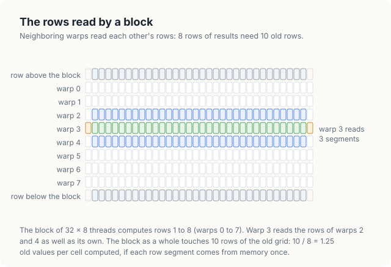
<figcaption><b>Figure 19.11</b> The rows read by 1 warp are the rows of its neighbors: a block of 8 rows needs 10 rows of the old grid.</figcaption>
</figure>

The step is thus close to the best it can be. It moves about 9 bytes per cell where 8 are needed,
and its speed follows from that count. In Chapter 20, we ask whether a block can do better by
copying its 10 rows into shared memory itself.

### 19.8.4 Why the Rust step is slower

The Rust kernel runs at 57.8 GB/s, 85% of the speed of the C++ kernel, although it reads and writes
the same cells. Its memory traffic is the same, but its integer work is not. The C++ kernel computes
positions in 32-bit `int`. The Rust kernel computes them in 64-bit `usize`, derives the height with
a 64-bit division, `new.len() / width`, and checks each index against the length of its slice. To
separate these costs, we changed only the C++ kernel, so that it used 64-bit positions and the same
division of the length by the width. It then ran at 58.9 GB/s, the speed of the Rust kernel. A
memory-bound kernel is therefore not free of arithmetic. With only 4 floating-point operations per
cell, the integer instructions that compute positions and check bounds make up most of the kernel,
and a 64-bit division, which the GPU performs as a sequence of many instructions, delays the loads.

<div class="exercises">

Exercises

19.19 Rewrite the Rust kernel so that it computes positions in `u32` and receives the height as an
argument, then measure it. How close does it come to the C++ kernel?<br>
19.20 Change the block shape of both programs to 16 × 16 and predict, with the row count of
Section 19.8.3, how many old values a block reads per cell. Then measure.

</div>

## 19.9 The complete programs

<p class="listing"><b>Listing 19.3</b> The complete Rust program. <a href="https://github.com/arpanpathak/gpu-parallel-book/blob/main/code/oxide/ch19_stencil/src/main.rs">code/oxide/ch19_stencil/src/main.rs</a></p>

<div class="code-tabs">
<div class="code-tab" data-lang="Rust">

```rust,ignore
{{#include ../../../../code/oxide/ch19_stencil/src/main.rs}}
```

</div>
<div class="code-tab" data-lang="C++">

```cpp
{{#include ../../../../code/cuda/ch19_stencil/stencil.cu}}
```

</div>
</div>

## Common mistakes

- **Updating the grid in place.** Threads then read neighbors that other threads have already
  replaced, and the result depends on their timing. On a small grid inside 1 block, the error may
  not appear at all (Section 19.5.1). Use 2 buffers; in Rust, the safe launch path rejects the same
  buffer as both arguments.
- **Leaving the boundary out of 1 buffer.** The kernel never writes boundary cells, so both
  buffers must hold them before the first step. The mistake converges to a wrong answer without
  any error (Section 19.5.2).
- **Copying the new grid back into the old one after every step.** Exchanging the 2 names moves 80
  bytes of host memory, whereas a copy moves the whole grid.
- **Checking convergence after every step on a large grid.** Each check waits for the GPU and moves
  data to the host. Check every few hundred or few thousand steps.
- **Expecting Jacobi iteration to converge quickly on a large grid.** The number of steps needed
  grows with the square of the width; use Jacobi steps inside a faster method such as multigrid.
- **Judging a stencil kernel by its FLOP rate.** At 0.5 FLOP per byte, the kernel is memory-bound;
  compare its effective bandwidth with that of a copy.

## Summary

- The Laplace equation, written with finite differences, says that in the final state every
  interior cell equals the mean of its 4 neighbors. This is the 5-point stencil.
- Jacobi iteration replaces every interior value by the mean of its old neighbors. On the 6 × 6
  plate, step 1 gives 25 in row 1, step 2 gives 31.25, 37.5 and 6.25, and 100 steps reach the final
  temperatures to 2 decimal places.
- An update in place computes a different value, 31.25 instead of 25 at cell (1, 2) in step 1. On
  a GPU, it gives results that change from run to run: 28,420, 28,330 and 28,464 wrong cells in 3
  runs on a 4096 × 4096 grid.
- Ping-pong buffers keep the steps apart. Theorem 19.1 proves that they compute Jacobi iteration
  exactly, provided that both buffers hold the boundary and the 2 arguments of a launch differ.
- Rust states this condition in types: the old grid is `&[f32]`, the new one a `DisjointSlice`,
  and the borrow checker rejects 1 buffer passed as both. C++ states it with `__restrict__`, which
  is not checked.
- The RMS change falls by \\(\cos(\pi/n)\\) per step: 0.809 on the 6 × 6 plate and 0.288 per 1,000
  steps on a 64 × 64 plate, as measured.
- A step performs 0.5 FLOP per byte and is memory-bound on every GPU. The C++ step reached
  68.3 GB/s, 89% of a copy, because the caches already reduce its reads to about 1.25 per cell.

## Exercises

1. Change the boundary of the plate so that the top edge is at 100 and the left edge at 50. Predict
   the mean of the 4 center cells at the final state from the symmetry of the problem, and check it
   with the programs.
2. A 9-point stencil also uses the 4 diagonal neighbors. How many reads per cell does it request,
   and how many old rows does a block of 32 × 8 threads touch? Predict its effective bandwidth from
   the measurements of Section 19.8.
3. Write a kernel that computes the RMS change on the GPU with a block reduction (Chapter 15) and
   use it for the 64 × 64 plate. Measure how often the loop can afford to check.
4. Modify the in-place variant so that it runs on the 6 × 6 plate with blocks of 1 × 1 threads.
   Does the result now differ from Jacobi's? Explain from the order in which blocks run.
5. Explain why Theorem 19.1 needs the sentence "launches on 1 stream run in order". Construct a
   program with 2 streams in which the proof fails.

## Sources and further reading

- R. J. LeVeque, *Finite Difference Methods for Ordinary and Partial Differential Equations*, SIAM,
  2007. Chapters 2 and 3 derive the 5-point Laplacian and its error; chapter 4 analyzes Jacobi
  iteration and its convergence factor.
- Y. Saad, *Iterative Methods for Sparse Linear Systems*, 2nd edition, SIAM, 2003. Jacobi and
  Gauss-Seidel iteration and their convergence.
- W. L. Briggs, V. E. Henson and S. F. McCormick, *A Multigrid Tutorial*, 2nd edition, SIAM, 2000.
  How Jacobi steps on coarser grids remove smooth errors quickly.
- T. H. Cormen, C. E. Leiserson, R. L. Rivest and C. Stein, *Introduction to Algorithms*, 4th
  edition, MIT Press, 2022. The pseudocode conventions and loop invariants used here.
- A. Pathak, *An Introduction to Tiled Parallel Programming, Simplified*, 2026. The same method of
  presentation applied to the matrix product.
- NVlabs, *cuda-oxide*, rev `b7fe543`: `cuda-device/src/disjoint.rs` documents `Runtime2DIndex`,
  `index_2d_runtime` and why `get_mut` on a slice of run-time width is safe.
