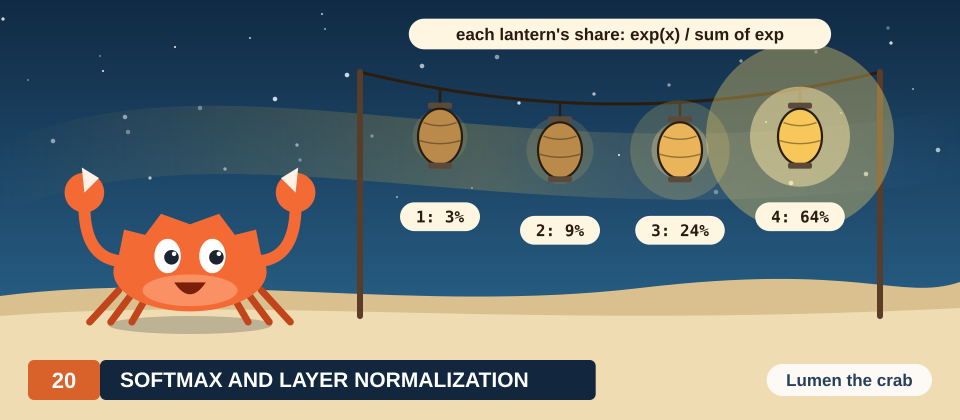

# Chapter 20: Tiled Stencils with Halo Cells

Recall that in the Jacobi kernel of Chapter 19, every thread reads its 4 neighbors from global
memory, so every value of the grid is read by up to 4 different threads. In Chapter 17, we removed
exactly this kind of repetition from the matrix product. The threads of a block copied a piece of
the input into shared memory once, and then every thread read its operands from that copy. A
stencil can be tiled in the same way, with 1 complication: the cells that a block computes need
neighbors that belong to other blocks.

In this chapter, we derive the tiled stencil kernel on the 6 × 6 plate of Chapter 19. We first
count how often the direct kernel reads each value. We then define the tile and its halo, compare 2
ways of loading the halo, and break the kernel twice, once without its barrier and once without its
halo, to show the exact wrong values that appear. After that, we count the memory traffic as a
function of the tile size and measure the result. The measurement holds a lesson of its own. On
GPUs whose caches already capture the reuse, the tile saves little traffic and costs instructions.
Finally, we study temporal blocking, which performs several steps on each tile and so obtains more
reuse, and we measure it as well.

<div class="covers" markdown="1">

This chapter covers

- how many times the direct kernel reads each value of the grid
- tiles, halo cells, and the 2 standard ways of loading a halo
- the barrier between loading and computing, and the wrong values without it
- a missing halo and the wrong values it produces
- a proof that the tiled kernel computes the same grid as the direct one
- loads per result as a function of the tile size, \\((T + 2)^2 / T^2\\)
- why tiling a 5-point stencil gains little on GPUs with large caches
- temporal blocking: several steps per load, and how its halo grows

</div>

The code of the chapter is in
[`code/oxide/ch20_stencil_tiled/`](https://github.com/arpanpathak/gpu-parallel-book/tree/main/code/oxide/ch20_stencil_tiled)
for Rust and in
[`code/cuda/ch20_stencil_tiled/`](https://github.com/arpanpathak/gpu-parallel-book/tree/main/code/cuda/ch20_stencil_tiled)
for C++. We use the notation of Chapter 19: \\(u\\) is the old grid that a step reads, \\(v\\) the
new grid that it writes, \\(W\\) and \\(H\\) are the width and height of the grid, and \\([a, b)\\)
is the range of integers from \\(a\\) to \\(b - 1\\).

## 20.1 Counting the reads

### 20.1.1 The plate and the direct kernel

We use the plate of Chapter 19, which has 6 × 6 cells, with the top edge held at 100 and the other
edges at 0. We look at step 2, which reads the grid after step 1 and writes the grid of step 2. In
the grid after step 1, row 1 holds 25 and every other interior cell holds 0. Recall that in the
direct kernel of Chapter 19, the thread of each interior cell \\((r, c)\\) reads the 4 values
\\(u_{r-1,c}\\), \\(u_{r+1,c}\\), \\(u_{r,c-1}\\) and \\(u_{r,c+1}\\) from global memory, which are
the values above, below, to the left and to the right of the cell, and writes their mean. For
example, the thread of cell (2, 2) reads 25, 0, 0 and 0 and writes 6.25.

### 20.1.2 Each value is read by its neighbors

So far, we have counted the reads of 1 thread. To find the repetition, we now count the other way
round and ask, for 1 value of the old grid, how many threads read it. The value \\(u_{2,2}\\) is a
neighbor of the cells (1, 2), (3, 2), (2, 1) and (2, 3). All 4 of them are interior cells, so 4
threads read \\(u_{2,2}\\), and each of them fetches it from global memory on its own, as shown in
Figure 20.1. A value next to the boundary is read fewer times, because some of its neighbors are
boundary cells, which have no thread that computes them. Thus \\(u_{1,1}\\) is read by 2 threads,
\\(u_{1,2}\\) by 3, and a boundary value such as \\(u_{0,2} = 100\\) by 1.

<figure>
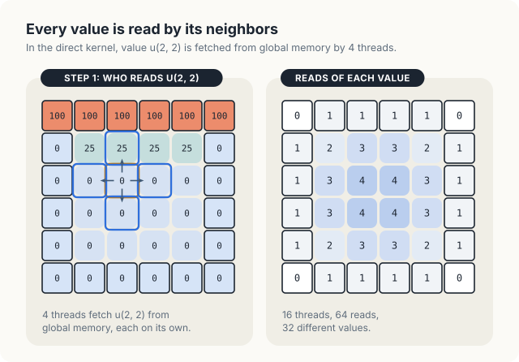
<figcaption><b>Figure 20.1</b> In the direct kernel, value \(u_{2,2}\) is fetched by 4 threads. Over a step, 16 threads make 64 reads of 32 different values.</figcaption>
</figure>

Let us add up these counts over the whole plate. The 4 center values are read 4 times each, and the
8 other values along the edges of the interior are read 3 times each. The 4 corners of the interior
are read 2 times each, and the 16 boundary values next to the interior are read once each. In
total, the step makes \\(16 + 24 + 8 + 16 = 64\\) reads of 32 different values. On a large grid,
nearly every value lies far from the boundary, so the direct kernel fetches nearly every value 4
times. A step on a 4096 × 4096 grid thus requests 67 million values, or 268 MB, to read 16.7
million different values, or 67 MB.

<div class="key-observation">

<span class="box-label">Key observation</span> The 4 threads that read \\(u_{2,2}\\) compute 4
neighboring cells. If those threads belong to the same block, 1 of them can copy \\(u_{2,2}\\)
into shared memory, and the other 3 can read it from there.

</div>

In Chapter 19, we found that the caches already serve many of these repeated reads. The tile makes
the reuse explicit instead of leaving it to the caches, and we measure the difference between the 2
in Section 20.7.

<div class="exercises">

Exercises

20.1 How many threads read \\(u_{3,1}\\) in a step of the plate? Which ones?<br>
20.2 For a grid of \\(W \times H\\) cells, how many reads does a step of the direct kernel make,
and how many different values does it read?

</div>

## 20.2 Tiles and halos

### 20.2.1 The cells a block needs

To turn the observation into an algorithm, we divide the plate among blocks. For the worked
example, we use blocks of \\(2 \times 2\\) threads with one thread per cell, so the 6 × 6 cells need
\\(3 \times 3 = 9\\) blocks. The programs use blocks of 32 × 8 threads, and everything below
carries over to them. We follow block (1, 1), which computes the 4 center cells (2, 2), (2, 3),
(3, 2) and (3, 3), as shown in Figure 20.2.

<figure>
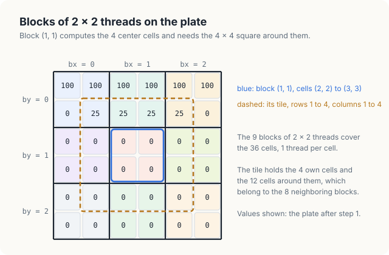
<figcaption><b>Figure 20.2</b> 9 blocks of 2 × 2 threads. Block (1, 1) computes the 4 center cells and needs the 4 × 4 square around them.</figcaption>
</figure>

To compute its 4 cells, block (1, 1) needs their neighbors. Some of these neighbors are the
block's own cells; cell (2, 2), for example, has cells (2, 3) and (3, 2) as neighbors. The others
lie directly above, below, to the left and to the right of the block's square, such as cell (1, 2)
above cell (2, 2), and they belong to the 4 neighboring blocks. The block copies all of these
values into shared memory once. The simplest arrangement copies the whole square of rows 1 to 4 and
columns 1 to 4, which holds 16 values. Of these, the 4 corner values (1, 1), (1, 4), (4, 1) and
(4, 4) are copied but never read, because a 5-point stencil does not use diagonal neighbors.

<div class="definition">

<span class="box-label">Definition 20.1</span> **Shared memory.** **Shared memory** is a memory on
each SM that belongs to 1 block. Every thread of the block can read and write it, no other thread
can, it responds within a few cycles, and values enter it only when the threads of the block store
them there.

*Example.* The block of 32 × 8 threads in our programs keeps a tile of 34 × 10 floats, 1,360 bytes,
in shared memory.

</div>

<div class="definition">

<span class="box-label">Definition 20.2</span> **Tile and halo.** A block that computes a
\\(T_y \times T_x\\) square of cells keeps a **tile** in shared memory: the \\((T_y + 2) \times
(T_x + 2)\\) square of old values made of its own cells and a ring of cells 1 cell wide around
them. The cells of the ring are the **halo** of the block. Halo cells are read by the block but
computed by its neighbors.

*Example.* Block (1, 1) of the plate has \\(T_x = T_y = 2\\). Its tile covers rows 1 to 4 and
columns 1 to 4: 4 own cells and 12 halo cells, of which 4 are corners that the 5-point stencil
does not read.

</div>

Here \\(T_x\\) is the number of cells that a block computes along a row, and \\(T_y\\) the number
along a column. The ring adds 1 cell on each of the two sides, which explains the 2 in
\\(T_x + 2\\) and \\(T_y + 2\\). For the blocks of our programs, \\(T_x = 32\\) and \\(T_y = 8\\),
so the tile is \\(34 \times 10\\), the size given in the example of Definition 20.1.

Next, we need to know where each cell sits inside the tile. Let \\((top, left)\\) be the first cell
of the block, that is, its upper-left own cell. The tile starts 1 row above and 1 column to the left
of this cell, at cell \\((top - 1, left - 1)\\). The block's cell \\((row, col)\\) therefore lies at
tile position

\\[ (row - top + 1,\\; col - left + 1). \\]

| Symbol | Meaning | Block (1, 1), cell (2, 2) |
|---|---|---|
| \\(top, left\\) | row and column of the block's first own cell | 2, 2 |
| \\(row, col\\) | row and column of a cell of the grid | 2, 2 |
| \\(row - top + 1\\) | row of the cell inside the tile | \\(2 - 2 + 1 = 1\\) |
| \\(col - left + 1\\) | column of the cell inside the tile | \\(2 - 2 + 1 = 1\\) |

The 4 neighbors of the cell lie 1 position above, below, to the left and to the right of it in the
tile. In block (1, 1), cell (2, 2) thus sits at tile position (1, 1), and its upper neighbor, cell
(1, 2), sits at tile position \\((1 - 2 + 1, 2 - 2 + 1) = (0, 1)\\).

### 20.2.2 Computing from the tile

Figure 20.3 shows the tile of block (1, 1) in step 2. It holds the old values of rows 1 to 4 of the
plate. Its top row is row 1 of the plate and holds 25, and its other rows hold 0. The thread of cell
(2, 2) reads its 4 neighbors from the tile positions (0, 1), (2, 1), (1, 0) and (1, 2). It obtains
25, 0, 0 and 0, which are the same values that it read from global memory in the direct kernel, and
it writes 6.25.

<figure>
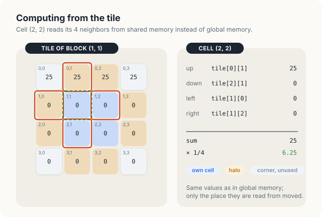
<figcaption><b>Figure 20.3</b> The tile of block (1, 1) in step 2. Cell (2, 2) reads 25, 0, 0 and 0 from shared memory and writes 6.25.</figcaption>
</figure>

<div class="exercises">

Exercises

20.3 Which cells does the tile of block (0, 1) cover? Which of its slots lie outside the plate?<br>
20.4 At which tile position does cell (3, 3) of block (1, 1) sit, and from which positions does
it read its neighbors?

</div>

## 20.3 Loading the halo

### 20.3.1 More slots than threads

We call each position of the tile a **slot**. In the tiled matrix product of Chapter 17, a tile had
exactly as many slots as the block had threads, so each thread copied 1 value. A stencil tile has
more. A block of \\(T_x \times T_y\\) threads must fill \\((T_x + 2)(T_y + 2)\\) slots. Block
(1, 1) of our example has 4 threads and 16 slots, and a block of 32 × 8 threads has 256 threads and
\\(34 \times 10 = 340\\) slots. There are 2 standard ways to close this gap, which are shown in
Figure 20.4.

<figure>
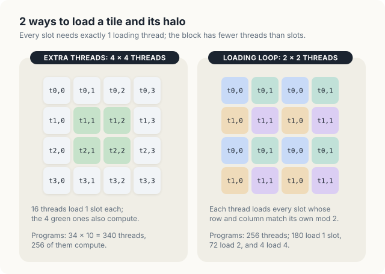
<figcaption><b>Figure 20.4</b> 2 ways to fill a 4 × 4 tile: 16 threads that load 1 slot each, or 4 threads that load 4 slots each.</figcaption>
</figure>

**Extra threads.** In the first way, the block is given one thread per slot, that is,
\\((T_x + 2) \times (T_y + 2)\\) threads. We let every thread load the slot at its own position, and after
the barrier, only the \\(T_x \times T_y\\) inner threads compute a cell. For block (1, 1), this
means 16 threads, of which 12 only load. In the programs, it means 34 × 10 = 340 threads, of which
256 compute. The loading is a single statement per thread, but 84 of the 340 threads are idle
while the others compute.

**A loading loop.** In the second way, the block keeps one thread per computed cell, and each thread
loads several slots. We write \\((ty, tx)\\) for the row and column of a thread within its block.
Thread \\((ty, tx)\\) starts at slot \\((ty, tx)\\) and moves down the tile in strides of \\(T_y\\)
rows and across it in strides of \\(T_x\\) columns, loading every slot that it lands on, as long as
the slot lies in the tile. Its rows are therefore \\(ty, ty + T_y, ty + 2T_y, \ldots\\), and its
columns are \\(tx, tx + T_x, tx + 2T_x, \ldots\\). In the notation of modular arithmetic, these are
the slots with

\\[ i \equiv ty \pmod{T_y}, \qquad j \equiv tx \pmod{T_x}. \\]

| Symbol | Meaning | Thread (0, 0) of block (1, 1) |
|---|---|---|
| \\(ty, tx\\) | row and column of the thread within its block | 0, 0 |
| \\((i, j)\\) | row and column of a slot of the tile | (0, 0), (0, 2), (2, 0), (2, 2) |
| \\(i \equiv ty \pmod{T_y}\\) | \\(i\\) leaves the remainder \\(ty\\) when divided by \\(T_y\\) | \\(i = 0\\) or \\(2\\), with \\(T_y = 2\\) |
| \\(j \equiv tx \pmod{T_x}\\) | \\(j\\) leaves the remainder \\(tx\\) when divided by \\(T_x\\) | \\(j = 0\\) or \\(2\\), with \\(T_x = 2\\) |

In block (1, 1), thread (0, 0) therefore loads the slots (0, 0), (0, 2), (2, 0) and (2, 2), and
in the same way each of the 4 threads loads 4 slots. With 32 × 8 threads and a tile of 34 × 10
slots, the counts are less even. The row \\(i\\) takes the value \\(ty\\), and also \\(ty + 8\\)
when \\(ty < 2\\), since the tile has only 10 rows. The column \\(j\\) takes the value \\(tx\\), and
also \\(tx + 32\\) when \\(tx < 2\\), since the tile has only 34 columns. As a result, 180 threads
load 1 slot, 72 threads load 2 slots, and 4 threads load 4 slots, which accounts for all
\\(180 + 144 + 16 = 340\\) slots. We let every thread compute a cell, but a few threads load more slots
than the rest.

Both ways give every slot exactly 1 loading thread, which is what the correctness proof of Section
20.5 needs. They differ in cost, and we measure both in Section 20.7.

### 20.3.2 Slots outside the grid

A block on the edge of the grid has slots that lie outside the grid. Block (0, 0) of the plate, for
example, computes the cells (0, 0) to (1, 1), and its tile covers rows −1 to 2 and columns −1 to 2.
The loader stores 0 in a slot outside the grid instead of reading it from memory. No thread ever
reads such a slot, because only interior cells are computed, and every neighbor of an interior
cell lies inside the grid.

<div class="exercises">

Exercises

20.5 With the loading loop and blocks of 32 × 8 threads, which slots does thread (1, 0) load? And
thread (5, 20)?<br>
20.6 For blocks of 16 × 16 threads, how many slots does the tile have, and how many threads load
2 slots with the loading loop?

</div>

## 20.4 The tiled algorithm

### 20.4.1 The barrier

The threads of a block do not move in lockstep. A thread may finish its own loads early and start
to compute while another thread is still loading a slot that the first thread needs. In block
(1, 1), for example, the thread of cell (2, 2) needs tile position (0, 1), which another thread
loads. The block therefore needs a point in the kernel at which all of its threads meet before any
of them continues.

<div class="definition">

<span class="box-label">Definition 20.3</span> **Barrier.** A **barrier** is a point in a kernel
that no thread of a block may pass until every thread of the block has reached it. In CUDA C++, a
barrier is `__syncthreads()`; in cuda-oxide, it is `thread::sync_threads()`. Writes to shared memory
made before the barrier are visible to every thread of the block after it.

*Example.* In the tiled kernel, the thread of cell (2, 2) waits at the barrier until the thread
that loads tile position (0, 1) has stored 25 there.

</div>

### 20.4.2 The kernel

Every thread executes the following procedure, which is written with the loading loop. With extra
threads, lines 3 to 7 become a single load, and the condition of line 10 also requires an inner
thread.

<div class="algo">
<p class="algo-name">Tiled-Jacobi-Kernel(\(u, v, W, H\))</p>
<ol>
<li>\(tx = \mathsf{threadIdx{.}x}\), \(ty = \mathsf{threadIdx{.}y}\)</li>
<li>\(top = \mathsf{blockIdx{.}y} \cdot T_y\), \(left = \mathsf{blockIdx{.}x} \cdot T_x\)</li>
<li><b class="kw">for</b> \(i = ty, ty + T_y, \ldots\) <b class="kw">while</b> \(i &lt; T_y + 2\) { <span class="c">// load the tile and its halo</span></li>
<li style="--d:1"><b class="kw">for</b> \(j = tx, tx + T_x, \ldots\) <b class="kw">while</b> \(j &lt; T_x + 2\) {</li>
<li style="--d:2">\(\mathsf{tile}[i][j] = u_{top+i-1,\, left+j-1}\) <b class="kw">if</b> that cell is in the grid, <b class="kw">else</b> 0</li>
<li style="--d:1">}</li>
<li>}</li>
<li><span class="sc">Barrier</span>() <span class="c">// wait until the whole tile is loaded</span></li>
<li>\(row = top + ty\), \(col = left + tx\)</li>
<li><b class="kw">if</b> \(row \in [1, H - 1)\) and \(col \in [1, W - 1)\) {</li>
<li style="--d:1">\(v_{row,col} = (\mathsf{tile}[ty][tx{+}1] + \mathsf{tile}[ty{+}2][tx{+}1] + \mathsf{tile}[ty{+}1][tx] + \mathsf{tile}[ty{+}1][tx{+}2]) / 4\)</li>
<li>}</li>
</ol>
</div>

Lines 1 and 2 compute the thread's position in the block and the first own cell \\((top, left)\\)
of the block. For block (1, 1) of the plate, with \\(T_x = T_y = 2\\), line 2 gives
\\(top = 1 \cdot 2 = 2\\) and \\(left = 2\\). Lines 3 to 7 are the loading loop of Section 20.3.1.
In line 5, slot \\((i, j)\\) receives the cell \\((top + i - 1, left + j - 1)\\), because the tile
begins 1 row above and 1 column to the left of the first own cell. For example, thread (0, 1) of
block (1, 1) loads slot (0, 1) with the cell \\((2 + 0 - 1, 2 + 1 - 1) = (1, 2)\\), whose value in
step 2 is 25. Line 8 is the barrier.

Lines 9 to 12 are Jacobi-Kernel of Chapter 19, with each read from \\(u\\) replaced by a read from
the tile. The cell \\((row, col)\\) of the thread sits at tile position \\((ty + 1, tx + 1)\\), so
its upper neighbor sits at \\((ty, tx + 1)\\), its lower neighbor at \\((ty + 2, tx + 1)\\), and
its left and right neighbors at \\((ty + 1, tx)\\) and \\((ty + 1, tx + 2)\\). For thread (0, 0)
of block (1, 1), these are the positions (0, 1), (2, 1), (1, 0) and (1, 2) of Figure 20.3. Note that
the barrier in line 8 lies outside every condition, so every thread of the block reaches it,
including the threads whose cell is on the boundary or outside the grid. The host loop is
unchanged from Chapter 19, with 2 buffers, 1 launch per step, and an exchange of the names after
each launch.

Each block thus runs through 3 phases, in which it loads the tile, waits at the barrier, and
computes its cells from the tile, as shown in Figure 20.5.

<figure>
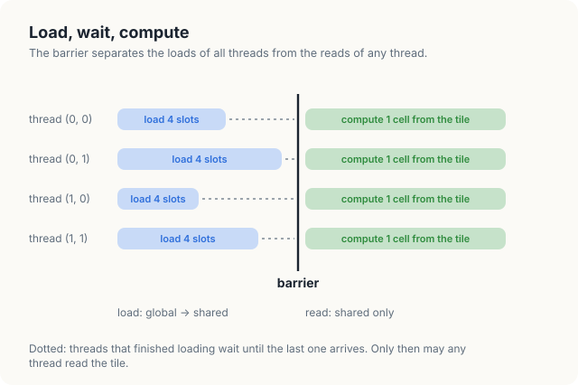
<figcaption><b>Figure 20.5</b> The 3 phases of a block: load the tile, wait at the barrier, compute from the tile.</figcaption>
</figure>

### 20.4.3 Counting the loads again

We can now count how much the tile saves. In the direct kernel, the 4 threads of block (1, 1)
make \\(4 \cdot 4 = 16\\) reads from global memory, 4 per thread. With the tile, the block makes
16 loads, 1 per slot. For a 2 × 2 block, the tile therefore saves nothing, since
\\((2 + 2)^2 = 16 = 4 \cdot 2^2\\). The halo is as large as the block itself in this case. As the
block grows, however, its own cells grow with the square of its width, while the halo grows only
with its perimeter, so the saving grows with the block.

In general, a block of \\(T \times T\\) threads makes \\(4T^2\\) reads in the direct kernel, 4 for
each of its \\(T^2\\) threads, and \\((T + 2)^2\\) loads with a tile, 1 for each slot. The tile
therefore divides the number of reads by

\\[ \frac{4T^2}{(T + 2)^2}. \\]

| Symbol | Meaning | \\(T = 2\\) | \\(T = 16\\) |
|---|---|---|---|
| \\(T\\) | width and height of the block, in threads | 2 | 16 |
| \\(4T^2\\) | reads of the direct kernel per block | 16 | 1,024 |
| \\((T + 2)^2\\) | loads of the tiled kernel per block | 16 | 324 |
| \\(4T^2 / (T + 2)^2\\) | factor by which the tile reduces the reads | 1 | 3.2 |

The factor is 1 for \\(T = 2\\), 1.8 for \\(T = 4\\), 2.6 for \\(T = 8\\) and 3.2 for \\(T = 16\\).
It approaches 4, the number of reads per cell of the direct kernel, as the block grows. A block of
32 × 8 threads makes \\(4 \cdot 256 = 1{,}024\\) reads in the direct kernel and 340 loads with a
tile, which is 3 times fewer.

It is often more useful to count the loads per computed cell, which we call the loads per result.
A tile of a \\(T_x \times T_y\\) block loads \\((T_x + 2)(T_y + 2)\\) values for \\(T_x T_y\\)
results, so it loads \\((T_x + 2)(T_y + 2) / (T_x T_y)\\) values per result, as plotted in Figure
20.6. For the 32 × 8 block of the programs, this is \\(340 / 256 = 1.33\\). A value of 1 would mean
that every value is loaded exactly once. The part above 1 is the **halo overhead**, which comes
from the halo cells that 2 or more neighboring blocks each load for themselves. The following
table gives both numbers for several block shapes.

| Block | Tile | Loads per result | Halo overhead |
|---|---|---|---|
| 2 × 2 | 4 × 4 | 16 / 4 = 4.00 | 300% |
| 4 × 4 | 6 × 6 | 36 / 16 = 2.25 | 125% |
| 8 × 8 | 10 × 10 | 100 / 64 = 1.56 | 56% |
| 16 × 16 | 18 × 18 | 324 / 256 = 1.27 | 27% |
| 32 × 8 | 34 × 10 | 340 / 256 = 1.33 | 33% |
| 32 × 32 | 34 × 34 | 1,156 / 1,024 = 1.13 | 13% |

<figure>
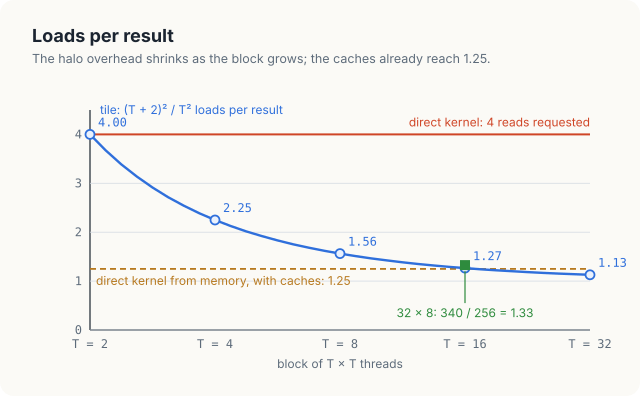
<figcaption><b>Figure 20.6</b> Loads per result: 4 in the direct kernel, \((T + 2)^2/T^2\) with a tile, and 1.25 from memory when the caches serve the direct kernel.</figcaption>
</figure>

The largest block in the table would have the smallest overhead, but a block holds at most 1,024
threads. The extra-threads scheme therefore cannot serve a block that computes 32 × 32 cells,
because its tile has 34 × 34 = 1,156 slots and would need 1,156 threads. Shared memory, on the
other hand, is not the limit, since the 34 × 10 tile of the programs takes only 1,360 bytes. The
32 × 8 block that the programs use costs 1.33 loads per result, which is 3 times fewer than the 4
that the direct kernel requests.

<div class="exercises">

Exercises

20.7 Compute the loads per result for blocks of 64 × 4 and 16 × 16 threads, both of 256 threads.
Which shape loads fewer halo cells per result?<br>
20.8 A 2-D stencil of radius 2 reads the 2 nearest cells in each direction. How wide is its halo,
and how many loads per result does a 32 × 8 block make?

</div>

## 20.5 Correctness

Compared with the direct kernel, the tiled kernel adds 2 places where it can go wrong, the barrier
and the halo. In this section, we remove each of them in turn, show the wrong value that the
removal produces on the plate, and run the broken variant.

### 20.5.1 Without the barrier

Suppose that we delete line 8. In block (1, 1), loaded with the loop, the thread of cell (2, 2) is
thread (0, 0). It needs tile position (0, 1), which holds the halo cell (1, 2) and is loaded by
thread (0, 1). If thread (0, 0) finishes its own loads early and thread (0, 1) runs late, thread
(0, 0) reads position (0, 1) before 25 has been stored there. The slot then holds whatever an
earlier block left in that part of shared memory. If it holds 0, cell (2, 2) becomes
\\((0 + 0 + 0 + 0) / 4 = 0\\) instead of 6.25, as shown in Figure 20.7.

<figure>
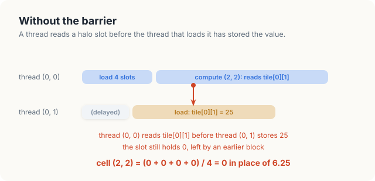
<figcaption><b>Figure 20.7</b> Without the barrier, thread (0, 0) reads a halo slot before thread (0, 1) fills it, and cell (2, 2) becomes 0 in place of 6.25.</figcaption>
</figure>

We ran the kernel of the programs, with 32 × 8 threads and the loading loop, without its barrier.
It performed 1 step on the 4096 × 4096 plate after 200 correct steps, and we repeated this 3 times
and compared each result with the result of the direct kernel. The program printed the following
counts.

```console
loop loader without barrier, 4096 x 4096, run 1: 126302 cells differ after 1 step
loop loader without barrier, 4096 x 4096, run 2: 124849 cells differ after 1 step
loop loader without barrier, 4096 x 4096, run 3: 124322 cells differ after 1 step
```

The count changes from run to run, because it depends on the timing of the threads. On the 6 × 6
plate with 2 × 2 blocks, the extra-threads kernel without its barrier gave the correct values in
our runs. There, the 16 threads of each block belong to 1 warp, and they happened to finish their
loads together. The error appears when the threads of a block span several warps, as they do in
every block of practical size.

### 20.5.2 Without the halo

Suppose next that the loader copies only the block's own cells, so that the halo slots stay at 0.
In block (1, 1), cell (2, 2) then reads 0 above instead of 25, and it becomes 0 instead of 6.25.
Cell (1, 1) belongs to block (0, 0), and its right neighbor (1, 2) belongs to block (0, 1). The
halo slot of block (0, 0) that should hold cell (1, 2) therefore holds 0, and cell (1, 1) becomes
\\((100 + 0 + 0 + 0) / 4 = 25\\) instead of 31.25. We ran this variant with 2 × 2 blocks on the
plate, and it printed the following grid.

```console
  2 x 2 blocks, halo filled with 0, after step 2
     100.00  100.00  100.00  100.00  100.00  100.00
       0.00   25.00   31.25   31.25   25.00    0.00
       0.00    0.00    0.00    0.00    0.00    0.00
       0.00    0.00    0.00    0.00    0.00    0.00
       0.00    0.00    0.00    0.00    0.00    0.00
       0.00    0.00    0.00    0.00    0.00    0.00
```

In this grid, 8 of the 16 interior cells are wrong. Row 1 reads 25, 31.25, 31.25 and 25 instead
of 31.25, 37.5, 37.5 and 31.25, and row 2 reads 0 instead of 6.25, as Figure 20.8 shows. Step 1
was still correct, because in step 1 every halo value that a computed cell reads is 0 in the
correct grid as well. A test of 1 step would therefore have passed.

<figure>
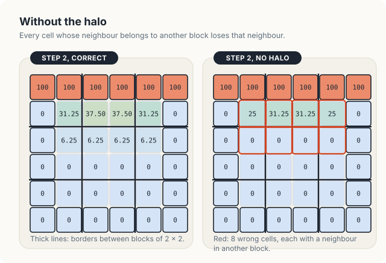
<figcaption><b>Figure 20.8</b> Step 2 without the halo: every cell whose neighbor belongs to another block loses that neighbor.</figcaption>
</figure>

### 20.5.3 A proof of correctness

Having seen how each part of the kernel fails when it is removed, we now prove that the complete
kernel computes exactly what the direct kernel computes.

<div class="theorem">

<span class="box-label">Theorem 20.1</span> Launched on 2 different buffers \\(u\\) and \\(v\\),
Tiled-Jacobi-Kernel writes the same value into every cell of \\(v\\) as Jacobi-Kernel of Chapter
19.

</div>

<div class="proof">

*Proof.* Fix a block with first cell \\((top, left)\\). We show three facts.

*Every slot is loaded once, with the old value.* The loops of lines 3 to 7 let thread \\((ty, tx)\\)
store slot \\((i, j)\\) exactly when \\(i \equiv ty \pmod{T_y}\\) and \\(j \equiv tx \pmod{T_x}\\).
Each slot \\((i, j)\\) of the \\((T_y + 2) \times (T_x + 2)\\) tile has exactly 1 such thread,
namely \\((i \bmod T_y, j \bmod T_x)\\). For example, with \\(T_x = T_y = 2\\), slot (2, 3) is
stored by thread \\((2 \bmod 2, 3 \bmod 2) = (0, 1)\\). That thread stores
\\(u_{top+i-1,\,left+j-1}\\) if the cell is in the grid. No thread of the launch writes \\(u\\),
because \\(u\\) and \\(v\\) are different buffers, so the stored value is the old value.

*Every load finishes before any read.* The barrier of line 8 lies outside every condition, so every
thread of the block reaches it. No thread passes it before all threads have finished lines 3 to 7,
and their stores are then visible to the whole block. The tile is not written after line 8.

*The reads are the right ones.* Let \\((row, col) = (top + ty, left + tx)\\) be an interior cell.
Tile position \\((ty, tx + 1)\\) holds the cell \\((top + ty - 1, left + tx) = (row - 1, col)\\),
the upper neighbor; in the same way, \\((ty + 2, tx + 1)\\), \\((ty + 1, tx)\\) and
\\((ty + 1, tx + 2)\\) hold the lower, left and right neighbors. All 4 lie in the grid, because
\\((row, col)\\) is interior, so their slots hold old values and not the 0 of line 5. Line 11
therefore adds the same 4 values, in the same order, as line 3 of Jacobi-Kernel and writes the same
result. Cells that are not interior are written by neither kernel.

</div>

Each broken variant of this section breaks 1 fact of the proof. Without the barrier, the second
fact fails. Without the halo, the first fact fails for every halo slot, and the third fact then
reads 0 where it needs a neighbor. Since the tiled kernel writes what the direct kernel writes,
Theorem 19.1 carries over unchanged, and with 2 buffers used in turn, the tiled kernel computes
Jacobi iteration.

<div class="rule-box">

<span class="box-label">Rule</span> Every thread of the block must reach the barrier between
loading the tile and reading it, and the tile must hold every cell that any thread of the block
reads, the halo included.

</div>

<div class="exercises">

Exercises

20.9 In the variant without the halo, compute cell (2, 1) after step 2 by hand.<br>
20.10 Suppose the loading loop used `j < T_x + 1` instead of `j < T_x + 2`. Which slots would stay
empty, and which cells of block (1, 1) of the plate would be wrong in step 2?<br>
20.11 Why must a thread whose cell lies outside the grid still execute line 8?

</div>

## 20.6 Implementation

### 20.6.1 The kernel with a loading loop

Listing 20.1 implements Tiled-Jacobi-Kernel with blocks of 32 × 8 threads and a 34 × 10 tile. The
2 `while` loops in Rust and the 2 `for` loops in C++ are lines 3 to 7 of the pseudocode. The test
of line 5, whether a cell lies in the grid, is written differently in the two languages. Rust uses
`wrapping_sub` on unsigned positions. For the first block, `top + i - 1` is −1, which
`wrapping_sub` turns into the largest `usize`, so the test `r < height` fails and the slot
receives 0. The C++ version computes signed positions and tests `r >= 0` as well. In both
languages, the barrier, `thread::sync_threads()` in Rust and `__syncthreads()` in C++, lies
outside every `if`.

<p class="listing"><b>Listing 20.1</b> 1 Jacobi step from a tile, loaded with a loop.</p>

<div class="code-tabs">
<div class="code-tab" data-lang="Rust">

```rust,ignore
mod kernels {
    // ...
{{#include ../../../../code/oxide/ch20_stencil_tiled/src/main.rs:50:96}}
    // ...
}
```

</div>
<div class="code-tab" data-lang="C++">

```cpp
{{#include ../../../../code/cuda/ch20_stencil_tiled/stencil_tiled.cu:47:77}}
```

</div>
</div>

The tile is declared differently in the two languages. In C++, `__shared__ float tile[TH][TW]` is a
2-D array, and `tile[ty][tx + 1]` reads it like any other array. In Rust, the tile is a
`static mut TILE: SharedArray<f32, { TW * TH }>`, a flat array of 340 floats with 1 copy per
block, and slot \\((i, j)\\) is element `i * TW + j`. Every access to it is `unsafe`, because the
compiler cannot check how the threads of a block share a static. Each `unsafe` block therefore
carries a `// SAFETY:` comment that states why it is sound, and the 2 comments are the first 2
facts of the proof of Theorem 20.1: each slot has 1 writer, and after the barrier the tile is only
read. The final write needs no `unsafe` block. As in Chapter 19, the thread writes its own cell
through `get_mut` of the `DisjointSlice`.

### 20.6.2 The kernel with extra threads

Listing 20.2 performs the same step with 34 × 10 threads per block, 1 thread per slot. Each thread
loads 1 slot, all threads wait at the barrier, and only the 32 × 8 inner threads compute a cell.

<p class="listing"><b>Listing 20.2</b> 1 Jacobi step from a tile, loaded by 1 thread per slot.</p>

<div class="code-tabs">
<div class="code-tab" data-lang="Rust">

```rust,ignore
mod kernels {
    // ...
{{#include ../../../../code/oxide/ch20_stencil_tiled/src/main.rs:98:131}}
    // ...
}
```

</div>
<div class="code-tab" data-lang="C++">

```cpp
{{#include ../../../../code/cuda/ch20_stencil_tiled/stencil_tiled.cu:79:102}}
```

</div>
</div>

In this kernel, the thread at position \\((ty, tx)\\) of the block no longer owns cell
\\((top + ty, left + tx)\\). Instead, it owns slot \\((ty, tx)\\), which holds cell
\\((top + ty - 1, left + tx - 1)\\). Thread (0, 0), for example, owns the corner slot of the halo,
and thread (1, 1) owns the block's first own cell \\((top, left)\\). The launch contract of the
Rust kernel states the new block shape, `block = (34, 10, 1)`. Because the thread's position is no
longer its cell, `index_2d_runtime` and `get_mut` no longer apply, and the Rust kernel writes with
`get_unchecked_mut(r * width + c)`. Its `// SAFETY:` comment gives the argument that the type
system gave before: the inner threads of the blocks cover each cell exactly once, so no 2 threads
write the same element. The C++ kernel writes `next[r * width + c]` and relies on the same
argument without stating it.

### 20.6.3 The 6 × 6 plate

Both programs run each tiled kernel on the plate and compare its result, bit for bit, with the
result of the direct kernel. The Rust program prints the following output.

```console
$ cargo oxide run
GPU: Orin, 8 SMs
1. 6 x 6 plate, top edge at 100
  after step 2, tiled
     100.00  100.00  100.00  100.00  100.00  100.00
       0.00   31.25   37.50   37.50   31.25    0.00
       0.00    6.25    6.25    6.25    6.25    0.00
       0.00    0.00    0.00    0.00    0.00    0.00
       0.00    0.00    0.00    0.00    0.00    0.00
       0.00    0.00    0.00    0.00    0.00    0.00
  loop loader              same bits as the plain kernel after 4 steps: true
  extra threads            same bits as the plain kernel after 4 steps: true
  4 steps per load         same bits as the plain kernel after 4 steps: true
```

The grid after step 2 agrees with the values of Chapter 19, and all 3 tiled kernels agree with the
direct kernel in every bit. The third kernel, `4 steps per load`, is the subject of Section 20.8.

<div class="exercises">

Exercises

20.12 Rewrite the loading loop of Listing 20.1 as a single loop over the slot number
\\(k = ty \cdot 32 + tx, k + 256, \ldots\\), with \\(i = k / 34\\) and \\(j = k \bmod 34\\). Which
threads now load 2 slots? Measure the two versions.<br>
20.13 In the Rust extra-threads kernel, which fact of the proof of Theorem 20.1 does the
`// SAFETY:` comment of the final write rely on?

</div>

## 20.7 Measurements

### 20.7.1 Results

The measurements come from a Jetson Orin NX, an integrated GPU with 8 SMs and 102 GB/s of memory
bandwidth. Both programs time each kernel on a 4096 × 4096 plate after 0.4 s of warm-up and
average 50 launches. They report the effective bandwidth of Chapter 19, that is, 8 bytes per cell
per step divided by the time of a step. Repeated runs differ by 10 to 20%. On the measured GPU, the
C++ program printed the following results.

```console
2. 4096 x 4096 plate, 8 bytes per cell per step (1 read, 1 write)
  copy kernel               1.752 ms     76.6 GB/s
  plain                     1.966 ms     68.3 GB/s
  loop loader               3.089 ms     43.4 GB/s
  extra threads             2.931 ms     45.8 GB/s
  4 steps per load          2.112 ms     63.5 GB/s
  loop loader              same bits as the plain kernel after 8 steps: true
  extra threads            same bits as the plain kernel after 8 steps: true
  4 steps per load         same bits as the plain kernel after 8 steps: true
PASSED
```

The following table collects these results together with those of the Rust program, and adds the
number of global loads per result of each kernel.

| Kernel | Global loads per result | C++ | Rust |
|---|---|---|---|
| copy | 1 | 76.6 GB/s | 75.0 GB/s |
| direct (plain) | 4 requested, about 1.25 from memory | 68.3 GB/s | 58.0 GB/s |
| tiled, loading loop | 1.33 | 43.4 GB/s | 34.6 GB/s |
| tiled, extra threads | 1.33 | 45.8 GB/s | 39.2 GB/s |
| 4 steps per load (Section 20.8) | 0.44 per step | 63.5 GB/s | 54.3 GB/s |

The tiled kernels load 3 times fewer values than the direct kernel requests, yet they run at 64%
and 67% of its speed in C++, and at 60% and 68% in Rust. In other words, the tile made the kernel
slower, not faster. The Rust kernels are slower than the C++ kernels throughout, for the reason
measured in Section 19.8.4: they compute positions in 64-bit integers and derive the height with a
division.

<figure>
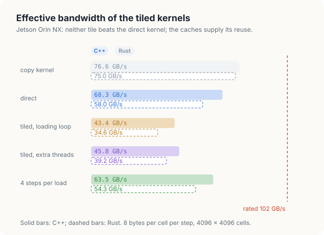
<figcaption><b>Figure 20.9</b> Effective bandwidth on the measured GPU: neither tiled kernel beats the direct kernel.</figcaption>
</figure>

### 20.7.2 Why the tile gains nothing here

Recall from Section 19.8.3 that the direct kernel already moves only about 9 bytes per cell from
memory, namely 1.25 reads and 1 write, and that it runs within 12% of a copy. The 4 reads per cell
that the direct kernel requests are mostly answered by the L1 and L2 caches, which keep the rows
that neighboring warps share (Figure 19.11). The tile loads 1.33 values per result, 340 cells for
256 results, and with the write, this amounts to \\(4 \cdot 1.33 + 4 = 9.3\\) bytes per cell. This
is no less than what the direct kernel already moves. A tile can remove only the traffic that
reaches memory, and in this case, the caches have already removed it.

Two further measurements support this explanation. First, we bypassed the L1 cache in the direct
kernel by reading each neighbor with the C++ intrinsic `__ldcg`, which reads through the L2 cache
only. The kernel then ran at 61.4 to 63.7 GB/s, which is 7 to 10% slower. The L2 cache alone thus
captures most of the reuse, since the 2 MiB L2 of the measured GPU holds the few rows that the
blocks running at the same time share. Second, the tile is not free. The tiled kernels compute a
tile position for every slot, store the value to shared memory and read it back, and wait at a
barrier. During the wait, a warp that has finished its loads issues no instructions. When we
deleted the barrier from the loop loader, which gives wrong results, its time fell from 3.10 ms to
2.83 ms, so the barrier alone costs about 9%. The remaining difference from the direct kernel is
instructions. The loading loop runs 1 or 2 iterations per thread with a test at each, and the
extra-threads kernel keeps 84 of its 340 threads idle while the others compute.

The result depends on the GPU. On a GPU whose caches are small compared with the number of threads
in flight, or that does not cache global loads in L1, the 4 reads per cell of the direct kernel
reach memory, and the tile's 1.33 loads per result reduce the traffic 3-fold. On the measured GPU,
the caches capture the reuse of a 5-point stencil, and the tile only adds work. A stencil with more
reuse per value leaves more for the tile to capture. Examples are a 3-D stencil of radius 4, which
reads 25 values per result, and a kernel that performs several steps on 1 tile. We measure the
second in the next section.

<div class="exercises">

Exercises

20.14 The extra-threads kernel launches 340 threads per block. How many warps is that, and how many
threads of its last warp have no slot?<br>
20.15 Estimate the time of the tiled kernel from its traffic alone, 9.3 bytes per cell at the
copy's rate. How much of the measured 3.089 ms is not explained by traffic?

</div>

## 20.8 Temporal blocking

### 20.8.1 Several steps per load

In Section 20.7, we saw that a single step reuses each value too little for the tile to pay. We can
increase the reuse by letting a block perform more than 1 step on the values that it has loaded.
The tile holds a block's cells and their neighbors, which is exactly what 1 step of the block's
cells needs. If the tile had 1 more ring of halo, it would hold everything needed to compute 2
steps of the block's cells. The first step would be computed on the block's cells and on the inner
ring of the halo, and the second step on the block's cells alone, from the values of the first. In
general, \\(K\\) steps need a halo \\(K\\) cells wide, because each step can compute correct values
only 1 ring further in than the step before.

<div class="definition">

<span class="box-label">Definition 20.4</span> **Temporal blocking.** In **temporal blocking**, a
block loads a tile with a halo \\(K\\) cells wide, performs \\(K\\) steps on it in shared memory,
and writes only its own cells after the last step. After step \\(s\\) of the \\(K\\), the values
are correct on the tile without its outer \\(s\\) rings.

*Example.* Our programs use a tile of 32 × 32 threads with \\(K = 4\\). The tile holds a 24 × 24
square of the block's own cells and a halo 4 cells wide; after steps 1, 2, 3 and 4 the correct
region is 30 × 30, 28 × 28, 26 × 26 and 24 × 24.

</div>

In this section, \\(K\\) is the number of steps per load and \\(s\\) the number of the step inside
the tile, from 1 to \\(K\\). In the example, the 32 × 32 tile loses 1 ring on each of its 4 sides in
every step, so its correct region shrinks by 2 cells in each direction per step, from 32 to 30, 28,
26 and finally \\(32 - 2 \cdot 4 = 24\\) cells. The block's own cells are the \\(24 \times 24\\)
square that remains after 4 steps.

The steps inside the tile need 2 buffers, for the same reason as in Chapter 19: a step must not
overwrite a value that another thread of the same step still has to read. The kernel therefore
keeps 2 tiles in shared memory and uses them in turn, with a barrier between steps. This is
ping-pong buffering in shared memory. Figure 20.10 shows the 2 tiles and the correct region that
shrinks from step to step.

<figure>
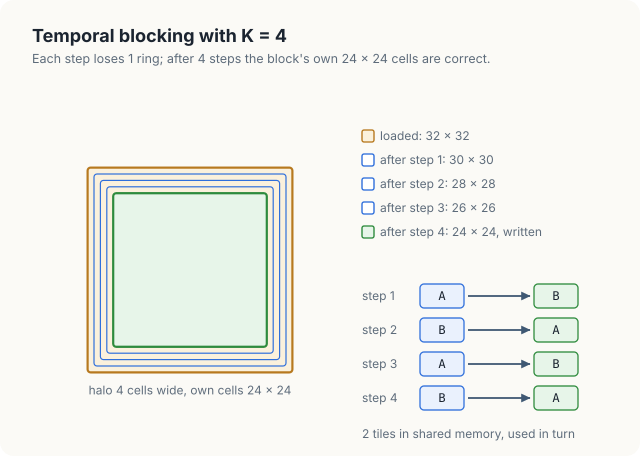
<figcaption><b>Figure 20.10</b> Temporal blocking with \(K = 4\): each step loses 1 ring, and after 4 steps the block's own 24 × 24 cells are correct.</figcaption>
</figure>

Every thread executes the following procedure. Each of the 32 × 32 threads owns 1 slot of the
tile, and \\(A\\) and \\(B\\) are the 2 tiles in shared memory.

<div class="algo">
<p class="algo-name">Temporal-Jacobi-Kernel(\(u, v, W, H\))</p>
<ol>
<li>\((r, c)\) = cell of this thread, \(K\) cells before the block's first own cell</li>
<li>\(A[ty][tx] = u_{r,c}\) <b class="kw">if</b> \((r, c)\) is in the grid, <b class="kw">else</b> 0</li>
<li><span class="sc">Barrier</span>()</li>
<li><b class="kw">for</b> \(s \in [1, K]\) { <span class="c">// src = A, dst = B for odd s, the reverse for even s</span></li>
<li style="--d:1"><b class="kw">if</b> \(tx, ty \in [s, 32 - s)\) {</li>
<li style="--d:2">\(\mathsf{dst}[ty][tx]\) = mean of the 4 neighbors in \(\mathsf{src}\) <b class="kw">if</b> \((r, c)\) is interior, <b class="kw">else</b> \(\mathsf{src}[ty][tx]\)</li>
<li style="--d:1">}</li>
<li style="--d:1"><span class="sc">Barrier</span>()</li>
<li>}</li>
<li><b class="kw">if</b> \(tx, ty \in [K, 32 - K)\) and \((r, c)\) is interior { \(v_{r,c}\) = the tile written in step \(K\) at \([ty][tx]\) }</li>
</ol>
</div>

Line 1 places the tile \\(K\\) cells above and to the left of the block's own cells, so that the
halo of width \\(K\\) surrounds them. Line 2 loads the whole tile, 1 slot per thread, and line 3
waits until the tile is complete. In step \\(s\\), line 5 lets only the threads whose slot lies at
least \\(s\\) positions from every edge of the tile compute. In step 1, for example, these are the
positions 1 to 30 in each direction, which form the 30 × 30 region of Definition 20.4. Line 6
reads from the tile written in the previous step, called \\(\mathsf{src}\\), and writes into the
other tile, called \\(\mathsf{dst}\\). Line 8 is the barrier between steps. Finally, line 10 writes
the block's own cells, the positions \\([K, 32 - K)\\), from the tile written in step \\(K\\).

<div class="theorem">

<span class="box-label">Theorem 20.2</span> Launched on 2 different buffers holding the grid
\\(u^{(k)}\\) and its boundary, Temporal-Jacobi-Kernel writes \\(u^{(k+K)}\\) into every interior
cell of \\(v\\).

</div>

<div class="proof">

*Proof.* We show that the loop of lines 4 to 9 maintains the invariant: at the start of pass \\(s\\),
for every position \\((ty, tx)\\) with \\(tx, ty \in [s - 1, 33 - s)\\) whose cell lies in the
grid, the tile \\(\mathsf{src}\\) holds \\(u^{(k+s-1)}\\) of that cell.

*Initialization.* At \\(s = 1\\) the region is the whole tile, and line 2 stored \\(u^{(k)}\\) in
every position whose cell is in the grid; the barrier of line 3 makes the stores visible.

*Maintenance.* Let \\((ty, tx)\\) lie in \\([s, 32 - s)\\) with its cell in the grid. If the cell is
interior, its 4 neighbors lie at positions in \\([s - 1, 33 - s)\\) and in the grid, so by the
invariant line 6 reads 4 values of \\(u^{(k+s-1)}\\) and stores \\(u^{(k+s)}\\). If the cell is a
boundary cell, line 6 copies its value, which is the same in every step. The 2 tiles are different
arrays, so no thread writes a value that another reads in the same pass, and the barrier of line 8
completes every store before pass \\(s + 1\\) reads them. The roles of the tiles exchange, and the
invariant holds for \\(s + 1\\) on the region \\([s, 32 - s)\\).

*Termination.* After pass \\(K\\), the tile written last holds \\(u^{(k+K)}\\) on \\([K, 32 - K)\\),
the block's own cells, and line 10 writes them. The own squares of the blocks cover the grid
without overlap.

</div>

### 20.8.2 Traffic and work

We now count what temporal blocking saves and what it costs. A launch loads a 32 × 32 tile, 1,024
values, and writes \\((32 - 2K)^2\\) cells, and it does so for \\(K\\) steps at once. Per kept cell,
the block therefore reads \\(1024 / (32 - 2K)^2\\) values and writes 1 value, each of 4 bytes, and
this traffic is shared among \\(K\\) steps. The traffic per cell and step is

\\[ \frac{4}{K} \left( \frac{1024}{(32 - 2K)^2} + 1 \right) \text{ bytes}. \\]

| Symbol | Meaning | \\(K = 4\\) |
|---|---|---|
| \\(K\\) | steps per load | 4 |
| \\(32 - 2K\\) | width of the block's own square | 24 |
| \\(1024 / (32 - 2K)^2\\) | values loaded per kept cell | \\(1024 / 576 = 1.78\\) |
| \\(+ 1\\) | the 1 value written per kept cell | 1 |
| \\(4 / K\\) | 4 bytes per value, shared among \\(K\\) steps | 1 |

For \\(K = 4\\), the traffic is \\(1 \cdot (1.78 + 1) = 2.78\\) bytes per cell and step, against
about 9 bytes for the direct kernel. The price of this saving is work. In every step, all 1,024
threads of the block run the loop and wait at the barrier, although only \\((32 - 2K)^2\\) cells per
block are kept. Per kept cell and step, a launch therefore runs \\(1024 / (32 - 2K)^2\\)
thread-steps, where a thread-step is 1 pass of 1 thread through the loop. For \\(K = 4\\), this is
1.78 thread-steps. We measured the C++ kernel for several values of \\(K\\) in 1 run, in which the
direct kernel reached 65.0 GB/s. The following table gives the results.

| \\(K\\) | Own cells per block | Bytes per cell and step | Thread-steps per cell and step | Measured |
|---|---|---|---|---|
| 1 | 30 × 30 | 8.55 | 1.14 | 30.3 GB/s |
| 2 | 28 × 28 | 4.61 | 1.31 | 48.4 GB/s |
| 4 | 24 × 24 | 2.78 | 1.78 | 62.4 GB/s |
| 6 | 20 × 20 | 2.37 | 2.56 | 57.1 GB/s |
| 8 | 16 × 16 | 2.50 | 4.00 | 43.7 GB/s |

<figure>
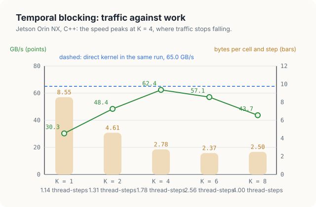
<figcaption><b>Figure 20.11</b> Temporal blocking on the measured GPU: traffic falls with \(K\), work grows, and the speed peaks at \(K = 4\), below the direct kernel.</figcaption>
</figure>

From \\(K = 1\\) to \\(K = 4\\), the traffic falls by a factor of 3, and the speed doubles. Beyond
\\(K = 4\\), the traffic hardly changes, while the work per cell grows from 1.78 to 4 thread-steps,
and the speed falls again. The time of the kernel now follows its work rather than its traffic. At
its best, with \\(K = 4\\), the temporal kernel reached 62.4 GB/s in this run, 96% of the direct
kernel's 65.0 GB/s, while moving a third of the bytes. In the run of Section 20.7, the two kernels
reached 63.5 and 68.3 GB/s, a ratio of 93%. On the measured GPU, with 8 SMs, a 5-point step costs
about as much in instructions as in memory traffic once the caches have done their part, so
neither tiling nor temporal blocking beats the direct kernel. On a GPU with more arithmetic per
byte of bandwidth, such as those with ridge points of 60 to 110 FLOP per byte in Chapter 2, the
same reduction of traffic leaves more room for the extra work. Temporal blocking is used on such
GPUs, and for stencils with more work per cell.

<div class="exercises">

Exercises

20.16 Derive the traffic formula of Section 20.8.2. What is its limit for large tiles and fixed
\\(K\\)?<br>
20.17 With 1,024 threads per block and 8 KiB of shared memory per block, how many blocks of the
temporal kernel fit on an SM with 1,536 threads and 100 KiB of shared memory? What limits the
number?<br>
20.18 Design a temporal kernel in which each thread computes 2 cells of a 64 × 32 tile, so that
fewer threads idle in the outer rings. Predict its thread-steps per cell for \\(K = 4\\).

</div>

## 20.9 The complete programs

<p class="listing"><b>Listing 20.3</b> The complete programs. <a href="https://github.com/arpanpathak/gpu-parallel-book/blob/main/code/oxide/ch20_stencil_tiled/src/main.rs">code/oxide/ch20_stencil_tiled/src/main.rs</a> <a href="https://github.com/arpanpathak/gpu-parallel-book/blob/main/code/cuda/ch20_stencil_tiled/stencil_tiled.cu">code/cuda/ch20_stencil_tiled/stencil_tiled.cu</a></p>

<div class="code-tabs">
<div class="code-tab" data-lang="Rust">

```rust,ignore
{{#include ../../../../code/oxide/ch20_stencil_tiled/src/main.rs}}
```

</div>
<div class="code-tab" data-lang="C++">

```cpp
{{#include ../../../../code/cuda/ch20_stencil_tiled/stencil_tiled.cu}}
```

</div>
</div>

## Common mistakes

- **Leaving out the barrier between loading and computing.** Threads then read slots that other
  threads have not filled; on small tests inside 1 warp, the error may not appear (Section 20.5.1).
- **Placing the barrier inside a condition.** A thread whose cell is on the boundary or outside the
  grid must still reach the barrier.
- **Loading only the block's own cells.** The cells on the edge of the block then lose the
  neighbors that belong to other blocks. Step 1 of the plate is still correct, so test more than 1
  step (Section 20.5.2).
- **Reading outside the grid while loading the halo.** Blocks on the edge of the grid have slots
  outside it; store 0 there and never read it.
- **Expecting a tile to beat the caches.** Measure the direct kernel first. A 5-point stencil reuses
  each value only 4 times, and the L1 and L2 caches already capture most of that reuse.
- **Growing the halo of temporal blocking without counting the work.** Each extra step removes a
  ring of results; past a few steps, the idle threads cost more than the saved traffic.

## Summary

- In the direct kernel, each value of the grid is read by up to 4 threads: on the 6 × 6 plate, 16
  threads make 64 reads of 32 values.
- A block copies a tile into shared memory, made of its own cells and a halo 1 cell wide. Block
  (1, 1) of the plate loads a 4 × 4 tile, 4 own cells and 12 halo cells, and computes cell
  (2, 2) = 6.25 from it.
- The halo is loaded either by extra threads, 1 per slot, or by a loop in which some threads load
  2 or more slots.
- Without the barrier, a thread reads a slot before it is filled: 124,322 to 126,302 wrong cells per
  step on a 4096 × 4096 grid. Without the halo, row 1 of the plate becomes 25, 31.25, 31.25, 25 in
  step 2.
- Theorem 20.1 shows that the tiled kernel writes exactly what the direct kernel writes, given 1
  loader per slot, the barrier, and a tile that covers every neighbor.
- A tile of \\(T \times T\\) costs \\((T + 2)^2 / T^2\\) loads per result: 1.33 for 32 × 8, against 4
  requested by the direct kernel.
- On the measured GPU, the caches already reduce the direct kernel to about 1.25 loads per cell, so
  the tiled kernels ran slower, at 43.4 and 45.8 GB/s against 68.3 GB/s.
- Temporal blocking with \\(K = 4\\) steps per load cuts the traffic to 2.78 bytes per cell and
  step and reached 63.5 GB/s, 93% of the direct kernel; beyond \\(K = 4\\), the extra work
  outweighs the saved traffic.

## Exercises

1. Draw the tile of block (0, 2) of the plate with 2 × 2 blocks in step 2, and compute its 4 cells
   from the tile.
2. A 9-point stencil also reads the 4 diagonal neighbors. Which slots of the tile become
   necessary, and how does the reuse per value change?
3. Implement a 3-D 7-point stencil on a 256 × 256 × 256 grid, directly and with a tile of 32 × 8
   cells in each of 3 consecutive planes. Count the loads per result of both and measure them.
4. Change the tiled kernel so that each thread computes 2 cells in the same column. How does the
   ratio of halo to own cells change, and what happens to the speed?
5. Extend Theorem 20.2 to a tile that is not square, of \\(T_x \times T_y\\) threads.

## Sources and further reading

- A. Pathak, *An Introduction to Tiled Parallel Programming, Simplified*, 2026. Tiles, the 2
  barriers, and a loop-invariant proof for the matrix product.
- T. H. Cormen, C. E. Leiserson, R. L. Rivest and C. Stein, *Introduction to Algorithms*, 4th
  edition, MIT Press, 2022. Pseudocode conventions and loop invariants.
- P. Micikevicius, "3D Finite Difference Computation on GPUs using CUDA", *Proceedings of the 2nd
  Workshop on General Purpose Processing on Graphics Processing Units*, 2009. Tiles with halos for
  high-order 3-D stencils.
- A. Nguyen, N. Satish, J. Chhugani, C. Kim and P. Dubey, "3.5-D Blocking Optimization for Stencil
  Computations on Modern CPUs and GPUs", *Proceedings of SC10*, 2010. Spatial and temporal
  blocking of stencils.
- NVIDIA, *CUDA C++ Programming Guide*: shared memory, `__syncthreads()`, and the caching of global
  loads.
