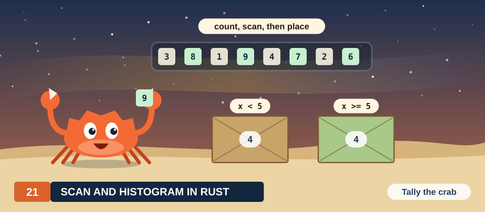
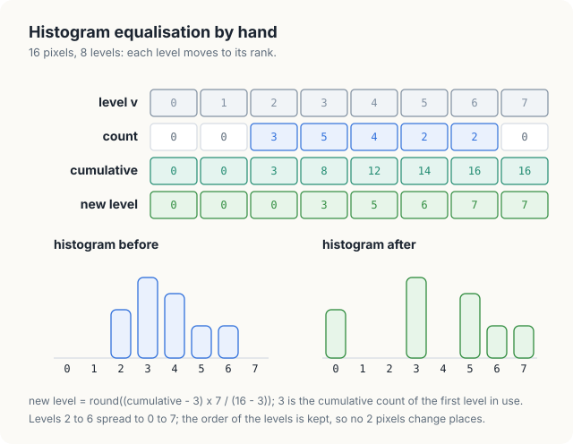
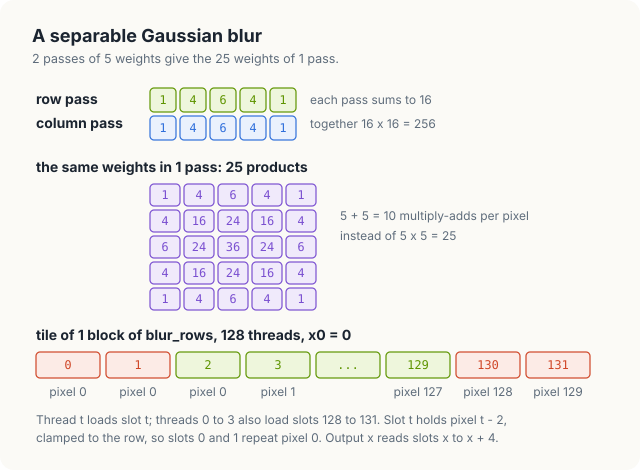
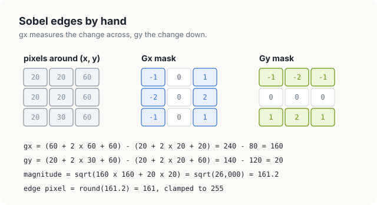
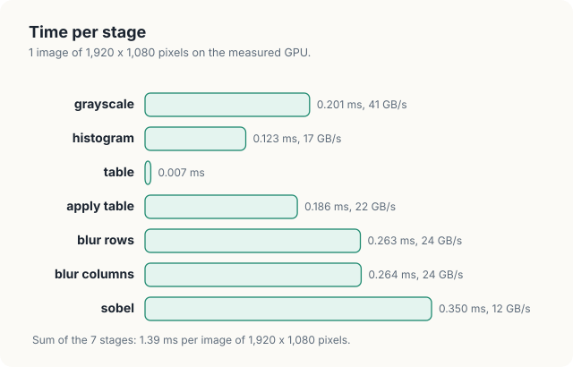
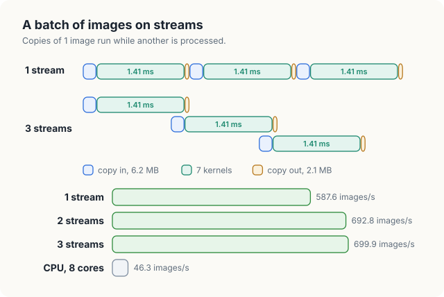

# Chapter 21: Capstone: An Image Pipeline in Rust

Each chapter of Part V developed 1 pattern of GPU computation in Rust: a map over the elements
of an array, a reduction, a scan, a stencil. Real applications seldom consist of a single pattern.
They chain several kernels, each of which reads the output of the one before, and the data must
also be moved between host memory and device memory. Image processing is a typical example. An
image is a 2-dimensional array of pixels. The common operations on images fall into the same
few patterns: some compute each output pixel from the input pixel at the same position, some from
a small neighbourhood around it, and some from the whole image.

In this chapter, we build a pipeline of 7 kernels that turns a colour image into a map of its
edges. The pipeline converts the image to gray, stretches its contrast by histogram
equalisation, smooths it with a Gaussian blur, and finds edges with the Sobel operator. Every
output pixel is compared with the result of the same computation on the CPU, every kernel is
timed, and a batch of images is processed on several streams so that copies overlap with
computation.

<div class="covers" markdown="1">

This chapter covers

- 3 kinds of image operations: point, neighbourhood and global, and the kernel pattern for each
- conversion to gray in fixed-point integer arithmetic
- histogram equalisation: a histogram, a scan of 256 counts, and a lookup table
- a separable Gaussian blur with tiles and halos in shared memory
- the Sobel operator, and a square root that rounds the same way on the GPU and the CPU
- a CPU version on every core, and a pixel-by-pixel comparison
- the time of each kernel, and the time of a batch on 1, 2 and 3 streams

</div>

The code of the chapter is in
[`code/oxide/ch21_capstone/`](https://github.com/arpanpathak/gpu-parallel-book/tree/main/code/oxide/ch21_capstone).
Its `Cargo.toml` and `rust-toolchain.toml` are those of Chapter 13 with the package name changed,
and it needs no other crate. The measurements in this chapter come from a Jetson Orin NX, an
integrated GPU with 8 SMs and 102 GB/s of memory bandwidth, beside a CPU of 8 cores.

## 21.1 Background

### 21.1.1 Images in memory

A **pixel** is the smallest element of an image. A gray image stores 1 byte per pixel, a level
from 0 (black) to 255 (white). A colour image stores 3 bytes per pixel, the intensities of red,
green and blue, in that order. The pipeline works on images of 1,920 × 1,080 pixels, the size of
a full-HD video frame: 2,073,600 pixels, or 6,220,800 bytes (6.2 MB) in colour and 2.1 MB in
gray.

The pixels are stored row by row. Pixel (x, y), in column x of row y, is element y × 1,920 + x of
a gray image, and its 3 colour bytes start at byte 3 × (y × 1,920 + x) of a colour image. For
example, pixel (10, 2) is element 3,850 of the gray image, and its colour bytes are bytes 11,550
to 11,552. This layout is the row-major layout of the matrices in Chapter 9, with a pixel in place
of a matrix element.

### 21.1.2 3 kinds of operations

Image operations differ in how many input pixels each output pixel depends on, and that number
decides how a kernel is organised.

| Kind | Each output pixel depends on | In this pipeline | Kernel pattern |
|---|---|---|---|
| point | the input pixel at the same position | grayscale, apply table | 1 thread per pixel (Chapter 13) |
| neighbourhood | a small window around that position | blur, Sobel | 1 thread per pixel, with a tile in shared memory (Section 9.4) |
| global | every pixel of the image | histogram | a reduction with atomic operations (Section 8.8) |

A **point operation** is a map: each thread reads 1 pixel and writes 1 pixel, and no thread
needs the result of another. A **neighbourhood operation**, also called a stencil, computes each
output from a window of inputs. Neighbouring outputs share most of their inputs, so a kernel can
load a block of inputs once into shared memory and let every thread of the block read from there.
A **global operation** combines all pixels into a small result, such as the 256 counts of a
histogram, and needs the coordination between blocks that Chapter 8 developed for reductions.

### 21.1.3 The pipeline

Figure 21.1 shows the 7 kernels and the buffers between them. The first 4 kernels equalise the
image: they convert it to gray, count how many pixels have each gray level, turn the counts into a
table of new levels, and replace each pixel by its new level. The last 3 kernels blur the
equalised image, first along the rows and then along the columns, and compute the edges.

<figure>

<figcaption><b>Figure 21.1</b> The 7 kernels of the pipeline and the buffers between them.</figcaption>
</figure>

The whole pipeline, for 1 image, is the following sequence of steps.

```text
gray[p]      ← (77 R[p] + 150 G[p] + 29 B[p] + 128) >> 8        for every pixel p
bins[v]      ← number of pixels p with gray[p] = v               for v = 0 .. 255
table[v]     ← new level of v, from the cumulative counts of bins
equal[p]     ← table[gray[p]]                                    for every pixel p
rows[p]      ← weighted sum of 5 pixels of equal along the row of p
blurred[p]   ← weighted sum of 5 values of rows along the column of p, divided by 256
edges[p]     ← length of the Sobel gradient of blurred at p, at most 255
```

Figure 21.2 shows the images that the program writes for its test image. The test image is
generated by the program itself: a house below a hill, a sky that brightens towards the horizon,
a sun, and random grain of ±8 levels on every pixel. Its colours were chosen to lie in a narrow
range of levels, so that the image has low contrast and the effect of equalisation is visible.

<figure>

<figcaption><b>Figure 21.2</b> The program's output for the test image: the input, the equalised image, the blur at 4 × enlargement, and the edges.</figcaption>
</figure>

Equalisation strengthens the grain as well as the scene. It stretches every difference
between levels, including the small random ones. The blur removes most of this grain before the
edge detector runs, so the edge image shows the outlines of the objects and only a faint texture
elsewhere.

## 21.2 Conversion to gray

The brightness that a viewer perceives in a colour pixel is not the plain average of its 3
components, because the eye is more sensitive to green than to red, and least sensitive to blue.
The standard ITU-R BT.601 weights the components accordingly:

\\[ Y = 0.299\\,R + 0.587\\,G + 0.114\\,B \\]

| Symbol | Meaning | For the pixel (150, 118, 104) |
|---|---|---|
| \\(R, G, B\\) | the red, green and blue levels, 0 to 255 | 150, 118, 104 |
| \\(Y\\) | the gray level | 44.85 + 69.27 + 11.86 = 125.97 |

The kernel computes the same weights in integer arithmetic. Each weight is multiplied by 256 and
rounded: 0.299 × 256 = 76.5 becomes 77, 0.587 × 256 = 150.3 becomes 150, and 0.114 × 256 = 29.2
becomes 29. The 3 integers sum to exactly 256, so a white pixel (255, 255, 255) gives 255 × 256 and
stays at level 255 after the division by 256. The division is a shift right by 8 bits, and adding
128 first makes it round to the nearest level rather than down. For the pixel above, 77 × 150 +
150 × 118 + 29 × 104 = 11,550 + 17,700 + 3,016 = 32,266. Then (32,266 + 128) >> 8 = 32,394 / 256 =
126.5, truncated to 126, which is the floating-point result 125.97 rounded.

We use integers rather than floating-point numbers for a reason given in
Section 21.7. The program checks every output pixel against a CPU version of the same
computation, and it can demand exact equality only if both processors perform exactly the same
operations. Integer additions and multiplications give the same result on every processor.
Floating-point expressions do not always: the GPU compiler may fuse a multiplication and an
addition into 1 instruction that rounds once instead of twice, which Section 10.4 measured on 585,903
of 2,097,152 values.

<p class="listing"><b>Listing 21.1</b> The grayscale kernel. <a href="https://github.com/arpanpathak/gpu-parallel-book/blob/main/code/oxide/ch21_capstone/src/main.rs">code/oxide/ch21_capstone/src/main.rs</a></p>

```rust,ignore
mod kernels {
    // ...
{{#include ../../../../code/oxide/ch21_capstone/src/main.rs:48:59}}
    // ...
}
```

Each thread handles 1 pixel. The thread's index `idx` is its pixel number, and its 3 colour bytes
start at `p = 3 * idx.get()`. The call `gray.get_mut(idx)` returns the thread's own element of the
output, or `None` for a thread whose index lies past the end of the image, as in Chapter 13. The
program launches 8,100 blocks of 256 threads, and 8,100 × 256 = 2,073,600 exactly, so every thread
has a pixel. The components are converted to `u32` before the multiplication, because 77 × 255
does not fit in a byte.

The reads are coalesced in the sense of Section 7.2. The 32 threads of a warp read 32 consecutive
pixels, which are 96 consecutive bytes of the colour image, and the memory system serves them with
3 sectors of 32 bytes.

## 21.3 Histogram equalisation

### 21.3.1 The method

A **histogram** of a gray image counts, for each level v from 0 to 255, the number of pixels whose
level is v. The histogram of a low-contrast image is concentrated in a narrow range of levels: in
the test image, the grayscale levels lie between about 70 and 170. Levels below and above that
range are not used, and the image appears dull.

**Histogram equalisation** replaces each level by a new level that is proportional to the number
of pixels at or below it. The number of pixels at or below level v is the **cumulative count**
\\(c(v)\\), the running sum of the histogram up to v, which is an inclusive scan in the sense of
Section 8.7. If 30% of the pixels are at or below level v, level v moves to about 30% of 255. Levels
that are used by many pixels are spread apart, and levels that are rare are pushed together, so
that the new histogram covers the whole range from 0 to 255.

\\[ \text{new}(v) = \operatorname{round}\left(\frac{c(v) - c_{\min}}{N - c_{\min}} \times 255\right) \\]

| Symbol | Meaning | In figure 21.3 |
|---|---|---|
| \\(c(v)\\) | cumulative count: pixels with a level of at most v | 0, 0, 3, 8, 12, 14, 16, 16 |
| \\(c_{\min}\\) | cumulative count at the lowest level in use | 3 |
| \\(N\\) | number of pixels | 16 |
| 255 | the highest level (7 in figure 21.3, which uses 8 levels) | 7 |

Subtracting \\(c_{\min}\\) maps the darkest level in use to 0, and dividing by \\(N - c_{\min}\\)
maps the brightest level in use to the highest level. Figure 21.3 works the method for an image of
16 pixels with 8 levels. The levels 2 to 6 of the input move to 0, 3, 5, 6 and 7. For level 3, for
example, \\(c(3) = 8\\), and the new level is round((8 − 3) × 7 / 13) = round(2.69) = 3.

<figure>

<figcaption><b>Figure 21.3</b> Histogram equalisation of 16 pixels with 8 levels.</figcaption>
</figure>

The division is done in integers. For a numerator a and a denominator s, the expression
(a + s / 2) / s rounds a / s to the nearest integer: (5 × 7 + 6) / 13 = 41 / 13 = 3 in integer
division. The new level of a level never decreases as the level increases, because the
cumulative count never decreases. 2 pixels that were in a given order of brightness therefore keep
that order.

The method needs 3 kernels, 1 for each step: the histogram, the table of 256 new levels, and the
replacement of every pixel by its entry in the table.

### 21.3.2 The histogram kernel

The histogram kernel follows Section 8.8. Each block keeps a private histogram of 256 counters in
shared memory, the threads of the block add to it with atomic operations, and at the end each block
adds its 256 counts to the global histogram.

<p class="listing"><b>Listing 21.2</b> The histogram kernel.</p>

```rust,ignore
mod kernels {
    // ...
{{#include ../../../../code/oxide/ch21_capstone/src/main.rs:61:90}}
    // ...
}
```

The kernel runs in 3 phases separated by 2 barriers. In the first phase, thread `tid` sets counter
`tid` of the shared array `LOCAL` to 0; the block has 256 threads, so every counter is cleared. In
the second phase, each thread walks through the image with a stride of the whole grid, 64 blocks
× 256 threads = 16,384 pixels, and adds 1 to the counter of each pixel's level. Each thread handles
2,073,600 / 16,384 = 126.6, that is 126 or 127, pixels. The counter is reached through a raw pointer
and turned into a `BlockAtomicU32`, because 2 threads of the block may count the same level at the
same time. In the third phase, thread `tid` adds the block's count of level `tid` to the global
histogram `bins`, which is a slice of `DeviceAtomicU32`, and skips the addition when the count is
0.

The global histogram is allocated as a buffer of `u32` zeros and given to the kernel as
`DeviceAtomicU32` elements with `cast_elem`, as in Chapter 8. The kernel adds to `bins`, so the
buffer must hold zeros before the first image. Section 21.3.3 shows how it returns to zeros for
the next image without a separate kernel.

### 21.3.3 The table kernel

The table kernel turns the 256 counts into 256 new levels. It is launched with a single block of
256 threads, and thread v is responsible for level v. The block first computes the cumulative
counts with a scan of 256 values, then finds \\(c_{\min}\\), and finally evaluates the formula of
Section 21.3.1.

```text
count      ← bins[v];  bins[v] ← 0                    one atomic exchange
inclusive  ← scan of count within the warp            Section 8.7.2
WARPS[w]   ← inclusive of lane 31 of warp w            the total of each of the 8 warps
barrier
warp 0: WARPS ← inclusive scan of the 8 warp totals
barrier
c          ← inclusive + WARPS[w - 1]                  (0 for warp 0)
if count > 0: FIRST ← min(FIRST, c)                    atomically; FIRST starts at the maximum
barrier
table[v]   ← round((c - FIRST) × 255 / (N - FIRST))
```

<p class="listing"><b>Listing 21.3</b> The table kernel.</p>

```rust,ignore
mod kernels {
    // ...
{{#include ../../../../code/oxide/ch21_capstone/src/main.rs:36:46}}

    // ...
{{#include ../../../../code/oxide/ch21_capstone/src/main.rs:92:140}}
    // ...
}
```

The first statement reads the count of level v with `bins[v].swap(0, ...)`, an atomic exchange that returns the old
value and stores 0 in its place. The kernel therefore leaves the global histogram cleared, ready for
the next image, and the pipeline needs no separate launch to clear it.

The scan is the 2-level scan of Section 8.7.3. The device function `warp_scan` gives each lane the
sum of the counts of its own lane and of all lanes before it in the warp. Lane 31 holds the total
of its warp and stores it in the shared array `WARPS`. After the first barrier, warp 0 scans the 8
warp totals. After the second barrier, each thread adds the total of all warps before its own,
and `cdf` is the cumulative count \\(c(v)\\).

The value \\(c_{\min}\\) is the cumulative count at the lowest level in use. Every level in use
has a count greater than 0, and the cumulative count grows with the level, so \\(c_{\min}\\) is the
smallest cumulative count among the levels whose count is greater than 0. Thread 0 sets the shared
word `FIRST` to the largest `u32` before the first barrier. Each thread whose count is
greater than 0 then applies an atomic minimum to `FIRST`, and after the third barrier
every thread reads the result. The total number of pixels is the last of the scanned warp totals,
`WARPS[7]`, so the kernel needs no parameter for \\(N\\).

The last lines of the kernel evaluate the formula in 64-bit integers, because \\((c(v) - c_{\min}) \times
255\\) can reach 2,073,600 × 255 = 528,768,000, which is close to the limit of a `u32`. For levels
below the lowest level in use, \\(c(v) = 0 < c_{\min}\\), and `saturating_sub` gives 0 rather than
a negative difference that a `u32` cannot represent. If the image contains a single level, the
denominator is 0, and the kernel leaves every level unchanged.

### 21.3.4 Applying the table

The last step of equalisation is a point operation. Each thread reads 1 gray pixel and writes the
table's entry for its level.

<p class="listing"><b>Listing 21.4</b> Applying the table.</p>

```rust,ignore
mod kernels {
    // ...
{{#include ../../../../code/oxide/ch21_capstone/src/main.rs:142:152}}
    // ...
}
```

The read `table[gray[i] as usize]` is a **gather**: the address depends on the data. The 32 threads
of a warp read 32 entries of the table at unpredictable positions. The table is only 256 bytes,
however, so after the first accesses it stays in the L1 cache of each SM, and the gathers cost
little.

## 21.4 A separable Gaussian blur

### 21.4.1 The weights

A **blur** replaces each pixel by a weighted average of the pixels around it. A **Gaussian blur**
uses weights that fall off with the distance from the centre in the shape of the normal
distribution. We use the 5 weights 1, 4, 6, 4, 1 in each direction. These are the binomial
coefficients of order 4, and they approximate a normal distribution with a standard deviation of 1
pixel: the variance of the binomial distribution of order 4 with probability 1/2 is 4 × 1/2 × 1/2 =
1. The weights of each direction sum to 16.

A 2-dimensional blur over a window of 5 × 5 pixels has 25 weights. The weight of the pixel in row
i and column j of the window is the product of weight i of the column direction and weight j of
the row direction, as figure 21.4 shows. A filter whose weights are such products is called
**separable**. It can be applied in 2 passes: the first pass blurs each row with the 5 row weights,
and the second pass blurs each column of the result with the 5 column weights. Each output then
costs 5 + 5 = 10 multiply-adds instead of 25.

<figure>

<figcaption><b>Figure 21.4</b> The 25 weights of the blur as the product of 2 passes of 5, and the shared tile of the row pass.</figcaption>
</figure>

Both passes work in integers. The row pass stores its sums without dividing them: the largest is
16 × 255 = 4,080, which needs 12 bits, so the intermediate image `rows` has 2 bytes per pixel. The
column pass multiplies by another 16, so its sums reach 16 × 4,080 = 65,280, and the result is the
sum divided by 256 and rounded: (sum + 128) >> 8. For example, a row of levels 10, 20, 30, 40, 50
gives a row sum at the centre of 10 + 4 × 20 + 6 × 30 + 4 × 40 + 50 = 480. A pixel whose 5 × 5
window has the level 100 everywhere gives 100 × 16 = 1,600 in every row sum, and 1,600 × 16 =
25,600 in the column pass, which is level 100 again.

The window of a pixel near the border of the image reaches past the border. We use the rule that a
position outside the image takes the value of the nearest pixel inside it. The device function
`tap` implements this rule: given a position i in a coordinate system shifted right by 2, it
returns i − 2, clamped to the range from 0 to n − 1.

<p class="listing"><b>Listing 21.5</b> The clamped index of a window position.</p>

```rust,ignore
mod kernels {
    // ...
{{#include ../../../../code/oxide/ch21_capstone/src/main.rs:30:34}}
    // ...
}
```

### 21.4.2 The row pass

Each output pixel of the row pass reads 5 input pixels, and each input pixel is read by 5 output
pixels. A kernel that reads its inputs directly from global memory therefore loads every pixel 5
times. The tiling idea of Section 9.4 removes the repetition: the threads of a block first copy the
pixels that the block needs into shared memory, and then every thread reads its 5 inputs from
there.

A block of 128 threads computes 128 consecutive outputs of 1 row. Output x needs the pixels from x
− 2 to x + 2, so the block needs 128 + 4 = 132 pixels: its own 128 and 2 on each side. The 4 extra
pixels are the **halo** of the tile. Slot t of the tile holds pixel x0 + t − 2 of the row, where x0
is the first output of the block. Thread `tx` loads slot `tx`, and threads 0 to 3 also load slots
128 to 131. After the barrier, thread `tx` reads slots `tx` to `tx + 4`, which hold pixels x0 + tx
− 2 to x0 + tx + 2.

```text
TILE[tx]        ← src[row, clamp(x0 + tx - 2)]               every thread
TILE[128 + tx]  ← src[row, clamp(x0 + 128 + tx - 2)]         threads 0 to 3
barrier
out[row, x0 + tx] ← TILE[tx] + 4 TILE[tx+1] + 6 TILE[tx+2] + 4 TILE[tx+3] + TILE[tx+4]
```

The block loads 132 pixels from global memory for 128 outputs, instead of 5 × 128 = 640. Figure
21.4 shows the tile of the first block of a row. Its slots 0 and 1 lie left of the image, and the
clamp gives them the value of pixel 0.

<p class="listing"><b>Listing 21.6</b> The row pass of the blur.</p>

```rust,ignore
mod kernels {
    // ...
{{#include ../../../../code/oxide/ch21_capstone/src/main.rs:154:180}}
    // ...
}
```

The kernel is launched on a 2-dimensional grid of 15 × 1,080 blocks: 15 blocks of 128 threads
cover a row of 1,920 pixels exactly, and there is 1 row of blocks for each of the 1,080 rows of the
image. The launch contract declares the block shape (128, 1, 1), so a launch with any other shape
is rejected on the host before it reaches the GPU. The first 3 statements compute the thread's position
in the tile, the first column of the block, and the offset of the block's row in the image.

The output is declared as `DisjointSlice<u16, Index2D<W>>`, a slice whose elements are addressed by
2-dimensional thread indices with a row length of `W` = 1,920. The call `thread::index_2d::<W>()`
returns the thread's index, row × 1,920 + column, or `None` if the thread's column lies
beyond 1,920. The `get_mut` that follows checks the index against the length of the slice, so the
write to the output needs no `unsafe` block, exactly as in the 1-dimensional kernels. Since every
thread has a distinct (row, column), no 2 threads can obtain the same element.

The tile is a different matter. Shared memory is accessible to every thread of the block, and the
compiler cannot verify that a thread reads only slots that some thread has written. Accesses to
`TILE` are therefore `unsafe`, and the `SAFETY` comments state the argument that makes them correct:
each slot is written by exactly 1 thread before the barrier, and after the barrier the tile is only
read. Section 21.10 shows what happens when that argument is broken. The closure `t`
reads slot `tx + k` of the tile; it keeps the 5-term sum on 1 line.

### 21.4.3 The column pass

The column pass works in the same way along the columns. A block of 32 × 8 threads computes a tile
of 8 rows and 32 columns. Each output needs 2 rows above it and 2 below, so the block loads 8 + 4
= 12 rows of 32 values of `rows` into shared memory. Thread (tx, ty) loads row ty of the tile, and
threads with ty < 4 also load rows 8 to 11.

<p class="listing"><b>Listing 21.7</b> The column pass of the blur.</p>

```rust,ignore
mod kernels {
    // ...
{{#include ../../../../code/oxide/ch21_capstone/src/main.rs:182:208}}
    // ...
}
```

The block is 32 threads wide so that a warp reads 32 consecutive values of 1 row, which are 64
consecutive bytes. The launch uses a grid of 60 × 135 blocks: 60 × 32 = 1,920 columns and 135 × 8 =
1,080 rows. The last statement divides by 256 with rounding and stores the blurred level as a byte.

## 21.5 Sobel edges

An **edge** in an image is a place where the level changes quickly from one pixel to the next. The
**Sobel operator** estimates the rate of change at each pixel in 2 directions from its 3 × 3
neighbourhood. The horizontal component gx is the weighted sum of the column to the right of the
pixel minus the weighted sum of the column to its left, with weights 1, 2, 1 from top to bottom.
The vertical component gy is the weighted sum of the row below minus the row above, with the same
weights from left to right. The length of the vector (gx, gy) is the **gradient magnitude**, which
is large at an edge and close to 0 in a uniform region.

\\[ \text{edge} = \min\left(\operatorname{round}\sqrt{g_x^2 + g_y^2},\ 255\right) \\]

Figure 21.5 applies the operator to a neighbourhood on the left side of a vertical edge. The
column to the right is 60, 60, 60 and the column to the left is 20, 20, 20, so gx = 240 − 80 =
160. The rows differ only in their middle pixel, so gy = 140 − 120 = 20 is small. The magnitude is
\\(\sqrt{26{,}000} = 161.2\\), and the edge pixel is 161.

<figure>

<figcaption><b>Figure 21.5</b> The Sobel operator applied to 1 neighbourhood.</figcaption>
</figure>

<p class="listing"><b>Listing 21.8</b> The Sobel kernel.</p>

```rust,ignore
mod kernels {
    // ...
{{#include ../../../../code/oxide/ch21_capstone/src/main.rs:210:232}}
}
```

The kernel reads its 9 inputs directly from global memory, without a shared tile. Each thread
clamps its neighbours to the image and reads them through the closure `p`. The
same input pixel is read by up to 9 threads, but those threads belong to the same block or to
neighbouring blocks, and most of the repeated reads are served by the L1 cache. Exercise 4 asks you
to measure whether a shared tile helps here.

The largest possible component is 4 × 255 = 1,020, so the sum of squares is at most 2 × 1,020² =
2,080,800. This value is an integer below 2²⁴ = 16,777,216, so its conversion to `f32` is exact.
The square root is computed by `sqrt_rn_f32`, the square root of cuda-oxide's `float` module that
rounds to the nearest representable `f32`. The IEEE 754 standard requires the square root to be
rounded in this way, and Rust's `f32::sqrt` on the CPU does so too, so both processors obtain the
same `f32` for every input. The last statement then rounds to the nearest integer by adding 0.5 and
truncating, and clamps the result to 255, because a magnitude of up to √2,080,800 = 1,442 does not
fit in a byte.

## 21.6 The host program

### 21.6.1 Buffers

The host program keeps the device buffers of 1 image in a structure, so that the pipeline can run
several images at once with 1 set of buffers for each.

<p class="listing"><b>Listing 21.9</b> The device buffers of 1 image.</p>

```rust,ignore
{{#include ../../../../code/oxide/ch21_capstone/src/main.rs:235:260}}
```

A set of buffers occupies 6.2 MB for the colour image, 2.1 MB for each of the 4 gray images, 4.1 MB
for the row sums of 2 bytes per pixel, and 1,280 bytes for the counts and the table: 18.7 MB in
all. When the structure is dropped, each `DeviceBuffer` frees its memory, as Chapter 10 described.

### 21.6.2 Launching the stages

The function `stage` launches stage k of the pipeline on a given stream, and `process` launches the
7 stages in order. The kernels of 1 image are all placed on the same stream, so each one starts
only after the previous one has finished, and no further synchronisation is needed between them.

<p class="listing"><b>Listing 21.10</b> The 7 stages on 1 stream.</p>

```rust,ignore
{{#include ../../../../code/oxide/ch21_capstone/src/main.rs:273:327}}
```

Each arm of the `match` prepares the launch configuration of its kernel and launches it. The 3
configurations correspond to the 3 kernel shapes. `line` covers the image with 8,100 blocks of
256 threads for the point operations. `rows` gives 1 row of 15 blocks of 128 threads to each
image row. `tiles` covers the image with 60 × 135 blocks of 32 × 8 threads. The histogram uses a
fixed grid of 64 blocks, because each of its blocks pays for clearing and flushing 256 counters,
and the table kernel uses 1 block. Each `prepare_` call checks the configuration against the launch
contract of its kernel and returns an error if the block shape differs.

## 21.7 Checking against the CPU

A GPU program can produce an image that looks plausible and is wrong in a few thousand pixels.
To detect such errors, the program computes the whole pipeline a second time on the CPU and
compares the 2 results pixel by pixel. The CPU version uses the same integer formulas, the same
clamping and a correctly rounded square root, so every pixel must agree exactly; a tolerance, as
Section 16.8 discusses for floating-point results, is not needed.

The CPU version is also the baseline for the speed of the GPU, so it uses all cores of the CPU.
The function `par_rows` divides the rows of an output image into 1 band per core and processes the
bands on separate threads with `std::thread::scope`. Each thread writes only the rows of its own
band, which `chunks_mut` hands out as separate mutable slices, so the compiler can verify that no
2 threads write the same row.

<p class="listing"><b>Listing 21.11</b> The rows of an image on every core, and the Sobel stage on the CPU.</p>

```rust,ignore
{{#include ../../../../code/oxide/ch21_capstone/src/main.rs:383:398}}

fn cpu_pipeline(rgb: &[u8]) -> Images {
    // ...
{{#include ../../../../code/oxide/ch21_capstone/src/main.rs:456:471}}
    // ...
}
```

The program reports the number of pixels in which each of the 4 output images of the GPU differs
from the CPU's.

```console
$ cargo oxide run
GPU: Orin, 8 SMs   image 1920 x 1080 = 2073600 pixels
...
pixels that differ from the CPU, gray     : 0
pixels that differ from the CPU, equalised: 0
pixels that differ from the CPU, blurred  : 0
pixels that differ from the CPU, edges    : 0
```

All 4 images agree in all 2,073,600 pixels. The batch of Section 21.9 checks the GPU's output once
more: the last edge image that each stream copies back is compared with the CPU's edge image of the
same input.

The square root deserves a remark. cuda-oxide also provides `sqrt_approx_f32`, a faster square
root whose result may differ from the correctly rounded value in the last bits. We replaced
`sqrt_rn_f32` with it and ran the program: the edge image still agreed with the CPU in every
pixel. The reason is the rounding to an integer that follows. A square root of an integer up to
2,080,800 changes its rounded value only where it crosses a value k + 0.5. The integer closest
to such a crossing, k² + k, has a square root about 1 / (8k) below k + 0.5. For k up to 255, this
distance is at least 0.0005, far larger than the error of the approximation. The correctly rounded
version remains the one in the listing, because it agrees with the CPU by definition rather than
by an argument about this particular range of inputs.

## 21.8 The time of each stage

The program times each stage separately, 20 launches after 1 warm-up launch, once the GPU's clocks
have risen under load (Section 16.7). It reports the time and the effective bandwidth: the bytes
that the stage must read and write, divided by its time.

```console
stage              ms     GB/s
  grayscale       0.201     41.2
  histogram       0.123     16.8
  table           0.007      0.0
  apply table     0.186     22.3
  blur rows       0.263     23.7
  blur columns    0.264     23.6
  sobel           0.350     11.9
  sum of stages   1.394
  all 7 in turn   1.406
```

Figure 21.6 shows the same times as bars. The whole pipeline takes about 1.41 ms per image, so
the GPU can process at most about 710 images per second when the copies are not counted.

<figure>

<figcaption><b>Figure 21.6</b> The time of each stage for 1 image of 1,920 × 1,080 pixels.</figcaption>
</figure>

The effective bandwidths lie between 11.9 and 41.2 GB/s, well below the 102 GB/s of
the GPU's memory. Each kernel moves only 2 to 8 MB, so the fixed costs of a launch and of the last,
partly filled wave of blocks take a noticeable share of each fraction of a millisecond. The larger
reason is the size of the loads. Every thread of these kernels loads single bytes, so a warp's load
instruction moves at most 32 bytes, a quarter of what it moves for 32 floats. Section 8.8 measured
the same effect on a histogram: 13.7 GB/s with 1-byte loads against 82.9 GB/s with 16-byte loads.
The Sobel kernel is the slowest per byte because each of its threads issues 9 loads to produce 1
byte of output.

The table kernel takes about 7 µs. It is a single block that does 256 units of work, and
its time is close to the time of a launch. Its share of the pipeline is negligible, which shows that
a kernel with very little parallelism is acceptable when it handles a small amount of data between
2 large kernels.

## 21.9 A batch of images on streams

### 21.9.1 Copies and kernels

A program that processes a stream of video frames must also copy each frame to the device and each
result back. Per image, the copy in moves 6.2 MB and the copy out moves 2.1 MB. On 1 stream these
copies and the 7 kernels run 1 after the other, and the GPU is idle during the copies. Chapter 6
showed how to overlap copies with kernels: the work is divided into independent pieces, here
images, and consecutive pieces are placed on different streams. A copy engine then transfers 1
image while the SMs process another.

```text
for i in 0 .. count:
    k ← i mod (number of streams)
    on stream k:  copy input i to lane k;  7 stages on lane k;  copy edges of lane k to output k
wait for every stream
```

Each stream has its own set of buffers, called a lane. The kernels of image i and image i + 3 use
the same lane on the same stream, so they run in order and cannot overwrite each other's data.
The asynchronous copies require host memory that is pinned (Section 4.2), and the program keeps 4
input images and 3 output images in `PinnedHostBuffer`s.

<p class="listing"><b>Listing 21.12</b> A batch of images on several streams.</p>

```rust,ignore
{{#include ../../../../code/oxide/ch21_capstone/src/main.rs:346:373}}
```

The 2 copies are `unsafe` because the GPU accesses the host buffers after the call has returned.
The `SAFETY` comment states the condition that makes them correct: no host buffer is read, written
or dropped until every stream has been synchronized. Images that use the same output buffer are on
the same stream, so their copies out happen in order.

### 21.9.2 Measured rates

The program processes a batch of 128 images on 1, 2 and 3 streams, after 1 warm-up batch, and
processes 4 images with the CPU version on all 8 cores.

```console
batch of 128 images: copy in, 7 stages, copy out
  1 stream(s)           587.6 images/s
  2 stream(s)           692.8 images/s
  3 stream(s)           699.9 images/s
  CPU, 8 threads         46.3 images/s
batch outputs match the CPU: yes
PASSED
```

<figure>

<figcaption><b>Figure 21.7</b> Copies and kernels on 1 and on 3 streams, and the measured rates.</figcaption>
</figure>

The rates can be checked with a simple account. On 1 stream, an image takes 1 / 587.6 = 1.70
ms. Its 7 kernels take 1.41 ms, so the 2 copies, 8.3 MB together, take about 0.30 ms, which is
about 28 GB/s. With several streams, the copies of 1 image overlap with the kernels of another,
and the rate approaches the limit of the kernels alone, 1 / 1.41 ms = 710 images per second. 3
streams reach 699.9 images per second, 99% of that limit. A third stream adds little over a
second one, because 2 streams already keep the SMs busy while the copies run.

The CPU version processes 46.3 images per second on 8 cores. The GPU, with 3 streams, is
15 times faster, for exactly the same output.

## 21.10 A missing halo

The correctness of the tiled kernels rests on the argument in their `SAFETY` comments: every slot
of the tile is written before the barrier. To see what happens when the argument is false, we
removed the `if tx < 4` block that loads the halo in `blur_rows`, so that slots 128 to 131 of
the tile are never written. The program still compiles, because the reads are inside `unsafe`
blocks and the compiler accepts the programmer's argument without checking it.

```console
pixels that differ from the CPU, gray     : 0
pixels that differ from the CPU, equalised: 0
pixels that differ from the CPU, blurred  : 60129
pixels that differ from the CPU, edges    : 93316
batch outputs match the CPU: no
FAILED
```

The count of wrong pixels can be predicted. Threads 124 to 127 of each block read at least 1 of the
slots 128 to 131. A row has 15 blocks, so 15 × 4 = 60 pixels of each row read uninitialised shared
memory. Over 1,080 rows, 60 × 1,080 = 64,800 pixels of the blurred image are at risk. 60,129 of them were
wrong; in the others, the leftover contents of shared memory happened to produce the right value.
The edge image has more wrong pixels, 93,316, because the Sobel operator reads a 3 × 3 window, and
every wrong blurred pixel spoils the edges of its neighbours as well.

The image looked normal at a glance: the errors form thin vertical stripes of slightly wrong levels,
1 every 128 columns. Only the comparison with the CPU revealed them.

## 21.11 The complete program

<p class="listing"><b>Listing 21.13</b> The complete program. <a href="https://github.com/arpanpathak/gpu-parallel-book/blob/main/code/oxide/ch21_capstone/src/main.rs">code/oxide/ch21_capstone/src/main.rs</a></p>

```rust,ignore
{{#include ../../../../code/oxide/ch21_capstone/src/main.rs}}
```

## Common mistakes

- **Computing in floating point and comparing exactly.** A float expression may be evaluated
  differently on the GPU, for example with a fused multiply-add. Use integer arithmetic where the
  result must match exactly, or compare floats with a tolerance.
- **Forgetting the halo of a tile.** A tile of n outputs of a filter of radius r needs n + 2r
  inputs. The missing slots hold whatever an earlier block left in shared memory, and the result is
  wrong in a few columns only (Section 21.10).
- **Clearing a global histogram with a separate copy or launch, or not at all.** A histogram kernel
  adds to its counts. Without clearing, the second image's histogram includes the first image's
  counts; here the table kernel clears each count as it reads it.
- **Overflowing an intermediate value.** The row sums of the blur reach 4,080 and do not fit in a
  byte; the equalisation formula reaches 528,768,000 before the division and is evaluated in 64
  bits.
- **Reusing a pinned output buffer on 2 streams.** 2 streams that copy into the same host buffer can
  do so in either order. Give each stream its own output buffer, or synchronise before reusing it.

## Summary

- Image operations are point, neighbourhood or global operations, and each kind maps to a kernel
  pattern of the earlier chapters: 1 thread per pixel, a tile with a halo in shared memory, and a
  reduction with shared and global atomic counters.
- Conversion to gray, equalisation and the blur are computed in integer arithmetic, so that the GPU
  and the CPU produce identical images and can be compared pixel by pixel.
- Histogram equalisation is a histogram, a scan of 256 counts in 1 block, and a table lookup. The
  table kernel clears the counts with an atomic exchange as it reads them.
- A separable blur of 5 × 5 weights costs 2 passes of 5 multiply-adds. Each pass loads a tile of n +
  4 values into shared memory for n outputs.
- `DisjointSlice` with `Index2D` makes the output writes of 2-dimensional kernels safe; reads from
  shared tiles remain `unsafe`, and their correctness rests on the barrier argument in the `SAFETY`
  comment.
- On the measured GPU the 7 kernels take about 1.41 ms per image of 1,920 × 1,080 pixels; with 3
  streams a batch runs at 699.9 images per second, 15 times the rate of the CPU on 8
  cores.

## Exercises

1. Work the grayscale formula by hand for the pixels (255, 0, 0), (0, 255, 0) and (0, 0, 255), and
   explain why the 3 results differ.
2. Compute the equalisation table for an image of 10 pixels with the levels 4, 4, 4, 5, 5, 6, 6, 6,
   6, 7 on a scale of 8 levels (0 to 7).
3. The row pass loads 132 pixels for 128 outputs. How many pixels would a block of 256 threads load,
   and what fraction of its loads would be halo? Change the block size in `blur_rows` and its launch
   configuration, and measure the time.
4. Write a version of `sobel` that loads a tile of (8 + 2) × (32 + 2) pixels into shared memory, and
   compare its time with the version in Listing 21.8. Explain the result with the role of the L1
   cache.
5. The kernels `grayscale` and `apply_table` cannot be fused, because equalisation needs the whole
   histogram first. Which other pairs of consecutive kernels could be fused into 1, and how many bytes
   per pixel would each fusion save? Fuse `blur_cols` and `sobel` conceptually: what halo would the
   fused kernel need?
6. Change `grayscale` to process 4 pixels per thread, reading the 12 colour bytes as 3 `u32` values.
   Measure the effective bandwidth, and compare the result with the 1-byte and 16-byte loads of
   Section 8.8.
7. Replace the row pass of the blur with a version that reads its 5 inputs directly from global
   memory, and measure the difference.
8. Run the batch with 4 and 6 streams. Explain why the rate stops growing.

## Sources and further reading

- ITU-R Recommendation BT.601, *Studio encoding parameters of digital television for standard 4:3
  and wide-screen 16:9 aspect ratios*: the luma weights 0.299, 0.587 and 0.114.
- R. C. Gonzalez and R. E. Woods, *Digital Image Processing*, 4th ed., Pearson, 2018: histogram
  equalisation (chapter 3), smoothing and Sobel filters (chapter 3), separable filters.
- I. Sobel and G. Feldman, "A 3 × 3 isotropic gradient operator for image processing", 1968,
  presented at the Stanford Artificial Intelligence Project.
- IEEE 754-2019, *Standard for Floating-Point Arithmetic*: the correctly rounded square root.
- NVIDIA, *CUDA C++ Programming Guide*: shared memory, streams and asynchronous copies.
- cuda-oxide source, rev b7fe543: `cuda_device::float::sqrt_rn_f32`, `thread::index_2d`,
  `DisjointSlice` with `Index2D`, `DeviceAtomicU32::swap` and `BlockAtomicU32::fetch_min`.
