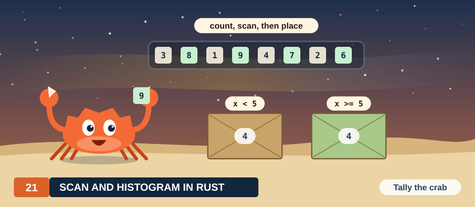

# Chapter 21: Scan and Stream Compaction

A **scan** turns a list of numbers into the list of its running totals. It is one of the most used building blocks of parallel programs. A running total answers the
question "how many elements come before this one?", and that question decides where each element is written when a
program packs, sorts or distributes data. Its sequential algorithm is a single loop, and every
iteration of that loop needs the result of the one before. A scan therefore looks at first like
the opposite of a parallel computation.

In this chapter we derive 2 parallel scans from the sequential loop, on 1 example of 8 small
integers: the Hillis-Steele scan, which takes the fewest steps, and the Blelloch scan, which
performs no more additions than necessary. We show why each barrier of these algorithms is
needed, prove 1 of them correct, extend both to arrays of any length, and use the scan for stream
compaction, the removal of unwanted elements from an array. Every algorithm is implemented in
Rust with cuda-oxide and in CUDA C++, and measured.

<div class="covers" markdown="1">

This chapter covers

- inclusive and exclusive scans, worked by hand on 8 values
- the dependence chain of the sequential scan, and how associativity breaks it
- the Hillis-Steele and Blelloch scans, their work and their steps
- the barrier and the second buffer of a scan, broken 1 at a time, and a proof of correctness
- the scan of an array of many blocks
- stream compaction with a scan, and with warp votes
- measured times on 16,777,216 values, and why they differ

</div>

The code of the chapter is in
[`code/oxide/ch21_scan_compaction/`](https://github.com/arpanpathak/gpu-parallel-book/tree/main/code/oxide/ch21_scan_compaction)
for Rust and in
[`code/cuda/ch21_scan_compaction/`](https://github.com/arpanpathak/gpu-parallel-book/tree/main/code/cuda/ch21_scan_compaction)
for C++. In Chapter 8 we already built a fast scan from warp shuffles (Section 8.7). Here we derive the
scan from the beginning, and we reuse the kernel of Chapter 8 as the third of our measured
methods.

## 21.1 The problem

### 21.1.1 A worked example

We use the same 8 values throughout the chapter:

\\[ x = (3,\ 1,\ 7,\ 0,\ 4,\ 1,\ 6,\ 3). \\]

Their running totals are found by walking along the list and adding each value to the total so
far. The first total is 3. Adding 1 gives 4, adding 7 gives 11, adding 0 leaves 11, and the
remaining 4 values give 15, 16, 22 and 25. The last total, 25, is the sum of all 8 values.

There are 2 ways to line up these totals with the input. In the first, the total at position
\\(i\\) includes \\(x_i\\) itself, so position 4 holds \\(3 + 1 + 7 + 0 + 4 = 15\\). In the
second, the total at position \\(i\\) stops before \\(x_i\\), so position 4 holds
\\(3 + 1 + 7 + 0 = 11\\), and position 0 holds the empty sum, 0. Figure 21.1 shows both.

<figure>
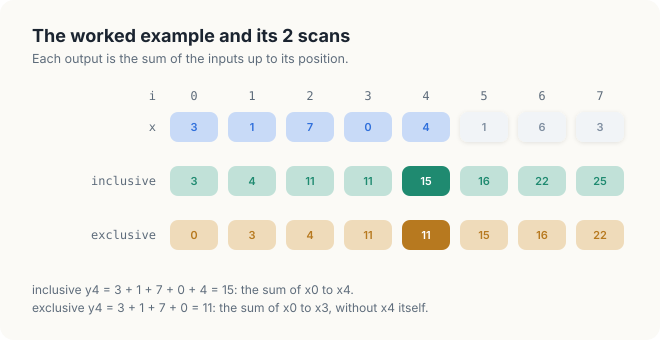
<figcaption><b>Figure 21.1</b> The 8 values and their 2 scans. Position 4 holds 15 in the inclusive scan and 11 in the exclusive scan.</figcaption>
</figure>

Keep 2 entries in mind, \\(y_2 = 11\\) and \\(y_6 = 22\\). In Section 21.6 we will see 2 faulty
kernels that produce 8 and 14 in place of \\(y_2 = 11\\).

### 21.1.2 Definitions

<div class="definition">

<span class="box-label">Definition 21.1</span> **Inclusive scan.** The inclusive scan of an array
\\(x\\) of \\(n\\) values is the array \\(y\\) of \\(n\\) values with

\\[ y_i = x_0 + x_1 + \cdots + x_i, \qquad i \in [0, n). \\]

*Example.* For our 8 values, \\(y = (3, 4, 11, 11, 15, 16, 22, 25)\\).

</div>

<div class="definition">

<span class="box-label">Definition 21.2</span> **Exclusive scan.** The exclusive scan of
\\(x\\) is the array \\(e\\) with \\(e_0 = 0\\) and

\\[ e_i = x_0 + x_1 + \cdots + x_{i-1}, \qquad i \in [1, n). \\]

*Example.* For our 8 values, \\(e = (0, 3, 4, 11, 11, 15, 16, 22)\\).

</div>

The 2 scans differ by exactly 1 term at every position, so each is obtained from the other with 1
operation per element: \\(e_i = y_i - x_i\\), and \\(y_i = e_i + x_i\\). Scans are also called
**prefix sums**, because \\(y_i\\) is the sum of the prefix of the array that ends at position
\\(i\\). The same definitions apply to other operators than addition, such as the maximum; we use
addition throughout, as the applications of this chapter and of Chapter 22 do.

We write ranges as in the rest of the book: \\([a, b)\\) is the set of integers
\\(a, a + 1, \ldots, b - 1\\), like `a..b` in Rust. Indices start at 0.

The exclusive scan has a direct use. Suppose some of the values are to be copied, in order, to
the front of another array. Write 1 for every copied value and 0 for the others. The exclusive scan of these 1s and 0s
at position \\(i\\) is the number of copied values before position \\(i\\), and that number is
exactly the output position of value \\(i\\). In Section 21.8 we build
stream compaction on this fact, and in Chapter 22 a radix sort.

<div class="exercises">

Exercises

21.1 Compute the inclusive and the exclusive scan of \\((2, 0, 5, 1, 1, 3, 0, 4)\\).<br>
21.2 The maximum is also an operator for a scan. Compute the inclusive max-scan of our 8 values.
What does \\(y_i\\) mean for this operator?<br>
21.3 Show that the last value of the inclusive scan equals the last value of the exclusive scan
plus the last input. Which value of our example does this give?

</div>

## 21.2 The sequential algorithm

### 21.2.1 The loop

On a CPU, Definition 21.1 becomes 1 loop. Each iteration adds the next input to the previous
total.

<div class="algo">
<p class="algo-name">Sequential-Scan(\(x, y, n\))</p>
<ol>
<li>\(y_0 = x_0\)</li>
<li>for \(i \in [1, n)\) {</li>
<li style="--d:1">\(y_i = y_{i-1} + x_i\) <span class="c">// 1 addition, needs line 3 of the previous iteration</span></li>
<li>}</li>
</ol>
</div>

Line 3 executes \\(n - 1\\) times, and so the loop performs \\(n - 1\\) additions. Our example
needs 7. No algorithm can do with fewer: each of the inputs \\(x_1\\) to \\(x_7\\) has to enter
the total through at least 1 addition.

### 21.2.2 The dependence chain

On a parallel machine, the number of additions is not the main cost. The order in which they
must happen is. Look at the iteration that computes \\(y_4 = 15\\). It adds \\(x_4 = 4\\)
to \\(y_3 = 11\\), and it cannot start until \\(y_3\\) is known. \\(y_3\\) in turn needs \\(y_2\\),
which needs \\(y_1\\). Figure 21.2 draws these dependences: every addition waits for the one
before it, and the 7 additions form a single chain.

<figure>
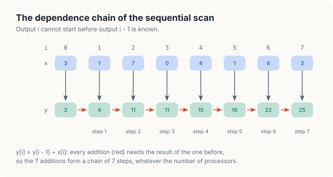
<figcaption><b>Figure 21.2</b> The sequential scan. Each red arrow is a dependence: \(y_i\) needs \(y_{i-1}\).</figcaption>
</figure>

<div class="definition">

<span class="box-label">Definition 21.3</span> **Work and steps.** The **work** of an algorithm
is the number of operations it performs. Its **steps** are the length of its longest chain of
operations in which each needs the result of the one before. A machine with enough processors
can execute an algorithm in as many rounds as it has steps, but not in fewer.

*Example.* Sequential-Scan of our 8 values does a work of 7 additions in 7 steps.

</div>

A GPU executes thousands of threads at once, and it is fast only when it has work for all of
them. Sequential-Scan gives it 1 addition per step. For an array of 1,024 values it needs 1,023
steps, each waiting for the last, and every other thread of the GPU would be idle. To use the
GPU, we need an algorithm whose number of steps grows much more slowly than \\(n\\).

<div class="exercises">

Exercises

21.4 How many additions and how many steps does Sequential-Scan need for \\(n = 2^{20}\\)?<br>
21.5 The sum of all \\(n\\) values is the last output of the scan. In Chapter 15 we computed a sum in
\\(\log_2 n\\) steps. Why does the tree of a sum not give all \\(n\\) outputs of a scan?

</div>

## 21.3 Breaking the chain

### 21.3.1 1 thread per output

The most direct parallel scan gives each output its own thread, and lets thread \\(i\\) add up
\\(x_0\\) to \\(x_i\\) on its own. A **kernel** is a function that the GPU runs many times at
once, and each of these runs is a **thread**, with its own index and its own variables.

<div class="algo">
<p class="algo-name">Direct-Scan(\(x, y, n\))</p>
<ol>
<li>\(i\) = the index of this thread <span class="c">// 1 thread per output</span></li>
<li>\(sum = 0\)</li>
<li>for \(j \in [0, i]\) {</li>
<li style="--d:1">\(sum = sum + x_j\) <span class="c">// \(i + 1\) reads of \(x\)</span></li>
<li>}</li>
<li>\(y_i = sum\)</li>
</ol>
</div>

No thread waits for another, so the threads may run in any order. But follow thread 7: it reads
all 8 values and performs 8 additions in a chain, exactly the chain of Sequential-Scan. The
number of steps has not changed. The work has grown instead. Thread \\(i\\) reads \\(i + 1\\)
values, so the 8 threads read \\(1 + 2 + \cdots + 8 = 36\\) values. For \\(n\\) values the
kernel reads \\(n(n + 1)/2\\) of them: 524,800 reads for 1,024 values that are only 1,024
different numbers.

The waste is visible on the example. The sum \\(3 + 1 + 7 + 0 = 11\\) of the first 4 values is
computed by thread 3, and computed again from scratch by threads 4, 5, 6 and 7. Each thread
rebuilds a total that another thread already holds.

### 21.3.2 Regrouping a sum

Thread 7 needs \\(y_7 = 3 + 1 + 7 + 0 + 4 + 1 + 6 + 3\\). Addition does not care how the terms are
grouped, so we may write

\\[ y_7 = \underbrace{(3 + 1 + 7 + 0)}_{11} + \underbrace{(4 + 1 + 6 + 3)}_{14} = 25. \\]

The left group is the sum of positions 0 to 3, and the right group the sum of positions 4 to 7.
Each group can itself be split into 2 pairs, and the 4 pair sums 4, 7, 5 and 9 are independent of
one another. Figure 21.3 draws the result: the same 7 additions, arranged as a tree of 3 levels
instead of a chain of 7.

<figure>
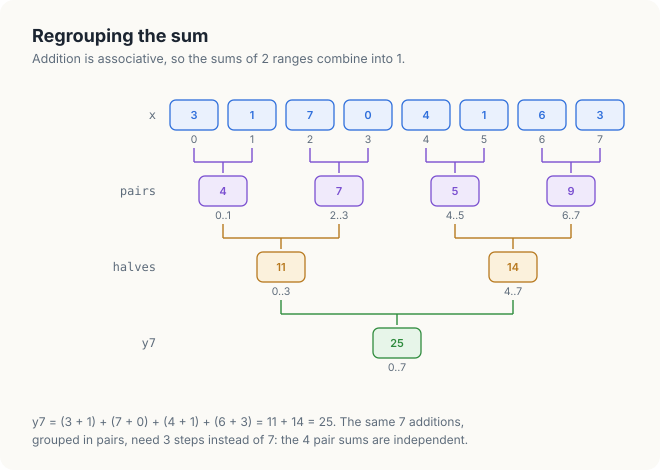
<figcaption><b>Figure 21.3</b> \(y_7\) as a tree. Under each node, the range of positions it sums.</figcaption>
</figure>

<div class="definition">

<span class="box-label">Definition 21.4</span> **Associative operator.** An operator \\(\oplus\\)
is associative if \\((a \oplus b) \oplus c = a \oplus (b \oplus c)\\) for all \\(a\\), \\(b\\),
\\(c\\). The result of combining a list with an associative operator then depends only on the
order of the list, not on how its terms are grouped.

*Example.* Integer addition is associative: \\((3 + 1) + 7 = 3 + (1 + 7) = 11\\).

</div>

<div class="definition">

<span class="box-label">Definition 21.5</span> **Range sum.** For \\(a \le b\\), the range sum
\\(S[a..b]\\) is \\(x_a + x_{a+1} + \cdots + x_b\\), the sum of the inputs at positions
\\(a\\) to \\(b\\), both included. Because addition is associative, for every \\(m\\) with
\\(a \le m < b\\),

\\[ S[a..b] = S[a..m] + S[m+1..b]. \\]

*Example.* \\(S[0..7] = S[0..3] + S[4..7] = 11 + 14 = 25\\), and \\(y_i = S[0..i]\\).

</div>

Integer addition is associative exactly, which is why every program of this chapter can check
its result against the CPU value by value. Floating-point addition is associative only
approximately, because every addition rounds; in Chapter 8 we measured what a regrouped float sum
changes (Section 8.2).

<div class="key-observation">

<span class="box-label">Key observation</span> A thread that knows the range sums of 2 adjacent
ranges obtains the range sum of their union with 1 addition. If, at every step, every thread
doubles the length of the range it knows by adding the range sum held by another thread, then
after \\(\log_2 n\\) steps every thread \\(i\\) holds \\(S[0..i] = y_i\\).

</div>

<div class="exercises">

Exercises

21.6 Draw the tree of Figure 21.3 for \\(y_5\\). Which range sums of the figure can it reuse?<br>
21.7 How many reads does Direct-Scan perform for \\(n = 4{,}096\\)? How many steps does it need?

</div>

## 21.4 The Hillis-Steele scan

### 21.4.1 Doubling the ranges

We now turn the key observation into an algorithm. Each position \\(i\\) keeps 1 value, which
starts as \\(x_i = S[i..i]\\), the range sum of a range of length 1 that ends at \\(i\\). In the
first step, every position \\(i \ge 1\\) adds the value of position \\(i - 1\\). Position 7 adds
\\(S[6..6] = 6\\) to \\(S[7..7] = 3\\) and holds \\(S[6..7] = 9\\); every position now holds the sum
of a range of length 2 that ends at it. In the second step, every position \\(i \ge 2\\) adds the
value of position \\(i - 2\\), the sum of the 2 values before its own pair: position 7 adds
\\(S[4..5] = 5\\) and holds \\(S[4..7] = 14\\). In the third step, every position \\(i \ge 4\\)
adds the value of position \\(i - 4\\): position 7 adds \\(S[0..3] = 11\\) and holds
\\(S[0..7] = 25 = y_7\\).

A position whose index is smaller than the offset has no partner. Its range already starts at
position 0, so it holds its final value and keeps it. Figure 21.4 shows all 3 steps on our
values, with the range that each cell sums written under it.

<figure>
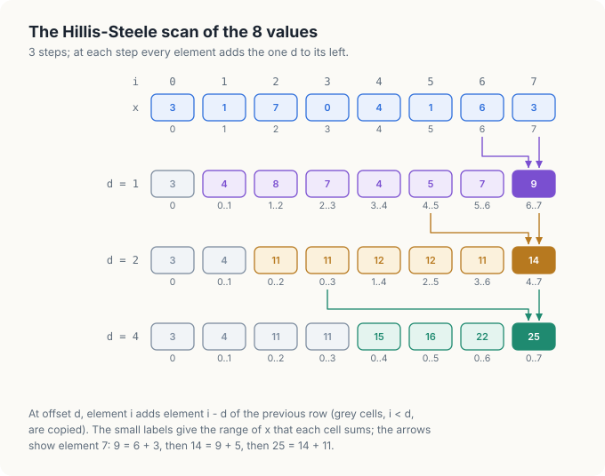
<figcaption><b>Figure 21.4</b> The Hillis-Steele scan of the 8 values. Grey cells have no partner and are copied. The arrows follow position 7.</figcaption>
</figure>

After the step with offset 4, every row of ranges starts at 0: the last row is the inclusive
scan. This algorithm is due to Hillis and Steele, and is called the Hillis-Steele scan.

### 21.4.2 Blocks, shared memory and the barrier

Every step reads the values that the previous step wrote, and those values were written by other
threads. The threads therefore need a memory they all can read and write, and a way to wait for
each other between steps. The GPU provides both inside a block.

<div class="definition">

<span class="box-label">Definition 21.6</span> **Block and shared memory.** A **block** is a
group of up to 1,024 threads that run on the same streaming multiprocessor (SM) of the GPU.
**Shared memory** is a small memory of each SM, a few cycles away, that every thread of a block
can read and write and that no thread of another block can access.

*Example.* We scan our 8 values with 1 block of 8 threads, thread \\(i\\) for position \\(i\\),
and keep the values in shared memory.

</div>

<div class="definition">

<span class="box-label">Definition 21.7</span> **Barrier.** A barrier is a point in a kernel that
no thread of a block may pass until every thread of the block has reached it. In cuda-oxide a
barrier is written `thread::sync_threads()`, and in CUDA C++ `__syncthreads()`.

*Example.* With a barrier at the end of each step, no thread starts the step with offset 2 until
all 8 threads have finished the step with offset 1.

</div>

A step reads the values of the previous step and writes new ones. If the new values overwrite the
old ones in the same array, a thread may read a value that its neighbour has already replaced. We
avoid this with 2 arrays: every step reads 1 and writes the other, and the next step exchanges
their roles.

<div class="definition">

<span class="box-label">Definition 21.8</span> **Double buffer.** A double buffer is a pair of
arrays \\(a\\) and \\(b\\) in which each step of an algorithm reads only \\(a\\) and writes only
\\(b\\), after which the 2 names are exchanged.

*Example.* In the step with offset 1, thread 2 reads \\(a[2] = 7\\) and \\(a[1] = 1\\) and writes
\\(b[2] = 8\\); \\(a[1]\\) keeps the value 1 until the step is over, whatever thread 1 does.

</div>

### 21.4.3 The algorithm

Every thread of the block executes the following procedure. The arrays \\(a\\) and \\(b\\) live
in shared memory.

<div class="algo">
<p class="algo-name">Hillis-Steele-Scan(\(x, y, n\))</p>
<ol>
<li>\(i\) = the index of this thread in the block <span class="c">// 1 thread per value, \(n\) threads</span></li>
<li>\(a[i] = x_i\)</li>
<li><span class="sc">Barrier</span>() <span class="c">// every value is in \(a\)</span></li>
<li>for \(d = 1, 2, 4, \ldots\) while \(d &lt; n\) {</li>
<li style="--d:1">if \(i \ge d\): \(b[i] = a[i] + a[i - d]\) <span class="c">// reads only \(a\), writes only \(b\)</span></li>
<li style="--d:1">else: \(b[i] = a[i]\)</li>
<li style="--d:1"><span class="sc">Barrier</span>() <span class="c">// the step is complete</span></li>
<li style="--d:1">exchange the names \(a\) and \(b\)</li>
<li>}</li>
<li>\(y_i = a[i]\)</li>
</ol>
</div>

Line 2 copies the input into shared memory, and the barrier in line 3 makes sure that every
value is there before any thread reads a neighbour's value. Lines 5 and 6 are 1 step of Figure
21.4. Line 7 is the barrier that ends the step, and line 8 makes the array written in this step the input of the
next step. In Section 21.6 we remove line 7 and then line 8, and show the wrong values
that each removal produces.

### 21.4.4 Counting the work

In the step with offset \\(d\\), the \\(n - d\\) threads with \\(i \ge d\\) perform 1 addition each.
Our example performs \\(7 + 6 + 4 = 17\\) additions in 3 steps, against 7 additions in 7 steps
for the sequential loop. In general the offsets are \\(1, 2, \ldots, n/2\\) for \\(n\\) a power
of 2, there are \\(\log_2 n\\) steps, and the work is

\\[ \sum_{k=0}^{\log_2 n - 1} (n - 2^k) = n \log_2 n - (n - 1). \\]

For a block of 1,024 values, the scan takes 10 steps and 11 barriers, and performs 9,217
additions where the sequential loop performs 1,023. The Hillis-Steele scan buys its few steps
with about \\(\log_2 n\\) times the work.

<div class="exercises">

Exercises

21.8 Carry out Hillis-Steele-Scan on \\((2, 0, 5, 1, 1, 3, 0, 4)\\) and write the range under
each cell, as in Figure 21.4.<br>
21.9 How many additions does Hillis-Steele-Scan perform for \\(n = 16\\), and how many of them
does the sequential loop need?<br>
21.10 In which step does position 5 reach its final value? What does it do in the remaining
steps?

</div>

## 21.5 The Blelloch scan

### 21.5.1 Work efficiency

An algorithm is **work-efficient** if it performs, up to a constant factor, no more operations
than the best sequential algorithm. The Hillis-Steele scan is not: on 1,024 values it performs 9
times the additions of the loop. A GPU block can absorb some extra work, since many of its
threads would otherwise wait, but the extra additions still occupy arithmetic units and, more
importantly, shared memory, which every addition of line 5 reads twice and writes once. In 1990
Blelloch described a scan that performs \\(2(n - 1)\\) additions in \\(2 \log_2 n\\) steps. It
works in 2 phases on a single array.

### 21.5.2 The up-sweep

The first phase builds the tree of Figure 21.3 in place. At distance \\(d = 1\\), every odd
position \\(i\\) adds position \\(i - 1\\): positions 1, 3, 5 and 7 receive the pair sums 4, 7, 5
and 9. At distance 2, positions 3 and 7 add positions 1 and 5 and receive 11 and 14. At distance 4,
position 7 adds position 3 and receives 25. Figure 21.5 shows the 3 levels.

<figure>
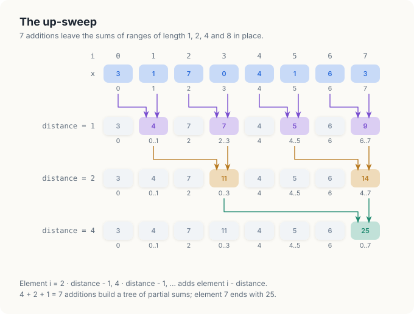
<figcaption><b>Figure 21.5</b> The up-sweep. At distance \(d\), positions \(2d - 1, 4d - 1, \ldots\) add the position \(d\) to their left.</figcaption>
</figure>

The up-sweep performs \\(4 + 2 + 1 = 7\\) additions, \\(n - 1\\) in general, the same as the
sequential loop. It leaves a mixture of results. Position 7 holds the total, 25, and position 3
holds \\(S[0..3] = 11\\), but position 5 holds \\(S[4..5] = 5\\), which is neither \\(y_5 = 16\\)
nor \\(e_5 = 15\\).

<div class="key-observation">

<span class="box-label">Key observation</span> After the up-sweep, every position in the right
half of the array needs, to complete its total, the sum of the whole left half, and that sum,
\\(S[0..3] = 11\\), already sits at position 3. The same holds inside each half and each quarter.
Every node of the tree needs the sum of everything to its left. For a left child that sum is its
parent's, and for a right child it is its parent's plus the total of its left sibling. Passing
these sums down the tree takes 1 addition per node, \\(n - 1\\) in all.

</div>

### 21.5.3 The down-sweep

The second phase starts by setting the last position, the root of the tree, to 0: nothing lies to
the left of the whole array. Then, from the root downwards, every pair \\((i - d, i)\\) of the
up-sweep is visited again. The left position receives the value of the right one, the sum of
everything to the left of the pair. The right position receives that value plus the old left
value, the total of its left sibling. Figure 21.6 shows the 3 levels on our values.

<figure>
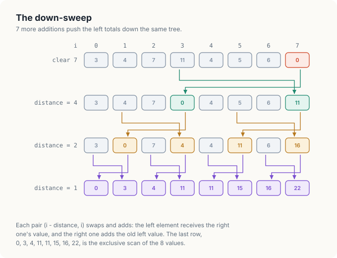
<figcaption><b>Figure 21.6</b> The down-sweep. Each pair swaps and adds; the last row is the exclusive scan.</figcaption>
</figure>

Follow position 5. At distance 2, the pair (5, 7) holds (5, 11). Position 5 receives 11, the sum
of everything left of the pair, and position 7 receives \\(11 + 5 = 16\\). At distance 1, the pair
(4, 5) holds (4, 11): position 4 receives 11 and position 5 receives \\(11 + 4 = 15 = e_5\\). The
last row is the exclusive scan \\((0, 3, 4, 11, 11, 15, 16, 22)\\); adding \\(x_i\\) to each
position gives the inclusive scan.

### 21.5.4 The algorithm

A block of \\(n/2\\) threads scans \\(n\\) values, 2 per thread, in 1 array \\(s\\) in shared
memory. At distance \\(d\\), thread \\(t\\) handles the pair whose right position is
\\(i = (2t + 2)d - 1\\), and only the first \\(n/(2d)\\) threads have a pair.

<div class="algo">
<p class="algo-name">Blelloch-Scan(\(x, y, n\))</p>
<ol>
<li>\(t\) = the index of this thread in the block <span class="c">// \(n/2\) threads</span></li>
<li>\(s[2t] = x_{2t}\), \(s[2t + 1] = x_{2t+1}\)</li>
<li>for \(d = 1, 2, 4, \ldots\) while \(d &lt; n\) { <span class="c">// up-sweep</span></li>
<li style="--d:1"><span class="sc">Barrier</span>()</li>
<li style="--d:1">if \(t &lt; n/(2d)\) {</li>
<li style="--d:2">\(i = (2t + 2)d - 1\)</li>
<li style="--d:2">\(s[i] = s[i] + s[i - d]\)</li>
<li style="--d:1">}</li>
<li>}</li>
<li><span class="sc">Barrier</span>()</li>
<li>if \(t = 0\): \(s[n - 1] = 0\) <span class="c">// the root: nothing to its left</span></li>
<li>for \(d = n/2, n/4, \ldots, 1\) { <span class="c">// down-sweep</span></li>
<li style="--d:1"><span class="sc">Barrier</span>()</li>
<li style="--d:1">if \(t &lt; n/(2d)\) {</li>
<li style="--d:2">\(i = (2t + 2)d - 1\)</li>
<li style="--d:2">\((s[i - d],\ s[i]) = (s[i],\ s[i] + s[i - d])\) <span class="c">// swap and add</span></li>
<li style="--d:1">}</li>
<li>}</li>
<li><span class="sc">Barrier</span>()</li>
<li>\(y_{2t} = s[2t]\), \(y_{2t+1} = s[2t+1]\) <span class="c">// the exclusive scan</span></li>
</ol>
</div>

Lines 3 to 9 are the up-sweep of Figure 21.5 and lines 12 to 18 the down-sweep of Figure 21.6.
Within 1 level, the pairs of different threads do not overlap, so no 2 threads touch the same
position between 2 barriers. Line 16 assigns both positions at once from their old values; the
code keeps the old left value in a register.

### 21.5.5 Comparing the 3 scans

The up-sweep performs \\(n - 1\\) additions and so does the down-sweep, so the Blelloch scan
performs \\(2(n - 1)\\) in total, 14 for our example and 2,046 for 1,024 values: twice the work
of the loop, and about 1/4.5 of the work of the Hillis-Steele scan. It pays with steps: \\(2
\log_2 n\\) levels, 20 for 1,024 values, and 21 barriers. Figure 21.7 compares the 3 algorithms.

<figure>
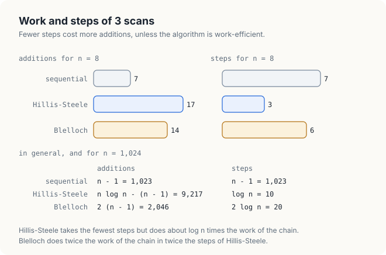
<figcaption><b>Figure 21.7</b> Work and steps of the 3 scans, on the example and for 1,024 values.</figcaption>
</figure>

Which of the 2 parallel scans is faster on a GPU cannot be read from Figure 21.7 alone. The answer
is set by what a step, an addition and a barrier cost on the hardware. We measure
both in Section 21.11.

<div class="exercises">

Exercises

21.11 Carry out the up-sweep and the down-sweep on \\((2, 0, 5, 1, 1, 3, 0, 4)\\).<br>
21.12 At distance \\(d = 2\\) of the up-sweep, which threads have a pair, and which positions
do they read and write?<br>
21.13 Why must line 11 set \\(s[n-1]\\) to 0 rather than leave the total there? What would the
last row of Figure 21.6 be without it?

</div>

## 21.6 Correctness

The threads of a block run at different speeds, and they read and write the same shared-memory
slots. Without coordination, 2 things can go wrong: a thread can read a slot before the step that
fills it is over, or it can read a slot that the current step has already changed. We now remove
line 7 of Hillis-Steele-Scan, and then line 8, and watch each error happen on our example.

### 21.6.1 The barrier at the end of a step

Suppose we delete line 7, the barrier that ends each step. In the step with offset 1, thread 2
computes \\(b[2] = a[2] + a[1] = 7 + 1 = 8\\) and moves on to the step with offset 2, where it
needs \\(b[0]\\). Thread 0 is running late and has not yet written \\(b[0] = a[0] = 3\\) (Figure
21.8).

<figure>
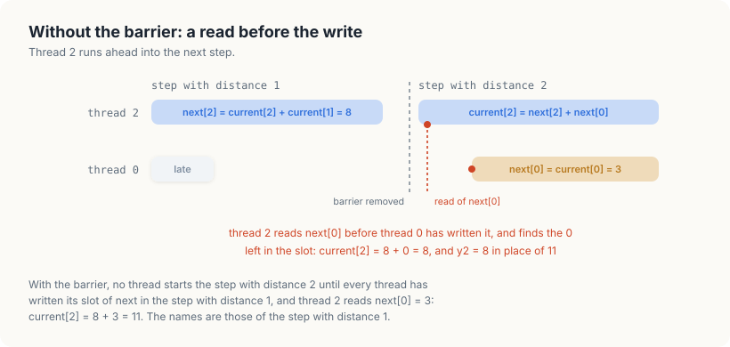
<figcaption><b>Figure 21.8</b> Without line 7. Thread 2 reads \(b[0]\) before thread 0 has written it.</figcaption>
</figure>

The slot still holds whatever it held before the kernel, and thread 2 computes \\(a[2] = 8 +
b[0]\\) from it. On the GPU we measured, the slot held 0, and we get \\(y_2 = 8\\) instead of 11.
We removed the barrier from the C++ program and ran it:

```console
$ ./nobarrier                                   # line 7 deleted
scans of 3 1 7 0 4 1 6 3
  Hillis-Steele 3 4 8 7 7 6 14 9
```

Position 2 holds 8, the value predicted by Figure 21.8, and the 5 positions after it are wrong as
well, because each of them read at least 1 slot too early. The output was the same in 3 runs, and the program reported FAILED for the array of 16,777,216
values. Line 7
prevents this error: no thread may start a step until every thread has finished the previous one.

### 21.6.2 The second buffer

Now we restore line 7 and delete line 8 instead, so that every step reads and writes the same
array: line 5 becomes \\(a[i] = a[i] + a[i - d]\\). In the step with offset 1, thread 1 computes
\\(a[1] = a[1] + a[0] = 4\\). Thread 2 is late, and when it reads \\(a[1]\\) it finds 4 instead of
1 (Figure 21.9).

<figure>
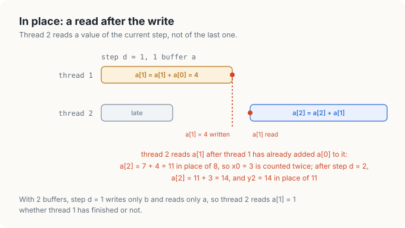
<figcaption><b>Figure 21.9</b> Without line 8. Thread 2 reads a value that the current step has already changed.</figcaption>
</figure>

Thread 2 computes \\(a[2] = 7 + 4 = 11\\) instead of 8: its range now counts \\(x_0\\) twice.
After the step with offset 2 it holds \\(11 + 3 = 14\\), and we get \\(y_2 = 14\\) instead of 11.
We deleted line 8 from the C++ program and ran it 3 times. The 8 values came out right every
time:

```console
$ ./inplace                                     # line 8 deleted
scans of 3 1 7 0 4 1 6 3
  Hillis-Steele 3 4 11 11 15 16 22 25
```

The scan of 16,777,216 values failed in all 3 runs. We added to the program a count of the wrong
values and the position of the first one:

```console
  Hillis-Steele: 16768480 of 16777216 values wrong, first at 8288 (tile 8, position 96)
  Hillis-Steele: 16766720 of 16777216 values wrong, first at 6848 (tile 6, position 704)
  Hillis-Steele: 16764032 of 16777216 values wrong, first at 6848 (tile 6, position 704)
```

In almost every tile, every thread read \\(a[i - d]\\) before the thread that owns that slot had
updated it, and the tile was scanned correctly; a single block scanned on its own 1,000 times in a
separate test never went wrong. In a few of the 16,384 tiles, 1 warp updated its values before
another warp had read them, as in Figure 21.9, and the wrong total of that tile reached every
later value through the tile offsets of Section 21.7. Nothing in the hardware or in CUDA fixes the
order of 2 warps inside a step, so a test on a small input cannot show that this kernel is
correct. Only an argument about every possible order can, and for the in-place kernel that
argument fails at Figure 21.9.

### 21.6.3 A proof of correctness

With lines 7 and 8 in place, we can prove that Hillis-Steele-Scan computes the inclusive scan.
The idea is to watch the value \\(a[i]\\) of 1 thread grow step by step, as in Figure 21.10. At
the start of the step with offset \\(d\\), it is the sum of the last \\(d\\) inputs that end at
position \\(i\\), or of all of them from position 0 if there are fewer.

<figure>
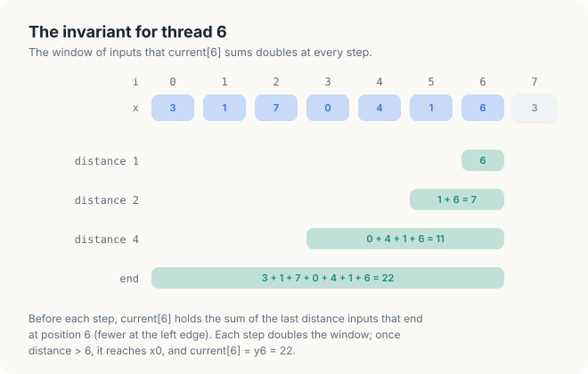
<figcaption><b>Figure 21.10</b> The loop invariant for thread 6. Before the step with offset \(d\), \(a[6]\) sums a window of \(d\) inputs.</figcaption>
</figure>

<div class="theorem">

<span class="box-label">Theorem 21.1</span> When Hillis-Steele-Scan finishes, \\(y_i = S[0..i]\\)
for every \\(i \in [0, n)\\).

</div>

<div class="proof">

*Proof.* Write \\(\ell(i, d) = \max(0, i - d + 1)\\) for the first position of the window. We show
that the loop of lines 4 to 9 maintains the invariant

\\[ a[i] = S[\ell(i, d)\,..\,i] \quad \text{for every } i \in [0, n), \text{ at the start of the
iteration with offset } d. \\]

*Initialization.* Before the first iteration, \\(d = 1\\), and line 2 stored \\(a[i] = x_i =
S[i..i]\\). The barrier in line 3 makes all \\(n\\) stores complete before any thread reads
\\(a\\).

*Maintenance.* Assume the invariant holds at the start of the iteration with offset \\(d\\). In
lines 5 and 6 each thread reads only \\(a\\) and writes only its own slot of \\(b\\), so every
value it reads is a value of the start of the iteration; this excludes the error of Section
21.6.2. If \\(i \ge d\\), thread \\(i\\) writes \\(S[\ell(i, d)..i] + S[\ell(i - d, d)..i - d]\\).
The second range ends at \\(i - d\\), 1 position before the first range begins, and starts at
\\(\ell(i, 2d)\\), so by Definition 21.5 the sum is \\(S[\ell(i, 2d)..i]\\). If \\(i < d\\), then
\\(\ell(i, d) = \ell(i, 2d) = 0\\) and thread \\(i\\) copies \\(S[0..i]\\) unchanged. The barrier
in line 7 completes every write to \\(b\\) before any thread passes it; this excludes the error of
Section 21.6.1. After line 8 exchanges the names, \\(a[i] = S[\ell(i, 2d)..i]\\) at the start of
the iteration with offset \\(2d\\).

*Termination.* The loop ends with the first offset \\(d \ge n\\). Then \\(i - d + 1 \le 0\\) for
every \\(i < n\\), so \\(\ell(i, d) = 0\\), \\(a[i] = S[0..i]\\), and line 10 stores it.

</div>

The proof uses each of the 3 barriers and the double buffer exactly once, and it uses no fact
about the speed of the threads. The same argument, applied level by level, shows that the
Blelloch scan is correct; Exercise 21.16 asks for its invariant. A barrier works only if every
thread of the block reaches it. In both scans, the threads without a partner in a step do not
leave the loop; they copy their value, or do nothing, and wait at the barrier with the others.

<div class="rule-box">

<span class="box-label">Rule</span> Every thread of a block must reach every barrier. Never place a
barrier where some threads of the block can skip it, and never let a step read a slot that the
same step writes.

</div>

<div class="exercises">

Exercises

21.14 Without line 7, could thread 7 read a wrong value in the step with offset 4? Give a
schedule in which it does, and the value of \\(y_7\\) it produces.<br>
21.15 Explain why the proof of Theorem 21.1 breaks if a thread with \\(i < d\\) leaves the loop
early, even though its value no longer changes.<br>
21.16 State an invariant for the up-sweep of Blelloch-Scan: what does \\(s[i]\\) hold after the
level with distance \\(d\\)?

</div>

## 21.7 Scanning more than 1 block

### 21.7.1 Tiles

A block holds at most 1,024 threads, and its threads cooperate only through its own shared
memory and barriers. The arrays we want to scan hold millions of values. We therefore cut the
array into **tiles** of 1,024 values, 1 tile per block, and every block scans its tile on its own.
The result is correct inside each tile, but each tile has started from 0, while the true total
of its first value must include every value of the earlier tiles.

Figure 21.11 shows the repair on our 8 values, cut into 2 tiles of 4. Tile 0, \\((3, 1, 7, 0)\\),
scans to \\((3, 4, 11, 11)\\), and tile 1, \\((4, 1, 6, 3)\\), to \\((4, 5, 11, 14)\\). The last
value of each tile scan is the tile's total: 11 and 14. Their inclusive scan, \\((11, 25)\\),
says that the values before tile 1 add up to 11. Adding 11 to every value of tile 1 gives
\\((15, 16, 22, 25)\\), and the whole scan is correct.

<figure>
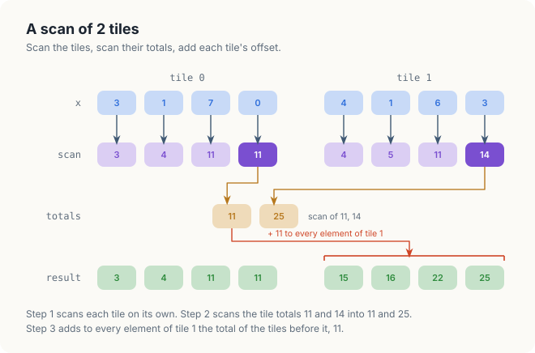
<figcaption><b>Figure 21.11</b> A scan of 2 tiles: scan each tile, scan the tile totals, add each tile's offset.</figcaption>
</figure>

### 21.7.2 The algorithm

The scan of the tile totals is itself a scan, of an array 1,024 times shorter, so the procedure
calls itself. 16,777,216 values form 16,384 tiles, whose totals form 16 tiles, whose totals fit
in 1 tile.

<div class="algo">
<p class="algo-name">Scan(\(x, y, n\))</p>
<ol>
<li>\(m = \lceil n / 1024 \rceil\) <span class="c">// the number of tiles</span></li>
<li>launch 1 block per tile: scan tile \(k\) of \(x\) into \(y\), write its total to \(t_k\)</li>
<li>if \(m > 1\) {</li>
<li style="--d:1"><span class="sc">Scan</span>(\(t, t', m\)) <span class="c">// the tile totals, recursively</span></li>
<li style="--d:1">launch 1 block per tile: add \(t'_{k-1}\) to every value of tile \(k \ge 1\)</li>
<li>}</li>
</ol>
</div>

The 2 launches of lines 2 and 5 replace a barrier across blocks, which the GPU does not provide:
a kernel launch starts only after the previous launch on the same stream has finished, so line 5
reads totals that are complete.

### 21.7.3 Counting the traffic

The scan reads every input value once and writes every output once, 8 bytes per value of 4
bytes, if nothing else is stored. Scan moves more. Line 2 reads the input and writes the tile
scans, and line 5 reads the tile scans again and writes them again: 16 bytes per value, plus 1
total per 1,024 values. On 16,777,216 values, the minimum is 134 MB and Scan moves 268 MB. A scan
that passes each tile's total directly to the next block while the kernel runs, a single-pass
scan, avoids the second pass; in Chapter 11 we measured one from the CUB library.

<div class="exercises">

Exercises

21.17 Carry out Figure 21.11 with 4 tiles of 2 values. What are the tile totals, their scan, and
the offsets?<br>
21.18 How many levels of recursion does Scan need for \\(n = 2^{30}\\), and how many tiles does
each level have?

</div>

## 21.8 Stream compaction

### 21.8.1 The problem

**Stream compaction** takes an array and a condition, and writes the values that satisfy the
condition to the front of an output array, in their input order. It appears wherever a
computation produces many candidates and keeps a few: particles still inside a simulation,
rays that hit a surface, detections above a threshold. We keep the values \\(x \ge 3\\) of our
example. They are 3, 7, 4, 6 and 3, at positions 0, 2, 4, 6 and 7, and the output is
\\((3, 7, 4, 6, 3)\\).

On a CPU, compaction is 1 loop with a counter of the values written so far.

<div class="algo">
<p class="algo-name">Sequential-Compact(\(x, out, n\))</p>
<ol>
<li>\(j = 0\) <span class="c">// values written so far</span></li>
<li>for \(i \in [0, n)\) {</li>
<li style="--d:1">if \(x_i \ge 3\) {</li>
<li style="--d:2">\(out_j = x_i\)</li>
<li style="--d:2">\(j = j + 1\)</li>
<li style="--d:1">}</li>
<li>}</li>
<li>return \(j\) <span class="c">// the number of kept values</span></li>
</ol>
</div>

The counter \\(j\\) is a chain like the one of Figure 21.2: the position of a kept value depends on
every earlier decision. When line 4 writes \\(x_4 = 4\\), \\(j = 2\\), because 2 values, at
positions 0 and 2, were kept before it.

<div class="key-observation">

<span class="box-label">Key observation</span> When line 4 writes \\(x_i\\), the counter \\(j\\)
equals the number of kept values before position \\(i\\). With a flag \\(f_i\\) that is 1 for a
kept value and 0 otherwise, that number is the exclusive scan of the flags at \\(i\\). A parallel
scan gives every kept value its output position at once.

</div>

<div class="definition">

<span class="box-label">Definition 21.9</span> **Flags and scatter.** The **flag** of a value is
1 if the value is kept and 0 if it is removed. A **scatter** is a write in which each thread
writes its value to a position computed from data, rather than to its own index.

*Example.* The flags of our values for \\(x \ge 3\\) are \\((1, 0, 1, 0, 1, 0, 1, 1)\\); their
exclusive scan is \\((0, 1, 1, 2, 2, 3, 3, 4)\\), and \\(x_4 = 4\\) is scattered to position 2.

</div>

### 21.8.2 The algorithm

<div class="algo">
<p class="algo-name">Parallel-Compact(\(x, out, n\))</p>
<ol>
<li>for every \(i \in [0, n)\) in parallel: \(f_i = 1\) if \(x_i \ge 3\), else 0 <span class="c">// kernel 1</span></li>
<li>\(s\) = the inclusive scan of \(f\) <span class="c">// Scan of Section 21.7</span></li>
<li>for every \(i \in [0, n)\) in parallel: if \(f_i = 1\): \(out_{s_i - 1} = x_i\) <span class="c">// kernel 2, a scatter</span></li>
<li>return \(s_{n-1}\)</li>
</ol>
</div>

Line 3 uses \\(s_i - 1\\), the inclusive scan minus the flag 1, which is the exclusive scan at
\\(i\\). Figure 21.12 follows the algorithm on our values. The 5 kept values read their positions
0, 1, 2, 3 and 4 from the exclusive scan, and the count is the last inclusive value, 5.

<figure>
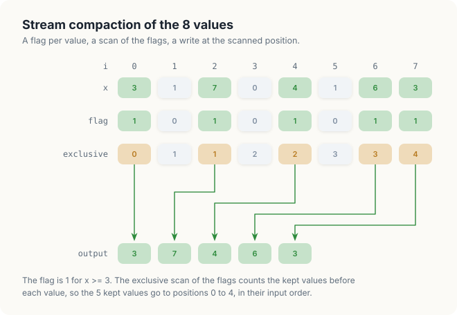= 3. Flags 1, 0, 1, 0, 1, 0, 1, 1; exclusive scan 0, 1, 1, 2, 2, 3, 3, 4. Arrows take the kept values 3, 7, 4, 6, 3 from positions 0, 2, 4, 6, 7 to output positions 0, 1, 2, 3, 4.">
<figcaption><b>Figure 21.12</b> Stream compaction of the 8 values: flags, exclusive scan, scatter.</figcaption>
</figure>

<div class="theorem">

<span class="box-label">Theorem 21.2</span> Parallel-Compact writes every kept value exactly
once, to a distinct position in \\([0, c)\\), where \\(c\\) is the number of kept values, and the
output keeps the input order.

</div>

<div class="proof">

*Proof.* Let \\(e_i = s_i - f_i\\) be the exclusive scan. Take 2 kept values at positions
\\(i < j\\). The kept values before \\(j\\) include those before \\(i\\) and \\(i\\) itself, so
\\(e_j \ge e_i + 1\\): the positions are distinct and increase with the input position, which is
the input order. The first kept value has \\(e = 0\\), and the last has \\(e = c - 1\\), since
\\(c - 1\\) kept values precede it. Every position therefore lies in \\([0, c)\\).

</div>

The proof also describes the mistake to avoid. If line 3 used the inclusive scan \\(s_i\\) as the
position, every value would land 1 position too far to the right. We made this change in the C++
program:

```console
$ ./inclusive                                   # out[s_i] in place of out[s_i - 1]
compaction of 3 1 7 0 4 1 6 3, keep x >= 3
  flags         1 0 1 0 1 0 1 1
  exclusive     0 1 1 2 2 3 3 4
  output        0 3 7 4 6
```

Position 0 keeps whatever the output buffer held, and the last kept value, 3, goes to position 5,
which the program does not read. No error is reported: position 5 lies inside the buffer of 8
values, and the writes are distinct and in bounds, only wrong. Only the comparison with the CPU
result detects the mistake.

<div class="exercises">

Exercises

21.19 Compact \\((2, 0, 5, 1, 1, 3, 0, 4)\\) with the condition \\(x \ge 1\\): give the flags,
their exclusive scan and the output.<br>
21.20 Change Parallel-Compact so that it writes the removed values, in order, after the kept
ones. Which position does a removed value at index \\(i\\) receive?

</div>

## 21.9 Compaction with warp votes

### 21.9.1 Bytes moved per value

Compaction performs almost no arithmetic, so its time is set by the bytes it moves between the
SMs and global memory. We count them per input value of 4 bytes, when half of the values are
kept. Kernel 1 reads the value and writes the flag, 8 bytes. The scan reads and writes the flags
twice, 16 bytes (Section 21.7.3). Kernel 2 reads the flag, the scan and the value, and writes half
a value on average, 14 bytes. In total, Parallel-Compact moves 38 bytes per value. The least that
any compaction must move is 1 read of each value and 1 write of each kept value, 6 bytes (Figure
21.13).

<figure>
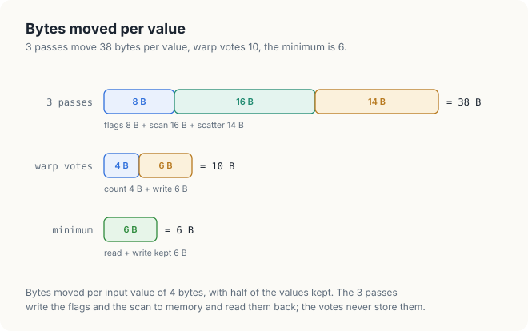
<figcaption><b>Figure 21.13</b> Bytes moved per value by the 2 compaction methods, with half of the values kept.</figcaption>
</figure>

Most of the 38 bytes go to storing the flags and their scan and reading them back. A method that
computes the flags and the positions inside each block, while it reads the values, never has to
store them. The tool for that is the warp vote.

### 21.9.2 Warps and ballots

<div class="definition">

<span class="box-label">Definition 21.10</span> **Warp and lane.** A **warp** is a group of 32
threads of a block that the SM executes together, 1 instruction for all 32 at a time. Threads
\\(32w\\) to \\(32w + 31\\) of a block form warp \\(w\\). The position of a thread inside its warp,
0 to 31, is its **lane**.

*Example.* A block of 256 threads has 8 warps; thread 70 is lane 6 of warp 2.

</div>

<div class="definition">

<span class="box-label">Definition 21.11</span> **Ballot and population count.** A **ballot** is
an instruction that all 32 lanes of a warp execute together, each with a condition; it returns to
every lane the same 32-bit word, whose bit \\(k\\) is 1 if the condition of lane \\(k\\) is true.
The **population count** of a word, popcount for short, is the number of its bits that are 1.

*Example.* For 8 lanes holding our values, the ballot of \\(x \ge 3\\) has the bits
\\((1, 0, 1, 0, 1, 0, 1, 1)\\) for lanes 0 to 7, and its popcount is 5.

</div>

A ballot hands every lane the flags of the whole warp in 1 instruction. Lane \\(k\\) obtains its
exclusive scan by keeping only the bits of the lanes below it, with the mask
\\(2^k - 1\\), and counting them. Figure 21.14 does this for lane 4 of a warp drawn with 8 lanes:
the bits of lanes 0 to 3 are \\((1, 0, 1, 0)\\), their popcount is 2, and \\(x_4 = 4\\) goes to
position 2, as in Figure 21.12.

<figure>
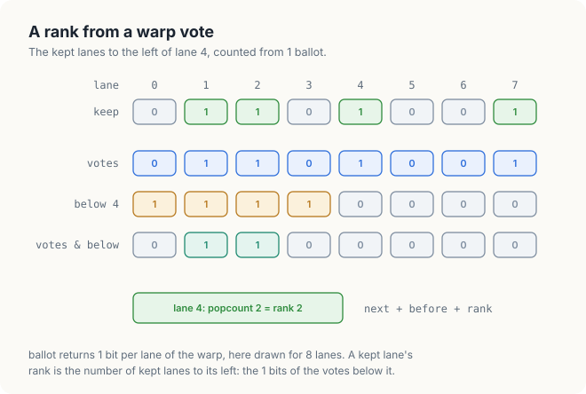= 3 is 1, 0, 1, 0, 1, 0, 1, 1. The mask of the lanes below lane 4 is 1, 1, 1, 1, 0, 0, 0, 0; their combination 1, 0, 1, 0, 0, 0, 0, 0 has 2 bits, so lane 4 writes at position 2. The ballot has 5 bits: 5 values are kept.">
<figcaption><b>Figure 21.14</b> A ballot gives every lane its exclusive scan within the warp, and the warp's count.</figcaption>
</figure>

### 21.9.3 The algorithm

The method runs 2 kernels on tiles of 1,024 values, 1 block of 256 threads per tile, each thread
handling 4 values. The first kernel counts the kept values of every tile. Scan turns the 16,384
counts into the position of each tile's first kept value. The second kernel reads the values
again, and places every kept value after the kept values of the earlier tiles, of the earlier
steps of its own tile, of the earlier warps of the step, and of the earlier lanes of its warp.

<div class="algo">
<p class="algo-name">Compact-Votes(\(x, out, n\)) <span class="c">// block \(b\), thread \(t\) in warp \(w\)</span></p>
<ol>
<li>\(next\) = the scanned count of tiles \(0\) to \(b - 1\) <span class="c">// 0 for \(b = 0\)</span></li>
<li>for \(k \in [0, 4)\) {</li>
<li style="--d:1">\(i = 1024b + 256k + t\), \(keep = (i &lt; n\) and \(x_i \ge 3)\)</li>
<li style="--d:1">\(v\) = <span class="sc">Ballot</span>(\(keep\))</li>
<li style="--d:1">lane 0 of warp \(w\): \(c[w]\) = <span class="sc">Popc</span>(\(v\)) <span class="c">// \(c\) in shared memory</span></li>
<li style="--d:1"><span class="sc">Barrier</span>()</li>
<li style="--d:1">\(before = c[0] + \cdots + c[w - 1]\), \(total = c[0] + \cdots + c[7]\)</li>
<li style="--d:1">if \(keep\): \(out[next + before + \)<span class="sc">Popc</span>\((v \wedge (2^{lane} - 1))] = x_i\)</li>
<li style="--d:1">\(next = next + total\)</li>
<li style="--d:1"><span class="sc">Barrier</span>() <span class="c">// \(c\) is read before the next step writes it</span></li>
<li>}</li>
</ol>
</div>

The order of the positions is the order of the input. Value \\(1024b + 256k + t\\) is processed in
step \\(k\\), by warp \\(t / 32\\), in lane \\(t \bmod 32\\). Line 8 orders the kept values
first by tile, then by step, then by warp, then by lane, which is the order of their indices. The
argument of Theorem 21.2 then applies unchanged. The first kernel, Count-Kept, is lines 2 to 6
with \\(next\\) replaced by a running count, followed by the sum of the 8 warp counts.

The values are read twice and the kept values written once: 4 + 4 + 2 = 10 bytes per value with
half kept, and the scan of 1 count per 1,024 values adds almost nothing. Figure 21.13 compares the
2 methods.

<div class="exercises">

Exercises

21.21 For a warp of 32 lanes in which lanes 3, 4, 10 and 31 keep their values, give the ballot
as a binary number and the position of lane 10.<br>
21.22 Why does line 3 compute the condition \\(i < n\\) instead of skipping line 4 for the lanes
beyond the end of the array?

</div>

## 21.10 Implementation

### 21.10.1 The Hillis-Steele kernel

We now turn the algorithms into code. Listing 21.1 is Hillis-Steele-Scan, for tiles of 1,024
values and blocks of 1,024 threads.

<p class="listing"><b>Listing 21.1</b> The Hillis-Steele scan of 1 tile.</p>

<div class="code-tabs">
<div class="code-tab" data-lang="Rust">

```rust,ignore
mod kernels {
    // ...
{{#include ../../../../code/oxide/ch21_scan_compaction/src/main.rs:37:84}}
    // ...
}
```

</div>
<div class="code-tab" data-lang="C++">

```cpp
{{#include ../../../../code/cuda/ch21_scan_compaction/scan_compaction.cu:50:78}}
```

</div>
</div>

The load into the first buffer is line 2 of the pseudocode, and the first barrier is line 3. The
loop over `step` is lines 4 to 9, with \\(d = 2^{step}\\); `src` and `dst` are the offsets of
\\(a\\) and \\(b\\) inside 1 shared array of 2,048 values, and `src = dst` is line 8. The barrier
inside the loop is line 7, outside every `if`, so every thread reaches it. The last thread of the
block also writes the tile's total to `sums`, for line 2 of Scan.

The 2 languages differ in 3 places. Shared memory in cuda-oxide is a `static mut` of type
`SharedArray<u32, 2048>`, whose length is part of its type, where C++ declares a `__shared__`
array. Every access to it is `unsafe`, because the compiler cannot see the barriers that make the
accesses safe, so each `unsafe` block carries a `// SAFETY:` comment that states the argument of
Section 21.6.3. The output `y` has the type `DisjointSlice<u32>`, which can be written only
through `get_mut(idx)` with the index that `thread::index_1d()` returned to this thread: with 1
thread per value, the type itself proves that no 2 threads write the same element, and the write
needs no `unsafe`. The total, written at the block number rather than the thread index, uses
`get_unchecked_mut` with its own safety comment. Finally, the loop runs over a counter `step` rather than over `d`. For a loop that
doubles `d`, the cuda-oxide compiler did not unroll the loop and reported "no recognized induction
variable"; a counter that grows by 1 is recognized, and `d` is computed from it.

### 21.10.2 The Blelloch kernel

Listing 21.2 is Blelloch-Scan for blocks of 512 threads. It converts the exclusive result of line
20 into the inclusive scan by adding the 2 inputs, which each thread kept in registers, and
thread 0 saves the total from \\(s[1023]\\) before line 11 replaces it with 0.

<p class="listing"><b>Listing 21.2</b> The Blelloch scan of 1 tile.</p>

<div class="code-tabs">
<div class="code-tab" data-lang="Rust">

```rust,ignore
mod kernels {
    // ...
{{#include ../../../../code/oxide/ch21_scan_compaction/src/main.rs:86:157}}
    // ...
}
```

</div>
<div class="code-tab" data-lang="C++">

```cpp
{{#include ../../../../code/cuda/ch21_scan_compaction/scan_compaction.cu:80:122}}
```

</div>
</div>

The loops of the up-sweep and the down-sweep are lines 3 to 9 and 12 to 18 of the pseudocode,
with `i = (2 * t + 2) * d - 1` as in line 6. The swap-and-add of line 16 keeps the old left value
in `left`. Each thread writes 2 elements of `y`, at \\(2t\\) and \\(2t + 1\\), which are not the
index of the thread, so the Rust kernel writes them through `get_unchecked_mut`; the safety
comment states that the 2 positions belong to thread \\(t\\) alone.

### 21.10.3 The scan of many tiles

Listing 21.3 is Scan of Section 21.7.2 on the host. The 3 tile kernels have the same interface,
so the function takes the method as a parameter.

<p class="listing"><b>Listing 21.3</b> The scan of an array of any length.</p>

<div class="code-tabs">
<div class="code-tab" data-lang="Rust">

```rust,ignore
{{#include ../../../../code/oxide/ch21_scan_compaction/src/main.rs:425:453}}

{{#include ../../../../code/oxide/ch21_scan_compaction/src/main.rs:455:474}}
```

</div>
<div class="code-tab" data-lang="C++">

```cpp
{{#include ../../../../code/cuda/ch21_scan_compaction/scan_compaction.cu:191:202}}

{{#include ../../../../code/cuda/ch21_scan_compaction/scan_compaction.cu:204:214}}
```

</div>
</div>

The C++ function scans the tile totals in place, in `scratch`, which holds every level of the
recursion 1 after another. A Rust function cannot borrow 1 buffer as both its input `&[u32]` and
its output `DisjointSlice<u32>`. The Rust version therefore gives each level its own pair of
buffers, `totals` and `scanned`, allocated once by `scan_levels` before any timing starts. It hands
the remaining levels to the recursive call with `split_first_mut`. Both versions launch the 3 kernels
on 1 stream, so each launch starts after the previous one has finished.

### 21.10.4 The compaction kernels

Listing 21.4 is the scatter of line 3 of Parallel-Compact, and Listing 21.5 is Compact-Votes.

<p class="listing"><b>Listing 21.4</b> The scatter of a compaction.</p>

<div class="code-tabs">
<div class="code-tab" data-lang="Rust">

```rust,ignore
mod kernels {
    // ...
{{#include ../../../../code/oxide/ch21_scan_compaction/src/main.rs:269:286}}
    // ...
}
```

</div>
<div class="code-tab" data-lang="C++">

```cpp
{{#include ../../../../code/cuda/ch21_scan_compaction/scan_compaction.cu:225:233}}
```

</div>
</div>

Thread \\(i\\) writes element \\(s_i - 1\\) of the output, a position computed from the contents
of the scan buffer. No type can express a property of the contents of a buffer, so `DisjointSlice`
cannot prove that the positions are distinct, and the write uses `get_unchecked_mut`. Its safety
comment is Theorem 21.2: the kept values receive the distinct positions 0 to \\(c - 1\\), and the
output holds \\(n \ge c\\) elements. The argument depends on the scan being complete when the
scatter runs, which the single stream guarantees.

<p class="listing"><b>Listing 21.5</b> Compaction with warp votes.</p>

<div class="code-tabs">
<div class="code-tab" data-lang="Rust">

```rust,ignore
mod kernels {
    // ...
{{#include ../../../../code/oxide/ch21_scan_compaction/src/main.rs:327:378}}
}
```

</div>
<div class="code-tab" data-lang="C++">

```cpp
{{#include ../../../../code/cuda/ch21_scan_compaction/scan_compaction.cu:261:293}}
```

</div>
</div>

`warp::ballot(keep)` in Rust and `__ballot_sync(0xffffffff, keep)` in C++ are line 4 of
Compact-Votes, and `count_ones()` and `__popc` are the popcount. Every lane calls the ballot,
including the lanes whose index lies beyond the end of the array: a ballot needs all 32 lanes of
the warp, and those lanes vote false. The shared array \\(c\\) is `WARPS` in Rust and `warps` in C++, and its 2 barriers are
lines 6 and 10.

<div class="exercises">

Exercises

21.23 In Listing 21.1, `y.get_mut(idx)` returns `None` for some threads of the last block.
Which threads, for \\(n = 3{,}000\\)?<br>
21.24 Rewrite the Blelloch kernel for blocks of 1,024 threads and tiles of 2,048 values. What
must change in `scan_tiles`?

</div>

## 21.11 Measurements

### 21.11.1 Platform and method

The measurements come from a Jetson Orin NX 16 GB, an integrated GPU with 8 SMs (sm_87) and 102
GB/s of memory bandwidth. The
programs scan 16,777,216 values of 4 bytes, 64 MiB, in \\([0, 4)\\), and compact 16,777,216
values in \\([0, 100)\\) at 3 thresholds. Every result is compared value by value with the CPU.
Each time is the average of 20 runs after 0.4 s of warm-up; between runs of the same program,
times varied by up to 10%.

### 21.11.2 Results

The C++ program printed:

```console
$ ./scan_compaction
...
inclusive scans of 16777216 values, average of 20 runs
  method          blocks/SM   tiles ms   GB/s   whole ms   GB/s
  Hillis-Steele           1      5.540   24.2      7.118   18.9
  Blelloch                3      4.722   28.4      6.328   21.2
  warp shuffles           6      1.750   76.7      3.404   39.4
compaction of 16777216 values in [0, 100), average of 20 runs
  keep x >=      kept   3 passes ms   GB/s   warp votes ms   GB/s
         90   1676698          7.74    9.5            2.28   32.3
         50   8387729          8.05   12.5            2.41   41.8
         10  15100473          8.46   15.1            2.66   47.9
PASSED
```

The column "tiles" times line 2 of Scan alone: every block scans its tile of 1,024 values and
writes its total. The column "whole" times the complete scan of Section 21.7. The GB/s columns divide the bytes that the job needs by the
time: 1 read of every input and 1 write of every output, which for the scans is
\\(2 \times 4 \times 16{,}777{,}216 = 134.2\\) MB. "blocks/SM" is the number of blocks of each
kernel that fit on 1 SM at the same time; the program asks the CUDA runtime for it. The Rust program measured 5.65, 4.74 and 1.76 ms for the tiles and 7.23, 6.35 and
3.46 ms for the whole scans, within 3% of the C++ times, and compaction times within 2% of
them. Figure 21.15 draws the C++ times.

<figure>
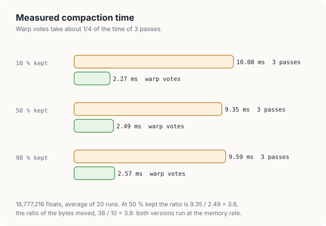
<figcaption><b>Figure 21.15</b> Measured scans and compaction of 16,777,216 values on the measured GPU.</figcaption>
</figure>

### 21.11.3 Why the work-efficient scan is not 4.5 times faster

The Blelloch scan performs 2,046 additions per tile and the Hillis-Steele scan 9,217, yet it is
only 1.17 times as fast: 4.72 ms against 5.54 ms. Both take 2.7 to 3.2 times as long as the scan
of Chapter 8, which runs at 76.7 GB/s, 75% of the memory's 102 GB/s. All 3 kernels read and write
the same 134.2 MB, so the difference lies inside the SMs. 3 costs explain it.

The first is the barrier. Removing line 7 from the Hillis-Steele kernel, as in Section 21.6.1,
gives wrong results, but it measures what the 10 barriers of the loop cost. The broken kernel
scanned the tiles in 4.03 ms instead of 5.54 ms. 27% of the time of the Hillis-Steele scan is spent
waiting at barriers.

The second is the number of blocks on an SM. A thread that waits, at a barrier or for a value
from global memory, does no work, and the SM hides that wait only if other threads are ready to
run in the meantime.

<div class="definition">

<span class="box-label">Definition 21.12</span> **Occupancy.** The occupancy of a kernel is the
number of its threads, or warps, that an SM holds at the same time, often given as a fraction of
the most the SM can hold.

*Example.* An SM of the measured GPU holds at most 1,536 threads. A block of 1,024 threads leaves room
for no second block: 1 block per SM, 2/3 of the maximum.

</div>

The Hillis-Steele kernel runs 1 block per SM. While that block waits at 1 of its 11 barriers, or
for its tile to arrive from global memory, the SM has nothing else to run. The Blelloch kernel
uses blocks of 512 threads and runs 3 per SM; its 22 barriers are twice as many, but while 1
block waits, the 2 others work. The warp-shuffle kernel runs 6 blocks of 256 threads per SM and
waits at only 2 barriers per tile.

The third is shared memory. The Hillis-Steele kernel reads 2 values and writes 1 in each of its
10 steps, about 31 accesses to shared memory per value. The Blelloch kernel reads 2 values and
writes 1 for every pair of the up-sweep, and writes 2 for every pair of the down-sweep, about 9
accesses per value in all. The warp-shuffle kernel scans 4 values per thread in registers and
exchanges values between the lanes of a warp with shuffles, which do not use shared memory at
all; it writes 1 total per warp.

The work of Figure 21.7 counts additions, and on a GPU block an addition is the cheapest part of
a step. What a step costs is set by its barrier, its accesses to shared memory, and the occupancy
that decides whether those waits overlap with other work. The scan of Chapter 8 was designed
around those 3 costs, and it is the one the compaction uses.

The whole scan adds 1.58 to 1.65 ms to each tile scan. That is the second pass of Section 21.7.3,
which reads and writes all 16,777,216 values again: 134.2 MB in 1.65 ms is 81 GB/s.

### 21.11.4 Why the warp votes are 3.3 times faster, not 3.8

With half of the values kept, the 3-pass compaction took 8.05 ms and the warp votes 2.41 ms, a
ratio of 3.3. In Section 21.9.1 we predicted the ratio of the bytes moved, 38 / 10 = 3.8. Dividing the
bytes each method moves by its time gives the rate at which it used the memory: \\(38 \times
16{,}777{,}216 = 637.5\\) MB in 8.05 ms, 79.2 GB/s, for the 3 passes, and \\(10 \times
16{,}777{,}216 = 167.8\\) MB in 2.41 ms, 69.6 GB/s, for the warp votes. Both run close to the
memory's rate, and the warp votes are faster because they move fewer bytes. They run at a
slightly lower rate because each tile waits at 8 barriers and reads its values twice in 2 separate
kernels, so each kernel has less work to overlap with its waits.

The time of the 3-pass method hardly changes with the kept fraction, 7.74 to 8.46 ms, because 24
of its 38 bytes, the flags and the scan, do not depend on it. The warp votes write more as more
values are kept, and their time grows from 2.28 to 2.66 ms.

<div class="exercises">

Exercises

21.25 Compute, from the table, the time per tile of the Blelloch kernel on 1 SM, and the number
of cycles per barrier at a clock of 1 GHz.<br>
21.26 Predict the time of the 3-pass compaction with 90% of the values kept from the byte count,
and compare with the measured value.

</div>

## 21.12 The complete programs

<p class="listing"><b>Listing 21.6</b> The complete programs. <a href="https://github.com/arpanpathak/gpu-parallel-book/blob/main/code/oxide/ch21_scan_compaction/src/main.rs">code/oxide/ch21_scan_compaction/src/main.rs</a> and <a href="https://github.com/arpanpathak/gpu-parallel-book/blob/main/code/cuda/ch21_scan_compaction/scan_compaction.cu">code/cuda/ch21_scan_compaction/scan_compaction.cu</a></p>

<div class="code-tabs">
<div class="code-tab" data-lang="Rust">

```rust,ignore
{{#include ../../../../code/oxide/ch21_scan_compaction/src/main.rs}}
```

</div>
<div class="code-tab" data-lang="C++">

```cpp
{{#include ../../../../code/cuda/ch21_scan_compaction/scan_compaction.cu}}
```

</div>
</div>

## Common mistakes

- **A missing barrier between steps.** A thread starts the next step and reads a slot that a slower
  thread has not written yet (Section 21.6.1). Every step that reads other threads' values ends
  with a barrier that every thread reaches.
- **Scanning in place.** A step that reads and writes the same array lets a thread read a value of
  the current step. The test passed on 8 values and failed on 16,777,216 (Section 21.6.2); use 2
  buffers, or keep the value to be added in a register and separate the read from the write with a
  barrier.
- **Leaving the loop early.** A thread whose value is final must still reach the barriers of the
  remaining steps, or the block waits for it forever.
- **The inclusive scan as an output position.** Every kept value lands 1 position too far, in
  bounds, with no error reported. The position is the exclusive scan, \\(s_i - f_i\\).
- **A ballot inside a branch.** A ballot needs every lane of the warp. Compute the condition for
  every lane, with the bounds test inside it, and call the ballot unconditionally.
- **Assuming that blocks see each other's results.** Blocks of 1 launch cannot wait for each other;
  the scan of many tiles crosses blocks only through a second launch.

## Summary

- The inclusive scan holds at position \\(i\\) the sum of the inputs 0 to \\(i\\); the exclusive
  scan stops before \\(i\\). The sequential scan does \\(n - 1\\) additions in a chain of \\(n -
  1\\) steps.
- Because addition is associative, a range sum is the sum of 2 adjacent range sums. Doubling the
  ranges gives the Hillis-Steele scan: \\(\log_2 n\\) steps and \\(n \log_2 n - (n - 1)\\)
  additions. Building and then descending a tree gives the Blelloch scan: \\(2 \log_2 n\\) steps and
  \\(2(n - 1)\\) additions.
- A step must not start before the previous one has ended, and must not read what it writes: 1
  barrier and 1 double buffer, both used in the proof of Theorem 21.1.
- An array of many blocks is scanned in tiles: scan the tiles, scan their totals, add the offsets.
- Stream compaction is a scan of flags followed by a scatter to the exclusive scan. Warp votes
  compute the same positions inside each block and reduce the traffic from 38 to 10 bytes per
  value.

In Chapter 22 we use the exclusive scan as the core of a radix sort, and combine it with a histogram.

## Exercises

1. Run Hillis-Steele-Scan by hand on 16 values \\(1, 2, \ldots, 16\\), and check the last row
   against \\(y_i = (i + 1)(i + 2)/2\\).
2. Prove that the up-sweep of Blelloch-Scan leaves \\(S[i - 2d + 1..i]\\) at every position
   \\(i = 2d - 1, 4d - 1, \ldots\\) after the level with distance \\(d\\).
3. A segmented scan restarts the running total at every position where a second array holds 1.
   Write the sequential algorithm, and show how Hillis-Steele-Scan can carry the segment flags.
4. Change `scan_hillis_steele` to keep 1 buffer and a register, as suggested in Common mistakes,
   with 2 barriers per step. Measure it against Listing 21.1.
5. Estimate the bytes per value of the 3-pass compaction when 10% of the values are kept, taking
   into account that memory is read in sectors of 32 bytes, and compare with the measured times.
6. Write a kernel that removes adjacent duplicates from a sorted array. Which flag does it
   compute?

## Sources and further reading

- W. D. Hillis and G. L. Steele, Jr., "Data Parallel Algorithms", *Communications of the ACM* 29(12),
  1986.
- G. E. Blelloch, "Prefix Sums and Their Applications", Technical Report CMU-CS-90-190, Carnegie
  Mellon University, 1990.
- T. H. Cormen, C. E. Leiserson, R. L. Rivest and C. Stein, *Introduction to Algorithms*, 4th ed.,
  MIT Press, 2022: loop invariants and the pseudocode conventions of this chapter.
- A. Pathak, "An Introduction to Tiled Parallel Programming, Simplified", 2026: the worked-example
  and proof style of this part of the book.
- D. Merrill and M. Garland, "Single-pass Parallel Prefix Scan with Decoupled Look-back", NVIDIA
  Technical Report NVR-2016-002, 2016.
- NVIDIA, *CUDA C++ Programming Guide*, "Warp Vote Functions" and "Synchronization Functions".
- cuda-oxide, documentation of `DisjointSlice` and `SharedArray`, crate `cuda-device`, revision
  b7fe543.
