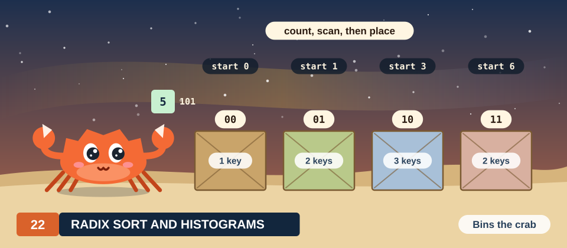

# Chapter 22: Radix Sort and Histograms

Sorting puts a list of keys in increasing order. Most sorts compare keys 2 at a time, and the
order of the comparisons depends on the keys, which makes them awkward to run on thousands of
threads. A **radix sort** compares nothing. It sorts integer keys by their digits, 1 digit per
pass, and in each pass every key computes its output position from counts: how many keys have a
smaller digit, and how many keys before it have the same digit. Both counts come from the scan of
Chapter 21, and the first one also from a histogram, the count of the keys of each digit value.

In this chapter we derive a radix sort on 8 keys of 3 bits. We start with passes of 1 bit, each of
which is 2 stream compactions, and show why every pass must keep equal digits in their input
order. We then count keys with atomic operations, measure what happens when many threads count
into the same bin, and remove most of that contention with private bins in shared memory.
Finally, a histogram and an exclusive scan give the positions of a pass on a digit of 4 bits, and
the measured sort runs 6.5 times as fast as the sort by single bits.

<div class="covers" markdown="1">

This chapter covers

- radix sort, least significant digit first, worked by hand on 8 keys of 3 bits
- a split on 1 bit as 2 compactions, and why each pass must be stable
- a proof that a sort by stable passes is correct
- histograms with atomic operations, contention, private bins and warp aggregation
- a pass on a digit of several bits from a histogram, an exclusive scan and ranks
- measured histograms and sorts of 16,777,216 keys

</div>

The code of the chapter is in
[`code/oxide/ch22_radix_sort_histogram/`](https://github.com/arpanpathak/gpu-parallel-book/tree/main/code/oxide/ch22_radix_sort_histogram)
for Rust and in
[`code/cuda/ch22_radix_sort_histogram/`](https://github.com/arpanpathak/gpu-parallel-book/tree/main/code/cuda/ch22_radix_sort_histogram)
for C++. It uses the scan of Chapter 21 (the warp-shuffle version of Section 21.10.3) without
change. Chapters 5 and 8 measured histograms of bytes in C++ and Rust; we cite their results where
we reuse them.

## 22.1 The problem

### 22.1.1 A worked example

We sort the same 8 keys throughout the chapter:

\\[ K = (5,\ 2,\ 7,\ 2,\ 0,\ 6,\ 3,\ 5). \\]

Every key is below 8, so it fits in 3 bits: 5 is 101 in binary, 2 is 010, 7 is 111, and so on. The
sorted list is \\((0, 2, 2, 3, 5, 5, 6, 7)\\). Figure 22.1 shows the keys with their bits, and the
sorted keys with the position each came from. The key 2 occurs twice, at positions 1 and 3, and
so does the key 5, at positions 0 and 7; we follow both pairs through the chapter.

<figure>
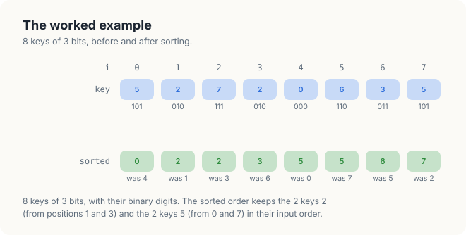
<figcaption><b>Figure 22.1</b> The 8 keys, their bits, and the sorted order.</figcaption>
</figure>

### 22.1.2 Definitions

<div class="definition">

<span class="box-label">Definition 22.1</span> **Key, bit and digit.** A key is an unsigned
integer of \\(B\\) bits. Bit \\(b\\) of key \\(k\\) is \\(\lfloor k / 2^b \rfloor \bmod 2\\), and
bit 0 is the least significant. A digit of \\(r\\) bits at shift \\(s\\) is
\\(\lfloor k / 2^s \rfloor \bmod 2^r\\), the bits \\(s\\) to \\(s + r - 1\\) read as a number.

*Example.* \\(B = 3\\). The key 6 = 110 has bit 0 equal to 0 and bit 2 equal to 1; its digit of 2
bits at shift 0 is 10, that is 2.

</div>

<div class="definition">

<span class="box-label">Definition 22.2</span> **Stable.** A rearrangement of a list by some
property of its keys is stable if any 2 keys with equal property keep the relative order they had
in the input.

*Example.* Sorting \\(K\\) by value is stable if the 2 from position 1 comes before the 2 from
position 3, as in Figure 22.1.

</div>

Stability is invisible when the keys are plain numbers, because 2 equal numbers look the same. It becomes visible when each key carries a payload, such as the index of a record. It is also
required inside the radix sort itself, as Section 22.4 shows.

<div class="exercises">

Exercises

22.1 Write the keys \\((6, 1, 4, 4, 7, 0, 3, 1)\\) in binary, and give their digits of 2 bits at
shift 0.<br>
22.2 How many bits do keys below 1,000 need? How many digits of 4 bits?

</div>

## 22.2 Sorting by 1 bit at a time

### 22.2.1 The sequential algorithm

A radix sort processes the bits from the least significant to the most significant. In each pass
it reads the keys in their current order and splits them in 2 lists: the keys whose current bit
is 0, then the keys whose bit is 1, each list in the order in which the keys were read.

<div class="algo">
<p class="algo-name">Radix-Sort-Bits(\(K, n, B\))</p>
<ol>
<li>for \(b \in [0, B)\) { <span class="c">// 1 pass per bit, bit 0 first</span></li>
<li style="--d:1">\(Z\) = empty list, \(O\) = empty list</li>
<li style="--d:1">for \(i \in [0, n)\) {</li>
<li style="--d:2">if bit \(b\) of \(K_i\) is 0: append \(K_i\) to \(Z\)</li>
<li style="--d:2">else: append \(K_i\) to \(O\)</li>
<li style="--d:1">}</li>
<li style="--d:1">\(K\) = \(Z\) followed by \(O\) <span class="c">// the split on bit \(b\)</span></li>
<li>}</li>
</ol>
</div>

Lines 3 to 7 are 1 pass, the **split** on bit \\(b\\). Figure 22.2 shows the 3 passes on our keys.
After the split on bit 0, the even keys \\((2, 2, 0, 6)\\) come before the odd keys
\\((5, 7, 3, 5)\\). After the split on bit 1, the keys are ordered by their 2 lowest bits:
first 0 (00), then 5 and 5 (01), then 2, 2 and 6 (10), then 7 and 3 (11). After the split on bit
2 they are sorted.

<figure>
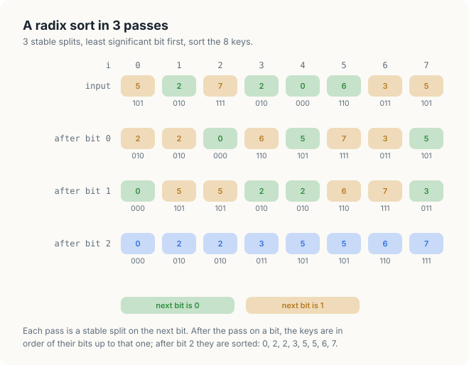
<figcaption><b>Figure 22.2</b> A radix sort of the 8 keys in 3 passes, 1 bit per pass. The colour shows the bit of the next pass.</figcaption>
</figure>

Line 4 or line 5 executes once per key and pass, \\(nB\\) times: 24 times for our example, and
\\(32n\\) times for keys of 32 bits. The work grows linearly with \\(n\\), with no comparison
between keys.

### 22.2.2 Why the least significant bit comes first

The last pass decides the order of the most significant bit, and every earlier pass must survive
it. They survive because each split keeps the order of the keys within each of its 2 lists. Take
the 2 keys 2 and 3 after the pass on bit 1 in Figure 22.2: 2 = 010 comes before 3 = 011, because
the pass on bit 0 put the even keys first. The pass on bit 2 sees 2 equal bits, 0 and 0, and keeps
2 before 3. The following theorem states this in general.

<div class="theorem">

<span class="box-label">Theorem 22.1</span> If every pass of Radix-Sort-Bits is a stable split,
then after the pass on bit \\(b\\), the keys are in increasing order of \\(k \bmod 2^{b+1}\\),
their bits 0 to \\(b\\), and keys with equal bits 0 to \\(b\\) are in input order. In particular,
after the pass on bit \\(B - 1\\) the keys are sorted, and the sort is stable.

</div>

<div class="proof">

*Proof.* We show that the loop of lines 1 to 8 maintains the statement as an invariant, writing
\\(v_b(k) = k \bmod 2^{b+1}\\).

*Initialization.* Before the first pass, take \\(b = -1\\): \\(v_{-1}(k) = 0\\) for every key, and
the keys are in input order.

*Maintenance.* Assume the statement holds after the pass on bit \\(b - 1\\), and take 2 keys
\\(k\\) and \\(k'\\). If their bits \\(b\\) differ, the split on bit \\(b\\) puts the key with bit
0 first. Bit \\(b\\) is the most significant of bits 0 to \\(b\\), so that key has the smaller
\\(v_b\\), and the order is correct. If their bits \\(b\\) are equal, the split is stable and keeps
the order of the previous pass, which is the order of \\(v_{b-1}\\), with input order among equal
values. Since \\(v_b(k) - v_b(k') = v_{b-1}(k) - v_{b-1}(k')\\) when bit \\(b\\) is equal, that
order is the order of \\(v_b\\), with input order among equal values.

*Termination.* After the pass on bit \\(B - 1\\), \\(v_{B-1}(k) = k\\) for every key of \\(B\\)
bits, so the keys are sorted, and equal keys are in input order.

</div>

The proof uses stability in exactly 1 place, the case of equal bits. Section 22.4 shows what
happens to our keys when that case fails.

<div class="exercises">

Exercises

22.3 Sort \\((6, 1, 4, 4, 7, 0, 3, 1)\\) with Radix-Sort-Bits, writing the keys after each pass.<br>
22.4 Sort \\(K\\) with the most significant bit first, by the same splits. Where does the result
differ from the sorted list, and why?

</div>

## 22.3 A split is 2 compactions

### 22.3.1 Positions from a scan

A split on the GPU cannot append to lists: the threads would have to agree on the order of the
appends. Instead, every key computes its output position, as in the stream compaction of
Section 21.8. The keys with bit \\(b\\) equal to 0 form 1 compaction, with the flag
\\(z_i = 1\\) when the bit is 0: key \\(i\\) goes to \\(e_i\\), the exclusive scan of the flags.
The keys with bit 1 form a second compaction, written after the \\(Z\\) keys of the first one.

The second compaction needs no second scan. Of the \\(i\\) keys before position \\(i\\), \\(e_i\\)
have bit 0, so \\(i - e_i\\) have bit 1, and a key with bit 1 goes to \\(Z + i - e_i\\). Figure
22.3 works the split on bit 0 of our keys. The flags of the bit-0 keys are
\\((0, 1, 0, 1, 1, 1, 0, 0)\\), their exclusive scan is \\((0, 0, 1, 1, 2, 3, 4, 4)\\), and
\\(Z = 4\\). Key 5 at position 0 has bit 1 and goes to \\(4 + 0 - 0 = 4\\). Key 7 at
position 2 goes to \\(4 + 2 - 1 = 5\\). Key 2 at position 3 has bit 0 and goes to \\(e_3 = 1\\).

<figure>
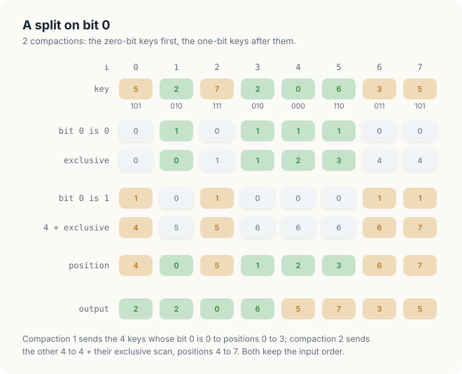
<figcaption><b>Figure 22.3</b> The split on bit 0 as 2 compactions. The second row of positions is \(4 + i - e_i\).</figcaption>
</figure>

<div class="key-observation">

<span class="box-label">Key observation</span> 1 exclusive scan of the zero flags places both
groups of a split: a key with bit 0 goes to \\(e_i\\), and a key with bit 1 goes to
\\(Z + i - e_i\\), where \\(Z\\) is the number of keys with bit 0. Each group is a stream
compaction, so the split inherits the stability of compaction.

</div>

### 22.3.2 The algorithm

<div class="algo">
<p class="algo-name">Parallel-Split(\(K, out, n, b\))</p>
<ol>
<li>for every \(i \in [0, n)\) in parallel: \(z_i = 1\) if bit \(b\) of \(K_i\) is 0, else 0</li>
<li>\(s\) = the inclusive scan of \(z\) <span class="c">// Scan of Section 21.7</span></li>
<li>\(Z = s_{n-1}\) <span class="c">// the keys with bit 0</span></li>
<li>for every \(i \in [0, n)\) in parallel {</li>
<li style="--d:1">\(e_i = s_i - z_i\) <span class="c">// the exclusive scan</span></li>
<li style="--d:1">if \(z_i = 1\): \(out_{e_i} = K_i\)</li>
<li style="--d:1">else: \(out_{Z + i - e_i} = K_i\)</li>
<li>}</li>
</ol>
</div>

<div class="theorem">

<span class="box-label">Theorem 22.2</span> Parallel-Split writes every key exactly once, the
positions form a permutation of \\([0, n)\\), and the split is stable.

</div>

<div class="proof">

*Proof.* By Theorem 21.2, the keys with bit 0 receive the distinct positions \\([0, Z)\\) in input
order. A key with bit 1 at position \\(i\\) receives \\(Z\\) plus the number of keys with bit 1
before it. For 2 such keys at \\(i < j\\), that number grows by at least 1. These positions are
therefore distinct, increase with the input position, and run from \\(Z\\) to \\(Z + (n - Z) - 1 = n - 1\\).
The 2 ranges \\([0, Z)\\) and \\([Z, n)\\) do not overlap and together hold \\(n\\) positions.

</div>

A pass moves every key once, and so does the sequential split. The parallel split also writes the
flags, scans them and reads them back, which Section 22.5 counts.

<div class="exercises">

Exercises

22.5 Carry out Parallel-Split on bit 1 of \\((2, 2, 0, 6, 5, 7, 3, 5)\\), the output of Figure
22.3, and check the result against Figure 22.2.<br>
22.6 Why does line 7 not need the inclusive scan of the flags of the bit-1 keys?

</div>

## 22.4 Stability

### 22.4.1 An unstable split

Suppose a split puts the keys with bit 0 first, as it must, but writes the keys with bit 1 in
some other order, for example in reverse. It is still a correct split on its own bit. Apply it to
bit 1 of the keys after the first pass, \\((2, 2, 0, 6, 5, 7, 3, 5)\\). The keys with bit 1 equal
to 0 are \\((0, 5, 5)\\) and stay in order; the keys with bit 1 are \\((2, 2, 6, 7, 3)\\) and come
out as \\((3, 7, 6, 2, 2)\\). The pass on bit 2, stable again, then gives
\\((0, 3, 2, 2, 5, 5, 7, 6)\\) (Figure 22.4).

<figure>
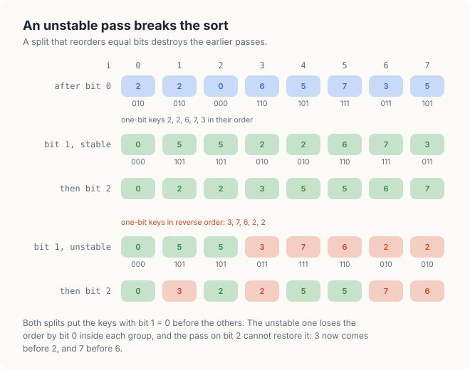
<figcaption><b>Figure 22.4</b> A stable and an unstable split on bit 1, each followed by the split on bit 2.</figcaption>
</figure>

The keys 3 = 011 and 2 = 010 have the same bits 1 and 2; only bit 0 tells them apart, and the
first pass had put 2 first. The unstable pass reversed them, and the last pass, seeing equal bits,
kept the reversed order. 3 now precedes 2, and 7 precedes 6, which differ in the same way. This is
the case of equal bits in the proof of Theorem 22.1, and it is the only place where the proof
needs stability.

A split that hands out output positions in the order in which threads arrive, for example by
incrementing a shared counter, produces such an order. Section 22.8 runs one on the GPU.

<div class="rule-box">

<span class="box-label">Rule</span> Every pass of a least-significant-digit radix sort must be
stable. A pass that places equal digits in any other order than the input order destroys the work
of the passes before it.

</div>

<div class="exercises">

Exercises

22.7 Which positions of the final result are wrong if the first pass, on bit 0, is the unstable
one and the other 2 are stable?<br>
22.8 Does the last pass of a radix sort need to be stable when the keys carry no payload? Give a
reason.

</div>

## 22.5 The cost of 1-bit passes

A sort of 32-bit keys by Parallel-Split takes 32 passes. Each pass is memory-bound: it does a few
operations per key and moves several bytes per key, so its time is set by the bytes it moves. We
count them per key of 4 bytes. Line 1 reads the key and writes the flag, 8 bytes. The scan of
Section 21.7 reads and writes the flags twice, 16 bytes. Lines 4 to 8 read the key, the flag and
the scan and write the key, 16 bytes. A pass moves 40 bytes per key, and the sort
\\(32 \times 40 = 1{,}280\\) bytes per key: 21.5 GB to sort 16,777,216 keys, 64 MiB.

The number of passes is the lever. A digit of \\(r\\) bits sorts keys of 32 bits in \\(32 / r\\)
passes, and with \\(r = 4\\) the sort needs 8 passes instead of 32. But a pass on a digit of
\\(r\\) bits splits the keys into \\(2^r\\) groups, not 2, and 1 scan of 1 flag no longer gives
every group its start. Every key needs to know how many keys have each smaller digit: the keys
must be counted by digit. That count is a histogram, the subject of the next section.

## 22.6 Histograms

### 22.6.1 Counting by value

<div class="definition">

<span class="box-label">Definition 22.3</span> **Histogram.** The histogram of a list of keys
over \\(R\\) bins is the array \\(h\\) of \\(R\\) counts in which \\(h_v\\) is the number of keys
whose digit, or value, is \\(v\\).

*Example.* The histogram of \\(K\\) by value, over 8 bins, is \\(h = (1, 0, 2, 1, 0, 2, 1, 1)\\):
1 key 0, no key 1, 2 keys 2, and so on.

</div>

The sequential algorithm reads every key once and adds 1 to its bin.

<div class="algo">
<p class="algo-name">Histogram(\(K, h, n, R\))</p>
<ol>
<li>for \(v \in [0, R)\): \(h_v = 0\)</li>
<li>for \(i \in [0, n)\) {</li>
<li style="--d:1">\(h_{K_i} = h_{K_i} + 1\) <span class="c">// a read, an addition and a write</span></li>
<li>}</li>
</ol>
</div>

### 22.6.2 1 thread per key, and atomic additions

The direct parallel version gives every key its own thread, and each thread executes line 3 for
its key. Line 3 is 3 operations: read the bin, add 1, write the bin. Threads 1 and 3 hold the
same key, 2. If both read \\(h_2 = 0\\) before either writes, both write 1, and 1 count is lost. The
GPU offers an operation that cannot be split in this way.

<div class="definition">

<span class="box-label">Definition 22.4</span> **Atomic operation.** An atomic operation reads a
memory location, modifies the value and writes it back as 1 indivisible step: no other thread can
access the location between the read and the write. When several threads apply atomic operations
to the same location, the hardware performs them 1 after the other, in an order it chooses, and
every one of them takes effect. In CUDA C++ the atomic addition is `atomicAdd(&h[v], 1)`; in
cuda-oxide it is the method `fetch_add` of an atomic type such as `DeviceAtomicU32`.

*Example.* Threads 1 and 3 each apply an atomic addition of 1 to \\(h_2\\). Whatever their order,
\\(h_2\\) ends at 2.

</div>

<div class="definition">

<span class="box-label">Definition 22.5</span> **Contention.** Contention is the waiting that
occurs when several threads apply atomic operations to the same location at about the same time:
since the operations are performed 1 after the other, each waits for those before it.

*Example.* Bins 2 and 5 each receive 2 requests from our 8 threads, and 1 of the 2 requests waits
for the other (Figure 22.5).

</div>

<figure>
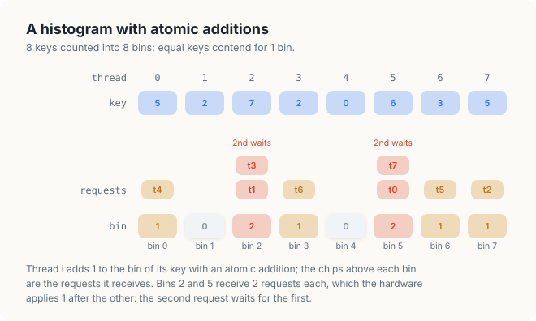
<figcaption><b>Figure 22.5</b> A histogram of the 8 keys with atomic additions. The chips above each bin are the requests it receives.</figcaption>
</figure>

Atomic operations on global memory are performed in the L2 cache, which all SMs share, and
requests to 1 address are queued there. Chapter 5 measured the queue: a histogram of 64 MiB of
bytes into 256 global bins took 33.40 ms for random bytes and 134.65 ms for bytes that were all
7, 4 times as long, because every request went to the same address (Section 5.5.2). A radix pass
with digits of 4 bits has only 16 bins, so even random keys send 1/16 of all requests to each
address.

### 22.6.3 Private bins

The cure is to let fewer threads share a bin. Each block counts its keys into its own copy of the
bins in shared memory, where only the threads of that block compete and where an atomic
operation completes within the SM. When the block has counted all its keys, it adds each of its
bins to the global bin once (Figure 22.6).

<div class="definition">

<span class="box-label">Definition 22.6</span> **Privatization.** Privatization gives each block,
or each warp, a private copy of a shared result, lets it update only its copy, and merges the
copies into the shared result at the end.

*Example.* Block 0 counts the keys 5, 2, 7, 2 into the private bins
\\((0, 0, 2, 0, 0, 1, 0, 1)\\), block 1 counts 0, 6, 3, 5 into \\((1, 0, 0, 1, 0, 1, 1, 0)\\), and
their sum is the histogram.

</div>

<figure>
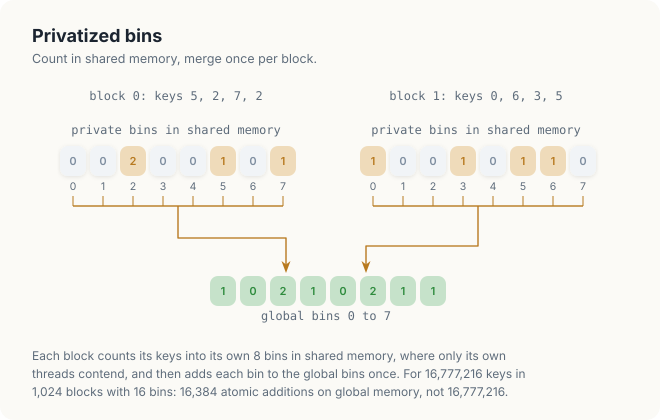
<figcaption><b>Figure 22.6</b> Private bins in shared memory, merged once per block.</figcaption>
</figure>

<div class="algo">
<p class="algo-name">Histogram-Private(\(K, h, n, R\)) <span class="c">// block \(b\) of \(G\), thread \(t\) of \(T\)</span></p>
<ol>
<li>if \(t &lt; R\): \(p[t] = 0\) <span class="c">// \(p\) in shared memory</span></li>
<li><span class="sc">Barrier</span>() <span class="c">// every private bin is 0</span></li>
<li>for \(i = bT + t\); \(i &lt; n\); \(i = i + GT\) {</li>
<li style="--d:1"><span class="sc">Atomic-Add</span>(\(p[\text{digit}(K_i)]\), 1)</li>
<li>}</li>
<li><span class="sc">Barrier</span>() <span class="c">// every key of the block is counted</span></li>
<li>if \(t &lt; R\): <span class="sc">Atomic-Add</span>(\(h_t\), \(p[t]\)) <span class="c">// the merge</span></li>
</ol>
</div>

Line 3 is a **grid-stride loop**: the \\(GT\\) threads of the grid take the keys in rounds, so
neighbouring threads read neighbouring keys in each round. The 2 barriers separate 3 phases.
Without the first, a thread could count into a bin that another thread has not yet set to 0;
without the second, thread \\(t\\) could merge bin \\(t\\) before the other threads have finished
counting into it.

The global atomics fall from 1 per key to \\(R\\) per block. With \\(G = 1{,}024\\) blocks and
\\(R = 16\\) bins, a histogram of 16,777,216 keys makes 16,384 atomic additions on global memory
instead of 16,777,216, 1,024 times fewer.

### 22.6.4 Warp aggregation

Inside a block, contention remains: when the 32 lanes of a warp hold the same digit, 32 atomic
operations on 1 shared-memory bin are performed 1 after the other. The lanes can combine their
counts first.

<div class="definition">

<span class="box-label">Definition 22.7</span> **Match.** A match is an instruction that all 32
lanes of a warp execute together, each with a value; it returns to every lane a 32-bit word
whose bit \\(k\\) is 1 if lane \\(k\\) holds the same value. In C++ it is
`__match_any_sync(mask, v)`; in cuda-oxide `warp::match_any_sync(mask, v)`.

*Example.* For 8 lanes holding the digits \\((1, 2, 3, 2, 0, 2, 3, 1)\\), lane 5 receives the
bits of lanes 1, 3 and 5, the lanes with digit 2.

</div>

With a match, the lowest lane of each group of equal digits adds the popcount of its word, the
size of the group, with 1 atomic operation, and the other lanes of the group add nothing. A warp
then makes at most 1 atomic operation per distinct digit instead of 32. This is **warp
aggregation**. It costs the match instruction on every key, and Section 22.10 measures whether it
pays.

<div class="exercises">

Exercises

22.9 Compute the histogram of \\((6, 1, 4, 4, 7, 0, 3, 1)\\) over 8 bins. Which bins receive more
than 1 request?<br>
22.10 For 16,777,216 keys, 1,024 blocks and 256 bins, how many atomic operations does
Histogram-Private make on global memory, and how many on shared memory?<br>
22.11 What does the merge of line 7 compute if the second barrier is removed and 1 thread of the
block is delayed?

</div>

## 22.7 A pass on a digit of several bits

### 22.7.1 The positions from a histogram

We now sort by digits of 2 bits. Our keys have 3 bits, so a first pass on the digit at shift 0,
the 2 low bits, and a second pass on bit 2 sort them. The digits of the first pass are
\\((1, 2, 3, 2, 0, 2, 3, 1)\\), and their histogram over 4 bins is \\((1, 2, 3, 2)\\): 1 key with
digit 0, 2 with digit 1, 3 with digit 2 and 2 with digit 3.

In the output of the pass, the key with digit 0 comes first, at position 0. The 2 keys with
digit 1 follow at positions 1 and 2, the 3 keys with digit 2 at 3, 4 and 5, and the keys with
digit 3 at 6 and 7. The start of each digit, \\((0, 1, 3, 6)\\), is the exclusive scan of the
histogram. Within a digit, the keys keep their input order: the first key with digit 2, the 2 at
position 1, goes to 3, the second, the 2 at position 3, to 4, and the third, the 6, to 5.

<div class="definition">

<span class="box-label">Definition 22.8</span> **Rank.** The rank of a key in a pass is the
number of keys before it, in input order, that have the same digit.

*Example.* In the pass on the 2 low bits, the 6 at position 5 has digit 2, and 2 keys with digit
2 come before it, at positions 1 and 3: its rank is 2.

</div>

<div class="key-observation">

<span class="box-label">Key observation</span> The exclusive scan of the digit histogram gives
the start of every digit in the output, and a key goes to the start of its digit plus its rank.
The split of Section 22.3 is the case of 1 bit: 2 bins, a start of 0 for digit 0 and \\(Z\\) for
digit 1, and ranks \\(e_i\\) and \\(i - e_i\\).

</div>

Figure 22.7 carries out the pass. The output, \\((0, 5, 5, 2, 2, 6, 7, 3)\\), is the output of
the 2 splits on bits 0 and 1 in Figure 22.2, as it must be: 1 stable pass on 2 bits sorts by
those 2 bits, as 2 stable passes on 1 bit do.

<figure>
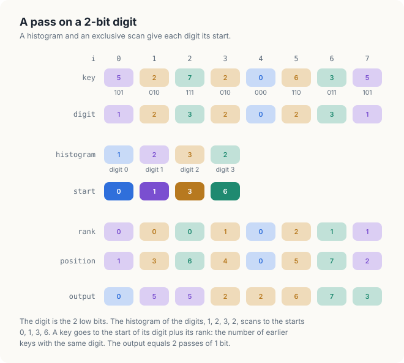
<figcaption><b>Figure 22.7</b> A pass on the 2 low bits: histogram, exclusive scan, rank, position.</figcaption>
</figure>

On a CPU, the pass is the counting sort, 3 loops over the keys and the bins.

<div class="algo">
<p class="algo-name">Counting-Pass(\(K, out, n, s, r\))</p>
<ol>
<li>\(h\) = the histogram of the digits \(\lfloor K_i / 2^s \rfloor \bmod 2^r\) over \(2^r\) bins</li>
<li>\(start\) = the exclusive scan of \(h\)</li>
<li>for \(i \in [0, n)\) { <span class="c">// in input order</span></li>
<li style="--d:1">\(d\) = the digit of \(K_i\)</li>
<li style="--d:1">\(out_{start[d]} = K_i\)</li>
<li style="--d:1">\(start[d] = start[d] + 1\) <span class="c">// the next key with digit \(d\)</span></li>
<li>}</li>
</ol>
</div>

In line 5, \\(start[d]\\) has grown by 1 for every earlier key with digit \\(d\\), so it equals
the start of \\(d\\) plus the rank of the key. Line 6 is a chain like the counter of
Sequential-Compact: the rank of each key depends on all the keys before it.

### 22.7.2 Many tiles

On the GPU, the keys are cut into tiles of 1,024, 1 block per tile, as in Section 21.7. A block
can count the digits of its own tile and rank its own keys, but a key's position also depends on
the keys with smaller digits in every tile and on the keys with the same digit in earlier tiles.
Both come from 1 scan, if the counts of all tiles are laid out digit by digit: first the count of
digit 0 in tile 0, tile 1, and so on, then the counts of digit 1, and so on. The exclusive scan
of this table at entry \\((d, b)\\) is the number of keys with a smaller digit anywhere, plus the
keys with digit \\(d\\) in tiles before \\(b\\): exactly the start of digit \\(d\\) in tile
\\(b\\).

Figure 22.8 shows the table for our keys as 2 tiles of 4. Tile 0 holds the digits
\\((1, 2, 3, 2)\\) and tile 1 \\((0, 2, 3, 1)\\). Their scan places digit 1 of tile 1 at 2, after
the key 0 of tile 1 and the key 5 of tile 0, and the keys of tile 1 land at 0, 5, 7 and 2, the
same positions as in Figure 22.7.

<figure>
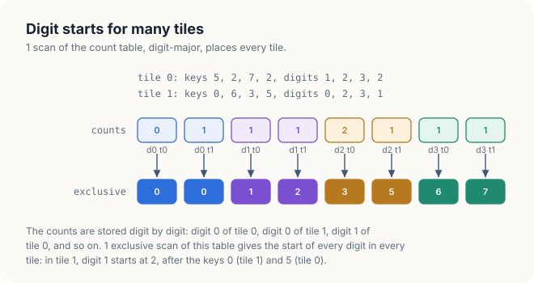
<figcaption><b>Figure 22.8</b> The table of digit counts, digit by digit, and its exclusive scan.</figcaption>
</figure>

Inside a tile, the rank of a key is the number of keys with the same digit before it in the
tile. A block processes its tile in 4 steps of 256 keys; within a step, the match of Definition
22.7 gives each lane the lanes of its warp with the same digit. Keeping the bits of the lanes
below it and counting them gives the key's rank within the warp, as the ballot gave the position
within the warp in Section 21.9 (Figure 22.9). The counts of the earlier warps of the step, and of
the earlier steps of the tile, complete the rank.

<figure>
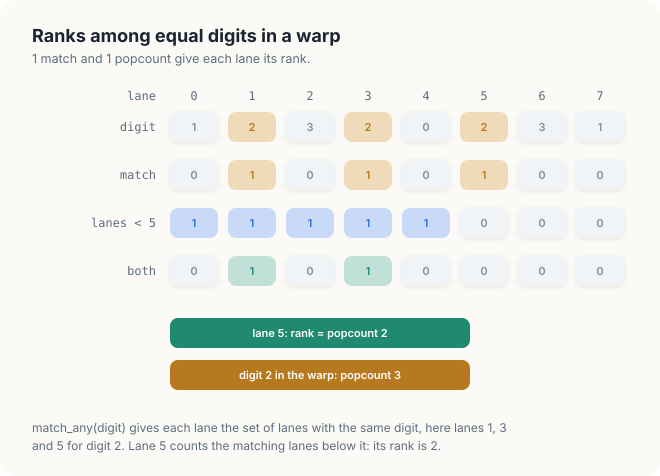
<figcaption><b>Figure 22.9</b> The rank of lane 5 among the lanes with the same digit, from 1 match.</figcaption>
</figure>

### 22.7.3 The algorithm

A pass on the digit of \\(r = 4\\) bits at shift \\(s\\) has 3 parts. The first kernel counts the
digits of every tile, with private bins (lines 1 to 6 of Histogram-Private, without a
grid-stride loop), and writes its 16 counts into column \\(b\\) of the table \\(c\\). Scan
computes the inclusive scan of the table, of \\(16m\\) entries for \\(m\\) tiles. The second
kernel moves the keys.

<div class="algo">
<p class="algo-name">Scatter-Digits(\(K, out, c, s\)) <span class="c">// tile \(b\) of \(m\), thread \(t\), lane \(\ell\) of warp \(w\)</span></p>
<ol>
<li>if \(t &lt; 16\): \(start[t] = s_{tm + b} - c_{tm + b}\) <span class="c">// the exclusive scan of the table</span></li>
<li>for \(k \in [0, 4)\) { <span class="c">// 4 steps of 256 keys, in order</span></li>
<li style="--d:1">set \(wc[\cdot][\cdot]\) to 0; <span class="sc">Barrier</span>() <span class="c">// \(wc[w][d]\): keys of digit \(d\) in warp \(w\)</span></li>
<li style="--d:1">\(i = 1024b + 256k + t\), \(d\) = the digit of \(K_i\)</li>
<li style="--d:1">\(peers\) = <span class="sc">Match</span>(\(d\)), \(rank\) = <span class="sc">Popc</span>(\(peers \wedge (2^{\ell} - 1)\))</li>
<li style="--d:1">if \(rank = 0\): \(wc[w][d]\) = <span class="sc">Popc</span>(\(peers\)) <span class="c">// 1 lane per digit and warp</span></li>
<li style="--d:1"><span class="sc">Barrier</span>()</li>
<li style="--d:1">\(out[start[d] + wc[0][d] + \cdots + wc[w-1][d] + rank] = K_i\)</li>
<li style="--d:1"><span class="sc">Barrier</span>()</li>
<li style="--d:1">if \(t &lt; 16\): \(start[t] = start[t] + wc[0][t] + \cdots + wc[7][t]\)</li>
<li style="--d:1"><span class="sc">Barrier</span>()</li>
<li>}</li>
</ol>
</div>

Line 8 is line 5 of Counting-Pass, with the rank assembled from 3 parts. The first part is the
keys with the same digit in the earlier steps of the tile, which line 10 has added to
\\(start[d]\\). The second is those in the earlier warps of the step, and the third those in the
earlier lanes of the warp. Each of the 4 barriers separates a write of the shared arrays from the
reads that need it. Line 3 completes the clearing of \\(wc\\) before any lane writes a count, line
7 completes the counts before any thread sums them, line 9 completes every read of \\(start\\)
before line 10 changes it, and line 11 completes the change before the next step reads
\\(start\\).

### 22.7.4 Counting the bytes

A pass reads every key twice, in the counting kernel and in the scatter, and writes it once: 12
bytes per key. The table holds 16 counts per 1,024 keys, so its scan moves less than 1 byte per
key. A sort of 32-bit keys by 8 passes of 4 bits moves about \\(8 \times 12 = 96\\) bytes per key,
against 1,280 bytes for 32 passes of 1 bit: 13 times less.

<div class="exercises">

Exercises

22.12 Carry out Counting-Pass on the digit of 2 bits at shift 1 of \\(K\\). What are the
histogram, the starts and the output?<br>
22.13 Build the table of Figure 22.8 for 4 tiles of 2 keys, and give its exclusive scan.<br>
22.14 How many bytes per key does a sort by 4 passes of 8 bits move, if the scan of the table is
counted too? (A tile has 256 counts.)

</div>

## 22.8 Correctness

<div class="theorem">

<span class="box-label">Theorem 22.3</span> A pass of Scatter-Digits writes every key of the
input exactly once, the positions form a permutation of \\([0, n)\\), and keys with equal digits
keep their input order.

</div>

<div class="proof">

*Proof.* Let \\(c(d, b)\\) be the number of keys with digit \\(d\\) in tile \\(b\\), and
\\(S(d, b)\\) the exclusive scan of the table at entry \\((d, b)\\): the number of keys with a
digit below \\(d\\), plus the keys with digit \\(d\\) in tiles before \\(b\\). We show that the
keys with digit \\(d\\) of tile \\(b\\) receive the positions \\(S(d, b)\\) to
\\(S(d, b) + c(d, b) - 1\\), in input order. The step \\(k\\), the warp \\(w\\) and the lane
\\(\ell\\) of a key order the keys of a tile as their indices do, since the index is
\\(1024b + 256k + 32w + \ell\\). In line 8 the position of a key is \\(S(d, b)\\) plus 3 counts of keys with digit \\(d\\): those in
the earlier steps (added to \\(start[d]\\) by line 10 of each earlier step), those in the earlier
warps of the step, and those in the earlier lanes of the warp. Together they are exactly the keys
with digit \\(d\\) before it in the tile. These numbers are \\(0, 1, \ldots, c(d, b) - 1\\) in input
order. The ranges for different \\((d, b)\\) follow each other in the order of the table, without
gap or overlap, and the last ends at \\(n - 1\\).

</div>

Rank and stability are the same thing here: the rank counts the keys before a key in input order,
so a pass that places keys by rank is stable by construction. A pass that places them by any
other count is not. We replaced the position of line 8 by an atomic increment of
\\(start[d]\\), and removed line 10. The increment hands every key the next free position of its digit in the order in which the threads arrive. We ran the C++ program with this change:

```console
$ ./unstable                                    # out[atomicAdd(&start[d], 1)] = key
radix sort of 5 2 7 2 0 6 3 5
  ...
  4-bit pass    0 2 2 3 5 5 6 7
...
  method 1 run 1: 5618124 neighbours out of order, 15278248 keys misplaced
  method 1 run 2: 5627284 neighbours out of order, 15294346 keys misplaced
  method 1 run 3: 5638523 neighbours out of order, 15291387 keys misplaced
FAILED
```

On the 8 keys the result was correct, because the 8 lanes of 1 warp happened to obtain their
positions in lane order. On 16,777,216 keys, 15.3 million keys ended in the wrong place, 5.6
million neighbours were out of order, and the counts differed from run to run. Every pass still
grouped the keys correctly by its own digit; only the order inside the groups was lost, and with
it the work of the earlier passes, as in Figure 22.4.

<div class="exercises">

Exercises

22.15 In Scatter-Digits, which wrong position can a key receive if the barrier of line 9 is
removed? Describe a schedule.<br>
22.16 Prove that \\(S(d, b) + c(d, b) = S(d, b + 1)\\) for \\(b < m - 1\\), and
\\(S(d, m - 1) + c(d, m - 1) = S(d + 1, 0)\\).

</div>

## 22.9 Implementation

### 22.9.1 The histograms

Listing 22.1 is Histogram-Private, and Listing 22.2 adds warp aggregation.

<p class="listing"><b>Listing 22.1</b> A histogram of 4-bit digits with private bins.</p>

<div class="code-tabs">
<div class="code-tab" data-lang="Rust">

```rust,ignore
mod kernels {
    // ...
{{#include ../../../../code/oxide/ch22_radix_sort_histogram/src/main.rs:54:83}}
    // ...
}
```

</div>
<div class="code-tab" data-lang="C++">

```cpp
{{#include ../../../../code/cuda/ch22_radix_sort_histogram/radix_sort_histogram.cu:65:83}}
```

</div>
</div>

The bins in shared memory are a `SharedArray<u32, RADIX>` in Rust and a `__shared__` array in
C++. CUDA C++ applies `atomicAdd` to any address. cuda-oxide gives atomics their own types, with
the scope of the threads that may share them in the name: `DeviceAtomicU32` for global memory,
which every thread of the grid can reach, and `BlockAtomicU32` for shared memory, which only the
block can. The global bins arrive as a slice `&[DeviceAtomicU32]`, and the host creates them by
reinterpreting a buffer of `u32` with `cast_elem`. A shared bin is viewed as a `BlockAtomicU32`
with `BlockAtomicU32::from_ptr`, which the helper `shared_bin` wraps; the pointer comes from the
`SharedArray`, so the call is `unsafe`, and its safety comment states that the digit is below 16.

<p class="listing"><b>Listing 22.2</b> The same histogram with warp aggregation.</p>

<div class="code-tabs">
<div class="code-tab" data-lang="Rust">

```rust,ignore
mod kernels {
    // ...
{{#include ../../../../code/oxide/ch22_radix_sort_histogram/src/main.rs:85:121}}
    // ...
}
```

</div>
<div class="code-tab" data-lang="C++">

```cpp
{{#include ../../../../code/cuda/ch22_radix_sort_histogram/radix_sort_histogram.cu:85:110}}
```

</div>
</div>

The loop runs over `base`, the first key of the block's round, rather than over the key itself,
so that all 32 lanes of every warp execute the match together, including the lanes past the end
of the array. Those lanes match on the value 16, which no digit has, and add nothing.

### 22.9.2 The split

Listing 22.3 is lines 4 to 8 of Parallel-Split. The flags and the scan are the kernels of
Chapter 21.

<p class="listing"><b>Listing 22.3</b> The scatter of a split on 1 bit.</p>

<div class="code-tabs">
<div class="code-tab" data-lang="Rust">

```rust,ignore
mod kernels {
    // ...
{{#include ../../../../code/oxide/ch22_radix_sort_histogram/src/main.rs:233:252}}
    // ...
}
```

</div>
<div class="code-tab" data-lang="C++">

```cpp
{{#include ../../../../code/cuda/ch22_radix_sort_histogram/radix_sort_histogram.cu:199:210}}
```

</div>
</div>

Every thread reads `scanned[n - 1]`, the number of keys with bit 0; the cache serves all but the
first of these reads. The Rust write uses `get_unchecked_mut`, and its safety comment is Theorem
22.2: the positions form a permutation of \\([0, n)\\).

### 22.9.3 The pass on a 4-bit digit

Listing 22.4 counts the digits of each tile, Listing 22.5 is Scatter-Digits, and Listing 22.6
runs the passes on the host.

<p class="listing"><b>Listing 22.4</b> The digit counts of every tile, digit by digit.</p>

<div class="code-tabs">
<div class="code-tab" data-lang="Rust">

```rust,ignore
mod kernels {
    // ...
{{#include ../../../../code/oxide/ch22_radix_sort_histogram/src/main.rs:254:289}}
    // ...
}
```

</div>
<div class="code-tab" data-lang="C++">

```cpp
{{#include ../../../../code/cuda/ch22_radix_sort_histogram/radix_sort_histogram.cu:212:233}}
```

</div>
</div>

<p class="listing"><b>Listing 22.5</b> The scatter of a pass on a 4-bit digit.</p>

<div class="code-tabs">
<div class="code-tab" data-lang="Rust">

```rust,ignore
mod kernels {
    // ...
{{#include ../../../../code/oxide/ch22_radix_sort_histogram/src/main.rs:291:365}}
    // ...
}
```

</div>
<div class="code-tab" data-lang="C++">

```cpp
{{#include ../../../../code/cuda/ch22_radix_sort_histogram/radix_sort_histogram.cu:235:283}}
```

</div>
</div>

`start` and `warpCounts` (`START` and `WARP_COUNTS` in Rust) are the arrays \\(start\\) and
\\(wc\\) of the pseudocode, and the 4 calls to the barrier are lines 3, 7, 9 and 11. The rank is
`popc(peers & below)`, where `below` has 1 bits for the lanes to the left of this one. A lane past
the end of the array gets the digit 16, matches only with other such lanes, and writes nothing,
but it still reaches every barrier. The Rust write uses `get_unchecked_mut`, and its safety
comment is Theorem 22.3.

<p class="listing"><b>Listing 22.6</b> 8 passes of 4 bits on the host.</p>

<div class="code-tabs">
<div class="code-tab" data-lang="Rust">

```rust,ignore
{{#include ../../../../code/oxide/ch22_radix_sort_histogram/src/main.rs:474:490}}

{{#include ../../../../code/oxide/ch22_radix_sort_histogram/src/main.rs:506:518}}
```

</div>
<div class="code-tab" data-lang="C++">

```cpp
{{#include ../../../../code/cuda/ch22_radix_sort_histogram/radix_sort_histogram.cu:305:315}}
```

</div>
</div>

The 3 launches of a pass run on 1 stream, so the scatter reads a complete scan. Each pass writes
the keys into a second buffer, and the host then exchanges the 2 buffers: `std::mem::swap` of
the 2 `DeviceBuffer` values in Rust, `std::swap` of the 2 pointers in C++, without moving any
data on the GPU. After 8 passes, an even number, the sorted keys are back in the first buffer.

<div class="exercises">

Exercises

22.17 Change `digit_counts` and `scatter_digits` for digits of 8 bits. Which shared arrays grow,
and how large is the table for 16,777,216 keys?<br>
22.18 Why does `hist_aggregated` compare `lane` with `leader` instead of testing `rank == 0` as
`scatter_digits` does? Are the 2 tests equivalent?

</div>

## 22.10 Measurements

### 22.10.1 Platform and method

The measurements come from a Jetson Orin NX 16 GB, an integrated GPU with 8 SMs (sm_87) and 102
GB/s of memory bandwidth; both programs also pass on a Jetson AGX Thor (20 SMs, sm_110). The
histograms count the low 4 bits of 16,777,216 keys of 4 bytes, 64 MiB, with 1,024 blocks of 256
threads, on random keys and on keys that are all 7; each time is the average of 20 runs after 0.4
s of warm-up. The sorts take 16,777,216 random keys of 32 bits, and each time is the best of 3
runs after 1 run of warm-up. Every histogram is compared bin by bin, and every sort key by key,
with the CPU. Between runs, times varied by up to 10%.

The C++ program printed:

```console
$ ./radix_sort_histogram
radix sort of 5 2 7 2 0 6 3 5
  split bit 0   2 2 0 6 5 7 3 5
  split bit 1   0 5 5 2 2 6 7 3
  split bit 2   0 2 2 3 5 5 6 7
  histogram     1 0 2 1 0 2 1 1
  digit starts  0 1 1 3 4 4 6 7
  4-bit pass    0 2 2 3 5 5 6 7
histograms of the low 4 bits of 16777216 keys, average of 20 runs
  keys        global ms   GB/s   shared ms   GB/s   warp-aggregated ms   GB/s
  random           3.23   20.8        1.02   66.1                 1.91   35.1
  all 7           15.15    4.4        1.01   66.2                 1.31   51.2
radix sorts of 16777216 random 32-bit keys, best of 3 runs
  32 passes of 1 bit    262.26 ms    64.0 Mkeys/s
  8 passes of 4 bits     40.13 ms   418.1 Mkeys/s
  1 pass of 4 bits: counts 1.15 ms, scan 0.04 ms, scatter 3.83 ms
PASSED
```

The first 4 lines repeat Figure 22.2. The histogram line is the histogram of Definition 22.3. Because
the keys have only 3 bits, 1 pass on the digit of 4 bits at shift 0 sorts them: the digit starts
\\((0, 1, 1, 3, 4, 4, 6, 7)\\) are the exclusive scan of the histogram, and the pass is a counting
sort of the whole keys. The Rust program printed the same small example and times within
5% of these: 3.24, 1.00 and 2.00 ms for the random keys, 15.24, 1.01 and 1.28 ms for the keys
that are all 7, and 255.32 ms and 39.89 ms for the 2 sorts.

### 22.10.2 Contention, measured

Figure 22.10 draws the histogram times. With global bins, the keys that are all 7 took 15.15 ms
and the random keys 3.23 ms, 4.7 times less. Chapter 5 measured a factor of 4 for bytes in 256
global bins (Section 5.5.2). With all keys equal, every one of the 16,777,216 atomic additions
went to 1 address, and the L2 cache performed them at \\(16{,}777{,}216 / 15.15\\ \text{ms} =
1.11\\) billion per second, 1 after the other. Spreading them over 16 addresses raised the rate
only to 5.19 billion per second.

<figure>
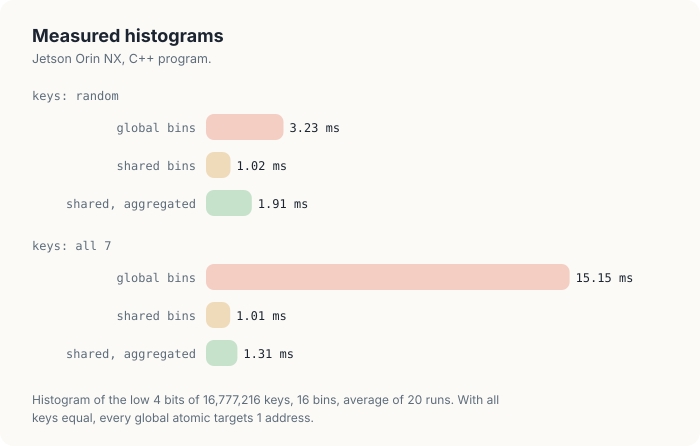
<figcaption><b>Figure 22.10</b> Histograms of 16,777,216 keys into 16 bins on the Orin NX.</figcaption>
</figure>

With private bins the 2 inputs took the same time, 1.02 and 1.01 ms, and both read the keys at 66
GB/s, 65% of the memory bandwidth. The 1,024 blocks merged 16,384 counts into global memory
instead of 16,777,216, and the contention in shared memory, where every key of the second input
also went to 1 bin, no longer set the time. Chapter 8 found the same for bytes: once the bins were
private, the speed of the histogram was set by its loads (Section 8.8).

Warp aggregation made the histogram slower: 1.91 ms against 1.02 ms on random keys, and 1.31 ms
against 1.01 ms on equal keys. Every key paid for the match instruction, and the atomic
operations it saved were not the limit. On random keys it saved few of them anyway: 32 random
digits out of 16 take on average \\(16 (1 - (15/16)^{32}) = 14.0\\) distinct values, so a warp
still made about 14 atomic additions instead of 32. Aggregation pays when many lanes of a warp
update the same location in global memory; private bins had already removed that case.

### 22.10.3 Why the 4-bit sort is 6.5 times faster, not 13

The 32 passes of 1 bit took 262.26 ms. By Section 22.5 they move 1,280 bytes per key, 21.5 GB for
16,777,216 keys, so they used the memory at 81.9 GB/s, 80% of its bandwidth: the sort by single
bits is limited by its traffic. The 8 passes of 4 bits move 96 bytes per key, 13.3 times less, but
took 40.13 ms, 6.5 times less (Figure 22.11). They used the memory at only 40.1 GB/s.

<figure>
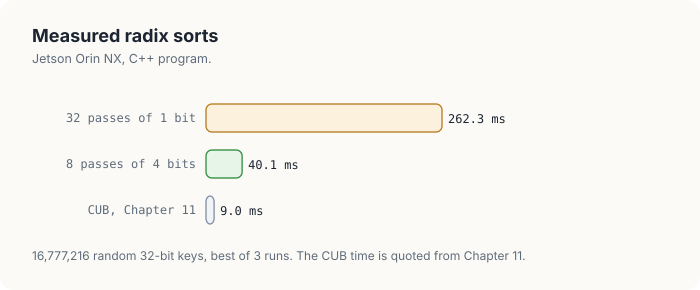
<figcaption><b>Figure 22.11</b> Sorting 16,777,216 random keys of 32 bits on the Orin NX. The CUB time is from Chapter 11.</figcaption>
</figure>

The last line of the output locates the difference. In 1 pass, counting the digits took 1.15 ms,
reading 67.1 MB at 58.4 GB/s; the scan of the table of 262,144 counts took 0.04 ms; and the
scatter took 3.83 ms, reading and writing 134.2 MB at only 35.0 GB/s. The scatter is the slow
part. In a step, the 32 keys of a warp go to about 14 different places, 1 per distinct digit, as
computed above. A store instruction of the warp then becomes about 14 separate writes of a few
bytes each, where the copy of 32 consecutive keys is 4 writes of 32 bytes; the memory system
handles each of those writes as a separate request. The scatter also waits at 16 barriers per
tile. The splits of the 1-bit sort scatter too, but every warp writes to at most 2 places, and
their writes are nearly as regular as a copy.

The library sort measured in Chapter 11, `cub::DeviceRadixSort`, sorted 16,777,216 keys in 8.96
ms on the same GPU, 4.5 times faster than our 4-bit sort. It uses digits of 8 bits, 4 passes
instead of 8 (Section 11.2.4), ranks and reorders the keys of each tile in shared memory so that
the writes of a warp go to few places, and computes the digit starts with a single-pass scan
(Adinets and Merrill, 2022). Exercise 5 at the end of the chapter takes the first of those
steps.

## 22.11 The complete programs

<p class="listing"><b>Listing 22.7</b> The complete programs. <a href="https://github.com/arpanpathak/gpu-parallel-book/blob/main/code/oxide/ch22_radix_sort_histogram/src/main.rs">code/oxide/ch22_radix_sort_histogram/src/main.rs</a> and <a href="https://github.com/arpanpathak/gpu-parallel-book/blob/main/code/cuda/ch22_radix_sort_histogram/radix_sort_histogram.cu">code/cuda/ch22_radix_sort_histogram/radix_sort_histogram.cu</a></p>

<div class="code-tabs">
<div class="code-tab" data-lang="Rust">

```rust,ignore
{{#include ../../../../code/oxide/ch22_radix_sort_histogram/src/main.rs}}
```

</div>
<div class="code-tab" data-lang="C++">

```cpp
{{#include ../../../../code/cuda/ch22_radix_sort_histogram/radix_sort_histogram.cu}}
```

</div>
</div>

## Common mistakes

- **An unstable pass.** Positions handed out by an atomic counter group the keys by digit but lose
  their order, and the sort fails on large inputs while it may pass on small ones (Section 22.8).
  Place keys by start plus rank.
- **The most significant digit first.** A least-significant-digit sort by stable passes must start
  at bit 0. Starting at the top requires sorting each group separately.
- **Counting into global bins.** With few bins, every global atomic queues behind others for the
  same address. Count into private bins in shared memory and merge once per block.
- **Merging before every thread has counted.** Without the barrier before the merge, a thread
  can add its private bin to the global bin while other threads still count into it.
- **A match or a ballot inside a branch.** All lanes of the warp must execute it. Give the lanes
  past the end of the array a value that no key has, and call it unconditionally.
- **The table of counts laid out tile by tile.** Only the digit-major layout makes 1 scan give the
  start of every digit in every tile.

## Summary

- A radix sort orders integer keys by their digits, least significant first. Theorem 22.1 shows
  that it is correct when every pass is stable.
- A split on 1 bit is 2 stream compactions that share 1 exclusive scan: bit-0 keys go to
  \\(e_i\\), bit-1 keys to \\(Z + i - e_i\\).
- A histogram counts keys by digit. Atomic additions make 1 thread per key correct; contention
  makes them slow when many threads hit 1 bin, and private bins in shared memory remove most of
  it.
- A pass on a digit of \\(r\\) bits places every key at the exclusive scan of the digit histogram
  plus its rank. Laying out the per-tile counts digit by digit lets 1 scan serve every tile.
- Passes of 4 bits move 96 bytes per key for a 32-bit sort, against 1,280 for passes of 1 bit;
  the measured sort ran 6.5 times as fast.

Chapter 23 turns to softmax and layer normalization, which combine reductions with arithmetic on
every element.

## Exercises

1. Sort \\((13, 2, 9, 2, 15, 0, 7, 13)\\), keys of 4 bits, by 2 passes of 2 bits. Give the
   histogram, the starts and the ranks of each pass.
2. Extend the radix sort to sort pairs (key, index), so that it returns the permutation that sorts
   the keys. Which kernels change?
3. Signed integers in two's complement do not sort correctly as unsigned keys. Which single bit
   must be flipped before the sort, and after it?
4. Measure the histogram of 8-bit digits (256 bins) with the 3 kernels of Section 22.6, on random
   keys and on keys that are all equal, and compare with the 16-bin results.
5. Replace the 3 passes of Section 22.7 (count, scan, scatter) by a version that keeps each tile's
   keys sorted by digit in shared memory before writing them, so that the writes of a warp go to
   fewer places. Measure the effect.
6. Estimate, from the byte count of Section 22.7.4, the time of a sort of 16,777,216 keys by 4
   passes of 8 bits at the measured rate of the 4-bit sort.

## Sources and further reading

- D. E. Knuth, *The Art of Computer Programming*, vol. 3, *Sorting and Searching*, 2nd ed.,
  Addison-Wesley, 1998, Section 5.2.5: radix sorting.
- T. H. Cormen, C. E. Leiserson, R. L. Rivest and C. Stein, *Introduction to Algorithms*, 4th ed.,
  MIT Press, 2022, Sections 8.2 and 8.3: counting sort and radix sort.
- G. E. Blelloch, "Prefix Sums and Their Applications", Technical Report CMU-CS-90-190, Carnegie
  Mellon University, 1990: the split and radix sort from scans.
- N. Satish, M. Harris and M. Garland, "Designing Efficient Sorting Algorithms for Manycore GPUs",
  IEEE IPDPS, 2009.
- D. Merrill and A. Grimshaw, "High Performance and Scalable Radix Sorting", *Parallel Processing
  Letters* 21(2), 2011.
- A. Adinets and D. Merrill, "Onesweep: A Faster Least Significant Digit Radix Sort for GPUs",
  arXiv:2206.01784, 2022.
- A. Pathak, "An Introduction to Tiled Parallel Programming, Simplified", 2026.
- NVIDIA, *CUDA C++ Programming Guide*, "Atomic Functions" and "Warp Match Functions".
