# Chapter 23: Softmax and Layer Normalization

Every layer of a transformer model applies 2 operations to the rows of a matrix. The first,
softmax, turns a row of scores into probabilities that are positive and add up to 1. The second,
layer normalization, shifts and scales a row so that its values have mean 0 and variance 1. The 2
operations have one property in common, which shapes everything in this chapter. No output value
can be computed from its own input alone. Every output depends on a statistic of its whole row,
namely the largest value and the sum of exponentials for softmax, and the mean and the variance
for layer normalization. Each operation is therefore a reduction over the row, which produces the
statistic, followed by an element-by-element computation that uses the result of the reduction.

In this chapter, we derive both operations on a matrix of 2 rows of 4 values, which is small
enough to check every number with a pencil. We first find 2 numerical failures of the direct
formulas in single precision, an overflow in softmax and a cancellation in the variance, and we
study the standard remedy for each. The remedies appear to require extra passes over the row, and
we then show how to remove those passes. The online softmax finds the maximum and the sum in 1
pass, and Welford's method finds the mean and the variance in 1 pass. Both rest on the same idea,
a partial result that can be corrected when more of the row arrives, and both allow partial
results computed by different threads to be combined. We prove each algorithm correct, map it onto
1 block of threads per row, implement it in Rust and in CUDA C++, and finally measure it against
the memory bandwidth of the GPU.

<div class="covers" markdown="1">

This chapter covers

- softmax and layer normalization of the rows of a matrix, computed by hand
- overflow of the exponential in `f32`, and why subtracting the row maximum leaves softmax unchanged
- cancellation in the variance formula \\(\overline{x^2} - \mu^2\\), with a negative variance in `f32`
- the online softmax and Welford's method, each with a loop invariant and a proof
- merging 2 partial results, and the empty state
- One block per row: warp shuffles, block-wide reductions and their 2 barriers
- fused kernels that read each value once, and the bytes per element of every version
- measured times in Rust and C++, and the reasons for each gap to the memory bandwidth

</div>

The code of the chapter is in
[`code/oxide/ch23_softmax_layernorm/`](https://github.com/arpanpathak/gpu-parallel-book/tree/main/code/oxide/ch23_softmax_layernorm)
for Rust and in
[`code/cuda/ch23_softmax_layernorm/`](https://github.com/arpanpathak/gpu-parallel-book/tree/main/code/cuda/ch23_softmax_layernorm)
for C++. The Rust crate's `Cargo.toml` and `rust-toolchain.toml` are those of Chapter 13 with a
different package name.

## 23.1 The problem

### 23.1.1 The worked example

We use the same matrix throughout the chapter. It has 2 rows of 4 values each:

\\[ X = \begin{pmatrix} 1 & 2 & 3 & 4 \\\\ 2 & 4 & 4 & 5 \end{pmatrix}. \\]

We write \\(x_{rj}\\) for the value in row \\(r\\) and column \\(j\\), counting both from 0, and
\\(n\\) for the length of a row, which is 4 here. For example, \\(x_{03} = 4\\) is the last value
of row 0, and \\(x_{12} = 4\\) is the third value of row 1. Both operations of the chapter work on
1 row at a time. Each reads a row of \\(X\\) and writes the row with the same number of its
result, and it never looks at any other row. Figure 23.1 shows \\(X\\) together with the 2 results
that we compute by hand in this section, the softmax \\(P\\) and the layer normalization \\(Y\\).

<figure>
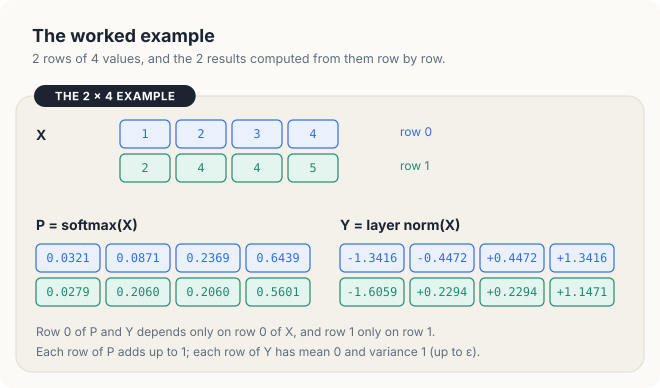
<figcaption><b>Figure 23.1</b> The worked example \(X\), its softmax \(P\) and its layer normalization \(Y\). Row 0 of each result depends only on row 0 of \(X\).</figcaption>
</figure>

We will return several times to 2 entries of these results, \\(p_{03} = 0.6439\\) and
\\(y_{00} = -1.3416\\). In Section 23.2, we will see that the direct formulas turn both of them
into NaN for rows that differ from row 0 only by a constant added to every value.

The matrix is stored in **row-major order**, that is, row 0 first and then row 1, in a single
array of \\(2n = 8\\) floats. The value \\(x_{rj}\\) therefore sits at position \\(r \cdot n + j\\)
of the array, since the \\(r\\) rows before it occupy \\(r \cdot n\\) positions. For example,
\\(x_{12}\\) sits at position \\(1 \cdot 4 + 2 = 6\\). A whole row is thus a contiguous piece of
memory, and the GPU algorithm of Section 23.4 relies on this fact.

### 23.1.2 Softmax

A model often produces a row of scores, 1 score per possible answer, and needs to turn the row
into probabilities. Probabilities must be positive and must add up to 1, while scores can be any
real numbers, including negative ones. A simple way to obtain positive numbers is to apply the
exponential function to every score, since \\(e^x > 0\\) for every real \\(x\\). A simple way to
make positive numbers add up to 1 is to divide each of them by their total. Softmax performs
exactly these 2 steps.

<div class="definition">

<span class="box-label">Definition 23.1</span> **Softmax.** The softmax of a row
\\(x_0, \dots, x_{n-1}\\) is the row \\(p_0, \dots, p_{n-1}\\) with

\\[ p_j = \frac{e^{x_j}}{\sum_{i \in [0, n)} e^{x_i}}, \qquad j \in [0, n). \\]

The inputs \\(x_j\\) are often called *logits*, and the outputs are positive and add up to 1.

*Example.* For row 0 of \\(X\\), \\(p_3 = e^4 / (e^1 + e^2 + e^3 + e^4) = 54.598 / 84.791 = 0.6439\\).

</div>

| Symbol | Meaning | In the example (row 0, \\(j = 3\\)) |
|---|---|---|
| \\(n\\) | number of values in the row | 4 |
| \\(x_j\\) | input value in column \\(j\\) of the row | \\(x_3 = 4\\) |
| \\(e^{x_j}\\) | exponential of the input, the numerator | \\(e^4 = 54.598\\) |
| \\(\sum_{i \in [0, n)} e^{x_i}\\) | sum of the exponentials of the whole row, the denominator | 84.791 |
| \\(p_j\\) | output in column \\(j\\) | 0.6439 |

Note that the numerator depends only on \\(x_j\\), whereas the denominator is the same for every
column and depends on the whole row. Every output is positive because an exponential is positive,
and the outputs add up to 1 because they share 1 denominator, which is the sum of all the
numerators. Softmax therefore turns any row of real numbers into a probability distribution. It
also preserves order: a larger input receives a larger output. More precisely, an input larger by
1 receives an output larger by a factor of \\(e = 2.718\\), since \\(e^{x + 1} = e \cdot e^x\\).

Figure 23.2 computes row 0 by hand. The 4 exponentials are 2.718, 7.389, 20.086 and 54.598, and
their sum is 84.791. Dividing each of them by the sum gives 0.0321, 0.0871, 0.2369 and 0.6439.
The value 4 receives 64% of the total, although it is only 4 times the value 1. The
reason is that the exponential magnifies differences: \\(e^4\\) is \\(e^3 = 20.1\\) times
\\(e^1\\).

<figure>
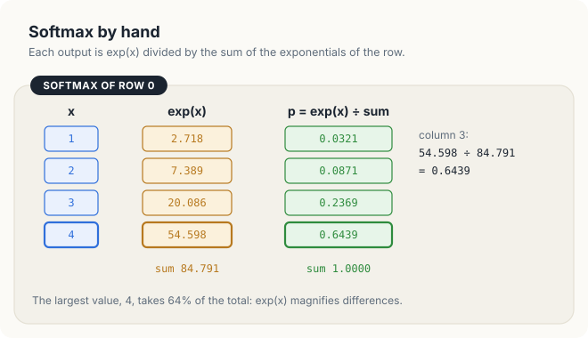
<figcaption><b>Figure 23.2</b> Softmax of row 0 by hand. Column 3 receives \(54.598 / 84.791 = 0.6439\).</figcaption>
</figure>

Row 1 is computed in the same way. Its denominator is \\(e^2 + e^4 + e^4 + e^5 = 7.389 + 54.598 +
54.598 + 148.413 = 264.998\\), and its outputs are 0.0279, 0.2060, 0.2060 and 0.5601. As we would
expect, the 2 equal inputs receive equal outputs.

Softmax appears in 2 places in a transformer. In an attention layer, it is applied to every row of
a matrix of scores between tokens, so a row holds one value per token of the sequence, often 1,024
to 32,768 values. At the output of the model, it is applied to a row with one value per word of the
vocabulary, often 32,000 to 128,000 values. A GPU implementation must therefore handle many short
rows as well as a few long ones, and in Section 23.7, we measure both cases.

### 23.1.3 Layer normalization

The values that a layer of a model produces can drift: from 1 row to the next, or from 1 training
step to the next, their centre may move and their spread may grow or shrink. Layer normalization
removes this drift. It measures where the values of a row are centred and how widely they are
spread, and then rescales the row so that it is centred at 0 with a spread of 1. The centre is
measured by the mean, and the spread by the variance, which we now define.

<div class="definition">

<span class="box-label">Definition 23.2</span> **Mean, variance and layer normalization.** The
mean of a row is \\(\mu = \frac{1}{n} \sum_{j} x_j\\), and its variance is the mean squared
deviation from the mean, \\(\sigma^2 = \frac{1}{n} \sum_j (x_j - \mu)^2\\). The square root
\\(\sigma\\) is the standard deviation. The layer normalization of the row is

\\[ y_j = \frac{x_j - \mu}{\sqrt{\sigma^2 + \varepsilon}} \\, \gamma_j + \beta_j, \qquad j \in [0, n), \\]

where \\(\varepsilon\\) is a small constant, and \\(\gamma_j\\) and \\(\beta_j\\) are a scale and a
shift for column \\(j\\) that the model learns.

*Example.* For row 0 of \\(X\\), \\(\mu = 2.5\\), \\(\sigma^2 = 1.25\\), and with \\(\gamma_j = 1\\),
\\(\beta_j = 0\\) and \\(\varepsilon = 10^{-5}\\), \\(y_0 = -1.5 / \sqrt{1.25001} = -1.3416\\).

</div>

| Symbol | Meaning | In the example (row 0, \\(j = 0\\)) |
|---|---|---|
| \\(\mu\\) | mean of the row, the centre of its values | 2.5 |
| \\(x_j - \mu\\) | deviation of value \\(j\\) from the mean | \\(1 - 2.5 = -1.5\\) |
| \\(\sigma^2\\) | variance, the mean of the squared deviations | 1.25 |
| \\(\sigma\\) | standard deviation, the square root of the variance | 1.118 |
| \\(\varepsilon\\) | small constant that keeps the square root away from 0 | \\(10^{-5}\\) |
| \\(\gamma_j, \beta_j\\) | learned scale and shift of column \\(j\\) | 1 and 0 |
| \\(y_j\\) | output in column \\(j\\) | \\(-1.3416\\) |

The formula is easiest to read from the inside out. The deviation \\(x_j - \mu\\) moves the centre
of the row to 0. Dividing by \\(\sqrt{\sigma^2 + \varepsilon}\\), which is almost exactly the
standard deviation, makes the spread 1. Finally, \\(\gamma_j\\) and \\(\beta_j\\) let the model
choose a different scale and centre for each column, if that serves it better. In this chapter, we
take \\(\gamma_j = 1\\) and \\(\beta_j = 0\\) in all hand computations, so that the last step
changes nothing.

Figure 23.3 carries out the definition on row 0. The mean is \\(10 / 4 = 2.5\\). The deviations
from the mean are \\(-1.5, -0.5, 0.5\\) and \\(1.5\\), their squares are 2.25, 0.25, 0.25 and
2.25, and the variance is the mean of these squares, \\(5 / 4 = 1.25\\). Each deviation is then
multiplied by \\(1 / \sqrt{1.25 + 10^{-5}} = 0.8944\\), which gives \\(-1.3416, -0.4472, 0.4472\\)
and \\(1.3416\\). The outputs have mean 0 and variance \\(1.25 / 1.25001\\), which is 1 up to the
small effect of \\(\varepsilon\\).

<figure>
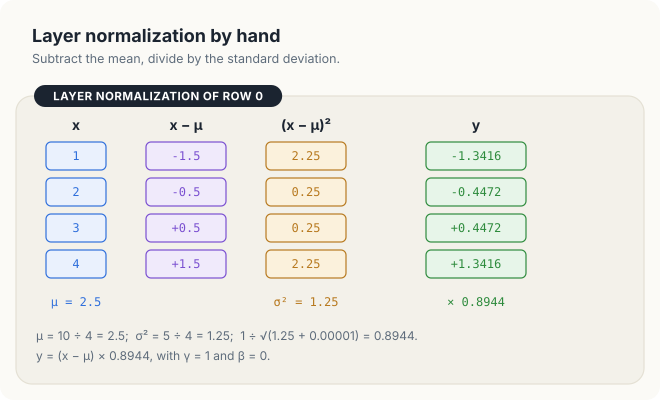
<figcaption><b>Figure 23.3</b> Layer normalization of row 0 by hand, with \(\gamma_j = 1\) and \(\beta_j = 0\).</figcaption>
</figure>

For row 1, the mean is \\(15 / 4 = 3.75\\), the deviations are \\(-1.75, 0.25, 0.25\\) and
\\(1.25\\), the variance is \\(4.75 / 4 = 1.1875\\), and the outputs are \\(-1.6059, 0.2294,
0.2294\\) and \\(1.1471\\). The constant \\(\varepsilon\\) matters only for a row whose values are
all equal. Such a row has variance 0, and without \\(\varepsilon\\), every output would be
\\(0 / 0\\).

We can now see that both definitions have the same shape. Each of them needs 1 or 2 numbers
computed from the whole row, the sum of exponentials in one case and the mean and the variance in
the other, before it can produce its first output. In the rest of the chapter, we study how to
compute these numbers quickly and accurately.

<div class="exercises">

Exercises

23.1 Compute the softmax of the row 0, 0, 0, 10. Which fraction of the total does the last value
receive?<br>
23.2 Show that the outputs of softmax add up to 1, and that the outputs of layer normalization
with \\(\gamma_j = 1\\) and \\(\beta_j = 0\\) add up to 0.<br>
23.3 Compute the layer normalization of the row 4, 4, 4, 4 with and without \\(\varepsilon\\).

</div>

## 23.2 The sequential algorithms

### 23.2.1 Overflow in `f32`

The formulas of Section 23.1 are exact in real arithmetic, but a computer evaluates them with
numbers of limited range and precision. The kernels of this chapter compute in **single
precision**, the 32-bit floating-point type `f32` in Rust and `float` in C++. Before we evaluate
softmax in this type, we recall what it can hold.

<div class="definition">

<span class="box-label">Definition 23.3</span> **The `f32` type.** An `f32` number holds a sign,
an 8-bit exponent and a 24-bit significand. Its largest finite value is about
\\(3.40 \times 10^{38}\\). A result larger than that is rounded to the special value
\\(\infty\\), and an expression without a defined value, such as \\(\infty / \infty\\) or
\\(0 \cdot \infty\\), gives the special value **NaN**, "not a number". Every arithmetic operation
with a NaN operand gives NaN.

*Example.* \\(e^{88} = 1.65 \times 10^{38}\\) fits in an `f32`; \\(e^{89} = 4.49 \times 10^{38}\\)
does not and becomes \\(\infty\\).

</div>

The largest `f32` equals \\(e^{88.72}\\), so the exponential of any input above 88.72 overflows.
Inputs of that size are not unusual in a model, and we now follow what happens to one of them.
Suppose that we add 100 to every value of \\(X\\). Row 0 becomes 101, 102, 103 and 104, and the
exponentials range from \\(7.31 \times 10^{43}\\) to \\(1.47 \times 10^{45}\\), all beyond the
largest `f32`. Each of them therefore becomes \\(\infty\\), their sum is \\(\infty\\), and every
output is \\(\infty / \infty\\), which is NaN, as shown in the left half of Figure 23.4. The entry
\\(p_{03} = 0.6439\\) is lost, and so is every other entry of the row, although the true softmax
of this row is ordinary, as we show next.

<figure>
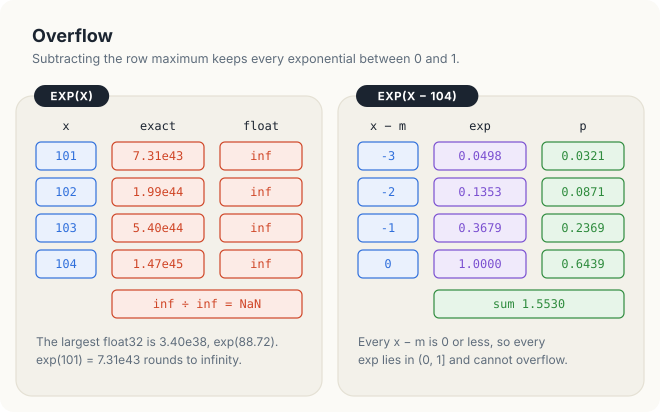
<figcaption><b>Figure 23.4</b> Row 0 of \(X + 100\). Left: the direct formula overflows. Right: with the maximum subtracted, no exponential exceeds 1.</figcaption>
</figure>

### 23.2.2 Subtracting the maximum

The exponentials in Figure 23.4 overflow because the inputs are large, yet the outputs that we
want are ordinary probabilities. This suggests that the size of the inputs should not matter to
the result, and indeed it does not. The reason is a familiar property of fractions: multiplying
the numerator and the denominator of a fraction by the same nonzero number does not change its
value. Subtracting a constant \\(c\\) from every input multiplies every exponential by the same
number \\(e^{-c}\\), and therefore leaves every output unchanged. If we choose \\(c\\) to be the
largest input of the row, no exponential can exceed 1.

<div class="theorem">

<span class="box-label">Theorem 23.1</span> For every real number \\(c\\), the softmax of
\\(x_0 - c, \dots, x_{n-1} - c\\) equals the softmax of \\(x_0, \dots, x_{n-1}\\). If
\\(c = m = \max_j x_j\\), then every exponential \\(e^{x_j - m}\\) lies in \\((0, 1]\\), and the
denominator \\(\sum_j e^{x_j - m}\\) lies in \\([1, n]\\).

</div>

<div class="proof">

*Proof.* Since \\(e^{x_j - c} = e^{x_j} e^{-c}\\),

\\[ \frac{e^{x_j - c}}{\sum_i e^{x_i - c}} = \frac{e^{x_j} e^{-c}}{e^{-c} \sum_i e^{x_i}} = \frac{e^{x_j}}{\sum_i e^{x_i}}, \\]

because the positive factor \\(e^{-c}\\) cancels. With \\(c = m\\), every \\(x_j - m \le 0\\), so
\\(0 < e^{x_j - m} \le 1\\). The sum has \\(n\\) such terms, so it is at most \\(n\\), and the term
of a column where \\(x_j = m\\) equals \\(e^0 = 1\\), so the sum is at least 1.

</div>

In the theorem, \\(c\\) is any constant subtracted from all inputs, and \\(m\\) is the largest
input of the row. For row 0 of \\(X + 100\\), \\(m = 104\\), and the shifted inputs
\\(x_j - m\\) are \\(-3, -2, -1\\) and 0.

The theorem gives more than freedom from overflow. A denominator of at least 1 cannot be 0, so the
division is always defined. Moreover, since shifting a whole row by a constant does not change its
softmax, the matrix \\(X + 100\\) has exactly the softmax \\(P\\) of \\(X\\). For row 0 of
\\(X + 100\\), the exponentials of the shifted inputs are 0.0498, 0.1353, 0.3679 and 1, which add
up to 1.5530, and the outputs are 0.0321, 0.0871, 0.2369 and 0.6439 again, as shown in the right
half of Figure 23.4.

### 23.2.3 Softmax in 3 passes

The subtraction of the maximum has a cost. The maximum must be known before the first exponential
is computed, and the sum of the exponentials must be known before the first output is written.
The algorithm therefore reads the row 3 times, once for each of these 3 steps. Since the number of
times an algorithm reads its data will decide its speed on a GPU, we first give this quantity a
name.

<div class="definition">

<span class="box-label">Definition 23.4</span> **Pass.** A pass is 1 traversal of a row in which
every value of the row is read once. The **memory traffic** of an algorithm is the number of bytes
it reads and writes in main memory.

*Example.* An algorithm that reads a row of 4 `f32` values 3 times and writes 4 results has 3
passes and moves \\(12 \cdot 4 + 4 \cdot 4 = 64\\) bytes.

</div>

<div class="algo">
<p class="algo-name">Softmax-3-Pass(\(x, p, n\))</p>
<ol>
<li>\(m = -\infty\)</li>
<li>for \(j \in [0, n)\) {</li>
<li style="--d:1">\(m = \max(m, x_j)\) <span class="c">// pass 1: the maximum</span></li>
<li>}</li>
<li>\(s = 0\)</li>
<li>for \(j \in [0, n)\) {</li>
<li style="--d:1">\(s = s + e^{x_j - m}\) <span class="c">// pass 2: the sum</span></li>
<li>}</li>
<li>for \(j \in [0, n)\) {</li>
<li style="--d:1">\(p_j = e^{x_j - m} / s\) <span class="c">// pass 3: the outputs</span></li>
<li>}</li>
</ol>
</div>

Lines 1 to 4 find the maximum \\(m\\), lines 5 to 8 add the shifted exponentials into the sum
\\(s\\), and lines 9 to 11 write the outputs. Each of lines 3, 7 and 10 executes \\(n\\) times, so
the algorithm performs \\(n\\) comparisons, \\(2n\\) exponentials and \\(n\\) divisions. Figure 23.5
follows the 3 passes on row 1. Pass 1 finds \\(m = 5\\). Pass 2 adds \\(e^{-3} + e^{-1} + e^{-1}
+ e^{0} = 0.0498 + 0.3679 + 0.3679 + 1 = 1.7855\\). Pass 3 writes 0.0279, 0.2060, 0.2060 and
0.5601, which is row 1 of \\(P\\) in Figure 23.1.

<figure>
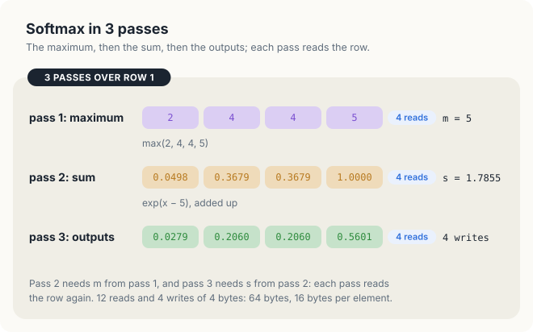
<figcaption><b>Figure 23.5</b> The 3 passes of <span class="sc">Softmax-3-Pass</span> on row 1: 12 reads and 4 writes, 16 bytes per element.</figcaption>
</figure>

Let us count the memory traffic of the example. Each pass reads all 4 values of the row, so the
row of 16 bytes is read 3 times, and 16 bytes of output are written. This makes 64 bytes in all,
or 16 bytes per element. In general, a matrix of \\(R\\) rows of \\(C\\) values each costs
\\(16RC\\) bytes, where \\(R\\) counts the rows and \\(C\\) the values in a row. For
\\(R = C = 4{,}096\\), that is 268 MB, which takes 2.63 ms on a GPU whose memory delivers
102 GB/s. The arithmetic, about 3 operations per element, takes little time compared with this
traffic, and therefore the number of passes decides the time.

### 23.2.4 Layer normalization in 2 or 3 passes

Layer normalization has the same difficulty. The definition of the variance needs the mean before
the squared deviations can be summed, so a direct algorithm also reads the row 3 times, once for
the mean, once for the variance and once for the outputs. A well-known identity removes one of these
passes, because it expresses the variance through sums that do not need the mean in advance.

<div class="theorem">

<span class="box-label">Theorem 23.2</span> The variance of a row equals the mean of the squares
minus the square of the mean: \\(\sigma^2 = \frac{1}{n} \sum_j x_j^2 - \mu^2\\).

</div>

<div class="proof">

*Proof.* We expand the square in the definition of the variance. This gives
\\(\frac{1}{n} \sum_j (x_j - \mu)^2 = \frac{1}{n} \sum_j x_j^2 - 2 \mu \frac{1}{n} \sum_j x_j +
\mu^2 = \frac{1}{n} \sum_j x_j^2 - 2\mu^2 + \mu^2\\), since \\(\frac{1}{n} \sum_j x_j = \mu\\).

</div>

For row 0 of \\(X\\), the mean of the squares is \\((1 + 4 + 9 + 16) / 4 = 7.5\\), the square of
the mean is \\(2.5^2 = 6.25\\), and their difference is 1.25, the variance that we found in
Figure 23.3. The point of the identity is that the sum of the values and the sum of their squares
can both be accumulated in the same pass, since neither needs the mean. The variance then needs 1
pass instead of 2, as the following procedure shows.

<div class="algo">
<p class="algo-name">LayerNorm-Sum-Of-Squares(\(x, y, n, \gamma, \beta\))</p>
<ol>
<li>\(a = 0\), \(b = 0\)</li>
<li>for \(j \in [0, n)\) {</li>
<li style="--d:1">\(a = a + x_j\), \(b = b + x_j^2\) <span class="c">// pass 1: 2 sums</span></li>
<li>}</li>
<li>\(\mu = a / n\), \(\sigma^2 = b / n - \mu^2\)</li>
<li>for \(j \in [0, n)\) {</li>
<li style="--d:1">\(y_j = (x_j - \mu) / \sqrt{\sigma^2 + \varepsilon} \cdot \gamma_j + \beta_j\) <span class="c">// pass 2: the outputs</span></li>
<li>}</li>
</ol>
</div>

Here \\(a\\) is the running sum of the values and \\(b\\) the running sum of their squares. On
row 0, line 3 accumulates \\(a = 10\\) and \\(b = 1 + 4 + 9 + 16 = 30\\), and line 5 gives
\\(\mu = 10 / 4 = 2.5\\) and \\(\sigma^2 = 30 / 4 - 2.5^2 = 7.5 - 6.25 = 1.25\\), the variance of
Figure 23.3. The algorithm reads each value twice and writes each output once, which makes 12
bytes per element. In exact arithmetic, it is correct. In `f32`, however, it can fail completely,
as we show next.

### 23.2.5 Cancellation

An `f32` number has only 24 bits of significand, so it can represent only a limited number of
digits. Large numbers are therefore stored less finely than small ones: near 1, neighbouring `f32`
numbers are very close together, while near \\(10^8\\), they are several units apart. A result that
falls between 2 neighbours must be rounded to one of them. We make this precise before we apply
it to the variance.

<div class="definition">

<span class="box-label">Definition 23.5</span> **Spacing and cancellation.** The `f32` numbers
between \\(2^k\\) and \\(2^{k+1}\\) are spaced \\(2^{k-23}\\) apart, so every result in that range
is rounded to a multiple of \\(2^{k-23}\\). **Cancellation** is the loss of correct digits when 2
nearly equal numbers, each carrying a rounding error, are subtracted: the difference is small,
but the errors are not.

*Example.* Between \\(2^{26} = 67{,}108{,}864\\) and \\(2^{27}\\), `f32` numbers are
\\(2^3 = 8\\) apart, so \\(10{,}001^2 = 100{,}020{,}001\\) is stored as 100,020,000.

</div>

In the definition, \\(2^k\\) is the power of 2 just below the number, and \\(2^{k-23}\\) is the gap
between 2 neighbouring `f32` numbers in that range. For example, for numbers near \\(10^8\\),
\\(k = 26\\), and the gap is \\(2^{26-23} = 8\\).

We now add 10,000 to every value of \\(X\\). Row 0 becomes 10,001, 10,002, 10,003 and 10,004. Its
deviations from the mean are those of row 0 of \\(X\\), so its variance is still 1.25, and its
layer normalization is still \\(-1.3416, -0.4472, 0.4472\\) and \\(1.3416\\). Figure 23.6 runs
<span class="sc">LayerNorm-Sum-Of-Squares</span> on this row in `f32`, 1 rounding at a time.

<figure>
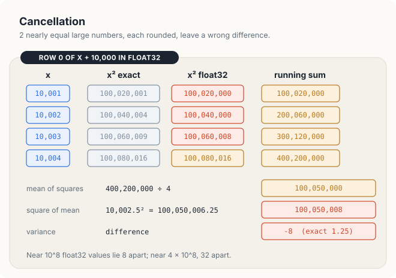
<figcaption><b>Figure 23.6</b> The variance of row 0 of \(X + 10{,}000\) by the sum of squares, in <code>f32</code>: \(-8\) instead of 1.25.</figcaption>
</figure>

Let us follow the roundings in order. The squares lie near \\(10^8\\), where `f32` numbers are 8
apart, and 3 of the 4 squares are rounded. Once the running sum passes \\(2.68 \times 10^8\\), the
spacing becomes 32. The last addition, \\(300{,}120{,}000 + 100{,}080{,}016 = 400{,}200{,}016\\),
lies exactly halfway between 2 neighbours and is rounded to 400,200,000. Dividing by 4 gives the
mean of the squares, 100,050,000. The mean itself is 10,002.5, which is exact in `f32`, but its
square, 100,050,006.25, is rounded to 100,050,008. Line 5 then subtracts the 2 results:

\\[ \sigma^2 = 100{,}050{,}000 - 100{,}050{,}008 = -8. \\]

The first number is the mean of the squares, \\(b / n\\), and the second is the square of the mean,
\\(\mu^2\\), each after rounding. The true difference, 1.25, is smaller than the spacing 8 of the
numbers being subtracted, so not a single correct digit survives the subtraction. The result is
not even positive, so \\(\sqrt{-8 + 10^{-5}}\\) is NaN, and every output of the row is NaN.
The entry \\(y_{00} = -1.3416\\) is lost. The GPU kernel of Section 23.6 prints the same 8 NaNs
for \\(X + 10{,}000\\).

The failure needs no extreme values. Rows of activations with a large common offset and
a small spread occur in practice, and in Section 23.7, we measure an error of 2.97 on outputs of
size 1 for values near 1,000. The difficulty lies in forming the squares of the values
themselves, which are large whenever the values are large, even when the variance is small. The
remedy is therefore to form only squares of deviations, which are small whenever the variance is
small.

<div class="exercises">

Exercises

23.4 Which is the largest integer \\(k\\) for which \\(e^k\\) is finite in `f32`? And in `f64`,
whose largest value is about \\(1.8 \times 10^{308}\\)?<br>
23.5 Show that Theorem 23.1 holds for any \\(c\\), but that only \\(c \ge \max_j x_j\\) guarantees
that no exponential overflows. Which choice of \\(c\\) also guarantees a denominator of at least
1?<br>
23.6 Repeat Figure 23.6 for row 0 of \\(X + 1{,}000\\), where `f32` numbers near \\(10^6\\) are
0.0625 apart. Is the variance exact?

</div>

## 23.3 One pass over the row

### 23.3.1 The dependence on the maximum

Recall that <span class="sc">Softmax-3-Pass</span> reads the row 3 times because of 2
dependences. Line 7 needs \\(m\\), which is known only after the last iteration of line 3, and
line 10 needs \\(s\\), which is known only after the last iteration of line 7. The second
dependence cannot be avoided, since an output \\(e^{x_j - m} / s\\) cannot be written before the
whole sum \\(s\\) is known. The first dependence, however, deserves a closer look.

Suppose that we process row 1, which holds 2, 4, 4 and 5, from the left, and that we
pretend that the largest value seen so far is the maximum. After the first value, the maximum so
far is 2, and the sum so far is \\(e^{2-2} = 1\\). The second value, 4, is larger, so the sum so
far was taken relative to the wrong maximum. We wanted the term \\(e^{2-4}\\), and we have
\\(e^{2-2}\\) instead. The work is not lost, however. Since \\(e^{a} \cdot e^{b} = e^{a+b}\\), the
term that we have becomes the term that we want when we multiply it by \\(e^{2-4}\\):

\\[ e^{2-2} \cdot e^{2-4} = e^{2-4}. \\]

Here, the first factor is the term relative to the old maximum 2, the second factor is the
correction from the old maximum 2 to the new maximum 4, and the right side is the term relative
to the new maximum. The correction factor depends only on the 2 maxima, not on the value of the
term. The same multiplication therefore corrects any number of terms at once, because every term
of the sum was taken relative to the same old maximum.

<div class="key-observation">

<span class="box-label">Key observation</span> A sum of exponentials taken relative to 1 maximum
\\(m\\) becomes the sum relative to a larger maximum \\(m'\\) by 1 multiplication, since
\\(e^{x - m} \cdot e^{m - m'} = e^{x - m'}\\) for every term. The maximum therefore does not have
to be known before the sum begins: the sum can be corrected each time the maximum grows.

</div>

| Symbol | Meaning | In the example |
|---|---|---|
| \\(x\\) | a value already added to the sum | 2 |
| \\(m\\) | the old maximum, relative to which the sum was taken | 2 |
| \\(m'\\) | the new, larger maximum | 4 |
| \\(e^{m - m'}\\) | correction factor, the same for every term | \\(e^{-2} = 0.1353\\) |

### 23.3.2 The online softmax

We now carry out the observation on row 1, 1 value at a time. We keep 2 numbers while we read the
row: \\(m\\), the largest value seen so far, and \\(s\\), the sum of \\(e^{x - m}\\) over the
values \\(x\\) seen so far. We start from \\(m = -\infty\\) and \\(s = 0\\), which describe a row
with no values, since no value has been seen and the sum of no terms is 0. Figure 23.7 shows the 4
steps.

1. The first value is 2. It is larger than \\(m = -\infty\\), so the old sum is multiplied by
   \\(e^{-\infty - 2} = 0\\), and the new value contributes \\(e^{2-2} = 1\\). We now have
   \\(m = 2\\) and \\(s = 1\\).
2. The second value is 4. It is larger than \\(m = 2\\), so the old sum is moved to the new maximum
   by the factor \\(e^{2-4}\\), and the new value contributes \\(e^0 = 1\\). We now have
   \\(s = 1 \cdot e^{2-4} + 1 = 0.1353 + 1 = 1.1353\\) and \\(m = 4\\).
3. The third value is 4. It is not larger than \\(m = 4\\), so the maximum stays, and the value
   adds \\(e^{4-4} = 1\\) to the sum, which becomes \\(s = 2.1353\\).
4. The fourth value is 5. It is larger than \\(m = 4\\), so we obtain
   \\(s = 2.1353 \cdot e^{4-5} + 1 = 0.7855 + 1 = 1.7855\\) and \\(m = 5\\).

The final pair, \\(m = 5\\) and \\(s = 1.7855\\), is exactly what passes 1 and 2 of Figure 23.5
computed, but we obtained it in 1 pass instead of 2.

<figure>
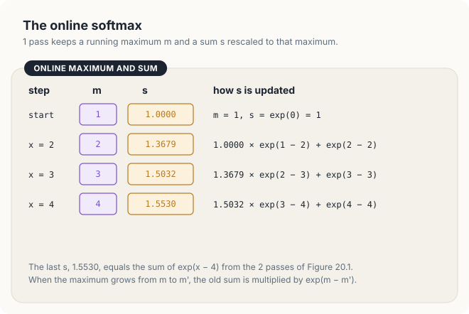
<figcaption><b>Figure 23.7</b> The online softmax on row 1. Steps 1, 2 and 4 find a new maximum and rescale the sum; step 3 adds to it.</figcaption>
</figure>

The pair \\((m, s)\\) carries everything that the algorithm needs to remember about the values
already read. We give such a pair a name, so that we can reason about it.

<div class="definition">

<span class="box-label">Definition 23.6</span> **Softmax state.** A softmax state \\((m, s)\\)
describes a set \\(S\\) of values when \\(m = \max S\\) and \\(s = \sum_{x \in S} e^{x - m}\\). The
**empty state** \\((-\infty, 0)\\) describes the empty set.

*Example.* \\((4, 1.1353)\\) describes the values 2, 4: \\(4 = \max\\{2, 4\\}\\) and
\\(e^{2-4} + e^{4-4} = 1.1353\\).

</div>

<div class="algo">
<p class="algo-name">Online-Softmax(\(x, p, n\))</p>
<ol>
<li>\(m = -\infty\), \(s = 0\) <span class="c">// the empty state</span></li>
<li>for \(j \in [0, n)\) {</li>
<li style="--d:1">if \(x_j > m\) {</li>
<li style="--d:2">\(s = s \cdot e^{m - x_j} + 1\) <span class="c">// move the sum to the new maximum</span></li>
<li style="--d:2">\(m = x_j\)</li>
<li style="--d:1">} else {</li>
<li style="--d:2">\(s = s + e^{x_j - m}\)</li>
<li style="--d:1">}</li>
<li>}</li>
<li>for \(j \in [0, n)\) {</li>
<li style="--d:1">\(p_j = e^{x_j - m} / s\)</li>
<li>}</li>
</ol>
</div>

Lines 1 to 9 form the first pass, and they replace lines 1 to 8 of
<span class="sc">Softmax-3-Pass</span>. Lines 10 to 12 are its third pass, unchanged. Line 4 is the
correction of the key observation, followed by the term \\(e^{x_j - x_j} = 1\\) of the new value.
Line 4 also handles the first value without a special case: when \\(m = -\infty\\), the
factor \\(e^{m - x_j}\\) is 0, and \\(s\\) becomes 1. The loop computes 1 exponential per value,
either on line 4 or on line 7, so the amount of arithmetic is the same as before, \\(2n\\)
exponentials in all. What changes is the traffic. The algorithm makes 2 reads and 1 write per
element, which is 12 bytes instead of 16.

The algorithm is short, but each step relies on the previous state being exactly right, so we now
prove that it is correct.

<div class="theorem">

<span class="box-label">Theorem 23.3</span> When the loop of lines 2 to 9 of
<span class="sc">Online-Softmax</span> ends, \\(m = \max_j x_j\\) and
\\(s = \sum_{j \in [0,n)} e^{x_j - m}\\). The outputs of line 11 are therefore the softmax of
\\(x\\).

</div>

<div class="proof">

*Proof.* We show that the loop maintains the invariant

\\[ \text{at the start of iteration } j, \quad (m, s) \text{ describes } \\{x_0, \dots, x_{j-1}\\}, \\]

that is, \\(m = \max_{i < j} x_i\\) and \\(s = \sum_{i < j} e^{x_i - m}\\), where \\(i\\) runs over
the values already read (Figure 23.8). For example, on row 1 at the start of iteration
\\(j = 2\\), the values read are 2 and 4, and \\((m, s) = (4, 1.1353)\\).

*Initialization.* Before iteration 0, the set is empty, and line 1 sets the empty state.

*Maintenance.* Assume that the invariant holds at the start of iteration \\(j\\). If \\(x_j > m\\), the new
maximum is \\(x_j\\). Line 4 multiplies every term \\(e^{x_i - m}\\) of \\(s\\) by
\\(e^{m - x_j}\\), which turns it into \\(e^{x_i - x_j}\\) by the key observation, and adds
\\(e^{x_j - x_j} = 1\\), the term of the new value. Line 5 sets \\(m = x_j\\). If
\\(x_j \le m\\), the maximum does not change, and line 7 adds the term \\(e^{x_j - m}\\) of the new
value. In both cases, \\((m, s)\\) describes \\(\\{x_0, \dots, x_j\\}\\) at the start of iteration
\\(j + 1\\).

*Termination.* The loop ends with \\(j = n\\), when \\((m, s)\\) describes the whole row. Line 11
then computes \\(e^{x_j - m} / s\\), which is the softmax by Theorem 23.1.

</div>

<figure>
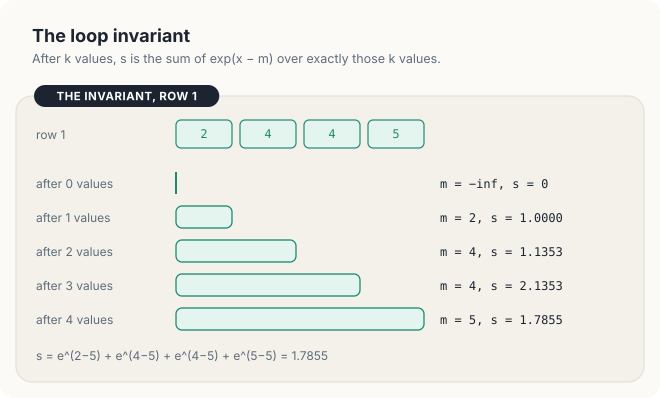
<figcaption><b>Figure 23.8</b> The loop invariant on row 1. After \(k\) values, \((m, s)\) describes exactly the first \(k\) values.</figcaption>
</figure>

The online softmax was published by Milakov and Gimelshein in 2018. It is also at the core of
attention kernels that never store the full matrix of scores, because such kernels, too, see a
row of scores in pieces.

### 23.3.3 Merging 2 states

A GPU does not traverse a row from the left with a single thread. Instead, many threads each
traverse a part of the row, and their partial results must then be combined. Suppose, for example,
that 1 thread has read the values 2 and 4 of row 1, and another thread the values 4 and 5. Each
thread holds a softmax state of its own part, taken relative to its own maximum. To combine the 2
states, we move both sums to the larger of the 2 maxima, by the key observation, and add them.
The key observation thus combines 2 states as easily as it adds 1 value.

<div class="algo">
<p class="algo-name">Merge-Softmax(\((m_a, s_a), (m_b, s_b)\))</p>
<ol>
<li>\(m = \max(m_a, m_b)\)</li>
<li>if \(m = -\infty\) {</li>
<li style="--d:1">return \((-\infty, 0)\) <span class="c">// both states are empty</span></li>
<li>}</li>
<li>return \((m,\; s_a e^{m_a - m} + s_b e^{m_b - m})\)</li>
</ol>
</div>

<div class="theorem">

<span class="box-label">Theorem 23.4</span> If \\((m_a, s_a)\\) describes a set \\(A\\) and
\\((m_b, s_b)\\) describes a set \\(B\\) disjoint from \\(A\\), then
<span class="sc">Merge-Softmax</span> returns the state that describes \\(A \cup B\\).

</div>

<div class="proof">

*Proof.* The maximum of \\(A \cup B\\) is the larger of the 2 maxima, which line 1 computes. If
both sets are empty, so is the union, and line 3 returns the empty state. Otherwise, \\(m\\) is finite, and line 5
moves each sum to \\(m\\) by the key observation: \\(s_a e^{m_a - m} = \sum_{x \in A} e^{x - m}\\),
and likewise for \\(B\\). If 1 of the sets is empty, its factor is \\(e^{-\infty} = 0\\) and its
sum 0 contributes nothing. Because \\(A\\) and \\(B\\) are disjoint, the 2 sums together contain
each term of \\(A \cup B\\) once.

</div>

In the procedure, \\((m_a, s_a)\\) and \\((m_b, s_b)\\) are the 2 states to be merged, and the
factors \\(e^{m_a - m}\\) and \\(e^{m_b - m}\\) move each sum from its own maximum to the common
maximum \\(m\\). The factor of the state that already has the larger maximum is \\(e^0 = 1\\).

The left half of Figure 23.9 merges the two halves of row 1 in this way. The values 2 and 4 have
the state \\((m_a, s_a) = (4, 1.1353)\\), and the values 4 and 5 have the state
\\((m_b, s_b) = (5, e^{-1} + 1) = (5, 1.3679)\\). The merge gives \\(m = 5\\) and
\\(s = 1.1353 \cdot e^{4-5} + 1.3679 \cdot e^{5-5} = 0.4177 + 1.3679 = 1.7855\\), which is the
sum of Figure 23.7.

<figure>
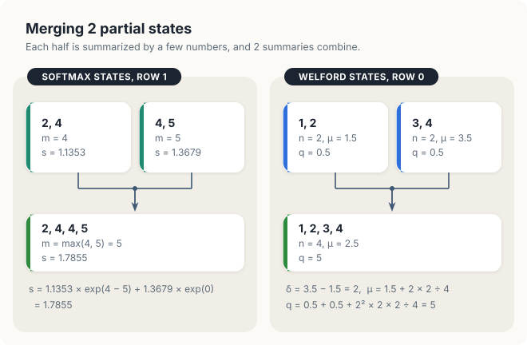
<figcaption><b>Figure 23.9</b> Merging 2 partial states. Left: softmax states of the halves of row 1. Right: Welford states of the halves of row 0 (Section 23.3.5).</figcaption>
</figure>

The theorem has two consequences that matter for the GPU. First, the result depends only on the
union of the sets, so merges can be grouped in any order. Merging \\(A\\) with \\(B\\) and then
with a third set \\(C\\) gives the same state as merging \\(A\\) with the merge of \\(B\\) and
\\(C\\). An operation with this property is called **associative**, and associativity is what
allows the threads to combine their states in a tree of merges instead of a chain. Second, the
test on line 2 is necessary. Without it, 2 empty states give \\(0 \cdot e^{-\infty - (-\infty)}\\),
and \\(-\infty - (-\infty)\\) is NaN in `f32`. On a GPU, many threads can hold empty states, and in
Section 23.5, we show what happens when line 2 is missing.

### 23.3.4 Welford's method

The same idea removes the extra pass of the variance, and it removes the cancellation at the same
time. Recall from Section 23.2.5 that the trouble came from squaring the values themselves. We
would rather sum the squared deviations from the mean, as the definition does, but the mean is not
known until the whole row has been read. We therefore proceed as we did with the maximum. We use
the mean of the values seen so far, and we correct the sum each time this mean moves.

While reading the row, we keep 3 numbers: the count \\(n\\) of values seen, their mean \\(\mu\\),
and the sum \\(q\\) of their squared deviations from \\(\mu\\). The variance of the values seen is
then \\(q / n\\). For example, after the values 1 and 2 of row 0, we have \\(n = 2\\),
\\(\mu = 1.5\\) and \\(q = (-0.5)^2 + 0.5^2 = 0.5\\). When a new value \\(x\\) arrives, the mean
moves, while every deviation in \\(q\\) was measured from the old mean. As with the maximum, the old
sum can be corrected without visiting the old values again, and we now derive the correction.

Let \\(\mu\\) be the mean of the first \\(k - 1\\) values, let \\(x\\) be the \\(k\\)-th value,
and let \\(\delta = x - \mu\\) be the deviation of the new value from the old mean. In our example,
with the third value \\(x = 3\\), we have \\(k = 3\\), \\(\mu = 1.5\\) and \\(\delta = 1.5\\). The
new mean is the total of the \\(k\\) values divided by \\(k\\):

\\[ \mu' = \frac{(k - 1)\mu + x}{k} = \mu + \frac{\delta}{k}. \\]

| Symbol | Meaning | In the example |
|---|---|---|
| \\(k\\) | number of values after the new one is added | 3 |
| \\(\mu\\) | mean of the first \\(k - 1\\) values, the old mean | 1.5 |
| \\(x\\) | the new value | 3 |
| \\(\delta\\) | deviation of the new value from the old mean, \\(x - \mu\\) | 1.5 |
| \\(\mu'\\) | mean of all \\(k\\) values, the new mean | \\(1.5 + 1.5 / 3 = 2\\) |

In words, the mean moves towards the new value by \\(1/k\\) of the distance between them. The old
values now deviate from \\(\mu'\\) instead of \\(\mu\\). Shifting the centre of \\(k - 1\\) values
by \\(\mu' - \mu = \delta / k\\) adds \\((k - 1)(\delta / k)^2\\) to the sum of their squared
deviations. No other term appears, because the cross terms contain the sum of the deviations from
\\(\mu\\), which is 0. In the example, the old values 1 and 2 had the squared deviations 0.25 and
0.25 from 1.5, and they have 1 and 0 from 2, so their sum grows by \\(2 \cdot 0.5^2 = 0.5\\). The
new value adds its own squared deviation, \\((x - \mu')^2 = (\delta (k-1)/k)^2\\), which is
\\(1^2 = 1\\) in the example. Together, the new sum is

\\[ q' = q + (k-1)\frac{\delta^2}{k^2} + \frac{(k-1)^2 \delta^2}{k^2} = q + \delta^2 \frac{k-1}{k}
= q + \delta \\, (x - \mu'), \\]

where the last step uses \\(x - \mu' = \delta (k-1)/k\\).

| Symbol | Meaning | In the example |
|---|---|---|
| \\(q\\) | sum of squared deviations of the old values from \\(\mu\\) | 0.5 |
| \\(x - \mu'\\) | deviation of the new value from the new mean | \\(3 - 2 = 1\\) |
| \\(q'\\) | sum of squared deviations of all \\(k\\) values from \\(\mu'\\) | \\(0.5 + 1.5 \cdot 1 = 2\\) |

Indeed, the values 1, 2 and 3 have the squared deviations 1, 0 and 1 from their mean 2, which add
up to 2. The final form of the update needs only the old mean and the new mean, and that
it multiplies 2 deviations, never 2 values.

<div class="algo">
<p class="algo-name">Welford-Update(\((n, \mu, q), x\))</p>
<ol>
<li>\(n = n + 1\)</li>
<li>\(\delta = x - \mu\) <span class="c">// deviation from the old mean</span></li>
<li>\(\mu = \mu + \delta / n\)</li>
<li>\(q = q + \delta \cdot (x - \mu)\) <span class="c">// old deviation times new deviation</span></li>
<li>return \((n, \mu, q)\)</li>
</ol>
</div>

Line 2 computes the deviation \\(\delta\\) from the old mean, line 3 moves the mean, and line 4
adds the product of the old and the new deviation of \\(x\\) to \\(q\\). Figure 23.10 applies the
update to the whole of row 0, starting from the state \\((0, 0, 0)\\). The value 1 gives
\\(\delta = 1\\), \\(\mu = 1\\) and \\(q = 1 \cdot 0 = 0\\). The value 2 gives \\(\delta = 1\\),
\\(\mu = 1.5\\) and \\(q = 0 + 1 \cdot 0.5 = 0.5\\). The value 3 gives \\(\delta = 1.5\\),
\\(\mu = 2\\) and \\(q = 0.5 + 1.5 \cdot 1 = 2\\), as we computed above. The value 4 gives
\\(\delta = 2\\), \\(\mu = 2.5\\) and \\(q = 2 + 2 \cdot 1.5 = 5\\). The variance is therefore
\\(5 / 4 = 1.25\\), as in Figure 23.3.

<figure>
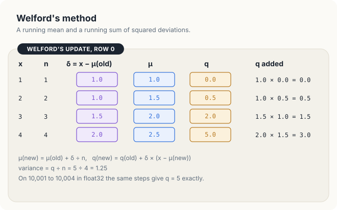
<figcaption><b>Figure 23.10</b> Welford's update on row 0. Every quantity added to \(q\) is a product of 2 deviations.</figcaption>
</figure>

We now run the same steps on the row 10,001 to 10,004 in `f32`, the row on which the sum of
squares failed. The means 10,001, 10,001.5, 10,002 and 10,002.5 are exact in `f32`, and the
deviations are 1, 1, 1.5 and 2, as before, so \\(q\\) is again exactly 5, and the variance is 1.25.
No square of a value near 10,000 is ever formed. Every number added to \\(q\\) is of the size of
the deviations, and the deviations are small whenever the variance is small. This is exactly the
property that the sum of squares lacked.

<div class="theorem">

<span class="box-label">Theorem 23.5</span> After <span class="sc">Welford-Update</span> has been
applied to \\(x_0, \dots, x_{k-1}\\), starting from \\((0, 0, 0)\\), the state is
\\(\big(k, \mu_k, \sum_{i<k} (x_i - \mu_k)^2\big)\\), where \\(\mu_k\\) is the mean of the \\(k\\)
values.

</div>

<div class="proof">

*Proof.* We use the invariant that after \\(k\\) updates, the state is
\\((k, \mu_k, q_k)\\) with \\(q_k = \sum_{i<k} (x_i - \mu_k)^2\\). For example, after \\(k = 3\\)
updates on row 0, the state is \\((3, 2, 2)\\).

*Initialization.* For \\(k = 0\\), the state \\((0, 0, 0)\\) has count 0 and \\(q_0 = 0\\), the empty
sum. The mean 0 of the empty state does not enter any later result, since line 3 of the first
update gives \\(\mu = 0 + (x_0 - 0)/1 = x_0\\).

*Maintenance.* Assume that the invariant holds after \\(k - 1\\) updates, and apply the update to \\(x_{k-1}\\).
Line 1 makes the count \\(k\\), and line 3 computes \\(\mu_k = \mu_{k-1} + \delta / k\\), the new
mean derived above. For the sum, write each old deviation as
\\(x_i - \mu_k = (x_i - \mu_{k-1}) - \delta/k\\). Squaring and summing over \\(i < k - 1\\) gives
\\(q_{k-1} + (k-1)\delta^2/k^2\\), since \\(\sum_{i<k-1} (x_i - \mu_{k-1}) = 0\\). Adding the new
term \\((x_{k-1} - \mu_k)^2 = \delta^2 (k-1)^2/k^2\\) gives \\(q_{k-1} + \delta^2 (k-1)/k\\), which
is what line 4 adds, \\(\delta (x_{k-1} - \mu_k)\\).

*Termination.* After the last value, the state is \\((n, \mu, q)\\) with \\(q / n = \sigma^2\\).

</div>

Welford's method has a price. It performs 1 division per value, on line 3, where the sum of
squares performs only 1 multiplication. In Section 23.7, we measure what this division costs on a
GPU.

### 23.3.5 Merging 2 Welford states

As with softmax, each thread of a GPU will hold the state of a part of the row, and the states must
then be merged. Suppose that 1 thread has read the values 1 and 2 of row 0, and another thread the
values 3 and 4. The first thread holds the state \\((2, 1.5, 0.5)\\), and the second the state
\\((2, 3.5, 0.5)\\). The count and the mean of the union are easy to obtain: the counts add up,
and the mean of the union is the average of the 2 means, weighted by the counts. The sums \\(q\\),
however, were measured from 2 different means, and neither of them is the mean of the union. They
must be corrected in the same way as in Welford's update. The following rule is due to Chan, Golub
and LeVeque.

<div class="algo">
<p class="algo-name">Merge-Welford(\((n_a, \mu_a, q_a), (n_b, \mu_b, q_b)\))</p>
<ol>
<li>\(n = n_a + n_b\)</li>
<li>if \(n = 0\) {</li>
<li style="--d:1">return \((0, 0, 0)\) <span class="c">// both states are empty</span></li>
<li>}</li>
<li>\(\delta = \mu_b - \mu_a\)</li>
<li>\(\mu = \mu_a + \delta \, n_b / n\)</li>
<li>\(q = q_a + q_b + \delta^2 \, n_a n_b / n\)</li>
<li>return \((n, \mu, q)\)</li>
</ol>
</div>

<div class="theorem">

<span class="box-label">Theorem 23.6</span> If \\((n_a, \mu_a, q_a)\\) and \\((n_b, \mu_b, q_b)\\)
are the states of 2 disjoint sets \\(A\\) and \\(B\\), then <span class="sc">Merge-Welford</span>
returns the state of \\(A \cup B\\).

</div>

<div class="proof">

*Proof.* If both sets are empty, line 3 returns the empty state. Otherwise, the mean of the union is
the weighted mean \\((n_a \mu_a + n_b \mu_b)/n = \mu_a + \delta n_b / n\\), which line 6 computes. Each value of
\\(A\\) deviates from the new mean \\(\mu\\) by its deviation from \\(\mu_a\\) minus
\\(\mu - \mu_a = \delta n_b / n\\). As in the proof of Theorem 23.5, the cross terms vanish, so
\\(A\\) contributes \\(q_a + n_a (\delta n_b / n)^2\\). Likewise, \\(B\\) contributes
\\(q_b + n_b (\delta n_a / n)^2\\). The sum of the 2 extra terms is
\\(\delta^2 n_a n_b (n_b + n_a) / n^2 = \delta^2 n_a n_b / n\\), which line 7 adds.

</div>

The right half of Figure 23.9 merges the halves of row 0 with this rule.

| Symbol | Meaning | In the example |
|---|---|---|
| \\(n_a, \mu_a, q_a\\) | count, mean and sum of squared deviations of the first part | 2, 1.5, 0.5 (values 1, 2) |
| \\(n_b, \mu_b, q_b\\) | the same for the second part | 2, 3.5, 0.5 (values 3, 4) |
| \\(n\\) | count of the union | 4 |
| \\(\delta\\) | distance between the 2 means, \\(\mu_b - \mu_a\\) | 2 |
| \\(\mu\\) | mean of the union | \\(1.5 + 2 \cdot 2 / 4 = 2.5\\) |
| \\(q\\) | sum of squared deviations of the union | \\(0.5 + 0.5 + 4 \cdot 2 \cdot 2 / 4 = 5\\) |

The result, \\((4, 2.5, 5)\\), is the state that Figure 23.10 reached by updating 1 value at a
time. The last term of line 7, \\(\delta^2 n_a n_b / n = 4\\) in the example, accounts for the
distance between the 2 means. Each half measured its deviations from its own mean, whereas the
union needs them from the common mean. In the example, the mean of each half lies 1 unit from the
common mean 2.5, which adds \\(2 \cdot 1^2 = 2\\) for the 2 values of each half, and 4 in all.

<div class="exercises">

Exercises

23.7 Run <span class="sc">Online-Softmax</span> on row 0, 1, 2, 3, 4. How many times does line 4
execute, and how many times line 7?<br>
23.8 Merge the softmax states of the values 2 and of 4, 4, 5 (first compute each state), and check
the result against Figure 23.7.<br>
23.9 Apply <span class="sc">Welford-Update</span> to row 1 and check that \\(q / 4 = 1.1875\\).
Then merge the states of 2, 4, 4 and of 5 with <span class="sc">Merge-Welford</span>.

</div>

## 23.4 The parallel algorithm

### 23.4.1 Rows and blocks

We now distribute the work over the threads of a GPU. Before we do so, we recall the terms that we
need.

<div class="definition">

<span class="box-label">Definition 23.7</span> **Kernel, thread, block, grid.** A **kernel** is a
function that the GPU runs many times at once; each run is a **thread** with its own variables. A
**block** is a group of threads that run on the same streaming multiprocessor (SM), share a region
of fast memory, and can wait for one another. The **grid** is the set of all blocks of 1 launch.
Inside a block, a thread knows its number \\(t\\), and its block's number \\(b\\).

*Example.* For the 4,096 rows of Section 23.7, the grid has 4,096 blocks of 256 threads; for
\\(X\\), it has 2 blocks of 256 threads.

</div>

The rows are independent of each other, and every row needs a reduction whose result all its
outputs share. Since the threads of a block can share data and wait for one another, while
different blocks cannot, we give each row to 1 block: block \\(b\\) computes row \\(b\\). The
threads of the block then divide the row between them in a fixed pattern. We write \\(B\\) for the
number of threads in a block, which is 256 in all our kernels. Thread \\(t\\) takes the columns
\\(t, t + B, t + 2B, \dots\\) of its row, that is, every column whose remainder on division by
\\(B\\) is \\(t\\). A row of 4,096 values therefore gives each thread \\(4{,}096 / 256 = 16\\)
values. For example, thread 5 takes the columns 5, 261, 517, and so on up to 3,845, as shown in
Figure 23.11.

<figure>
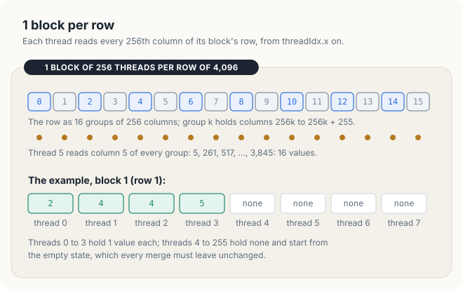
<figcaption><b>Figure 23.11</b> 1 block per row. Top: the 16 columns of thread 5 in a row of 4,096. Bottom: block 1 of the example, where threads 4 to 255 hold no value.</figcaption>
</figure>

It may seem more natural to give each thread a contiguous piece of the row. The interleaved
pattern is chosen instead because of the way the memory serves reads. The threads of a block run
in groups of 32, and the hardware serves the reads of such a group together when they fall on
neighbouring addresses.

<div class="definition">

<span class="box-label">Definition 23.8</span> **Warp, lane, coalesced access.** A **warp** is a
group of 32 consecutive threads of a block, threads \\(32w\\) to \\(32w + 31\\) for warp \\(w\\),
that execute each instruction together. The position \\(t \bmod 32\\) of a thread in its warp is
its **lane**. A memory access of a warp is **coalesced** when its 32 threads read 32 consecutive
4-byte values, 128 contiguous bytes, which the memory system serves together.

*Example.* A block of 256 threads has 8 warps. In the first step, warp 0 of a block reads columns
0 to 31 of its row, 128 contiguous bytes.

</div>

In every step of the interleaved pattern, the 32 threads of a warp read 32 consecutive columns, so
every access is coalesced. For example, in the second step, warp 0 reads columns 256 to 287. The
contiguous alternative, which gives thread \\(t\\) the 16 columns \\(16t\\) to \\(16t + 15\\), would
make the 32 threads of a warp read addresses that lie \\(16 \cdot 4 = 64\\) bytes apart, and the
memory system could not serve them together.

On \\(X\\), block 1 has 256 threads for only 4 values. Threads 0 to 3 receive 2, 4, 4 and 5, and
threads 4 to 255 receive nothing. Each thread runs <span class="sc">Online-Softmax</span> or
<span class="sc">Welford-Update</span> over its own columns, and a thread without columns keeps the
empty state. Every thread then holds the state of a different set of columns. These sets are
disjoint, and their union is the row. By Theorems 23.4 and 23.6, merging all 256 states therefore
gives the state of the row. It remains to merge them quickly, and to give the result to all 256
threads, because every thread writes outputs.

### 23.4.2 Merging inside a warp

We begin with the 32 threads of a single warp. Each of them holds a state in its registers, and
we want every one of them to end with the merge of all 32 states. The threads of a warp can read
each other's registers directly, with an instruction that we now define.

<div class="definition">

<span class="box-label">Definition 23.9</span> **Warp shuffle.** A warp shuffle lets every lane of
a warp read a register of another lane of the same warp in 1 instruction, without shared memory and
without a barrier. In the **xor shuffle** with mask \\(k\\), lane \\(i\\) receives the value of lane
\\(i \oplus k\\), where \\(\oplus\\) is the bitwise exclusive or of the 2 lane numbers.

*Example.* With mask 16, lane 3 receives the value of lane \\(3 \oplus 16 = 19\\), and lane 19 the
value of lane 3: the 2 lanes exchange values.

</div>

When the mask \\(k\\) is a power of 2, the exclusive or flips exactly 1 bit of the lane number. In
the example, 3 is 00011 in binary, and flipping the bit of value 16 gives 10011, which is 19. With
such a mask, the lanes therefore form pairs \\(\\{i, i \oplus k\\}\\) that exchange values. If both
lanes of each pair merge the value they receive into their own, both of them hold the merge of the
pair. With mask 16, for example, lanes 3 and 19 both end with the merge of their 2 states. Repeating
the exchange with masks 16, 8, 4, 2 and 1 leaves every lane holding the merge of all 32 states,
after 5 steps. This pattern is called a **butterfly**, after the crossing lines of its diagram.
Figure 23.12 shows it on 8 lanes, with the maximum as the merge, for block 1 of the example: 4
lanes hold 2, 4, 4 and 5, and the other 4 lanes hold \\(-\infty\\). After the steps with masks 4,
2 and 1, every lane holds 5.

<figure>
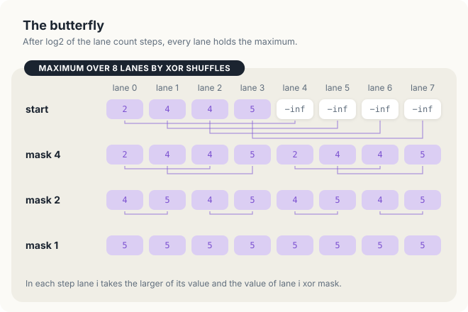
<figcaption><b>Figure 23.12</b> A butterfly maximum on 8 lanes. A warp of 32 lanes needs 5 steps, with masks 16, 8, 4, 2 and 1.</figcaption>
</figure>

The butterfly is correct for the same reason as the merges. Before the first step, lane \\(i\\)
holds the state of its own set of columns. After the steps with masks 16 down to \\(k\\), lane
\\(i\\) holds the merge over all lanes whose numbers differ from \\(i\\) only in the bits of value
\\(k\\) or more. For example, after the step with mask 16, lane 3 holds the merge over lanes 3 and
19, and after the step with mask 8, the merge over lanes 3, 11, 19 and 27. The step with mask
\\(k / 2\\) merges this group with the group of lane \\(i \oplus k/2\\), which is disjoint from it
and which, together with it, forms the group for \\(k / 2\\). After the step with mask 1, the group
is the whole warp. In Chapter 8, we used a different shuffle, `shfl_down`, which leaves the result
in lane 0 only, whereas the xor shuffle leaves it in every lane.

### 23.4.3 Merging across the warps of a block

After the butterfly, every lane of a warp holds the state of its warp, but a block of 256 threads
has 8 warps, and a shuffle cannot reach a register in another warp. The 8 warps of a block must
therefore exchange their results through memory that the whole block shares.

<div class="definition">

<span class="box-label">Definition 23.10</span> **Shared memory and barrier.** **Shared memory** is
a small, fast memory on each SM that the threads of 1 block can read and write, and no other block
can. A **barrier** is a point in a kernel that no thread of a block may pass until every thread of
the block has reached it.

*Example.* A block of 8 warps keeps 8 slots of shared memory, 1 per warp, 32 bytes in all.

</div>

The exchange takes 3 steps. First, lane 0 of each warp writes its warp's result to the slot of its
warp. Then, a barrier makes sure that all 8 slots have been written before anyone reads them.
Finally, every thread reads all 8 slots and merges them itself, so that every thread ends with the
result of the row. Reading 8 slots costs less than a second round of shuffles, and it needs no
broadcast of the result afterwards. The following procedure, shown in Figure 23.13, combines the
butterfly with these 3 steps.

<div class="algo">
<p class="algo-name">Block-Reduce(\(v, \otimes, \mathit{slots}\))</p>
<ol>
<li>for \(k \in (16, 8, 4, 2, 1)\) {</li>
<li style="--d:1">\(v = v \otimes \text{Shuffle-Xor}(v, k)\) <span class="c">// the butterfly of Section 23.4.2</span></li>
<li>}</li>
<li>if \(t \bmod 32 = 0\) {</li>
<li style="--d:1">\(\mathit{slots}[\lfloor t / 32 \rfloor] = v\) <span class="c">// lane 0 writes its warp's slot</span></li>
<li>}</li>
<li><span class="sc">Barrier</span>() <span class="c">// barrier 1: all slots written</span></li>
<li>\(r = \mathit{slots}[0] \otimes \mathit{slots}[1] \otimes \dots \otimes \mathit{slots}[7]\)</li>
<li><span class="sc">Barrier</span>() <span class="c">// barrier 2: all slots read</span></li>
<li>return \(r\)</li>
</ol>
</div>

Here \\(v\\) is the value or state that the calling thread contributes, and \\(\otimes\\) is the
merge: \\(\max\\) for the maximum, \\(+\\) for a sum, and <span class="sc">Merge-Softmax</span> or
<span class="sc">Merge-Welford</span> for a state. The expression \\(\lfloor t / 32 \rfloor\\) is
the number of the warp of thread \\(t\\); for example, thread 70 belongs to warp 2. Line 7 is
needed because line 8 reads slots that other warps write on line 5. Line 9 is needed when the same
slots are used again by a second reduction, since no warp may write a slot for the second
reduction while another warp is still reading the slots of the first. In Section 23.5, we remove
line 9 and show what goes wrong.

<figure>
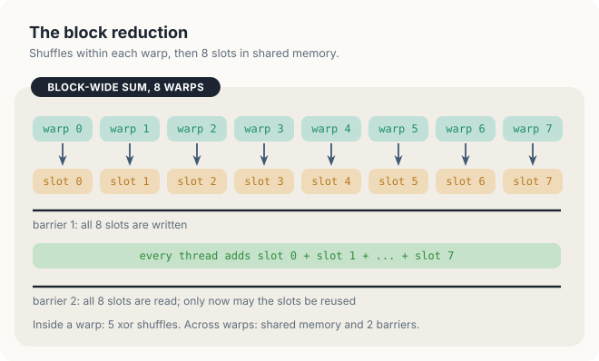
<figcaption><b>Figure 23.13</b> <span class="sc">Block-Reduce</span>: shuffles within each warp, 8 slots in shared memory, 2 barriers.</figcaption>
</figure>

### 23.4.4 The kernels

We now have all the pieces of the kernels. For the online softmax, every thread \\(t\\) of block
\\(b\\) executes the following procedure. As before, \\(B = 256\\) is the number of threads in a
block, and \\(C\\) is the length of a row, 4 for \\(X\\) and 4,096 in the measurements.

<div class="algo">
<p class="algo-name">Softmax-Online-Kernel(\(X, P, C\))</p>
<ol>
<li>\((m, s) = (-\infty, 0)\)</li>
<li>for \(j = t, t + B, t + 2B, \dots\) while \(j \lt C\) {</li>
<li style="--d:1">update \((m, s)\) with \(x_{bj}\) <span class="c">// lines 3 to 8 of Online-Softmax</span></li>
<li>}</li>
<li>\((m, s) = \) <span class="sc">Block-Reduce</span>\(((m, s),\) <span class="sc">Merge-Softmax</span>\()\)</li>
<li>for \(j = t, t + B, t + 2B, \dots\) while \(j \lt C\) {</li>
<li style="--d:1">\(p_{bj} = e^{x_{bj} - m} / s\)</li>
<li>}</li>
</ol>
</div>

Lines 1 to 4 run the first pass of <span class="sc">Online-Softmax</span> on the thread's own
columns. Line 5 merges the 256 states into the state of the row and gives it to every thread.
Lines 6 to 8 then write the thread's outputs. In block 1 of \\(X\\), for example, thread 2 reads
\\(x_{12} = 4\\) on line 3, receives \\((m, s) = (5, 1.7855)\\) on line 5, and writes
\\(p_{12} = e^{4-5} / 1.7855 = 0.2060\\) on line 7. Because the kernel calls
<span class="sc">Block-Reduce</span> only once, barrier 2 is not needed, and the code leaves it
out.

The layer-normalization kernel has the same shape, with <span class="sc">Welford-Update</span> on
line 3, <span class="sc">Merge-Welford</span> on line 5, and the output
\\(y_{bj} = (x_{bj} - \mu)\\, \gamma_j / \sqrt{q / C + \varepsilon} + \beta_j\\) on line 7, where
\\(q / C\\) is the variance of row \\(b\\). The 3-pass softmax calls
<span class="sc">Block-Reduce</span> twice, with \\(\max\\) after pass 1 and with \\(+\\) after
pass 2.

Each of these kernels still reads the row at least twice, once to reduce it and once to write the
outputs. Note, however, that a thread of a row of 4,096 values handles only 16 of them, and a
thread can keep 16 values in its registers. If it does, the second read is unnecessary.

<div class="definition">

<span class="box-label">Definition 23.11</span> **Register, fused kernel.** **Registers** are the
fastest storage of a GPU; each thread has its own, and a value in a register costs no memory
traffic to reuse. A **fused kernel** keeps its share of the row in registers between the reduction
and the output, so it reads each value from memory once.

*Example.* For rows of 4,096 values and 256 threads, a fused kernel holds 16 values per thread in
16 registers, 64 bytes per thread.

</div>

<div class="algo">
<p class="algo-name">Softmax-Fused-Kernel(\(X, P\))</p>
<ol>
<li>for \(k \in [0, 16)\) {</li>
<li style="--d:1">\(r_k = x_{b,\, kB + t}\) <span class="c">// the only read of the row</span></li>
<li>}</li>
<li>\(m = \) <span class="sc">Block-Reduce</span>\((\max_k r_k, \max)\)</li>
<li>for \(k \in [0, 16)\) {</li>
<li style="--d:1">\(r_k = e^{r_k - m}\)</li>
<li>}</li>
<li>\(s = \) <span class="sc">Block-Reduce</span>\((\sum_k r_k, +)\)</li>
<li>for \(k \in [0, 16)\) {</li>
<li style="--d:1">\(p_{b,\, kB + t} = r_k / s\)</li>
<li>}</li>
</ol>
</div>

Here \\(r_k\\) is the \\(k\\)-th value that the thread keeps in a register, and it holds column
\\(kB + t\\) of the row. For example, thread 5 keeps column \\(0 \cdot 256 + 5 = 5\\) in \\(r_0\\)
and column \\(15 \cdot 256 + 5 = 3{,}845\\) in \\(r_{15}\\), the same 16 columns as in Figure 23.11.

The fused kernel needs no online softmax. Once the values are in registers, a second and
a third pass over them cost no memory traffic, and the plain 3-pass order is the simplest. Line 6
overwrites each value with its exponential, so that line 10 only divides. Likewise, the fused layer
normalization uses the definition directly, with 1 reduction for the mean and then 1 over the
squared deviations \\((r_k - \mu)^2\\), both from registers. It thereby avoids the cancellation
without paying for Welford's division. The price of fusion is generality. The number of values per
thread must be a constant when the kernel is compiled, because registers cannot be indexed by a
value known only at run time. Moreover, a row of 65,536 values would need 256 registers per thread
for the row alone. For these reasons, libraries compile fused kernels for common row lengths and
fall back to a 2-pass kernel for the others.

### 23.4.5 Counting the bytes

We can now compare the kernels by the number of bytes that each of them moves. Figure 23.14 counts
the traffic of each kernel per element of the matrix, with 4 bytes per value.

<figure>

<figcaption><b>Figure 23.14</b> Memory traffic per element of the softmax kernels. The layer-normalization kernels move 12 bytes (sum of squares, Welford) and 8 bytes (fused).</figcaption>
</figure>

For a matrix of \\(R\\) rows of \\(C\\) values each, a kernel that moves \\(b\\) bytes per element
moves \\(bRC\\) bytes in all. On a memory of bandwidth \\(W\\), that is, a memory that delivers
\\(W\\) bytes per second, it therefore needs at least \\(bRC / W\\) seconds. For example, the
3-pass softmax, with \\(b = 16\\), \\(R = C = 4{,}096\\) and \\(W = 102\\) GB/s, needs at least
\\(16 \cdot 4{,}096^2 / (102 \cdot 10^9) \\) s, or 2.63 ms. The following table gives the bound for
every kernel.

| Kernel | Bytes per element | Bytes per matrix | Lower bound at 102 GB/s |
|---|---|---|---|
| softmax, 3 passes | 16 | 268 MB | 2.63 ms |
| softmax, online; layer norm, sum of squares or Welford | 12 | 201 MB | 1.97 ms |
| softmax or layer norm, fused | 8 | 134 MB | 1.32 ms |

Each kernel performs only a few arithmetic operations per 4 bytes that it reads, far fewer than a
GPU can perform in the time that the memory needs to deliver those bytes, so the bytes set the
time. The model assumes that every read reaches main memory. A block reads its row of
16 KiB repeatedly within a short time, however, and some of the repeated reads may be served by a
cache instead. In Section 23.7, we measure how much this matters.

<div class="exercises">

Exercises

23.10 Which columns does thread 200 read in a row of 4,096? Which warp does it belong to, and
which lane?<br>
23.11 Carry out Figure 23.12 with the sum instead of the maximum, on the values 0.0498, 0.3679,
0.3679, 1 and 4 zeros.<br>
23.12 A row has 65,536 values and a block has 256 threads. How many values does each thread read,
and how many bytes does the 3-pass kernel move for 256 such rows?

</div>

## 23.5 Correctness

The warps of a block do not run in lockstep. They run at different speeds, and 1 warp can be
several instructions ahead of another. The kernels contain 2 safeguards against the errors that
this can cause, the second barrier of <span class="sc">Block-Reduce</span> and the test for 2
empty states in the merges. In this section, we remove 1 safeguard at a time, follow the wrong
values that appear, and then prove that the complete kernel is correct.

### 23.5.1 The second barrier

Suppose that we remove line 9 of <span class="sc">Block-Reduce</span> and run the layer
normalization by the sum of squares. This kernel calls <span class="sc">Block-Reduce</span> twice
in a row, once for \\(\sum x\\) and once for \\(\sum x^2\\), and both calls use the same 8 slots.
Between the 2 calls, a warp does almost nothing, only 1 division and 5 shuffles. A fast warp can
therefore leave the first call, finish the shuffles of the second, and write its sum of squares
into its slot while a slow warp is still reading the sums of the first call.

Figure 23.15 follows this sequence of events on row 94 of the test matrix of Section 23.7, whose
4,096 values lie between 999 and 1,001. Each warp holds 512 values, so the sums in the slots are
near 512,000, and the sums of squares are near \\(5.12 \times 10^8\\). Suppose that warp 5
finishes reading the 8 sums early and writes its sum of squares, 511,965,734, into slot 5, while
warp 0 has read only slots 0 to 4. Warp 0 then adds 511,965,734 instead of 511,982.8, and it
obtains the sum 515,549,697 instead of 4,095,945. Its mean is therefore
\\(515{,}549{,}697 / 4{,}096 = 125{,}866.6\\) instead of 999.99, its variance
\\(999{,}973.7 - 125{,}866.6^2\\) is negative, and its 512 outputs are NaN.

<figure>
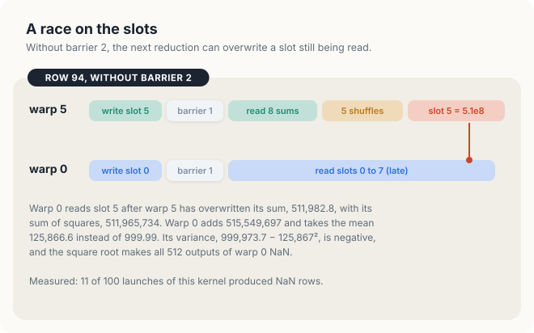
<figcaption><b>Figure 23.15</b> Without barrier 2, warp 5 overwrites slot 5 while warp 0 still reads it.</figcaption>
</figure>

A failure of this kind is called a **race**, because the result depends on the relative speed of
the warps. On most launches, the slow warp finishes reading in time, and the result is correct. We
ran the kernel without barrier 2 on the 4,096 rows of the test 100 times and compared every row
with a reference. The program printed the following summary.

```console
first bad row 94 error NaN
layernorm sum of squares: 11 of 100 runs wrong, 12 rows
```

In 11 of the 100 launches, at least 1 row was NaN, 12 rows in all, and the first wrong row of the
first failing launch was row 94. The other 89 launches were correct. A race is therefore hard to
find, since a test that runs the kernel once passes 9 times in 10. On the example, \\(X\\), the race
cannot change the output at all. Only warp 0 of each block holds values, and the other warps write
sums of 0, which do not change any total (Exercise 23.13).

### 23.5.2 The empty state

We now restore barrier 2 and remove instead lines 2 to 4 of <span class="sc">Merge-Softmax</span>,
the test for 2 empty states. On rows of 4,096 values, every thread holds 16 values, so no state is
empty, and every result is still correct. On \\(X\\), however, threads 4 to 255 of each block hold
the empty state \\((-\infty, 0)\\). In the first step of the butterfly, lane 4 merges with lane 20,
and both of them are empty. The merge computes \\(m = -\infty\\) and
\\(s = 0 \cdot e^{-\infty - (-\infty)} + 0 \cdot e^{-\infty - (-\infty)}\\). The difference
\\(-\infty - (-\infty)\\) is NaN, so \\(s\\) is NaN. Every later merge that includes lane 4
inherits the NaN, and after the 5 steps, every lane of warp 0 holds \\(s = \text{NaN}\\). The
program, run with the test removed, prints the following rows.

```console
  softmax, online, X
         NaN      NaN      NaN      NaN
         NaN      NaN      NaN      NaN
```

Recall that the proof of Theorem 23.4 relied on the merge returning the empty state for 2 empty
states. Without line 2, the merge does not do so, and the proof no longer applies. The same holds
for <span class="sc">Merge-Welford</span>, where 2 empty states would compute \\(0 \cdot 0 / 0\\).

### 23.5.3 The kernels are correct

With both safeguards in place, the kernels are correct, and we now prove this for the online
softmax. The proof assembles the results of Sections 23.3 and 23.4: each thread computes the state
of its own columns, the butterfly merges the states of a warp, and the slots merge the states of
the warps.

<div class="theorem">

<span class="box-label">Theorem 23.7</span> When <span class="sc">Softmax-Online-Kernel</span>
finishes, \\(p_{bj}\\) is the softmax of row \\(b\\) of \\(X\\) for every \\(b\\) and every
\\(j \in [0, C)\\).

</div>

<div class="proof">

*Proof.* Fix a block \\(b\\). By Theorem 23.3 applied to the columns of thread \\(t\\), after line 4
the state of thread \\(t\\) describes the set \\(S_t = \\{x_{bj} : j \equiv t \pmod{B}\\}\\) of the
values in the columns whose remainder on division by \\(B\\) is \\(t\\). This set is empty when
\\(t \ge C\\). For example, in block 1 of \\(X\\), \\(S_2 = \\{x_{12}\\} = \\{4\\}\\), and \\(S_7\\) is
empty. The sets \\(S_0, \dots, S_{255}\\) are disjoint, and their union is row
\\(b\\). In the butterfly of line 5, each step merges 2 disjoint groups of lanes (Section 23.4.2),
so by Theorem 23.4, lane 0 of warp \\(w\\) holds the state of \\(\bigcup_{t \in \text{warp } w}
S_t\\), the values of all 32 threads of the warp, after the 5 steps. The merge is defined even for 2 empty states, because of line 2 of
<span class="sc">Merge-Softmax</span>. Lane 0 writes it to slot \\(w\\). Because of barrier 1,
every slot is written before any thread reads it, so every thread merges the 8 states of the 8
warps, which by Theorem 23.4 is the state \\((m, s)\\) of the whole row. The slots are not written
again in this kernel, so no barrier 2 is needed. Lines 6 to 8 then compute \\(e^{x_{bj} - m} / s\\)
for the thread's columns, which is the softmax by Theorem 23.1, and the columns of the 256 threads
cover the row. Different blocks touch different rows, so they do not interfere.

</div>

The same argument, with Theorems 23.5 and 23.6 in place of Theorems 23.3 and 23.4, proves the
Welford kernel. For a kernel that calls <span class="sc">Block-Reduce</span> twice with the same
slots, the proof needs 1 more fact, namely that no slot is written by the second call before every
thread has read it in the first. Barrier 2 provides this fact, and it is exactly the barrier that we
removed in Section 23.5.1.

<div class="rule-box">

<span class="box-label">Rule</span> Between the last read of a shared slot and the next write to
it, place a barrier that every thread of the block reaches.

</div>

<div class="exercises">

Exercises

23.13 Explain why removing barrier 2 can never change the outputs for \\(X\\), where only warp 0
of each block holds values.<br>
23.14 In the fused softmax, <span class="sc">Block-Reduce</span> is called with \\(\max\\) and then
with \\(+\\). Describe an interleaving without barrier 2 that gives a wrong maximum, and the effect
on the outputs.<br>
23.15 Why does the online kernel of Section 23.4.4 not need barrier 2, while the 3-pass kernel
does?

</div>

## 23.6 Implementation

### 23.6.1 Warp and block reductions

We now turn the procedures of Section 23.4 into code, beginning with the reductions that every
kernel uses. The following code implements the butterfly, lines 1 to 3 of
<span class="sc">Block-Reduce</span>, twice: `warp_max` uses \\(\max\\) as the merge, and
`warp_sum` uses \\(+\\).

<div class="code-tabs">
<div class="code-tab" data-lang="Rust">

```rust,ignore
mod kernels {
    // ...
{{#include ../../../../code/oxide/ch23_softmax_layernorm/src/main.rs:25:43}}
    // ...
}
```

</div>
<div class="code-tab" data-lang="C++">

```cpp
{{#include ../../../../code/cuda/ch23_softmax_layernorm/softmax_layernorm.cu:27:41}}
```

</div>
</div>

The loop runs for the masks 16, 8, 4, 2 and 1, halving the mask after each step. In Rust, it is a
`while` loop, which is the form of device loop that cuda-oxide compiles (Section 9.7), and
`warp::shuffle_xor_f32` is the xor shuffle. In C++, `__shfl_xor_sync` takes a first argument,
`0xffffffff`, whose 32 bits name the 32 lanes that take part, and all of them must execute the
call. Both `f32::max` and `fmaxf` return the larger of 2 floats.

The following code implements the whole of <span class="sc">Block-Reduce</span> for the maximum.
It calls the warp maximum and then adds lines 4 to 10 of the procedure.

<div class="code-tabs">
<div class="code-tab" data-lang="Rust">

```rust,ignore
mod kernels {
    // ...
{{#include ../../../../code/oxide/ch23_softmax_layernorm/src/main.rs:45:65}}
    // ...
}
```

</div>
<div class="code-tab" data-lang="C++">

```cpp
{{#include ../../../../code/cuda/ch23_softmax_layernorm/softmax_layernorm.cu:43:59}}
```

</div>
</div>

The correspondence with the procedure is direct. Lane 0 writes the slot of its warp, the first
call to `sync_threads` is barrier 1, the loop over `w` is line 8, and the second call to
`sync_threads` is barrier 2. Both barriers sit outside every `if`, so every thread of the block
reaches them. The function `block_sum` differs only in the merge. The two languages differ, however,
in where the slots live. A cuda-oxide `#[device]` function cannot declare shared memory of its
own, so each kernel declares `static mut SLOTS: SharedArray<f32, 8>` and passes a raw pointer to
the helper. Every access through the pointer is `unsafe`, with a `// SAFETY:` comment that names
the threads that touch the slots and the barriers between which they do so. The C++ helper
receives the same pointer from a `__shared__` array of its kernel and needs no such annotation.

### 23.6.2 The 3-pass kernel

The following kernel implements <span class="sc">Softmax-3-Pass</span> with one block per row.

<div class="code-tabs">
<div class="code-tab" data-lang="Rust">

```rust,ignore
mod kernels {
    // ...
{{#include ../../../../code/oxide/ch23_softmax_layernorm/src/main.rs:137:170}}
    // ...
}
```

</div>
<div class="code-tab" data-lang="C++">

```cpp
{{#include ../../../../code/cuda/ch23_softmax_layernorm/softmax_layernorm.cu:130:152}}
```

</div>
</div>

Block \\(b\\) starts at element `base = b × cols` of the matrix, which is the row-major position of
row \\(b\\); for row 1 of \\(X\\), `base` is \\(1 \cdot 4 = 4\\). Each of the 3 loops starts at
column `tid` and advances by `BLOCK`, the pattern of Figure 23.11. The 3 loops are the 3 passes of
<span class="sc">Softmax-3-Pass</span>, with `block_max` and `block_sum` between them. The kernel
works for any row length, including the 4 of \\(X\\).

The Rust kernel writes through a `DisjointSlice<f32>`, the output type of Chapter 13, whose safe
method lets each thread write only the element at its own global index. Here, however, thread
\\(t\\) of block \\(b\\) writes the elements \\(b \cdot C + t + 256k\\) for \\(k = 0, 1, \dots\\).
No other thread writes these elements, but they are not the thread's global index, so the kernel
calls `get_unchecked_mut` and states this argument in the `SAFETY` comment. The C++ kernel writes
through a plain pointer. The attribute `#[launch_contract(domain = 1, block = (256, 1, 1))]` records
that the kernel expects 1-dimensional blocks of 256 threads, and the host's
`prepare_softmax_three_pass` checks a launch configuration against it before the first launch. The
Rust kernel also reads through a slice, `input[base + j]`, and every such read is checked against
the slice length. In Section 23.7.5, we measure what these checks cost.

### 23.6.3 The online kernel

The following code shows the merge of 2 softmax states and the kernel
<span class="sc">Softmax-Online-Kernel</span> that uses it.

<div class="code-tabs">
<div class="code-tab" data-lang="Rust">

```rust,ignore
mod kernels {
    // ...
{{#include ../../../../code/oxide/ch23_softmax_layernorm/src/main.rs:89:97}}
    // ...
}

mod kernels {
    // ...
{{#include ../../../../code/oxide/ch23_softmax_layernorm/src/main.rs:172:227}}
    // ...
}
```

</div>
<div class="code-tab" data-lang="C++">

```cpp
{{#include ../../../../code/cuda/ch23_softmax_layernorm/softmax_layernorm.cu:79:92}}

{{#include ../../../../code/cuda/ch23_softmax_layernorm/softmax_layernorm.cu:154:191}}
```

</div>
</div>

The function `merge_softmax` is <span class="sc">Merge-Softmax</span>, including the test for 2
empty states that we removed in Section 23.5.2. The first loop of the kernel is lines 1 to 4 of
<span class="sc">Softmax-Online-Kernel</span>, and its `if` and `else` branches are lines 3 to 8
of <span class="sc">Online-Softmax</span>. The butterfly shuffles both numbers of the state in each
step. Lane 0 of each warp then writes its state to 2 slots, and after the barrier, every thread
merges the 8 states. The final loop is lines 6 to 8. In Rust, the state is 2 local variables
updated by a destructuring assignment, `(m, s) = merge_softmax(m, s, m2, s2)`. In C++, it is a
`struct` with 2 members, and the slots are an array of that `struct`.

### 23.6.4 Welford's kernel

The following code shows the merge of 2 Welford states and the layer-normalization kernel built on
<span class="sc">Welford-Update</span>.

<div class="code-tabs">
<div class="code-tab" data-lang="Rust">

```rust,ignore
mod kernels {
    // ...
{{#include ../../../../code/oxide/ch23_softmax_layernorm/src/main.rs:99:109}}
    // ...
}

mod kernels {
    // ...
{{#include ../../../../code/oxide/ch23_softmax_layernorm/src/main.rs:308:372}}
    // ...
}
```

</div>
<div class="code-tab" data-lang="C++">

```cpp
{{#include ../../../../code/cuda/ch23_softmax_layernorm/softmax_layernorm.cu:94:110}}

{{#include ../../../../code/cuda/ch23_softmax_layernorm/softmax_layernorm.cu:247:285}}
```

</div>
</div>

The first loop applies <span class="sc">Welford-Update</span> to the thread's columns, and its 4
lines are the 4 lines of the procedure. The state holds the count as a float, so that
all 3 numbers can be shuffled with the same instruction. This is safe, because counts up to
\\(2^{24}\\) are exact in `f32`. After the warp merge, lane 0 writes 3 numbers. In Rust, they
occupy 3 consecutive slots of a `SharedArray<f32, 24>`, and in C++, 1 slot of an array of
`WelfordState`. The variance of the row is \\(q / C\\), and `rstd`, the reciprocal of the standard
deviation, is \\(1 / \sqrt{q / C + \varepsilon}\\). For row 0 of \\(X\\), `rstd` is
\\(1 / \sqrt{5 / 4 + 10^{-5}} = 0.8944\\), the factor of Figure 23.3.

### 23.6.5 The fused kernels

The following code implements <span class="sc">Softmax-Fused-Kernel</span>, which keeps the 16
values of each thread in registers.

<div class="code-tabs">
<div class="code-tab" data-lang="Rust">

```rust,ignore
mod kernels {
    // ...
{{#include ../../../../code/oxide/ch23_softmax_layernorm/src/main.rs:229:268}}
    // ...
}
```

</div>
<div class="code-tab" data-lang="C++">

```cpp
{{#include ../../../../code/cuda/ch23_softmax_layernorm/softmax_layernorm.cu:193:221}}
```

</div>
</div>

The 3 loops are lines 1 to 3, 5 to 7 and 9 to 11 of <span class="sc">Softmax-Fused-Kernel</span>.
The array `x` of `PER_THREAD = COLS / 256 = 16` values has a size fixed at compile time, and this
is why the row length is the constant `COLS = 4096` and not an argument. Each loop has a constant
trip count and is fully unrolled, so that every `x[k]` names a fixed register. In Rust, the loop is
a `while` loop marked `#[unroll]`; in Section 9.7, we found this form necessary for cuda-oxide to
keep a small array in registers. In C++, it is a `for` loop under `#pragma unroll`. The fused layer
normalization in the complete programs has the same 3 loops, which compute the mean, the squared
deviations and the outputs.

### 23.6.6 The host program

The host program first runs the kernels on \\(X\\), \\(X + 100\\) and \\(X + 10{,}000\\). The
following code prepares the launches and runs them on the 2 rows of the example.

<div class="code-tabs">
<div class="code-tab" data-lang="Rust">

```rust,ignore
fn main() -> Result<(), Error> {
    // ...
{{#include ../../../../code/oxide/ch23_softmax_layernorm/src/main.rs:535:557}}
    // ...
}
```

</div>
<div class="code-tab" data-lang="C++">

```cpp
int main()
{
    // ...
{{#include ../../../../code/cuda/ch23_softmax_layernorm/softmax_layernorm.cu:489:504}}
    // ...
}
```

</div>
</div>

A launch configuration of 2 blocks of 256 threads covers the 2 rows. In Rust, each
`prepare_<kernel>` call checks the configuration against the kernel's launch contract once, and the
launches that follow use the prepared configuration. In C++, the launch is written
`softmaxThreePass<<<2, BLOCK>>>(...)`. For the example, the program prints the following output.

```console
$ cargo oxide run
the 2 x 4 example X = [1 2 3 4; 2 4 4 5]
  softmax without the maximum, X
      0.0321   0.0871   0.2369   0.6439
      0.0279   0.2060   0.2060   0.5601
  softmax without the maximum, X + 100
         NaN      NaN      NaN      NaN
         NaN      NaN      NaN      NaN
  softmax, 3 passes, X
      0.0321   0.0871   0.2369   0.6439
      0.0279   0.2060   0.2060   0.5601
  softmax, 3 passes, X + 100
      0.0321   0.0871   0.2369   0.6439
      0.0279   0.2060   0.2060   0.5601
  softmax, online, X
      0.0321   0.0871   0.2369   0.6439
      0.0279   0.2060   0.2060   0.5601
  layer norm, sum of squares, X
     -1.3416  -0.4472   0.4472   1.3416
     -1.6059   0.2294   0.2294   1.1471
  layer norm, sum of squares, X + 10000
         NaN      NaN      NaN      NaN
         NaN      NaN      NaN      NaN
  layer norm, Welford, X + 10000
     -1.3416  -0.4472   0.4472   1.3416
     -1.6059   0.2294   0.2294   1.1471
```

Every line matches a hand computation of this chapter. Without the maximum, \\(X\\) gives the
\\(P\\) of Figure 23.1, and \\(X + 100\\) gives NaN, as in Figure 23.4. With the maximum, \\(X\\)
and \\(X + 100\\) give the same \\(P\\), as Theorem 23.1 states. The sum of squares gives \\(Y\\)
for \\(X\\) and NaN for \\(X + 10{,}000\\), as in Figure 23.6, and Welford's method gives \\(Y\\)
for both. The program compares each of these results with a softmax and a layer normalization
computed in `f64` on the CPU, and it requires the NaNs where the analysis predicts them.

For the timed runs, a kernel takes about 2 ms, which is too short to time a single launch
reliably. The function `time_ms`, shown below, therefore runs the kernel 100 times first, so that
the GPU raises its clock. It then times 7 batches of 20 launches each and returns the median batch
time divided by 20.

<div class="code-tabs">
<div class="code-tab" data-lang="Rust">

```rust,ignore
{{#include ../../../../code/oxide/ch23_softmax_layernorm/src/main.rs:421:444}}
```

</div>
<div class="code-tab" data-lang="C++">

```cpp
{{#include ../../../../code/cuda/ch23_softmax_layernorm/softmax_layernorm.cu:325:348}}
```

</div>
</div>

<div class="exercises">

Exercises

23.16 `block_sum` in Rust starts its loop over the slots at `w = 0` with `s = 0.0`, while
`block_max` starts at `w = 1` with the value of slot 0. Why can `block_max` not start from
`m = 0.0`?<br>
23.17 Change `ROWS` and `COLS` to 16,384 rows of 1,024 columns. Which constant must change for the
fused kernels to stay correct?

</div>

## 23.7 Measurements

### 23.7.1 Platform and method

The measurements come from a Jetson Orin NX 16 GB, an integrated GPU with 8 SMs, 102 GB/s of
memory bandwidth and 2 MiB of L2 cache. The test matrices have 4,096 rows of 4,096 `f32` values,
which is 64 MiB, far larger than the L2 cache. The softmax inputs are uniform in \\([-10, 10)\\).
The layer-normalization inputs are uniform in \\([999, 1001)\\), so that their mean is large
compared with their spread, and they use a different \\(\gamma_j\\) and \\(\beta_j\\) for each
column. The same softmax inputs are also arranged as 256 rows of 65,536 values. Each time is the
median of 7 batches of 20 launches. Repeated runs differ by up to 10%, and we quote 1 run of 3,
made with no other work on the GPU or the memory.

### 23.7.2 Results

After the example, the Rust program printed the following results.

```console
softmax of 4096 rows x 4096 columns, median of 7 x 20 runs
  kernel      bytes/elem      ms    GB/s   max error
  3 passes            16   2.025   132.6     1.37e-9
  online              12   2.255    89.3     1.36e-9
  fused                8   1.435    93.6     1.37e-9
softmax of 256 rows x 65536 columns, median of 7 x 20 runs
  kernel      bytes/elem      ms    GB/s   max error
  3 passes            16   3.985    67.4    1.22e-10
  online              12   3.015    66.8    1.18e-10
layer norm of 4096 rows x 4096 columns, values 1,000 + [-1, 1)
  kernel      bytes/elem      ms    GB/s   max error
  sum, sum x2         12   1.808   111.3      2.97e0
  Welford             12   2.112    95.3     1.88e-4
  fused                8   1.424    94.3     1.81e-4
PASSED
```

The GB/s column divides the modelled bytes of Section 23.4.5 by the measured time. For example,
the fused softmax moves \\(8 \cdot 4{,}096^2\\) bytes, 134 MB, in 1.435 ms, which gives 93.6 GB/s.
The following table collects the times of both programs, together with those of the Rust program
built with `cargo oxide run --unchecked-indexing`, an option that we explain in Section 23.7.5.

| Kernel | Bytes per element | Rust (ms) | Rust, unchecked (ms) | C++ (ms) | C++, modelled (GB/s) |
|---|---|---|---|---|---|
| softmax, 3 passes | 16 | 2.025 | 1.684 | 1.434 | 187.2 |
| softmax, online | 12 | 2.255 | 1.545 | 1.480 | 136.1 |
| softmax, fused | 8 | 1.435 | 1.446 | 1.417 | 94.8 |
| softmax, 3 passes, rows of 65,536 | 16 | 3.985 | 3.088 | 3.129 | 85.8 |
| softmax, online, rows of 65,536 | 12 | 3.015 | 2.453 | 2.373 | 84.8 |
| layer norm, sum of squares | 12 | 1.808 | 1.433 | 1.464 | 137.5 |
| layer norm, Welford | 12 | 2.112 | 1.902 | 1.920 | 104.9 |
| layer norm, fused | 8 | 1.424 | 1.424 | 1.445 | 92.9 |

<figure>
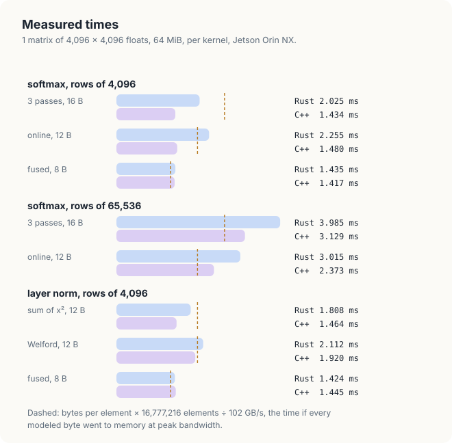
<figcaption><b>Figure 23.16</b> Measured time per 64 MiB matrix, Rust (upper bar) and C++ (lower bar). The dashed line of each kernel is its modelled bytes at 102 GB/s.</figcaption>
</figure>

We begin with the fused kernels, which match the model. They move 134 MB in 1.42 to 1.45 ms,
that is, at 93 to 95 GB/s, which is 91 to 93% of the 102 GB/s of the memory. This is the fraction
that a well-behaved streaming kernel reaches on this GPU. The other numbers need explanations,
which we give in the next 4 sections.

### 23.7.3 Why 3 passes cost no more than 1 on rows of 4,096

The C++ 3-pass softmax takes 1.434 ms, the same time as the fused kernel, although it reads each
value 3 times. Its modelled rate, 187.2 GB/s, is 1.8 times the bandwidth of the memory, which would
be impossible if every read reached the memory. We conclude that most of its second and third reads
were served by the L2 cache.

A simple count confirms this conclusion. An SM of this GPU holds at most 1,536 threads, that is, 6
blocks of 256, so at most \\(8 \cdot 6 = 48\\) rows are being processed at any moment on the 8
SMs. Each row occupies 16 KiB, so all the rows in progress fit in \\(48 \cdot 16 = 768\\) KiB,
which is less than the 2 MiB of the L2 cache. A row read in pass 1 is therefore still in the cache
when passes 2 and 3 read it, and the traffic to the memory is 8 bytes per element, as for the
fused kernel. For the same reason, the online kernel saves nothing here, 1.480 ms against 1.434 ms
in C++, because the read that it removes was a cache hit.

### 23.7.4 Rows of 65,536

With rows of 65,536 values, which occupy 256 KiB each, the 48 rows in progress would occupy
\\(48 \cdot 256\\) KiB = 12 MiB, 6 times the size of the L2 cache. A row is then no longer in
the cache when the next pass reads it, and every pass reaches the memory. The model of
Section 23.4.5 therefore holds. The C++ 3-pass kernel takes 3.129 ms for 268 MB, which is
85.8 GB/s, and the online kernel takes 2.373 ms for 201 MB, which is 84.8 GB/s. The ratio of the 2
times, \\(3.129 / 2.373 = 1.32\\), is the ratio of their traffic, \\(16 / 12 = 1.33\\). For long
rows, such as those of the output layer of a language model, the online softmax thus saves a
quarter of the time. For short rows, the cache had already removed the extra pass.

### 23.7.5 Bounds checks in the Rust loops

On rows of 4,096 values, the Rust 3-pass and online kernels are 41% and 52% slower than the C++
kernels (2.025 against 1.434 ms, and 2.255 against 1.480 ms), while the fused kernels run at the
same speed in both languages. The difference lies in how the kernels read the row. A Rust kernel
reads `input[base + j]` from a slice, and every such read compares the index with the slice length
and branches to a trap when the index is out of range. In the fused kernels, the 16 reads are
unrolled and independent of each other, and the checks cost nothing measurable. In the other
kernels, the reads sit in loops whose trip count is known only at run time, and there the checks
are not free.

cuda-oxide can remove the checks. Built with `cargo oxide run --unchecked-indexing`, the same
program runs the online kernel in 1.545 ms, the long-row kernels in 3.088 and 2.453 ms, and the sum
of squares in 1.433 ms, all within 5% of C++. The 3-pass kernel on short rows improves from 2.025
to 1.684 ms, but it remains 17% slower than C++. The flag makes every out-of-range index
undefined behaviour, exactly like `get_unchecked`, in every kernel of the program. The kernels of
this chapter read only indices \\(b \cdot C + j\\) with \\(b < R\\) and \\(j < C\\), so they stay in
range, but the compiler no longer checks this claim. A per-kernel form,
`#[kernel(unchecked_indexing)]`, limits the trust to the kernels that need the speed.

### 23.7.6 Welford's division, and the accuracy

The Welford kernel moves the same 12 bytes per element as the sum of squares, but it takes
\\(1.920 - 1.464 = 0.456\\) ms longer in C++. Since the traffic is the same, the difference must
come from computation. Per value, the sum of squares performs 2 additions, 1 of them combined with
a multiplication. Welford's update performs 3 subtractions or additions, 1 combined multiplication
and addition, and a division, which a GPU computes with a sequence of several instructions. The
kernel is close enough to the memory limit that this extra arithmetic shows in the time. The fused
layer normalization avoids both costs, because it moves only 8 bytes per element and computes the
variance from registers in 2 inexpensive passes.

The error column shows the cancellation of Section 23.2.5 on the GPU. The sum of squares reaches an
error of 2.97 on outputs whose typical size is 1, so its results are useless, although it runs at
the same speed as the correct kernels. Welford's method and the fused kernel stay within
\\(1.9 \times 10^{-4}\\) of the `f64` reference. This remaining error has a definite source. The
values lie near 1,000, where `f32` numbers are \\(6.1 \times 10^{-5}\\) apart, so the mean is exact
only to a few times this spacing. Dividing by the standard deviation, \\(\sqrt{0.33} = 0.58\\),
multiplies the error by 1.7. The softmax errors, about \\(10^{-9}\\) on probabilities near
\\(2.4 \times 10^{-4}\\), are at the level of `f32` rounding.

<div class="exercises">

Exercises

23.18 With 4 bytes per value and 102 GB/s, how long must the fused layer normalization take at
least for 16,384 rows of 1,024 values? Would the 3-pass softmax be served by the L2 cache at that
row length?<br>
23.19 Estimate the times of the 3-pass and online softmax for 64 rows of 128,000 values on a GPU
with 3.35 TB/s of memory bandwidth and 50 MB of L2 cache.

</div>

## 23.8 The complete programs

<div class="code-tabs">
<div class="code-tab" data-lang="Rust">

```rust,ignore
{{#include ../../../../code/oxide/ch23_softmax_layernorm/src/main.rs}}
```

</div>
<div class="code-tab" data-lang="C++">

```cpp
{{#include ../../../../code/cuda/ch23_softmax_layernorm/softmax_layernorm.cu}}
```

</div>
</div>

## Common mistakes

- **Computing the exponential before subtracting the maximum.** Inputs above 88.72 overflow `f32`,
  and the softmax of the row becomes NaN.
- **Computing the variance as the mean of the squares minus the square of the mean.** The result
  loses all its digits when the mean is large compared with the spread, and can be negative, which
  makes the square root NaN.
- **Merging 2 empty states without a test.** \\(-\infty - (-\infty)\\) is NaN for the softmax
  merge, and \\(0 / 0\\) is NaN for the Welford merge. Threads without values hold empty states
  whenever a row is shorter than the block.
- **Leaving out the second barrier of a block reduction.** A warp that finishes early overwrites a
  slot that another warp still reads when 2 reductions use the same slots. The result is wrong on a
  few launches in a hundred.
- **Counting bytes without asking where they come from.** A model that sends every read to main
  memory overestimates repeated reads of a short row, which the L2 cache serves.
- **Leaving out \\(\varepsilon\\).** A row of equal values has variance 0, and the division gives
  NaN.

## Summary

- Softmax divides the exponential of each value by the sum of the exponentials of its row. Layer
  normalization subtracts the row mean and divides by the standard deviation, with a small
  \\(\varepsilon\\) under the square root, and then applies a scale and a shift per column.
- Subtracting the row maximum leaves softmax unchanged (Theorem 23.1) and keeps every exponential in
  \\((0, 1]\\). The variance computed as \\(\overline{x^2} - \mu^2\\), the mean of
  the squares minus the square of the mean, suffers from cancellation. It gives \\(-8\\) instead of
  1.25 for 10,001 to 10,004 in `f32`.
- A sum of exponentials relative to 1 maximum is moved to a larger one by 1 multiplication. The
  online softmax uses this to find the maximum and the sum in 1 pass, and Welford's method applies
  the same idea to the mean and the sum of squared deviations.
- Partial states of disjoint parts of a row merge into the state of their union. The merges are
  associative, which allows a tree of merges, and they must treat 2 empty states separately.
- With one block per row, the threads read coalesced columns, merge within each warp by an xor
  butterfly, and merge across warps through 8 shared slots and 2 barriers. Removing the second
  barrier produced NaN rows in 11 of 100 launches.
- Fused kernels keep the row in registers, read it once, and reached 91 to 93% of the 102 GB/s of
  the measured GPU. On rows of 4,096 values, the L2 cache served the extra passes of the other
  kernels. On rows of 65,536 values, it could not, and the online softmax was 1.32 times as fast
  as 3 passes, which is the ratio of their traffic.

## Exercises

1. Compute by hand the softmax of the row 0, 0, 0, 10, with and without subtracting the maximum.
   What fraction of the total does the last value receive?
2. Apply Welford's update by hand to 1,000.5, 999.5, 1,000.5, 999.5. Then compute the mean of the
   squares minus the square of the mean, rounding each square to the nearest 0.0625. Compare both
   variances with the exact value, 0.25.
3. Prove that <span class="sc">Merge-Softmax</span> is commutative: merging \\(a\\) with \\(b\\)
   gives the same state as merging \\(b\\) with \\(a\\).
4. Write <span class="sc">Online-Softmax</span> for a row that arrives in pieces of 4 values, using
   <span class="sc">Merge-Softmax</span> once per piece. How many exponentials does it compute per
   value?
5. Write a softmax kernel that assigns 1 warp of 32 threads to each row, with no shared memory and
   no barrier, and measure it against the fused kernel on rows of 1,024.
6. The online kernel computes 1 exponential per value in its first loop and 1 in its second. Count
   the exponentials of the 3-pass kernel. What does the online kernel save, if not arithmetic?
7. Replace the division in <span class="sc">Welford-Update</span> by a multiplication with a
   reciprocal computed once per count. Is the result still exact on Figure 23.10? Measure the
   effect on the kernel.
8. Build the Rust program with `--unchecked-indexing` and run it on your GPU. Which kernels change,
   and by how much?

## Sources and further reading

- M. Milakov and N. Gimelshein, *Online normalizer calculation for softmax*, arXiv:1805.02867,
  2018. The online softmax of Section 23.3.2.
- B. P. Welford, *Note on a method for calculating corrected sums of squares and products*,
  Technometrics 4(3), 1962. The update of Section 23.3.4.
- T. F. Chan, G. H. Golub and R. J. LeVeque, *Updating formulae and a pairwise algorithm for
  computing sample variances*, Stanford technical report STAN-CS-79-773, 1979. The merge of Section
  23.3.5.
- J. L. Ba, J. R. Kiros and G. E. Hinton, *Layer normalization*, arXiv:1607.06450, 2016.
- N. J. Higham, *Accuracy and Stability of Numerical Algorithms*, 2nd ed., SIAM, 2002. Chapter 1 on
  cancellation, and chapter 4 on the accuracy of summation.
- T. Dao et al., *FlashAttention: fast and memory-efficient exact attention with IO-awareness*,
  NeurIPS 2022. The online softmax applied inside attention.
- T. H. Cormen, C. E. Leiserson, R. L. Rivest and C. Stein, *Introduction to Algorithms*, 4th ed.,
  MIT Press, 2022. Loop invariants and the pseudocode conventions of this chapter.
- A. Pathak, *An Introduction to Tiled Parallel Programming, Simplified*, 2026. The worked-example
  method of this chapter, applied to the matrix product.
