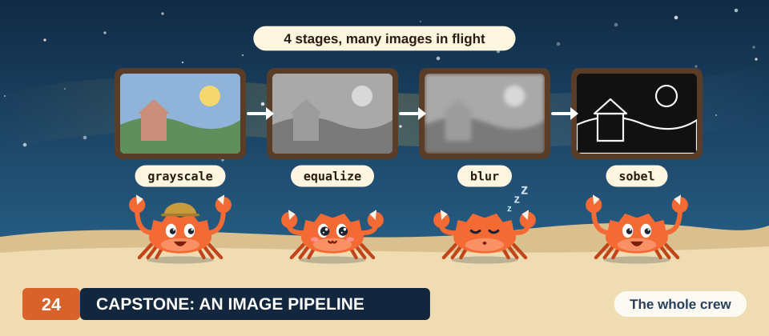

# Chapter 24: Capstone: An Image Pipeline

In Chapters 14 to 23, we derived 1 parallel algorithm at a time: a map, a reduction, a matrix product, a
stencil, a scan, a histogram and a normalisation. A real program chains several of them. Each kernel
reads what the previous kernel wrote, the data travel from host memory to the device and back, and
the slowest stage sets the rate of the whole program. Image processing shows this well, because its
common operations fall into the patterns of Part V: some compute each output pixel from 1 input
pixel, some from a small window around it, and some from every pixel of the image.

In this chapter, we build a pipeline of 4 stages that turns a colour image into a map of its edges:
conversion to gray, histogram equalisation, a Gaussian blur and the Sobel edge detector. We carry an
image of 8 × 8 pixels through every stage by hand, derive each kernel from the chapter of Part V
in which we developed its pattern, and prove that a blur in 2 passes of 5 weights equals the blur with 25
weights. We then run the pipeline in Rust and in CUDA C++ on images of 1,920 × 1,080 pixels, check
every pixel against the CPU, find which stage takes the most time and why, and process a batch of
images on several streams so that copies overlap with computation.

<div class="covers">

This chapter covers

- An 8 × 8 image carried by hand through gray conversion, equalisation, blur and edge detection
- The pattern behind each stage: a map, a histogram with a scan, and 2 stencils
- The proof that 2 passes of 5 weights equal 1 pass of 25 weights, and the work it saves
- A shared tile with a halo, and the wrong pixels a missing halo produces
- 1 easy mistake for each stage, with the wrong value it gives on the example
- The host program: buffers, streams, and an exact comparison with the CPU
- The time of each stage, and copies overlapped with kernels on 2 and 3 streams

</div>

The programs are in
[`code/oxide/ch24_capstone/`](https://github.com/arpanpathak/gpu-parallel-book/tree/main/code/oxide/ch24_capstone)
(Rust, `cargo oxide run`) and
[`code/cuda/ch24_capstone/capstone.cu`](https://github.com/arpanpathak/gpu-parallel-book/tree/main/code/cuda/ch24_capstone)
(C++, with its build command in its first lines). Both compute the same images from the same input
and print the same report.

## 24.1 The problem

### 24.1.1 Images in memory

An image is a rectangle of pixels, and memory is a single line of numbered bytes, so we first fix how
the rectangle is laid along the line.

<div class="definition">

<span class="box-label">Definition 24.1</span> **Pixel and image.** A **pixel** is the smallest
element of an image. A pixel of a gray image is 1 byte, a **level** from 0 (black) to 255 (white).
A pixel of a colour image is 3 bytes, the levels of red, green and blue. An image of width \\(W\\)
and height \\(H\\) stores its pixels row by row: pixel \\((x, y)\\), in column \\(x\\) of row
\\(y\\), is byte \\(yW + x\\) of a gray image, and its 3 bytes start at byte \\(3(yW + x)\\) of a
colour image.

*Example.* In an image of width 8, pixel \\((3, 0)\\) is byte 3 of the gray image, and its colour
bytes are bytes 9, 10 and 11.

</div>

We always write a pixel position as \\((x, y)\\), column first, as in the figures of this chapter,
whose column numbers run across the top and row numbers down the left side.

### 24.1.2 The worked example

We use 1 image throughout the chapter (Figure 24.1). It has 8 × 8 pixels of 4 colours, 16 pixels
of each: 2 rows of sky at the top, 2 rows of ground at the bottom, and between them a house of
4 × 4 pixels with hill on both sides. The program's test image of Section 24.8 is the same kind of
scene at 1,920 × 1,080 pixels.

<figure>
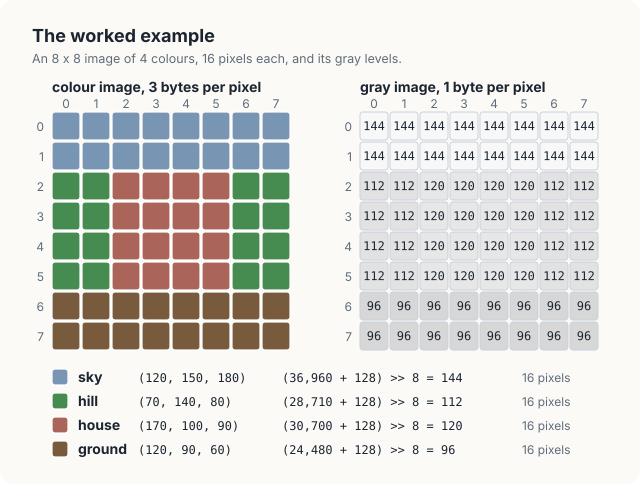> 8 = 144; hill (70, 140, 80) gives 112; house (170, 100, 90) gives 120; ground (120, 90, 60) gives 96. Each colour covers 16 pixels.">
<figcaption><b>Figure 24.1</b> The worked example: an 8 × 8 colour image and its gray levels.</figcaption>
</figure>

The 4 gray levels, 96, 112, 120 and 144, lie within 48 of each other, on a scale that runs from
0 to 255. The image has low contrast: its darkest pixel is a dark gray, its brightest a light gray, and
the hill and the house differ by only 8 levels. The pipeline improves it in 4 stages.

1. **Gray conversion** replaces each colour pixel by 1 level (Figure 24.1, right).
2. **Histogram equalisation** spreads the levels in use over the whole scale. The 4 levels move to
   0, 85, 170 and 255.
3. **A Gaussian blur** replaces each pixel by a weighted average of the 5 × 5 pixels around it, which
   removes noise and softens the steps between regions.
4. **Sobel edges** measure how fast the level changes at each pixel. The result is bright where 2
   regions meet and dark inside a region.

Each stage reads the image that the previous stage wrote. The stages differ in how many input pixels
1 output pixel depends on.

<div class="definition">

<span class="box-label">Definition 24.2</span> **Point, neighbourhood and global operations.** An
image operation is a **point operation** if each output pixel depends only on the input pixel at the
same position. It is a **neighbourhood operation** if each output pixel depends on a small window of
input pixels around its position. It is a **global operation** if its result depends on every pixel
of the image.

*Example.* Gray conversion is a point operation; the blur, with a window of 5 × 5, and the Sobel
detector, with a window of 3 × 3, are neighbourhood operations; equalisation contains a global
operation, the histogram of all 64 levels.

</div>

Figure 24.2 shows the pipeline as the 7 kernels of our programs and the buffers between them. The
equalisation takes 3 kernels and the blur takes 2; we explain why in Sections 24.4 and 24.5. Figure 24.3
shows what the programs produce for their test image of 1,920 × 1,080 pixels.

<figure>
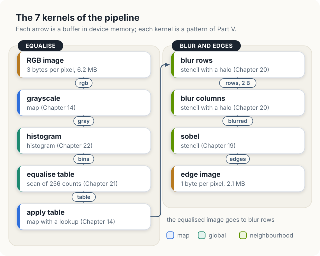
<figcaption><b>Figure 24.2</b> The 7 kernels of the pipeline, the pattern of each, and the buffers between them.</figcaption>
</figure>

<figure>

<figcaption><b>Figure 24.3</b> The programs' output for their test image: the input, the equalised image, the blur at 4 × enlargement, and the edges.</figcaption>
</figure>

Equalisation strengthens the grain of the test image together with the scene, because it stretches
every difference between levels, including the small random ones. The blur removes most of the
grain before the edge detector runs, so the edge image shows the outlines of the objects and only a
faint texture elsewhere.

<div class="exercises">

Exercises

24.1 At which byte of a gray image of width 1,920 is pixel \\((10, 2)\\) stored? At which bytes are
its 3 colour bytes?<br>
24.2 In the example, which pixels does the blur of pixel \\((0, 0)\\) depend on, if positions
outside the image are not counted? Which pixels does the equalised level of pixel \\((0, 0)\\)
depend on?<br>
24.3 Classify as point, neighbourhood or global: inverting an image (\\(255 - v\\)); finding its
brightest level; replacing each pixel by the median of its 3 × 3 window.

</div>

## 24.2 The sequential pipeline

### 24.2.1 The algorithm

On a CPU the 4 stages become a sequence of loops. A blur window near the border of the image
reaches past the border; we let a position outside the image take the level of the nearest pixel
inside it, and write \\(\mathrm{clamp}(i, n) = \min(\max(i, 0), n - 1)\\) for that rule. The 5
weights of the blur are \\(w = (1, 4, 6, 4, 1)\\), and we explain them in Section 24.5.

<div class="algo">
<p class="algo-name">Image-Pipeline(\(rgb, W, H\))</p>
<ol>
<li>for \(p \in [0, WH)\) {</li>
<li style="--d:1">\(gray[p] = (77\, rgb[3p] + 150\, rgb[3p+1] + 29\, rgb[3p+2] + 128) \gg 8\)</li>
<li>}</li>
<li>\(bins[v] = 0\) for every \(v \in [0, 256)\)</li>
<li>for \(p \in [0, WH)\) {</li>
<li style="--d:1">\(bins[gray[p]] = bins[gray[p]] + 1\) <span class="c">// histogram</span></li>
<li>}</li>
<li>\(c = 0\)</li>
<li>for \(v \in [0, 256)\) {</li>
<li style="--d:1">\(c = c + bins[v]\), \(\;cdf[v] = c\) <span class="c">// scan</span></li>
<li>}</li>
<li>\(c_{\min} = cdf[v]\) for the lowest \(v\) with \(bins[v] > 0\), \(\;s = WH - c_{\min}\)</li>
<li>for \(v \in [0, 256)\) {</li>
<li style="--d:1">\(table[v] = \lfloor (\max(cdf[v] - c_{\min}, 0) \cdot 255 + \lfloor s/2 \rfloor) / s \rfloor\)</li>
<li>}</li>
<li>for \(p \in [0, WH)\) {</li>
<li style="--d:1">\(equal[p] = table[gray[p]]\)</li>
<li>}</li>
<li>for \(y \in [0, H)\), \(x \in [0, W)\) {</li>
<li style="--d:1">\(rows[y][x] = \sum_{j \in [0,5)} w_j \cdot equal[y][\mathrm{clamp}(x + j - 2, W)]\)</li>
<li>}</li>
<li>for \(y \in [0, H)\), \(x \in [0, W)\) {</li>
<li style="--d:1">\(blurred[y][x] = (\sum_{i \in [0,5)} w_i \cdot rows[\mathrm{clamp}(y + i - 2, H)][x] + 128) \gg 8\)</li>
<li>}</li>
<li>for \(y \in [0, H)\), \(x \in [0, W)\) {</li>
<li style="--d:1">\((g_x, g_y) = \) <span class="sc">Sobel</span>\((blurred, x, y)\)</li>
<li style="--d:1">\(edges[y][x] = \min(\lfloor \sqrt{g_x^2 + g_y^2}\,/\,4 + 1/2 \rfloor, 255)\)</li>
<li>}</li>
</ol>
</div>

Lines 1 to 3 convert to gray, lines 4 to 18 equalise, lines 19 to 24 blur in 2 passes, and lines 25
to 28 compute the edges. The symbol \\(\gg 8\\) is a shift right by 8 bits, a division by 256 that
discards the remainder. In Sections 24.3 to 24.6, we explain each group of lines on the example; here we
count the work and look at what each line depends on.

### 24.2.2 Counting the work

Line 2 runs once for each pixel, 64 times in our example, with 3 multiplications each. Lines 6 and
17 also run 64 times. Lines 10 and 14 run 256 times, once for each possible level, whatever the
size of the image. Lines 20 and 23 each run 64 times with 5 multiply-adds, 320 multiply-adds per
pass. Line 26 reads the 8 neighbours of each of the 64 outputs and adds 12 weighted terms. The example
therefore needs 192 multiplications for the gray levels, 640 multiply-adds for the blur and 768
weighted terms for the edges, and the CPU performs them one after another.

In general, with \\(N = WH\\) pixels, every line except 10 and 14 runs \\(N\\) times. For an image of
1,920 × 1,080 pixels, \\(N = 2{,}073{,}600\\), and the 2 blur passes alone perform
\\(2 \cdot 5N = 20{,}736{,}000\\) multiply-adds. In Section 24.10, we measure the whole sequence on 8
CPU cores at 38 to 51 images per second.

### 24.2.3 What each line depends on

The order of the loops hides how little most lines need. Line 2 computes \\(gray[p]\\) from the 3
bytes of pixel \\(p\\) and from nothing else. Line 17 reads \\(gray[p]\\) and 1 entry of a table of
256 bytes. Line 20 reads 5 pixels of 1 row, line 23 reads 5 row sums of 1 column, and line 26 reads
the 3 × 3 pixels around \\((x, y)\\). For each of these lines, every output could be computed at the
same time as every other output, once its few inputs exist.

Lines 4 to 14 are different. The table entry of line 14 needs \\(cdf[v]\\), which counts every pixel
of the image with a level of at most \\(v\\). No entry of the table, and therefore no pixel of the
equalised image, can be computed until the histogram of the whole image is complete.

<div class="key-observation">

<span class="box-label">Key observation</span> Each stage of the pipeline is a pattern of Part V,
decided by how many input pixels 1 output pixel depends on: 1 pixel (a map), a small window (a
stencil), or all pixels (a histogram followed by a scan). The patterns give the kernels; the
pipeline connects them, in an order that only the histogram constrains.

</div>

<div class="exercises">

Exercises

24.4 How many times does line 20 read each pixel of the equalised image, away from the border? How
many times does line 26 read each pixel of the blurred image?<br>
24.5 Lines 10 and 14 run 256 times for an image of any size. What fraction of the work of
Image-Pipeline do they represent for the image of 1,920 × 1,080 pixels?<br>
24.6 Which lines of Image-Pipeline could start on pixel \\(p\\) before line 2 has finished every
pixel? Which could not, and why?

</div>

## 24.3 Conversion to gray

### 24.3.1 The weights

The brightness that a viewer perceives in a colour pixel is not the plain average of its 3 levels,
because the eye is most sensitive to green and least sensitive to blue. The ITU-R BT.601 standard
weighs the levels accordingly:
\\[ Y = 0.299\\,R + 0.587\\,G + 0.114\\,B. \\]
For the sky of the example, \\(Y = 0.299 \cdot 120 + 0.587 \cdot 150 + 0.114 \cdot 180 = 35.88 +
88.05 + 20.52 = 144.45\\).

Our programs compute the same weights in integers. Each weight is multiplied by 256 and rounded to
the nearest integer: \\(0.299 \cdot 256 = 76.5\\) becomes 77, \\(0.587 \cdot 256 = 150.3\\) becomes
150, and \\(0.114 \cdot 256 = 29.2\\) becomes 29. The 3 integers sum to exactly 256, so a white pixel
(255, 255, 255) gives \\(255 \cdot 256\\) and keeps level 255 after the division by 256. The
division is a shift right by 8 bits, and adding 128, half of 256, before the shift makes it round to
the nearest level instead of down. For the sky,
\\[ 77 \cdot 120 + 150 \cdot 150 + 29 \cdot 180 = 9{,}240 + 22{,}500 + 5{,}220 = 36{,}960, \qquad
(36{,}960 + 128) \gg 8 = 144, \\]
the floating-point value 144.45 rounded. Figure 24.1 lists the same computation for the other 3
colours.

We use integers for a reason that we make precise in Section 24.8. The programs compare every pixel of
the GPU's output with the CPU's, and they can demand exact equality only if both processors perform
exactly the same operations. Integer additions and multiplications give the same result on every
processor. Floating-point expressions do not always: the GPU compiler may fuse a multiplication and
an addition into 1 instruction that rounds once instead of twice, and in Chapter 10 we measured such
differences on 585,903 of 2,097,152 values.

### 24.3.2 The kernel

Gray conversion is a map, the pattern of Chapter 14, and its kernel gives each pixel its own thread.
We restate the terms once.

<div class="definition">

<span class="box-label">Definition 24.3</span> **Kernel, thread, block and grid.** A **kernel** is a
function that the GPU runs many times at once, and each run is a **thread**. Threads are grouped
into **blocks** of up to 1,024 threads; the threads of a block run on the same processor of the GPU,
a **streaming multiprocessor** (SM), and can share a small fast memory and wait for one another. The
**grid** is the set of all blocks of 1 launch. Each thread reads its position from the built-in
values *blockIdx*, *blockDim* and *threadIdx*.

*Example.* The gray kernel for the 8 × 8 example could run as 1 block of 64 threads; thread 3
converts pixel \\((3, 0)\\).

</div>

<div class="algo">
<p class="algo-name">Gray-Kernel(\(rgb, gray, W, H\))</p>
<ol>
<li>\(i = blockIdx.x \cdot blockDim.x + threadIdx.x\)</li>
<li>if \(i \in [0, WH)\) {</li>
<li style="--d:1">\(r = rgb[3i]\), \(\;g = rgb[3i + 1]\), \(\;b = rgb[3i + 2]\) <span class="c">// 3 reads</span></li>
<li style="--d:1">\(gray[i] = (77r + 150g + 29b + 128) \gg 8\) <span class="c">// 1 write</span></li>
<li>}</li>
</ol>
</div>

Line 1 gives each thread a pixel number, and line 2 sends home the threads of the last block that
lie past the end of the image. Figure 24.4 follows thread 3 of the example. It reads bytes 9, 10
and 11, computes 144 and writes byte 3 of the gray image: 3 reads from global memory and 1 write,
and no other thread is involved.

<figure>
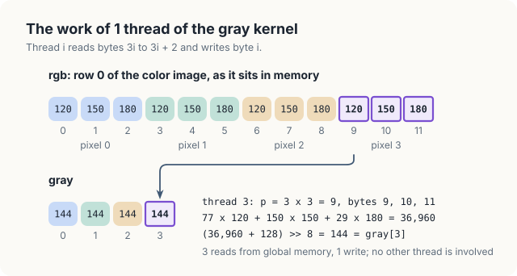
<figcaption><b>Figure 24.4</b> The work of 1 thread of the gray kernel: 3 bytes in, 1 byte out.</figcaption>
</figure>

The GPU runs the threads of a block in groups of 32, and the order of the bytes decides how fast
their reads are served.

<div class="definition">

<span class="box-label">Definition 24.4</span> **Warp and coalesced access.** A **warp** is a group
of 32 consecutive threads of a block that execute the same instruction together; its threads are its
**lanes** 0 to 31. An access of a
warp to global memory is **coalesced** when its 32 addresses fall into as few aligned segments of
32 bytes as the data allow, so that the memory system serves the whole warp with a few transfers.

*Example.* The 32 threads of a warp of the gray kernel read pixels \\(i\\) to \\(i + 31\\), which
are 96 consecutive bytes of the colour image, and the memory system serves each of the 3 read
instructions from the same 3 segments of 32 bytes.

</div>

For the image of 1,920 × 1,080 pixels the programs launch 8,100 blocks of 256 threads, and
\\(8{,}100 \cdot 256 = 2{,}073{,}600\\), exactly 1 thread per pixel. The kernels follow lines 1 to 5
of Gray-Kernel.

<div class="code-tabs">
<div class="code-tab" data-lang="Rust">

```rust,ignore
mod kernels {
    // ...
{{#include ../../../../code/oxide/ch24_capstone/src/main.rs:57:68}}
    // ...
}
```

</div>
<div class="code-tab" data-lang="C++">

```cpp
{{#include ../../../../code/cuda/ch24_capstone/capstone.cu:60:70}}
```

</div>
</div>

In Rust, `thread::index_1d()` is line 1, and the test of line 2 is the call `gray.get_mut(idx)`. The
output is a `DisjointSlice`, a slice that hands each thread only the element of its own index, and
`get_mut` returns `None` for a thread whose index lies past the end, so the write needs no `unsafe`
block. The attribute `#[launch_contract(domain = 1, block = (256, 1, 1))]` records the block shape;
the host must prepare every launch against it, and a launch with another shape is refused on the
host before it reaches the GPU. The C++ kernel tests the index itself and writes through a raw
pointer. In both languages the levels are widened to 32-bit integers before the multiplication,
because \\(77 \cdot 255 = 19{,}635\\) does not fit in a byte.

### 24.3.3 Weights that do not sum to 256

The 3 weights are easy to get wrong by truncating them instead of rounding: \\(0.299 \cdot 256 =
76.54\\) truncates to 76, and the 3 weights 76, 150 and 29 then sum to 255. Every level comes out
slightly too dark, and the error grows with the level. The sky keeps level 144, since
\\((76 \cdot 120 + 22{,}500 + 5{,}220 + 128) \gg 8 = 36{,}968 \gg 8 = 144\\), but a white pixel
gives \\((255 \cdot 255 + 128) \gg 8 = 65{,}153 \gg 8 = 254\\) instead of 255. A test image with no white pixel does not
reveal the mistake; a test that converts (255, 255, 255) does.

<div class="exercises">

Exercises

24.7 Convert the pixels (255, 0, 0), (0, 255, 0) and (0, 0, 255) with the integer weights. Explain
why the 3 results differ.<br>
24.8 A warp of the gray kernel reads 96 bytes with 3 load instructions. How many bytes would each
load instruction move if each thread converted 4 pixels and read its 12 bytes as 3 words of 4
bytes?<br>
24.9 Without the 128 in line 4, which of the 4 colours of the example changes its gray level?

</div>

## 24.4 Histogram equalisation

### 24.4.1 The method on the example

Equalisation moves each level to a new level in proportion to the number of pixels at or below it.
It needs 2 quantities.

<div class="definition">

<span class="box-label">Definition 24.5</span> **Histogram and cumulative count.** The **histogram**
of a gray image counts, for each level \\(v \in [0, 256)\\), the pixels whose level is \\(v\\); we
call the counts \\(bins[v]\\). The **cumulative count** \\(c(v)\\) is the number of pixels whose
level is at most \\(v\\), \\(c(v) = \sum_{u \le v} bins[u]\\). The sequence \\(c\\) is the
**inclusive scan** of the histogram (Chapter 21).

*Example.* The gray image of Figure 24.1 has \\(bins[96] = bins[112] = bins[120] = bins[144] = 16\\)
and every other count 0. Its cumulative counts are \\(c(96) = 16\\), \\(c(112) = 32\\), \\(c(120) =
48\\) and \\(c(144) = 64\\).

</div>

If 50% of the pixels have a level of at most \\(v\\), equalisation moves \\(v\\) to about 50%
of 255. The darkest level in use should become 0 and the brightest 255, so we subtract the cumulative
count \\(c_{\min}\\) of the darkest level in use and divide by what remains.

<div class="definition">

<span class="box-label">Definition 24.6</span> **Equalisation table.** For an image of \\(N\\)
pixels, let \\(c_{\min}\\) be the cumulative count at the lowest level in use. The equalisation
table maps level \\(v\\) to
\\[ \mathrm{new}(v) = \mathrm{round}\left(\frac{\max(c(v) - c_{\min}, 0)}{N - c_{\min}} \cdot
255\right), \\]
and the equalised image replaces each level \\(v\\) by \\(\mathrm{new}(v)\\).

*Example.* With \\(N = 64\\) and \\(c_{\min} = c(96) = 16\\), \\(\mathrm{new}(112) =
\mathrm{round}(16 \cdot 255 / 48) = 85\\).

</div>

Figure 24.5 works the whole table. Level 96 moves to \\(\mathrm{round}(0 \cdot 255 / 48) = 0\\),
level 120 to \\(\mathrm{round}(32 \cdot 255 / 48) = 170\\) and level 144 to
\\(\mathrm{round}(48 \cdot 255 / 48) = 255\\). The 4 levels, once within 48 of each other, now cover
the whole scale in equal steps of 85, because each of them holds a quarter of the pixels. In the
programs, line 14 of Image-Pipeline performs the rounding in integers: for a numerator \\(a\\) and a
denominator \\(s\\), \\(\lfloor (a + \lfloor s/2 \rfloor) / s \rfloor\\) is \\(a / s\\) rounded to
the nearest integer, and for level 112 it gives \\(\lfloor (4{,}080 + 24) / 48 \rfloor = 85\\).

<figure>
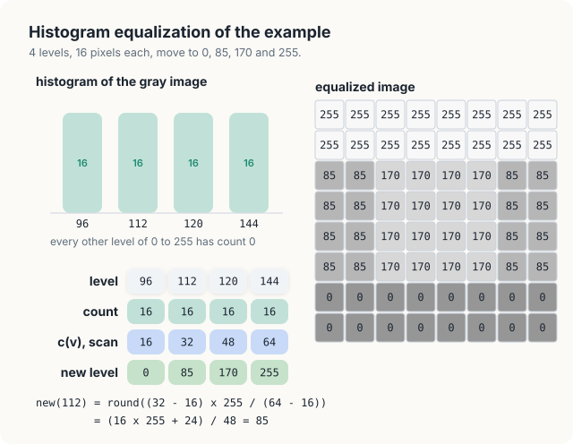
<figcaption><b>Figure 24.5</b> The histogram, the cumulative counts and the table of the example, and the equalised image.</figcaption>
</figure>

The cumulative count never decreases as \\(v\\) grows, so neither does \\(\mathrm{new}(v)\\): 2
pixels that were in a given order of brightness keep that order. Equalisation changes contrast, not
the arrangement of light and dark.

The method splits into 3 steps with different patterns: the histogram (a global operation), the
table of 256 entries (a scan), and the replacement of each level (a map). Each step needs the
previous one complete, so the programs use 1 kernel for each.

### 24.4.2 The histogram kernel

Many threads add to the same few counters, so the additions must not interfere. The histogram of
Chapter 22 solves this with atomic operations and private counters per block; we restate the terms.

<div class="definition">

<span class="box-label">Definition 24.7</span> **Shared memory, barrier and atomic operation.**
**Shared memory** is a small memory on each SM that the threads of 1 block share; it answers in a
few cycles, and its contents last as long as the block. A **barrier** is a point in a kernel that no
thread of a block passes until every thread of the block has reached it. An **atomic operation**
reads a memory word, changes it and writes it back as 1 step, so that no other thread can access the
word in between.

*Example.* 2 threads that add 1 to the same counter with an atomic addition always leave it 2
higher.

</div>

Each block of the histogram kernel counts into its own 256 counters in shared memory, and adds them
to the global counters once at the end.

<div class="algo">
<p class="algo-name">Histogram-Kernel(\(gray, bins, N\))</p>
<ol>
<li>\(t = threadIdx.x\)</li>
<li>\(local[t] = 0\) <span class="c">// 256 threads clear 256 counters</span></li>
<li><span class="sc">Barrier</span>()</li>
<li>for \(i = blockIdx.x \cdot 256 + t\); \(i &lt; N\); \(i = i + gridDim.x \cdot 256\) {</li>
<li style="--d:1"><span class="sc">Atomic-Add</span>\((local[gray[i]], 1)\) <span class="c">// shared memory</span></li>
<li>}</li>
<li><span class="sc">Barrier</span>()</li>
<li>if \(local[t] > 0\) {</li>
<li style="--d:1"><span class="sc">Atomic-Add</span>\((bins[t], local[t])\) <span class="c">// global memory</span></li>
<li>}</li>
</ol>
</div>

Line 2 clears the counters, 1 per thread. The loop of lines 4 to 6 walks through the image with a
stride of the whole grid, and line 5 counts each pixel in the block's own counter of its level. The
barrier of line 3 keeps every count from starting before every counter is 0, and the barrier of line
7 keeps every block total from being read before every count of the block is done. Lines 8 to 10 add
the block's 256 totals to the global histogram, skipping counters that stayed at 0.

For the image of 1,920 × 1,080 pixels the programs launch 64 blocks of 256 threads, 16,384 threads
in all, so each thread counts 2,073,600 / 16,384 = 126.6 pixels, that is 126 or 127. The global
counters receive at most \\(64 \cdot 256 = 16{,}384\\) atomic additions instead of 2,073,600. For
the 8 × 8 example, 1 block would do: threads 0 to 63 each count 1 pixel, and threads 96, 112, 120 and
144 each add 16 to the global counter of their level.

<div class="code-tabs">
<div class="code-tab" data-lang="Rust">

```rust,ignore
mod kernels {
    // ...
{{#include ../../../../code/oxide/ch24_capstone/src/main.rs:70:99}}
    // ...
}
```

</div>
<div class="code-tab" data-lang="C++">

```cpp
{{#include ../../../../code/cuda/ch24_capstone/capstone.cu:72:90}}
```

</div>
</div>

The 2 kernels follow Histogram-Kernel line by line, and differ in how they reach shared memory. C++
declares `__shared__ unsigned local[256]` and calls `atomicAdd` on an element. Rust declares
`static mut LOCAL: SharedArray<u32, 256>` and turns the address of an element into a
`BlockAtomicU32`, an atomic integer whose operations are atomic among the threads of 1 block, which is
all that shared memory needs. The global counters are a slice of `DeviceAtomicU32`, atomic among all
threads of the device. Every direct access to `LOCAL` is `unsafe`, because the compiler cannot check
how concurrent threads use shared memory; each `// SAFETY:` comment states the argument, which is the
2 barriers of the pseudocode.

### 24.4.3 The table kernel

The table needs the scan of 256 counts and the value \\(c_{\min}\\). A scan of 256 values is
small, so a single block of 256 threads computes it, with thread \\(v\\) responsible for level
\\(v\\). The block scans each warp with register shuffles, then scans the 8 warp totals, as in the
block scan of Chapter 21.

<div class="algo">
<p class="algo-name">Table-Kernel(\(bins, table\))</p>
<ol>
<li>\(v = threadIdx.x\), \(\;lane = v \bmod 32\), \(\;w = \lfloor v / 32 \rfloor\)</li>
<li>\(count = \) <span class="sc">Atomic-Exchange</span>\((bins[v], 0)\) <span class="c">// read and clear</span></li>
<li>\(s = \) <span class="sc">Warp-Scan</span>\((count)\) <span class="c">// inclusive, within the warp</span></li>
<li>if \(lane = 31\) { \(warps[w] = s\) }</li>
<li>if \(v = 0\) { \(first = \infty\) }</li>
<li><span class="sc">Barrier</span>()</li>
<li>if \(w = 0\) and \(lane &lt; 8\) { \(warps[lane] = \) <span class="sc">Warp-Scan</span>\((warps[lane])\) }</li>
<li><span class="sc">Barrier</span>()</li>
<li>\(c = s + warps[w - 1]\) if \(w > 0\), else \(c = s\) <span class="c">// c = c(v)</span></li>
<li>if \(count > 0\) { <span class="sc">Atomic-Min</span>\((first, c)\) }</li>
<li><span class="sc">Barrier</span>()</li>
<li>\(span = warps[7] - first\)</li>
<li>\(table[v] = \lfloor (\max(c - first, 0) \cdot 255 + \lfloor span/2 \rfloor) / span \rfloor\)</li>
</ol>
</div>

On the example, the 4 levels in use belong to 2 warps. Warp 3 holds threads 96 to 127: its scan
gives 16 at lane 0 (level 96), 32 at lane 16 (level 112) and 48 from lane 24 (level 120) to lane
31, so \\(warps[3] = 48\\). Warp 4 holds level 144 at lane 16, so \\(warps[4] = 16\\). After line 7
the warp totals are 0, 0, 0, 48, 64, 64, 64, 64, and line 9 gives thread 144 the count \\(c = 16 +
48 = 64\\). Line 10 leaves \\(first = 16\\), the smallest cumulative count among the 4 levels in
use, which is \\(c_{\min}\\). The total number of pixels is the last warp total, \\(warps[7] = 64\\),
so the kernel needs no parameter for \\(N\\).

Line 2 reads each count with an atomic exchange, which returns the old value and stores 0. The kernel
therefore leaves the global histogram cleared for the next image, and the pipeline needs no separate
launch to clear it. Line 13 works in 64-bit integers in the programs, because
\\(\max(c - first, 0) \cdot 255\\) reaches \\(2{,}073{,}600 \cdot 255 = 528{,}768{,}000\\) for the large image, close to
the limit of a 32-bit integer, and line 12 gives a span of 0 for an image of a single level, in
which case the programs keep every level unchanged.

<div class="code-tabs">
<div class="code-tab" data-lang="Rust">

```rust,ignore
mod kernels {
    // ...
{{#include ../../../../code/oxide/ch24_capstone/src/main.rs:101:149}}
    // ...
}
```

</div>
<div class="code-tab" data-lang="C++">

```cpp
{{#include ../../../../code/cuda/ch24_capstone/capstone.cu:92:130}}
```

</div>
</div>

The 3 barriers of Table-Kernel are the 3 calls to `sync_threads()` and `__syncthreads()`, and all of
them lie outside every `if`, so every thread of the block reaches them. Line 13 writes the table
through `table.get_mut(...)` in Rust, a `DisjointSlice` again, and through a plain store in C++.
The scan inside a warp is the device function `warp_scan` (`warpScan` in C++), which adds the value
of the lane 1, 2, 4, 8 and 16 places lower with `shuffle_up_sync` (`__shfl_up_sync`); we derived it
in Chapter 21.

### 24.4.4 Applying the table

The last step is a map. Each thread reads 1 gray level and writes the table's entry for it.

<div class="code-tabs">
<div class="code-tab" data-lang="Rust">

```rust,ignore
mod kernels {
    // ...
{{#include ../../../../code/oxide/ch24_capstone/src/main.rs:151:161}}
    // ...
}
```

</div>
<div class="code-tab" data-lang="C++">

```cpp
{{#include ../../../../code/cuda/ch24_capstone/capstone.cu:132:139}}
```

</div>
</div>

The read `table[gray[i]]` is a **gather**, a read whose address depends on data. The 32 threads of a
warp read 32 entries of the table at unpredictable positions, which is the opposite of a coalesced
access. The table holds only 256 bytes, however, so after the first accesses it stays in the L1 cache
of each SM, and the gathers cost little.

### 24.4.5 A histogram without atomic additions

The easy mistake in the histogram is to count with a plain addition, `local[gray[i]] += 1`. The
addition is 3 steps, a read, an add and a write, and 2 threads that count the same level can
interleave them (Figure 24.6). Both read the old count 7, both write 8, and 1 of the 2 pixels is
lost.

<figure>
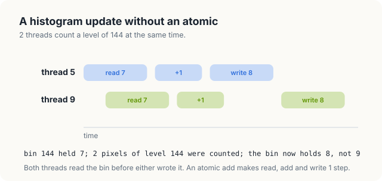
<figcaption><b>Figure 24.6</b> 2 threads count a pixel of level 144 with a plain addition; the bin grows by 1 instead of 2.</figcaption>
</figure>

On the example, 16 threads of 1 block count the 16 sky pixels, all of them level 144. If they lose
any of their additions, \\(bins[144]\\) ends below 16, the total \\(warps[7]\\) below 64, and the
table changes. We ran the C++ program with this 1 change.

```console
$ ./capstone                                  # local[gray[i]] += 1, no atomicAdd
...
image      pixels that differ from the CPU
  gray              0
  equalised   1961635   first at (0, 0): GPU 104, CPU 97
  blurred     1988211   first at (0, 0): GPU 112, CPU 106
  edges       1302442   first at (0, 0): GPU 9, CPU 10
...
FAILED
```

The gray image is still right, and 1,961,635 of the 2,073,600 equalised pixels, 95%, are wrong. A
lost count lowers the cumulative count of its level and of every level above it, and with it the
table entry of almost every level; pixel \\((0, 0)\\) became 104 instead of 97. The error then passes
through the blur and the edges. The histogram stage of this broken program also ran in 0.050 ms
instead of about 0.12 ms, because plain additions do not wait for one another. A faster kernel is
no evidence of a correct one.

<div class="exercises">

Exercises

24.10 Compute the equalisation table for an image of 10 pixels with the levels 4, 4, 4, 5, 5, 6, 6,
6, 6, 7, on a scale of 8 levels (replace 255 by 7).<br>
24.11 In Table-Kernel, why must line 10 run after the barrier of line 8 and not before it?<br>
24.12 Histogram-Kernel is launched with 64 blocks. How many atomic additions reach global memory
for the 8 × 8 example with 1 block, and for the large image with 64 blocks?

</div>

## 24.5 A separable Gaussian blur

### 24.5.1 The weights

A **blur** replaces each pixel by a weighted average of the pixels around it. A **Gaussian blur**
uses weights that fall off with the distance from the centre in the shape of the normal
distribution. We use the 5 weights \\(w = (1, 4, 6, 4, 1)\\) in each direction. They are the
binomial coefficients of order 4, which approximate a normal distribution with a standard deviation
of 1 pixel (the binomial distribution of order 4 with probability 1/2 has variance \\(4 \cdot
\tfrac12 \cdot \tfrac12 = 1\\)). They sum to 16.

The 2-dimensional blur over a window of 5 × 5 pixels gives the pixel in row \\(i\\) and column \\(j\\)
of the window the weight \\(w_i w_j\\) (Figure 24.7, left). The 25 weights run from 1 at the corners
to 36 at the centre and sum to \\(16 \cdot 16 = 256\\), so a region of constant level keeps its
level after the division by 256.

<div class="definition">

<span class="box-label">Definition 24.8</span> **Separable filter.** A filter on a window of
\\(k \times k\\) pixels is **separable** if its weight at row \\(i\\) and column \\(j\\) of the window
is a product \\(a_i b_j\\) of a column weight and a row weight. Its **row pass** replaces each pixel
by the sum of its \\(k\\) row neighbours weighted by \\(b\\), and its **column pass** does the same
along the columns with the weights \\(a\\).

*Example.* The blur is separable with \\(a = b = (1, 4, 6, 4, 1)\\); the weight 36 at the centre is
\\(6 \cdot 6\\), and the weight 4 at row 0 and column 1 is \\(1 \cdot 4\\).

</div>

<figure>
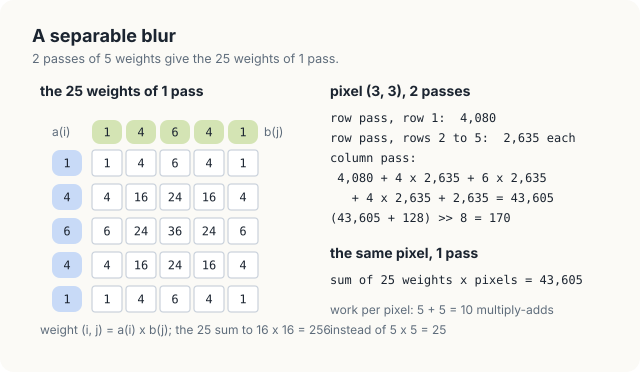> 8 = 170. 1 pass over 25 weights gives the same 43,605. 2 passes cost 10 multiply-adds per pixel instead of 25.">
<figcaption><b>Figure 24.7</b> The 25 weights of the blur as products of 2 sets of 5, and pixel (3, 3) of the example computed both ways.</figcaption>
</figure>

### 24.5.2 Separability

Let us blur pixel \\((3, 3)\\) of the equalised image by hand in 2 passes (Figure 24.8). The row pass
at \\((3, y)\\) reads pixels 1 to 5 of row \\(y\\). In rows 2 to 5 these are 85, 170, 170, 170 and
170, so the row sum is \\(85 + 4 \cdot 170 + 6 \cdot 170 + 4 \cdot 170 + 170 = 2{,}635\\); in row 1
all 5 are 255, and the sum is \\(16 \cdot 255 = 4{,}080\\). The column pass at \\((3, 3)\\) reads the
row sums of rows 1 to 5:
\\[ 4{,}080 + 4 \cdot 2{,}635 + 6 \cdot 2{,}635 + 4 \cdot 2{,}635 + 2{,}635 = 4{,}080 + 15 \cdot
2{,}635 = 43{,}605, \\]
and \\((43{,}605 + 128) \gg 8 = 170\\). Adding the 25 products of the 5 × 5 window with the weights of
Figure 24.7 gives the same 43,605. The agreement is not a coincidence of the example.

<div class="theorem">

<span class="box-label">Theorem 24.1</span> Let \\(e\\) be an image of \\(W \times H\\) levels, let
\\(R(x, y) = \sum_{j \in [0,5)} w_j\\, e(\mathrm{clamp}(x + j - 2, W), y)\\) be its row sums, and let
\\(B(x, y) = (\sum_{i \in [0,5)} w_i\\, R(x, \mathrm{clamp}(y + i - 2, H)) + 128) \gg 8\\). Then for
every pixel,
\\[ B(x, y) = \Big(\sum_{i \in [0,5)} \sum_{j \in [0,5)} w_i w_j\\, e(\mathrm{clamp}(x + j - 2, W),
\mathrm{clamp}(y + i - 2, H)) + 128\Big) \gg 8, \\]
the 2-dimensional blur with the 25 weights \\(w_i w_j\\).

</div>

<div class="proof">

*Proof.* Fix \\((x, y)\\) and write \\(y_i = \mathrm{clamp}(y + i - 2, H)\\) and \\(x_j =
\mathrm{clamp}(x + j - 2, W)\\). By the definition of \\(R\\), \\(R(x, y_i) = \sum_j w_j\\, e(x_j,
y_i)\\): the clamp acts on each coordinate separately, so the columns \\(x_j\\) that the row pass
reads in row \\(y_i\\) do not depend on \\(i\\). Hence
\\[ \sum_i w_i\\, R(x, y_i) = \sum_i w_i \sum_j w_j\\, e(x_j, y_i) = \sum_i \sum_j w_i w_j\\, e(x_j,
y_i), \\]
since multiplication distributes over the inner sum. Every quantity is a non-negative integer: a row
sum is at most \\(16 \cdot 255 = 4{,}080\\), and a column sum at most \\(16 \cdot 4{,}080 =
65{,}280\\), far below \\(2^{32}\\). Every addition and multiplication is therefore exact, the 2 sides
are the same integer before the shift, and the shift gives the same result.

</div>

The proof needs the row pass to keep its sums whole. A program that divides by 16 with rounding after
each pass instead of by 256 once at the end computes a different image: on the example, the row sum
2,635 becomes 165 and 4,080 becomes 255, and pixel \\((3, 3)\\) becomes \\((255 + 15 \cdot 165 + 8)
\gg 4 = 171\\) instead of 170. 16 of the 64 pixels of the example change in this way. Our programs
therefore store the row sums unscaled, in 2 bytes per pixel.

### 24.5.3 Counting the savings

The 2-dimensional blur performs 25 multiply-adds per pixel; the 2 passes perform \\(5 + 5 = 10\\).
For a window of \\(k \times k\\) the counts are \\(k^2\\) and \\(2k\\), so the saving grows with the
window: 2.5 times for \\(k = 5\\), and 7.5 times for \\(k = 15\\), with 225 multiply-adds against 30.
For the image of 1,920 × 1,080 pixels, the 2 passes save \\(15 \cdot 2{,}073{,}600 = 31{,}104{,}000\\)
multiply-adds per image.

The 2 passes cost memory traffic instead. The row pass writes its sums to an intermediate image of 2
bytes per pixel, 4.1 MB for the large image, and the column pass reads it back. In Section 24.9, we show
that the time of the blur is set by this traffic, not by the multiply-adds.

<figure>
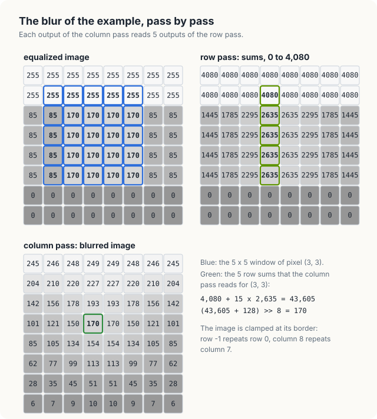
<figcaption><b>Figure 24.8</b> The blur of the example, pass by pass: the equalised image, the row sums and the blurred image.</figcaption>
</figure>

### 24.5.4 The tile and its halo

Each output of the row pass reads 5 pixels, and each pixel is read by 5 outputs. A kernel that reads
its inputs from global memory therefore fetches every pixel 5 times. The tiling of Chapter 20 removes
the repetition: the threads of a block first copy the pixels that the block needs into shared memory
once, and every thread then reads its 5 inputs from the copy.

<div class="definition">

<span class="box-label">Definition 24.9</span> **Tile and halo.** A **tile** is the piece of the
input that a block copies into shared memory. For a block of \\(T\\) outputs of a filter that reads
\\(r\\) positions on each side, the tile holds \\(T + 2r\\) inputs: the \\(T\\) positions of the
block's own outputs and \\(r\\) more on each side. The \\(2r\\) extra positions are the **halo**.

*Example.* A block of 8 outputs of the row pass, with \\(r = 2\\), needs a tile of 12 pixels; its
halo is 2 pixels on the left and 2 on the right.

</div>

Figure 24.9 shows the tile of row 2 of the example for a block of 8 threads. Slot \\(s\\) of the tile
holds pixel \\(x_0 + s - 2\\) of the row, clamped, where \\(x_0\\) is the first output of the block.
Thread \\(t\\) copies its own pixel into slot \\(t + 2\\), and threads 0 and 1 also copy the 4 halo
slots. After a barrier, thread \\(t\\) reads slots \\(t\\) to \\(t + 4\\), which hold pixels
\\(x_0 + t - 2\\) to \\(x_0 + t + 2\\).

<figure>
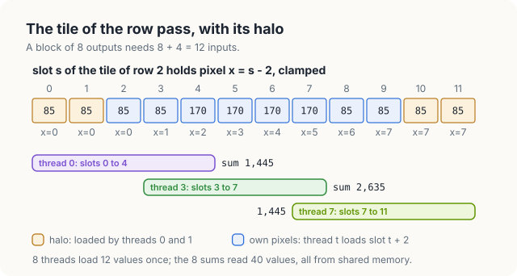
<figcaption><b>Figure 24.9</b> The tile of row 2 for a block of 8 threads, with its halo, and the windows of 3 threads.</figcaption>
</figure>

<div class="algo">
<p class="algo-name">Blur-Rows(\(src, rows, W\))</p>
<ol>
<li>\(t = threadIdx.x\), \(\;x_0 = blockIdx.x \cdot T\), \(\;y = blockIdx.y\)</li>
<li>\(tile[t + 2] = src[y][\mathrm{clamp}(x_0 + t, W)]\) <span class="c">// own pixel</span></li>
<li>if \(t &lt; 2\) {</li>
<li style="--d:1">\(tile[t] = src[y][\mathrm{clamp}(x_0 + t - 2, W)]\) <span class="c">// left halo</span></li>
<li style="--d:1">\(tile[T + 2 + t] = src[y][\mathrm{clamp}(x_0 + T + t, W)]\) <span class="c">// right halo</span></li>
<li>}</li>
<li><span class="sc">Barrier</span>()</li>
<li>\(rows[y][x_0 + t] = \sum_{k \in [0,5)} w_k \cdot tile[t + k]\)</li>
</ol>
</div>

Lines 2 to 6 are the joint copy, line 7 separates the copy from the reads, and line 8 is line 20 of
Image-Pipeline with every read taken from the tile. A block now fetches \\(T + 4\\) pixels from
global memory for \\(T\\) outputs, instead of \\(5T\\). The programs use \\(T = 128\\): 132 fetches
instead of 640 per block, and 15 blocks cover a row of 1,920 pixels exactly.

The column pass works in the same way along the columns. A block of 32 × 8 threads computes 8 rows
of 32 columns, and its tile holds the 8 + 4 = 12 rows of 32 row sums that those outputs read. The
block is 32 threads wide so that a warp reads 32 consecutive row sums of 1 row, 64 consecutive
bytes. It finishes with the rounding of line 23 of Image-Pipeline, \\((sum + 128) \gg 8\\).

<div class="code-tabs">
<div class="code-tab" data-lang="Rust">

```rust,ignore
mod kernels {
    // ...
{{#include ../../../../code/oxide/ch24_capstone/src/main.rs:163:221}}
    // ...
}
```

</div>
<div class="code-tab" data-lang="C++">

```cpp
{{#include ../../../../code/cuda/ch24_capstone/capstone.cu:141:182}}
```

</div>
</div>

In the row pass, the line that writes `TILE[tx + 2]` (C++: `tile[tx + 2]`) is line 2 of Blur-Rows,
the `if tx < 2` block is lines 3 to 6, and the barrier is line 7. The device function `tap(i, n)`
computes \\(\mathrm{clamp}(i - 2, n)\\), so `tap(x0 + s, W)` is the pixel that belongs in slot
\\(s\\). The 2 languages declare the tile differently. C++ writes `__shared__ unsigned tile[ROW_T +
4]`. Rust writes `static mut TILE: SharedArray<u32, { ROW_T + 4 }>`, a type whose length is part of
the type and must be a constant, which is why the tile widths are the constants `ROW_T`, `COL_W` and
`COL_H`. Every access to the tile is `unsafe` in Rust, and the 2 `// SAFETY:` comments state the
argument that we prove in the next section. The output is a `DisjointSlice<u16, Index2D<W>>`, addressed
by the thread's 2-dimensional index `thread::index_2d::<W>()`, so the write needs no `unsafe` block.

### 24.5.5 Correctness of the tile

The tiled row pass is correct if every slot holds the right pixel at the moment it is read.

<div class="theorem">

<span class="box-label">Theorem 24.2</span> After the barrier of line 7 of Blur-Rows, slot \\(s\\)
of the tile holds \\(src[y][\mathrm{clamp}(x_0 + s - 2, W)]\\) for every \\(s \in [0, T + 4)\\), and
line 8 computes the row sum \\(R(x_0 + t, y)\\) of Theorem 24.1.

</div>

<div class="proof">

*Proof.* Line 2 writes slot \\(t + 2\\) for \\(t \in [0, T)\\), that is the slots \\([2, T + 2)\\).
Lines 4 and 5 write slots \\(t\\) and \\(T + 2 + t\\) for \\(t \in [0, 2)\\), that is the slots
\\([0, 2)\\) and \\([T + 2, T + 4)\\). The 3 ranges are disjoint and together cover \\([0, T + 4)\\),
so every slot is written exactly once, and each write stores the pixel \\(x_0 + s - 2\\), clamped,
for its slot \\(s\\). No thread passes the barrier of line 7 before every thread has finished lines
2 to 6, so every slot holds its value before any thread reads. After the barrier the tile is only
read. Thread \\(t\\) reads slots \\(t + k\\) for \\(k \in [0, 5)\\), which hold
\\(src[y][\mathrm{clamp}(x_0 + t + k - 2, W)]\\), and line 8 adds them with the weights \\(w_k\\),
which is \\(R(x_0 + t, y)\\).

</div>

The same argument, with rows in place of columns, proves the column pass.

### 24.5.6 A missing halo

The halo is easy to forget, because the block has \\(T\\) threads and it seems natural to copy
\\(T\\) values. Suppose lines 3 to 6 of Blur-Rows are left out. Slots 0, 1, \\(T + 2\\) and \\(T +
3\\) are then never written, and the proof of Theorem 24.2 fails at its first step. The threads whose
windows reach into those slots read whatever the memory held before: threads 0 and 1 on the left,
and threads \\(T - 2\\) and \\(T - 1\\) on the right.

Figure 24.10 shows the effect on the example, with a block of 8 threads per row and with 0 in the
4 slots that are never written. Thread 0 of row 2 should add \\(85 + 4 \cdot 85 + 6 \cdot 85 + 4
\cdot 85 + 170 = 1{,}445\\); it adds \\(0 + 0 + 6 \cdot 85 + 4 \cdot 85 + 170 = 1{,}020\\) instead.
The column pass spreads the error down the column, and pixel \\((0, 3)\\) of the blurred image
becomes 71 instead of 101. 30 of the 64 blurred pixels are wrong, all in columns 0, 1, 6 and 7.

<figure>
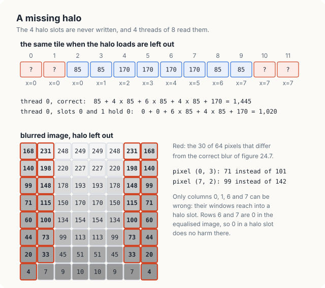
<figcaption><b>Figure 24.10</b> The row pass without its halo loads, on the example: 4 of 8 threads read slots that no thread wrote.</figcaption>
</figure>

In the programs, the block has 128 threads, so threads 0, 1, 126 and 127 of each block read an
unwritten slot. A row has 15 blocks, so 60 columns of the image are at risk, and \\(60 \cdot 1{,}080
= 64{,}800\\) blurred pixels. We removed the `if tx < 2` block from the Rust kernel and ran it.

```console
$ cargo oxide run                             # blur_rows without the `if tx < 2` block
...
image      pixels that differ from the CPU
  gray              0
  equalised         0
  blurred       56548   first at (0, 0): GPU 164, CPU 106
  edges         81436   first at (0, 0): GPU 84, CPU 10
...
FAILED
```

The program compiled without a warning: the reads of the tile are inside `unsafe` blocks, and the
compiler accepts the argument of their `// SAFETY:` comments without checking it. 56,548 of the
64,800 blurred pixels at risk are wrong, 87%; in the others, the old contents of shared memory
happened to give the right sum. Pixel \\((0, 0)\\) is 164 instead of 106. The edge image has more
wrong pixels, 81,436, because the Sobel operator reads a 3 × 3 window and every wrong blurred pixel
spoils the edges of its neighbours: the 60 columns at risk become 90 columns of edges at risk, 97,200
pixels. The C++ program with the same change gave 56,646 wrong blurred pixels and 81,212 wrong edge
pixels. In the picture the errors form thin vertical stripes, 1 every 128 columns, which a look at
the image does not reveal; the comparison with the CPU does.

<div class="rule-box">

<span class="box-label">Rule</span> A tile for \\(T\\) outputs of a filter that reads \\(r\\)
positions on each side holds \\(T + 2r\\) inputs, and every one of them must be written before the
barrier. Count the slots, not the threads.

</div>

<div class="exercises">

Exercises

24.13 Compute the row sum and the blurred level of pixel \\((1, 2)\\) of the example by hand, and
check them against Figure 24.8.<br>
24.14 A block of the row pass has 256 threads instead of 128. How many pixels does it fetch, and
what fraction of its fetches are halo? How many columns of the image would a missing halo put at
risk?<br>
24.15 Prove that rounding after each pass, \\((sum + 8) \gg 4\\) twice, can differ from rounding once
at the end, using pixel \\((3, 3)\\) of the example.

</div>

## 24.6 Sobel edges

### 24.6.1 The gradient

An **edge** in an image is a place where the level changes quickly from 1 pixel to the next. The
**Sobel operator** estimates the rate of change at each pixel in 2 directions from its 3 × 3
neighbourhood. The horizontal component \\(g_x\\) is the weighted sum of the column to the right of
the pixel minus the weighted sum of the column to its left, with weights 1, 2, 1 from top to
bottom. The vertical component \\(g_y\\) is the weighted sum of the row below minus the row above,
with the same weights from left to right.

<div class="definition">

<span class="box-label">Definition 24.10</span> **Gradient magnitude.** The **gradient magnitude**
at a pixel is the length \\(\sqrt{g_x^2 + g_y^2}\\) of the vector \\((g_x, g_y)\\). Our edge image
stores it divided by 4, rounded to the nearest integer and limited to 255:
\\[ \mathrm{edge}(x, y) = \min\big(\lfloor \sqrt{g_x^2 + g_y^2} / 4 + 1/2 \rfloor, 255\big). \\]

*Example.* At pixel \\((3, 1)\\) of the blurred example, \\(g_x = 30\\) and \\(g_y = -238\\), and
the edge level is 60 (Figure 24.11).

</div>

The division by 4 scales the result to the range of a byte. A sharp step from level 0 to level 255
gives \\(g_x = (1 + 2 + 1) \cdot 255 = 1{,}020\\), and \\(1{,}020 / 4 = 255\\), the brightest level.
Figure 24.11 works pixel \\((3, 1)\\), which lies where the sky meets the house. Its neighbourhood
in the blurred image has rows 248, 249, 249; 220, 227, 227; and 178, 193, 193, so
\\[ g_x = (249 + 2 \cdot 227 + 193) - (248 + 2 \cdot 220 + 178) = 896 - 866 = 30, \\]
\\[ g_y = (178 + 2 \cdot 193 + 193) - (248 + 2 \cdot 249 + 249) = 757 - 995 = -238. \\]
The level falls by about 70 from the row above to the row below, and barely changes from left to
right. The magnitude is \\(\sqrt{900 + 56{,}644} = \sqrt{57{,}544} = 239.88\\), and \\(239.88 / 4 =
59.97\\) rounds to 60.

<figure>
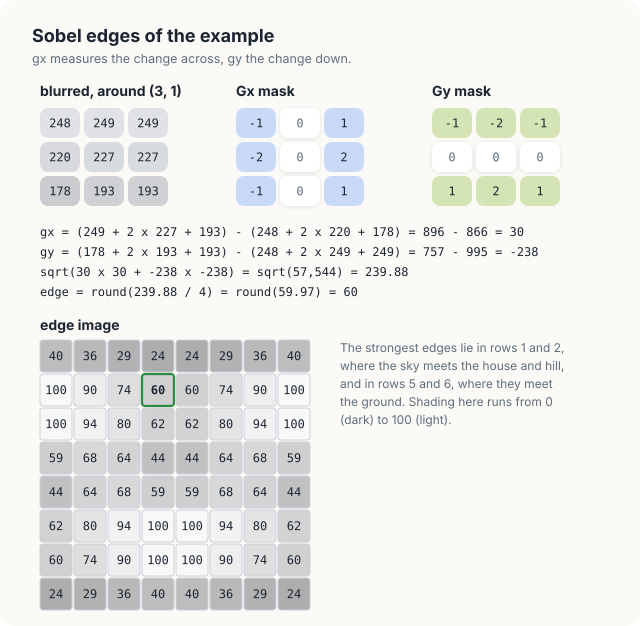
<figcaption><b>Figure 24.11</b> The Sobel operator at pixel (3, 1) of the blurred example, and the edge image.</figcaption>
</figure>

### 24.6.2 The kernel

The Sobel operator is a stencil of radius 1, the pattern of Chapter 19, and its kernel gives each
output pixel a thread.

<div class="algo">
<p class="algo-name">Sobel-Kernel(\(src, edges, W, H\))</p>
<ol>
<li>\(x = blockIdx.x \cdot blockDim.x + threadIdx.x\), \(\;y = blockIdx.y \cdot blockDim.y + threadIdx.y\)</li>
<li>\(p(r, c) = src[\mathrm{clamp}(r, H)][\mathrm{clamp}(c, W)]\)</li>
<li>\(g_x = (p(y{-}1, x{+}1) + 2p(y, x{+}1) + p(y{+}1, x{+}1)) - (p(y{-}1, x{-}1) + 2p(y, x{-}1) + p(y{+}1, x{-}1))\)</li>
<li>\(g_y = (p(y{+}1, x{-}1) + 2p(y{+}1, x) + p(y{+}1, x{+}1)) - (p(y{-}1, x{-}1) + 2p(y{-}1, x) + p(y{-}1, x{+}1))\)</li>
<li>\(edges[y][x] = \min(\lfloor \sqrt{g_x^2 + g_y^2}\,/\,4 + 1/2 \rfloor, 255)\)</li>
</ol>
</div>

Each thread uses the 8 pixels around its own, since the centre has weight 0 in both masks, and
writes 1 byte. The kernel reads the 8 pixels from global memory without a shared tile. A pixel is read by up to 9 threads, but
those threads belong to the same block or to neighbouring blocks, and most of the repeated reads are
served by the L1 cache of the SM; Exercise 24.18 asks whether a tile would help.

<div class="code-tabs">
<div class="code-tab" data-lang="Rust">

```rust,ignore
mod kernels {
    // ...
{{#include ../../../../code/oxide/ch24_capstone/src/main.rs:223:245}}
}
```

</div>
<div class="code-tab" data-lang="C++">

```cpp
{{#include ../../../../code/cuda/ch24_capstone/capstone.cu:184:204}}
```

</div>
</div>

The kernels compute the 4 weighted sums of lines 3 and 4 as `right`, `left`, `below` and `above`,
and the clamped neighbours `xl`, `xr`, `yu` and `yd` of line 2. The largest possible component is
\\(4 \cdot 255 = 1{,}020\\), so the sum of squares is at most \\(2 \cdot 1{,}020^2 = 2{,}080{,}800\\),
an integer below \\(2^{24} = 16{,}777{,}216\\), and its conversion to a 32-bit float is exact. The
square root is `sqrt_rn_f32` in Rust and `sqrtf` in C++; both round to the nearest float, as the IEEE
754 standard requires of a square root, and so do the CPU's `f32::sqrt` and `std::sqrt`. The
multiplication by 0.25 is exact, because 0.25 is a power of 2.

We also compiled the C++ program with `--use_fast_math`, which replaces `sqrtf` by an approximate
square root. The edge image still agreed with the CPU's in every pixel, with the same checksum. The
rounding of line 5 depends on the root exactly at the sums of squares \\((4k + 2)^2\\): for \\(g_x =
10\\) and \\(g_y = 0\\), \\(\sqrt{100} = 10\\) and \\(10 / 4 + 1/2 = 3\\) exactly, and a root a little
below 10 would give 2. The approximate root of the measured GPU returned these integer roots
exactly. The programs keep the correctly rounded root, because it agrees with the CPU by its
definition, not by a test on 1 GPU and 1 image.

### 24.6.3 Neighbours outside the image

The easy mistake in a stencil is to forget the clamp of line 2 of Sobel-Kernel. At pixel \\((3,
0)\\) the kernel then reads row \\(-1\\), which does not exist. In a buffer stored row by row, row
\\(-1\\) lies before the start of the image, and column \\(-1\\) of row \\(y\\) is the last pixel of
row \\(y - 1\\). If the memory before the image holds 0, pixel \\((3, 0)\\) of the example gets
\\(g_y = (220 + 2 \cdot 227 + 227) - 0 = 901\\) and the edge level 225 instead of 24, and 27 of the
28 border pixels of the example change. We removed the 4 clamps from the C++ kernel and ran it.

```console
$ ./capstone                                  # sobel with xl = x - 1, xr = x + 1, ...
...
image      pixels that differ from the CPU
  gray              0
  equalised         0
  blurred           0
  edges          5852   first at (0, 0): GPU 129, CPU 10
...
FAILED
```

The image has \\(2 \cdot 1{,}920 + 2 \cdot 1{,}078 = 5{,}996\\) border pixels, and 5,852 of them are
wrong; every interior pixel is right. Pixel \\((0, 0)\\) became 129 instead of 10. The kernel did not
stop: the reads before the first row and after the last one landed in other memory of the program,
and the device reported no error. In Rust the same reads would be caught, because cuda-oxide checks
every slice index against the length of the slice and stops the kernel when it lies outside; the
column wrap of \\(x - 1\\) at \\(x = 0\\), which stays inside the slice, would not be caught.

<div class="exercises">

Exercises

24.16 Compute the edge level of pixel \\((0, 1)\\) of the example from the blurred image of Figure
24.8.<br>
24.17 Which levels of a blurred image of constant level give an edge level other than 0?<br>
24.18 Write a Sobel kernel that copies a tile of \\((8 + 2) \times (32 + 2)\\) pixels into shared
memory, and compare its time with the kernel above. Explain the result with the role of the L1
cache.

</div>

## 24.7 The host pipeline

### 24.7.1 Buffers

The host is the CPU and its memory; the device is the GPU and its memory. The host program keeps the
device buffers of 1 image in a structure, so that it can process several images at once with 1 set
of buffers for each.

| Buffer | Element | Elements | Size |
|---|---|---|---|
| `rgb` | byte | 3 per pixel | 6.2 MB |
| `gray`, `equal`, `blurred`, `edges` | byte | 1 per pixel | 2.1 MB each |
| `rows` | 16-bit integer | 1 per pixel | 4.1 MB |
| `bins` | 32-bit atomic integer | 256 | 1,024 bytes |
| `table` | byte | 256 | 256 bytes |

A set occupies \\(6.2 + 4 \cdot 2.1 + 4.1 = 18.7\\) MB. In Rust each buffer is a `DeviceBuffer`, which
frees its memory when the structure is dropped; in C++ the function `freeBuffers` calls `cudaFree`
for each.

### 24.7.2 Streams

The 7 kernels of 1 image must run in order, and the copies must run before the first kernel and after
the last. A stream gives that order.

<div class="definition">

<span class="box-label">Definition 24.11</span> **Stream.** A **stream** is a queue of device work,
copies and kernel launches, that the device executes in the order in which the host issued it. Work
in 1 stream starts only after the previous work in the same stream has finished. Work in different
streams has no order and may run at the same time.

*Example.* The 7 kernels of 1 image, issued on stream 0, run 1 after the other; the kernels of a
second image, on stream 1, may run while the first image is copied.

</div>

The host functions `stage` and `process` issue the 7 launches of 1 image on 1 stream. A launch
returns to the host as soon as the work is queued, so the host issues all 7 without waiting, and the
stream keeps them in order.

<div class="code-tabs">
<div class="code-tab" data-lang="Rust">

```rust,ignore
{{#include ../../../../code/oxide/ch24_capstone/src/main.rs:286:341}}
```

</div>
<div class="code-tab" data-lang="C++">

```cpp
{{#include ../../../../code/cuda/ch24_capstone/capstone.cu:261:299}}
```

</div>
</div>

The launch configurations match the 3 shapes of kernel. `line` covers the image with 8,100 blocks of
256 threads for the 2 maps. `rows` gives each of the 1,080 image rows 15 blocks of 128 threads. The
column pass and the Sobel kernel use 60 × 135 blocks of 32 × 8 threads, because \\(60 \cdot 32 =
1{,}920\\) and \\(135 \cdot 8 = 1{,}080\\). The histogram uses a fixed grid of 64 blocks, and the
table kernel 1 block. In Rust each `prepare_` call checks a configuration against the launch contract
of its kernel and returns an error if the block shape differs, and the launch itself takes the
prepared value; in C++ the triple-angle-bracket launch takes any configuration.

## 24.8 Checking against the CPU

A GPU program can produce an image that looks right and is wrong in a few thousand pixels, as we showed in
Section 24.5.6. Both programs therefore compute the whole pipeline a second time on the CPU and compare
the 2 results pixel by pixel. The CPU version uses the same integer formulas, the same clamping and
a correctly rounded square root, so every pixel must agree exactly; no tolerance is needed.

The CPU version is also the baseline for the speed of the GPU, so it uses every core. The function
`par_rows` (`parRows` in C++) divides the rows of an output image into 1 band per core and processes
the bands on separate threads. In Rust, `chunks_mut` hands each thread its own band as a separate
mutable slice, so the compiler verifies that no 2 threads write the same row.

<div class="code-tabs">
<div class="code-tab" data-lang="Rust">

```rust,ignore
{{#include ../../../../code/oxide/ch24_capstone/src/main.rs:397:412}}
```

</div>
<div class="code-tab" data-lang="C++">

```cpp
{{#include ../../../../code/cuda/ch24_capstone/capstone.cu:345:363}}
```

</div>
</div>

The test image is generated by the programs themselves: a house below a hill, a sky that brightens
towards the horizon, a sun, and random grain of up to 8 levels on every pixel. Its colours lie in a
narrow range of levels, so the image has low contrast and equalisation has a visible effect (Figure
24.3). Both programs print, for each of the 4 images, the number of pixels in which the GPU differs
from the CPU.

```console
$ ./capstone                                  # C++, Jetson Orin NX
GPU: Orin, 8 SMs   image 1920 x 1080 = 2073600 pixels
...
image      pixels that differ from the CPU
  gray              0
  equalised         0
  blurred           0
  edges             0
edge image checksum: 166b66c2
```

All 4 images agree in all 2,073,600 pixels. The last line is a checksum of the GPU's edge image, and
the Rust and the C++ programs print the same value, 166b66c2: the 2 languages produce the same edge
image, byte for byte. The batch of Section 24.10 checks the output once more, by comparing the last
edge image that each stream copies back with the CPU's edge image of the same input.

## 24.9 Time per stage

### 24.9.1 Measurements

The measurements come from an integrated GPU, a Jetson Orin NX (8 SMs, 102 GB/s). Each stage is timed alone, as the mean of 100 launches after the GPU has run the
pipeline for 0.4 s to raise its clock. The programs report the time and the effective bandwidth, the
bytes that the stage must read and write divided by its time. Times drift by about 10% between runs.

| Stage | Bytes per pixel | Rust | C++ | C++, effective |
|---|---|---|---|---|
| grayscale | 4 | 0.200 ms | 0.183 ms | 45.4 GB/s |
| histogram | 1 | 0.056 ms | 0.055 ms | 38.0 GB/s |
| equalise table | 0 | 0.007 ms | 0.007 ms | |
| apply table | 2 | 0.185 ms | 0.192 ms | 21.6 GB/s |
| blur rows | 3 | 0.301 ms | 0.208 ms | 29.9 GB/s |
| blur columns | 3 | 0.280 ms | 0.210 ms | 29.7 GB/s |
| sobel | 2 | 0.350 ms | 0.225 ms | 18.4 GB/s |
| sum of the 7 stages | 15 | 1.380 ms | 1.079 ms | 28.8 GB/s |
| the 7 stages in turn | | 1.489 ms | 1.165 ms | |

The bytes per pixel are those a stage must move: the gray kernel reads 3 bytes and writes 1, the
row pass reads 1 byte and writes a 2-byte row sum, and so on. The histogram was the 1 stage whose
time changed by much more than 10% between runs, from 0.054 to 0.117 ms in both languages; the table
quotes the more frequent value. The 7 stages issued 1 after the other take 1.165 ms in C++, a little
more than the sum of their separate times.

<figure>
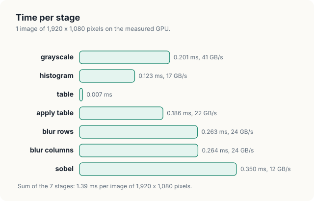
<figcaption><b>Figure 24.12</b> The time of each stage for 1 image of 1,920 × 1,080 pixels, in Rust and in C++.</figcaption>
</figure>

The table kernel, a single block of 256 threads, takes 0.007 ms, about the cost of launching any
kernel. A kernel with almost no parallelism costs nothing noticeable when it handles 256 values
between 2 kernels that handle 2 million.

### 24.9.2 Which stage dominates, and why

The blur dominates. Its 2 passes take \\(0.208 + 0.210 = 0.418\\) ms in C++, 39% of the 1.079 ms of
the 7 stages. The Sobel kernel follows with 21%, the apply-table kernel with 18% and the gray kernel
with 17%; the histogram and the table together take 6%.

The arithmetic does not explain this order. The 2 blur passes perform 10 multiply-adds per pixel,
20.7 million per image. The measured GPU has 1,024 lanes (8 SMs of 128) at up to 1.17 GHz,
about \\(1.2 \cdot 10^{12}\\) simple integer operations per second. The multiply-adds therefore account
for about 0.02 ms of the 0.418 ms. The square roots of the Sobel kernel are likewise a small part of its
time.

What the stages share is memory traffic. Together they must read and write 15 bytes per pixel,
\\(15 \cdot 2{,}073{,}600 = 31.1\\) MB per image. At the 102 GB/s of the memory that would take 0.305
ms; the stages take 1.079 ms, an effective 28.8 GB/s, 28% of the peak. The blur takes the largest
share because it moves the most bytes, 6 per pixel: the row pass reads the equalised image and writes
2-byte row sums, and the column pass reads them back and writes the blurred image. The intermediate
image of 4.1 MB is the price of the separable form. Theorem 24.1 saves 15 multiply-adds per pixel,
which cost little here, and the 2 passes add 4 bytes of traffic per pixel, which cost more. A 1-pass
blur with a tile of \\((8 + 4) \times (32 + 4)\\) inputs would move about 2 bytes per pixel and perform
25 multiply-adds; Exercise 7 at the end of the chapter asks for it.

The effective rates stay far below 102 GB/s because every access is narrow. Each thread of these
kernels reads and writes 1 or 2 bytes, so 1 load instruction of a warp moves 32 or 64 bytes. In Chapter
8 we measured the same effect with a histogram: 13.7 GB/s with 1-byte loads and 82.9 GB/s
with 16-byte loads. The Sobel kernel has the lowest rate, 18.4 GB/s, because it issues the most load
instructions per byte. For each byte it writes, its code reads 12 bytes, most of them answered by
the L1 cache, and takes a square root. The apply-table kernel, at 21.6 GB/s, adds a gather to its 2 bytes. Each
kernel also lives only a fraction of a millisecond, so its start-up and its last, partly filled wave
of blocks are a visible part of its time.

### 24.9.3 Rust and C++

The Rust kernels take 1.380 ms against 1.079 ms in C++, 28% more. The difference lies in 3 kernels:
the row pass (0.301 against 0.208 ms), the column pass (0.280 against 0.210 ms) and the Sobel kernel
(0.350 against 0.225 ms); the 2 maps and the histogram are within 10% of each other. These are the 3
kernels that index slices most. Every index into a slice, such as `src[r * W + c]`, compiles in
cuda-oxide to a comparison with the length of the slice and a branch that stops the kernel if the
index lies outside. The Sobel kernel performs 12 such reads per pixel. We ran the Rust program
with `#[kernel(unchecked_indexing)]` on every kernel, which removes the checks. It gave 0.228 ms for
each blur pass, 0.268 ms for the Sobel kernel and 1.175 ms for the 7 stages, with the same edge
image. The
checks therefore account for about 2/3 of the difference. The flag makes an index out of range
undefined behaviour, as it is in C++; the programs keep the checks.

## 24.10 A batch of images on streams

### 24.10.1 Copies and kernels

A program that processes a sequence of video frames must also copy each frame to the device and each
result back. Per image, the copy in moves 6.2 MB and the copy out 2.1 MB. On 1 stream the 2 copies
and the 7 kernels run 1 after the other, and the SMs wait during the copies. The copies, however, are
not performed by the SMs.

<div class="definition">

<span class="box-label">Definition 24.12</span> **Copy engine and pinned memory.** A **copy engine**
is a unit of the GPU that moves data between host memory and device memory while the SMs run
kernels. **Pinned memory** is host memory that the operating system keeps at a fixed physical
address, so that a copy engine can read and write it without the CPU. An asynchronous copy, one that
returns to the host before it is done, requires pinned memory.

*Example.* While the SMs blur image 0, a copy engine can copy image 1 from pinned host memory into
the buffers of a second stream.

</div>

The batch therefore gives image \\(i\\) to stream \\(i \bmod S\\), with 1 set of buffers for each of
the \\(S\\) streams (Chapter 6). The programs call such a set a lane; it has nothing to do with the
lanes of a warp.

<div class="algo">
<p class="algo-name">Batch(\(images, n, S\))</p>
<ol>
<li>for \(i \in [0, n)\) {</li>
<li style="--d:1">\(k = i \bmod S\)</li>
<li style="--d:1">on stream \(k\): copy \(images[i]\) into \(lanes[k].rgb\) <span class="c">// host to device</span></li>
<li style="--d:1">on stream \(k\): the 7 kernels on \(lanes[k]\)</li>
<li style="--d:1">on stream \(k\): copy \(lanes[k].edges\) into \(out[k]\) <span class="c">// device to host</span></li>
<li>}</li>
<li>wait for every stream</li>
</ol>
</div>

The kernels of images \\(i\\) and \\(i + S\\) use the same lane on the same stream, so they run in
order and cannot overwrite each other's buffers. The host loop issues all the work at once and then
waits in line 7.

<div class="code-tabs">
<div class="code-tab" data-lang="Rust">

```rust,ignore
{{#include ../../../../code/oxide/ch24_capstone/src/main.rs:360:387}}
```

</div>
<div class="code-tab" data-lang="C++">

```cpp
{{#include ../../../../code/cuda/ch24_capstone/capstone.cu:317:338}}
```

</div>
</div>

In Rust, the 2 asynchronous copies are `unsafe`, because the device reads and writes the host buffers
after the call has returned, and the compiler cannot see when it is done. The `// SAFETY:` comment
states the condition that makes them correct: no host buffer is read, written or dropped until every
stream has been synchronised. The C++ calls `cudaMemcpyAsync` carry the same condition without a
marker.

### 24.10.2 Measured overlap

The programs first time the 2 copies alone, then process a batch of 128 images on 1, 2 and 3
streams, after 1 batch to warm up. The C++ program printed the following.

```console
copy in   0.201 ms   30.9 GB/s
copy out  0.070 ms   29.8 GB/s
batch of 128 images: copy in, 7 stages, copy out
  1 stream(s)           695.3 images/s
  2 stream(s)           835.3 images/s
  3 stream(s)           859.5 images/s
  CPU, 8 threads         37.7 images/s
batch outputs match the CPU: yes
PASSED
```

The Rust program measured 573.4, 686.7 and 689.9 images/s on 1, 2 and 3 streams, and 51.0 images/s
for its CPU version. The CPU rates varied between runs from 37.7 to 51.0 images/s.

<figure>
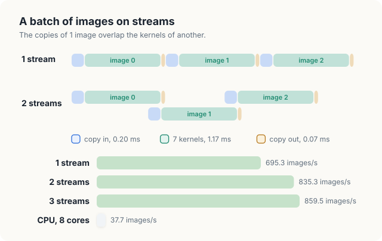
<figcaption><b>Figure 24.13</b> Copies and kernels on 1 and on 2 streams, and the measured rates of the C++ program.</figcaption>
</figure>

The rates follow from the measured times. On 1 stream an image costs its copy in, its 7
kernels and its copy out in turn: \\(0.201 + 1.165 + 0.070 = 1.436\\) ms, or 696 images/s, and the
measured 695.3 images/s agrees. The copies are 0.271 ms of the 1.436 ms, 19%. If they were hidden
completely, the kernels alone would set the rate: 1 image per 1.165 ms, 858 images/s.

2 streams reach 835.3 images/s, 1.197 ms per image. Of the 0.271 ms of copies per image, 0.239 ms,
88%, now run while kernels run. 3 streams reach 859.5 images/s, 1.163 ms per image, so the copies are hidden
completely and the kernels of consecutive images run back to back (Figure 24.13). More streams cannot
help, because the SMs are then busy all the time. On this integrated GPU the copies and the kernels
share the same memory, and they still overlap well. The copy engine moves about 31 GB/s and the
kernels about 29 GB/s, together well under the 102 GB/s of the memory.

The Rust program follows the same account. Its times, \\(0.203 + 1.489 + 0.072 = 1.764\\) ms,
predict 567 images/s on 1 stream, against 573.4 measured. On 3 streams its 689.9 images/s, 1.450 ms
per image, are again the rate of its kernels alone. On 3 streams the GPU processes images 22.8 times as
fast as the CPU version in the C++ run, 859.5 against 37.7 images/s. In the Rust run the factor is
13.5, 689.9 against 51.0 images/s. Both produce exactly the same output as the CPU.

<div class="exercises">

Exercises

24.19 Use the measured times of the copies and of the 7 kernels to predict the rate on 1 stream and
the best possible rate on many streams. Compare with the measurements.<br>
24.20 Run the batch with 4 and 6 streams. Explain why the rate stops growing.<br>
24.21 The Rust program spends more time per image in its kernels than the C++ program. Does the
benefit of a second stream, as a fraction, grow or shrink when the kernels are slower?

</div>

## 24.11 The complete programs

The whole Rust program, `src/main.rs`, and the whole C++ program, `capstone.cu`.

<div class="code-tabs">
<div class="code-tab" data-lang="Rust">

```rust,ignore
{{#include ../../../../code/oxide/ch24_capstone/src/main.rs}}
```

</div>
<div class="code-tab" data-lang="C++">

```cpp
{{#include ../../../../code/cuda/ch24_capstone/capstone.cu}}
```

</div>
</div>

## Common mistakes

- **Computing in floating point and comparing exactly.** A floating-point expression may be evaluated
  differently on the GPU, for example with a fused multiply-add. Use integer arithmetic where the
  result must match exactly, or compare with a tolerance.
- **Fixed-point weights that do not sum to the scale.** Weights of 76, 150 and 29 sum to 255, and
  white becomes 254 (Section 24.3.3).
- **Counting with a plain addition.** 2 threads that count the same level lose 1 of the 2 counts;
  count with an atomic addition (Section 24.4.5).
- **Rounding each pass of a separable filter.** Theorem 24.1 holds only if the row pass keeps its
  sums whole and the rounding happens once at the end.
- **Forgetting the halo of a tile.** A tile of \\(T\\) outputs of a filter of radius \\(r\\) needs
  \\(T + 2r\\) inputs. The missing slots hold whatever the memory held before, and the result is
  wrong in a few columns only (Section 24.5.6).
- **Leaving a global histogram uncleared.** A histogram kernel adds to its counts. Here, the table
  kernel clears each count as it reads it.
- **Reusing a pinned output buffer on 2 streams.** 2 streams that copy into the same host buffer can
  do so in either order. Give each stream its own buffer, or synchronise before reusing it.

## Summary

- The 4 stages of the pipeline are patterns of Part V: gray conversion and the table lookup are maps,
  equalisation needs a histogram and a scan of 256 counts, and the blur and the Sobel detector are
  stencils.
- The worked example of 8 × 8 pixels goes from levels 96, 112, 120 and 144 to 0, 85, 170 and 255,
  to a blurred image in which pixel (3, 3) is 170, and to an edge image in which pixel (3, 1) is 60.
- Integer arithmetic, a correctly rounded square root and 1 rounding at the end of the blur make
  the GPU's images equal to the CPU's in every pixel, and the Rust and C++ programs equal to each
  other.
- A separable filter of \\(k \times k\\) weights costs \\(2k\\) multiply-adds instead of \\(k^2\\), and
  Theorem 24.1 proves the 2 passes exact.
- A tile for \\(T\\) outputs of radius \\(r\\) holds \\(T + 2r\\) inputs; without the halo, 4 threads
  of each block read unwritten slots.
- On the measured GPU the 7 kernels take 1.079 ms per image of 1,920 × 1,080 pixels in C++ and
  1.380 ms in Rust. The blur takes the largest share, 39%, because it moves the most bytes, and every
  stage runs at 18 to 45 GB/s because its accesses are 1 or 2 bytes wide.
- On 3 streams the copies hide completely behind the kernels: 859.5 images/s in C++ and 689.9 in
  Rust, against 37.7 to 51.0 images/s for the CPU version on 8 cores.

## Exercises

1. Carry an 8 × 8 image whose top 4 rows have level 100 and bottom 4 rows level 140 through the whole
   pipeline by hand: the equalised levels, the row sums, the blurred column 0, and the edge level of
   pixel \\((0, 3)\\).
2. The grayscale and apply-table kernels cannot be fused into 1, because equalisation needs the whole
   histogram first. Which other pairs of consecutive kernels could be fused, and how many bytes per
   pixel would each fusion save?
3. Fuse the column pass of the blur and the Sobel kernel. What halo does the fused kernel need, and
   how many rows of row sums must its tile hold for a block of 8 output rows?
4. Change the gray kernel to convert 4 pixels per thread, reading its 12 colour bytes as 3 words of
   4 bytes. Measure the effective bandwidth, and compare it with the 1-byte and 16-byte loads of
   Section 8.8.
5. Replace the tiled row pass by a kernel that reads its 5 inputs directly from global memory, and
   measure the difference. Explain it with the L1 cache.
6. Add `#[kernel(unchecked_indexing)]` to 1 Rust kernel at a time and find which kernels gain most.
7. Write a 1-pass blur that copies a tile of \\((8 + 4) \times (32 + 4)\\) equalised pixels into shared
   memory and applies the 25 weights of Figure 24.7 directly. Count the bytes it moves per pixel and
   the multiply-adds it performs, measure it against the 2 passes, and explain the result with
   Section 24.9.2.
8. Make the equalisation table kernel work for images of 16-bit levels (65,536 bins). Which parts of
   Table-Kernel no longer fit in 1 block?

## Sources and further reading

- ITU-R Recommendation BT.601, *Studio encoding parameters of digital television for standard 4:3
  and wide-screen 16:9 aspect ratios*: the luma weights 0.299, 0.587 and 0.114.
- R. C. Gonzalez and R. E. Woods, *Digital Image Processing*, 4th ed., Pearson, 2018: histogram
  equalisation, smoothing filters, separable filters and the Sobel operator (chapter 3).
- I. Sobel and G. Feldman, "A 3 × 3 isotropic gradient operator for image processing", 1968,
  presented at the Stanford Artificial Intelligence Project.
- T. H. Cormen, C. E. Leiserson, R. L. Rivest and C. Stein, *Introduction to Algorithms*, 4th ed.,
  MIT Press, 2022: the style of the pseudocode, and loop-invariant proofs.
- A. Pathak, *An Introduction to Tiled Parallel Programming, Simplified*, 2026: tiles, barriers and
  their proof on a worked example.
- IEEE 754-2019, *Standard for Floating-Point Arithmetic*: the correctly rounded square root.
- NVIDIA, *CUDA C++ Programming Guide*: shared memory, atomic functions, streams and asynchronous
  copies, and `--use_fast_math`.
- cuda-oxide source, rev b7fe543: `SharedArray`, `DisjointSlice` with `Index2D`, `BlockAtomicU32`,
  `DeviceAtomicU32::swap`, `sqrt_rn_f32` and `#[kernel(unchecked_indexing)]`.
