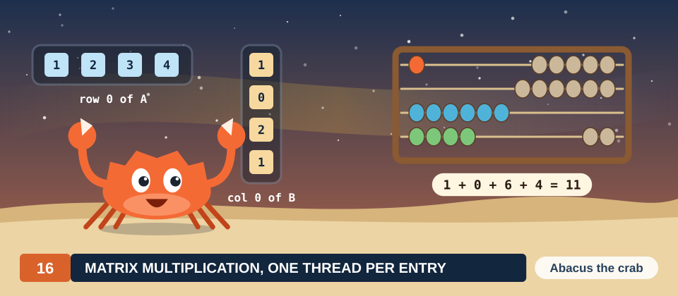

# Chapter 16: Profiling, Debugging & Performance Engineering

Every earlier chapter made claims of the form "this kernel ran 5.4 times as fast as that one". A
**kernel** is a function that the GPU runs in many threads at once, and a **launch** starts it.
Each claim rested on a measurement: a pair of CUDA **events**, timestamps that the GPU records
between 2 pieces of its work, around a launch; a count of wrong elements; a comparison with a
result computed on the CPU. Each of those measurements answers a single question. When a program is
slower than expected, or gives a wrong answer only sometimes, we need finer instruments. We need a
record of what the GPU did and when, the counts the hardware keeps for each kernel, a checker that
watches every memory access, and a clock that can be read from inside a kernel.

This chapter introduces those instruments and applies each to a program the reader already knows:
the stream pipeline of Chapter 6, the matrix product of Chapter 9, the vector addition of Chapter 3
and the block sum of Chapter 5. Along the way it measures the latencies that Chapter 1 quoted, 4
cycles for an addition and hundreds for a read from memory, from inside a running kernel. It ends
with a protocol for measurements that can be trusted, a way to choose the tolerance of a
correctness test, and the loop of measuring, changing 1 thing and measuring again that ties the
book together.

<div class="covers" markdown="1">

This chapter covers

- profilers, traces and hardware counters, and which question each tool answers
- reading a timeline from Nsight Systems, and accounting for every millisecond of it
- what Nsight Compute reports, and the same report worked by hand
- Compute Sanitizer finding 4 bugs that produce no error message
- `cuda-gdb` stopping a single thread inside a kernel
- `clock64()`: latencies in cycles, measured from inside a kernel, in C++ and in Rust
- warm-up, medians, events and idle machines: a protocol for timing
- units in the last place, tolerances, and inputs whose answer is known exactly
- the engineering loop, once round, on a real case

</div>

The code of the chapter is in
[`code/ch16_profiling/`](https://github.com/arpanpathak/gpu-parallel-book/tree/main/code/ch16_profiling)
for C++ and in
[`code/oxide/ch16_latency/`](https://github.com/arpanpathak/gpu-parallel-book/tree/main/code/oxide/ch16_latency)
for Rust. The measurements in this chapter come from 2 integrated GPUs: a Jetson Orin NX (8 SMs,
102 GB/s), the first GPU below, and a Jetson AGX Thor (20 SMs, 273 GB/s), the second.

## 16.1 Instruments and the questions they answer

### 16.1.1 Profilers, traces and counters

A **profiler** is a program that records what another program does while it runs, and when. 2
kinds of record matter on a GPU. A **trace** is a list of timestamped events: this copy started at
0.665 ms and ended at 1.470 ms, that kernel ran from 1.978 ms to 3.311 ms. A **hardware performance
counter** is a register inside the GPU that counts events of 1 kind while a kernel runs: bytes read
from **DRAM**, the GPU's main memory; instructions issued; cycles in which a **warp**, a group of 32
threads that execute each instruction together, waited. A trace tells us where the time of a
whole program went; counters tell us why 1 kernel took the time it did.

NVIDIA ships 1 profiler for each kind of record. **Nsight Systems**, run as `nsys`, traces the whole
program: CUDA calls on the CPU, copies and kernels on the GPU, on a common time axis. **Nsight
Compute**, run as `ncu`, reads the counters of 1 kernel at a time. A GPU has fewer counter
registers than there are kinds of event to count. `ncu` therefore runs the same kernel several
times, counts a different set of events each time, and restores the kernel's memory before each
run. That
repetition is called **replay**. It makes `ncu` slow, and it makes the times `ncu` reports
different from the times of an ordinary run.

Profilers do not check correctness. For that, the CUDA toolkit has 2 other tools. **Compute
Sanitizer** adds checks to every memory access of a kernel while it runs, and to every
**barrier**, a point in a kernel at which the threads of a block wait for each other.
**cuda-gdb** is a debugger that can stop a kernel at a line and show the variables of 1 thread. A
debugger is a program that controls another program: it stops it at chosen points, called
**breakpoints**, and shows its state.

Figure 16.1 pairs each question of this chapter with the instrument that answers it.

<figure>
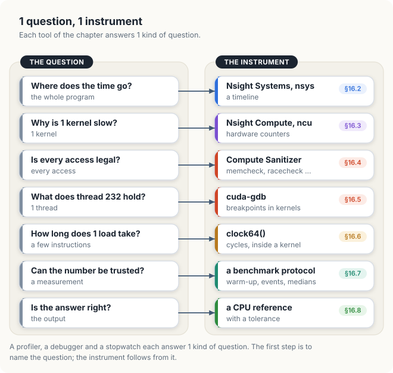
<figcaption><b>Figure 16.1</b> Each question of the chapter, and the instrument that answers it.</figcaption>
</figure>

### 16.1.2 The timeline first

The order in which we use the instruments follows from Amdahl's law (Chapter 1, section 1.3). A
kernel can only shorten the part of the run during which it executes. When the GPU spends half the
run waiting for copies, even a kernel made infinitely fast leaves the other half.

<div class="example" markdown="1">

Worked example: making the kernel of Chapter 6 twice as fast

1. The 1-stream pipeline of Chapter 6, traced in section 16.2, takes 20.95 ms: 6.18 ms of copy in,
   10.40 ms of kernel and 4.19 ms of copy out, one after another.
2. A kernel twice as fast takes 10.40 / 2 = 5.20 ms, and the run takes 20.95 − 5.20 = 15.75 ms.
3. Overlapping the copies with the kernel instead, with 2 streams and 8 chunks, gave 13.59 ms with
   the kernel unchanged.

</div>

The timeline showed where the time went before any kernel was tuned, and it pointed at the larger
gain. Nsight Systems therefore comes first; Nsight Compute comes second, once the timeline shows a
kernel that dominates the run.

### 16.1.3 Permissions

Hardware counters and debugger control are restricted on most systems. In 2018 researchers showed
that 1 program could learn about another program's work from the GPU's performance counters, a
vulnerability registered as CVE-2018-6260. NVIDIA's drivers have since allowed only administrators
to read the counters, unless the machine's owner changes a driver option. Debugging is restricted for a similar
reason: a debugger can read any memory of the program it controls.

| Tool | Needs |
|---|---|
| `nsys` (trace) | no special rights |
| `ncu` (counters) | counter access: an administrator, or the driver option below |
| `compute-sanitizer` | debugger access |
| `cuda-gdb` | debugger access |

On Jetson modules, counter and debugger access go through the device files
`/dev/nvhost-prof-gpu` and `/dev/nvhost-dbg-gpu`, which belong to the group `debug`.

<div class="callout note" markdown="1">

**NOTE:** On a machine you administer, `sudo ncu ...` reads the counters. A desktop Linux system can
allow every user to read them with the driver option `NVreg_RestrictProfilingToAdminUsers=0`, set in
a file under `/etc/modprobe.d/`; NVIDIA's page for `ERR_NVGPUCTRPERM` gives the steps for each
operating system. On Jetson modules, run the tool with `sudo` or add the user to the `debug` group.

</div>

## 16.2 Reading the timeline (nsys)

### 16.2.1 Recording a trace

A **stream** is a queue of GPU work whose operations run in the order they were issued; work in 2
different streams may overlap. Chapter 6's program `streams` runs the same work 3 ways: copy in,
kernel and copy out on 1 stream; the same in 8 chunks on 2 streams; and in 32 chunks. We trace it without changing a line:

```console
$ nsys profile -t cuda -o streams ./streams
$ nsys stats --report cuda_gpu_kern_sum,cuda_gpu_mem_time_sum streams.nsys-rep
```

`-t cuda` records CUDA calls, copies and kernels; `-o` names the report file. `nsys stats` prints
summaries of the report as tables. The first summary lists every kernel (the columns Min, Max and
StdDev are left out here):

```console
 Time (%)  Total Time (ns)  Instances   Avg (ns)    Med (ns)   Name
     99.5      297,936,832        248  1,201,358.2  336,896.0  work(float *, int, int)
      0.5        1,368,576      1,001      1,367.2    1,376.0  empty()
```

A summary is useful only if we can account for it. The program launches `work` 40 times while it
warms up, in 5 runs of 8 chunks. It launches it twice to time 1 launch and once to time the 3
stages separately. Then come 5 runs of 1 chunk, 5 of 8 chunks and 5 of 32 chunks. In all, 40 + 2 +
1 + 5 + 40 + 160 = 248 launches, the number in the table. Its median, 0.34 ms, is the kernel on 1 chunk of 32 when the pipeline is cut
into 32 pieces, because 160 of the 248 launches are of that size.

### 16.2.2 The timeline

The report also holds the start and end of every copy and kernel. Figure 16.2 draws 2 repetitions
from it on a common scale: the last run of the 1-stream pipeline and the first run of the 2-stream
pipeline with 8 chunks.

<figure>
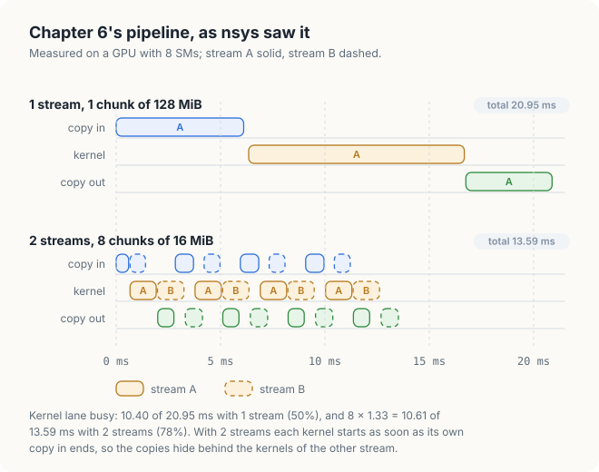
<figcaption><b>Figure 16.2</b> The pipeline of Chapter 6 as Nsight Systems recorded it on the first GPU.</figcaption>
</figure>

A lane of the timeline is **busy** while it executes something. The fraction of the run during
which the kernel lane is busy measures how well the pipeline feeds the arithmetic units.

<div class="example" markdown="1">

Worked example: accounting for the 2-stream run

1. Kernel lane, 1 stream: busy 10.40 ms of 20.95 ms, 50%.
2. Kernel lane, 2 streams: 8 kernels of 1.32 to 1.33 ms, 10.61 ms in all, of 13.59 ms: 78%.
3. A lower bound for the 2-stream run: the first copy in, 0.66 ms, then 8 kernels back to back,
   10.61 ms, then the last copy out, 0.90 ms: 12.17 ms.
4. The trace shows 3 gaps in the kernel lane, before kernels 3, 5 and 7, of 0.47, 0.48 and 0.48
   ms: 1.42 ms. 12.17 + 1.42 = 13.59 ms, the measured run.

</div>

The 3 gaps have 1 cause, which the trace makes visible. A stream executes its operations in the
order they were issued. Stream A holds chunk 0's copy out before chunk 2's copy in, so chunk 2
cannot start copying until chunk 0's result has left the GPU, at 2.83 ms. Its copy then takes 0.94
ms, and kernel 3 starts at 3.78 ms, while the kernel lane has been idle since 3.31 ms. Exercise 2
removes the gaps.

The program times the same pipeline itself, without the profiler, and printed 13.08, 13.31 and
13.34 ms in 3 runs. The traced run, 13.59 ms, is within 4% of those, so the trace describes the
program as it normally runs.

### 16.2.3 Symptoms and their causes

The same timeline reveals the usual problems of a GPU program at a glance. Each symptom points to
a chapter that treats it.

| What the timeline shows | Likely cause | Remedy |
|---|---|---|
| kernel lane idle while a copy runs, and the reverse | 1 stream, or copies from pageable memory | streams and pinned memory (Chapters 4 and 6) |
| short gaps between many tiny kernels | the CPU's launch cost, a few µs per launch | CUDA graphs (section 6.7) |
| long CPU calls such as `cudaMalloc` between kernels | allocation inside the loop | allocate once, before the loop |
| kernel lane busy nearly all the time | the kernels themselves | Nsight Compute (section 16.3) |

### 16.2.4 Tracing a Rust program

`nsys` traces any program that uses the CUDA driver, whatever language it was written in. On the
Rust program of section 16.6 it prints the Rust names of the kernels:

```console
$ nsys profile -t cuda -o rust ./target/release/ch16_latency
$ nsys stats --report cuda_gpu_kern_sum rust.nsys-rep
 Time (%)  Total Time (ns)  Instances   Avg (ns)     Med (ns)     Name
     99.5       19,164,896          3  6,388,298.7  8,258,176.0  chase
      0.3           63,680          1     63,680.0     63,680.0  dependent_fma
      0.1           23,680          1     23,680.0     23,680.0  independent_fma
```

Its summary of CPU calls shows `cuLaunchKernel` and `cuModuleLoadData` where the C++ program shows
`cudaLaunchKernel`: cuda-oxide calls the CUDA driver API directly, while the C++ programs call the
runtime API that Chapter 12 describes, which itself calls the driver.

<div class="bee bee-happy" markdown="1">

Read the timeline before tuning any kernel, and account for its milliseconds by hand. Any time
that the sum does not explain is idle time, and idle time is the next gain.

</div>

## 16.3 The kernel report (ncu)

### 16.3.1 What Nsight Compute measures

`ncu` organises its counters into **sections**. 3 of them answer most questions.

- **Speed of light** (`SpeedOfLight`). The **speed of light** of a unit is its peak rate. The
  section reports how close the kernel came to the peak of the arithmetic units and of the memory
  system, as percentages. A kernel near 100% on 1 of them is bounded by that unit, as the roofline
  of Chapter 1 predicts.
- **Occupancy** (`Occupancy`). An **SM**, streaming multiprocessor, is 1 of the GPU's processors;
  it runs **blocks**, groups of up to 1,024 threads that share its fast **shared memory**.
  **Occupancy** is the number of warps resident on an SM divided by the most the SM can hold
  (Chapter 2, section 2.9). The **theoretical occupancy** follows from the kernel's registers,
  shared memory and block size; the **achieved occupancy** is the average
  actually measured while the kernel ran, which is lower when blocks finish unevenly.
- **Warp state statistics** (`WarpStateStats`). A **stall** is a cycle in which a warp could not
  issue its next instruction. The section counts stalls by reason: waiting for a global load
  (`long_scoreboard`), for shared memory (`short_scoreboard`), at a barrier (`barrier`).

The command for Chapter 9's patch kernel, on a machine where counters are allowed, is

```console
$ sudo ncu --section SpeedOfLight --section Occupancy -k regex:patches -c 1 ./sgemm
```

`--section` chooses the sections to collect; adding `--section WarpStateStats` adds the stall
reasons. `-k` selects kernels by name, and `-c 1` profiles only the first launch that matches.
Without counter access, `ncu` stops before the kernel runs and names the setting of section 16.1.3:

```console
==ERROR== ERR_NVGPUCTRPERM - The user does not have permission to access NVIDIA GPU
Performance Counters on the target device 0.
```

### 16.3.2 The limits of the GPU

Several of the report's numbers can be computed without counters, from the limits the GPU reports
and a time measured with events. The CUDA runtime describes the GPU in a `cudaDeviceProp` structure
and answers `cudaDeviceGetAttribute` for single values. Listing 16.1 prints the limits that the
rest of the chapter uses, and the 2 peaks they imply.

<p class="listing"><b>Listing 16.1</b> The limits of the GPU, and the peaks they imply. <a href="https://github.com/arpanpathak/gpu-parallel-book/blob/main/code/ch16_profiling/measure.cu">code/ch16_profiling/measure.cu</a></p>

```cpp
{{#include ../../../../code/ch16_profiling/measure.cu:61:90}}
```

```console
Orin, compute capability 8.7                   NVIDIA Thor, compute capability 11.0
  SMs                              8             SMs                             20
  threads per SM, at most       1536             threads per SM, at most       1536
  registers per SM             65536             registers per SM             65536
  shared memory per SM           164 KiB         shared memory per SM           228 KiB
  L2 cache                      2048 KiB         L2 cache                     32768 KiB
  SM clock                      1173 MHz         SM clock                      1048 MHz
  memory clock                  1173 MHz         memory clock                  4266 MHz
  memory bus                     256 bits        memory bus                     256 bits
  FP32 peak from the clock      2402 GFLOP/s     FP32 peak from the clock      5369 GFLOP/s
  bandwidth from the clock      75.1 GB/s        bandwidth from the clock     273.0 GB/s
```

The 2 runs are printed side by side. Each line is a limit that an earlier chapter used. The SMs
and the threads per SM set how many warps can be resident (Chapter 2). The registers per SM decided
the occupancy of Chapter 9's kernels. The **L2 cache** is a memory on the GPU chip, shared by all
SMs, that keeps recently used data; each SM also has a smaller **L1 cache** of its own. The L2
size decides how large a test must be to measure
memory rather than the cache (section 16.7).

The peaks need care. The FP32 peak is SMs × 128 FP32 units × 2 FLOP per multiply-add × clock: on
the first GPU, 8 × 128 × 2 × 1.173 GHz = 2,402 GFLOP/s, NVIDIA's figure of 2.4 TFLOP/s. The memory
peak is 2 transfers per memory clock × the bus width in bytes: on the second GPU, 2 × 4.266 GHz × 32
bytes = 273.0 GB/s, NVIDIA's figure. The other 2 results are wrong. The first GPU reports its own
clock as the memory clock, and a 256-bit bus where its data sheet gives 128 bits; the product, 75.1
GB/s, is below the 102 GB/s of the data sheet. The second GPU reports 1,048 MHz as the SM clock, while
its data-sheet peak of 8.1 TFLOP/s implies 8,100 / (20 × 128 × 2) = 1.58 GHz. A peak computed from
reported attributes is a starting point; the data sheet is the reference. This chapter uses the
data-sheet peaks of Chapter 2: 2.4 TFLOP/s and 102 GB/s for the first GPU, 8.1 TFLOP/s and
273 GB/s for the second.

### 16.3.3 A speed-of-light report by hand

The speed of light of a kernel is its achieved rate divided by the peak. For memory, the achieved
rate is the bytes the kernel moves divided by its time; for arithmetic, its operations divided by
its time. `measure.cu` times the kernel `y = 2 x` over 2 arrays of 256 MiB, larger than the L2 of
either GPU, and section 16.7 explains how its time was taken.

<div class="example" markdown="1">

Worked example: `y = 2 x` on the first GPU, median time 8.35 ms

1. Bytes moved: each of 67,108,864 elements is read once and written once, 2 × 4 bytes:
   536,870,912 bytes, 512 MiB.
2. Memory rate: 536,870,912 bytes / 8.35 ms = 64.3 GB/s; 64.3 / 102 = 63% of the peak.
3. Operations: 1 multiplication per element, 67,108,864 FLOP; 67,108,864 / 8.35 ms = 8.0 GFLOP/s;
   8.0 / 2,400 = 0.33% of the peak.
4. The kernel is memory-bound: its intensity, 1 FLOP per 8 bytes = 0.125 FLOP per byte, lies far
   below the GPU's ridge point of 24 FLOP per byte (Chapter 2, section 2.1.5).

</div>

Chapter 9's best kernel gives each thread a 4 × 4 patch of \\(C\\) and ran at 901.4 GFLOP/s on the
first GPU: 901.4 / 2,400 = 38% of the arithmetic peak. Its memory side needs a count of the loads.
Each block of 256 threads computes a 64 × 64 tile of \\(C\\); at each of its 4,096 / 16 = 256 steps
it loads a 64 × 16 tile of \\(A\\) and a 16 × 64 tile of \\(B\\), 2,048 floats. Over the run a block
loads 256 × 2,048 × 4 bytes = 2 MiB, and 4,096 blocks load 8 GiB, 8,589,934,592 bytes, in 152.47
ms: 56.3 GB/s.

<figure>
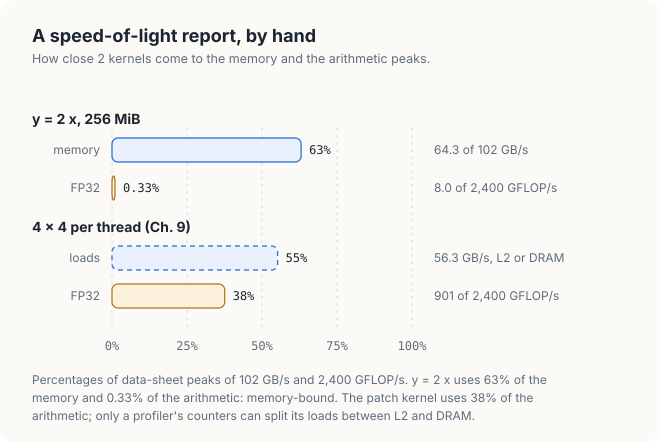
<figcaption><b>Figure 16.3</b> A speed-of-light report for 2 kernels, worked by hand.</figcaption>
</figure>

Figure 16.3 draws both reports. The second shows the limit of working by hand. The 56.3 GB/s of
loads are served by the L2 cache or by DRAM, and the program cannot tell which: tiles that several
blocks need may stay in the 2 MiB L2 between them. If all came from DRAM, the kernel would use 55%
of the memory peak; if most came from L2, much less. `ncu` reads the split from counters
(`dram__bytes` and the L2 hit rate) and reports it directly. Achieved occupancy and stall reasons
likewise exist only as counters.

The theoretical occupancy, on the other hand, needs no counter. Chapter 2 promised the CUDA function
that computes it: `cudaOccupancyMaxActiveBlocksPerMultiprocessor` returns how many blocks of a given
size fit on 1 SM, given the kernel's registers and shared memory.

<p class="listing"><b>Listing 16.2</b> The theoretical occupancy of <code>scale</code>.</p>

```cpp
int main()
{
    // ...
{{#include ../../../../code/ch16_profiling/measure.cu:133:135}}
    // ...
}
```

```console
blocks of 256 per SM          6 = 1536 threads
```

6 blocks of 256 threads are 1,536 threads, the limit of an SM on both boards: a theoretical
occupancy of 100%.

<div class="bee bee-shocked" markdown="1">

A peak computed from the attributes a GPU reports can be wrong; check it against the data sheet
before dividing by it.

</div>

## 16.4 Compute Sanitizer

### 16.4.1 4 bugs that say nothing

The most dangerous bugs of a GPU program produce no error message. A kernel that writes past the
end of an array usually lands in memory that belongs to nobody or to another array of the same
program; the hardware raises no fault, and the launch reports success. Compute Sanitizer finds such
bugs by **instrumentation**: it rewrites the kernel so that every load, store and barrier first
calls a check, then runs the rewritten kernel.

The tool has 4 checkers, chosen with `--tool`:

| Checker | Finds |
|---|---|
| `memcheck` (the default) | loads and stores outside any allocation, misaligned accesses, errors from CUDA calls |
| `racecheck` | 2 accesses to the same shared-memory location, at least 1 a write, with no barrier between them |
| `synccheck` | barriers used in ways the hardware does not define |
| `initcheck` | loads of global memory that nothing has written |

`bugs.cu` holds 1 bug for each checker, all taken from earlier chapters. It is built with
`-lineinfo`, which records for each instruction the source line it came from, so that the checkers
can name lines:

```console
$ nvcc -arch=native -lineinfo bugs.cu -o bugs
$ ./bugs bounds; ./bugs race; ./bugs barrier; ./bugs uninit      # second GPU
1,024 threads for 1,000 elements: 0 wrong elements
64 blocks of 256 ones: 64 wrong block sums
2 barriers, 1 per branch: 0 wrong elements of 256
sum of 1,024 floats nobody wrote: 0
```

On the second GPU all 4 runs exit with status 0, and 3 of the 4 print a correct-looking result.
The first GPU printed the same lines for 3 of the bugs; section 16.4.4 tells what it did with the
fourth.

### 16.4.2 memcheck: the missing guard

Chapter 3 rounded the number of threads up to whole blocks and gave the kernel a guard, `if (i <
n)`, so that the extra threads do nothing. Listing 16.3 leaves the guard out.

<p class="listing"><b>Listing 16.3</b> Vector addition without its guard. <a href="https://github.com/arpanpathak/gpu-parallel-book/blob/main/code/ch16_profiling/bugs.cu">code/ch16_profiling/bugs.cu</a></p>

```cpp
{{#include ../../../../code/ch16_profiling/bugs.cu:19:24}}
```

The program launches 4 blocks of 256 threads, 1,024 threads, for 1,000 elements, so threads 1,000
to 1,023 read `a[i]` and `b[i]` and write `c[i]` past the end of each array. Yet all 1,000
elements of `c` came out right. memcheck explains why:

```console
$ compute-sanitizer --tool memcheck ./bugs bounds
========= Invalid __global__ read of size 4 bytes
=========     at addNoGuard(const float *, const float *, float *, int)+0xa0 in bugs.cu:23
=========     by thread (232,0,0) in block (3,0,0)
=========     Access to 0xfffd63800fa0 is out of bounds
=========     and is 1 bytes after the nearest allocation at 0xfffd63800000 of size
=========     4,000 bytes
...
=========     Access to 0xfffd63800fd0 is out of bounds
=========     and is 48 bytes before the nearest allocation at 0xfffd63801000 of size
=========     4,000 bytes
...
CUDA error: unspecified launch failure
========= ERROR SUMMARY: 25 errors
```

Thread 232 of block 3 has index 3 × 256 + 232 = 1,000, the first element past the end. The array
`a` starts at `...800000` and the next allocation at `...801000`, 0x1000 = 4,096 bytes later:
`cudaMalloc` placed each array of 4,000 bytes at the start of a 4,096-byte slot. The 24 extra
threads touch 24 × 4 = 96 bytes past the end of each array, exactly the 4,096 − 4,000 = 96 bytes
of padding, as figure 16.4 shows. No other array was harmed, so the bug was invisible. With
1,010 elements the slots would hold only 4,096 − 4,040 = 56 bytes of padding, and the last 10
threads would write into the next array.

<figure>
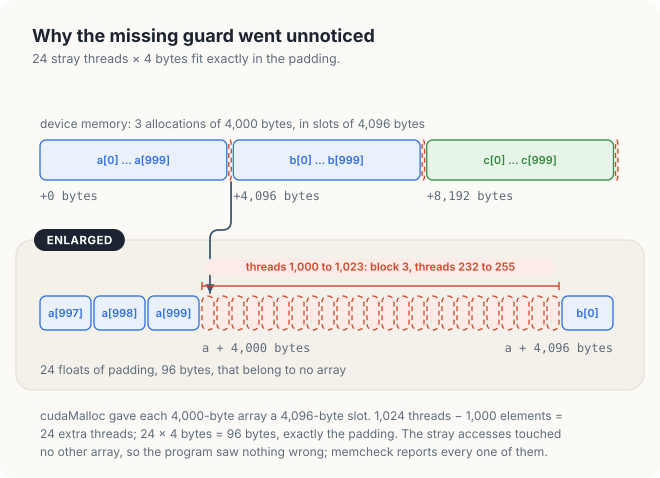
<figcaption><b>Figure 16.4</b> The 24 stray threads read and write only the padding after each array.</figcaption>
</figure>

memcheck reports 24 invalid reads, 1 per stray thread, and stops the kernel; the program's next
CUDA call then fails, which is the 25th error. The same check on Chapter 3's program, guard
included, ends with `ERROR SUMMARY: 0 errors`.

### 16.4.3 racecheck: the block sum without barriers

Chapter 5 summed 256 values per block as a tree in shared memory, with a barrier after each level.
Listing 16.4 leaves the barriers out.

<p class="listing"><b>Listing 16.4</b> A block sum without barriers.</p>

```cpp
{{#include ../../../../code/ch16_profiling/bugs.cu:26:42}}
```

All 64 block sums came out wrong, and racecheck names the conflicting lines:

```console
$ compute-sanitizer --tool racecheck ./bugs race
========= Error: Race reported between Write access at sumNoBarrier(...)+0x1a0 in bugs.cu:31
=========     and Read access at sumNoBarrier(...)+0x130 in bugs.cu:35 [32768 hazards]
...
========= RACECHECK SUMMARY: 4 hazards displayed (3 errors, 1 warning)
```

A **race** is a pair of accesses to the same location by different threads, at least 1 of them a
write, with nothing that orders them. Line 31 stores each thread's value into `s[t]`; line 35 reads
`s[t + stride]`. Thread 0 of warp 0
reads `s[128]` in the first step, but `s[128]` is written by thread 128, which belongs to warp 4.
Nothing orders the 2 warps, and figure 16.5 draws the case in which warp 0 reads first.

<figure>
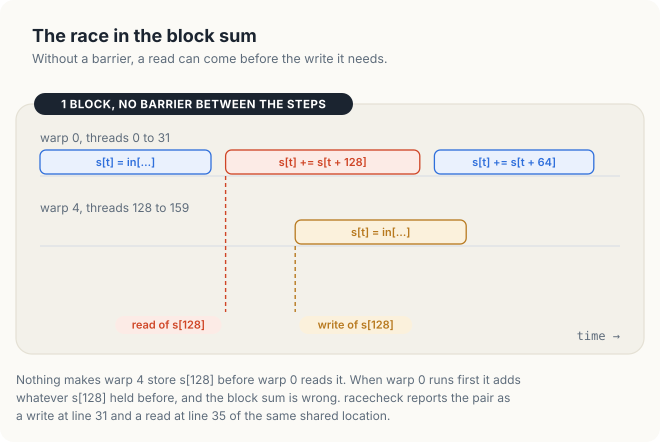
<figcaption><b>Figure 16.5</b> Without a barrier, warp 0 can read s[128] before warp 4 has written it.</figcaption>
</figure>

### 16.4.4 synccheck: a barrier in each branch

`__syncthreads()` is defined only when every thread of the block reaches the same barrier
instruction. Listing 16.5 puts 1 barrier in each branch of an `if`, so even and odd threads of every
warp wait at 2 different instructions.

<p class="listing"><b>Listing 16.5</b> 2 barriers, 1 per branch.</p>

```cpp
{{#include ../../../../code/ch16_profiling/bugs.cu:44:58}}
```

On the second GPU the kernel produced the right 256 elements: the hardware happened to release
both groups together. On the first GPU the same program never finished; it hung. The same source
file gave 2 outcomes on 2 GPUs. Such a program has **undefined behaviour**: the language does not
specify its result, so each machine may do something different. synccheck reports the cause:

```console
$ compute-sanitizer --tool synccheck ./bugs barrier
========= Barrier error detected. Divergent thread(s) in warp.
=========     at barrierInBranch(float *)+0xd0 in bugs.cu:52
=========     by thread (64,0,0) in block (0,0,0)
...
========= ERROR SUMMARY: 128 errors
```

128 errors are 1 for each of the 128 even threads that waited at line 52 while the odd threads of
their warps waited at line 55. A correct kernel moves the barrier out of the `if`, where all 256
threads reach it.

### 16.4.5 initcheck: memory nobody wrote

`cudaMalloc` returns memory with whatever it last held. Listing 16.6 sums 1,024 floats that nothing
has written.

<p class="listing"><b>Listing 16.6</b> A sum of unwritten memory.</p>

```cpp
{{#include ../../../../code/ch16_profiling/bugs.cu:60:68}}
```

The result was 0, because the memory happened to hold zeros. initcheck reports all 1,024 reads,
each with its thread:

```console
$ compute-sanitizer --tool initcheck ./bugs uninit
========= Uninitialized __global__ memory read of size 4 bytes
=========     at sumUnwritten(const float *, float *, int)+0x180 in bugs.cu:65
=========     by thread (0,0,0) in block (0,0,0)
...
========= ERROR SUMMARY: 1024 errors
```

### 16.4.6 The cost of instrumentation

Every check is extra work. The Rust program of section 16.6 measures a load from L1 in 39 cycles; run
under memcheck, the same loop took 8,463 cycles per load, 217 times as long. A sanitizer
run tells us whether a program is correct, never how fast it is. The same run ended with `ERROR
SUMMARY: 0 errors`: cuda-oxide programs can be checked like any other.

A clean run is evidence about the inputs and the timing of that run only. A race that did not occur
in 1 run may occur in the next, and an out-of-bounds index that depends on the input may not be
reached by the test input. Section 16.8 adds tests that check the result itself.

<div class="bee bee-shocked" markdown="1">

The out-of-bounds kernel produced every element correctly and exited with status 0. A program that
passes its tests can still access memory it does not own; run Compute Sanitizer on every kernel
before trusting it.

</div>

## 16.5 cuda-gdb

`cuda-gdb` extends the GNU debugger with GPU threads. A breakpoint on a line of a kernel stops the
whole grid when any thread reaches it, and **focus** selects which thread's variables the debugger
shows. The program is built with `-G`, which keeps device variables in a form the debugger can read
and turns off most optimisation, and `-g` for the host code. A run can be scripted with `-batch`
and 1 `-ex` per command; here the breakpoint has a condition, so that it stops only thread 232 of
block 3, the first stray thread of section 16.4.2:

```console
$ nvcc -arch=native -G -g bugs.cu -o bugs_debug
$ cuda-gdb -q -batch \
    -ex 'break bugs.cu:23 if blockIdx.x == 3 && threadIdx.x == 232' \
    -ex 'run bounds' -ex 'print i' -ex 'print n' -ex 'continue' ./bugs_debug
[Switching focus to CUDA kernel 0, grid 1, block (3,0,0), thread (232,0,0), device 0, sm 3,
warp 7, lane 8]

CUDA thread hit Breakpoint 1, addNoGuard<<<(4,1,1),(256,1,1)>>> (a=0x32b200000,
b=0x32b201000, c=0x32b202000, n=1000) at bugs.cu:23
23          c[i] = a[i] + b[i];
$1 = 1000
$2 = 1000
1,024 threads for 1,000 elements: 0 wrong elements
[Inferior 1 (process 3104365) exited normally]
```

The debugger confirms the reasoning of section 16.4.2 from inside the kernel: thread 232 of block 3
has `i = 1000`, equal to `n`, and is about to access `a[1000]`. The focus line also places the
thread on the hardware: thread 232 is in warp 232 / 32 = 7, rounded down, at lane 232 − 7 × 32 = 8,
and it ran on SM 3. The 3 pointers lie 0x1000 = 4,096 bytes apart, the slots of figure 16.4.

`cuda-gdb` is the tool for the last kind of bug, the one that Compute Sanitizer does not flag:
wrong arithmetic on indices, a wrong weight in a stencil, a branch taken by the wrong threads.

## 16.6 clock64(): timing inside a kernel

### 16.6.1 A clock that a thread can read

Events time a whole kernel. To time a few instructions we need a clock that a thread can read.
`clock64()` returns the value of a 64-bit counter that each SM increments once per cycle of its own
clock. The difference between 2 readings by the same thread is the number of cycles between them.
Counters of different SMs are not synchronised, so 2 readings are compared only when the same
thread took both.

Chapter 1 quoted 2 latencies, about 4 cycles for an addition and about 500 cycles for a read from
main memory, and built the case for many threads on them. `latency.cu` measures them. The
**latency** of an operation is the time from its start to the moment its result can be used; to see
it, each operation must need the result of the one before, so that no 2 overlap. A sequence of
operations with that property is a **dependent chain**.

```text
KERNEL dependentFma, 1 thread:
    v ← x[0]
    t0 ← clock64()
    repeat 4,096 times:
        v ← v × 0.999 + 1              # needs the v of the line before
    t1 ← clock64()
    x[0] ← v                            # keeps the compiler from deleting the loop
    cycles ← t1 − t0

KERNEL chase(next, warm, hops), 1 thread:
    j ← 0
    repeat warm times: j ← next[j]     # brings the chain into the caches
    t0 ← clock64()
    repeat hops times: j ← next[j]     # each load needs the index the last one returned
    t1 ← clock64()
    out ← j
    cycles ← t1 − t0
```

### 16.6.2 Arithmetic

<p class="listing"><b>Listing 16.7</b> 1 dependent chain, and 4 independent chains, timed with <code>clock64()</code>. <a href="https://github.com/arpanpathak/gpu-parallel-book/blob/main/code/ch16_profiling/latency.cu">code/ch16_profiling/latency.cu</a></p>

```cpp
{{#include ../../../../code/ch16_profiling/latency.cu:19:50}}
```

The second kernel performs the same 4,096 multiply-adds as 4 chains of 1,024. The 4 operations of
1 step do not depend on each other, so the SM can start each one before the previous one has
finished.

### 16.6.3 Loads

A **pointer chase** measures the latency of a load. An array `next` holds, at each position, the
position of the next load, so each load must wait for the one before. The host builds the array
with a fixed step of 32 ints, 128 bytes, so that every load touches a new **cache line**, the 128-byte unit in which the caches hold
data (Chapter 7,
section 7.2). 3 chains of different sizes are served from different places. A chain of 4 KiB fits
in the L1 cache. A chain of 1 MiB fits in L2 but not in L1. The third chain spans 256 MiB with a
step of 1 MiB + 128 bytes and no warm-up, so every load goes to DRAM.

<p class="listing"><b>Listing 16.8</b> The pointer chase.</p>

```cpp
{{#include ../../../../code/ch16_profiling/latency.cu:52:69}}
```

The host checks that each chain ended where it should: after \\(w + h\\) hops of step \\(s\\) through
\\(c\\) positions, the index is \\((w + h)\,s \bmod c\\).

```console
$ ./latency                                    # first GPU
4096 multiply-adds in 1 thread, cycles per multiply-add
  1 dependent chain        4.24
  4 independent chains     1.31
1 thread follows a chain of loads, cycles per load
  4 KiB chain, from L1          39
  1 MiB chain, from L2         191
  256 MiB chain, from DRAM     607
PASSED: 0 of 3 chains end in the wrong place
```

<div class="example" markdown="1">

Worked example: reading the latency output

1. The program divides the cycles of the dependent chain by its 4,096 multiply-adds: 4.24 cycles
   each, about 17,400 cycles in all. The latency of a multiply-add is about 4 cycles, Chapter 1's
   figure; the extra 0.24 is the loop's own counting and branching.
2. With 4 chains, 1.31 cycles per multiply-add: about 4 times as many operations per cycle. By
   Little's law (Chapter 1, section 1.1.4), 4 operations in flight with a latency of 4 cycles
   complete 4 / 4 = 1 per cycle.
3. At 1,173 MHz a cycle lasts 1 / 1.173 GHz = 0.85 ns. A load from L1 takes 39 × 0.85 = 33 ns, from
   L2 191 × 0.85 = 163 ns, from DRAM 607 × 0.85 = 517 ns.
4. 1 load from DRAM costs as long as 607 / 4.24 = 143 dependent multiply-adds.

</div>

Figure 16.6 places the 5 numbers on 1 logarithmic scale. The DRAM figure varied more than the
others. Over 14 runs of the C++ and Rust programs it ranged from 598 to 1,137 cycles. L1 stayed at
39 cycles, and L2 at 190 to 191 cycles in all runs but 2, which gave 431 and 689 cycles. The board's memory is shared with
its CPU cores, its display and every other program, and a single thread's loads wait behind theirs;
DRAM latency is therefore reported as a range.

<figure>
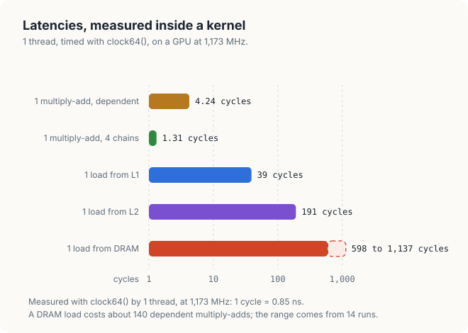
<figcaption><b>Figure 16.6</b> Latencies measured with clock64() on the first GPU.</figcaption>
</figure>

### 16.6.4 The same measurement in Rust

cuda-oxide exposes the same counter as `cuda_device::debug::clock64()`, and the multiply-add as
`cuda_device::float::fma_rn_f32`, which rounds to nearest like `fmaf`. The kernels launch 1 thread
with the contract `block = (1, 1, 1)` and write their results through `DisjointSlice`, as in Chapter
13. The chase reads `next` with `get_unchecked`; section 16.9 measures why.

<p class="listing"><b>Listing 16.9</b> The pointer chase in Rust. <a href="https://github.com/arpanpathak/gpu-parallel-book/blob/main/code/oxide/ch16_latency/src/main.rs">code/oxide/ch16_latency/src/main.rs</a></p>

```rust,ignore
mod kernels {
    // ...
{{#include ../../../../code/oxide/ch16_latency/src/main.rs:74:107}}
}
```

```console
$ cargo oxide run                              # first GPU
4096 multiply-adds in 1 thread, cycles per multiply-add
  1 dependent chain        4.07
  4 independent chains     1.12
1 thread follows a chain of loads, cycles per load
  4 KiB chain, from L1          39
  1 MiB chain, from L2         191
  256 MiB chain, from DRAM     599
PASSED: every chain ends where the host expects
```

The loads match the C++ program cycle for cycle. The Rust loops of multiply-adds are unrolled 16
and 4 times by `#[unroll]` (Chapter 9, section 9.7), so less of each step goes to counting, and they
come out 0.17 to 0.19 cycles faster per operation.

<div class="bee bee-happy" markdown="1">

A load from DRAM costs about 140 dependent multiply-adds. The GPU hides that cost only when many
independent loads are in flight at once, which is why it needs so many threads.

</div>

## 16.7 The benchmarking discipline

### 16.7.1 Warm-up

A **benchmark** is a measurement of a program's speed made so that it can be repeated and compared.
The first rule is to measure the program in the state in which it will run. `measure.cu` times the
kernel `y = 2 x` 40 times in a row with events, starting after the GPU had been idle.

<p class="listing"><b>Listing 16.10</b> 1 launch, timed with 2 events.</p>

```cpp
{{#include ../../../../code/ch16_profiling/measure.cu:42:59}}
```

```console
y = 2 x over 256 MiB, the first 40 runs in ms
 19.83 14.43 10.63 13.25 10.64 11.40 10.62  9.67  8.48  8.46
  8.47  8.47  8.46  8.47 10.43  8.39  8.37  8.38  8.35  8.35
  8.34  8.35  8.36  8.33  8.32  8.36 10.33  8.38  8.40  8.35
  8.34  8.34 12.91  9.80  8.36  8.35  8.36  8.36  8.34  8.35
mean of all 40 runs        9.46 ms
median of runs 21 to 40    8.35 ms
bytes moved                 512 MiB
achieved bandwidth         64.3 GB/s
blocks of 256 per SM          6 = 1536 threads
PASSED: 0 of 67108864 elements wrong
```

<figure>
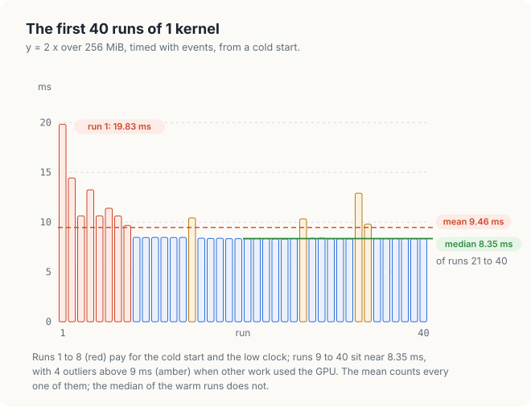
<figcaption><b>Figure 16.7</b> The first 40 runs of 1 kernel: warm-up, a plateau, and 4 outliers.</figcaption>
</figure>

The same kernel on the same data took 19.83 ms the first time and 8.35 ms once warm, as figure 16.7
shows. 2 effects add up. A first launch pays one-time costs, such as loading the kernel's code onto
the GPU. And a power governor, as on Jetson modules, lowers the GPU clock when the GPU is idle
and raises it only after it has seen sustained load (Chapter 6), so runs 2 to 8 ran at a lower
clock. Run again at once,
while the clock was still high, the program's first run took 8.92 ms. A measurement taken without
warm-up therefore depends on what the machine did in the seconds before it.

### 16.7.2 Median and mean

The **mean** of a set of times is their sum divided by their number. The **median** is the middle
value once they are sorted. 1 slow run moves the mean by its whole excess divided by the number of
runs, but moves the median at most to a neighbouring value.

<div class="example" markdown="1">

Worked example: the 40 runs above

1. The mean of all 40 runs is 9.46 ms: the 8 warm-up runs and 4 outliers pull it 1.11 ms above the
   typical run.
2. Runs 21 to 40, sorted, have 8.35 ms and 8.35 ms in positions 10 and 11, so their median is 8.35
   ms.
3. The outlier of 12.91 ms alone adds (12.91 − 8.35) / 40 = 0.11 ms to the mean of 40 runs, and
   nothing to the median.

</div>

The outliers came from other work on the GPU: the board drives a desktop, whose programs also draw
on the GPU. An earlier run of the same kernel, while that desktop was busier, gave a mean of 11.56
ms and a median of 9.74 ms. A busy machine shifts even the median, so the protocol also checks that
the machine is idle before it measures.

### 16.7.3 The protocol

The rules below were followed for every number in this book. Each one prevents a mistake that the
measurements of this chapter or of an earlier one made visible.

```text
BENCHMARK kernel:
    check the GPU is idle                     # nvidia-smi or tegrastats
    allocate every buffer before timing       # no cudaMalloc inside the timed region
    size the data well beyond the L2 cache    # or the test measures the cache
    run the kernel for about 0.4 s            # warm-up: one-time costs, clocks
    repeat R times:
        record event start; launch; record event stop
        times[r] ← elapsed(start, stop)
    report median(times) and the spread       # not the mean of a few runs
    verify the output                         # a fast wrong kernel is not a result
    record GPU, clocks, CUDA version, flags   # the limits of listing 16.1
```

- **Events, not CPU clocks.** A launch returns to the CPU before the kernel ends; Chapter 6 measured
  0.07 ms for the call against 10.4 ms for the kernel. Events are timestamped by the GPU itself.
- **Data larger than L2.** On a GPU whose L2 holds 32 MiB, Chapter 7's test on 16 MiB of data
  reported 432 GB/s, above that GPU's memory bandwidth of 273 GB/s: it measured the cache. The
  256 MiB arrays of `measure.cu` are 128 times an L2 of 2 MiB and 8 times one of 32 MiB.
- **The environment.** Clocks, compiler flags (`-O3`, `-arch`, `--use_fast_math`) and the CUDA
  version all change results; a number without them cannot be reproduced.
- **3 runs of the whole program.** Quote 1 quiet run of 3, and expect 10% to 20% drift between
  runs on GPUs whose clocks change with load and temperature.

<div class="bee bee-happy" markdown="1">

Warm up, take the median of many runs on an idle machine, use events, use data larger than L2, and
verify the output. 1 run of a cold kernel is not a measurement.

</div>

## 16.8 Verification: tolerances and known answers

### 16.8.1 Units in the last place

A **differential test** compares a result with a trusted reference computed another way, usually on
the CPU in double precision. For integers the comparison is exact. For floats it needs a
**tolerance**, the largest difference that still counts as correct, and the tolerance needs a unit.

A float stores 24 significant bits. Between 2 consecutive powers of 2, \\(2^e\\) and \\(2^{e+1}\\),
there are therefore \\(2^{23}\\) floats, evenly spaced \\(2^{e-23}\\) apart. The spacing doubles
at every power of 2. 1 **unit in the last place**, 1 **ULP**, is the spacing of the floats around a
value. Figure 16.8 draws a toy float with 8 values between powers of 2, so that the doubling can be
seen.

<figure>
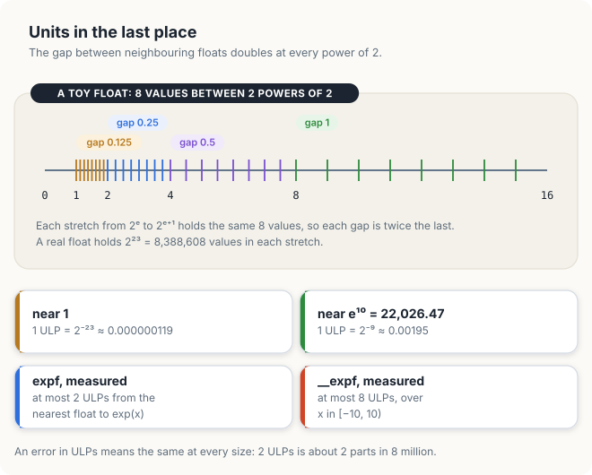
<figcaption><b>Figure 16.8</b> The spacing of floats doubles at every power of 2; a ULP is that spacing.</figcaption>
</figure>

<div class="example" markdown="1">

Worked example: 1 ULP near e<sup>10</sup>

1. e<sup>10</sup> = 22,026.47 lies between 2<sup>14</sup> = 16,384 and 2<sup>15</sup> = 32,768, so
   \\(e = 14\\).
2. 1 ULP there is \\(2^{14-23} = 2^{-9}\\) = 0.00195.
3. An error of 2 ULPs is 0.0039 at 22,026.47, and \\(2 \times 2^{-23}\\) = 0.00000024 near 1: the same
   relative size, about 1 part in 4 million.

</div>

Because positive floats are stored in order, the number of floats between 2 of them is the
difference of their bit patterns read as integers. Listing 16.11 uses that to measure `expf` and
`__expf`, the fast hardware version that `--use_fast_math` substitutes, against the nearest float to
the exact value.

<p class="listing"><b>Listing 16.11</b> The distance between 2 floats in ULPs. <a href="https://github.com/arpanpathak/gpu-parallel-book/blob/main/code/ch16_profiling/verify.cu">code/ch16_profiling/verify.cu</a></p>

```cpp
{{#include ../../../../code/ch16_profiling/verify.cu:61:79}}
```

```console
y = exp(x) for 1,048,576 values of x in [-10, 10)
  expf    largest error   2 ULPs
  __expf  largest error   8 ULPs
```

The CUDA programming guide gives `expf` a maximum error of 2 ULPs, and the measurement agrees. A
test of `expf` can therefore use a tolerance of 2 ULPs. The same test fails a kernel compiled with
`--use_fast_math`, so the flag is a decision about accuracy as well as speed.

### 16.8.2 A tolerance from the error bound

A sum has no ULP bound of its own: its error grows with the number of additions. Each addition of
2 floats rounds its exact result to the nearest float, an error of at most \\(u = 2^{-24}\\) of the
result. An element of the input that passes through \\(d\\) additions on its way to the total
therefore contributes rounding errors of at most \\(d\,u\\) times its own size, and

\\[ |\text{error}| \le d \cdot u \cdot \sum_i |x_i| \\]

| Symbol | Meaning | In the example |
|---|---|---|
| \\(d\\) | most additions any element passes through | 84 |
| \\(u\\) | largest relative rounding of 1 addition | \\(2^{-24}\\) = 5.96 × 10<sup>−8</sup> |
| \\(\sum_i \lvert x_i \rvert\\) | sum of the sizes of the inputs | 8,391,134.58 |
| \\(d\,u\sum_i \lvert x_i \rvert\\) | the tolerance | 42.01 |

`verify.cu` sums 16,777,216 random floats in [0, 1) with the 2-launch reduction of Chapter 8.

<div class="example" markdown="1">

Worked example: \\(d\\) for the 2-launch sum

1. Launch 1 runs 1,024 blocks of 256 threads, 262,144 threads. Each thread adds 16,777,216 /
   262,144 = 64 elements in a loop: up to 64 additions.
2. Its block then adds the 256 thread sums as a tree, log<sub>2</sub> 256 = 8 levels: 8 more.
3. Launch 2 runs 1 block of 256 threads over the 1,024 block sums: 4 additions per thread, then
   8 levels.
4. \\(d\\) = 64 + 8 + 4 + 8 = 84, and the tolerance is 84 × 2<sup>−24</sup> × 8,391,134.58 = 42.01.

</div>

<p class="listing"><b>Listing 16.12</b> The sum tested against its tolerance, and against a known answer.</p>

```cpp
{{#include ../../../../code/ch16_profiling/verify.cu:126:175}}
```

### 16.8.3 Known answers

The test runs the sum twice: once correctly, and once through a caller that passes \\(n - 1\\)
instead of \\(n\\), a classic off-by-one bug.

```console
sum of 16,777,216 random floats in [0, 1)
  exact sum         8391134.58
  tolerance              42.01
  n elements      error   0.42  PASSED
  n - 1 elements  error   0.58  PASSED
sum of 16,777,216 ones
  exact sum        16777216.00
  tolerance               0.00
  n elements      error   0.00  PASSED
  n - 1 elements  error   1.00  FAILED
```

The bug passes the differential test. The missing element is less than 1, and the tolerance is 42.01:
a test that allows for honest rounding cannot see an error smaller than the rounding it allows. The
second input catches the bug. With every element equal to 1, every partial sum is a whole number of
at most 2<sup>24</sup> = 16,777,216. A float holds every whole number up to 2<sup>24</sup> exactly,
so no addition rounds, the right answer is exact, and the tolerance is 0. Figure 16.9 places
both results.

<figure>
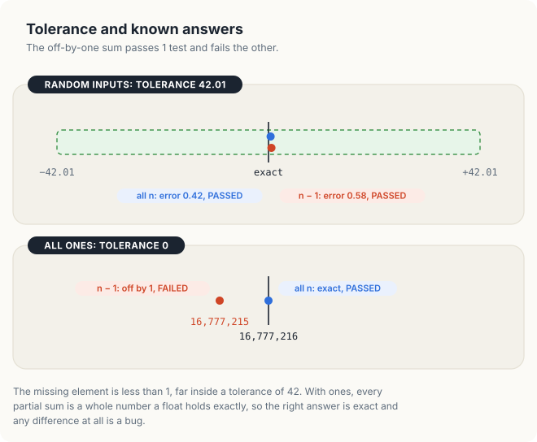
<figcaption><b>Figure 16.9</b> The off-by-one sum passes a test with a tolerance and fails a test with a known answer.</figcaption>
</figure>

A **known-answer test** chooses its input so that the right result is known exactly. A **property
test** checks a relation that every correct result satisfies, whatever the input. The counts of a
histogram add up to the number of elements (Chapters 5 and 8). A transpose applied twice gives back
the input (Chapter 7). The last element of an inclusive scan equals the sum. Property tests need no
reference at all, so they also catch bugs that a reference shares with the code it checks.

<div class="bee bee-shocked" markdown="1">

A tolerance wide enough for rounding is wide enough to hide small bugs. Add inputs whose answer is
known exactly, and test them with a tolerance of 0.

</div>

## 16.9 The engineering loop

Every chapter of the book followed the same loop, and figure 16.10 draws it once round on a real
case from this chapter.

1. **Measure**, with the protocol of section 16.7.
2. Form a **hypothesis**: name the cause, using the timeline, the counters or a count by hand.
3. **Change 1 thing.**
4. **Measure again**, the same way.
5. **Verify** that the results are still correct.

The first Rust version of the pointer chase indexed `next[j as usize]` in a `for` loop and measured
62 cycles per L1 load, against 39 in C++. The hypothesis was that the bounds check of `next[j]`
sits on the chain. The check compares `j` with the length of the slice before each load, so each
load now waits for the index of the one before and then for the comparison.

The first attempt replaced the `for` loop by a `while` loop and the indexing by `get_unchecked`
together, and measured 39 cycles. With 2 changes at once, the measurement could not say which one
mattered. Measured separately, the `while` loop with the bounds check still took 62 cycles. The
check alone accounted for the 23 cycles, and the loop form for none of them.

<figure>
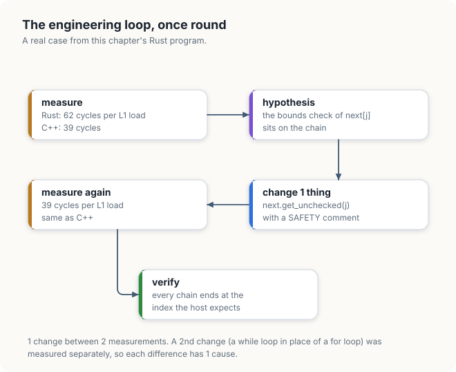
<figcaption><b>Figure 16.10</b> The engineering loop, once round, on the Rust pointer chase.</figcaption>
</figure>

The L2 numbers moved as well, from 408 cycles to 295 and then to 191, but each was a single run,
and 2 runs of the final program gave 431 and 689 cycles. Those differences may be noise, so the
loop draws no conclusion from them. Verification then closed the loop: every chain still ended at
the index the host predicts, and the `SAFETY` comment records why the unchecked load is in bounds.

Most of the book's chapters are an argument about step 2. The roofline of Chapter 1 says whether
the bound is memory or arithmetic, coalescing in Chapter 7 says how many sectors a warp moves, and
the reuse count of Chapter 9 says how often each value is fetched. The loop is how each argument
was checked.

## 16.10 The complete programs

<p class="listing"><b>Listing 16.13</b> The complete <code>bugs.cu</code>. <a href="https://github.com/arpanpathak/gpu-parallel-book/blob/main/code/ch16_profiling/bugs.cu">code/ch16_profiling/bugs.cu</a></p>

```cpp
{{#include ../../../../code/ch16_profiling/bugs.cu}}
```

<p class="listing"><b>Listing 16.14</b> The complete <code>measure.cu</code>. <a href="https://github.com/arpanpathak/gpu-parallel-book/blob/main/code/ch16_profiling/measure.cu">code/ch16_profiling/measure.cu</a></p>

```cpp
{{#include ../../../../code/ch16_profiling/measure.cu}}
```

<p class="listing"><b>Listing 16.15</b> The complete <code>latency.cu</code>. <a href="https://github.com/arpanpathak/gpu-parallel-book/blob/main/code/ch16_profiling/latency.cu">code/ch16_profiling/latency.cu</a></p>

```cpp
{{#include ../../../../code/ch16_profiling/latency.cu}}
```

<p class="listing"><b>Listing 16.16</b> The complete <code>verify.cu</code>. <a href="https://github.com/arpanpathak/gpu-parallel-book/blob/main/code/ch16_profiling/verify.cu">code/ch16_profiling/verify.cu</a></p>

```cpp
{{#include ../../../../code/ch16_profiling/verify.cu}}
```

<p class="listing"><b>Listing 16.17</b> The complete Rust program. <a href="https://github.com/arpanpathak/gpu-parallel-book/blob/main/code/oxide/ch16_latency/src/main.rs">code/oxide/ch16_latency/src/main.rs</a></p>

```rust,ignore
{{#include ../../../../code/oxide/ch16_latency/src/main.rs}}
```

## Common mistakes

- **Tuning a kernel before reading the timeline.** In section 16.1.2 a kernel twice as fast saved
  5.20 ms; overlapping the copies saved 7.36 ms without touching the kernel.
- **Trusting a clean exit.** The out-of-bounds kernel produced correct output and exit status 0.
  The 2 barriers in 2 branches did the same on 1 GPU and hung another.
- **Timing under a tool.** memcheck made a load 217 times as slow, and `ncu`'s replay changes the
  caches between runs; time with events in an ordinary run.
- **Timing a cold kernel.** The first run took 19.83 ms, the warm runs 8.35 ms.
- **Reporting a mean of a few runs.** 4 outliers and 8 warm-up runs pulled the mean 1.11 ms above the
  median.
- **Dividing by a computed peak.** Each board reported 1 attribute that gives a wrong peak; use the
  data sheet.
- **A tolerance with no unit or no derivation.** Count ULPs for single operations; derive the bound
  for sums; add known-answer inputs with a tolerance of 0.
- **Changing 2 things between measurements.** The first fix of the Rust chase changed 2 things, and
  only a second measurement showed which one mattered.
- **Profiling a debug build.** `-G` turns off optimisation; profile what will run, built with
  `-lineinfo` for source lines.

<div class="summary" markdown="1">

## Summary

- A trace records when each copy and kernel ran; hardware counters record what happened inside 1
  kernel. Nsight Systems reads the first, Nsight Compute the second, and the timeline comes first.
- The trace of Chapter 6's pipeline accounted for every millisecond. 0.66 ms + 10.61 ms + 0.90 ms
  of copies and kernels and 1.42 ms of gaps made the 13.59 ms run. The gaps came from the order of
  operations in 1 stream.
- The speed of light can also be worked by hand from the GPU's limits and an event time:
  `y = 2 x` used 63% of the GPU's memory bandwidth and 0.33% of its arithmetic.
- Compute Sanitizer found 4 bugs that printed no error: writes into padding, a race between warps,
  2 barriers in 2 branches, and a read of memory nobody wrote.
- `clock64()` measured 4.24 cycles per dependent multiply-add, 39 cycles from L1, 191 from L2 and 598
  to 1,137 from DRAM, in C++ and in Rust.
- Warm up, report medians, use events, use data larger than L2, check the machine is idle and verify
  the output.
- Count float errors in ULPs, derive tolerances from error bounds, and add known-answer and property
  tests that a tolerance cannot replace.
- Measure, form a hypothesis, change 1 thing, measure again, verify.

</div>

Chapter 17 leaves the single program and looks at the GPU as a device of the whole system: how the
CPU reaches its registers and how its copy engines reach memory.

## Exercises

1. Account for the 1-stream run of figure 16.2 the way section 16.2.2 accounted for the 2-stream
   run. What fraction of the run did each lane spend busy?
2. Issue all 8 copies in of the 2-stream pipeline before any kernel, or use 3 streams, and trace the
   program again. Do the 3 gaps of 0.47 ms disappear? Account for the new total.
3. Profile `sgemm` of Chapter 9 with `ncu` on a machine where you can read counters. Compare the
   `SpeedOfLight` percentages with figure 16.3, and find how much of the patch kernel's 8 GiB of
   loads came from DRAM.
4. Change `bugs.cu` to use 1,010 elements. Which elements of which array does the unguarded kernel
   now overwrite? Predict, then check with memcheck.
5. Put the 2 barriers of listing 16.5 into a block of 64 threads in which the 2 branches fall in
   different warps (for example, `t < 32`). Does synccheck still report an error? Explain. Run it
   under synccheck first: the plain program may hang, as it did on the first GPU.
6. Extend `latency.cu` with a chain of 16 MiB. Where does it land between the L2 and DRAM figures
   on a GPU with a 2 MiB L2, and on one with a 40 MiB L2?
7. Run `measure` twice in a row, then again after 5 minutes of idle. Compare the first 10 runs of
   each, and explain the difference.
8. Derive the tolerance of `verify.cu`'s sum for 2<sup>26</sup> elements. Then construct an input
   with a known exact sum other than all ones, and use it to catch the \\(n - 1\\) bug.
9. Compile `verify.cu` with `--use_fast_math`. Which line of its output changes, and why?

## Sources and further reading

- NVIDIA, *Nsight Systems User Guide*: <https://docs.nvidia.com/nsight-systems/UserGuide/>
- NVIDIA, *Nsight Compute Profiling Guide*, "Metrics Structure", "Replay" and the sections
  `SpeedOfLight`, `Occupancy` and `WarpStateStats`: <https://docs.nvidia.com/nsight-compute/>
- NVIDIA, *Compute Sanitizer User Manual*: <https://docs.nvidia.com/compute-sanitizer/>
- NVIDIA, *CUDA-GDB*: <https://docs.nvidia.com/cuda/cuda-gdb/>
- NVIDIA, "ERR_NVGPUCTRPERM: Permission issue with Performance Counters":
  <https://developer.nvidia.com/ERR_NVGPUCTRPERM>
- H. Naghibijouybari, A. Neupane, Z. Qian and N. Abu-Ghazaleh, "Rendered Insecure: GPU Side
  Channel Attacks are Practical", ACM CCS 2018: the attack behind CVE-2018-6260.
- NVIDIA, *CUDA C++ Programming Guide*, "Mathematical Functions" (error bounds of `expf` and
  `__expf`) and "Synchronization Functions": <https://docs.nvidia.com/cuda/cuda-c-programming-guide/>
- D. Goldberg, "What Every Computer Scientist Should Know About Floating-Point Arithmetic", *ACM
  Computing Surveys* 23(1), 1991.
- N. J. Higham, *Accuracy and Stability of Numerical Algorithms*, 2nd ed., SIAM, 2002, chapter 4
  (summation).
- H. Wong et al., "Demystifying GPU Microarchitecture through Microbenchmarking", ISPASS 2010:
  pointer chases and `clock()` on a GPU.
