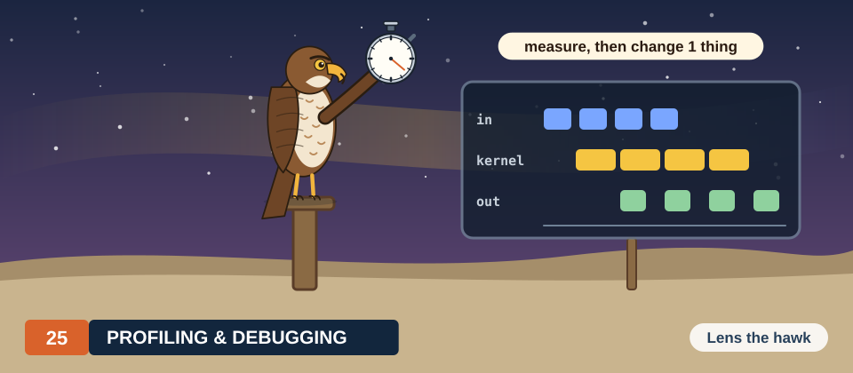

# Chapter 25: Profiling, Debugging & Performance Engineering

Every performance claim in the earlier chapters rested on a measurement. We timed kernels with
CUDA events, counted wrong elements, and compared results with a reference computed on the CPU.
Each of these measurements answers a single question about a single run. When a program is slower
than expected, or produces a wrong answer only some of the time, we need tools that tell us more:
a record of what the GPU did and when, the counts that the hardware keeps for each kernel, a
checker that inspects every memory access, and a clock that a thread can read from inside a
kernel.

In this chapter, we introduce these tools and apply each of them to a program from an earlier
chapter: the stream pipeline of Chapter 6, the matrix multiplication of Chapter 9, the vector
addition of Chapter 3 and the block sum of Chapter 5. We use an in-kernel clock to measure the
latencies that Chapter 1 assumed, about 4 cycles for an arithmetic operation and several hundred
cycles for a read from memory. We then turn to the question of whether a measurement or a test
result can be trusted, and we close with the procedure that connects all of these tools:
measure, explain, change one thing, and measure again.

<div class="covers" markdown="1">

This chapter covers

- profilers, traces and hardware performance counters
- reading an Nsight Systems timeline and accounting for its run time
- the sections of an Nsight Compute report, and a speed-of-light analysis done by hand
- finding out-of-bounds accesses, races, barrier errors and uninitialized reads with Compute
  Sanitizer
- stopping a single GPU thread with `cuda-gdb`
- measuring latencies in cycles with `clock64()`, in C++ and in Rust
- warm-up, medians and a protocol for timing kernels
- units in the last place, tolerances for sums, and known-answer tests
- a systematic process for performance work

</div>

The code of the chapter is in
[`code/ch16_profiling/`](https://github.com/arpanpathak/gpu-parallel-book/tree/main/code/ch16_profiling)
for C++ and in
[`code/oxide/ch16_latency/`](https://github.com/arpanpathak/gpu-parallel-book/tree/main/code/oxide/ch16_latency)
for Rust. The measurements in this chapter come from 2 integrated GPUs: a Jetson Orin NX (8 SMs,
102 GB/s), the first GPU below, and a Jetson AGX Thor (20 SMs, 273 GB/s), the second.

## 25.1 Tools for performance and correctness

### 25.1.1 Profilers, traces and counters

A **profiler** is a program that records what another program does while it runs. On a GPU, 2
kinds of record are useful. A **trace** is a list of timestamped events, such as a copy that
started at 0.665 ms and ended at 1.470 ms, or a kernel that ran from 1.978 ms to 3.311 ms. A
**hardware performance counter** is a register inside the GPU that counts events of 1 kind while a
kernel runs, such as bytes read from DRAM, instructions issued, or cycles in which a warp could not
proceed. Recall that a **warp** is a group of 32 threads that execute each instruction together.
A trace tells us where the time of a whole program went. Counters tell us why a particular kernel
took the time it did.

NVIDIA provides 1 profiler for each kind of record. **Nsight Systems**, run as `nsys`, traces the
whole program: the CUDA calls made by the CPU and the copies and kernels executed by the GPU, all
on a common time axis. **Nsight Compute**, run as `ncu`, reads the counters of 1 kernel at a time.
A GPU has fewer counter registers than there are kinds of events to count. Therefore, `ncu` runs
the same kernel several times, counts a different set of events in each run, and restores the
kernel's memory before each run. This repetition is called **replay**. Replay makes `ncu` slow,
and it is the reason why the kernel times reported by `ncu` differ from those of an ordinary run.

Profilers do not check whether a program is correct. For correctness, the CUDA toolkit provides 2
other tools. **Compute Sanitizer** adds checks to every memory access of a kernel while it runs,
and to every **barrier**, a point in a kernel at which the threads of a block wait for each other.
**cuda-gdb** is a **debugger**: a program that controls another program, stops it at chosen
points called **breakpoints**, and shows its state. cuda-gdb can stop a kernel at a source line
and show the variables of any one of its threads. Figure 25.1 pairs each question that we ask in
this chapter with the tool that answers it.

<figure>
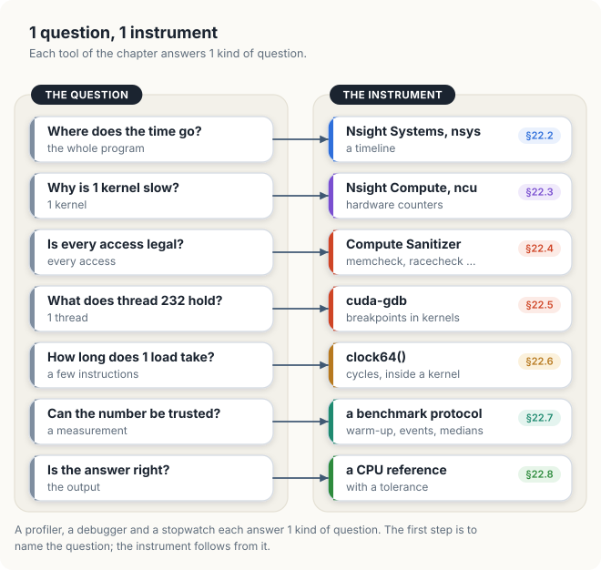
<figcaption><b>Figure 25.1</b> Questions about a GPU program and the tools that answer them.</figcaption>
</figure>

### 25.1.2 Which tool to use first

The order in which we apply these tools follows from Amdahl's law (Chapter 1, section 1.3).
Making a kernel faster can only shorten the part of the run during which that kernel executes. If
the GPU spends half of the run waiting for copies, even an infinitely fast kernel leaves the other
half.

The pipeline of Chapter 6 shows this clearly. Its 1-stream version, which we trace in section 25.2,
takes 20.95 ms: 6.18 ms of copy in, 10.40 ms of kernel and 4.19 ms of copy out, executed one after
another. If we made the kernel twice as fast, it would take 10.40 / 2 = 5.20 ms, and the run would
take 20.95 − 5.20 = 15.75 ms. Overlapping the copies with the kernel instead, using 2 streams and
8 chunks, brought the run down to 13.59 ms without changing the kernel at all.

The timeline showed where the time went before any kernel was tuned, and it pointed to the larger
gain. For this reason, we start with Nsight Systems, and we turn to Nsight Compute only once the
timeline shows that a kernel dominates the run.

### 25.1.3 Access permissions for counters and debuggers

Hardware counters and debugger control are restricted on most systems. In 2018, researchers showed
that a program could learn about the work of another program from the GPU's performance counters,
a vulnerability registered as CVE-2018-6260. Since then, NVIDIA's drivers have allowed only
administrators to read the counters, unless the owner of the machine changes a driver option.
Debugging is restricted for a similar reason: a debugger can read any memory of the program it
controls. The table below lists what each tool needs.

| Tool | Needs |
|---|---|
| `nsys` (trace) | no special rights |
| `ncu` (counters) | counter access: an administrator, or the driver option below |
| `compute-sanitizer` | debugger access |
| `cuda-gdb` | debugger access |

On a machine that we administer, `sudo ncu ...` reads the counters. A desktop Linux system can
allow every user to read them with the driver option `NVreg_RestrictProfilingToAdminUsers=0`, set
in a file under `/etc/modprobe.d/`; NVIDIA's page for `ERR_NVGPUCTRPERM` gives the steps for each
operating system. On Jetson modules, counter and debugger access go through the device files
`/dev/nvhost-prof-gpu` and `/dev/nvhost-dbg-gpu`, which belong to the group `debug`, so the tools
must be run with `sudo` or by a member of that group.

## 25.2 Timelines with Nsight Systems

### 25.2.1 Recording a trace

Recall from Chapter 6 that a **stream** is a queue of GPU work whose operations run in the order in
which they were issued, and that work in different streams may overlap. Chapter 6's program
`streams` performs the same work in 3 ways: copy in, kernel and copy out on 1 stream; the same in 8
chunks on 2 streams; and the same in 32 chunks. We can trace it without changing a line of code:

```console
$ nsys profile -t cuda -o streams ./streams
$ nsys stats --report cuda_gpu_kern_sum,cuda_gpu_mem_time_sum streams.nsys-rep
```

The option `-t cuda` records CUDA calls, copies and kernels, and `-o` names the report file. The
command `nsys stats` prints summaries of the report as tables. The first summary lists every
kernel (the columns Min, Max and StdDev are omitted here):

```console
 Time (%)  Total Time (ns)  Instances   Avg (ns)    Med (ns)   Name
     99.5      297,936,832        248  1,201,358.2  336,896.0  work(float *, int, int)
      0.5        1,368,576      1,001      1,367.2    1,376.0  empty()
```

A summary is useful only if we can account for its numbers. The program launches `work` 40 times
while it warms up, in 5 runs of 8 chunks. It launches the kernel twice to time a single launch, and
once to time the 3 stages separately. Then come 5 runs of 1 chunk, 5 runs of 8 chunks and 5 runs of
32 chunks. In total, this gives 40 + 2 + 1 + 5 + 40 + 160 = 248 launches, which is the number in the
table. The median time, 0.34 ms, is that of the kernel on 1 chunk of 32, because 160 of the 248
launches are of that size.

### 25.2.2 Accounting for the run time

The report also holds the start and end time of every copy and kernel. Figure 25.2 draws 2
repetitions from it on a common scale: the last run of the 1-stream pipeline and the first run of
the 2-stream pipeline with 8 chunks.

<figure>
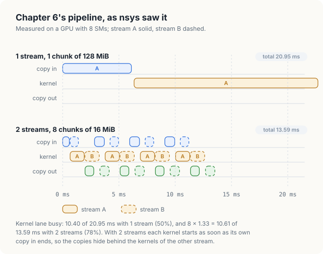
<figcaption><b>Figure 25.2</b> The pipeline of Chapter 6 as recorded by Nsight Systems on the first GPU.</figcaption>
</figure>

We say that a lane of the timeline is **busy** while it executes an operation. The fraction of the
run during which the kernel lane is busy measures how well the pipeline keeps the arithmetic units
supplied with work. With 1 stream, the kernel lane is busy for 10.40 ms of 20.95 ms, or 50% of the
run. With 2 streams, the 8 kernels take 1.32 to 1.33 ms each, 10.61 ms in total, out of 13.59 ms,
or 78% of the run.

We can go further and account for every millisecond of the 2-stream run.

<div class="example" markdown="1">

Worked example: accounting for the 2-stream run

1. The run cannot be shorter than the first copy in, 0.66 ms, followed by the 8 kernels back to
   back, 10.61 ms, followed by the last copy out, 0.90 ms: 12.17 ms in total.
2. The trace shows 3 gaps in the kernel lane, before kernels 3, 5 and 7, of 0.47 ms, 0.48 ms and
   0.48 ms: 1.42 ms in total.
3. 12.17 ms + 1.42 ms = 13.59 ms, which is the measured run.

</div>

The 3 gaps have a single cause. A stream executes its operations in the order in which they were
issued. Stream A holds the copy out of chunk 0 before the copy in of chunk 2, so chunk 2 cannot
start copying until the result of chunk 0 has left the GPU, at 2.83 ms. Its copy then takes 0.94
ms, and kernel 3 starts at 3.78 ms, although the kernel lane has been idle since 3.31 ms. Exercise 2
asks the reader to remove these gaps.

Tracing a program can change its timing. The program also times the same pipeline
itself, without the profiler, and printed 13.08 ms, 13.31 ms and 13.34 ms in 3 runs. The traced
run, 13.59 ms, is within 4% of those times, so the trace describes the program as it normally runs.

### 25.2.3 Common timeline patterns

Most performance problems of a GPU program are visible on a timeline. The table below lists the common
patterns, their likely causes, and the chapters that treat them.

| What the timeline shows | Likely cause | Remedy |
|---|---|---|
| kernel lane idle while a copy runs, and the reverse | 1 stream, or copies from pageable memory | streams and pinned memory (Chapters 4 and 6) |
| short gaps between many tiny kernels | the CPU's launch cost, a few µs per launch | CUDA graphs (section 6.7) |
| long CPU calls such as `cudaMalloc` between kernels | allocation inside the loop | allocate once, before the loop |
| kernel lane busy nearly all the time | the kernels themselves | Nsight Compute (section 25.3) |

### 25.2.4 Tracing a Rust program

`nsys` traces any program that uses the CUDA driver, regardless of the language in which it was
written. For the Rust program of section 25.6, it prints the Rust names of the kernels:

```console
$ nsys profile -t cuda -o rust ./target/release/ch16_latency
$ nsys stats --report cuda_gpu_kern_sum rust.nsys-rep
 Time (%)  Total Time (ns)  Instances   Avg (ns)     Med (ns)     Name
     99.5       19,164,896          3  6,388,298.7  8,258,176.0  chase
      0.3           63,680          1     63,680.0     63,680.0  dependent_fma
      0.1           23,680          1     23,680.0     23,680.0  independent_fma
```

The summary of CPU calls shows `cuLaunchKernel` and `cuModuleLoadData` where the C++ program shows
`cudaLaunchKernel`. The reason is that cuda-oxide calls the CUDA driver API directly, whereas the
C++ programs call the runtime API, which in turn calls the driver (Chapter 12).

## 25.3 Kernel analysis with Nsight Compute

### 25.3.1 Sections of a kernel report

`ncu` organizes its counters into **sections**, and 3 of them answer most questions.

The **speed of light** of a hardware unit is its peak rate. The `SpeedOfLight` section reports how
close the kernel came to the peak rate of the arithmetic units and to that of the memory system, as
percentages. A kernel that comes close to 100% for one of these units is limited by that unit, as
the roofline model of Chapter 1 predicts.

The `Occupancy` section reports how fully the kernel uses the SMs. Recall that an **SM**
(streaming multiprocessor) is one of the GPU's processors, and that it runs **blocks**, groups of up
to 1,024 threads that share its fast **shared memory**. **Occupancy** is the number of warps
resident on an SM divided by the maximum number the SM can hold (Chapter 2, section 2.9). The
**theoretical occupancy** follows from the kernel's registers, its shared memory and its block
size. The **achieved occupancy** is the average measured while the kernel ran. It is lower than the
theoretical occupancy when blocks finish unevenly.

The `WarpStateStats` section reports stalls. A **stall** is a cycle in which a warp could not issue
its next instruction. The section counts stalls by reason, such as waiting for a load from global
memory (`long_scoreboard`), waiting for shared memory (`short_scoreboard`), or waiting at a barrier
(`barrier`).

For Chapter 9's kernel with 4 × 4 patches, on a machine where counters are allowed, the command is

```console
$ sudo ncu --section SpeedOfLight --section Occupancy -k regex:patches -c 1 ./sgemm
```

The option `--section` chooses the sections to collect, and adding `--section WarpStateStats`
adds the stall reasons. The option `-k` selects kernels by name, and `-c 1` profiles only the first
launch that matches. Without counter access, `ncu` stops before the kernel runs and names the
setting described in section 25.1.3:

```console
==ERROR== ERR_NVGPUCTRPERM - The user does not have permission to access NVIDIA GPU
Performance Counters on the target device 0.
```

### 25.3.2 Peak rates from device attributes

Several numbers of the report can be computed without counters, from the limits that the GPU
reports and a kernel time measured with events. The CUDA runtime describes the GPU in a
`cudaDeviceProp` structure, and `cudaDeviceGetAttribute` returns single values. Listing 25.1 prints
the limits that the rest of the chapter uses, and the 2 peak rates they imply.

<p class="listing"><b>Listing 25.1</b> The limits of the GPU, and the peaks they imply. <a href="https://github.com/arpanpathak/gpu-parallel-book/blob/main/code/ch16_profiling/measure.cu">code/ch16_profiling/measure.cu</a></p>

```cpp
{{#include ../../../../code/ch16_profiling/measure.cu:61:90}}
```

```console
Orin, compute capability 8.7                   NVIDIA Thor, compute capability 11.0
  SMs                              8             SMs                             20
  threads per SM, at most       1536             threads per SM, at most       1536
  registers per SM             65536             registers per SM             65536
  shared memory per SM           164 KiB         shared memory per SM           228 KiB
  L2 cache                      2048 KiB         L2 cache                     32768 KiB
  SM clock                      1173 MHz         SM clock                      1048 MHz
  memory clock                  1173 MHz         memory clock                  4266 MHz
  memory bus                     256 bits        memory bus                     256 bits
  FP32 peak from the clock      2402 GFLOP/s     FP32 peak from the clock      5369 GFLOP/s
  bandwidth from the clock      75.1 GB/s        bandwidth from the clock     273.0 GB/s
```

The output of the 2 GPUs is printed side by side. Each line is a limit that an earlier chapter
used. The number of SMs and the maximum number of threads per SM determine how many warps can be
resident (Chapter 2). The number of registers per SM determined the occupancy of Chapter 9's
kernels. The **L2 cache** is a memory on the GPU chip, shared by all SMs, that keeps recently used
data; each SM also has a smaller **L1 cache** of its own. The size of the L2 cache determines how
large the data of a test must be for the test to measure memory rather than the cache (section
25.7).

The 2 peak rates require care. The FP32 peak is the number of SMs × 128 FP32 units × 2 FLOP per
multiply-add × the clock rate. For the first GPU, this gives 8 × 128 × 2 × 1.173 GHz = 2,402
GFLOP/s, which agrees with NVIDIA's figure of 2.4 TFLOP/s. The memory peak is 2 transfers per
memory clock × the bus width in bytes. For the second GPU, this gives 2 × 4.266 GHz × 32 bytes =
273.0 GB/s, which agrees with NVIDIA's figure. The other 2 results, however, are wrong. The first
GPU reports its SM clock as the memory clock and a bus of 256 bits where its data sheet gives 128
bits, so the product, 75.1 GB/s, falls below the 102 GB/s of the data sheet. The second GPU reports
1,048 MHz as its SM clock, while its data-sheet peak of 8.1 TFLOP/s implies 8,100 / (20 × 128 × 2)
= 1.58 GHz. A peak rate computed from reported attributes is therefore only a starting point, and
the data sheet is the reference. In this chapter, we use the data-sheet peaks of Chapter 2: 2.4
TFLOP/s and 102 GB/s for the first GPU, and 8.1 TFLOP/s and 273 GB/s for the second.

### 25.3.3 Speed-of-light analysis without counters

The speed-of-light percentage of a kernel is its achieved rate divided by the peak rate. For
memory, the achieved rate is the number of bytes the kernel moves divided by its time. For
arithmetic, it is the number of operations divided by the time. The program `measure.cu` times the
kernel `y = 2 x` over 2 arrays of 256 MiB each, which is larger than the L2 cache of either GPU;
section 25.7 explains how the time was taken.

On the first GPU, the median time of the kernel is 8.35 ms. Each of the 67,108,864 elements is read
once and written once, so the kernel moves 2 × 4 bytes per element, 536,870,912 bytes or 512 MiB in
total. The achieved memory rate is therefore 536,870,912 bytes / 8.35 ms = 64.3 GB/s, which is
64.3 / 102 = 63% of the peak. The kernel performs 1 multiplication per element, 67,108,864 FLOP in
total, so its arithmetic rate is 67,108,864 FLOP / 8.35 ms = 8.0 GFLOP/s, or 8.0 / 2,400 = 0.33% of
the peak. The kernel is clearly memory-bound: its arithmetic intensity, 1 FLOP per 8 bytes or 0.125
FLOP/B, lies far below the GPU's ridge point of 24 FLOP/B (Chapter 2, section 2.1.5).

Let us now apply the same analysis to Chapter 9's best kernel, in which each thread computes a 4 ×
4 patch of \\(C\\). The kernel ran at 901.4 GFLOP/s on the first GPU, which is 901.4 / 2,400 = 38%
of the arithmetic peak. Its memory side requires a count of the loads. Each block of 256 threads
computes a 64 × 64 tile of \\(C\\). At each of its 4,096 / 16 = 256 steps, the block loads a 64 × 16
tile of \\(A\\) and a 16 × 64 tile of \\(B\\), 2,048 floats in total. Over the whole run, a block
therefore loads 256 × 2,048 × 4 bytes = 2 MiB, and the 4,096 blocks load 8 GiB, or 8,589,934,592
bytes, in 152.47 ms. This is a load rate of 56.3 GB/s.

<figure>
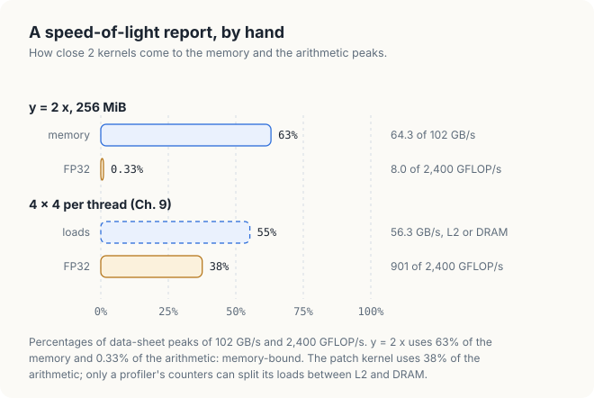
<figcaption><b>Figure 25.3</b> A speed-of-light analysis of 2 kernels, computed by hand.</figcaption>
</figure>

Figure 25.3 draws both results. The second one shows the limit of an analysis done by hand. The
56.3 GB/s of loads are served by the L2 cache or by DRAM, and the program cannot tell which. Tiles
that several blocks need may stay in the 2 MiB L2 cache between their uses. If all loads came from
DRAM, the kernel would use 55% of the memory peak; if most came from L2, it would use much less.
`ncu` reads this split from counters (`dram__bytes` and the L2 hit rate) and reports it directly.
The achieved occupancy and the stall reasons are likewise available only from counters.

The theoretical occupancy, on the other hand, can be computed without counters. The CUDA function
`cudaOccupancyMaxActiveBlocksPerMultiprocessor`, which Chapter 2 mentioned, returns how many blocks
of a given size fit on 1 SM, given the registers and shared memory of the kernel.

<p class="listing"><b>Listing 25.2</b> The theoretical occupancy of <code>scale</code>.</p>

```cpp
int main()
{
    // ...
{{#include ../../../../code/ch16_profiling/measure.cu:133:135}}
    // ...
}
```

```console
blocks of 256 per SM          6 = 1536 threads
```

6 blocks of 256 threads are 1,536 threads, which is the limit of an SM on both GPUs. The
theoretical occupancy of the kernel is therefore 100%.

## 25.4 Compute Sanitizer

### 25.4.1 Bugs that produce no error

The most dangerous bugs of a GPU program produce no error message. A kernel that writes past the
end of an array usually writes into memory that belongs to no allocation, or to another array of
the same program. The hardware raises no fault, and the launch reports success. Compute Sanitizer
finds such bugs by **instrumentation**: it rewrites the kernel so that every load, store and
barrier first calls a check, and then runs the rewritten kernel. The tool has 4 checkers, selected
with the option `--tool`:

| Checker | Finds |
|---|---|
| `memcheck` (the default) | loads and stores outside any allocation, misaligned accesses, errors from CUDA calls |
| `racecheck` | 2 accesses to the same shared-memory location, at least one of them a write, with no barrier between them |
| `synccheck` | barriers used in ways the hardware does not define |
| `initcheck` | loads of global memory that nothing has written |

The program `bugs.cu` contains 1 bug for each checker, each taken from an earlier chapter. We build
it with `-lineinfo`, which records for each instruction the source line it came from, so that the
checkers can report line numbers:

```console
$ nvcc -arch=native -lineinfo bugs.cu -o bugs
$ ./bugs bounds; ./bugs race; ./bugs barrier; ./bugs uninit      # second GPU
1,024 threads for 1,000 elements: 0 wrong elements
64 blocks of 256 ones: 64 wrong block sums
2 barriers, 1 per branch: 0 wrong elements of 256
sum of 1,024 floats nobody wrote: 0
```

On the second GPU, all 4 runs exit with status 0, and 3 of the 4 print a result that looks
correct. The first GPU printed the same lines for 3 of the bugs; section 25.4.4 describes what it
did with the fourth.

### 25.4.2 Out-of-bounds accesses (memcheck)

Recall from Chapter 3 that we round the number of threads up to a whole number of blocks, and that
the kernel needs a guard, `if (i < n)`, so that the extra threads do nothing. Listing 25.3 leaves
the guard out.

<p class="listing"><b>Listing 25.3</b> Vector addition without its guard. <a href="https://github.com/arpanpathak/gpu-parallel-book/blob/main/code/ch16_profiling/bugs.cu">code/ch16_profiling/bugs.cu</a></p>

```cpp
{{#include ../../../../code/ch16_profiling/bugs.cu:19:24}}
```

The program launches 4 blocks of 256 threads, 1,024 threads in total, for 1,000 elements.
Threads 1,000 to 1,023 therefore read `a[i]` and `b[i]` and write `c[i]` past the end of each
array. Nevertheless, all 1,000 elements of `c` were correct. memcheck shows why:

```console
$ compute-sanitizer --tool memcheck ./bugs bounds
========= Invalid __global__ read of size 4 bytes
=========     at addNoGuard(const float *, const float *, float *, int)+0xa0 in bugs.cu:23
=========     by thread (232,0,0) in block (3,0,0)
=========     Access to 0xfffd63800fa0 is out of bounds
=========     and is 1 bytes after the nearest allocation at 0xfffd63800000 of size
=========     4,000 bytes
...
=========     Access to 0xfffd63800fd0 is out of bounds
=========     and is 48 bytes before the nearest allocation at 0xfffd63801000 of size
=========     4,000 bytes
...
CUDA error: unspecified launch failure
========= ERROR SUMMARY: 25 errors
```

Thread 232 of block 3 has the index 3 × 256 + 232 = 1,000, which is the first element past the end.
The array `a` starts at address `...800000`, and the next allocation starts at `...801000`, 0x1000
= 4,096 bytes later. In other words, `cudaMalloc` placed each array of 4,000 bytes at the start of a
4,096-byte slot. The 24 extra threads access 24 × 4 = 96 bytes past the end of each array, which is
exactly the 4,096 − 4,000 = 96 bytes of padding, as Figure 25.4 shows. Because no other array was
affected, the bug was invisible in the output. With 1,010 elements, the slots would hold only
4,096 − 4,040 = 56 bytes of padding, and the last 10 threads would write into the next array.

<figure>
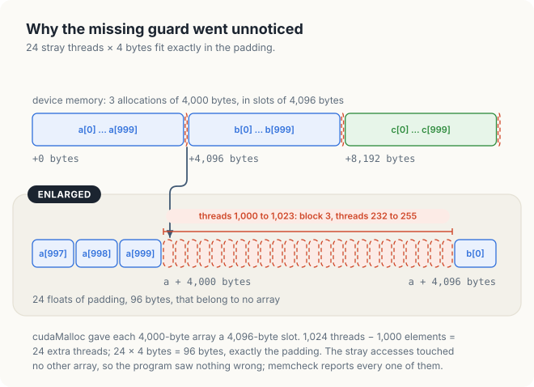
<figcaption><b>Figure 25.4</b> The 24 extra threads access only the padding after each array.</figcaption>
</figure>

memcheck reports 24 invalid reads, 1 for each extra thread, and stops the kernel. The program's next
CUDA call then fails, which is the 25th error. The same check applied to Chapter 3's program, which
has the guard, ends with `ERROR SUMMARY: 0 errors`.

### 25.4.3 Shared-memory races (racecheck)

In Chapter 5, we summed 256 values per block as a tree in shared memory, with a barrier after each
level of the tree. Listing 25.4 leaves the barriers out.

<p class="listing"><b>Listing 25.4</b> A block sum without barriers.</p>

```cpp
{{#include ../../../../code/ch16_profiling/bugs.cu:26:42}}
```

All 64 block sums were wrong, and racecheck reports the conflicting lines:

```console
$ compute-sanitizer --tool racecheck ./bugs race
========= Error: Race reported between Write access at sumNoBarrier(...)+0x1a0 in bugs.cu:31
=========     and Read access at sumNoBarrier(...)+0x130 in bugs.cu:35 [32768 hazards]
...
========= RACECHECK SUMMARY: 4 hazards displayed (3 errors, 1 warning)
```

A **race** is a pair of accesses to the same location by different threads, at least one of them a
write, with nothing that orders them. Line 31 stores the value of each thread into `s[t]`, and line
35 reads `s[t + stride]`. In the first step, thread 0 of warp 0 reads `s[128]`, but `s[128]` is
written by thread 128, which belongs to warp 4. Nothing orders the 2 warps. Figure 25.5 shows the
case in which warp 0 reads the location before warp 4 has written it.

<figure>
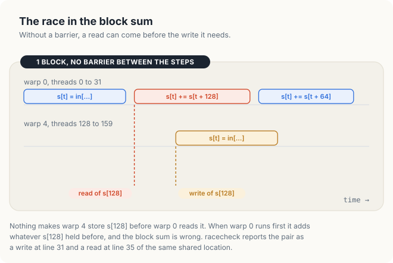
<figcaption><b>Figure 25.5</b> Without a barrier, warp 0 can read s[128] before warp 4 has written it.</figcaption>
</figure>

### 25.4.4 Barriers in divergent code (synccheck)

The behavior of `__syncthreads()` is defined only when every thread of the block reaches the same
barrier instruction. Listing 25.5 places 1 barrier in each branch of an `if` statement, so the even
and odd threads of every warp wait at 2 different instructions.

<p class="listing"><b>Listing 25.5</b> 2 barriers, 1 per branch.</p>

```cpp
{{#include ../../../../code/ch16_profiling/bugs.cu:44:58}}
```

On the second GPU, the kernel produced the correct 256 elements, because the hardware happened to
release both groups of threads together. On the first GPU, the same program never finished. The
same source file thus gave 2 different outcomes on 2 GPUs. A program of this kind has **undefined
behavior**: the language does not specify its result, so each machine may do something different.
synccheck reports the cause:

```console
$ compute-sanitizer --tool synccheck ./bugs barrier
========= Barrier error detected. Divergent thread(s) in warp.
=========     at barrierInBranch(float *)+0xd0 in bugs.cu:52
=========     by thread (64,0,0) in block (0,0,0)
...
========= ERROR SUMMARY: 128 errors
```

The 128 errors are 1 for each of the 128 even threads that waited at line 52 while the odd threads
of their warps waited at line 55. The correct kernel moves the barrier out of the `if` statement,
where all 256 threads reach it.

### 25.4.5 Reads of uninitialized memory (initcheck)

`cudaMalloc` returns memory that still holds whatever it last contained. Listing 25.6 sums 1,024
floats that nothing has written.

<p class="listing"><b>Listing 25.6</b> A sum of unwritten memory.</p>

```cpp
{{#include ../../../../code/ch16_profiling/bugs.cu:60:68}}
```

The result was 0, because the memory happened to contain zeros. initcheck reports all 1,024 reads,
each with its thread:

```console
$ compute-sanitizer --tool initcheck ./bugs uninit
========= Uninitialized __global__ memory read of size 4 bytes
=========     at sumUnwritten(const float *, float *, int)+0x180 in bugs.cu:65
=========     by thread (0,0,0) in block (0,0,0)
...
========= ERROR SUMMARY: 1024 errors
```

### 25.4.6 Overhead and limits of instrumentation

Every check adds work. The Rust program of section 25.6 measures a load from the L1 cache in 39
cycles. Under memcheck, the same loop took 8,463 cycles per load, 217 times as long. A run under
Compute Sanitizer therefore tells us whether a program is correct, but never how fast it is. The
same run ended with `ERROR SUMMARY: 0 errors`, which shows that programs written with cuda-oxide can
be checked in the same way as C++ programs.

A clean run, moreover, is evidence only about the inputs and the timing of that run. A race
that did not occur in 1 run may occur in the next, and an out-of-bounds index that depends on the
input may not be reached by the test input. Section 25.8 adds tests that check the result itself.

<div class="bee bee-shocked" markdown="1">

The out-of-bounds kernel produced every element correctly and exited with status 0. A program that
passes its tests can still access memory it does not own. Run Compute Sanitizer on every kernel
before trusting it.

</div>

## 25.5 Debugging a kernel with cuda-gdb

`cuda-gdb` extends the GNU debugger with support for GPU threads. A breakpoint on a line of a
kernel stops the whole grid as soon as any thread reaches it, and the **focus** selects the thread
whose variables the debugger shows. The program is built with `-G`, which keeps device variables
in a form the debugger can read and turns off most optimizations, and with `-g` for the host code.
A debugging session can be scripted with `-batch` and 1 `-ex` option per command. In the session
below, the breakpoint has a condition, so that it stops only thread 232 of block 3, the first extra
thread of section 25.4.2:

```console
$ nvcc -arch=native -G -g bugs.cu -o bugs_debug
$ cuda-gdb -q -batch \
    -ex 'break bugs.cu:23 if blockIdx.x == 3 && threadIdx.x == 232' \
    -ex 'run bounds' -ex 'print i' -ex 'print n' -ex 'continue' ./bugs_debug
[Switching focus to CUDA kernel 0, grid 1, block (3,0,0), thread (232,0,0), device 0, sm 3,
warp 7, lane 8]

CUDA thread hit Breakpoint 1, addNoGuard<<<(4,1,1),(256,1,1)>>> (a=0x32b200000,
b=0x32b201000, c=0x32b202000, n=1000) at bugs.cu:23
23          c[i] = a[i] + b[i];
$1 = 1000
$2 = 1000
1,024 threads for 1,000 elements: 0 wrong elements
[Inferior 1 (process 3104365) exited normally]
```

The debugger confirms the reasoning of section 25.4.2 from inside the kernel. Thread 232 of block 3
has `i = 1000`, which equals `n`, and is about to access `a[1000]`. The focus line also locates the
thread in the hardware: thread 232 belongs to warp 232 / 32 = 7, rounded down, at lane 232 − 7 × 32
= 8, and it ran on SM 3. The 3 pointers lie 0x1000 = 4,096 bytes apart, which matches the slots of
Figure 25.4.

`cuda-gdb` is the tool for the bugs that Compute Sanitizer cannot detect, because they involve no
illegal access: wrong arithmetic on indices, a wrong weight in a stencil, or a branch taken by the
wrong threads.

## 25.6 Timing inside a kernel with clock64()

### 25.6.1 The per-SM cycle counter

Events measure the time of a whole kernel. To measure a few instructions, we need a clock that a
thread can read. The function `clock64()` returns the value of a 64-bit counter that each SM
increments once per cycle of its own clock. The difference between 2 readings taken by the same
thread is the number of cycles between them. The counters of different SMs are not synchronized,
so 2 readings can be compared only when the same thread took both.

Chapter 1 assumed 2 latencies, about 4 cycles for an addition and about 500 cycles for a read from
main memory, and argued from them that a GPU needs many threads. The program `latency.cu`
measures these latencies. Recall that the **latency** of an operation is the time from its start to
the moment its result can be used. To observe it, each operation must need the result of the
previous one, so that no 2 operations overlap. A sequence of operations with this property is
called a **dependent chain**. The pseudocode below shows the 2 measurements.

```text
KERNEL dependentFma, 1 thread:
    v ← x[0]
    t0 ← clock64()
    repeat 4,096 times:
        v ← v × 0.999 + 1              # needs the v of the line before
    t1 ← clock64()
    x[0] ← v                            # keeps the compiler from deleting the loop
    cycles ← t1 − t0

KERNEL chase(next, warm, hops), 1 thread:
    j ← 0
    repeat warm times: j ← next[j]     # brings the chain into the caches
    t0 ← clock64()
    repeat hops times: j ← next[j]     # each load needs the index the last one returned
    t1 ← clock64()
    out ← j
    cycles ← t1 − t0
```

### 25.6.2 Latency of arithmetic

Listing 25.7 implements the first measurement in 2 forms.

<p class="listing"><b>Listing 25.7</b> 1 dependent chain, and 4 independent chains, timed with <code>clock64()</code>. <a href="https://github.com/arpanpathak/gpu-parallel-book/blob/main/code/ch16_profiling/latency.cu">code/ch16_profiling/latency.cu</a></p>

```cpp
{{#include ../../../../code/ch16_profiling/latency.cu:19:50}}
```

The first kernel performs 4,096 multiply-adds as a single dependent chain. The second kernel
performs the same 4,096 multiply-adds as 4 chains of 1,024. The 4 operations of each step do not
depend on each other, so the SM can start each of them before the previous one has finished.

### 25.6.3 Latency of loads

A **pointer chase** measures the latency of a load. An array `next` holds, at each position, the
position of the next load, so that each load must wait for the one before it. The host builds the
array with a fixed step of 32 ints, 128 bytes, so that every load touches a new **cache line**, the
128-byte unit in which the caches hold data (Chapter 7, section 7.2). We use 3 chains of different
sizes, which are served from different levels of the memory hierarchy. A chain of 4 KiB fits in the
L1 cache. A chain of 1 MiB fits in the L2 cache but not in L1. The third chain spans 256 MiB with a
step of 1 MiB + 128 bytes and has no warm-up, so every load goes to DRAM.

<p class="listing"><b>Listing 25.8</b> The pointer chase.</p>

```cpp
{{#include ../../../../code/ch16_profiling/latency.cu:52:69}}
```

The host checks that each chain ended at the expected position: after \\(w + h\\) hops of step
\\(s\\) through \\(c\\) positions, the index is \\((w + h)\,s \bmod c\\).

```console
$ ./latency                                    # first GPU
4096 multiply-adds in 1 thread, cycles per multiply-add
  1 dependent chain        4.24
  4 independent chains     1.31
1 thread follows a chain of loads, cycles per load
  4 KiB chain, from L1          39
  1 MiB chain, from L2         191
  256 MiB chain, from DRAM     607
PASSED: 0 of 3 chains end in the wrong place
```

The program divides the cycles of the dependent chain by its 4,096 multiply-adds, which gives 4.24
cycles per operation, or about 17,400 cycles in total. The latency of a multiply-add is therefore
about 4 cycles, as Chapter 1 assumed; the extra 0.24 cycles come from the loop's own counting and
branching. With 4 independent chains, a multiply-add takes 1.31 cycles, so the SM completes about
4 times as many operations per cycle. This is what Little's law predicts (Chapter 1, section
1.1.4): 4 operations in flight with a latency of 4 cycles complete at a rate of 4 / 4 = 1 per
cycle.

The loads can be converted from cycles to time in the same way. At 1,173 MHz, a cycle lasts
1 / 1.173 GHz = 0.85 ns, so a load from L1 takes 39 × 0.85 = 33 ns, a load from L2 takes
191 × 0.85 = 163 ns, and a load from DRAM takes 607 × 0.85 = 517 ns. A single load from DRAM thus
costs as much time as 607 / 4.24 = 143 dependent multiply-adds.

Figure 25.6 places the 5 numbers on a logarithmic scale. The DRAM latency varied more than the
others. Over 14 runs of the C++ and Rust programs, it ranged from 598 to 1,137 cycles. The L1
latency stayed at 39 cycles, and the L2 latency at 190 to 191 cycles in all runs but 2, which gave
431 and 689 cycles. On an integrated GPU, DRAM is shared with the CPU cores, the display and every
other program, and the loads of a single thread wait behind theirs. For this reason, we report the
DRAM latency as a range.

<figure>
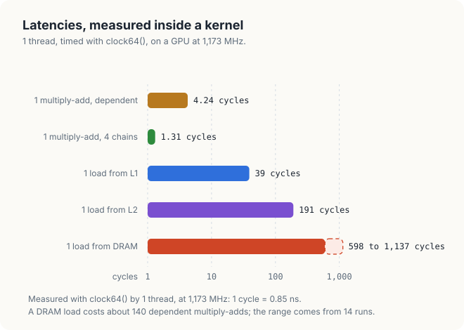
<figcaption><b>Figure 25.6</b> Latencies measured with clock64() on the first GPU.</figcaption>
</figure>

### 25.6.4 Latency measurement in Rust

cuda-oxide exposes the same counter as `cuda_device::debug::clock64()`, and the multiply-add as
`cuda_device::float::fma_rn_f32`, which rounds to nearest like `fmaf`. The kernels launch 1 thread
with the contract `block = (1, 1, 1)` and write their results through `DisjointSlice`, as in
Chapter 13. The chase reads `next` with `get_unchecked`; section 25.9 explains why.

<p class="listing"><b>Listing 25.9</b> The pointer chase in Rust. <a href="https://github.com/arpanpathak/gpu-parallel-book/blob/main/code/oxide/ch16_latency/src/main.rs">code/oxide/ch16_latency/src/main.rs</a></p>

```rust,ignore
mod kernels {
    // ...
{{#include ../../../../code/oxide/ch16_latency/src/main.rs:74:107}}
}
```

```console
$ cargo oxide run                              # first GPU
4096 multiply-adds in 1 thread, cycles per multiply-add
  1 dependent chain        4.07
  4 independent chains     1.12
1 thread follows a chain of loads, cycles per load
  4 KiB chain, from L1          39
  1 MiB chain, from L2         191
  256 MiB chain, from DRAM     599
PASSED: every chain ends where the host expects
```

The load latencies match those of the C++ program cycle for cycle. The multiply-add loops of the
Rust program are unrolled 16 and 4 times by `#[unroll]` (Chapter 9, section 9.7). Less of each step
is therefore spent on counting, and the Rust kernels are 0.17 to 0.19 cycles faster per operation.

## 25.7 The benchmarking discipline

### 25.7.1 Warm-up effects

A **benchmark** is a measurement of a program's speed made in such a way that it can be repeated
and compared. The first rule of benchmarking is to measure the program in the state in which it
will normally run. To see why, `measure.cu` times the kernel `y = 2 x` 40 times in a row with
events, starting after the GPU has been idle. Listing 25.10 shows how a single launch is timed.

<p class="listing"><b>Listing 25.10</b> 1 launch, timed with 2 events.</p>

```cpp
{{#include ../../../../code/ch16_profiling/measure.cu:42:59}}
```

```console
y = 2 x over 256 MiB, the first 40 runs in ms
 19.83 14.43 10.63 13.25 10.64 11.40 10.62  9.67  8.48  8.46
  8.47  8.47  8.46  8.47 10.43  8.39  8.37  8.38  8.35  8.35
  8.34  8.35  8.36  8.33  8.32  8.36 10.33  8.38  8.40  8.35
  8.34  8.34 12.91  9.80  8.36  8.35  8.36  8.36  8.34  8.35
mean of all 40 runs        9.46 ms
median of runs 21 to 40    8.35 ms
bytes moved                 512 MiB
achieved bandwidth         64.3 GB/s
blocks of 256 per SM          6 = 1536 threads
PASSED: 0 of 67108864 elements wrong
```

<figure>
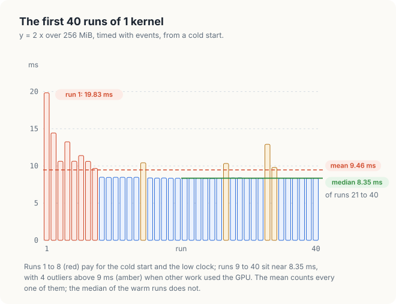
<figcaption><b>Figure 25.7</b> The first 40 runs of a kernel: warm-up, a steady state, and 4 outliers.</figcaption>
</figure>

As Figure 25.7 shows, the same kernel on the same data took 19.83 ms the first time and 8.35 ms
once warm. 2 effects contribute to the difference. First, a first launch pays one-time costs, such
as loading the kernel's code onto the GPU. Second, a power governor, such as the one on Jetson
modules, lowers the GPU clock while the GPU is idle and raises it only after it has seen sustained
load (Chapter 6), so runs 2 to 8 executed at a lower clock. When the program was run again
immediately, while the clock was still high, its first run took 8.92 ms. A measurement taken
without warm-up therefore depends on what the machine did in the seconds before it.

### 25.7.2 Mean and median

The **mean** of a set of times is their sum divided by their number. The **median** is the middle
value once the times are sorted. A single slow run moves the mean by its whole excess divided by
the number of runs, but it moves the median at most to a neighboring value.

The 40 runs above illustrate the difference. The mean of all 40 runs is 9.46 ms, because the 8
warm-up runs and the 4 outliers pull it 1.11 ms above the typical run. When runs 21 to 40 are
sorted, positions 10 and 11 both hold 8.35 ms, so their median is 8.35 ms. The outlier of 12.91 ms
alone adds (12.91 − 8.35) / 40 = 0.11 ms to the mean of 40 runs, and nothing to the median.

The outliers came from other work on the GPU, such as a desktop that draws its windows with the
same GPU. An earlier run of the same kernel, while that other work was heavier, gave a mean of
11.56 ms and a median of 9.74 ms. A busy machine shifts even the median, so a measurement protocol
must also check that the machine is idle before it measures.

### 25.7.3 A measurement protocol

The following protocol collects these rules. Each rule prevents a mistake that the measurements of
this chapter or of an earlier chapter made visible.

```text
BENCHMARK kernel:
    check the GPU is idle                     # nvidia-smi or tegrastats
    allocate every buffer before timing       # no cudaMalloc inside the timed region
    size the data well beyond the L2 cache    # or the test measures the cache
    run the kernel for about 0.4 s            # warm-up: one-time costs, clocks
    repeat R times:
        record event start; launch; record event stop
        times[r] ← elapsed(start, stop)
    report median(times) and the spread       # not the mean of a few runs
    verify the output                         # a fast wrong kernel is not a result
    record GPU, clocks, CUDA version, flags   # the limits of listing 25.1
```

We use events rather than CPU clocks because a launch returns to the CPU before the kernel ends;
Chapter 6 measured 0.07 ms for the launch call against 10.4 ms for the kernel itself. Events are
timestamped by the GPU. We size the data beyond the L2 cache because a test that fits in the cache
measures the cache. For example, on a GPU whose L2 cache holds 32 MiB, Chapter 7's test on 16 MiB
of data reported 432 GB/s, above that GPU's memory bandwidth of 273 GB/s. The 256 MiB arrays of
`measure.cu` are 128 times the size of an L2 cache of 2 MiB and 8 times that of an L2 cache of 32
MiB. We record the environment because the clocks, the compiler flags (`-O3`, `-arch`,
`--use_fast_math`) and the CUDA version all change results, and a number reported without them
cannot be reproduced. Finally, we run the whole program 3 times and quote a quiet run, and we expect
10% to 20% drift between runs on GPUs whose clocks change with load and temperature.

## 25.8 Verifying results

### 25.8.1 Units in the last place

A **differential test** compares a result with a trusted reference computed in another way,
usually on the CPU in double precision. For integers, the comparison is exact. For floating-point
numbers, it needs a **tolerance**, the largest difference that still counts as correct, and the
tolerance needs a unit.

A float stores 24 significant bits. Between 2 consecutive powers of 2, \\(2^e\\) and \\(2^{e+1}\\),
there are therefore \\(2^{23}\\) floats, evenly spaced \\(2^{e-23}\\) apart, and the spacing doubles
at every power of 2. 1 **unit in the last place**, or 1 **ULP**, is the spacing of the floats around
a value. Figure 25.8 draws a small floating-point format with 8 values between consecutive powers
of 2, so that the doubling of the spacing is visible.

<figure>
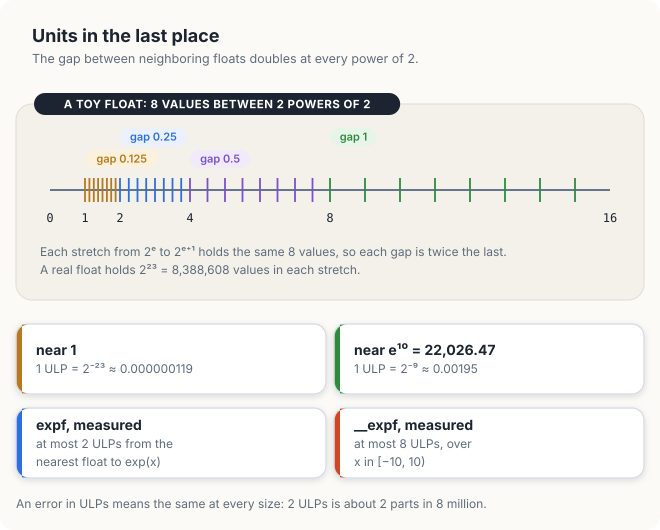
<figcaption><b>Figure 25.8</b> The spacing of floats doubles at every power of 2; a ULP is that spacing.</figcaption>
</figure>

For example, e<sup>10</sup> = 22,026.47 lies between 2<sup>14</sup> = 16,384 and 2<sup>15</sup> =
32,768, so \\(e = 14\\), and 1 ULP there is \\(2^{14-23} = 2^{-9}\\) = 0.00195. An error of 2 ULPs is
therefore 0.0039 at 22,026.47 and \\(2 \times 2^{-23}\\) = 0.00000024 near 1. Both errors have the
same relative size, about 1 part in 4 million.

Because positive floats are stored in order, the number of floats between 2 of them is the
difference of their bit patterns read as integers. Listing 25.11 uses this property to measure the
error of `expf`, and of `__expf`, the faster hardware version that `--use_fast_math` substitutes,
against the nearest float to the exact value.

<p class="listing"><b>Listing 25.11</b> The distance between 2 floats in ULPs. <a href="https://github.com/arpanpathak/gpu-parallel-book/blob/main/code/ch16_profiling/verify.cu">code/ch16_profiling/verify.cu</a></p>

```cpp
{{#include ../../../../code/ch16_profiling/verify.cu:61:79}}
```

```console
y = exp(x) for 1,048,576 values of x in [-10, 10)
  expf    largest error   2 ULPs
  __expf  largest error   8 ULPs
```

The CUDA programming guide gives `expf` a maximum error of 2 ULPs, and the measurement agrees. A
test of `expf` can therefore use a tolerance of 2 ULPs. The same test fails a kernel compiled with
`--use_fast_math`, so that flag is a decision about accuracy as well as about speed.

### 25.8.2 Tolerances for sums

A sum has no ULP bound of its own, because its error grows with the number of additions. Each
addition of 2 floats rounds its exact result to the nearest float, which introduces an error of at
most \\(u = 2^{-24}\\) of the result. An input element that passes through \\(d\\) additions on its
way to the total therefore contributes rounding errors of at most \\(d\,u\\) times its own size,
and the error of the sum is bounded by

\\[ |\text{error}| \le d \cdot u \cdot \sum_i |x_i| \\]

| Symbol | Meaning | In the example |
|---|---|---|
| \\(d\\) | most additions any element passes through | 84 |
| \\(u\\) | largest relative rounding of 1 addition | \\(2^{-24}\\) = 5.96 × 10<sup>−8</sup> |
| \\(\sum_i \lvert x_i \rvert\\) | sum of the sizes of the inputs | 8,391,134.58 |
| \\(d\,u\sum_i \lvert x_i \rvert\\) | the tolerance | 42.01 |

The program `verify.cu` sums 16,777,216 random floats in [0, 1) with the 2-launch reduction of
Chapter 8. To obtain the tolerance, we count the additions that an element can pass through.

<div class="example" markdown="1">

Worked example: \\(d\\) for the 2-launch sum

1. Launch 1 runs 1,024 blocks of 256 threads, 262,144 threads in total. Each thread adds
   16,777,216 / 262,144 = 64 elements in a loop: up to 64 additions.
2. Its block then adds the 256 thread sums as a tree of log<sub>2</sub> 256 = 8 levels: 8 more
   additions.
3. Launch 2 runs 1 block of 256 threads over the 1,024 block sums: 4 additions per thread, then 8
   levels of the tree.
4. \\(d\\) = 64 + 8 + 4 + 8 = 84, and the tolerance is 84 × 2<sup>−24</sup> × 8,391,134.58 =
   42.01.

</div>

<p class="listing"><b>Listing 25.12</b> The sum tested against its tolerance, and against a known answer.</p>

```cpp
{{#include ../../../../code/ch16_profiling/verify.cu:126:175}}
```

### 25.8.3 Known-answer and property tests

The test runs the sum twice: once correctly, and once through a caller that passes \\(n - 1\\)
instead of \\(n\\), a common off-by-one error.

```console
sum of 16,777,216 random floats in [0, 1)
  exact sum         8391134.58
  tolerance              42.01
  n elements      error   0.42  PASSED
  n - 1 elements  error   0.58  PASSED
sum of 16,777,216 ones
  exact sum        16777216.00
  tolerance               0.00
  n elements      error   0.00  PASSED
  n - 1 elements  error   1.00  FAILED
```

The bug passes the differential test. The missing element is smaller than 1, while the tolerance is
42.01, and a test that allows for rounding cannot detect an error smaller than the rounding it
allows. The second input detects the bug. When every element equals 1, every partial sum is a
whole number no larger than 2<sup>24</sup> = 16,777,216. A float represents every whole number up
to 2<sup>24</sup> exactly, so no addition rounds, the correct answer is exact, and the tolerance is
0. Figure 25.9 places both results.

<figure>
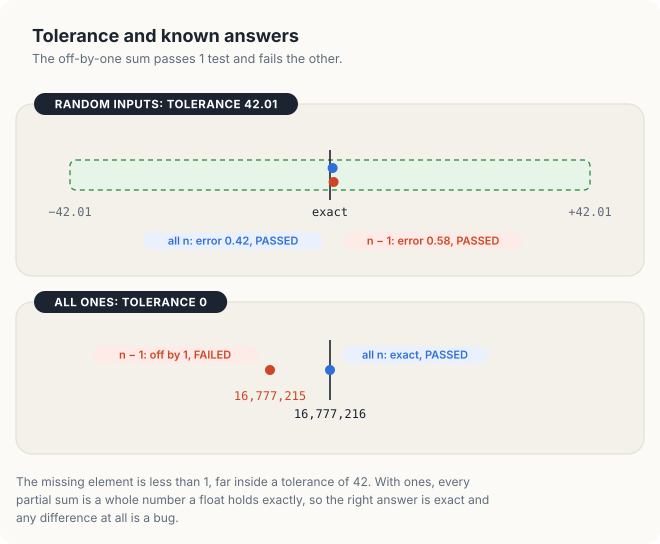
<figcaption><b>Figure 25.9</b> The off-by-one sum passes a test with a tolerance and fails a test with a known answer.</figcaption>
</figure>

A **known-answer test** chooses its input so that the correct result is known exactly. A
**property test** checks a relation that every correct result satisfies, whatever the input. For
example, the counts of a histogram add up to the number of elements (Chapters 5 and 8), a transpose
applied twice gives back the input (Chapter 7), and the last element of an inclusive scan equals
the sum of the input. Property tests need no reference at all, so they also detect bugs that a
reference shares with the code it checks.

<div class="bee bee-shocked" markdown="1">

A tolerance wide enough for rounding is wide enough to hide small bugs. Add inputs whose answer is
known exactly, and test them with a tolerance of 0.

</div>

## 25.9 A systematic optimization process

The tools of this chapter fit into a single procedure, which every earlier chapter followed:

1. **Measure**, using the protocol of section 25.7.
2. Form a **hypothesis** that names the cause, using the timeline, the counters or a count by hand.
3. **Change one thing.**
4. **Measure again**, in the same way.
5. **Verify** that the results are still correct.

Figure 25.10 applies the procedure to a case from this chapter. The first Rust version of the
pointer chase indexed `next[j as usize]` in a `for` loop and measured 62 cycles per L1 load,
against 39 cycles in C++. Our hypothesis was that the bounds check of `next[j]` lies on the
dependent chain. The check compares `j` with the length of the slice before each load, so each
load must wait for the index returned by the previous load and then for the comparison.

The first attempt replaced the `for` loop with a `while` loop and the indexing with
`get_unchecked` at the same time, and it measured 39 cycles. Because 2 things had changed, the
measurement could not tell which change mattered. Measured separately, the `while` loop with the
bounds check still took 62 cycles. The bounds check alone accounted for the 23 cycles, and the form
of the loop for none of them.

<figure>
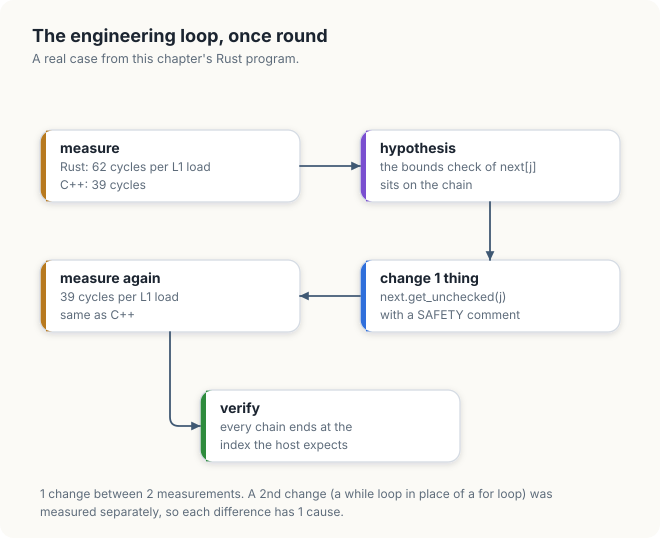
<figcaption><b>Figure 25.10</b> The optimization process applied to the Rust pointer chase.</figcaption>
</figure>

The L2 latencies also changed, from 408 cycles to 295 and then to 191, but each of these was a
single run, and 2 runs of the final program gave 431 and 689 cycles. These differences may be
noise, so we draw no conclusion from them. Finally, verification confirmed that every chain still
ended at the index the host predicts, and the `SAFETY` comment in the code records why the
unchecked load stays within bounds.

Most of the analysis in the earlier chapters concerns step 2. The roofline model of Chapter 1
tells us whether a kernel is limited by memory or by arithmetic, the coalescing rules of Chapter 7
tell us how many sectors a warp moves, and the reuse count of Chapter 9 tells us how often each
value is fetched. The procedure above is how each of these explanations was checked.

## 25.10 The complete programs

<p class="listing"><b>Listing 25.13</b> The complete <code>bugs.cu</code>. <a href="https://github.com/arpanpathak/gpu-parallel-book/blob/main/code/ch16_profiling/bugs.cu">code/ch16_profiling/bugs.cu</a></p>

```cpp
{{#include ../../../../code/ch16_profiling/bugs.cu}}
```

<p class="listing"><b>Listing 25.14</b> The complete <code>measure.cu</code>. <a href="https://github.com/arpanpathak/gpu-parallel-book/blob/main/code/ch16_profiling/measure.cu">code/ch16_profiling/measure.cu</a></p>

```cpp
{{#include ../../../../code/ch16_profiling/measure.cu}}
```

<p class="listing"><b>Listing 25.15</b> The complete <code>latency.cu</code>. <a href="https://github.com/arpanpathak/gpu-parallel-book/blob/main/code/ch16_profiling/latency.cu">code/ch16_profiling/latency.cu</a></p>

```cpp
{{#include ../../../../code/ch16_profiling/latency.cu}}
```

<p class="listing"><b>Listing 25.16</b> The complete <code>verify.cu</code>. <a href="https://github.com/arpanpathak/gpu-parallel-book/blob/main/code/ch16_profiling/verify.cu">code/ch16_profiling/verify.cu</a></p>

```cpp
{{#include ../../../../code/ch16_profiling/verify.cu}}
```

<p class="listing"><b>Listing 25.17</b> The complete Rust program. <a href="https://github.com/arpanpathak/gpu-parallel-book/blob/main/code/oxide/ch16_latency/src/main.rs">code/oxide/ch16_latency/src/main.rs</a></p>

```rust,ignore
{{#include ../../../../code/oxide/ch16_latency/src/main.rs}}
```

## Common mistakes

- **Tuning a kernel before reading the timeline.** In section 25.1.2, a kernel twice as fast saved
  5.20 ms, while overlapping the copies saved 7.36 ms without changing the kernel.
- **Trusting a clean exit.** The out-of-bounds kernel produced correct output and exit status 0.
  The 2 barriers in 2 branches did the same on 1 GPU and hung another.
- **Timing under a tool.** memcheck made a load 217 times as slow, and the replay of `ncu` changes
  the caches between runs. Time kernels with events in an ordinary run.
- **Timing a cold kernel.** The first run took 19.83 ms, and the warm runs 8.35 ms.
- **Reporting the mean of a few runs.** 4 outliers and 8 warm-up runs pulled the mean 1.11 ms above
  the median.
- **Dividing by a computed peak.** Each GPU reported 1 attribute that gives a wrong peak rate. Use
  the data sheet.
- **A tolerance with no unit or no derivation.** Count ULPs for single operations, derive the bound
  for sums, and add known-answer inputs with a tolerance of 0.
- **Changing 2 things between measurements.** The first fix of the Rust chase changed 2 things, and
  only a second measurement showed which one mattered.
- **Profiling a debug build.** `-G` turns off optimization. Profile the build that will run, built
  with `-lineinfo` for source lines.

<div class="summary" markdown="1">

## Summary

- A trace records when each copy and kernel ran, and hardware counters record what happened inside
  a kernel. Nsight Systems reads the first and Nsight Compute the second, and the timeline comes
  first.
- The trace of Chapter 6's pipeline accounted for the whole run: 0.66 ms + 10.61 ms + 0.90 ms of
  copies and kernels and 1.42 ms of gaps made up the 13.59 ms. The gaps came from the order of
  operations within a stream.
- A speed-of-light analysis can also be done by hand from the GPU's limits and an event time.
  `y = 2 x` used 63% of the GPU's memory bandwidth and 0.33% of its arithmetic peak.
- Compute Sanitizer found 4 bugs that printed no error: accesses to padding, a race between warps,
  2 barriers in 2 branches, and a read of unwritten memory.
- `clock64()` measured 4.24 cycles per dependent multiply-add, 39 cycles for a load from L1, 191
  cycles from L2 and 598 to 1,137 cycles from DRAM, in C++ and in Rust.
- Warm up, report medians, use events, use data larger than the L2 cache, check that the machine is
  idle, and verify the output.
- Count floating-point errors in ULPs, derive tolerances from error bounds, and add known-answer and
  property tests, which a tolerance cannot replace.
- Measure, form a hypothesis, change one thing, measure again, and verify.

</div>

Chapter 26 moves from the single program to the GPU as a device in the whole system: how the CPU
reaches the GPU's registers, and how the GPU's copy engines reach memory.

## Exercises

1. Account for the 1-stream run of Figure 25.2 in the way section 25.2.2 accounted for the 2-stream
   run. What fraction of the run did each lane spend busy?
2. Issue all 8 copies in of the 2-stream pipeline before any kernel, or use 3 streams, and trace the
   program again. Do the 3 gaps of 0.47 ms disappear? Account for the new total.
3. Profile `sgemm` of Chapter 9 with `ncu` on a machine where you can read counters. Compare the
   `SpeedOfLight` percentages with Figure 25.3, and find how much of the patch kernel's 8 GiB of
   loads came from DRAM.
4. Change `bugs.cu` to use 1,010 elements. Which elements of which array does the unguarded kernel
   now overwrite? Predict the answer, then check it with memcheck.
5. Put the 2 barriers of Listing 25.5 into a block of 64 threads in which the 2 branches fall in
   different warps (for example, `t < 32`). Does synccheck still report an error? Explain. Run the
   program under synccheck first, because the plain program may hang, as it did on the first GPU.
6. Extend `latency.cu` with a chain of 16 MiB. Where does its latency fall between the L2 and DRAM
   figures on a GPU with a 2 MiB L2 cache, and on one with a 40 MiB L2 cache?
7. Run `measure` twice in a row, then again after 5 minutes of idle time. Compare the first 10 runs
   of each, and explain the difference.
8. Derive the tolerance of `verify.cu`'s sum for 2<sup>26</sup> elements. Then construct an input
   with a known exact sum other than all ones, and use it to detect the \\(n - 1\\) bug.
9. Compile `verify.cu` with `--use_fast_math`. Which line of its output changes, and why?

## Sources and further reading

- NVIDIA, *Nsight Systems User Guide*: <https://docs.nvidia.com/nsight-systems/UserGuide/>
- NVIDIA, *Nsight Compute Profiling Guide*, "Metrics Structure", "Replay" and the sections
  `SpeedOfLight`, `Occupancy` and `WarpStateStats`: <https://docs.nvidia.com/nsight-compute/>
- NVIDIA, *Compute Sanitizer User Manual*: <https://docs.nvidia.com/compute-sanitizer/>
- NVIDIA, *CUDA-GDB*: <https://docs.nvidia.com/cuda/cuda-gdb/>
- NVIDIA, "ERR_NVGPUCTRPERM: Permission issue with Performance Counters":
  <https://developer.nvidia.com/ERR_NVGPUCTRPERM>
- H. Naghibijouybari, A. Neupane, Z. Qian and N. Abu-Ghazaleh, "Rendered Insecure: GPU Side
  Channel Attacks are Practical", ACM CCS 2018: the attack behind CVE-2018-6260.
- NVIDIA, *CUDA C++ Programming Guide*, "Mathematical Functions" (error bounds of `expf` and
  `__expf`) and "Synchronization Functions": <https://docs.nvidia.com/cuda/cuda-c-programming-guide/>
- D. Goldberg, "What Every Computer Scientist Should Know About Floating-Point Arithmetic", *ACM
  Computing Surveys* 23(1), 1991.
- N. J. Higham, *Accuracy and Stability of Numerical Algorithms*, 2nd ed., SIAM, 2002, chapter 4
  (summation).
- H. Wong et al., "Demystifying GPU Microarchitecture through Microbenchmarking", ISPASS 2010:
  pointer chases and `clock()` on a GPU.
