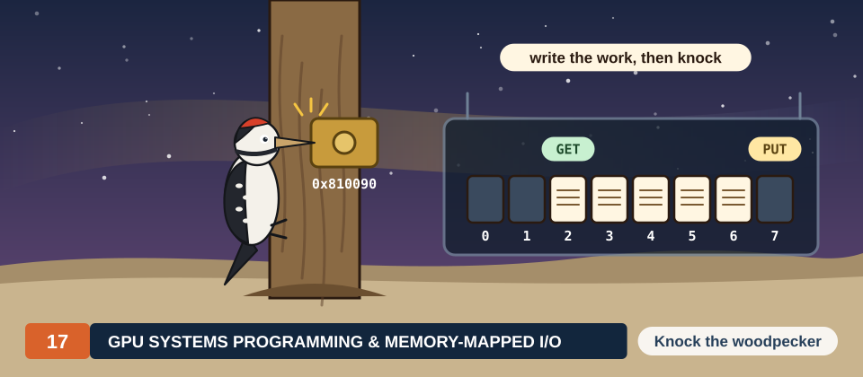
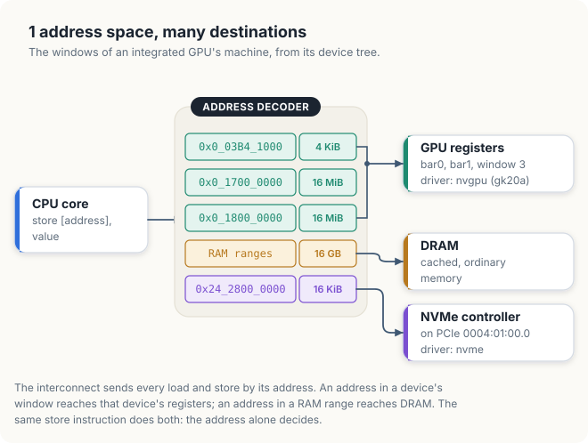
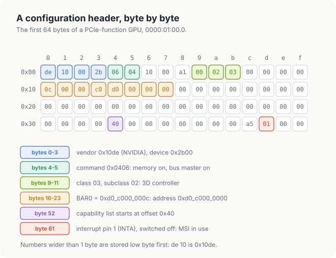
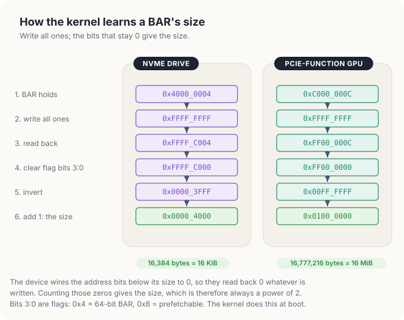
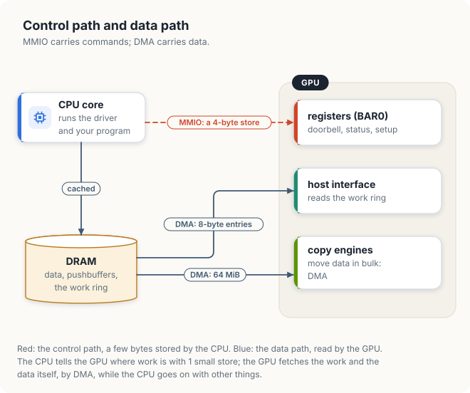
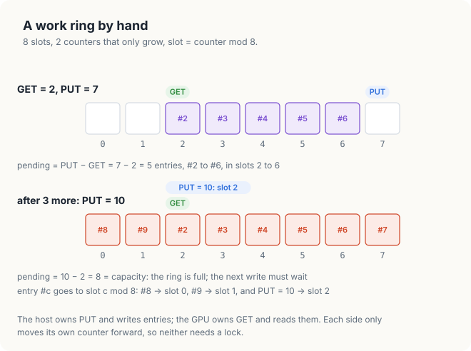
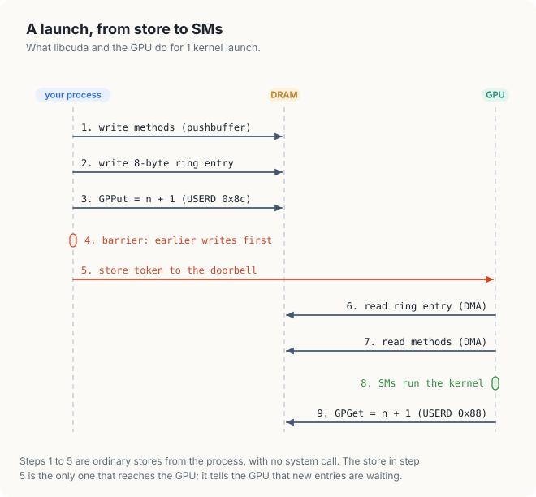
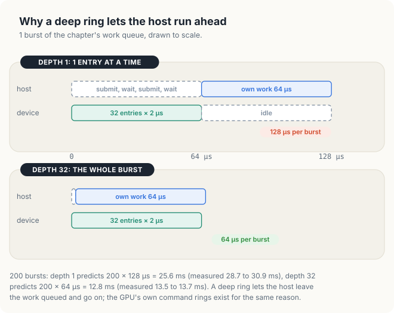
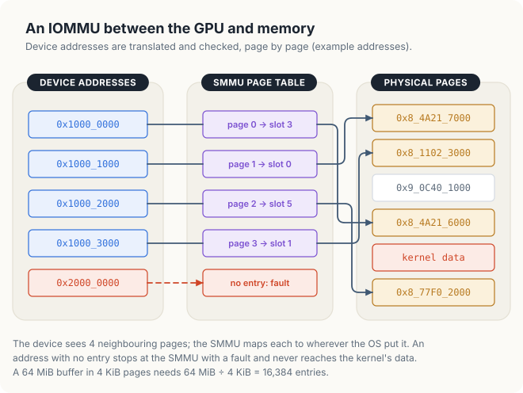

# Chapter 17: GPU Systems Programming & Memory-Mapped I/O

So far, we have used the GPU only through the CUDA API. `cudaMalloc` returns a pointer,
`cudaMemcpy` moves data, and a kernel launch with `<<<grid, block>>>` returns to the host after
a few microseconds while the kernel continues to run on the device. In Chapter 6 we measured a
launch at 3.77 µs. Because the CPU and the GPU are separate devices, a launch cannot be an
ordinary function call: the CPU must deliver the work to the GPU through the hardware that
connects them. In this chapter, we study that hardware and the way the driver uses it.

We start with the physical addresses through which a CPU reaches any device, and with the way
the operating system finds a GPU and the address ranges that the GPU occupies. We then look at
the 2 ways in which the CPU and the GPU exchange information: small stores into the GPU's
registers, called memory-mapped I/O, and bulk transfers that the GPU performs by itself, called
direct memory access. With these mechanisms in place, we follow a kernel launch from the CPU to
the GPU's streaming multiprocessors (SMs), and we build a working model of the mechanism with 2
CPU threads, in C++ and in Rust.

<div class="covers" markdown="1">

This chapter covers

- physical addresses, and memory-mapped I/O: devices that answer to addresses
- PCIe devices, their configuration space and their base address registers (BARs)
- 3 ways to attach a GPU: a discrete card on PCIe, an integrated GPU presented as a PCIe
  function, and an integrated GPU described by the device tree
- the control path (MMIO) and the data path (DMA), and why they differ
- cached, write-combined and device memory, measured from the CPU
- work rings and doorbells: how a kernel launch reaches the GPU without a system call
- the order of writes before a doorbell, and the errors that a wrong order causes
- the IOMMU, which checks every address a device uses
- the kernel-mode and user-mode drivers, and how to observe all of it on Linux

</div>

The code of the chapter is in
[`code/ch17_systems/`](https://github.com/arpanpathak/gpu-parallel-book/tree/main/code/ch17_systems)
for C++ and in
[`code/oxide/ch17_systems/`](https://github.com/arpanpathak/gpu-parallel-book/tree/main/code/oxide/ch17_systems)
for Rust. Neither needs root: everything the chapter shows can be read by an ordinary user.

## 17.1 The GPU is a device on a bus

### 17.1.1 Physical addresses and memory-mapped I/O

A processor names every byte it reads or writes by a number, its **address**. The addresses
that a program uses are virtual. The processor's memory management unit translates each one,
through the page tables that the operating system keeps, into a **physical address**: the
number that leaves the core and travels on the chip's internal buses. The set of all physical
addresses is the **physical address space**. On a 64-bit Arm or x86 machine it spans far more
numbers than the machine has bytes of memory, and most physical addresses lead nowhere.

The chip's interconnect decides where each physical address goes. Some ranges lead to the
memory controllers and so to DRAM, the main memory. Other ranges lead to devices: a disk
controller, a network card, the GPU. A **register** of a device is a small storage location
inside the device, often 4 bytes, whose contents control the device or report its state. When a
range of physical addresses leads to a device's registers, a load from one of those addresses
reads a register and a store writes one. This arrangement is called **memory-mapped I/O**, or
**MMIO**: the device is operated with the same load and store instructions that work on memory,
and the address alone decides whether an instruction reaches DRAM or a device.

Figure 17.1 shows the ranges that matter to this chapter on a Jetson Orin NX, a machine whose
GPU is built into the processor chip. They come from the machine's **device tree**, a
description of the hardware that the firmware hands to Linux at boot. For each built-in
device, the device tree lists the physical addresses of its registers.

<figure>

<figcaption><b>Figure 17.1</b> 1 physical address space, many destinations: the windows of an integrated GPU's machine.</figcaption>
</figure>

The GPU's node in that device tree holds 3 pairs of (address, size). Read as raw
bytes, its `reg` property is:

```console
$ xxd -g4 /sys/firmware/devicetree/base/bus@0/gpu@17000000/reg
00000000: 00000000 17000000 00000000 01000000  ................
00000010: 00000000 18000000 00000000 01000000  ................
00000020: 00000000 03b41000 00000000 00001000  ................
```

Each number in the property is written as 2 words of 32 bits, high word first, and each row
holds an address followed by a size. The first row therefore describes a window at
0x1700_0000 of 0x0100_0000 = 16,777,216 bytes, or 16 MiB. The second row describes another
16 MiB window at 0x1800_0000, and the third a window of 0x1000 = 4,096 bytes at 0x03B4_1000.
The kernel's binding for this family of GPUs names the first 2 windows `bar0` and `bar1`, after
the BARs of a PCIe GPU that we introduce in section 17.2.

A store by the CPU to 0x1700_0000 + \\(r\\) writes the GPU's register at offset \\(r\\) of
`bar0`. The driver, not a program, decides which offsets to touch; section 17.7 shows how the
operating system keeps ordinary programs away from these addresses.

### 17.1.2 PCIe: links, functions and addresses

Most devices in a computer are not built into the processor chip but attached through
**PCIe** (PCI Express), the standard connection for expansion devices. Section 4.1.2 described
its physical side: a **link** of 1 to 16 **lanes**, each lane a pair of wires in each
direction, carrying about 2 GB/s each way per lane in generation 4.0 and 4 GB/s in 5.0.

In this chapter, we need its logical side. PCIe carries **transactions**, packets with a type, an
address and data. A CPU store to an address inside a device's window becomes a *memory write*
transaction that travels down the link. A CPU load becomes a *memory read* transaction, and the
device answers with a *completion* packet that carries the data back. The **root complex** is
the part of the processor chip that turns the CPU's loads and stores into transactions and
back; each of its connectors is a **root port**. A device at the end of a link is an
**endpoint**.

Each endpoint holds one or more **functions**, logical devices with their own registers. A
function is named by 4 numbers, written `domain:bus:device.function`: the NVMe drive of the
same machine is `0004:01:00.0`, domain 4, bus 1, device 0, function 0. `lspci` lists every
function the kernel found:

```console
$ lspci                                               # Orin NX
0001:00:00.0 PCI bridge: NVIDIA Corporation Device 229e (rev a1)
0001:01:00.0 Network controller: Realtek ... RTL8822CE 802.11ac PCIe Wireless Network Adapter
0004:00:00.0 PCI bridge: NVIDIA Corporation Device 229c (rev a1)
0004:01:00.0 Non-Volatile memory controller: Samsung Electronics Co Ltd Device a80c
0008:00:00.0 PCI bridge: NVIDIA Corporation Device 229c (rev a1)
0008:01:00.0 Ethernet controller: Realtek ... RTL8111/8168/8411 PCI Express Gigabit Ethernet
```

The machine has 3 root ports in use, each shown as a PCI bridge on bus 0 of its own domain,
with 1 device behind each: a Wi-Fi card, an NVMe drive and an Ethernet controller. The GPU is
not in the list: on this machine it is not a PCIe device at all.

### 17.1.3 Discrete and integrated GPUs

A **discrete GPU** is a separate card with its own memory, joined to the CPU by a PCIe link
(or, on Grace Hopper, by NVLink-C2C). An **integrated GPU** is built on the same chip as the
CPU and uses the same memory. An integrated GPU can be attached in 2 different ways (figure
17.2).

<figure>

<figcaption><b>Figure 17.2</b> A discrete GPU, an integrated GPU presented as a PCIe function, and an integrated GPU described by the device tree.</figcaption>
</figure>

The GPU of figure 17.1 is a **platform device**: a device that Linux does not discover on a bus
but learns about from the device tree, by its fixed register addresses. We call it the
**platform-device GPU** below. An integrated GPU can instead be presented to software as a PCIe
function behind an internal root port. The same PCIe machinery that finds a discrete card then
finds it. A Jetson AGX Thor attaches its GPU this way, and we call it the **PCIe-function
GPU**:

```console
$ lspci -nn                                           # Jetson AGX Thor
0000:01:00.0 3D controller [0302]: NVIDIA Corporation Device [10de:2b00] (rev a1)
0001:01:00.0 Network controller [0280]: Realtek ... RTL8852CE PCIe 802.11ax Wireless ...
0002:01:00.0 Ethernet controller [0200]: Realtek Semiconductor Co., Ltd. Device [10ec:8126]
0005:01:00.0 Non-Volatile memory controller [0108]: Sandisk Corp WD PC SN5000S M.2 2280 ...
```

The table puts the 7 GPUs of the earlier chapters side by side. The link column is the path
between the CPU and the GPU, with the bandwidth of section 4.1.3.

| GPU | Attached by | Bandwidth each way | GPU memory |
|---|---|---|---|
| Jetson Orin NX 16 GB | on-chip bus, platform device | none needed: 1 memory | 16 GB LPDDR5, shared |
| Jetson AGX Thor | on-chip, presented as PCIe 01:00.0 | none needed: 1 memory | 128 GB LPDDR5X, shared |
| DGX Spark (GB10) | NVLink-C2C inside 1 package | none needed: 1 memory | 128 GB LPDDR5X, shared |
| GeForce RTX 4090 | PCIe 4.0 × 16 | 32 GB/s | 24 GB GDDR6X, own |
| GeForce RTX 5090 | PCIe 5.0 × 16 | 64 GB/s | 32 GB GDDR7, own |
| A100 | PCIe 4.0 × 16 | 32 GB/s | 40 or 80 GB HBM2e, own |
| H100 | PCIe 5.0 × 16 | 64 GB/s | 80 GB HBM, own |

A program can ask the CUDA runtime how its GPU is attached. The first part of the chapter's
program prints what `cudaGetDeviceProperties` and `cudaDeviceGetPCIBusId` report.

<p class="listing"><b>Listing 17.1</b> What the runtime knows about the device, in C++.</p>

```cpp
{{#include ../../../../code/ch17_systems/systems.cu:36:60}}
```

```console
device            Orin, sm_87                device            NVIDIA Thor, sm_110
PCI address       0000:00:00.0               PCI address       0000:01:00.0
integrated        1                          integrated        1
memory            15.3 GiB, L2 2 MiB         memory            122.8 GiB, L2 32 MiB
copy engines      2                          copy engines      2
canMapHostMemory  1                          canMapHostMemory  1
unifiedAddressing 1                          unifiedAddressing 1
pageableAccess    0                          pageableAccess    1
viaHostPageTables 0                          viaHostPageTables 1
hostNativeAtomic  1                          hostNativeAtomic  1
```

Both GPUs report `integrated` = 1. The PCIe-function GPU reports the address that `lspci`
showed, 0000:01:00.0. The platform-device GPU reports 0000:00:00.0: it has no PCIe address, and
the runtime fills the field with zeros. The last 3 lines return in section 17.6, which explains
how the PCIe-function GPU can use the CPU's page tables.

The Rust program asks the driver directly. cuda-core wraps the common queries, such as
`device_name` and `multiprocessor_count`. For an attribute it does not wrap, such as
`INTEGRATED`, the program calls `cuDeviceGetAttribute` from `cuda_core::sys`, the raw bindings,
inside 1 small `unsafe` function.

<p class="listing"><b>Listing 17.2</b> Device queries, in Rust.</p>

```rust,ignore
{{#include ../../../../code/oxide/ch17_systems/src/main.rs:15:22}}

{{#include ../../../../code/oxide/ch17_systems/src/main.rs:144:151}}
    // ...
}
```

```console
device      Orin, sm_87                      device      NVIDIA Thor, sm_110
SMs         8                                SMs         20
integrated  1                                integrated  1
```

## 17.2 Configuration space and BARs

### 17.2.1 The configuration header

Before an operating system can use a PCIe function, it must learn what the function is and
where its registers should live. Every function therefore carries a **configuration space**:
4 KiB of registers that the root complex can read and write by bus number, device number and
function number, before any other address has been assigned. Its first 64 bytes, the
**configuration header**, have the same layout on every PCIe function ever made. Linux lets an
ordinary user read them from sysfs. Here is the header of the PCIe-function GPU:

```console
$ xxd -g1 -l 64 /sys/bus/pci/devices/0000:01:00.0/config
00000000: de 10 00 2b 06 04 10 00 a1 00 02 03 00 00 00 00  ...+............
00000010: 0c 00 00 c0 d0 00 00 00 00 00 00 00 00 00 00 00  ................
00000020: 00 00 00 00 00 00 00 00 00 00 00 00 00 00 00 00  ................
00000030: 00 00 00 00 40 00 00 00 00 00 00 00 a5 01 00 00  ....@...........
```

Figure 17.3 decodes the fields that matter. PCIe stores numbers wider than 1 byte with the low
byte first, so the first 2 bytes, `de 10`, are the number 0x10de.

<figure>

<figcaption><b>Figure 17.3</b> The configuration header of the PCIe-function GPU, byte by byte.</figcaption>
</figure>

<div class="example" markdown="1">

Worked example: decoding the configuration header

1. **Vendor and device**, bytes 0 to 3: 0x10de is NVIDIA's vendor number, assigned by the
   PCI-SIG; 0x2b00 is the device number NVIDIA gave this GPU. `lspci -nn` printed the same
   pair as `[10de:2b00]`.
2. **Command**, bytes 4 and 5: 0x0406 = binary 0000 0100 0000 0110. Bit 1 lets the function
   answer memory transactions (its BARs are live). Bit 2 lets it start transactions of its own
   (it may read and write memory: DMA, section 17.5). Bit 10 switches off the old interrupt
   wire in favour of messages (section 17.7).
3. **Class**, bytes 9 to 11: programming interface 0x00, subclass 0x02, class 0x03. Class 3 is
   "display controller" and subclass 2 is "3D controller", a GPU with no display output.
4. **BAR0**, bytes 16 to 23: the 8 bytes read low first are 0x0000_00d0_c000_000c. Its low 4
   bits, 0xc = binary 1100, are flags: bit 0 = 0, a memory window; bits 2:1 = 10, a 64-bit
   address; bit 3 = 1, prefetchable. With the flags cleared, the window starts at
   0xd0_c000_0000.

</div>

A **BAR**, base address register, is one of 6 such fields in the header. Each describes a
window of the function's registers or memory. The function decides how large the window is
and what kind; the operating system decides where in the physical address space it goes, by
writing the address into the BAR. `lspci -v` prints the result of that negotiation:

```console
$ lspci -vv -s 0000:01:00.0                           # Jetson AGX Thor, as a normal user
0000:01:00.0 3D controller: NVIDIA Corporation Device 2b00 (rev a1)
	Control: I/O- Mem+ BusMaster+ SpecCycle- MemWINV- VGASnoop- ParErr- Stepping- SERR- ...
	Interrupt: pin A routed to IRQ 421
	IOMMU group: 83
	Region 0: Memory at d0c0000000 (64-bit, prefetchable) [size=16M]
	Capabilities: <access denied>
	Kernel driver in use: nvidia
```

`Mem+ BusMaster+` are bits 1 and 2 of the command register, and `Region 0` is BAR0 at the
address decoded above. The capabilities, which start at offset 0x40, lie beyond the first 64
bytes, and Linux shows them only to root.

### 17.2.2 BAR sizing

`lspci` reported `[size=16M]`, although no field of the header holds a size. The size is found
by a procedure that the PCI specification defines. A device implements only the high bits of each BAR's
address: the bits below the window's size are wired to 0, because a window of \\(2^k\\) bytes
must start at a multiple of \\(2^k\\). Software writes all ones into the BAR and reads it back;
the bits that stayed 0 reveal the size. Figure 17.4 works it for the NVMe drive of figure 17.1
and for the PCIe-function GPU.

<figure>

<figcaption><b>Figure 17.4</b> The size of a BAR: write all ones, read back, invert, add 1.</figcaption>
</figure>

Let us follow the procedure for the NVMe drive. Its window is 16 KiB = 16,384 bytes =
\\(2^{14}\\) bytes, so address bits 13 to 0 of its BAR are wired to 0. When software writes
0xFFFF_FFFF, the low word reads back as 0xFFFF_C004: bits 31 to 14 are 1, bits 13 to 4 are 0,
and bits 3 to 0 hold the flags, 0x4, which mark a 64-bit memory window. Clearing the flags gives
0xFFFF_C000, inverting gives 0x0000_3FFF = 16,383, and adding 1 gives 16,384 bytes. The same
steps on the PCIe-function GPU give 0x0100_0000 = 16,777,216 bytes, the `[size=16M]` that
`lspci` printed.

The kernel performs this sizing once, at boot, for every BAR of every function. Ordinary
programs never do it, and should not: a BAR full of ones points the device at the wrong
address until it is restored. It follows from the procedure that the size of a BAR is always
a power of 2. A GPU with 24 GiB of memory that wants all of it visible through 1 window needs
a BAR of 32 GiB, the next power of 2.

### 17.2.3 Bus addresses and CPU addresses

The address written in a BAR is the address that the device sees on its link, a **bus
address**. The CPU need not use the same number. The NVMe drive of figure 17.1 shows the
difference:

```console
$ xxd -g1 -s 16 -l 8 /sys/bus/pci/devices/0004:01:00.0/config
00000010: 04 00 00 40 00 00 00 00                          ...@....
$ lspci -v -s 0004:01:00.0 | grep Region
	Region 0: Memory at 2428000000 (64-bit, non-prefetchable) [size=16K]
```

The BAR holds 0x4000_0000 (flags 0x4, a 64-bit window that is not prefetchable). The CPU
reaches the same registers at 0x24_2800_0000. The root port translates between the 2: a CPU
store to 0x24_2800_0000 + \\(r\\) leaves the root port as a PCIe write to bus address
0x4000_0000 + \\(r\\). For the PCIe-function GPU the 2 numbers happen to be equal: its BAR
holds 0xd0_c000_0000, and `lspci` reports the CPU address d0c0000000. A driver must never
assume either case; Linux keeps the 2 kinds of address apart in its types for exactly this
reason.

### 17.2.4 The BARs of a GPU

NVIDIA's open-source kernel driver describes the windows of its GPUs. **BAR0** holds the GPU's
registers. **BAR1** is a window onto the GPU's own memory, through which the CPU can read
and write device memory with loads and stores. On consumer cards BAR1 has traditionally been
256 MiB, a small sliding view of the whole memory. With **Resizable BAR**, a PCIe feature that
lets the system grow a BAR at boot, it can cover all of the memory. Data-centre GPUs such as
the A100 and the H100 offer a BAR1 at least as large as their memory.

The PCIe-function GPU has only BAR0, 16 MiB of registers. It has no memory of its own to
expose: its memory is the system's DRAM, which the CPU already reaches directly. The device
tree of the platform-device GPU gives it a `bar0` and a `bar1` of 16 MiB each, plus a 4 KiB
window, again with no window onto a separate memory.

## 17.3 Memory-mapped I/O as the control path

### 17.3.1 Loads and stores with side effects

A load from DRAM has no effect on the memory, and reading the same address twice gives the
same value. A load from a device register can have an effect: reading a status register may
clear the event it reports, and 2 reads may return 2 different values because the device
changed state in between. A store to a register is a command, such as "start", "reset" or
"new work is waiting". Such effects are called **side effects**, and they change what the processor may do with the
addresses.

A processor keeps copies of memory in its caches and reads ahead of a program when it expects
to need data soon. Both behaviours are wrong for a device: a cached copy of a status register goes
stale, and a load that the processor issued early, on a guess, may trigger a side effect the
program never asked for. Every page in a program's address space therefore carries a **memory
type** in its page-table entry, which tells the processor how it may treat the addresses:

| Memory type (Arm name; x86 name) | Cached | Speculative reads | Stores merged | Used for |
|---|---|---|---|---|
| Normal, cacheable (WB) | yes | yes | yes | DRAM |
| Normal, non-cacheable (WC, write-combining) | no | yes | yes | frame buffers, BAR1-like windows |
| Device-nGnRE (UC, uncached) | no | no | no | registers in BAR0 |

**Write-combining** memory is not cached, but the processor may gather several stores to
neighbouring addresses in a small buffer and send them as 1 larger transaction. A program that
fills a frame buffer or a command buffer with a stream of stores runs much faster that way.
Device memory forbids even that: each store reaches the device as written, in program order.

On PCIe the 2 directions differ in cost. A memory write is **posted**: the root complex sends
it and lets the CPU continue at once, without waiting for any reply. A memory read must wait
for the device's completion to travel back across the link, typically several hundred
nanoseconds to more than a microsecond, a few thousand CPU cycles. Drivers therefore write
registers freely and read them as rarely as they can.

The CPU uses MMIO for **control**: a few bytes that tell the device what to do. Bulk data takes
another path. The device itself reads and writes memory, by **DMA** (direct memory access),
while the CPU does other work (figure 17.5).

<figure>

<figcaption><b>Figure 17.5</b> The control path carries a few bytes from the CPU; the data path carries the rest, fetched by the GPU.</figcaption>
</figure>

### 17.3.2 CPU access speed by memory type

The registers of a GPU are out of reach of an ordinary program, but the memory types
are not. CUDA can allocate host memory with the write-combining type: `cudaHostAlloc` with the
flag `cudaHostAllocWriteCombined`. The second part of the chapter's program runs the same 2
loops, a write of every word and a sum of every word, over 64 MiB of 4 kinds of memory.

<p class="listing"><b>Listing 17.3</b> The same CPU loops over 4 kinds of memory, in C++.</p>

```cpp
{{#include ../../../../code/ch17_systems/systems.cu:108:134}}
```

`timeCpu` writes the value 1 into every word, sums every word, keeps the best of 5 passes, and
checks that the sum equals the number of words. The output on both machines:

```console
CPU access to 64 MiB through each mapping:                            # Orin NX
malloc (pageable)        write  27.02 GB/s   read  12.03 GB/s   PASSED
cudaMallocHost (pinned)  write  26.62 GB/s   read  11.93 GB/s   PASSED
write-combined pinned    write  13.75 GB/s   read   1.09 GB/s   PASSED
cudaMallocManaged        write  27.20 GB/s   read  12.13 GB/s   PASSED

CPU access to 64 MiB through each mapping:                            # Thor
malloc (pageable)        write  41.61 GB/s   read  20.52 GB/s   PASSED
cudaMallocHost (pinned)  write  41.43 GB/s   read  20.61 GB/s   PASSED
write-combined pinned    write  41.44 GB/s   read  20.69 GB/s   PASSED
cudaMallocManaged        write  41.38 GB/s   read  20.69 GB/s   PASSED
```

On the platform-device machine, 3 of the 4 kinds of memory behave alike, because all 3 are
ordinary cacheable DRAM to the CPU. They ran at about 27 GB/s for writes and 12 GB/s for reads,
the speed of 1 CPU core. Write-combined memory is different. Its reads ran at 1.09 GB/s, 12.03
/ 1.09 ≈ 11 times slower, because no read is served from a cache and none is fetched ahead:
each load waits for DRAM. Its writes ran at 13.75 GB/s, half the cached speed but 13 times its
own reads, because the write-combining buffer still merges the stores into whole lines. On the
PCIe-function machine the flag changed nothing: all 4 kinds ran at about 41 GB/s and 21 GB/s.
CUDA's documentation describes the flag as a request that helps "on some system
configurations", and there the memory was mapped cacheable. The Rust program measures the 2
kinds that cuda-core can allocate, `Vec` and `PinnedHostBuffer`; cuda-core has no
write-combined allocation at rev b7fe543. On the platform-device machine it found the same as
C++: 27.41 and 27.58 GB/s for writes, 12.43 and 12.32 GB/s for reads. Runs differ by about 10%
from one to the next.

### 17.3.3 Ordering writes before a doorbell

A device usually learns of new work in 2 steps. The CPU first writes the work itself into
memory, then stores into 1 register, the **doorbell**, to tell the device to look. The order of
those 2 steps decides whether the device sees the work. If the doorbell's store reached the
device first, the device would read the memory before the work was in it.

The processor does not keep stores in program order on its own. An Arm core may let a later
store become visible before an earlier one, and stores to cacheable memory and stores to device
registers travel by different paths. A **barrier** is an instruction that keeps the order:
every memory access before it completes, as seen by other observers, before any after it. On
Arm the barriers are the `DMB` and `DSB` instructions; in C++ and Rust, a store with *release*
ordering places the barrier before the store. Linux's `writel()`, the function a driver uses to
write a 32-bit register, puts a write barrier before the store for exactly this case, so that a
device started by the register sees every earlier write to memory. Section 17.4.6 shows what
happens when the order is wrong.

## 17.4 Work rings and doorbells

### 17.4.1 A ring of work entries

A kernel launch returns in microseconds because the CPU does not hand the work to the GPU and
wait; it leaves the work in memory for the GPU to collect. The structure that holds the work is
a **ring buffer**: an array of a fixed number of **slots**, used in a circle, with 2 counters.
**PUT** counts the entries the CPU has written, and **GET** counts the entries the GPU has
finished. Both only grow. Entry number \\(c\\) lives in slot \\(c \bmod n\\), where \\(n\\) is
the number of slots, so the slots are reused once the ring wraps around.

```text
host, to submit entry e:                      device, forever:
    while PUT - GET = n: wait                     wait until GET ≠ PUT
    ring[PUT mod n] ← e                           run ring[GET mod n]
    barrier                                       GET ← GET + 1
    PUT ← PUT + 1          (the doorbell)
```

<div class="example" markdown="1">

Worked example: a ring of 8 slots

1. GET = 2 and PUT = 7: entries #2 to #6 are waiting, PUT − GET = 7 − 2 = 5 of them, in slots
   2 to 6.
2. The host writes 3 more entries. Entry #7 goes to slot 7 mod 8 = 7, #8 to slot 8 mod 8 = 0,
   #9 to slot 9 mod 8 = 1. PUT is now 10.
3. PUT − GET = 10 − 2 = 8 = the number of slots: the ring is full. Entry #10 would go to slot
   10 mod 8 = 2, which still holds #2, not yet run; the host must wait until GET passes 2.
4. Each counter has 1 writer: the host moves PUT, the device moves GET. Neither side needs a
   lock.

</div>

<figure>

<figcaption><b>Figure 17.6</b> A work ring of 8 slots, by hand.</figcaption>
</figure>

| Symbol | Meaning | In the example |
|---|---|---|
| \\(n\\) | number of slots in the ring | 8 |
| PUT | entries written by the host so far | 7, then 10 |
| GET | entries finished by the device so far | 2 |
| PUT − GET | entries waiting; the ring is full when it equals \\(n\\) | 5, then 8 |
| \\(c \bmod n\\) | slot of entry \\(c\\) | #9 → slot 1 |

### 17.4.2 The ring and the doorbell of an NVIDIA GPU

An NVIDIA GPU receives work through **channels**. A channel is 1 ordered stream of commands
from 1 process to the GPU; the CUDA runtime places each stream's work on 1 of a pool of
channels. Each channel has 3 structures in memory that both the CPU and the GPU can reach.
NVIDIA's open-source kernel driver publishes their layouts in its class headers:

- The **pushbuffer** holds the commands themselves, called **methods**: "set this kernel's
  parameters", "launch with this grid", "signal this semaphore". A launch is a short run of
  methods.
- The **GPFIFO** is the ring of the previous section. Each entry is 8 bytes and points at a
  piece of the pushbuffer: its address and its length (`GP_ENTRY__SIZE` = 8 in the headers).
- **USERD** is a small page of counters for the channel. At offset 0x8c it holds `GPPut`, the
  ring's PUT, which the CPU writes; at offset 0x88, `GPGet`, which the GPU writes.

Since the Volta generation, the doorbell is a register named `NOTIFY_CHANNEL_PENDING`, at
offset 0x90 of a 64 KiB "user mode" window that the headers place at offset 0x81_0000 of BAR0.
The CPU stores the channel's **work-submit token**, a number the driver gives each channel,
into that register. The register's page is mapped into the process, so the store needs no
system call. Figure 17.7 puts the steps of 1 launch in order.

<figure>

<figcaption><b>Figure 17.7</b> 1 kernel launch, from the stores of libcuda to the SMs.</figcaption>
</figure>

Steps 1 to 5 are the launch call that Chapter 6 timed: a few ordinary stores into memory, 1
barrier and 1 store to a register, 3.77 µs with the rest of the runtime's work.
Steps 6 to 9 happen later, on the GPU's own time. The part of the GPU that reads the ring, its
**host interface**, fetches entries and methods from memory by DMA, so the CPU never waits for
the GPU to accept anything. Only when the ring is full does a launch wait, exactly as the host
waits in the worked example.

### 17.4.3 Doorbells in an NVMe drive

The design is not peculiar to GPUs. An NVMe drive, whose specification is public, takes its
commands the same way. The host writes 64-byte commands into a **submission queue** in memory,
then writes the queue's new tail, its PUT, into a doorbell register in BAR0. The specification
places the doorbells right after the drive's 4 KiB of control registers:

\\[ \text{SQ tail doorbell of queue } y = \text{0x1000} + 2y \cdot (4 \ll \text{DSTRD}) \\]

\\[ \text{CQ head doorbell of queue } y = \text{0x1000} + (2y + 1) \cdot (4 \ll \text{DSTRD}) \\]

| Symbol | Meaning | On the drive of figure 17.1 |
|---|---|---|
| \\(y\\) | queue number; 0 is the administration queue | 0 to 8 |
| DSTRD | doorbell stride, read from the drive's capability register | 0 (the usual value) |
| \\(4 \ll \text{DSTRD}\\) | bytes between doorbells | 4 |

For example, `/proc/interrupts` lists 9 interrupt lines for the drive of figure 17.1,
`nvme0q0` to `nvme0q8`: the administration queue and 8 I/O queues, 1 per CPU core. With a
stride of 4 bytes, the submission doorbell of queue 8 sits at 0x1000 + 2 × 8 × 4 = 0x1040, and
its completion doorbell at 0x1000 + 17 × 4 = 0x1044. The highest doorbell, at 0x1047, lies well
inside the 16 KiB = 0x4000-byte BAR0 that we sized in figure 17.4.

### 17.4.4 A software model of a work ring

The chapter's program builds the mechanism with 2 CPU threads, so that we can run it, time it,
and observe what happens when the order of writes is wrong. A *host* thread submits entries; a *device* thread plays the GPU's host
interface. Each entry carries an opcode and an argument. The device thread spends 2 µs on each
entry, a stand-in for a kernel, and adds the argument to a sum, so the program can check that
every entry was run exactly once.

The doorbell here is an atomic counter, PUT, that the device thread watches. A real device
would be woken by a store to its register instead of watching memory, but the order of events
is the same. Each counter sits on its own 64-byte cache line, as each register of a device has
its own address.

<p class="listing"><b>Listing 17.4</b> The ring, the device and the doorbell, in C++.</p>

```cpp
{{#include ../../../../code/ch17_systems/systems.cu:136:188}}
```

`submit` waits while the ring holds `depth` entries, writes the entry, then stores PUT + 1 with
release ordering: the barrier of section 17.3.3, built into the store. The device loads PUT
with acquire ordering, which pairs with the release: once the device sees PUT = \\(c\\) + 1, it
also sees entry \\(c\\). The `doorbellFirst` branch exists to break that order on purpose
(section 17.4.6).

Rust's version stores each entry in an `AtomicU64`, with the opcode in the high 32 bits. Rust
does not allow 2 threads to touch the same plain memory when one of them writes, so the slots are
atomics too. A `Relaxed` store compiles to an ordinary store, and the `Release` store of the
doorbell provides the order.

<p class="listing"><b>Listing 17.5</b> The ring, the device and the doorbell, in Rust.</p>

```rust,ignore
{{#include ../../../../code/oxide/ch17_systems/src/main.rs:58:104}}
```

### 17.4.5 Ring depth and run-ahead

The program submits 200 bursts of 32 entries. After each burst the host does 64 µs of work of
its own, so the work a GPU would do and the work the CPU does could overlap. We run it with a
ring of depth 1, 4, 32 and 64: the host may run at most that many entries ahead of the device.
Before we run it, we can predict the time of 1 burst.

<div class="example" markdown="1">

Worked example: 1 burst at depth 1, 4 and 32

1. The device needs 32 entries × 2 µs = 64 µs per burst, and the host needs 64 µs for its own
   work.
2. Depth 1: the host can submit entry \\(k\\) only after the device has finished entry
   \\(k − 1\\). It waits through almost all 64 µs of the device's work, then works alone for
   64 µs. A burst takes about 64 + 64 = 128 µs, and 200 bursts take 200 × 128 µs = 25.6 ms.
3. Depth 4: the host writes 4 entries at once, then 1 more each time the device finishes 1. Its
   last entry goes in after the device has finished 28: 28 × 2 µs = 56 µs. Then come 64 µs of
   its own work: 56 + 64 = 120 µs per burst, 200 × 120 µs = 24.0 ms.
4. Depth 32: the whole burst fits. The host writes 32 entries in about a microsecond and starts
   its own work while the device runs them; both take 64 µs, so a burst takes 64 µs, and 200
   bursts take 12.8 ms. Depth 64 can do no better.

</div>

```console
Work queue: 200 bursts of 32 entries, 2 us each, 64 us of host work:   # Orin NX, C++
depth  1, entry first      30.85 ms   sum 20483200 of 20483200   PASSED
depth  4, entry first      26.01 ms   sum 20483200 of 20483200   PASSED
depth 32, entry first      13.69 ms   sum 20483200 of 20483200   PASSED
depth 64, entry first      14.21 ms   sum 20483200 of 20483200   PASSED

Work queue: 200 bursts of 32 entries, 2 us each, 64 us of host work:   # Thor, C++
depth  1, entry first      28.66 ms   sum 20483200 of 20483200   PASSED
depth  4, entry first      25.76 ms   sum 20483200 of 20483200   PASSED
depth 32, entry first      13.50 ms   sum 20483200 of 20483200   PASSED
depth 64, entry first      13.49 ms   sum 20483200 of 20483200   PASSED

Work queue: 200 bursts of 32 entries, 2 us each, 64 us of host work:   # Orin NX, Rust
depth  1    29.80 ms   sum 20483200 of 20483200   PASSED
depth  4    25.01 ms   sum 20483200 of 20483200   PASSED
depth 32    13.69 ms   sum 20483200 of 20483200   PASSED
depth 64    13.86 ms   sum 20483200 of 20483200   PASSED
```

Every run summed all 6,400 arguments, 1 + 2 + … + 6,400 = 6,400 × 6,401 / 2 = 20,483,200, so
every entry ran exactly once. The times follow the prediction. Depth 1 took 28.7 to 30.9 ms
against 25.6 ms predicted, depth 4 took 25.0 to 26.0 ms against 24.0 ms, and depths 32 and 64
took 13.5 to 14.2 ms against 12.8 ms. The measured times sit 4% to 21% above the predictions:
the cost of the threads waking, the clock reads and the cache lines moving between the 2 cores.
Figure 17.8 draws 1 burst at depth 1 and at depth 32.

<figure>

<figcaption><b>Figure 17.8</b> 1 burst at depth 1 and at depth 32, to scale.</figcaption>
</figure>

Note that the ring halves the total time only when it holds the whole burst. A ring is a queue, and a
queue lets the producer run ahead of the consumer by as many entries as it holds; this is the
mechanism behind Chapter 6's asynchronous launches and streams. A GPU's rings hold hundreds of
entries, so a program can queue many kernels and copies before it must wait.

<div class="bee bee-happy" markdown="1">

A launch is a few stores into a ring in memory and 1 store to a doorbell. The deeper the ring,
the further the CPU can run ahead of the GPU.

</div>

### 17.4.6 Ordering errors

Run with `--doorbell-first`, the program stores PUT + 1 before it writes the entry. The device
may then see the new PUT, read the slot, and find whatever the slot held before: an entry from
the previous lap, or nothing.

```console
$ ./systems --doorbell-first                                              # Orin NX
depth  1, doorbell first   31.50 ms   sum 20479232 of 20483200   FAILED
depth  4, doorbell first   25.35 ms   sum 20483200 of 20483200   PASSED
depth 32, doorbell first   13.50 ms   sum 20483200 of 20483200   PASSED
depth 64, doorbell first   13.50 ms   sum 20483200 of 20483200   PASSED
```

At depth 1 the device read stale slots and lost 20,483,200 − 20,479,232 = 3,968 from the sum.
The other 3 depths passed in this run. Over 5 runs on the platform-device machine, 4 of the 20
results were wrong, and on the PCIe-function machine 3 of 12; which ones fail changes from run
to run. Depth 1 fails most often, because the device thread is idle and watching PUT when the
doorbell rings, so it reaches the slot in the instant before the entry arrives. The same swap
in the Rust program failed at depth 1 in all 5 runs.

The Rust version shows a further point. Rust does not compile a program in which 2 threads
touch the same plain memory, so the slots had to be atomics. The broken program is
nevertheless free of data races in Rust's sense, and it still loses entries. The compiler can
prove that every access is safe, but not that the protocol, entry first and doorbell second, is
followed. The C++ version is worse off: there the swap also creates a data race, and its
behaviour is undefined. In a driver, the same mistake causes the GPU to execute stale
commands, rarely and usually under load.

<div class="bee bee-angry" markdown="1">

Write the work, then a barrier, then the doorbell. In the other order, the program passed most
runs and failed some, which makes the error hard to find.

</div>

## 17.5 DMA as the data path

**DMA**, direct memory access, is a transfer that a device performs itself, reading or writing
memory without a CPU core moving each byte. A PCIe function may do it only while its *bus
master* bit is set, bit 2 of the command register that figure 17.3 decoded (`BusMaster+` in
`lspci`). A GPU uses DMA for 2 different jobs. Its host interface reads the work rings and
pushbuffers, as in steps 6 and 7 of figure 17.7. Its **copy engines**, units that do nothing
but move data, carry out `cudaMemcpy` and its asynchronous forms; both GPUs of listing 17.1
report 2 of them.

A copy engine is told what to move by a **descriptor**, a small record in memory with a source
address, a destination address and a length. For `cudaMemcpy` from a host buffer to the device,
the sequence is:

1. The driver makes sure the host buffer's pages cannot move, by pinning them or by staging the
   data through a pinned buffer (section 4.2.2 explains why).
2. It writes one or more descriptors, as methods in a channel's pushbuffer.
3. It rings the channel's doorbell, as in section 17.4.2.
4. The copy engine reads the descriptors, then reads the source by DMA and writes the
   destination, while the CPU does other work.
5. The engine signals completion, by writing a value into memory that the driver checks or by
   raising an interrupt (section 17.7).

The addresses in a descriptor are the addresses that the device uses, not the CPU's virtual
addresses. On a system with an IOMMU they are not physical addresses either, as the next
section explains.

## 17.6 The IOMMU

A device that can write any physical address can overwrite any memory, including the kernel's.
A faulty device, or a malicious one plugged into an external port, could then take over the
machine. An **IOMMU** (input-output memory management unit; the Arm name is **SMMU**, system
MMU) sits between devices and memory and does for DMA what the CPU's MMU does for loads and
stores. It translates every address a device uses, an **I/O virtual address** or IOVA, through
page tables that the kernel controls, and refuses any address the kernel has not mapped for
that device (figure 17.9).

<figure>

<figcaption><b>Figure 17.9</b> An IOMMU translates and checks each page a device touches (example addresses).</figcaption>
</figure>

The IOMMU gives 2 benefits besides safety. A buffer whose pages lie scattered in physical
memory looks contiguous to the device, so 1 descriptor can cover it. And the kernel can take a
mapping away, for example when a device is unplugged or handed to a virtual machine.

The mappings have a cost. A 64 MiB buffer in 4 KiB pages has 67,108,864 ÷ 4,096 = 16,384
pages, so before a copy engine can read it, the kernel writes 16,384 entries into the IOMMU's
page table. The IOMMU caches recent translations in its own **TLB** (translation lookaside
buffer), a small cache of page-table entries. A buffer that is pinned once and reused keeps its
entries, whereas a buffer that is pinned again for every copy has them rebuilt each time; section
4.2.3 discusses why pinning is slow to set up.

Both machines route their devices through SMMUs. The platform-device machine has 3 SMMU
instances and 53 **IOMMU groups**, sets of devices that the IOMMU cannot tell apart and that
are always isolated together; its NVMe drive is in group 5. The PCIe-function machine has 5
SMMU instances of Arm's version 3 and 86 groups; its GPU is in group 83 (`IOMMU group: 83` in
the `lspci` output of section 17.2.1).

Some systems let a device go further and use the CPU's own page tables. With **ATS**, address
translation services, a PCIe device asks the IOMMU for translations and caches them, and the
IOMMU can walk the same page tables the CPU uses for a process. `nvidia-smi -q` on the
PCIe-function machine reports `Addressing Mode : ATS`. This is why its GPU printed
`pageableAccess 1` and `viaHostPageTables 1` in listing 17.1: it can follow a pointer returned
by `malloc`, because it translates the address the same way the CPU does. The platform-device
GPU printed 0 for both, so a kernel there needs memory that CUDA allocated or registered.

## 17.7 The kernel-mode and user-mode drivers

The GPU is driven by 2 pieces of software. The **kernel-mode driver** (KMD) runs inside the
operating system's kernel. It alone maps the GPU's BARs, programs the IOMMU, handles the GPU's
interrupts, manages its power and clocks, and allocates its memory. The **user-mode driver**
(UMD) is a library loaded into each process; for CUDA it is `libcuda.so`, the library behind
both the runtime API and the driver API. It implements the API, builds pushbuffers and ring
entries, and keeps each context's state.

A program reaches the KMD through **device files**, special files in `/dev` whose operations
the kernel forwards to a driver. The UMD opens them, calls `ioctl` on them to ask for setup
work (allocate memory, create a channel), and calls `mmap` on them to map pages into the
process. Among those pages are the channel's ring, pushbuffer and USERD, and the page holding
the doorbell register. From then on the UMD submits work by itself, with ordinary stores
(figure 17.10).

<figure>

<figcaption><b>Figure 17.10</b> The kernel sets things up; the process submits work by itself.</figcaption>
</figure>

The 2 machines use different KMDs, which the chapter's program shows. Listing the device files
that a running `systems` process holds open:

```console
$ ls -l /proc/<pid>/fd | grep /dev                    # Orin NX: nvgpu and nvmap modules
/dev/nvgpu/igpu0/ctrl  /dev/nvmap  /dev/dri/render...
$ ls -l /proc/<pid>/fd | grep /dev                    # Thor: nvidia and nvidia_uvm modules
/dev/nvidia0 (18 times)  /dev/nvidiactl  /dev/nvidia-uvm (2 times)  /dev/nvmap ...
```

On the PCIe-function machine the process also had 13 mappings of `/dev/nvidiactl` and 2 of
`/dev/nvidia0` in its address space. The platform-device GPU is driven by `nvgpu`, NVIDIA's
driver for Tegra GPUs, which binds to the platform device `17000000.gpu` under the name
`gk20a`. The PCIe-function GPU is driven by `nvidia`, the same open kernel module that drives
discrete GPUs, with `nvidia_uvm` for unified memory.

The split explains 3 facts that earlier chapters stated without a reason. A launch costs a few
microseconds, not the tens that a system call and a return would add, because it does not enter
the kernel. A CUDA context belongs to a process, because the mappings and the channels belong
to a process. And a crashed kernel ends with an error in 1 process, not a crashed machine,
because the KMD stays in control of the GPU and can reset the faulty channel.

**Interrupts** go the other way, from the device to the CPU. A device raises one to report an
event, such as a finished copy or a fault, and the CPU stops what it is doing to run the KMD's
handler. The platform-device GPU uses wires into the interrupt controller, named in its device
tree; the PCIe-function GPU sends **MSI** interrupts, which are memory writes to a special
address, so they need no wire.

The device tree of the platform-device GPU gives it 4 interrupts, numbered 0x44, 0x46, 0x47 and
0x43 among the interrupt controller's *shared peripheral interrupts*, and named `stall0`,
`stall1`, `stall2` and `nonstall`. On an Arm GICv3 interrupt controller, shared peripheral
interrupts start at number 32, so 0x44 = 68 becomes interrupt 68 + 32 = 100, and
`/proc/interrupts` lists it as `GICv3 100 gk20a_stall`; the other 3 appear as 99, 102 and 103.
Line 103 had counted 49,415,447 interrupts after 2,590,200 s of uptime, or about 19 interrupts
per second. The PCIe-function GPU uses 8 MSI vectors instead, listed as 8 lines named `nvidia`.

Interrupts are for events that the CPU must hear about. The submission of work never needs one:
the doorbell is a store from the CPU, and the CPU learns that work has finished by reading GET,
or a semaphore the GPU wrote, in memory.

## 17.8 Observing the system on Linux

The mechanisms of this chapter can be observed on any Linux machine with a GPU, without root
privileges. The table lists the commands and what each one showed on the 2 machines.

| Command | Shows | Platform-device GPU | PCIe-function GPU |
|---|---|---|---|
| `lspci -nn` | PCIe functions with vendor and device | no GPU on PCIe | `01:00.0 [10de:2b00]` |
| `lspci -vv -s <addr>` | command bits, BARs, IOMMU group, driver | NVMe: 16K BAR0, group 5 | GPU: 16M BAR0, group 83, `nvidia` |
| `xxd -l 64 /sys/bus/pci/devices/<addr>/config` | the configuration header | NVMe | GPU |
| `/sys/bus/platform/devices/*gpu*` | platform devices and their driver | `17000000.gpu`, `gk20a` | none |
| `/sys/firmware/devicetree/base/.../reg` | register windows from the device tree | 3 windows | not needed |
| `/proc/interrupts` | interrupt lines and counts | `gk20a_stall` on GIC 99 to 103 | 8 × `nvidia` (MSI) |
| `ls /sys/class/iommu`, `/sys/kernel/iommu_groups` | IOMMU instances and groups | 3, 53 groups | 5 (SMMUv3), 86 groups |
| `/proc/<pid>/fd`, `/proc/<pid>/maps` | device files a CUDA process uses | `nvgpu/igpu0/ctrl`, `nvmap` | `nvidia0`, `nvidiactl`, `nvidia-uvm` |
| `nvidia-smi -q` | bus ID, addressing mode, BAR1 size | not available | `ATS` |

One file needs root: `/proc/iomem`, the kernel's map of the physical address space. An ordinary
user sees its names but every address as 0, because physical addresses help an attacker who is
trying to exploit a kernel bug:

```console
$ grep gpu /proc/iomem                               # Orin NX, as a normal user
00000000-00000000 : 17000000.gpu gpu@17000000
00000000-00000000 : 17000000.gpu gpu@17000000
```

<details class="check"><summary>The platform-device GPU is not in <code>lspci</code>. How does Linux find it, and where are its registers?</summary>

It is a platform device: the firmware's device tree describes it, and Linux reads the
description at boot. Its `reg` property gives 3 windows: 16 MiB at 0x1700_0000, 16 MiB at
0x1800_0000 and 4 KiB at 0x03B4_1000. The `gk20a` driver, part of the `nvgpu` module, binds to
it.

</details>

## 17.9 CUDA calls and the mechanisms beneath them

We can now relate each CUDA call that touches the hardware to the mechanisms of this chapter.

| CUDA call | What happens underneath |
|---|---|
| `cudaMalloc` | the KMD allocates device memory and maps it in the GPU's page tables; the pointer is a GPU virtual address |
| `kernel<<<...>>>` | the UMD writes methods and a ring entry, then stores to the doorbell; no system call |
| `cudaMemcpy` | pins or stages the host buffer, writes copy descriptors, rings the doorbell, waits for completion |
| `cudaMemcpyAsync` | the same on a stream's channel, without the wait, so copies overlap kernels (Chapter 6) |
| `cudaMallocHost` | pins host pages and maps them in the IOMMU once, so copy engines can read them directly |
| `cudaHostAlloc(..., cudaHostAllocWriteCombined)` | pinned memory mapped write-combining for the CPU: fast streaming writes, slow reads |
| `cudaHostGetDevicePointer` | gives the GPU an address for pinned host memory (zero-copy, section 4.6) |
| `cudaMallocManaged` | 1 address for CPU and GPU; pages migrate on faults, or are shared outright with ATS |
| `cudaDeviceEnablePeerAccess` | lets 1 GPU's DMA reach another GPU's memory (Chapter 18) |
| `cudaStreamSynchronize` | waits until the stream's GET passes its last entry, by polling memory or by an interrupt |

## 17.10 The complete programs

<p class="listing"><b>Listing 17.6</b> The complete <code>systems.cu</code>. <a href="https://github.com/arpanpathak/gpu-parallel-book/blob/main/code/ch17_systems/systems.cu">code/ch17_systems/systems.cu</a></p>

```cpp
{{#include ../../../../code/ch17_systems/systems.cu}}
```

<p class="listing"><b>Listing 17.7</b> The complete Rust program. <a href="https://github.com/arpanpathak/gpu-parallel-book/blob/main/code/oxide/ch17_systems/src/main.rs">code/oxide/ch17_systems/src/main.rs</a></p>

```rust,ignore
{{#include ../../../../code/oxide/ch17_systems/src/main.rs}}
```

## Common mistakes

- **Dereferencing a device pointer on the CPU.** A pointer from `cudaMalloc` is a GPU virtual
  address. On a discrete GPU the CPU has no mapping for it, and the program crashes. Only
  managed memory, pinned mapped memory, or ATS on systems that support it make 1 address valid
  on both sides.
- **Ringing the doorbell before the work is written.** The device may read the slot early.
  Write the entry, then use a release store or a barrier, then the doorbell (section 17.4.6).
- **Reading from write-combined memory.** It is meant for streams of writes; the CPU read it 11
  times slower than cached memory on the platform-device machine.
- **Assuming a bus address equals a CPU address.** On the platform-device machine the NVMe BAR
  holds 0x4000_0000 while the CPU uses 0x24_2800_0000.
- **Pinning a buffer for every copy.** Each pin rebuilds IOMMU entries and page locks; pin once
  and reuse the buffer.
- **Expecting a PCIe address for every GPU.** A platform-device GPU has none; the runtime
  reports 0000:00:00.0.

<div class="summary" markdown="1">

## Summary

- Memory-mapped I/O makes a device's registers answer to physical addresses; the address alone
  decides whether a load or store reaches DRAM or a device.
- A PCIe function is described by a 64-byte configuration header: vendor, device, class,
  command bits and up to 6 BARs. A BAR's size is found by writing all ones and is always a
  power of 2: 16 KiB for an NVMe drive, 16 MiB for an integrated GPU's registers.
- A discrete GPU has a BAR0 of registers and a BAR1 window on its own memory. An integrated GPU
  may be a PCIe function with only BAR0, or a platform device found in the device tree.
- MMIO is the control path: few bytes, written by the CPU, with posted writes and slow reads.
  DMA is the data path: the GPU reads and writes memory itself.
- The memory type of a mapping decides CPU speed: write-combined memory read 11 times slower
  than cached memory on the platform-device machine, while the PCIe-function machine mapped it
  cacheable.
- A kernel launch writes methods and an 8-byte entry into a ring in memory and stores 1 token
  to a doorbell register, with no system call. A deeper ring let the host run ahead: 200 bursts
  took 28.7 to 30.9 ms at depth 1 and 13.5 to 13.7 ms at depth 32, against 25.6 ms and 12.8 ms
  predicted.
- Writing the doorbell before the entry lost entries in some runs and not others; a release
  store or barrier between the 2 writes prevents it.
- The IOMMU translates and checks every device address. With ATS, the GPU can use the CPU's
  page tables and read `malloc` memory.
- The kernel-mode driver sets up memory, channels, the IOMMU and interrupts through device
  files; the user-mode driver submits work by itself through mapped pages.

</div>

Chapter 18 extends the picture from 1 GPU to several, joined by NVLink: the same DMA, now from
1 GPU's memory to another's.

## Exercises

1. Run `lspci -vv` on a machine with a discrete GPU. Find its BAR0 and BAR1, their sizes and
   whether they are prefetchable. Is Resizable BAR in use?
2. Compute the size of a BAR that reads back 0xFFF0_000C after all ones were written. What do
   the flag bits say?
3. A GPU has 48 GiB of memory. What is the smallest BAR that shows all of it to the CPU?
4. In the work ring of figure 17.6, GET = 13 and PUT = 19 with 8 slots. Which slots hold
   waiting entries, and how many more entries can the host write before it must wait?
5. Predict the time of the chapter's work queue at depth 16, then change the program to run it
   and compare. At what depth does the time stop falling, and why?
6. Change the device thread's work per entry from 2 µs to 4 µs. Predict and measure the times
   at depth 1 and 32.
7. Change the program so the device thread reports GET only after every 8 entries instead of
   after each one. Which depths become slower, and why?
8. On an x86 machine with a discrete GPU, run the memory-type part of the program. Does the
   write-combined flag change the CPU's read speed there?
9. Use `/proc/<pid>/fd` and `/proc/<pid>/maps` on a running CUDA program on your machine. Which
   device files does it open, and how many mappings of each does it hold?
10. Using the NVMe formula of section 17.4.3, find the offset of queue 3's completion doorbell
    when DSTRD = 2.

## Sources and further reading

- PCI-SIG, *PCI Express Base Specification*: configuration space, BARs, posted and non-posted
  transactions, Resizable BAR, ATS.
- NVM Express, *NVM Express Base Specification*, "Controller Registers" (doorbell offsets):
  <https://nvmexpress.org/specifications/>
- NVIDIA, open GPU kernel modules, class headers `clc361.h` (`NOTIFY_CHANNEL_PENDING`) and
  `clc86f.h` (GPFIFO entries, USERD `GPPut`/`GPGet`):
  <https://github.com/NVIDIA/open-gpu-kernel-modules>
- NVIDIA, *CUDA Runtime API*, `cudaHostAlloc` and `cudaDeviceProp`:
  <https://docs.nvidia.com/cuda/cuda-runtime-api/>
- Linux kernel documentation, "Bus-Independent Device Accesses" (`writel` and ordering) and
  "Dynamic DMA mapping using the generic device":
  <https://docs.kernel.org/driver-api/device-io.html>,
  <https://docs.kernel.org/core-api/dma-api.html>
- Linux kernel documentation, device-tree binding `nvidia,gk20a` (the `bar0`/`bar1` windows).
- Arm, *Arm Architecture Reference Manual for A-profile*: memory types, `DMB` and `DSB`; *Arm
  System Memory Management Unit Architecture Specification, SMMU version 3*.
- `lspci(8)`, `pciutils`: <https://mj.ucw.cz/sw/pciutils/>
