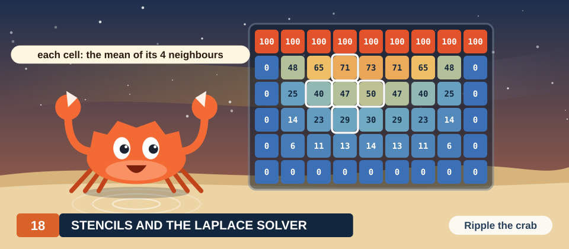
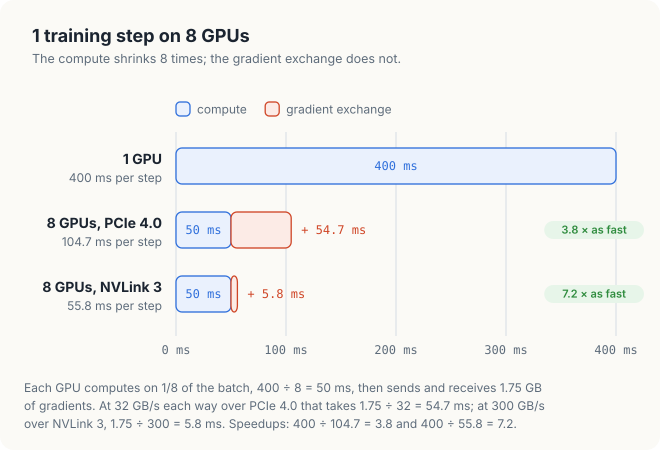
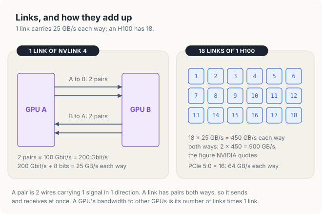
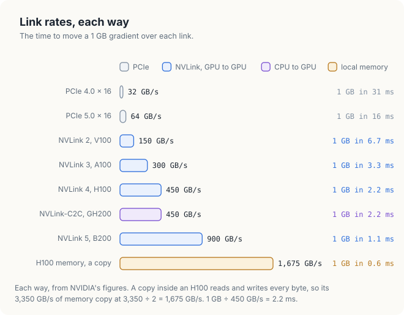
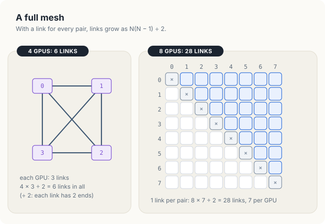
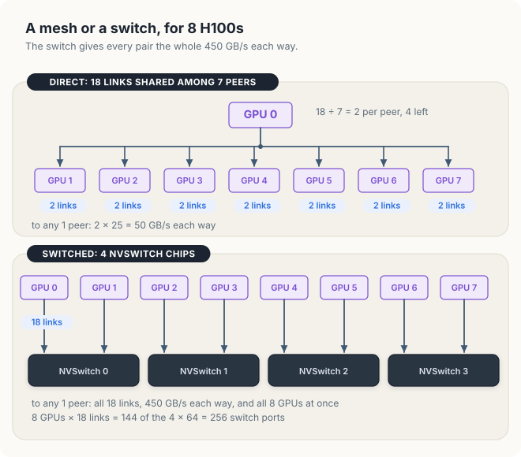
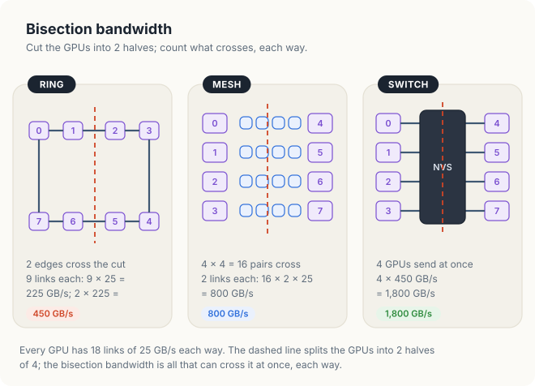
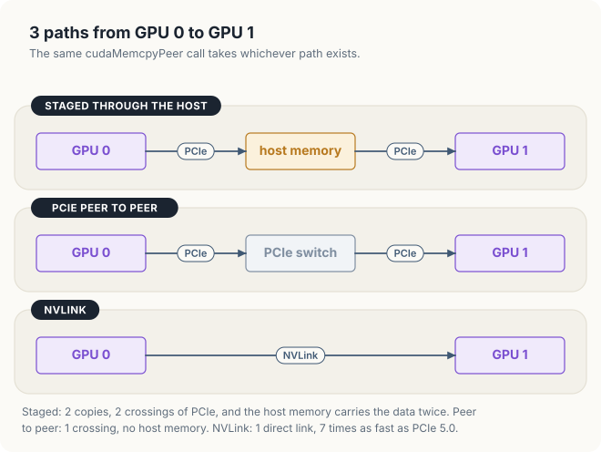
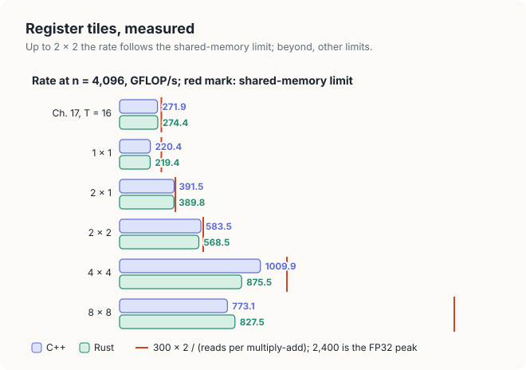
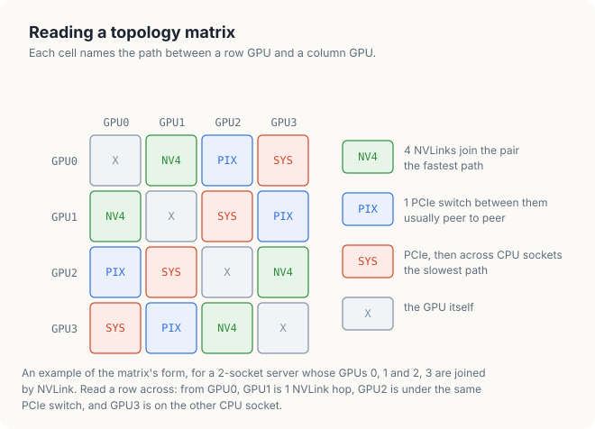

# Chapter 18: NVLink & NVSwitch - The Multi-GPU Interconnect

Every chapter so far has run on 1 GPU. Its threads read and wrote 1 memory, and the only
other memory they ever met was the host's, across the link of Chapter 4. Large programs
outgrow that arrangement. A model whose weights do not fit in 1 GPU's memory must be
spread over several GPUs, and a computation that must finish sooner can share its work
among several GPUs. In both cases the GPUs exchange data while they work, and the time
that exchange takes decides whether adding a GPU helps.

In this chapter, we study the connections that carry that exchange. We first count the
bytes that 1 step of a multi-GPU program sends, and the time they take over PCIe. We then
look at **NVLink**, NVIDIA's link between GPUs, at **NVSwitch**, the switch that joins many
of them, and at the ways of wiring 4, 8 and 72 GPUs together. We end with the CUDA calls
that let 1 GPU reach the memory of another, in a program that runs on any number of GPUs,
and with the tool that shows how the GPUs of a machine are connected.

<div class="covers" markdown="1">

This chapter covers

- why programs use more than 1 GPU, and the bytes they exchange at each step
- links, pairs and lanes, and bandwidth each way against both ways
- 4 generations of NVLink, measured against PCIe and against local memory
- full meshes, switches, and the links they need for 4, 8 and 72 GPUs
- bisection bandwidth, counted by hand
- 1 address space for all GPUs, copies between GPUs, and direct access to a peer's memory
- peer-to-peer in CUDA C++ and in Rust, run on 2 boards
- a model of when a faster link pays off
- reading `nvidia-smi topo -m`

</div>

The code of the chapter is in
[`code/ch18_peer/`](https://github.com/arpanpathak/gpu-parallel-book/tree/main/code/ch18_peer)
for C++ and in
[`code/oxide/ch18_peer/`](https://github.com/arpanpathak/gpu-parallel-book/tree/main/code/oxide/ch18_peer)
for Rust.

## 18.1 Scaling beyond 1 GPU

### 18.1.1 Why 1 GPU is not enough

There are 2 reasons to use more than 1 GPU, and they lead to different ways of dividing a
program.

The first is **capacity**: the data does not fit. A language model has **parameters**, the
numbers it learns. With 70 × 10<sup>9</sup> of them, stored as 16-bit numbers of 2 bytes each,
it needs 70 × 10<sup>9</sup> × 2 = 140 GB for its parameters alone. An H100 holds 80 GB.
However fast the H100 is, the model cannot run on 1 of them; it needs at least 140 / 80 = 1.75,
so 2, and in practice more, because the computation also needs memory for its intermediate
values.

The second is **time**. A computation that fits on 1 GPU may still take too long there.
Training a model repeats the same step, over and over, each time on a new **batch**, a group of
training examples. 8 GPUs that each take a share of every step can finish the training sooner.

### 18.1.2 3 ways to divide the work

A program can be divided among GPUs in 3 ways. Each way decides what the GPUs must send to
each other.

| Division | Each GPU holds | What crosses between GPUs |
|---|---|---|
| **Data parallelism** | a full copy of the model, and its own share of each batch | the results of each step, to be combined into 1 |
| **Model parallelism** | a part of every layer of the model | partial results inside every layer |
| **Pipeline parallelism** | whole layers, a few consecutive ones per GPU | each layer's output, passed to the GPU with the next layer |

Data parallelism is the simplest, because every GPU runs the unchanged single-GPU program
on its share of the data. Model and pipeline parallelism answer the capacity problem: no
GPU holds the whole model. Real systems combine them, for example pipeline parallelism
between groups of GPUs and model parallelism inside each group. In every case the GPUs
send each other data at every step.

### 18.1.3 What 1 step of data parallelism sends

We work through data parallelism, because its exchange is easy to count. A training step
computes, for every parameter of the model, a **gradient**: the direction and amount by
which that parameter should change to make the model's error on the batch smaller. There
is 1 gradient value per parameter, so the gradients take as many bytes as the parameters.

With data parallelism, each GPU computes gradients from its own share of the batch, and so
each GPU's gradients differ. Before any GPU may update its copy of the model, the gradients
of all GPUs must be added, and every GPU must receive the sum; otherwise the copies of the
model would drift apart. The operation that adds a value held by every GPU and gives the sum
to every GPU is called an **all-reduce**. Chapter 19 builds it. Here we need only its cost:
the usual algorithm, a ring, has each of \\(N\\) GPUs send, and also receive,
\\(2(N - 1)/N\\) times the size of the data.

<div class="example" markdown="1">

Worked example: the exchange of 1 step on 8 GPUs

1. A model of 500 × 10<sup>6</sup> parameters in 16-bit numbers has gradients of
   500 × 10<sup>6</sup> × 2 bytes = 1 GB.
2. On \\(N\\) = 8 GPUs, each GPU sends 2 × (8 − 1) / 8 × 1 GB = 1.75 GB, and receives as
   much.
3. Over PCIe 4.0 with 16 lanes, 32 GB/s each way (Chapter 4, section 4.1.2), sending
   1.75 GB takes 1.75 / 32 = 0.0547 s, 54.7 ms.
4. If 1 GPU needs 400 ms to compute the step for the whole batch, each of 8 GPUs needs
   400 / 8 = 50 ms for its eighth.

</div>

The exchange takes longer than the computation it serves. Figure 18.1 draws the step: on 8
GPUs joined by PCIe, it takes 50 + 54.7 = 104.7 ms, and the 8 GPUs together are only
400 / 104.7 = 3.8 times as fast as 1. The same step over the NVLink of an A100, at 300 GB/s
each way, exchanges in 1.75 / 300 = 5.8 ms, and 8 GPUs become 400 / 55.8 = 7.2 times as fast.
Section 18.6 turns the example into a model.

<figure>

<figcaption><b>Figure 18.1</b> 1 step on 8 GPUs: the compute shrinks 8 times, the exchange stays.</figcaption>
</figure>

<div class="callout note" markdown="1">

**NOTE:** Training frameworks start sending the gradients of the last layers while the earlier
layers are still computing, so part of the exchange hides behind the computation, as the copies
of Chapter 6 hid behind kernels. Overlap can hide at most as much exchange as there is
computation to hide it behind: of the 54.7 ms, at most 50 ms, and the step still takes at least
54.7 ms.

</div>

<div class="bee bee-shocked" markdown="1">

Adding GPUs divides the computation of a step, but not the bytes each GPU must exchange. The
link between the GPUs decides how many GPUs still make a program faster.

</div>

## 18.2 NVLink: a faster link between GPUs

### 18.2.1 Links and pairs

An **interconnect** is the hardware that carries data between chips. PCIe, from Chapter 4,
is one: the standard interconnect between a CPU and the cards plugged into it.

Both PCIe and NVLink send data as electrical signals over **differential pairs**: 2 wires
that carry 1 signal as the difference between their voltages, which noise from outside
disturbs much less than a single wire. A pair carries data in 1 direction. A **lane** of
PCIe is 2 pairs, 1 each way, and PCIe gains bandwidth by putting 16 lanes side by side.

**NVLink** is NVIDIA's interconnect between GPUs, and on some systems between a GPU and a
CPU. It is built from **links**, each a bundle of pairs in both directions. A GPU has many
links, and it can join each one to a different GPU or join several to the same GPU.

<div class="example" markdown="1">

Worked example: 1 link of NVLink 4, as in the H100

1. A link has 2 pairs in each direction, and each pair signals at 100 Gbit/s.
2. Each way: 2 × 100 Gbit/s = 200 Gbit/s, and 200 / 8 bits per byte = 25 GB/s.
3. An H100 has 18 links: 18 × 25 GB/s = 450 GB/s each way.

</div>

The A100's NVLink 3 reached the same 25 GB/s per link with 4 pairs each way at half the
rate; NVLink 4 halved the pairs per link and doubled their rate, which leaves room on the
chip for more links. Figure 18.2 draws a link and the 18 links of an H100.

<figure>

<figcaption><b>Figure 18.2</b> 1 link carries 25 GB/s each way; an H100 has 18 of them.</figcaption>
</figure>

### 18.2.2 Each way, and both ways

The **bandwidth** of a link is the most data it can carry in a given time. A link that has
pairs in both directions has 2 bandwidths, 1 each way, and it can use both at once. NVIDIA
quotes NVLink as the sum of the 2 directions: "900 GB/s" for an H100 is 450 GB/s each way.
PCIe is usually quoted each way, as Chapter 4 did: 32 GB/s for PCIe 4.0 with 16 lanes, 64 GB/s
for PCIe 5.0.

A comparison must use the same convention on both sides. A GPU that sends its gradients to
another sends them in 1 direction, so this chapter quotes every link **each way**. In that
unit, NVIDIA's statement that the H100's NVLink has 7 times the bandwidth of PCIe 5.0 checks
out: 450 / 64 = 7.0.

| Symbol | Meaning | For an H100 |
|---|---|---|
| \\(L\\) | links per GPU | 18 |
| \\(b\\) | bandwidth of 1 link, each way | 25 GB/s |
| \\(B = L \cdot b\\) | the GPU's NVLink bandwidth, each way | 18 × 25 = 450 GB/s |
| \\(2B\\) | both ways, the figure NVIDIA quotes | 900 GB/s |

### 18.2.3 4 generations

Each generation of NVIDIA's data-centre GPUs has brought a new generation of NVLink. The
table lists NVIDIA's figures; the column each way is half of NVIDIA's total.

| Link | GPU | Links | Each link, each way | Each way | Both ways (NVIDIA) |
|---|---|---|---|---|---|
| PCIe 4.0 × 16 | A100 PCIe, RTX 4090 | 16 lanes | 2 GB/s per lane | 32 GB/s | 64 GB/s |
| PCIe 5.0 × 16 | H100 PCIe, RTX 5090 | 16 lanes | 4 GB/s per lane | 64 GB/s | 128 GB/s |
| NVLink 2 | V100 | 6 | 25 GB/s | 150 GB/s | 300 GB/s |
| NVLink 3 | A100 | 12 | 25 GB/s | 300 GB/s | 600 GB/s |
| NVLink 4 | H100 | 18 | 25 GB/s | 450 GB/s | 900 GB/s |
| NVLink 5 | B200 | 18 | 50 GB/s | 900 GB/s | 1,800 GB/s |
| NVLink-C2C | GH200, CPU to GPU | 1 chip-to-chip link | | 450 GB/s | 900 GB/s |

From V100 to H100, the rate of 1 link stayed at 25 GB/s each way, and the bandwidth grew with
the number of links: 6, 12, 18. NVLink 5 doubled the rate of each link instead. The consumer
GPUs in the table, the RTX 4090 and 5090, have no NVLink at all; 2 of them exchange data over
PCIe. Integrated GPUs, such as the DGX Spark's, have none either: each is
the only GPU in its system, and it shares 1 memory with the CPU.

Figure 18.3 turns the rates into the time to move the 1 GB gradient of section 18.1.3.

<figure>

<figcaption><b>Figure 18.3</b> The time to move 1 GB over each link, and inside 1 GPU's memory.</figcaption>
</figure>

### 18.2.4 How far away is a peer?

A GPU's own memory is still faster than any link. The last bar of figure 18.3 is a copy inside
an H100: its memory delivers 3,350 GB/s, and a copy both reads and writes every byte, so it
moves data at 3,350 / 2 = 1,675 GB/s. The useful question is how many times slower a
neighbouring GPU's memory is than a GPU's own. The table uses the **SXM** versions of the
data-centre GPUs, modules mounted on a server board with NVLink; the same GPUs also come as
PCIe cards, with other links and memory.

| GPU | Memory | Link to a peer, each way | Memory ÷ link |
|---|---|---|---|
| V100 SXM | 900 GB/s | NVLink 2, 150 GB/s | 6 |
| A100 SXM 80 GB | 2,039 GB/s | NVLink 3, 300 GB/s | 6.8 |
| H100 SXM | 3,350 GB/s | NVLink 4, 450 GB/s | 7.4 |
| B200 | 8,000 GB/s | NVLink 5, 900 GB/s | 8.9 |
| H100 SXM, over PCIe 5.0 | 3,350 GB/s | 64 GB/s | 52 |

Over NVLink, a peer's memory is 6 to 9 times as slow to reach as a GPU's own memory. Over
PCIe it is 52 times as slow. That ratio, more than the bandwidth alone, decides which
programs can treat several GPUs as 1 large GPU: a kernel that reads 1 byte in 8 from a peer
over NVLink loses about as much time to the link as to its own memory.

<div class="bee bee-happy" markdown="1">

Compare links each way. An H100's NVLink carries 450 GB/s each way, 7 times PCIe 5.0, and
brings a peer's memory within 7.4 times of the GPU's own.

</div>

## 18.3 NVSwitch and topologies

### 18.3.1 A full mesh

The **topology** of a multi-GPU system is the pattern of links that joins its GPUs. The
simplest topology gives every pair of GPUs its own link: a **full mesh**.

<div class="example" markdown="1">

Worked example: the links of a full mesh

1. 4 GPUs: each GPU needs a link to each of the other 3. That is 4 × 3 = 12 link ends, and
   each link has 2 ends, so 12 / 2 = 6 links.
2. 8 GPUs: each needs 7, and 8 × 7 / 2 = 28 links.
3. \\(N\\) GPUs: each needs \\(N - 1\\), and the mesh needs \\(N(N - 1)/2\\) links.

</div>

Figure 18.4 draws both. The links of a mesh grow with the square of the number of GPUs, but
the links of each GPU are fixed when the chip is made.

<figure>

<figcaption><b>Figure 18.4</b> A full mesh: 6 links for 4 GPUs, 28 for 8.</figcaption>
</figure>

A GPU's links must therefore be shared out among its peers. An A100 has 12 links; in a mesh
of 4 A100s, each GPU gives 12 / 3 = 4 links to each of its 3 peers, 4 × 25 = 100 GB/s each
way per pair. In a mesh of 8 H100s, each GPU would give 18 / 7 = 2 links to each of its 7
peers, with 4 left over: 2 × 25 = 50 GB/s each way to any 1 peer, a ninth of the GPU's
450 GB/s. The more GPUs a mesh joins, the thinner the link between any 2 of them.

### 18.3.2 A switch

A **switch** is a chip with many ports that forwards the data arriving at any port to any
other port. **NVSwitch** is NVIDIA's switch for NVLink. Instead of joining GPUs to each
other, each GPU joins all of its links to switches, and the switches carry its data to
whichever GPU it addresses.

The difference shows when 1 GPU talks to 1 peer. In the mesh, only the 2 links between the
pair carry the data. Through the switches, all 18 of the GPU's links carry it, at the full
450 GB/s each way. A switch that lets every GPU send at its full rate at the same time, to
any other GPU, is called **non-blocking**. Figure 18.5 compares the 2 ways of wiring 8 H100s.

<figure>

<figcaption><b>Figure 18.5</b> 8 H100s: 50 GB/s to a peer in a mesh, 450 GB/s through switches.</figcaption>
</figure>

The switch adds a hop: data travels from the GPU to a switch and on to the peer, and each hop
adds a little time. For every exchange larger than a few kilobytes, the bandwidth gained
outweighs that time.

### 18.3.3 Systems built this way

NVIDIA's servers of 8 GPUs, and its larger racks, are built from these parts.

| System | GPUs | Switches | Each GPU's links | Any pair, each way |
|---|---|---|---|---|
| DGX A100 | 8 A100 | 6 NVSwitch, 2nd generation | 12, 2 to each switch | 300 GB/s |
| DGX H100 | 8 H100 | 4 NVSwitch, 3rd generation, 64 ports each | 18, spread over the 4 | 450 GB/s |
| GB200 NVL72 | 72 B200 in 1 rack | 18 NVSwitch chips | 18 | 900 GB/s |

In the DGX A100, 12 links per GPU over 6 switches gives 12 / 6 = 2 links from every GPU to
every switch. In the DGX H100, the 8 GPUs bring 8 × 18 = 144 links to 4 × 64 = 256 switch
ports; the third-generation NVSwitch also has ports for switches outside the server, so that
up to 256 GPUs can join 1 NVLink network. The NVL72 joins 72 GPUs in 1 rack, each at
1,800 GB/s both ways: 72 × 1.8 TB/s = 129.6 TB/s, the 130 TB/s NVIDIA quotes as the rack's
total.

The third-generation NVSwitch can also do arithmetic: it can add the data that several GPUs
send to it and return the sum, which can halve the bytes that some collective operations of
Chapter 19 must move.

### 18.3.4 Bisection bandwidth

The topologies differ most when every GPU sends at once. A single number captures that case.
Cut the GPUs into 2 halves of equal size, in the way that leaves the fewest links crossing
the cut. The **bisection bandwidth** is the total bandwidth of the links that cross, each way:
the most data one half can send to the other half at the same time.

Figure 18.6 counts it for 8 GPUs that each have 18 links of 25 GB/s, wired 3 ways.

<div class="example" markdown="1">

Worked example: the bisection bandwidth of 8 GPUs

1. **Ring.** Each GPU joins its 2 neighbours, 9 links to each: 9 × 25 = 225 GB/s per edge. A
   cut through the ring crosses 2 edges: 2 × 225 = 450 GB/s.
2. **Mesh.** 4 GPUs on each side make 4 × 4 = 16 pairs that cross, each with 2 links:
   16 × 2 × 25 = 800 GB/s.
3. **Switch.** Each of the 4 GPUs on 1 side sends at its full 450 GB/s through the switch:
   4 × 450 = 1,800 GB/s.

</div>

<figure>

<figcaption><b>Figure 18.6</b> The same 18 links per GPU give 450, 800 or 1,800 GB/s across the middle.</figcaption>
</figure>

The links are the same in all 3 cases; only their arrangement differs. Some model-parallel
programs make every GPU send to every other at once, in every layer. Such exchanges run at the
bisection bandwidth, and a switch gives them 4 times what a ring does.

| Symbol | Meaning | For 8 H100s through switches |
|---|---|---|
| \\(N\\) | GPUs | 8 |
| \\(B\\) | 1 GPU's bandwidth, each way | 450 GB/s |
| \\(\frac{N}{2} B\\) | bisection bandwidth of a non-blocking switch | 4 × 450 = 1,800 GB/s |

<div class="bee bee-happy" markdown="1">

A mesh shares a GPU's links among its peers; a switch gives every pair all of them. Count
the links that cross the middle to compare topologies.

</div>

## 18.4 What NVLink adds to memory

A fast link would help even if it only carried copies. NVLink, with CUDA, also lets 1 GPU
use another GPU's memory almost as if it were its own. 4 ideas make that possible.

### 18.4.1 1 address space

On a 64-bit system, CUDA gives the host and every GPU 1 shared range of addresses. The
arrangement is called **unified virtual addressing**, UVA. No 2 allocations, on any GPU or on
the host, receive the same address, so the value of a pointer alone says which memory it points
into. The program of section 18.5 asks the runtime where a buffer lives with
`cudaPointerGetAttributes`. It copies with `cudaMemcpyDefault`, which tells the runtime to read
the direction of the copy from the 2 pointers.

UVA is the same idea as unified memory of Chapter 4, section 4.5, but only half of it: the
addresses are shared, and the data stays where it was allocated.

### 18.4.2 Copies and direct access

A GPU is a **peer** of another GPU in the same system. Data can reach a peer's memory in 2
ways, and the program of section 18.5 measures both.

1. **A copy.** `cudaMemcpyPeerAsync` asks the GPU's copy engines, the units that move data
   without using any SM (Chapter 4, section 4.2.2), to move a block of bytes from 1 GPU to
   another.
2. **Direct access.** A kernel running on GPU 0 dereferences a pointer to GPU 1's memory,
   and each load or store travels over the link. No copy is made, and the kernel can read
   only the bytes it needs, scattered anywhere in the peer's memory.

Direct access must be switched on, once, with `cudaDeviceEnablePeerAccess`. Copies work without
it, but then the runtime **stages** them through host memory. It copies from GPU 0 to the host
and then from the host to GPU 1: 2 crossings of PCIe where 1 would do. Figure 18.7 draws the 3
paths a copy can take.

<figure>

<figcaption><b>Figure 18.7</b> 3 paths from GPU 0 to GPU 1, slowest first.</figcaption>
</figure>

**Peer-to-peer**, P2P, is any transfer that goes from 1 GPU to another without passing through
host memory. Over PCIe the platform decides: it works most reliably when the 2 GPUs sit behind
the same PCIe switch, and many desktop systems do not allow it at all. Over NVLink it is always
possible. `cudaDeviceCanAccessPeer` reports, for a pair of GPUs, whether it is.

### 18.4.3 Atomics on a peer

The atomic operations of Chapter 5 can target a peer's memory, so threads on 2 GPUs can add
into the same counter. NVLink carries atomic operations as such, and the peer's memory
performs them. Whether a given pair supports this natively is reported by
`cudaDeviceGetP2PAttribute` with `cudaDevP2PAttrNativeAtomicSupported`. Each such atomic
crosses the link and waits for its answer, so peer atomics suit rare events, such as a flag
or a work counter, and not 1 update per element.

### 18.4.4 NVLink-C2C and coherence

The Grace Hopper superchip, GH200, joins a Grace CPU and an H100 GPU with **NVLink-C2C**, a
chip-to-chip link of 450 GB/s each way. The link is **coherent**. When the CPU writes a value
that the GPU holds in a cache, the hardware updates or discards the GPU's copy, and the other
way round, so neither reads a stale value. CPU and GPU threads can work on the same data at the
same time without copies, and without the page migrations of unified memory. Integrated
GPUs, such as the DGX Spark's, go further: they share 1 memory with their CPU,
so there is no second memory to copy to.

<div class="bee bee-cute" markdown="1">

With UVA, a pointer says which GPU owns the memory. With peer access on, a kernel can
dereference a peer's pointer, and a copy goes straight across the link.

</div>

## 18.5 Peer-to-peer in CUDA

### 18.5.1 The plan of the program

The program asks the system 3 questions and then measures the answer to the last.

1. How many GPUs are there, and what are they?
2. Which GPUs can reach which others' memory?
3. How fast do bytes move from GPU 0 to GPU 1, by a copy and by a kernel?

On a machine with 2 GPUs that can reach each other, the copies go from GPU 0 to GPU 1. On
a machine with 1 GPU, they stay inside GPU 0. The program then measures the GPU's own
memory, the baseline that section 18.2.4 compared every link against.

```text
count ← number of GPUs
print each GPU's name and SMs
for each pair (i, j), i ≠ j:
    print whether GPU i can access GPU j
if count > 1 and GPU 0 can access GPU 1:
    src ← 0, dst ← 1, enable peer access from GPU 0 to GPU 1
else:
    src ← 0, dst ← 0
a ← 128 MiB on GPU src, filled with known values
b ← 128 MiB on GPU dst
for each way in (cudaMemcpyPeerAsync, copy kernel on GPU src):
    b ← 0
    time 50 transfers of a into b, after 0.4 s of warm-up
    check b against the known values
```

The measurements in this chapter come from 2 integrated GPUs: a Jetson Orin NX (8 SMs,
102 GB/s) and a Jetson AGX Thor (20 SMs, 32 MiB of L2 cache). 128 MiB is 4 times the larger
of the 2 L2 caches, so the copies measure memory and not the cache (Chapter 7).

### 18.5.2 Who can reach whom

`cudaGetDeviceCount` gives the number of GPUs, numbered from 0. `cudaDeviceCanAccessPeer`
sets its first argument to 1 when the GPU of its second argument can access the memory of
its third. The question has a direction: GPU 0 reaching GPU 1 and GPU 1 reaching GPU 0 are
asked, and enabled, separately.

<p class="listing"><b>Listing 18.1</b> The peer matrix, in C++. <a href="https://github.com/arpanpathak/gpu-parallel-book/blob/main/code/ch18_peer/peer.cu">code/ch18_peer/peer.cu</a></p>

```cpp
{{#include ../../../../code/ch18_peer/peer.cu:31:52}}
```

cuda-core, the host library of cuda-oxide, has the same query as
`peer::can_access_peer(from, to)`, between 2 `CudaContext`s. At revision `b7fe543` it has no
function for the number of GPUs, so the program calls the driver's `cuDeviceGetCount`
through `cuda_core::sys`, the raw bindings, in 1 `unsafe` line. The driver must already be
initialised, which `CudaContext::new(0)` does.

<p class="listing"><b>Listing 18.2</b> The number of GPUs and the peer matrix, in Rust. <a href="https://github.com/arpanpathak/gpu-parallel-book/blob/main/code/oxide/ch18_peer/src/main.rs">code/oxide/ch18_peer/src/main.rs</a></p>

```rust,ignore
{{#include ../../../../code/oxide/ch18_peer/src/main.rs:37:69}}
```

### 18.5.3 Turning peer access on

`cudaDeviceEnablePeerAccess(peer, 0)` lets the current GPU, chosen with `cudaSetDevice`,
access the memory of `peer`. Its second argument, flags, must be 0. The call maps the peer's
memory into the current GPU's page tables, so it costs time once and is not made in a loop.

<p class="listing"><b>Listing 18.3</b> Choosing the 2 GPUs and enabling access, in C++.</p>

```cpp
int main()
{
    // ...
{{#include ../../../../code/ch18_peer/peer.cu:124:136}}
    // ...
}
```

The buffers are allocated on their own GPUs: `cudaMalloc` allocates on the current GPU, so
the program selects GPU `src` for `a` and GPU `dst` for `b`. `cudaPointerGetAttributes` then
reads, from the pointer `b` alone, which GPU holds it.

<p class="listing"><b>Listing 18.4</b> 1 buffer on each GPU, and where UVA says <code>b</code> lives, in C++.</p>

```cpp
int main()
{
    // ...
{{#include ../../../../code/ch18_peer/peer.cu:143:154}}
    // ...
}
```

In Rust, each GPU has its own `CudaContext` and its own stream, and a `DeviceBuffer` is
allocated on the GPU whose stream creates it. `peer::enable_peer_access(from, to)` does what
`cudaDeviceEnablePeerAccess` does, and returns `Ok` as well when access was already on.

<p class="listing"><b>Listing 18.5</b> Choosing the 2 GPUs and allocating, in Rust.</p>

```rust,ignore
fn main() -> Result<(), Error> {
    // ...
{{#include ../../../../code/oxide/ch18_peer/src/main.rs:115:130}}
    // ...
}
```

### 18.5.4 2 ways to move the bytes

The first way is a copy. `cudaMemcpyPeerAsync(dst pointer, dst GPU, src pointer, src GPU,
bytes, stream)` names both GPUs, and with peer access on it goes across the link. With 1 GPU,
both GPUs are GPU 0, and the call is an ordinary copy inside its memory. The second way is a
kernel on GPU `src` in which every thread copies 1 float from `a` to `b`; on 2 GPUs its
stores land in the peer's memory.

<p class="listing"><b>Listing 18.6</b> The copy kernel, in C++.</p>

```cpp
{{#include ../../../../code/ch18_peer/peer.cu:25:29}}
```

<p class="listing"><b>Listing 18.7</b> A copy and a kernel, each timed and checked, in C++.</p>

```cpp
int main()
{
    // ...
{{#include ../../../../code/ch18_peer/peer.cu:163:181}}
    // ...
}
```

`averageMs` runs its argument for 0.4 s to let the GPU's clock rise, as Chapter 6 measured,
and then times 50 runs with events. `matches` copies `b` back to the host and compares all
33,554,432 floats with the values written into `a`. `clear` sets `b` to 0 before each
method, so that a method that copied nothing could not pass on the previous one's result.

In Rust, `DeviceBuffer::copy_from_device_async` is the copy; it calls the driver's
device-to-device copy, which with UVA works between GPUs as well. The kernel uses the
1-D launch contract of Chapter 13: `src` is a plain slice, and `DisjointSlice` lets each
thread write its own element of `dst` with no `unsafe`.

<p class="listing"><b>Listing 18.8</b> The copy kernel, in Rust.</p>

```rust,ignore
{{#include ../../../../code/oxide/ch18_peer/src/main.rs:22:35}}
```

<p class="listing"><b>Listing 18.9</b> A copy and a kernel, each timed and checked, in Rust.</p>

```rust,ignore
fn main() -> Result<(), Error> {
    // ...
{{#include ../../../../code/oxide/ch18_peer/src/main.rs:139:148}}
    // ...
}
```

### 18.5.5 Running it

```console
$ nvcc -arch=native peer.cu -o peer && ./peer
GPUs: 1
  GPU0  Orin, 8 SMs, unified addressing yes
peer access (row can reach column):
        GPU0
  GPU0     X
no peer to reach: copying within GPU0
buffer b lives on GPU0
128 MiB from GPU0 to GPU0, average of 50 copies
  cudaMemcpyPeerAsync          3.462 ms    38.8 GB/s  PASSED
  copy kernel on GPU0          3.677 ms    36.5 GB/s  PASSED
```

The first lines say what we expected: 1 GPU, so the matrix holds only its diagonal, `X`, and
the program copies within GPU 0. UVA is on, and `cudaPointerGetAttributes` found `b` on GPU 0.
On the second GPU the program prints the same first lines:

```console
$ ./peer
GPUs: 1
  GPU0  NVIDIA Thor, 20 SMs, unified addressing yes
peer access (row can reach column):
        GPU0
  GPU0     X
no peer to reach: copying within GPU0
buffer b lives on GPU0
```

Both of its copies PASSED, in C++ and in Rust.

The rates need the reasoning of section 18.2.4. A copy of 128 MiB, 134.2 MB, in 3.462
ms is 134.2 / 3.462 = 38.8 GB/s copied. Every copied byte was read once and written once, so
the memory moved 2 × 38.8 = 77.6 GB/s: 76% of the GPU's 102 GB/s. A copy can never use all
of the bandwidth, because the memory loses time each time it turns from reading to writing. The
copy kernel came within 6% of the copy call: either way, the memory and not the
SMs set the rate. Across 6 runs, the copy measured 38.8 to 42.3 GB/s, a spread
of 9%.

<figure>

<figcaption><b>Figure 18.8</b> A copy inside 1 GPU spends its memory bandwidth twice.</figcaption>
</figure>

The Rust program prints the same lines without the UVA details, because cuda-core does not
wrap the pointer query at this revision.

```console
$ cargo oxide run
GPUs: 1
  GPU0  Orin, 8 SMs
peer access (row can reach column):
        GPU0
  GPU0     X
no peer to reach: copying within GPU0
128 MiB from GPU0 to GPU0, average of 50 copies
  copy_from_device_async       3.528 ms    38.0 GB/s  PASSED
    copy kernel on GPU0          3.769 ms    35.6 GB/s  PASSED
```

`copy_from_device_async` calls the same driver copy as the C++ program, and it ran within 2% of
it, inside the spread between runs.

### 18.5.6 What it prints on a machine with peers

On a server with 8 GPUs joined by NVSwitch, the matrix reads
`yes` in every cell off the diagonal, because every GPU can reach every other through the
switches. On a desktop with 2 consumer GPUs on PCIe, it may read `no`; the copy then still
works, staged through the host. When GPU 0 can reach GPU 1, the program prints `buffer b lives
on GPU1`. Its 2 rates are then those of the link and not of memory, and between 2 H100s they
can approach 450 GB/s each way. A copy inside 1 GPU sets the rate that no
link to a peer exceeds.

<div class="callout tip" markdown="1">

**TIP:** Run `peer` on any multi-GPU machine you can reach, a cloud instance with 2 or 8
GPUs, and compare its rates with the table of section 18.2.3. A rate far below the table
usually means the copies are being staged: check the matrix for `no`.

</div>

## 18.6 When NVLink pays off

### 18.6.1 A model of 1 step

Section 18.1.3 computed 1 step by hand. The same arithmetic, written with symbols, says when
a faster link pays off. Let a step take \\(T_1\\) on 1 GPU. On \\(N\\) GPUs, each GPU computes
for \\(T_1 / N\\) and then exchanges for \\(T_x\\), which does not shrink with \\(N\\):

\\[ T_N = \frac{T_1}{N} + T_x, \qquad S = \frac{T_1}{T_N} \\]

| Symbol | Meaning | 8 A100s on PCIe 4.0 | 8 A100s on NVLink 3 |
|---|---|---|---|
| \\(T_1\\) | 1 step on 1 GPU | 400 ms | 400 ms |
| \\(N\\) | GPUs | 8 | 8 |
| \\(T_x\\) | exchange per step: bytes ÷ link, each way | 1.75 GB ÷ 32 GB/s = 54.7 ms | 1.75 GB ÷ 300 GB/s = 5.8 ms |
| \\(T_N\\) | 1 step on \\(N\\) GPUs | 50 + 54.7 = 104.7 ms | 50 + 5.8 = 55.8 ms |
| \\(S\\) | speedup | 400 ÷ 104.7 = 3.8 | 400 ÷ 55.8 = 7.2 |

The model is Amdahl's law of Chapter 1, section 1.3, with \\(T_x\\) as the part that does not
divide. Its lesson is the same: when \\(T_x\\) is comparable to \\(T_1/N\\), more GPUs add
little. The link changes \\(T_x\\), and with it the number of GPUs that still help.

<div class="example" markdown="1">

Worked example: is the exchange short enough for 8 GPUs?

1. Take as a target an exchange that takes at most a quarter of each GPU's compute time,
   \\(T_x \le T_1 / (4N)\\), here 400 / 32 = 12.5 ms.
2. On PCIe 4.0, \\(T_x\\) = 54.7 ms: 4.4 times too long.
3. On NVLink 3, \\(T_x\\) = 5.8 ms: inside the limit.
4. Doubling the model doubles both \\(T_1\\) and the bytes, so the ratio stays; halving the
   batch halves \\(T_1\\) but not the bytes, and the exchange grows in importance.

</div>

### 18.6.2 Which programs need NVLink

The model sorts programs by the ratio of their exchange to their computation.

| Workload | Exchange per step | Link |
|---|---|---|
| data-parallel training of a large model | all gradients, every step | NVLink pays off |
| model parallelism inside every layer | partial results, every layer | NVLink needed |
| graph analytics, databases spread over GPUs | small, scattered reads of peers' memory | NVLink pays off |
| many independent jobs, 1 per GPU | none | PCIe is enough |
| loading a dataset once, then computing for hours | once | PCIe is enough |
| inference of a model that fits on 1 GPU | none between GPUs | PCIe is enough |

The table's entries are arithmetic, not rules. Measure the 2 terms for your own program:
\\(T_1\\) with the events of Chapter 6, and \\(T_x\\) with the program of section 18.5 or
with nccl-tests, introduced in Chapter 19.

<div class="bee bee-happy" markdown="1">

A faster link pays off when the exchange per step is comparable to the compute per GPU,
\\(T_x \approx T_1/N\\). It cannot help a program whose GPUs do not talk to each other.

</div>

## 18.7 Topology discovery

### 18.7.1 `nvidia-smi topo -m`

A program cannot choose good pairs of GPUs without knowing how they are connected.
`nvidia-smi topo -m` prints the topology as a matrix: 1 row and 1 column per GPU, and in each
cell a code for the path between the 2. On the second GPU of section 18.5.5 it prints this:

```console
$ nvidia-smi topo -m
        GPU0    CPU Affinity    NUMA Affinity   GPU NUMA ID
GPU0     X      0-13            0               N/A

Legend:

  X    = Self
  SYS  = Connection traversing PCIe as well as the SMP interconnect between NUMA nodes (e.g., QPI/UPI)
  NODE = Connection traversing PCIe as well as the interconnect between PCIe Host Bridges within a NUMA node
  PHB  = Connection traversing PCIe as well as a PCIe Host Bridge (typically the CPU)
  PXB  = Connection traversing multiple PCIe bridges (without traversing the PCIe Host Bridge)
  PIX  = Connection traversing at most a single PCIe bridge
  NV#  = Connection traversing a bonded set of # NVLinks
```

The matrix has 1 cell, `X`, the GPU itself. The other columns say which CPU cores, 0 to 13, are
closest to the GPU. A **NUMA node** is a group of CPU cores with the memory attached to them;
the GPU belongs to node 0, the only one. On some integrated GPUs, `nvidia-smi` does not
implement the matrix and prints `Failed to run topology matrix`.

### 18.7.2 Reading the codes

The legend lists the paths from fastest to slowest, bottom to top. A **PCIe bridge** is a
PCIe switch; a **host bridge** is where PCIe enters the CPU; an **SMP interconnect** joins the
CPU sockets of a server with more than 1 CPU.

| Code | Path between the 2 GPUs | Peer to peer |
|---|---|---|
| `NV#` | # NVLinks, bonded into 1 connection | yes, over NVLink |
| `PIX` | at most 1 PCIe switch | usually possible |
| `PXB` | several PCIe switches, not through the CPU | often possible |
| `PHB` | through the CPU's host bridge | depends on the platform |
| `NODE` | between host bridges of 1 CPU | rarely |
| `SYS` | across CPU sockets | no; staged through the host |

Figure 18.9 reads a matrix of this form for an example server with 4 GPUs on 2 CPU sockets. In
it, GPUs 0 and 1, and GPUs 2 and 3, are joined by 4 NVLinks. It is an illustration of the
format, not output from a real machine.

<figure>

<figcaption><b>Figure 18.9</b> Reading a row of the matrix: the path from 1 GPU to each of the others.</figcaption>
</figure>

On such a server, a program that uses 2 GPUs should choose 0 and 1, or 2 and 3. Choosing 0
and 3 sends every byte across the CPU sockets.

### 18.7.3 NVLink status and NVML

`nvidia-smi nvlink -s` lists each NVLink of each GPU, its rate and whether it is up. On a GPU
that is the only one in its system, it prints `Device does not have or support Nvlink`. A program that must adapt to the machine reads the same information from
**NVML**, the library behind `nvidia-smi`. `nvmlDeviceGetTopologyCommonAncestor` gives the
nearest common point of 2 GPUs' paths, the codes of the table above. `nvmlDeviceGetNvLinkState`
reports each link.

## 18.8 The complete programs

<p class="listing"><b>Listing 18.10</b> The complete <code>peer.cu</code>. <a href="https://github.com/arpanpathak/gpu-parallel-book/blob/main/code/ch18_peer/peer.cu">code/ch18_peer/peer.cu</a></p>

```cpp
{{#include ../../../../code/ch18_peer/peer.cu}}
```

<p class="listing"><b>Listing 18.11</b> The complete Rust program. <a href="https://github.com/arpanpathak/gpu-parallel-book/blob/main/code/oxide/ch18_peer/src/main.rs">code/oxide/ch18_peer/src/main.rs</a></p>

```rust,ignore
{{#include ../../../../code/oxide/ch18_peer/src/main.rs}}
```

## Common mistakes

- **Comparing "both ways" with "each way".** NVIDIA's 900 GB/s for an H100 is 450 GB/s each
  way; PCIe 5.0's 64 GB/s is each way. The ratio is 7, not 14.
- **Assuming every pair of GPUs can do peer-to-peer.** Check `cudaDeviceCanAccessPeer`. Many
  desktop platforms answer `no` over PCIe, and a copy between such GPUs is staged through the
  host at a fraction of the expected rate.
- **Enabling access in 1 direction and using the other.** Access from GPU 0 to GPU 1 does not
  give GPU 1 access to GPU 0; enable each direction that a kernel uses.
- **Ignoring the topology.** 2 GPUs across CPU sockets (`SYS`) are much farther apart than 2
  joined by NVLink. Read `nvidia-smi topo -m` and choose the pairs.
- **Peer atomics on a hot path.** Each one crosses the link and waits; use them for rare
  events.
- **Measuring a link with data that fits in a cache.** Use buffers several times the L2.

<div class="summary" markdown="1">

## Summary

- Programs use several GPUs for capacity, when the data does not fit, and for time. Data,
  model and pipeline parallelism divide the work differently, and all of them exchange data
  at every step.
- Data parallelism all-reduces the gradients: each of \\(N\\) GPUs sends \\(2(N - 1)/N\\)
  times their size. For 1 GB on 8 GPUs, 1.75 GB: 54.7 ms over PCIe 4.0, 5.8 ms over NVLink 3.
- An NVLink link carries 25 GB/s each way (50 GB/s in NVLink 5); a GPU's bandwidth is its
  links times 1 link: 150, 300, 450 and 900 GB/s each way from V100 to B200. NVIDIA quotes
  twice that, both ways.
- Over NVLink, a peer's memory is 6 to 9 times as slow to reach as a GPU's own; over PCIe,
  about 52 times.
- A full mesh needs \\(N(N - 1)/2\\) links and shares each GPU's links among its peers;
  NVSwitch gives every pair all of them. For 8 GPUs of 18 links, the bisection bandwidth is
  450 GB/s in a ring, 800 GB/s in a mesh and 1,800 GB/s through switches.
- UVA gives all GPUs 1 address space; `cudaDeviceEnablePeerAccess` lets a kernel use a
  peer's pointer, and `cudaMemcpyPeerAsync` copies directly when peer access is on.
- Inside 1 GPU, a copy of 128 MiB moved 38.8 GB/s, 76% of its
  memory bandwidth spent twice: the ceiling against which any link is measured.
- A faster link pays off when the exchange is comparable to each GPU's share of the
  computation, \\(T_x \approx T_1/N\\).

</div>

Chapter 19 builds the all-reduce that this chapter only counted, and the library, NCCL, that
runs it over whichever links the topology offers.

## Exercises

1. A model has 7 × 10<sup>9</sup> parameters in 16-bit numbers. How large are its gradients?
   How many bytes does each of 8 GPUs send per step in a ring all-reduce, and how long does
   that take over PCIe 5.0 and over NVLink 4?
2. NVIDIA quotes the B200's NVLink as 1,800 GB/s with 18 links. Compute the bandwidth of 1
   link each way, and the time to move 1 GB to a peer.
3. How many links does a full mesh of 16 GPUs need? With 18 links per GPU, how many links
   does each pair get, and what bandwidth each way at 25 GB/s per link?
4. Compute the bisection bandwidth each way of 16 GPUs with 18 links each, joined (a) in a
   ring with 9 links to each neighbour, and (b) through a non-blocking switch.
5. In the model of section 18.6, find the smallest \\(T_1\\) for which 8 A100s on NVLink 3
   reach a speedup of 6 with gradients of 1 GB.
6. Run `peer` on your GPU. Compute the memory traffic of the copy, 2 × the rate, as a share
   of your GPU's memory bandwidth. Then change `N` to 1 MiB of floats and explain the new rate.
7. On a machine with 2 GPUs, run `peer` with and without the call to
   `cudaDeviceEnablePeerAccess`. What changes in the rates, and why?
8. Read the `nvidia-smi topo -m` matrix of a cloud machine with 8 GPUs, from its provider's
   documentation or by running it. Which pairs would you choose for a 2-GPU job?

## Sources and further reading

- NVIDIA, *NVLink and NVLink Switch*, the generations and their bandwidths:
  <https://www.nvidia.com/en-us/data-center/nvlink/>
- NVIDIA, "NVIDIA Hopper Architecture In-Depth", 2022, for NVLink 4, the third-generation
  NVSwitch and the comparison with NVLink 3:
  <https://developer.nvidia.com/blog/nvidia-hopper-architecture-in-depth/>
- NVIDIA, *NVIDIA A100 Tensor Core GPU Architecture* whitepaper, 2020, for NVLink 3 and
  the DGX A100.
- NVIDIA, *NVIDIA Grace Hopper Superchip Architecture* whitepaper, for NVLink-C2C.
- NVIDIA, *DGX H100 User Guide*: <https://docs.nvidia.com/dgx/dgxh100-user-guide/>
- NVIDIA, *CUDA C++ Programming Guide*, "Multi-Device System", "Peer-to-Peer Memory Access",
  "Peer-to-Peer Memory Copy" and "Unified Virtual Address Space":
  <https://docs.nvidia.com/cuda/cuda-c-programming-guide/>
- NVIDIA, *NVML API Reference*, topology and NVLink queries:
  <https://docs.nvidia.com/deploy/nvml-api/>
