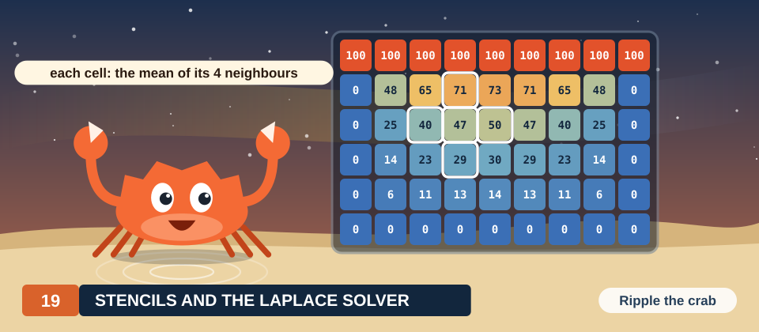
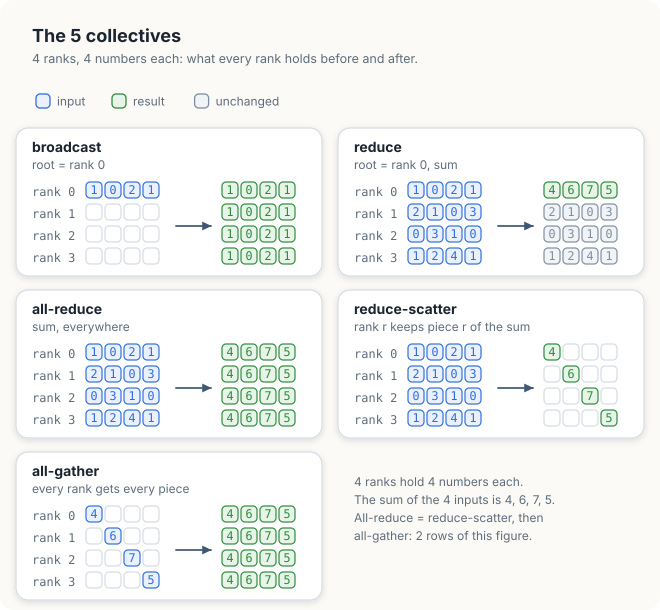
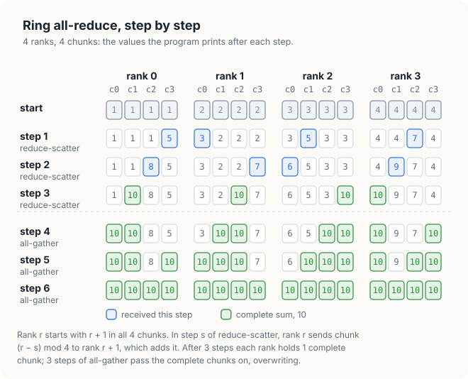
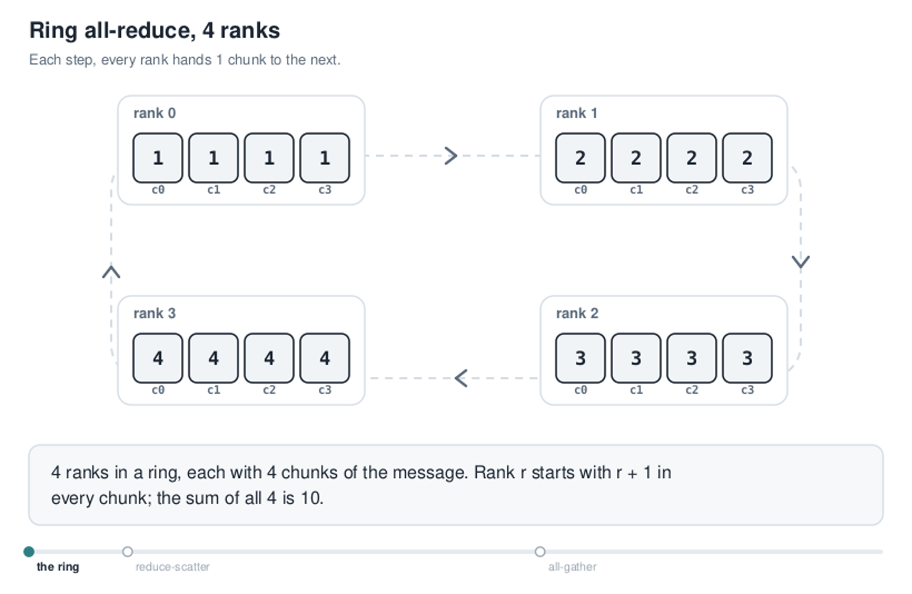
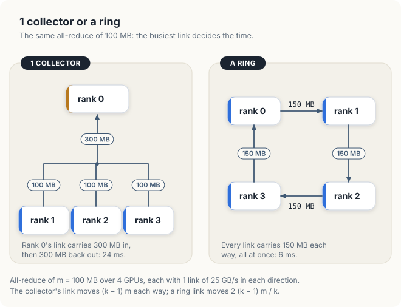
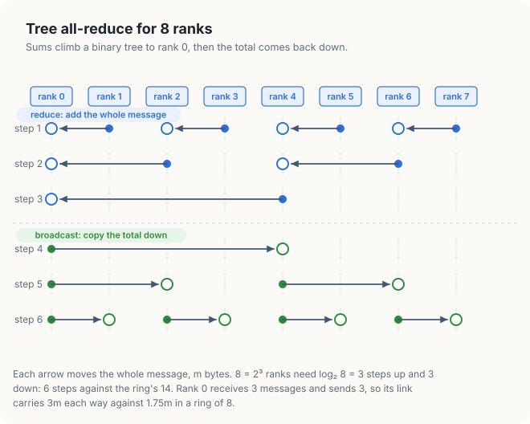
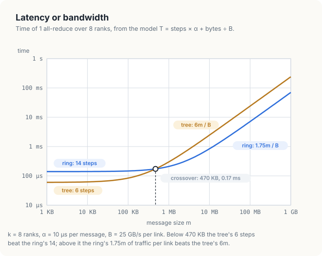
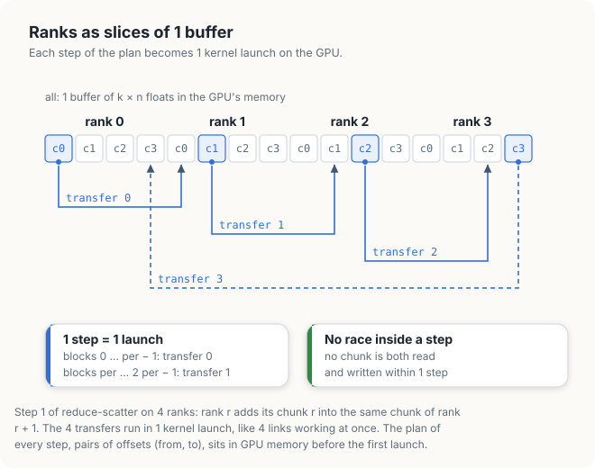
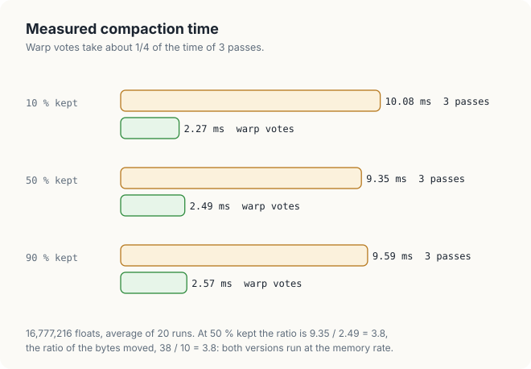
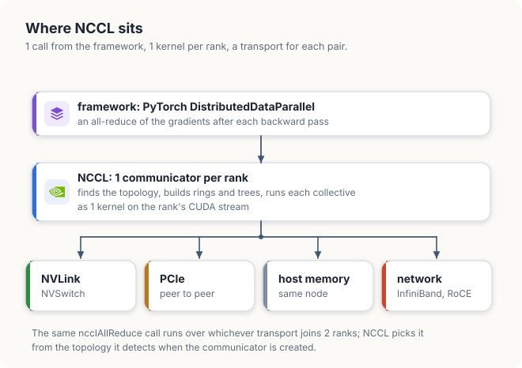

# Chapter 19: NCCL & Multi-GPU Collective Communication

Chapter 18 described the wires between GPUs: NVLink, NVSwitch and PCIe. This chapter is about
the traffic on those wires. When several GPUs work on 1 problem, they must combine their
partial results again and again, and the pattern in which they exchange data decides how long
each exchange takes. The same 100 MB can take 24 ms or 6 ms between the same 4 GPUs, depending
only on who sends what to whom.

We study the exchanges that every rank of a group takes part in, the **collective operations**,
and the algorithms that carry them out. We count the steps and the bytes of each algorithm by
hand, and we derive when a ring wins and when a tree wins. Then we run both algorithms, in CUDA
C++ and in Rust, on 1 GPU whose memory holds all the ranks, and we compare the measured times
with the model. The chapter ends with NCCL, NVIDIA's library of collectives, and the way
frameworks such as PyTorch call it.

<div class="covers" markdown="1">

This chapter covers

- data-parallel training, and why it needs the same sum on every GPU
- the 5 collectives: broadcast, reduce, all-reduce, reduce-scatter and all-gather
- a cost model for messages: a fixed time per message plus bytes over bandwidth
- ring all-reduce, step by step, and why each rank sends 2 (k − 1) / k of the message
- tree all-reduce, and the message size at which a tree beats a ring
- both algorithms running on 1 GPU in C++ and Rust, checked exactly and timed
- NCCL: communicators, the unique ID, collectives on streams, group calls
- NCCL inside PyTorch, and the settings used to debug and tune it

</div>

The code of the chapter is in
[`code/ch19_collectives/`](https://github.com/arpanpathak/gpu-parallel-book/tree/main/code/ch19_collectives)
for C++ and in
[`code/oxide/ch19_collectives/`](https://github.com/arpanpathak/gpu-parallel-book/tree/main/code/oxide/ch19_collectives)
for Rust.

## 19.1 The multi-GPU programming problem

### 19.1.1 Data parallelism

A neural network computes its output from a large set of numbers called its **parameters**.
Training adjusts the parameters so that the output improves. In each step of training, the
program runs a **batch** of examples through the network. It then computes the **gradient**: 1
number per parameter, which says in which direction and how strongly that parameter should
change to reduce the error on the batch.

**Data parallelism** splits the batch among several GPUs. Every GPU holds a full copy of the
parameters, processes its own share of the examples, and computes its own gradient. The copies
must stay identical, so before the next step every GPU needs the same combined gradient: the
sum of all the GPUs' gradients, usually divided by their number.

Each participant in such a group is a **rank**, numbered 0 to k − 1 for a group of k. A rank is
usually 1 process driving 1 GPU.

<div class="example" markdown="1">

Worked example: 4 ranks, a model with 3 parameters

| Rank | Its gradient |
|---|---|
| 0 | 1, 2, 0 |
| 1 | 3, 0, 1 |
| 2 | 0, 1, 1 |
| 3 | 2, 1, 2 |
| sum | 6, 4, 4 |
| average | 1.5, 1, 1 |

Every rank must end the step holding 6, 4, 4 (or the average 1.5, 1, 1), so that all 4 apply
the same change to their parameters.

</div>

Real models have far more parameters. A model with 250 million parameters in 32-bit floats has a
gradient of 250 × 10<sup>6</sup> × 4 bytes = 1 GB. Every rank must combine its 1 GB with
everyone else's in every step.

### 19.1.2 1 collector does not scale

The plainest way to combine the gradients is to choose 1 rank as a collector. Every other rank
sends its gradient to the collector, the collector adds them, and it sends the sum back to
everyone.

Each GPU connects to the others through a **link**, the wire its data leaves and enters by, such
as a PCIe slot or a set of NVLink lanes. A link carries data in both directions at once, at a
fixed **bandwidth** in each: the most bytes it can move per second.

<div class="example" markdown="1">

Worked example: 1 collector, 4 ranks, 100 MB each, links of 25 GB/s

1. Ranks 1, 2 and 3 each send 100 MB to rank 0. All 300 MB enter through rank 0's link:
   300 MB ÷ 25 GB/s = 12 ms.
2. Rank 0 sends the 100 MB sum to each of the 3: another 300 MB out through the same link,
   12 ms.
3. In all, 24 ms. During those 24 ms the links of ranks 1, 2 and 3 each carry only 100 MB in
   each direction, a third of what rank 0's link carries.

</div>

The collector's link carries (k − 1) times the message in each direction, so the time grows with
the number of ranks while the other links idle. Section 19.4 shows an algorithm in which every
link carries the same share, 150 MB in this example, and the same exchange takes 6 ms.

<div class="bee bee-shocked" markdown="1">

The busiest link sets the time of an exchange. A good collective algorithm spreads the bytes
evenly over all the links.

</div>

## 19.2 Collective operations

### 19.2.1 The 5 collectives

A **collective operation** is an operation in which every rank of a group takes part, and whose
result depends on data from all of them. Each rank calls the same operation; none of them can
finish it alone. Some collectives single out 1 rank as the **root**, the rank that sends to all
or receives from all.

5 collectives cover most programs. Figure 19.1 works each of them for 4 ranks that hold 4
numbers each. Their sum, element by element, is 4, 6, 7, 5.

<figure>

<figcaption><b>Figure 19.1</b> The 5 collectives on 4 ranks: what every rank holds before and after.</figcaption>
</figure>

| Collective | Before | After |
|---|---|---|
| **broadcast** | the root holds the data | every rank holds a copy |
| **reduce** | every rank holds data | the root holds the combination |
| **all-reduce** | every rank holds data | every rank holds the combination |
| **reduce-scatter** | every rank holds data | rank r holds piece r of the combination |
| **all-gather** | rank r holds piece r | every rank holds all the pieces |

Data-parallel training needs an all-reduce: every rank contributes a gradient, and every rank
needs the sum.

### 19.2.2 The combining operation

The combination is computed by a **reduction operator** applied element by element: a sum, a
product, a minimum or a maximum. The operator must be **associative**, (a + b) + c = a + (b + c),
because each algorithm groups the additions in its own order. NCCL offers `ncclSum`, `ncclProd`,
`ncclMin`, `ncclMax` and `ncclAvg`, the sum divided by the number of ranks.

Floating-point addition is associative only up to rounding, as Chapter 8 showed for the sum of an
array. Algorithms that group the same additions differently can therefore return results that
differ in the last bits. The tests in this chapter use small whole numbers, whose sums are exact
in any order, so that every rank's result can be compared exactly.

### 19.2.3 Collectives built from collectives

The 5 collectives are related. An all-reduce gives the same result as a reduce followed by a
broadcast, and also as a reduce-scatter followed by an all-gather. In figure 19.1, the
reduce-scatter leaves 4, 6, 7, 5 spread over the 4 ranks, 1 number each; the all-gather then
hands every rank all 4 numbers, which is the all-reduce's result.

The second decomposition is the one the ring of section 19.4 uses. Its first half makes every rank
responsible for 1 piece of the sum, so the work of adding is split evenly; its second half
distributes the finished pieces.

<details class="check">
<summary>A program needs every rank to hold the maximum of 1 value per rank. Which collective is it, and with which operator?</summary>

An all-reduce with the maximum as its operator, `ncclMax` in NCCL. Every rank contributes 1 value
and every rank needs the result.

</details>

## 19.3 A cost model for messages

To compare algorithms we need the time of 1 message. Chapter 4, section 4.3, modelled a copy
between host and device as a fixed start-up time plus the bytes divided by the bandwidth. The
same model describes a message between 2 ranks:

\\[ T = \alpha + \frac{m}{B} \\]

| Symbol | Meaning | In the example |
|---|---|---|
| \\(\alpha\\) | **latency** of a message: the fixed time any message costs, however small | 10 µs |
| \\(m\\) | the size of the message | 4 KB or 100 MB |
| \\(B\\) | the bandwidth of the link | 25 GB/s |
| \\(T\\) | the time of 1 message | 10.2 µs or 4.0 ms |

The fixed time \\(\alpha\\) covers everything that does not depend on the size: starting the
transfer, the signal crossing the wire, and the receiver noticing that the data has arrived.

<div class="example" markdown="1">

Worked example: 2 messages over a link with α = 10 µs and B = 25 GB/s

1. 4 KB: 10 µs + 4,000 B ÷ 25 × 10<sup>9</sup> B/s = 10 µs + 0.16 µs = 10.2 µs. The fixed time is
   98% of the total.
2. 100 MB: 10 µs + 100 × 10<sup>6</sup> B ÷ 25 × 10<sup>9</sup> B/s = 10 µs + 4,000 µs = 4.0 ms.
   The fixed time is 0.25% of the total.

</div>

The 2 parameters are round numbers of the same order as the copies Chapter 4 measured. Small
messages are **latency-bound**: their time is the number of messages times \\(\alpha\\). Large
messages are **bandwidth-bound**: their time is the bytes on the busiest link divided by \\(B\\).
An algorithm for small messages should send few messages, one after another; an algorithm for
large messages should send few bytes over each link. The ring and the tree of the next 2 sections
each win one of these contests.

<div class="bee bee-happy" markdown="1">

The time of an exchange is (number of steps) × α + (bytes on the busiest link) ÷ B.

</div>

## 19.4 Ring all-reduce

### 19.4.1 The ring and the chunks

In a **ring** the k ranks are arranged in a circle. Each rank sends only to the next rank, r + 1,
and receives only from the previous one, r − 1; rank k − 1 sends to rank 0. The message of
m bytes on each rank is cut into k equal **chunks**, numbered 0 to k − 1, of m / k bytes each.

The algorithm has 2 halves, the 2 collectives of section 19.2.3:

1. **Reduce-scatter**, k − 1 steps. In each step every rank sends 1 chunk to the next rank, which
   adds it to its own copy of that chunk. A chunk travels around the ring collecting 1 rank's
   contribution per step.
2. **All-gather**, k − 1 steps. Every rank now holds 1 complete chunk. In each step every rank
   sends 1 complete chunk to the next rank, which stores it in place of its own copy.

In every step all k ranks send at the same time, each over its own link, so all k links are
busy in every step.

```text
RING ALL-REDUCE on rank r of k; data[0 .. k − 1] are r's chunks
    for s ← 0 to k − 2:                          # reduce-scatter
        send data[(r − s) mod k] to rank r + 1
        receive chunk c ← (r − 1 − s) mod k from rank r − 1
        data[c] ← data[c] + received
    # now data[(r + 1) mod k] is complete
    for s ← 0 to k − 2:                          # all-gather
        send data[(r + 1 − s) mod k] to rank r + 1
        receive chunk c ← (r − s) mod k from rank r − 1
        data[c] ← received
```

All indices are taken mod k, so rank r − 1 of rank 0 is rank k − 1.

### 19.4.2 The ring by hand

<div class="example" markdown="1">

Worked example: 4 ranks, 8 floats each, so 4 chunks of 2 floats

Rank r starts with r + 1 in every element, so the sum of all 4 ranks is 1 + 2 + 3 + 4 = 10.

1. Step 1. Rank 0 sends chunk 0 to rank 1, which adds: 2 + 1 = 3. Rank 1 sends chunk 1 to rank
   2: 3 + 2 = 5. Rank 2 sends chunk 2 to rank 3: 4 + 3 = 7. Rank 3 sends chunk 3 to rank 0:
   1 + 4 = 5.
2. Step 2. Each rank passes on the chunk it received in step 1, with its own value added. Rank 1
   sends its chunk 0, now 3, to rank 2: 3 + 3 = 6.
3. Step 3. Rank 2 sends chunk 0, now 6, to rank 3: 6 + 4 = 10. Chunk 0 has visited every rank.
   In the same step rank 3 completes chunk 1, rank 0 chunk 2 and rank 1 chunk 3, each at 10.
4. Steps 4 to 6. Each complete chunk is copied 3 more times around the ring, until every rank
   holds 10 in every element.

</div>

Figure 19.2 shows every rank after every step. The values are the ones the program of section
19.6 prints when it runs this case.

<figure>

<figcaption><b>Figure 19.2</b> Ring all-reduce on 4 ranks: 3 steps of reduce-scatter, then 3 of all-gather.</figcaption>
</figure>

Animation 1 runs the same 6 steps, with the chunks in flight.

<figure class="anim">
<video class="motion" src="../../figures/ch19-ring-anim.mp4" autoplay loop muted playsinline preload="metadata" aria-label="4 ranks at the corners of a square ring, each with 4 chunks. Rank r starts with r + 1 in every chunk. In each of 6 steps, 4 cards fly at once from each rank to the next. In steps 1 to 3 the receiver adds, and the values grow until each rank holds 1 chunk of 10; in steps 4 to 6 the tens are copied around until all 16 chunks read 10." data-chapters="[[0.0, &quot;the ring&quot;], [5.7, &quot;reduce-scatter&quot;], [29.52, &quot;all-gather&quot;]]"></video>
<figcaption><b>Animation 1</b> 6 steps of a ring all-reduce: every link carries 1 chunk per step.</figcaption>
</figure>

### 19.4.3 Counting steps and bytes

The ring takes k − 1 steps for each half, 2 (k − 1) in all. In each step a rank sends 1 chunk of
m / k bytes. Over the whole all-reduce, each rank therefore sends

\\[ 2 (k - 1) \cdot \frac{m}{k} = \frac{2 (k - 1)}{k} \, m \\]

bytes, and receives the same amount.

<div class="example" markdown="1">

Worked example: the bytes one rank sends, for k = 4 and m = 8 floats

1. 2 (k − 1) = 6 steps.
2. 1 chunk per step, m / k = 8 / 4 = 2 floats.
3. 6 × 2 = 12 floats, which is 2 × 3 / 4 = 1.5 times the message of 8 floats.

</div>

The factor 2 (k − 1) / k grows towards 2 as the ring grows: 1.5 for 4 ranks, 1.75 for 8, 1.97
for 64. The bytes on each link barely grow with the number of ranks. Patarasuk and Yuan proved in
2009 that in any all-reduce algorithm some rank must send at least 2 (k − 1) / k of the message
over its link. The ring reaches that bound, so it is **bandwidth-optimal**.

With the cost model of section 19.3, the time of a ring all-reduce is

\\[ T_{\text{ring}} = 2 (k - 1) \, \alpha + \frac{2 (k - 1)}{k} \cdot \frac{m}{B} \\]

| Symbol | Meaning | For the example of section 19.1.2 |
|---|---|---|
| \\(k\\) | ranks | 4 |
| \\(m\\) | message per rank | 100 MB |
| \\(2 (k - 1)\\) | steps, each costing \\(\alpha\\) | 6 |
| \\(2 (k - 1) m / k\\) | bytes each link carries, each way | 150 MB |
| \\(T_{\text{ring}}\\) | the time, with α = 10 µs and B = 25 GB/s | 0.06 ms + 6 ms |

### 19.4.4 The ring against 1 collector

Figure 19.3 sets the ring beside the collector of section 19.1.2, for the same 4 ranks, 100 MB
and 25 GB/s links. The collector's link carries 300 MB each way, 24 ms. Each ring link carries
2 × 3 / 4 × 100 MB = 150 MB each way, all links at the same time, 6 ms.

<figure>

<figcaption><b>Figure 19.3</b> The same all-reduce of 100 MB: 1 collector takes 24 ms, a ring 6 ms.</figcaption>
</figure>

The ratio is k in general. The collector's link moves 2 (k − 1) m bytes, and a ring link
2 (k − 1) m / k. For 8 ranks the ring is therefore 8 times as fast, and for 64 ranks 64 times. The cost of
the ring is its number of steps: 2 (k − 1) of them, each paying α. For a large message the
fixed time, 6 × 10 µs = 60 µs, is 1% of the 6 ms total. For a small message it is nearly all of
it.

The bandwidth term sets how long a large all-reduce takes on real hardware. The table assumes 8
GPUs in a ring and 1 GB of gradients, the 250 million parameters of section 19.1.1. It gives the
bandwidth term, 1.75 × 1 GB ÷ B, at each link's rated bandwidth in 1 direction. Measured runs
reach less than the rated figure, as Chapter 4 found for PCIe.

| Link between GPUs | Rated bandwidth, 1 direction | 1.75 GB at that rate |
|---|---|---|
| PCIe 4.0 × 16 (RTX 4090, A100 PCIe) | 32 GB/s | 55 ms |
| PCIe 5.0 × 16 (RTX 5090, H100 PCIe) | 63 GB/s | 28 ms |
| InfiniBand NDR, 400 Gb/s (between servers) | 50 GB/s | 35 ms |
| NVLink 3, A100 SXM (12 links) | 300 GB/s | 5.8 ms |
| NVLink 4, H100 SXM (18 links) | 450 GB/s | 3.9 ms |
| NVLink 5, B200 (18 links) | 900 GB/s | 1.9 ms |

NVIDIA quotes NVLink bandwidth as the total of both directions, 600, 900 and 1,800 GB/s for the 3
generations; the table halves them. A machine with 1 GPU, such as a single
DGX Spark, has no GPU-to-GPU link at all.

<div class="bee bee-happy" markdown="1">

In a ring all-reduce each link carries 2 (k − 1) / k of the message, less than twice the message
for any number of ranks.

</div>

## 19.5 Tree all-reduce

### 19.5.1 A binary tree of ranks

The ring needs 2 (k − 1) steps, which for 1,024 ranks is 2,046 steps, each paying α. A tree needs
far fewer. A **binomial tree** pairs the ranks up, then pairs the pairs, and so on, so for
k = 2<sup>d</sup> ranks it has d = log<sub>2</sub> k levels.

1. **Reduce up the tree**, log<sub>2</sub> k steps. In step 1 every odd rank sends its whole
   message to the even rank below it, which adds. In step 2 the receivers pair up again at
   distance 2, then at distance 4, until rank 0 holds the sum of everything.
2. **Broadcast down the tree**, log<sub>2</sub> k steps. The same pairs in the opposite order and
   direction: rank 0 sends the total to rank k / 2, then both send it on, and so on.

```text
TREE ALL-REDUCE over k = 2^d ranks
    d ← 1
    while d < k:                                  # reduce, log2 k steps
        every rank r with r mod 2d = d sends data to rank r − d, which adds it
        d ← 2d
    d ← k / 2
    while d ≥ 1:                                  # broadcast, log2 k steps
        every rank r with r mod 2d = 0 sends data to rank r + d, which stores it
        d ← d / 2
```

<figure>

<figcaption><b>Figure 19.4</b> A tree all-reduce of 8 ranks: 3 steps up, 3 steps down.</figcaption>
</figure>

<div class="example" markdown="1">

Worked example: the tree for k = 8 (figure 19.4)

1. Steps: 2 × log<sub>2</sub> 8 = 2 × 3 = 6, against 2 × 7 = 14 for a ring.
2. Every arrow carries the whole message, m bytes, because nothing is cut into chunks.
3. Rank 0 receives in all 3 steps of the reduce and sends in all 3 steps of the broadcast. Its link
   carries 3m in each direction, against 1.75m for a ring of 8.

</div>

The time of the tree is therefore

\\[ T_{\text{tree}} = 2 \log_2 k \, \left( \alpha + \frac{m}{B} \right) \\]

with \\(\log_2 k\\) in place of the ring's \\(k - 1\\) in the number of steps, and the whole message,
not a chunk, in every step.

### 19.5.2 Where the tree and the ring cross

For k = 8 the 2 formulas are

\\[ T_{\text{ring}} = 14 \alpha + 1.75 \frac{m}{B} \qquad T_{\text{tree}} = 6 \alpha + 6 \frac{m}{B} \\]

The tree saves 8α of fixed time and pays 4.25 m / B more traffic. The 2 are equal when
8α = 4.25 m / B, at the **crossover** size

\\[ m^{\ast} = \frac{8 \alpha B}{4.25} \\]

<div class="example" markdown="1">

Worked example: the crossover for α = 10 µs, B = 25 GB/s, k = 8

1. 8α = 80 µs, the fixed time the tree saves.
2. m\* = 80 × 10<sup>−6</sup> s × 25 × 10<sup>9</sup> B/s ÷ 4.25 = 2,000,000 B ÷ 4.25 = 470,588
   bytes, about 470 KB.
3. Check: the ring takes 140 µs + 1.75 × 470,588 B ÷ 25 GB/s = 140 µs + 33 µs = 173 µs. The tree
   takes 6 × (10 µs + 18.8 µs) = 173 µs.

</div>

Below 470 KB the tree is faster; above it the ring is. Figure 19.5 draws both formulas from 1 KB
to 1 GB. For a 4 KB message the tree takes 60 µs against the ring's 140 µs; for 1 GB the ring takes
70 ms against the tree's 240 ms.

<figure>

<figcaption><b>Figure 19.5</b> The model for 8 ranks: the tree wins below 470 KB, the ring above.</figcaption>
</figure>

A gradient of 1 GB is far above the crossover, which is why rings carry most of the traffic of
data-parallel training. Small all-reduces, such as a single loss value or a flag that says
whether training should stop, sit far below it.

NCCL does better than either simple algorithm. Since version 2.4 it uses a **double binary
tree**: 2 trees over the same ranks, each carrying half of the data. A rank that is a leaf in one
tree is an inner node in the other, so no rank does the inner work twice. The message is also cut into small pieces that
follow each other down the tree, a **pipeline**, so every level of the tree works at once. The
result keeps the logarithmic number of steps and comes close to the ring's bandwidth. NCCL picks
ring, tree or another algorithm for each call from the message size, the number of ranks and the
**topology**, the way the GPUs are connected to each other.

<details class="check">
<summary>For k = 64 and the same α and B, does the crossover move up or down?</summary>

Up. The ring takes 126α + 1.97 m / B, the binomial tree 12α + 12 m / B. They meet at
114α = 10.03 m / B, so m\* = 114 × 10 µs × 25 GB/s ÷ 10.03 = 2.8 MB. More ranks mean many more
ring steps, so the tree stays ahead up to larger messages.

</details>

## 19.6 The algorithms on 1 GPU

### 19.6.1 Ranks as slices of 1 buffer

The program of this section runs both algorithms on 1 GPU. It places all k ranks in the memory
of that GPU, as k slices of 1 buffer. Rank r owns the floats from r n to r n + n − 1. A send from rank r to
rank r + 1 becomes a read from 1 slice and a write into another.

The program measures the algorithms, and not any network. All the simulated links share 1 memory,
so the sends of 1 step do not each get a link of their own. Section 19.6.4 shows what that changes.

The program first turns an algorithm into a **plan**: a list of steps, each a list of
**transfers** that run at the same time. A transfer names the offset it reads from, the offset it
writes to, and whether it adds or overwrites.

<p class="listing"><b>Listing 19.1</b> A plan of steps and transfers, in C++. <a href="https://github.com/arpanpathak/gpu-parallel-book/blob/main/code/ch19_collectives/allreduce.cu">code/ch19_collectives/allreduce.cu</a></p>

```cpp
{{#include ../../../../code/ch19_collectives/allreduce.cu:19:43}}
```

`ring` writes the pseudocode of section 19.4.1 as a plan. In reduce-scatter step `s`, rank `r`
sends its chunk `(r − s) mod k`; in all-gather step `s`, its chunk `(r + 1 − s) mod k`. The
`+ k` inside each `%` keeps the left operand positive, because `%` of a negative `int` is
negative in C++.

<p class="listing"><b>Listing 19.2</b> The ring and the tree as plans, in C++.</p>

```cpp
{{#include ../../../../code/ch19_collectives/allreduce.cu:45:97}}
```

The Rust version builds the same plans. A plan stores each transfer as 2 numbers in 1 flat
`Vec<u32>`, so that it can be copied to the GPU with `DeviceBuffer::from_host` and read by the
kernel as `&[u32]`.

<p class="listing"><b>Listing 19.3</b> The ring and the tree as plans, in Rust. <a href="https://github.com/arpanpathak/gpu-parallel-book/blob/main/code/oxide/ch19_collectives/src/main.rs">code/oxide/ch19_collectives/src/main.rs</a></p>

```rust,ignore
{{#include ../../../../code/oxide/ch19_collectives/src/main.rs:106:144}}
```

### 19.6.2 1 step, 1 launch

Each step of a plan runs as 1 launch of 1 **kernel**, a function that runs on the GPU. The step's transfers share the launch. If a
step has `count` transfers and each gets `per` blocks, block `b` works on transfer `b / per`. The
`per` blocks of a transfer stride through its floats together. Figure 19.6 draws step 1 of the
ring for 4 ranks.

<figure>

<figcaption><b>Figure 19.6</b> Step 1 of the ring on 4 simulated ranks: 4 transfers in 1 launch.</figcaption>
</figure>

Running a step's transfers in 1 launch is safe only if no transfer reads what another writes in
the same step. The ring and the tree both meet this condition. In reduce-scatter step `s`, rank r + 1
receives chunk (r − s) and sends chunk (r + 1 − s), 2 different chunks. In a tree step, the ranks
that send and the ranks that receive are 2 separate sets. The order of the steps is kept by the
**stream**, the queue of work on the GPU from Chapter 6. A launch starts only after the launch
before it on the same stream has finished.

<p class="listing"><b>Listing 19.4</b> The step kernel and its launch, in C++.</p>

```cpp
{{#include ../../../../code/ch19_collectives/allreduce.cu:113:124}}
```

```cpp
{{#include ../../../../code/ch19_collectives/allreduce.cu:143:148}}
```

`run` gives every step at most 1,024 blocks of 256 threads, shared among its transfers, and never
more blocks than a transfer has floats to cover. A tree step with 1 transfer of 4 Mi floats
therefore gets all 1,024 blocks, and a ring step with 8 transfers gets 128 blocks for each.

In Rust, 2 threads may write the same `DisjointSlice` only at indices the compiler can tell apart,
the thread's own index. The step kernel writes at `to + i` and reads at `from + i`, offsets that
come from the plan, so it uses `get_unchecked_mut` inside `unsafe`, as the per-block writes of
Chapter 8 did. The `SAFETY` comment states the argument of the previous paragraph.

<p class="listing"><b>Listing 19.5</b> The step kernel and its launch, in Rust.</p>

```rust,ignore
mod kernels {
    // ...
{{#include ../../../../code/oxide/ch19_collectives/src/main.rs:21:50}}
    // ...
}
```

```rust,ignore
impl Gpu<'_> {
    // ...
{{#include ../../../../code/oxide/ch19_collectives/src/main.rs:161:173}}
    // ...
}
```

### 19.6.3 The ring by hand, run on the GPU

The measurements in this section come from a Jetson Orin NX, an integrated GPU with 8 SMs and
102 GB/s of memory bandwidth. The program first runs the case of section 19.4.2, 4 ranks of 8 floats, 1 step at a time, and
prints every rank after every step.

```console
$ nvcc -arch=native allreduce.cu -o allreduce && ./allreduce
GPU: Orin, 8 SMs
ring all-reduce, 4 ranks of 8 floats: rank r starts with r + 1
  rank 0    1  1  1  1  1  1  1  1
  rank 1    2  2  2  2  2  2  2  2
  rank 2    3  3  3  3  3  3  3  3
  rank 3    4  4  4  4  4  4  4  4
after step 1 (reduce-scatter)
  rank 0    1  1  1  1  1  1  5  5
  rank 1    3  3  2  2  2  2  2  2
  rank 2    3  3  5  5  3  3  3  3
  rank 3    4  4  4  4  7  7  4  4
after step 2 (reduce-scatter)
  rank 0    1  1  1  1  8  8  5  5
  rank 1    3  3  2  2  2  2  7  7
  rank 2    6  6  5  5  3  3  3  3
  rank 3    4  4  9  9  7  7  4  4
after step 3 (reduce-scatter)
  rank 0    1  1 10 10  8  8  5  5
  rank 1    3  3  2  2 10 10  7  7
  rank 2    6  6  5  5  3  3 10 10
  rank 3   10 10  9  9  7  7  4  4
after step 4 (all-gather)
  rank 0   10 10 10 10  8  8  5  5
  rank 1    3  3 10 10 10 10  7  7
  rank 2    6  6  5  5 10 10 10 10
  rank 3   10 10  9  9  7  7 10 10
after step 5 (all-gather)
  rank 0   10 10 10 10  8  8 10 10
  rank 1   10 10 10 10 10 10  7  7
  rank 2    6  6 10 10 10 10 10 10
  rank 3   10 10  9  9 10 10 10 10
after step 6 (all-gather)
  rank 0   10 10 10 10 10 10 10 10
  rank 1   10 10 10 10 10 10 10 10
  rank 2   10 10 10 10 10 10 10 10
  rank 3   10 10 10 10 10 10 10 10
```

Each pair of columns is 1 chunk of 2 floats. The rows agree with the hand-worked steps. After
step 1, rank 1's chunk 0 is 3 and rank 0's chunk 3 is 5. After step 3, each rank holds 1 chunk of
10, and after step 6 all 32 floats are 10. The Rust program prints the same 35 lines.

### 19.6.4 Timing the ring and the tree

The program then runs both algorithms on 8 simulated ranks, for messages of 4 KiB, 64 KiB,
1 MiB and 16 MiB per rank. For each size it times 50 all-reduces with CUDA events (Chapter 6),
each starting from fresh values, and compares every element of every rank with the exact sum.
Rank r, element `i`, starts as `i % 16 + r`: whole numbers below 24,
whose sum over 8 ranks is exact in any order.

```console
all-reduce on 8 simulated ranks
          steps   busiest rank sends
  ring      14     1.75 x the message
  tree       6     3.00 x the message

  message     ring        tree
       4 KiB    0.162 ms    0.070 ms
      64 KiB    0.226 ms    0.143 ms
    1024 KiB    0.913 ms    0.795 ms
   16384 KiB    7.184 ms    6.645 ms
every rank holds the exact sum: PASSED
```

```console
$ cargo oxide run
...
  message     ring        tree
       4 KiB    0.166 ms    0.073 ms
      64 KiB    0.221 ms    0.129 ms
    1024 KiB    1.082 ms    1.065 ms
   16384 KiB    7.295 ms    6.655 ms
every rank holds the exact sum: PASSED
```

The first table confirms the counts of sections 19.4.3 and 19.5.1: 14 and 6 steps, 1.75 and 3
times the message through the busiest rank. Repeated runs differ by up
to 25% at 1 MiB.

<figure>

<figcaption><b>Figure 19.7</b> Measured on 1 GPU: small messages pay per step, large ones per byte of memory traffic.</figcaption>
</figure>

**Small messages follow the steps.** At 4 KiB the ring took 0.162 ms for 14 steps, 11.6 µs per
step, and the tree 0.070 ms for 6 steps, 11.7 µs per step. The tree was faster by 0.162 ÷ 0.070 =
2.3 times, the ratio of the step counts, 14 ÷ 6 = 2.3. On this GPU the α of a step is about 12 µs.
A timeline from Nsight Systems (Chapter 16) splits it into about 9 µs inside the small step kernel
and 3.5 µs between 1 kernel and the next.

**Large messages follow the memory.** At 16 MiB the 2 algorithms took about the same time, 7.2 and
6.6 ms. The reason is the shared memory. A float that is added costs 12 bytes of memory traffic,
2 reads and 1 write, and a float that is copied costs 8 bytes, 1 read and 1 write. Both
algorithms add (k − 1) n floats and copy (k − 1) n floats.

<div class="example" markdown="1">

Worked example: the memory traffic of 1 all-reduce of 16 MiB on 8 simulated ranks

1. n = 16 MiB ÷ 4 bytes = 4,194,304 floats per rank.
2. Additions: 7 × 4,194,304 floats × 12 B = 352.3 MB. Copies: 7 × 4,194,304 × 8 B = 234.9 MB.
3. In all 587.2 MB, 35 bytes for every byte of the message, in the ring and in the tree alike.
4. The ring took 7.184 ms, 0.162 ms of it fixed time: 587.2 MB ÷ 7.022 ms = 84 GB/s, 82% of the
   GPU's 102 GB/s.

</div>

The dashed lines of figure 19.7 are the model T = steps × 11.6 µs + 35 m ÷ 84 GB/s. It matches
both ends of the measurements. At 1 MiB the measured times lie about 0.3 ms above it, where
neither term dominates.

On real hardware the 2 differ at large sizes. A ring link would carry 1.75 × 16 MiB, and the root's
link in the tree 3 × 16 MiB. The ring would take about 1.75 ÷ 3 = 58% of the tree's time. The
simulation cannot show that, because its 8 links are 1 memory, and only the total traffic counts.

<div class="bee bee-sleepy" markdown="1">

Simulating ranks on 1 GPU tests the algorithm and measures the cost of its steps. It does not
measure links: those need 2 GPUs or more.

</div>

## 19.7 NCCL

### 19.7.1 What the library does

**NCCL**, the NVIDIA Collective Communications Library (pronounced "nickel"), implements the
collectives of section 19.2 and point-to-point sends and receives for NVIDIA GPUs. It is open
source, under a BSD licence, and every major deep-learning framework calls it.

When a group of ranks starts, NCCL discovers the **topology**: which GPUs share NVLink or an
NVSwitch, which sit under the same PCIe switch, which are in other servers. From the topology it
builds rings and trees that use the fastest paths. Between 2 ranks it picks a **transport**,
the path the data takes. Within a server it prefers **peer-to-peer** access over NVLink or PCIe,
in which 1 GPU reads and writes another's memory directly. Where that is not possible, it passes
the data through a buffer in host memory. Between servers it uses the network: InfiniBand, RoCE
(remote memory access over Ethernet) or TCP sockets.

Each collective runs as 1 CUDA kernel on each rank, launched on a stream the program chooses. The
kernel's threads move the data and do the additions. They keep the steps of the algorithm in
order through flags in memory, which the threads of 1 rank write and those of the next wait for. No host thread takes part
between the steps, unlike the simulation of section 19.6, which launched 1 kernel per step.

<figure>

<figcaption><b>Figure 19.8</b> NCCL between a framework and the wires.</figcaption>
</figure>

### 19.7.2 Communicators and the unique ID

A **communicator**, of type `ncclComm_t`, is a rank's membership in a group: the group's size,
the rank's number in it, and the rings and connections NCCL built for it. Every collective takes a
communicator.

Ranks in different processes must first agree that they belong to the same group. 1 rank calls `ncclGetUniqueId`, which returns a `ncclUniqueId`, 128 bytes that name
the group. The program sends those 128 bytes to every other rank by a channel of its own choosing. It can
use a file, a TCP connection, or a broadcast of MPI, the Message Passing Interface of
supercomputer programs. Then every rank calls `ncclCommInitRank` with the
group size, the ID and its own number.

```cpp
ncclUniqueId id;
if (rank == 0) check(ncclGetUniqueId(&id));
// send `id` to every rank, for example with MPI_Bcast

ncclComm_t comm;
check(cudaSetDevice(localGpu));
check(ncclCommInitRank(&comm, nranks, id, rank));
```

`ncclCommInitRank` returns only when all `nranks` ranks have called it with the same ID. A rank that
never calls it, or that received a different ID, leaves the others waiting: the most common hang in
multi-GPU programs.

A single process that drives every GPU of 1 server can skip the ID. `ncclCommInitAll` creates k
communicators at once, 1 per device in a list.

### 19.7.3 A collective on a stream

```cpp
check(ncclAllReduce(send, recv, count, ncclFloat, ncclSum, comm, stream));
check(cudaStreamSynchronize(stream));
```

`ncclAllReduce` reads `count` floats at `send` on every rank and writes the sum into `recv` on every
rank; `send` and `recv` may be the same buffer. The call returns as soon as the work is queued on
`stream`, like a kernel launch. It runs after the work queued before it on that stream, so a kernel
that computes the gradient and the all-reduce that sums it need no other synchronisation between
them. The host waits for the result with `cudaStreamSynchronize` or an event, as in Chapter 6.

Every rank must call the same collectives in the same order, with the same `count` and type. A rank
that calls `ncclAllReduce` while another calls `ncclBroadcast` waits for a partner that never
comes.

### 19.7.4 Group calls

A thread may drive several GPUs, each with its own communicator. It must then start the
collective on all of them before any can finish, because each rank's kernel waits for the
others.
`ncclGroupStart` and `ncclGroupEnd` mark such a batch: NCCL queues the calls between them and
launches them together at `ncclGroupEnd`.

```cpp
check(ncclGroupStart());
for (int r = 0; r < k; ++r) {
    check(ncclAllReduce(data[r], data[r], n, ncclFloat, ncclSum, comms[r], streams[r]));
}
check(ncclGroupEnd());
```

Without the group, the first call could block, waiting for ranks whose calls the same thread has
not made yet. Group calls also fuse a `ncclSend` and a `ncclRecv` into 1 exchange, the way a halo
is swapped between neighbouring GPUs.

## 19.8 NCCL in frameworks, and tuning it

### 19.8.1 PyTorch DistributedDataParallel

Most programs reach NCCL through a framework. In PyTorch, `torchrun` starts 1 process per GPU and
gives each its rank in environment variables (`RANK`, `LOCAL_RANK`, `WORLD_SIZE`). The program
joins the group and wraps its model:

```python
import torch.distributed as dist
from torch.nn.parallel import DistributedDataParallel

dist.init_process_group(backend="nccl")
model = DistributedDataParallel(model.cuda(local_rank), device_ids=[local_rank])

outputs = model(inputs)
loss = loss_fn(outputs, targets)
loss.backward()                  # all-reduces the gradients through NCCL
```

`init_process_group` creates the NCCL communicator; PyTorch's own store passes the unique ID from
rank 0 to the others. `DistributedDataParallel` groups the gradients into **buckets** of about 25 MB
and starts an all-reduce for each bucket as soon as the backward pass has computed all of its
gradients. The backward pass computes the last layers' gradients first. Their buckets are therefore summed
over the links while the gradients of the first layers are still being computed: the overlap of
Chapter 6, applied to communication.

### 19.8.2 Debugging and tuning

NCCL reads its settings from environment variables. A few are used often:

| Variable | Effect |
|---|---|
| `NCCL_DEBUG=INFO` | prints the version, the topology found, and the rings and trees built |
| `NCCL_DEBUG=WARN` | prints only problems |
| `NCCL_DEBUG_SUBSYS=INIT,COLL` | limits the output to some parts, here start-up and collectives |
| `NCCL_ALGO=Ring` or `Tree` | forces an algorithm, for experiments |
| `NCCL_PROTO=Simple`, `LL` or `LL128` | forces a protocol: `LL` and `LL128` store a flag with the data, for lower latency at lower bandwidth |
| `NCCL_P2P_DISABLE=1` | stops direct GPU-to-GPU transfers, to test whether peer access is the problem |
| `NCCL_SOCKET_IFNAME=eth0` | chooses the network interface for start-up and socket traffic |

Forcing an algorithm or a protocol helps to understand a measurement. In production NCCL's own
choice, made from the topology and the message size, is usually the faster one.

The NCCL tests, a separate open-source repository, measure collectives in isolation:

```bash
./build/all_reduce_perf -b 8 -e 128M -f 2 -g 4
```

The command times all-reduces from 8 bytes (`-b`) to 128 MB (`-e`), doubling the size each time
(`-f 2`), over 4 GPUs driven by 1 thread (`-g 4`). For each size it prints 2 rates. The
**algorithm bandwidth** is the message size divided by the time. The **bus bandwidth** multiplies
that by 2 (k − 1) / k for an all-reduce, the factor of section 19.4.3. It gives the bytes
each link carried per second, which can be compared with the link's rated bandwidth.

`nvidia-smi topo -m` prints the matrix of connections between the GPUs of a server. An entry
`NV4` means 4 NVLinks; `PIX`, `PXB`, `PHB` and `SYS` mean PCIe paths of growing length. A ring that must cross
a `SYS` path, between processor sockets, runs at that path's speed.

## 19.9 The complete programs

<p class="listing"><b>Listing 19.6</b> The complete <code>allreduce.cu</code>. <a href="https://github.com/arpanpathak/gpu-parallel-book/blob/main/code/ch19_collectives/allreduce.cu">code/ch19_collectives/allreduce.cu</a></p>

```cpp
{{#include ../../../../code/ch19_collectives/allreduce.cu}}
```

<p class="listing"><b>Listing 19.7</b> The complete Rust program. <a href="https://github.com/arpanpathak/gpu-parallel-book/blob/main/code/oxide/ch19_collectives/src/main.rs">code/oxide/ch19_collectives/src/main.rs</a></p>

```rust,ignore
{{#include ../../../../code/oxide/ch19_collectives/src/main.rs}}
```

## Common mistakes

- **Collectives in a different order on different ranks.** Every rank must make the same calls in
  the same order; otherwise ranks wait for partners that never arrive.
- **An ID that did not reach every rank.** `ncclCommInitRank` waits until all ranks join with the
  same `ncclUniqueId`, so a missing or different ID hangs the start-up.
- **Several GPUs from 1 thread without a group.** Wrap the calls in `ncclGroupStart` and
  `ncclGroupEnd`.
- **Reading the result before the stream finishes.** NCCL calls return when the work is queued.
  Synchronise the stream, or order later work after an event.
- **Judging a collective by algorithm bandwidth alone.** Compare the bus bandwidth with the
  link's rated bandwidth.
- **Expecting identical floats from different algorithms.** Ring and tree add in different orders;
  their sums can differ in the last bits.
- **Timing a 1-GPU simulation as if it were a network.** Its links share 1 memory; it measures
  steps and traffic, not link bandwidth.

<div class="summary" markdown="1">

## Summary

- Data-parallel training needs an all-reduce of the gradients in every step: every rank
  contributes, every rank needs the sum.
- The 5 collectives are broadcast, reduce, all-reduce, reduce-scatter and all-gather. An
  all-reduce is a reduce-scatter followed by an all-gather.
- A message costs α + m / B. Small messages are latency-bound, large ones bandwidth-bound.
- 1 collector's link carries (k − 1) m each way. A ring link carries 2 (k − 1) m / k, in 2 (k − 1)
  steps. For 4 ranks and 100 MB: 150 MB against 300 MB, 6 ms against 24 ms.
- A binomial tree takes 2 log<sub>2</sub> k steps but carries the whole message in each. For 8
  ranks with α = 10 µs and B = 25 GB/s it wins below 470 KB.
- On 1 GPU with 102 GB/s, with 8 ranks as slices of 1 buffer, each step cost about 12 µs. At 4 KiB
  the tree ran 2.3 times as fast. At 16 MiB both moved 587 MB of memory traffic at about 84 GB/s.
- NCCL builds rings and trees from the topology and runs each collective as 1 kernel on a stream.
  Ranks join with a shared unique ID; 1 thread driving several GPUs uses group calls.

</div>

This chapter closes the part of the book on systems with more than 1 GPU. The Epilogue looks at
where GPU hardware and its programming are heading.

## Exercises

1. Trace a ring all-reduce for k = 3 ranks holding 1, 2 and 3 in each of 6 floats. List what each
   rank sends and holds after each of the 4 steps.
2. Compute the time of a ring all-reduce of 4 GB over 8 H100 SXM GPUs at NVLink 4's 450 GB/s in
   each direction. What would 1 collector need over the same links?
3. Derive the crossover size m\* between ring and binomial tree for k = 16, α = 5 µs and
   B = 50 GB/s.
4. In `allreduce.cu`, change `k` to 4 and to 16 and run it. How do the times at 4 KiB change, and
   which count from section 19.4.3 or 19.5.1 explains them?
5. The tree in listing 19.2 assumes k is a power of 2. Which ranks lose their partner when k = 6,
   and how would you change `tree` to handle them?
6. Write a plan for an all-gather alone and add it to the program: each rank starts with 1 chunk.
   How many steps does it take, and how many bytes does each rank send?
7. Prove that within 1 reduce-scatter step of the ring, no chunk is both read and written.
8. nccl-tests reports an algorithm bandwidth of 160 GB/s for an all-reduce over 8 GPUs. Compute the
   bus bandwidth, and compare it with NVLink 4's 450 GB/s per direction.

## Sources and further reading

- NVIDIA, *NCCL User Guide*, "Overview", "Collective Operations", "Group Calls" and "Environment
  Variables": <https://docs.nvidia.com/deeplearning/nccl/user-guide/docs/>
- NVIDIA, *NCCL* source code: <https://github.com/NVIDIA/nccl>, and the NCCL tests with
  `doc/PERFORMANCE.md` on algorithm and bus bandwidth: <https://github.com/NVIDIA/nccl-tests>
- S. Jeaugey, "Massively Scale Your Deep Learning Training with NCCL 2.4", NVIDIA Technical Blog,
  2019. Double binary trees.
- P. Patarasuk and X. Yuan, "Bandwidth Optimal All-reduce Algorithms for Clusters of
  Workstations", *Journal of Parallel and Distributed Computing* 69(2), 2009.
- R. Thakur, R. Rabenseifner and W. Gropp, "Optimization of Collective Communication Operations in
  MPICH", *International Journal of High Performance Computing Applications* 19(1), 2005. The
  α-β cost model and the choice of algorithm by message size.
- PyTorch, "DistributedDataParallel" and "torchrun" documentation: <https://pytorch.org/docs/stable/>
- NVIDIA, *NVLink and NVSwitch* product pages, for the bandwidths of each generation:
  <https://www.nvidia.com/en-us/data-center/nvlink/>
