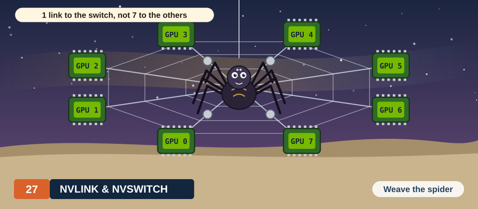
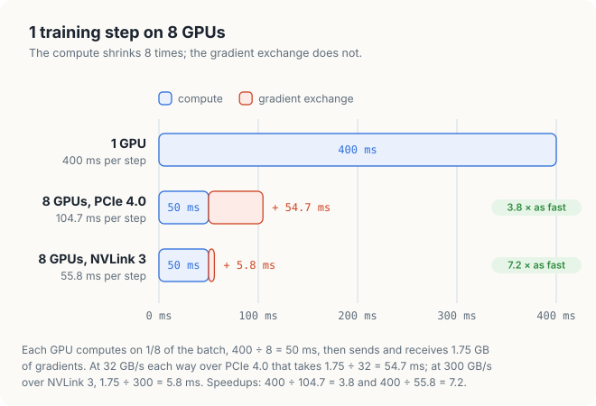
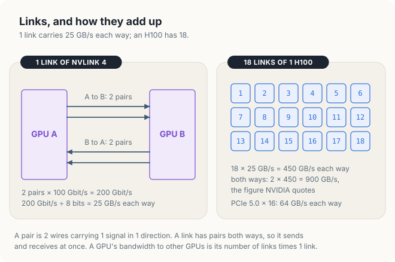
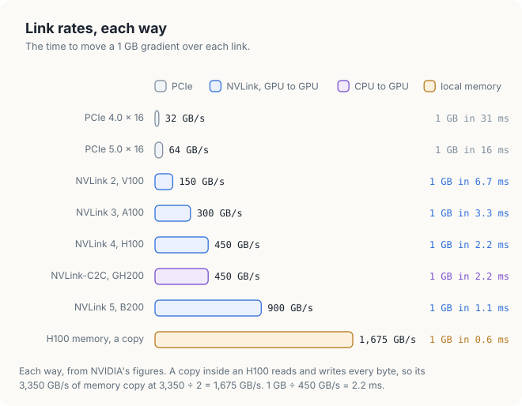
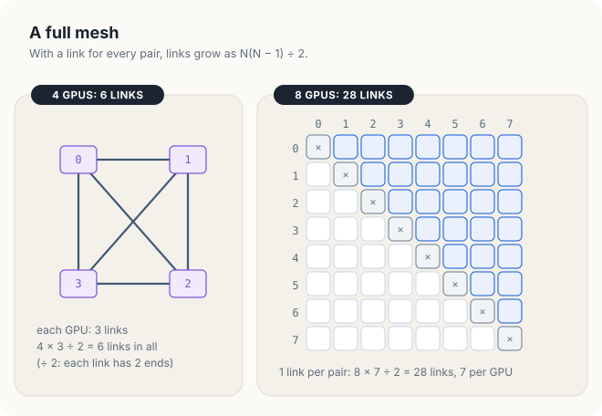
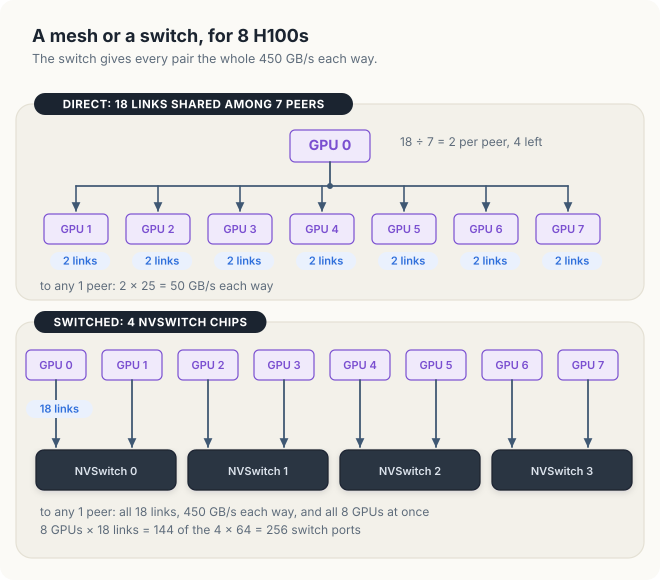
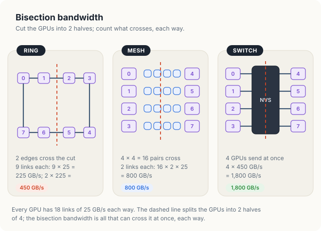
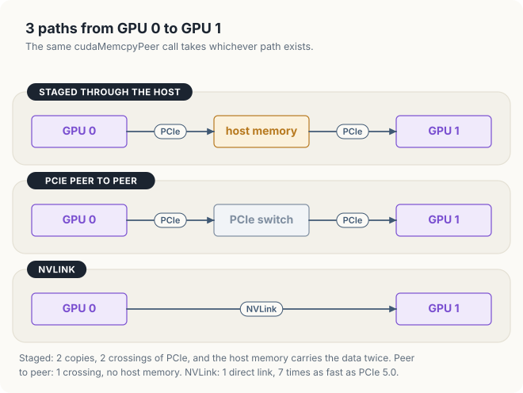
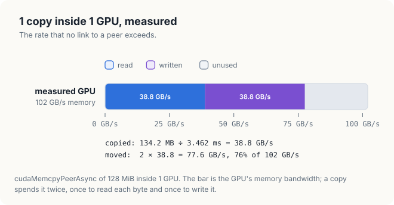
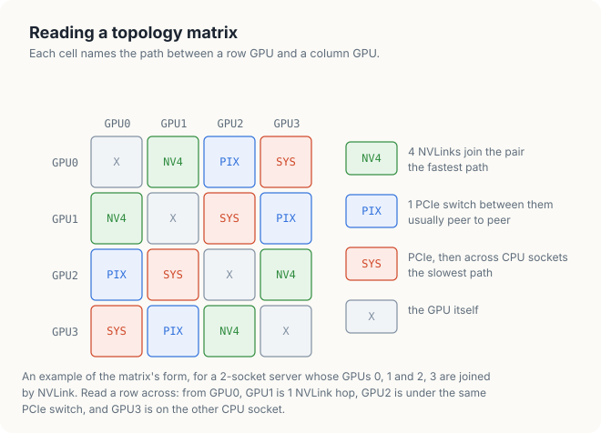

# Chapter 27: NVLink & NVSwitch - The Multi-GPU Interconnect

Every program in the previous chapters ran on a single GPU. Its threads read and wrote the
GPU's own memory, and the only other memory involved was host memory, reached over the link
described in Chapter 4. Many applications need more than a single GPU. A model whose
parameters do not fit in the memory of a GPU must be divided among several GPUs, and a
computation that takes too long on a GPU can be shared among several GPUs to finish sooner.
In both cases, the GPUs must exchange data while they compute, and the time spent on that
exchange determines how much faster the program runs when GPUs are added.

In this chapter, we study the hardware that carries data between GPUs. We start by counting
the bytes that each GPU sends in a step of a data-parallel training program, and the time
those bytes take over PCIe. We then describe **NVLink**, NVIDIA's interconnect between GPUs,
and **NVSwitch**, the switch that connects many GPUs through NVLink, and we compare the ways in
which 4, 8 and 72 GPUs are connected. Finally, we use the CUDA peer-to-peer API, which
allows a GPU to copy to and access the memory of another GPU, and the tools that report how
the GPUs of a machine are connected.

<div class="covers" markdown="1">

This chapter covers

- the reasons for using several GPUs, and the data they exchange in each step
- links, differential pairs, and bandwidth in each direction
- the NVLink generations, compared with PCIe and with the memory of the GPU itself
- full meshes, NVSwitch, and the number of links needed for 4, 8 and 72 GPUs
- bisection bandwidth
- unified virtual addressing, peer copies and direct access to a peer's memory
- the CUDA peer-to-peer API in C++ and in Rust
- a performance model that shows when a faster interconnect helps
- reading the output of `nvidia-smi topo -m`

</div>

The code of the chapter is in
[`code/ch18_peer/`](https://github.com/arpanpathak/gpu-parallel-book/tree/main/code/ch18_peer)
for C++ and in
[`code/oxide/ch18_peer/`](https://github.com/arpanpathak/gpu-parallel-book/tree/main/code/oxide/ch18_peer)
for Rust.

## 27.1 Scaling beyond a single GPU

### 27.1.1 Capacity and time

There are 2 reasons to use more than a single GPU, and they lead to different ways of
dividing a program.

The first reason is capacity. A language model is defined by its **parameters**, the numbers
that are learned during training. A model with 70 × 10<sup>9</sup> parameters, stored as
16-bit numbers of 2 bytes each, needs 70 × 10<sup>9</sup> × 2 = 140 GB for its parameters
alone. An H100 has 80 GB of memory. Regardless of how fast the H100 computes, the model does
not fit on a single H100. It needs at least 140 / 80 = 1.75, that is, 2 GPUs, and in practice
more, because the computation also needs memory for its intermediate values.

The second reason is time. A computation that fits on a single GPU may still take too long
there. Training a model repeats the same step many times, each time on a new **batch**, a
group of training examples. If 8 GPUs each process a share of every batch, the training
finishes sooner.

### 27.1.2 Dividing the work among GPUs

A program can be divided among GPUs in 3 ways, summarised in the following table. The
division determines what data the GPUs must send to each other.

| Division | Each GPU holds | What crosses between GPUs |
|---|---|---|
| **Data parallelism** | a full copy of the model, and its own share of each batch | the results of each step, to be combined into 1 |
| **Model parallelism** | a part of every layer of the model | partial results inside every layer |
| **Pipeline parallelism** | whole layers, a few consecutive ones per GPU | each layer's output, passed to the GPU with the next layer |

Data parallelism is the simplest of the 3, because every GPU runs the unchanged single-GPU
program on its share of the data. Model parallelism and pipeline parallelism address the
capacity problem, since no GPU holds the whole model. Real systems combine them, for example
pipeline parallelism between groups of GPUs and model parallelism within each group. In every
case, the GPUs send data to each other at every step.

### 27.1.3 Communication in data-parallel training

We use data parallelism as our example because its communication is easy to count. A training
step computes a **gradient** for every parameter of the model. The gradient of a parameter is
the direction and amount by which the parameter should change to reduce the model's error on
the batch. There is 1 gradient value per parameter, so the gradients occupy as many bytes as
the parameters.

In data parallelism, each GPU computes gradients from its own share of the batch, so the
gradients differ from GPU to GPU. Before any GPU updates its copy of the model, the gradients
of all GPUs must be added, and every GPU must receive the sum. Otherwise, the copies of the
model would diverge. The operation that adds a value held by every GPU and gives the sum to
every GPU is called an **all-reduce**. We develop the all-reduce algorithms in Chapter 28; here we
only need their cost. With the commonly used ring algorithm, each of \\(N\\) GPUs sends, and
also receives, \\(2(N - 1)/N\\) times the size of the data.

Let us apply this to a concrete case. A model of 500 × 10<sup>6</sup> parameters in 16-bit
numbers has 500 × 10<sup>6</sup> × 2 bytes = 1 GB of gradients. On \\(N\\) = 8 GPUs, each GPU
sends 2 × (8 − 1) / 8 × 1 GB = 1.75 GB per step, and receives as much. PCIe 4.0 with 16 lanes, the
widest PCIe connection of a GPU (lanes are defined in Section 27.2.1), carries 32 GB/s in each
direction (Section 4.1.2), so sending 1.75 GB takes 1.75 / 32 =
0.0547 s, or 54.7 ms. Assume that a single GPU needs 400 ms to compute the step for the whole
batch. Each of the 8 GPUs then needs 400 / 8 = 50 ms to compute its share.

The exchange therefore takes longer than the computation it serves. Figure 27.1 shows the
resulting step. On 8 GPUs connected by PCIe, a step takes 50 + 54.7 = 104.7 ms, so the 8 GPUs
together are only 400 / 104.7 = 3.8 times as fast as a single GPU. With the NVLink of an A100,
which carries 300 GB/s in each direction, the exchange takes 1.75 / 300 = 5.8 ms, and the 8
GPUs are 400 / 55.8 = 7.2 times as fast. In Section 27.6, we generalise this example into a model.

<figure>

<figcaption><b>Figure 27.1</b> A training step on 8 GPUs: the computation is divided by 8, the exchange is not.</figcaption>
</figure>

<div class="callout note" markdown="1">

**NOTE:** Training frameworks start sending the gradients of the last layers while the earlier
layers are still being computed, so part of the exchange overlaps with computation, in the same
way that the copies of Chapter 6 overlapped with kernels. Overlap can hide at most as much
exchange time as there is computation to hide it behind. In this example, at most 50 ms of the
54.7 ms can be hidden, and the step still takes at least 54.7 ms.

</div>

<div class="bee bee-shocked" markdown="1">

Adding GPUs divides the computation of a step, but not the bytes that each GPU must exchange.
The interconnect between the GPUs determines how many GPUs still make the program faster.

</div>

## 27.2 NVLink: a faster link between GPUs

### 27.2.1 Links and differential pairs

Before we describe NVLink, we need 4 terms for the hardware that connects 2 chips. We define them
from the outside in: the system of connections, 1 connection, and the wires inside it.

<div class="definition">

<span class="box-label">Definition 27.1</span> **Interconnect and link.** An **interconnect** is the
hardware that carries data between chips. A **link** is 1 connection of an interconnect between 2
chips. A link carries data in both directions, and its **bandwidth** in each direction is the
maximum number of bytes that it can move per second in that direction.

*Example.* PCI Express (**PCIe**), described in Chapter 4, is the standard interconnect between a
CPU and the devices plugged into it. A GPU in a PCIe slot is joined to the CPU by 1 PCIe link.

</div>

Both PCIe and NVLink transmit data as electrical signals over **differential pairs**. A
differential pair is 2 wires that carry a signal as the difference between their voltages.
Noise from outside affects both wires nearly equally, so the difference is disturbed much less
than the voltage on a single wire would be. A pair carries data in 1 direction, so a link that
carries data both ways needs pairs in both directions.

<div class="definition">

<span class="box-label">Definition 27.2</span> **Lane.** A PCIe **lane** consists of 2 differential
pairs, 1 in each direction. A PCIe link is made of 1 or more lanes side by side, and its bandwidth
is the number of lanes times the bandwidth of 1 lane.

*Example.* A lane of PCIe 4.0 carries 2 GB/s in each direction. A GPU in a slot with 16 lanes
therefore has 16 × 2 = 32 GB/s in each direction, the figure used in Section 27.1.3.

</div>

<div class="definition">

<span class="box-label">Definition 27.3</span> **NVLink.** **NVLink** is NVIDIA's interconnect between
GPUs, and in some systems between a GPU and a CPU. It is organised into links, each a bundle of
pairs in both directions. A GPU has many NVLink links. It can connect each link to a different
GPU, or connect several links to the same GPU.

*Example.* An H100 has 18 NVLink links. In a server of 8 H100s connected directly, a GPU can give
2 links to each of the other 7 GPUs.

</div>

Let us compute the bandwidth of 1 NVLink link from its pairs. A link of NVLink 4, the generation
used by the H100, has 2 pairs in each direction, and each pair signals at 100 Gbit/s. A link
therefore carries 2 × 100 = 200 Gbit/s in each direction, which is 200 / 8 = 25 GB/s. An H100 has
18 links, for a total of 18 × 25 = 450 GB/s in each direction. The NVLink 3 of the A100 reached
the same 25 GB/s per link with 4 pairs in each direction at half the signalling rate. NVLink 4
halved the number of pairs per link and doubled their rate, which leaves room on the chip for
more links. Figure 27.2 shows a link and the 18 links of an H100.

<figure>

<figcaption><b>Figure 27.2</b> A link carries 25 GB/s in each direction; an H100 has 18 links.</figcaption>
</figure>

### 27.2.2 Bandwidth in each direction

Recall from Definition 27.1 that the bandwidth of a link is the maximum amount of data it can carry
per unit of time. A link with pairs in both directions has 2 bandwidths, 1 for each direction, and
both can be used at the same time. NVIDIA quotes NVLink bandwidth as the sum of the 2 directions:
the 900 GB/s quoted for an H100 is 450 GB/s in each direction. PCIe bandwidth is usually quoted per
direction, as in Chapter 4: 32 GB/s for PCIe 4.0 with 16 lanes and 64 GB/s for PCIe 5.0.

A comparison between links must use the same convention for both. A GPU that sends its
gradients to another GPU sends them in 1 direction, so in this chapter we quote every link per
direction. In this unit, NVIDIA's statement that the NVLink of the H100 has 7 times the
bandwidth of PCIe 5.0 is confirmed: 450 / 64 = 7.0. The following table summarises the
quantities for an H100.

| Symbol | Meaning | For an H100 |
|---|---|---|
| \\(L\\) | links per GPU | 18 |
| \\(b\\) | bandwidth of 1 link, each way | 25 GB/s |
| \\(B = L \cdot b\\) | the GPU's NVLink bandwidth, each way | 18 × 25 = 450 GB/s |
| \\(2B\\) | both ways, the figure NVIDIA quotes | 900 GB/s |

### 27.2.3 NVLink generations

Each generation of NVIDIA's data-centre GPUs has introduced a new generation of NVLink. The
following table lists NVIDIA's figures. The column for each direction is half of NVIDIA's
total.

| Link | GPU | Links | Each link, each way | Each way | Both ways (NVIDIA) |
|---|---|---|---|---|---|
| PCIe 4.0 × 16 | A100 PCIe, RTX 4090 | 16 lanes | 2 GB/s per lane | 32 GB/s | 64 GB/s |
| PCIe 5.0 × 16 | H100 PCIe, RTX 5090 | 16 lanes | 4 GB/s per lane | 64 GB/s | 128 GB/s |
| NVLink 2 | V100 | 6 | 25 GB/s | 150 GB/s | 300 GB/s |
| NVLink 3 | A100 | 12 | 25 GB/s | 300 GB/s | 600 GB/s |
| NVLink 4 | H100 | 18 | 25 GB/s | 450 GB/s | 900 GB/s |
| NVLink 5 | B200 | 18 | 50 GB/s | 900 GB/s | 1,800 GB/s |
| NVLink-C2C | GH200, CPU to GPU | 1 chip-to-chip link | | 450 GB/s | 900 GB/s |

From the V100 to the H100, the rate of a single link stayed at 25 GB/s in each direction, and
the bandwidth grew with the number of links: 6, 12 and 18. NVLink 5 instead doubled the rate
of each link. The consumer GPUs in the table, the RTX 4090 and RTX 5090, have no NVLink, so 2
of them exchange data over PCIe. Integrated GPUs, such as the one in the DGX Spark, have no
NVLink either: each is the only GPU in its system, and it shares a single memory with the CPU.

Figure 27.3 converts these rates into the time needed to move the 1 GB of gradients from
Section 27.1.3.

<figure>

<figcaption><b>Figure 27.3</b> The time to move 1 GB over each link, and within the memory of a GPU.</figcaption>
</figure>

### 27.2.4 Peer bandwidth compared with local memory

A GPU's own memory is still faster than any link. The last bar of Figure 27.3 is a copy within
an H100. Its memory delivers 3,350 GB/s, and a copy both reads and writes every byte, so it
moves data at 3,350 / 2 = 1,675 GB/s.

<div class="definition">

<span class="box-label">Definition 27.4</span> **Peer.** A **peer** of a GPU is another GPU in the
same system, and the memory of a peer is called **peer memory**.

*Example.* In a server of 8 GPUs, GPU 0 has 7 peers, GPUs 1 to 7.

</div>

For a program, the important quantity is how many times slower peer memory is to reach than the
GPU's own memory. The following table uses the **SXM** versions of the data-centre GPUs, which
are modules mounted on a server board with NVLink. The same GPUs are also sold as PCIe cards,
with different links and memory.

| GPU | Memory | Link to a peer, each way | Memory ÷ link |
|---|---|---|---|
| V100 SXM | 900 GB/s | NVLink 2, 150 GB/s | 6 |
| A100 SXM 80 GB | 2,039 GB/s | NVLink 3, 300 GB/s | 6.8 |
| H100 SXM | 3,350 GB/s | NVLink 4, 450 GB/s | 7.4 |
| B200 | 8,000 GB/s | NVLink 5, 900 GB/s | 8.9 |
| H100 SXM, over PCIe 5.0 | 3,350 GB/s | 64 GB/s | 52 |

Over NVLink, a peer's memory is 6 to 9 times slower to reach than the GPU's own memory. Over
PCIe it is 52 times slower. This ratio, more than the bandwidth alone, determines which
programs can treat several GPUs as 1 large GPU. For example, a kernel that reads 1 byte in 8
from a peer over NVLink spends about as much time on the link as on its own memory.

## 27.3 NVSwitch and topologies

### 27.3.1 Full-mesh topology

Once a system has more than 2 GPUs, there is more than 1 way to connect them, and the choice
determines how fast each pair of GPUs can exchange data.

<div class="definition">

<span class="box-label">Definition 27.5</span> **Topology.** The **topology** of a multi-GPU system is
the pattern of links that connects its GPUs: which pairs of chips are joined, and by how many
links.

*Example.* 4 GPUs can be connected in a ring, 0–1–2–3–0, with 4 connections, or with a connection
between every pair, with 6 connections. The 2 topologies use the same GPUs but give different
bandwidths between GPUs 0 and 2: the ring has no direct connection between them.

</div>

The simplest topology gives every pair of GPUs its own link, and is called a **full mesh**. Let us
count the links of a full mesh of 4 GPUs by hand. GPU 0 needs a link to each of GPUs 1, 2 and 3, and
so do the other 3 GPUs. The 4 GPUs therefore have 4 × 3 = 12 link ends. Each link has 2 ends, 1 on
each of the GPUs that it joins, so the link from GPU 0 to GPU 1 is counted once at GPU 0 and once at
GPU 1. The mesh therefore has 12 / 2 = 6 links: 0–1, 0–2, 0–3, 1–2, 1–3 and 2–3. With 8 GPUs, each
GPU needs 7 links, and the mesh needs 8 × 7 / 2 = 28. The same count for \\(N\\) GPUs gives the
general rule: a full mesh of \\(N\\) GPUs needs \\(N - 1\\) links per GPU and \\(N(N - 1)/2\\) links
in total.

Figure 27.4 shows both cases. The number of links in a mesh grows with the square of the
number of GPUs, but the number of links on each GPU is fixed when the chip is designed.

<figure>

<figcaption><b>Figure 27.4</b> A full mesh: 6 links for 4 GPUs, 28 links for 8 GPUs.</figcaption>
</figure>

Each GPU must therefore divide its links among its peers. An A100 has 12 links. In a mesh of 4
A100s, each GPU gives 12 / 3 = 4 links to each of its 3 peers, for 4 × 25 = 100 GB/s in each
direction per pair. In a mesh of 8 H100s, each GPU could give 2 links to each of its 7 peers
(18 / 7, rounded down, with 4 links left over), for 2 × 25 = 50 GB/s in each direction to any
single peer. That is a ninth of the GPU's 450 GB/s. The more GPUs a mesh connects, the less
bandwidth is available between any 2 of them.

### 27.3.2 NVSwitch

A mesh runs out of links because every GPU must have a link of its own to every other GPU. A
switch removes this requirement.

<div class="definition">

<span class="box-label">Definition 27.6</span> **Switch and NVSwitch.** A **switch** is a chip with
many **ports**, each of which accepts 1 link, and it forwards data arriving at any port to any
other port. **NVSwitch** is NVIDIA's switch for NVLink. Instead of connecting GPUs to each other,
each GPU connects all of its links to switches, and the switches forward its data to whichever
GPU it addresses.

*Example.* 8 GPUs connected through switches need 8 connections, 1 bundle of links from each GPU
to the switches, where a full mesh of the same 8 GPUs needs 28 links. A ninth GPU adds 1 more
bundle, whereas in the mesh it would add 8 links.

</div>

The difference appears when a GPU communicates with a single peer. In a mesh, only the 2 links
between the pair carry the data. Through switches, all 18 links of the GPU carry it, at the
full 450 GB/s in each direction. A switch that allows every GPU to send at its full rate to any
other GPU at the same time is called **non-blocking**. Figure 27.5 compares the 2 ways of
connecting 8 H100s.

<figure>

<figcaption><b>Figure 27.5</b> 8 H100s: 50 GB/s to a peer in a mesh, 450 GB/s through switches.</figcaption>
</figure>

A switch also changes the path that data takes.

<div class="definition">

<span class="box-label">Definition 27.7</span> **Hop.** A **hop** is 1 crossing of a link, from 1
chip to the next chip on the path of the data. The **latency** of a transfer is the time between
the start of the transfer and the arrival of its first byte, and every hop adds to it.

*Example.* In a full mesh, data from GPU 0 to GPU 3 crosses the link 0–3: 1 hop. Through a switch,
it crosses the link from GPU 0 to the switch and then the link from the switch to GPU 3: 2 hops.

</div>

The switch therefore adds a hop: data travels from the GPU to a switch and then to the peer, and
each hop adds latency. For exchanges larger than a few kilobytes, the gain in bandwidth outweighs
the added latency.

### 27.3.3 NVLink systems

NVIDIA's 8-GPU servers and its rack-scale systems are built from these components.

| System | GPUs | Switches | Each GPU's links | Any pair, each way |
|---|---|---|---|---|
| DGX A100 | 8 A100 | 6 NVSwitch, 2nd generation | 12, 2 to each switch | 300 GB/s |
| DGX H100 | 8 H100 | 4 NVSwitch, 3rd generation, 64 ports each | 18, spread over the 4 | 450 GB/s |
| GB200 NVL72 | 72 B200 in 1 rack | 18 NVSwitch chips | 18 | 900 GB/s |

In the DGX A100, 12 links per GPU over 6 switches give 12 / 6 = 2 links from every GPU to every
switch. In the DGX H100, the 8 GPUs bring 8 × 18 = 144 links to 4 × 64 = 256 switch ports. The
third-generation NVSwitch also has ports for switches outside the server, so that up to 256
GPUs can be connected in a single NVLink network. The NVL72 connects 72 GPUs in a rack, each at
1,800 GB/s in both directions together: 72 × 1.8 TB/s = 129.6 TB/s, the 130 TB/s that NVIDIA
quotes as the total for the rack.

The third-generation NVSwitch can also perform arithmetic. It can add the data that several
GPUs send to it and return the sum, which can halve the number of bytes that some of the
collective operations of Chapter 28 must move.

### 27.3.4 Bisection bandwidth

Topologies differ most when every GPU sends data at the same time, and a single number
characterises this case. Let us derive it on 4 GPUs before we define it. Connect GPUs 0, 1, 2 and
3 in a ring, 0–1–2–3–0, with 1 link of 25 GB/s on each edge, and let GPUs 0 and 1 each send data
to GPUs 2 and 3 at the same time. Every byte must cross from the half {0, 1} to the half {2, 3},
and only 2 links join the halves: 1–2 and 3–0. The 2 halves can therefore exchange at most
2 × 25 = 50 GB/s in each direction, however fast each GPU is.

The answer depends on where we cut. The division into {0, 2} and {1, 3} is crossed by all 4 links
of the ring, 100 GB/s. A program cannot choose which halves need to talk to each other, so the
number that describes the topology is the worst case, the division crossed by the fewest links:
50 GB/s for this ring. In a full mesh of the same 4 GPUs, with 1 link per pair, every division
into 2 halves of 2 GPUs is crossed by 2 × 2 = 4 links, 100 GB/s.

<div class="definition">

<span class="box-label">Definition 27.8</span> **Bisection bandwidth.** Divide the GPUs into 2 halves
of equal size, choosing the division that leaves the fewest links crossing between the halves.
The **bisection bandwidth** is the total bandwidth, in each direction, of the links that cross. It
is the maximum amount of data that one half can send to the other half per unit of time, for the
worst division.

*Example.* 4 GPUs in a ring with 1 link of 25 GB/s per edge have a bisection bandwidth of
2 × 25 = 50 GB/s; in a full mesh with 1 link per pair, 4 × 25 = 100 GB/s.

</div>

Figure 27.6 computes the bisection bandwidth of 8 GPUs, each with 18 links of 25 GB/s,
connected in 3 ways.

<div class="example" markdown="1">

Worked example: the bisection bandwidth of 8 GPUs

1. **Ring.** Each GPU connects to its 2 neighbours with 9 links each: 9 × 25 = 225 GB/s per
   edge. A cut through the ring crosses 2 edges: 2 × 225 = 450 GB/s.
2. **Mesh.** 4 GPUs on each side make 4 × 4 = 16 pairs that cross the cut, each with 2 links:
   16 × 2 × 25 = 800 GB/s.
3. **Switch.** Each of the 4 GPUs on one side sends at its full 450 GB/s through the switches:
   4 × 450 = 1,800 GB/s.

</div>

<figure>

<figcaption><b>Figure 27.6</b> The same 18 links per GPU give a bisection bandwidth of 450, 800 or 1,800 GB/s.</figcaption>
</figure>

The links are the same in all 3 cases; only their arrangement differs. Some model-parallel
programs make every GPU send to every other GPU at once, in every layer. Such exchanges run at
the bisection bandwidth, and a switch gives them 4 times the bandwidth of a ring.

| Symbol | Meaning | For 8 H100s through switches |
|---|---|---|
| \\(N\\) | GPUs | 8 |
| \\(B\\) | 1 GPU's bandwidth, each way | 450 GB/s |
| \\(\frac{N}{2} B\\) | bisection bandwidth of a non-blocking switch | 4 × 450 = 1,800 GB/s |

<div class="bee bee-happy" markdown="1">

A mesh divides each GPU's links among its peers, while a switch gives every pair all of them.
The links that cross the middle of a system determine its performance when every GPU
communicates at once.

</div>

## 27.4 Memory access across NVLink

A fast link would be useful even if it only carried copies. Together with CUDA, however,
NVLink also allows a GPU to use the memory of another GPU almost as if it were its own. We now
describe the 4 mechanisms that make this possible.

### 27.4.1 Unified virtual addressing

A pointer is a number, an address. Before a GPU can use a pointer into the memory of a peer, the
program must be able to tell from that number which memory it refers to. If GPU 0 and GPU 1 each
numbered their memory from the same starting address, the same pointer value could mean a byte on
GPU 0 or a byte on GPU 1, and a copy function would need to be told which.

<div class="definition">

<span class="box-label">Definition 27.9</span> **Unified virtual addressing.** On a 64-bit system,
CUDA places the host and all GPUs in a single range of virtual addresses. This arrangement is
called **unified virtual addressing** (**UVA**). No 2 allocations, on any GPU or on the host,
receive the same address, so the value of a pointer alone determines which memory it points to.

*Example.* A program allocates `a` on GPU 0 and `b` on GPU 1. Under UVA, the addresses of `a` and
of `b` lie in different parts of 1 address range, so the runtime can tell from the value of `b`
alone that it points into the memory of GPU 1.

</div>

 The program of Section 27.5 uses `cudaPointerGetAttributes` to ask the
runtime where a buffer resides. It copies with `cudaMemcpyDefault`, which tells the runtime to
infer the direction of the copy from the 2 pointers.

UVA is related to the unified memory of Section 4.5, but it provides only part of it: the
addresses are shared, while the data stays in the memory where it was allocated.

### 27.4.2 Peer copies and direct peer access

Data can reach a peer's memory in 2 ways, and the program of Section 27.5 measures both.

1. **A copy.** `cudaMemcpyPeerAsync` asks the copy engines of the GPU, the units that move data
   without using any streaming multiprocessor (SM) (Section 4.2.2), to move a block of bytes from 1 GPU to another.
2. **Direct access.** A kernel running on GPU 0 dereferences a pointer into the memory of GPU 1,
   and each load or store travels over the link. No copy is made, and the kernel reads only
   the bytes it needs, wherever they are in the peer's memory.

<div class="definition">

<span class="box-label">Definition 27.10</span> **Peer access.** **Peer access** from GPU i to GPU j
is the permission for kernels running on GPU i to load from and store to the memory of GPU j
through pointers, and for copies from GPU i to GPU j to go directly to that memory. It is granted
in 1 direction at a time.

*Example.* After GPU 0 enables peer access to GPU 1, a kernel on GPU 0 can read `b[5]` in the
memory of GPU 1. A kernel on GPU 1 still cannot read the memory of GPU 0 until GPU 1 enables peer
access to GPU 0.

</div>

Direct access must be enabled, once, with `cudaDeviceEnablePeerAccess`. Copies work without
it, but the runtime then **stages** them through host memory: it copies from GPU 0 to the host
and then from the host to GPU 1, crossing PCIe twice where once would suffice. Figure 27.7
shows the 3 paths that a copy can take.

<figure>

<figcaption><b>Figure 27.7</b> The 3 paths from GPU 0 to GPU 1, slowest first.</figcaption>
</figure>

A **peer-to-peer** (**P2P**) transfer is any transfer from 1 GPU to another that does not pass
through host memory. In Figure 27.7, the second and third paths are peer-to-peer, and the first is
not. Over PCIe, the platform determines whether P2P is possible. It works most
reliably when the 2 GPUs are behind the same PCIe switch, and many desktop systems do not allow
it at all. Over NVLink it is always possible. `cudaDeviceCanAccessPeer` reports, for a pair of
GPUs, whether it is.

### 27.4.3 Atomic operations on peer memory

The atomic operations of Chapter 5 can target a peer's memory, so threads on 2 GPUs can add to
the same counter. NVLink carries atomic operations as such, and the peer's memory performs
them. Whether a given pair of GPUs supports this natively is reported by
`cudaDeviceGetP2PAttribute` with the attribute `cudaDevP2PAttrNativeAtomicSupported`. Each such
atomic operation crosses the link and waits for its result. Peer atomics are therefore suited
to infrequent events, such as a flag or a work counter, and not to an update per element.

### 27.4.4 NVLink-C2C and coherence

The Grace Hopper superchip, GH200, connects a Grace CPU and an H100 GPU with **NVLink-C2C**, a
chip-to-chip link of 450 GB/s in each direction. The link is **coherent**: when the CPU writes
a value that the GPU holds in a cache, the hardware updates or invalidates the GPU's copy, and
vice versa, so neither processor reads a stale value. CPU threads and GPU threads can therefore
work on the same data at the same time, without copies and without the page migrations of
unified memory. Integrated GPUs, such as the one in the DGX Spark, go further: they share a
single memory with their CPU, so there is no second memory to copy to.

## 27.5 Peer-to-peer in CUDA

### 27.5.1 Structure of the program

The program of this section asks the system 3 questions and measures the answer to the last:

1. How many GPUs are there, and what are they?
2. Which GPUs can access the memory of which other GPUs?
3. How fast do bytes move from GPU 0 to GPU 1, by a copy and by a kernel?

On a machine with 2 GPUs that can access each other, the copies go from GPU 0 to GPU 1. On a
machine with a single GPU, they stay within GPU 0, and the program measures the GPU's own
memory, the baseline against which we compared every link in Section 27.2.4. The following
pseudocode summarises the program.

```text
count ← number of GPUs
print each GPU's name and SMs
for each pair (i, j), i ≠ j:
    print whether GPU i can access GPU j
if count > 1 and GPU 0 can access GPU 1:
    src ← 0, dst ← 1, enable peer access from GPU 0 to GPU 1
else:
    src ← 0, dst ← 0
a ← 128 MiB on GPU src, filled with known values
b ← 128 MiB on GPU dst
for each way in (cudaMemcpyPeerAsync, copy kernel on GPU src):
    b ← 0
    time 50 transfers of a into b, after 0.4 s of warm-up
    check b against the known values
```

The measurements in this chapter come from 2 integrated GPUs: a Jetson Orin NX (8 SMs,
102 GB/s) and a Jetson AGX Thor (20 SMs, 32 MiB of L2 cache). The buffers are 128 MiB, 4 times
the larger of the 2 L2 caches, so the copies measure memory rather than the cache (Chapter 7).

### 27.5.2 Querying peer access

`cudaGetDeviceCount` returns the number of GPUs, which are numbered from 0.
`cudaDeviceCanAccessPeer` sets its first argument to 1 if the GPU given by its second argument
can access the memory of the GPU given by its third argument. Note that the query has a
direction: whether GPU 0 can access GPU 1 and whether GPU 1 can access GPU 0 are queried, and
enabled, separately. Listing 27.1 prints the resulting matrix.

<p class="listing"><b>Listing 27.1</b> The number of GPUs and the peer matrix. <a href="https://github.com/arpanpathak/gpu-parallel-book/blob/main/code/oxide/ch18_peer/src/main.rs">Rust</a> <a href="https://github.com/arpanpathak/gpu-parallel-book/blob/main/code/ch18_peer/peer.cu">C++</a></p>

<div class="code-tabs">
<div class="code-tab" data-lang="Rust">

```rust,ignore
{{#include ../../../../code/oxide/ch18_peer/src/main.rs:37:69}}
```

</div>
<div class="code-tab" data-lang="C++">

```cpp
{{#include ../../../../code/ch18_peer/peer.cu:31:52}}
```

</div>
</div>

cuda-core, the host library of cuda-oxide, provides the same query as
`peer::can_access_peer(from, to)` between 2 `CudaContext`s. At revision `b7fe543` it has no
function that returns the number of GPUs, so the Rust program calls the driver function
`cuDeviceGetCount` through `cuda_core::sys`, the raw driver bindings, in a single `unsafe`
line. The driver must already be initialised when the call is made, which
`CudaContext::new(0)` ensures.

### 27.5.3 Enabling peer access and allocating the buffers

`cudaDeviceEnablePeerAccess(peer, 0)` allows the current GPU, selected with `cudaSetDevice`, to
access the memory of the GPU `peer`. The second argument is reserved for flags and must be 0.
The call maps the peer's memory into the page tables of the current GPU. This mapping takes
time, so the call is made once and not inside a loop.

<p class="listing"><b>Listing 27.2</b> Choosing the 2 GPUs and enabling access.</p>

<div class="code-tabs">
<div class="code-tab" data-lang="Rust">

```rust,ignore
fn main() -> Result<(), Error> {
    // ...
{{#include ../../../../code/oxide/ch18_peer/src/main.rs:115:123}}
    // ...
}
```

</div>
<div class="code-tab" data-lang="C++">

```cpp
int main()
{
    // ...
{{#include ../../../../code/ch18_peer/peer.cu:124:136}}
    // ...
}
```

</div>
</div>

`peer::enable_peer_access(from, to)` corresponds to `cudaDeviceEnablePeerAccess`; it also
returns `Ok` when access is already enabled.

Each buffer is allocated on its own GPU. Since `cudaMalloc` allocates on the current GPU, the
program selects GPU `src` before allocating `a` and GPU `dst` before allocating `b`.
`cudaPointerGetAttributes` then determines, from the pointer `b` alone, which GPU holds the
buffer.

<p class="listing"><b>Listing 27.3</b> A buffer on each GPU, and, in C++, the location of <code>b</code> reported through UVA.</p>

<div class="code-tabs">
<div class="code-tab" data-lang="Rust">

```rust,ignore
fn main() -> Result<(), Error> {
    // ...
{{#include ../../../../code/oxide/ch18_peer/src/main.rs:125:130}}
    // ...
}
```

</div>
<div class="code-tab" data-lang="C++">

```cpp
int main()
{
    // ...
{{#include ../../../../code/ch18_peer/peer.cu:143:154}}
    // ...
}
```

</div>
</div>

In Rust, each GPU has its own `CudaContext` and its own stream, and a `DeviceBuffer` is
allocated on the GPU whose stream creates it.

### 27.5.4 Peer copies and copy kernels

The first method is a copy. `cudaMemcpyPeerAsync(dst pointer, dst GPU, src pointer, src GPU,
bytes, stream)` names both GPUs, and when peer access is enabled the copy goes directly across
the link. With a single GPU, the source and destination are both GPU 0, and the call performs
an ordinary copy within its memory. The second method is a kernel running on GPU `src` in which
each thread copies 1 float from `a` to `b`. On 2 GPUs, the stores of this kernel are written to
the peer's memory.

<p class="listing"><b>Listing 27.4</b> The copy kernel.</p>

<div class="code-tabs">
<div class="code-tab" data-lang="Rust">

```rust,ignore
{{#include ../../../../code/oxide/ch18_peer/src/main.rs:22:35}}
```

</div>
<div class="code-tab" data-lang="C++">

```cpp
{{#include ../../../../code/ch18_peer/peer.cu:25:29}}
```

</div>
</div>

<p class="listing"><b>Listing 27.5</b> A copy and a kernel, each timed and checked.</p>

<div class="code-tabs">
<div class="code-tab" data-lang="Rust">

```rust,ignore
fn main() -> Result<(), Error> {
    // ...
{{#include ../../../../code/oxide/ch18_peer/src/main.rs:139:148}}
    // ...
}
```

</div>
<div class="code-tab" data-lang="C++">

```cpp
int main()
{
    // ...
{{#include ../../../../code/ch18_peer/peer.cu:163:181}}
    // ...
}
```

</div>
</div>

The function `averageMs` first runs its argument for 0.4 s so that the GPU's clock can rise,
as measured in Chapter 6, and then times 50 runs with events. The function `matches` copies `b`
back to the host and compares all 33,554,432 floats with the values written into `a`. The
function `clear` sets `b` to 0 before each method, so that a method that copies nothing cannot
pass by finding the result of the previous method.

In Rust, `DeviceBuffer::copy_from_device_async` performs the copy. It calls the driver's
device-to-device copy, which, with UVA, also works between GPUs. The kernel uses the 1-D launch
contract of Chapter 13: `src` is a plain slice, and `DisjointSlice` allows each thread to write
its own element of `dst` without `unsafe` code.

### 27.5.5 Results

```console
$ nvcc -arch=native peer.cu -o peer && ./peer
GPUs: 1
  GPU0  Orin, 8 SMs, unified addressing yes
peer access (row can reach column):
        GPU0
  GPU0     X
no peer to reach: copying within GPU0
buffer b lives on GPU0
128 MiB from GPU0 to GPU0, average of 50 copies
  cudaMemcpyPeerAsync          3.462 ms    38.8 GB/s  PASSED
  copy kernel on GPU0          3.677 ms    36.5 GB/s  PASSED
```

The first lines of the output are as expected. There is 1 GPU, so the matrix contains only its
diagonal, `X`, and the program copies within GPU 0. UVA is enabled, and
`cudaPointerGetAttributes` reports that `b` resides on GPU 0. On the second GPU, the program
prints the same first lines:

```console
$ ./peer
GPUs: 1
  GPU0  NVIDIA Thor, 20 SMs, unified addressing yes
peer access (row can reach column):
        GPU0
  GPU0     X
no peer to reach: copying within GPU0
buffer b lives on GPU0
```

Both copies pass on this GPU as well, in C++ and in Rust.

To interpret the rates, we use the reasoning of Section 27.2.4. A copy of 128 MiB, which is
134.2 MB, in 3.462 ms corresponds to 134.2 / 3.462 = 38.8 GB/s copied. Every copied byte is
read once and written once, so the memory moved 2 × 38.8 = 77.6 GB/s, which is 76% of the
GPU's 102 GB/s. A copy cannot use all of the memory bandwidth, because the memory loses time
each time it switches between reading and writing. The copy kernel ran within 6% of the copy
call; in both cases the memory, not the SMs, limited the rate. Across 6 runs, the copy measured
between 38.8 and 42.3 GB/s, a spread of 9%.

<figure>

<figcaption><b>Figure 27.8</b> A copy within a GPU uses its memory bandwidth twice, once to read and once to write.</figcaption>
</figure>

The Rust program prints the same lines except the UVA details, because cuda-core does not
provide the pointer query at this revision.

```console
$ cargo oxide run
GPUs: 1
  GPU0  Orin, 8 SMs
peer access (row can reach column):
        GPU0
  GPU0     X
no peer to reach: copying within GPU0
128 MiB from GPU0 to GPU0, average of 50 copies
  copy_from_device_async       3.528 ms    38.0 GB/s  PASSED
  copy kernel on GPU0          3.769 ms    35.6 GB/s  PASSED
```

`copy_from_device_async` calls the same driver copy as the C++ program, and it ran within 2% of
it, which is within the spread between runs.

### 27.5.6 Output on a multi-GPU system

On a server with 8 GPUs connected through NVSwitch, the matrix contains `yes` in every cell off
the diagonal, because every GPU can reach every other GPU through the switches. On a desktop
with 2 consumer GPUs on PCIe, it may contain `no`. In that case, the copy still works, but it is
staged through host memory. When GPU 0 can access GPU 1, the program prints `buffer b lives on
GPU1`, and the 2 rates are those of the link rather than of memory; between 2 H100s they can
approach 450 GB/s in each direction. The rate of a copy within a single GPU is an upper bound
that no link to a peer exceeds.

<div class="callout tip" markdown="1">

**TIP:** Run `peer` on a multi-GPU machine, such as a cloud instance with 2 or 8 GPUs, and
compare its rates with the table of Section 27.2.3. A rate far below the table usually means
that the copies are being staged through the host; check the matrix for `no`.

</div>

## 27.6 When a faster interconnect helps

### 27.6.1 A model of a training step

In Section 27.1.3, we computed the time of a step by hand. Writing the same arithmetic with symbols
tells us when a faster link improves performance. Let a step take \\(T_1\\) on a single GPU. On
\\(N\\) GPUs, each GPU computes for \\(T_1 / N\\) and then exchanges data for \\(T_x\\), a time
that does not decrease with \\(N\\):

\\[ T_N = \frac{T_1}{N} + T_x, \qquad S = \frac{T_1}{T_N} \\]

| Symbol | Meaning | 8 A100s on PCIe 4.0 | 8 A100s on NVLink 3 |
|---|---|---|---|
| \\(T_1\\) | 1 step on 1 GPU | 400 ms | 400 ms |
| \\(N\\) | GPUs | 8 | 8 |
| \\(T_x\\) | exchange per step: bytes ÷ link, each way | 1.75 GB ÷ 32 GB/s = 54.7 ms | 1.75 GB ÷ 300 GB/s = 5.8 ms |
| \\(T_N\\) | 1 step on \\(N\\) GPUs | 50 + 54.7 = 104.7 ms | 50 + 5.8 = 55.8 ms |
| \\(S\\) | speedup | 400 ÷ 104.7 = 3.8 | 400 ÷ 55.8 = 7.2 |

The model is Amdahl's law from Section 1.3, with \\(T_x\\) as the part that does not divide
among processors, and its conclusion is the same: when \\(T_x\\) is comparable to \\(T_1/N\\),
adding GPUs brings little benefit. The link determines \\(T_x\\), and therefore the number of
GPUs that still improve performance.

For example, suppose we require the exchange to take at most a quarter of each GPU's
computation time, \\(T_x \le T_1 / (4N)\\), which here is 400 / 32 = 12.5 ms. Over PCIe 4.0,
\\(T_x\\) = 54.7 ms, 4.4 times too long. Over NVLink 3, \\(T_x\\) = 5.8 ms, within the limit.
The model also shows how the balance changes with the workload. Doubling the size of the model
doubles both \\(T_1\\) and the number of bytes exchanged, so their ratio does not change.
Halving the batch halves \\(T_1\\) but not the bytes, so the exchange becomes relatively more
important.

### 27.6.2 Workloads and interconnect requirements

The model classifies programs by the ratio of their exchange time to their computation time.

| Workload | Exchange per step | Link |
|---|---|---|
| data-parallel training of a large model | all gradients, every step | NVLink pays off |
| model parallelism inside every layer | partial results, every layer | NVLink needed |
| graph analytics, databases spread over GPUs | small, scattered reads of peers' memory | NVLink pays off |
| many independent jobs, 1 per GPU | none | PCIe is enough |
| loading a dataset once, then computing for hours | once | PCIe is enough |
| inference of a model that fits on 1 GPU | none between GPUs | PCIe is enough |

The entries of the table follow from the arithmetic of the model rather than from fixed rules.
To decide for a given program, measure the 2 terms: \\(T_1\\) with the events of Chapter 6, and
\\(T_x\\) with the program of Section 27.5 or with nccl-tests, which we introduce in Chapter 28.

## 27.7 Topology discovery

### 27.7.1 `nvidia-smi topo -m`

A program cannot choose good pairs of GPUs without knowing how they are connected. The command
`nvidia-smi topo -m` prints the topology as a matrix with 1 row and 1 column per GPU, and each
cell contains a code for the path between the 2 GPUs. On the second GPU of Section 27.5.5, it
prints the following:

```console
$ nvidia-smi topo -m
        GPU0    CPU Affinity    NUMA Affinity   GPU NUMA ID
GPU0     X      0-13            0               N/A

Legend:

  X    = Self
  SYS  = Connection traversing PCIe as well as the SMP interconnect between NUMA nodes (e.g., QPI/UPI)
  NODE = Connection traversing PCIe as well as the interconnect between PCIe Host Bridges within a NUMA node
  PHB  = Connection traversing PCIe as well as a PCIe Host Bridge (typically the CPU)
  PXB  = Connection traversing multiple PCIe bridges (without traversing the PCIe Host Bridge)
  PIX  = Connection traversing at most a single PCIe bridge
  NV#  = Connection traversing a bonded set of # NVLinks
```

The matrix has a single cell, `X`, which is the GPU itself. The other columns identify the CPU
cores closest to the GPU, here cores 0 to 13. A **NUMA node** is a group of CPU cores together
with the memory attached to them; the GPU belongs to node 0, the only node of this system. On
some integrated GPUs, `nvidia-smi` does not implement the matrix and prints `Failed to run
topology matrix`.

### 27.7.2 Connection codes

The legend lists the paths from the fastest, at the bottom, to the slowest, at the top. A
**PCIe bridge** is a PCIe switch. A **host bridge** is the point where PCIe enters the CPU. An
**SMP interconnect** connects the CPU sockets of a server with more than one CPU.

| Code | Path between the 2 GPUs | Peer to peer |
|---|---|---|
| `NV#` | # NVLinks, bonded into 1 connection | yes, over NVLink |
| `PIX` | at most 1 PCIe switch | usually possible |
| `PXB` | several PCIe switches, not through the CPU | often possible |
| `PHB` | through the CPU's host bridge | depends on the platform |
| `NODE` | between host bridges of 1 CPU | rarely |
| `SYS` | across CPU sockets | no; staged through the host |

Figure 27.9 shows a matrix of this form for an example server with 4 GPUs on 2 CPU sockets, in
which GPUs 0 and 1, and GPUs 2 and 3, are connected by 4 NVLinks. The figure illustrates the
format; it is not output from a real machine.

<figure>

<figcaption><b>Figure 27.9</b> Reading a row of the matrix: the path from a GPU to each of the others.</figcaption>
</figure>

On such a server, a program that uses 2 GPUs should choose GPUs 0 and 1, or GPUs 2 and 3.
Choosing GPUs 0 and 3 would send every byte across the CPU sockets.

### 27.7.3 NVLink status and NVML

`nvidia-smi nvlink -s` lists the NVLinks of each GPU, with the rate of each link and whether it
is active. On a GPU that is the only GPU in its system, it prints `Device does not have or
support Nvlink`. A program that must adapt to the machine can read the same information from
**NVML**, the library on which `nvidia-smi` is built. `nvmlDeviceGetTopologyCommonAncestor`
returns the nearest common point on the paths of 2 GPUs, which corresponds to the codes of the
table above, and `nvmlDeviceGetNvLinkState` reports the state of each link.

## 27.8 The complete programs

<p class="listing"><b>Listing 27.6</b> The complete programs. <a href="https://github.com/arpanpathak/gpu-parallel-book/blob/main/code/oxide/ch18_peer/src/main.rs">code/oxide/ch18_peer/src/main.rs</a> <a href="https://github.com/arpanpathak/gpu-parallel-book/blob/main/code/ch18_peer/peer.cu">code/ch18_peer/peer.cu</a></p>

<div class="code-tabs">
<div class="code-tab" data-lang="Rust">

```rust,ignore
{{#include ../../../../code/oxide/ch18_peer/src/main.rs}}
```

</div>
<div class="code-tab" data-lang="C++">

```cpp
{{#include ../../../../code/ch18_peer/peer.cu}}
```

</div>
</div>

## Common mistakes

- **Comparing bandwidth in both directions with bandwidth in each direction.** NVIDIA's
  900 GB/s for an H100 is 450 GB/s in each direction, and the 64 GB/s of PCIe 5.0 is per
  direction. The ratio is 7, not 14.
- **Assuming that every pair of GPUs supports peer-to-peer transfers.** Check
  `cudaDeviceCanAccessPeer`. Many desktop platforms answer `no` over PCIe, and a copy between
  such GPUs is staged through the host at a fraction of the expected rate.
- **Enabling access in 1 direction and using the other.** Access from GPU 0 to GPU 1 does not
  give GPU 1 access to GPU 0. Enable each direction that a kernel uses.
- **Ignoring the topology.** 2 GPUs on different CPU sockets (`SYS`) are much farther apart
  than 2 GPUs connected by NVLink. Read `nvidia-smi topo -m` and choose the pairs accordingly.
- **Using peer atomics on a frequently executed path.** Each one crosses the link and waits
  for its result; use them for infrequent events.
- **Measuring a link with data that fits in a cache.** Use buffers several times the size of
  the L2 cache.

<div class="summary" markdown="1">

## Summary

- Programs use several GPUs for capacity, when the data does not fit on a GPU, and for time.
  Data, model and pipeline parallelism divide the work differently, and all of them exchange
  data at every step.
- Data parallelism all-reduces the gradients: each of \\(N\\) GPUs sends \\(2(N - 1)/N\\) times
  their size. For 1 GB on 8 GPUs, that is 1.75 GB: 54.7 ms over PCIe 4.0 and 5.8 ms over
  NVLink 3.
- An NVLink link carries 25 GB/s in each direction (50 GB/s in NVLink 5), and a GPU's NVLink
  bandwidth is its number of links times the bandwidth of a link: 150, 300, 450 and 900 GB/s in
  each direction from the V100 to the B200. NVIDIA quotes twice these figures, for both
  directions together.
- Over NVLink, a peer's memory is 6 to 9 times slower to reach than a GPU's own memory; over
  PCIe, about 52 times slower.
- A full mesh needs \\(N(N - 1)/2\\) links and divides each GPU's links among its peers;
  NVSwitch gives every pair all of them. For 8 GPUs with 18 links each, the bisection bandwidth
  is 450 GB/s in a ring, 800 GB/s in a mesh and 1,800 GB/s through switches.
- UVA gives all GPUs a single address space. `cudaDeviceEnablePeerAccess` allows a kernel to
  use a pointer into a peer's memory, and `cudaMemcpyPeerAsync` copies directly when peer
  access is enabled.
- Within a GPU, a copy of 128 MiB ran at 38.8 GB/s, using 76% of the memory bandwidth for its
  reads and writes. This rate is the upper bound against which any link is measured.
- A faster link pays off when the exchange time is comparable to each GPU's share of the
  computation, \\(T_x \approx T_1/N\\).

</div>

In Chapter 28, we develop the all-reduce algorithms whose cost we used in this chapter, and NCCL,
the library that runs them over the links that the topology provides.

## Exercises

1. A model has 7 × 10<sup>9</sup> parameters in 16-bit numbers. How large are its gradients?
   How many bytes does each of 8 GPUs send per step in a ring all-reduce, and how long does
   that take over PCIe 5.0 and over NVLink 4?
2. NVIDIA quotes the B200's NVLink as 1,800 GB/s with 18 links. Compute the bandwidth of 1
   link in each direction, and the time to move 1 GB to a peer.
3. How many links does a full mesh of 16 GPUs need? With 18 links per GPU, how many links does
   each pair get, and what bandwidth in each direction at 25 GB/s per link?
4. Compute the bisection bandwidth in each direction of 16 GPUs with 18 links each, connected
   (a) in a ring with 9 links to each neighbour, and (b) through a non-blocking switch.
5. In the model of Section 27.6, find the smallest \\(T_1\\) for which 8 A100s on NVLink 3
   reach a speedup of 6 with gradients of 1 GB.
6. Run `peer` on your GPU. Compute the memory traffic of the copy, 2 times the rate, as a share
   of your GPU's memory bandwidth. Then change `N` to 1 MiB of floats and explain the new rate.
7. On a machine with 2 GPUs, run `peer` with and without the call to
   `cudaDeviceEnablePeerAccess`. What changes in the rates, and why?
8. Read the `nvidia-smi topo -m` matrix of a cloud machine with 8 GPUs, from its provider's
   documentation or by running it. Which pairs would you choose for a 2-GPU job?

## Sources and further reading

- NVIDIA, *NVLink and NVLink Switch*, the generations and their bandwidths:
  <https://www.nvidia.com/en-us/data-center/nvlink/>
- NVIDIA, "NVIDIA Hopper Architecture In-Depth", 2022, for NVLink 4, the third-generation
  NVSwitch and the comparison with NVLink 3:
  <https://developer.nvidia.com/blog/nvidia-hopper-architecture-in-depth/>
- NVIDIA, *NVIDIA A100 Tensor Core GPU Architecture* whitepaper, 2020, for NVLink 3 and
  the DGX A100.
- NVIDIA, *NVIDIA Grace Hopper Superchip Architecture* whitepaper, for NVLink-C2C.
- NVIDIA, *DGX H100 User Guide*: <https://docs.nvidia.com/dgx/dgxh100-user-guide/>
- NVIDIA, *CUDA C++ Programming Guide*, "Multi-Device System", "Peer-to-Peer Memory Access",
  "Peer-to-Peer Memory Copy" and "Unified Virtual Address Space":
  <https://docs.nvidia.com/cuda/cuda-c-programming-guide/>
- NVIDIA, *NVML API Reference*, topology and NVLink queries:
  <https://docs.nvidia.com/deploy/nvml-api/>
